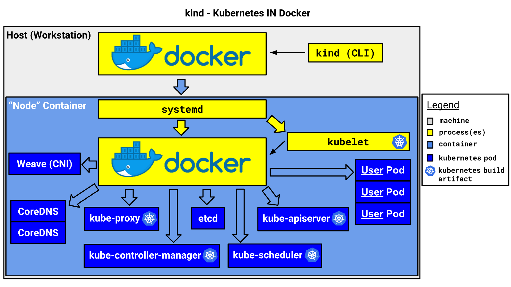

# 13-如何配置和创建一个Kind集群？

你好，我是孔令飞。

因为在学习本课程的过程中，需要频繁地创建、删除用于开发、测试的 Kind 集群。所以，本节课，我们详细介绍下 Kind，带你熟练掌握 Kind 工具，方便以后的学习。

注意，本节课介绍的 Kind 命令版本为 v0.19.0。其他版本的命令可能会有变更，例如v0.20.0、v0.21.0，在使用时需要你根据版本自行适配。另外，在正式开始之前需要你在宿主机上安装好 Docker。

## Kind 介绍

我们先来回忆一下 Kind 的概念，它是一个 Kubernetes SIG 项目，用来快速在本地创建一个开发、测试用的 Kubernetes 集群。Kind 使用 Docker/Podman 驱动，Kubernetes 组件都部署在用 kindest/node 镜像启动的 Docker 容器中。

Kind 的核心特性如下：

- 支持多个 Kubernetes 节点（支持集群 HA，其实就是创建多个 control-plane 类型的 Node节点）。

- 创建的 Kubernetes 集群经过 Kubernetes 一致性认证。

- 支持 Linux、macOS 和 Windows。

- 因为 Kind 足够轻量，所以 Kind 也大量使用于 CI 流程中的集群创建。

Kind 架构如下：



- 图片来源于网络

结合上图我们一起来说说 Kind 的工作流程。首先，在宿主机上，要安装一个 Kind 命令行工具，用来完成所有的集群管理，例如创建、查询、删除、加载镜像、导出 kubeconfig 文件等。

```
执行 kind create cluster -n test-k8s 命令后，Kind 工具会下载 kindest/node 镜
```

像，并使用该镜像启动一个或多个 Docker 容器（可以通过配置文件来配置启动几个 Docker容器），这些容器就作为 Kubernetes 集群的 Node 节点，也即上图中的 “Node” Container。

在节点容器中，会根据节点的类型启动对应的 Kubernetes 组件。Kind 集群有两类节点：

- control-plane 节点：作为 Kubernetes 的 master 节点，部署 master 组件，例如：kube-apiserver、kube-controller-manager、kube-scheduler、etcd、coredns、kubelet、kube-proxy 组件。

- worker 节点：作为 Kubernetes 工作节点，用来运行 Kubernetes Pod。worker 节点会部署kubelet、kube-proxy。当然，如果我们在测试集群中创建 Deployment、StatefulSet 等Workload 类型的资源，还会在 worker 节点中创建 Kubernetes Pod。

在使用 kindest/node 创建 Kubernetes 节点容器时，kindest/node 镜像启动时，会启动systemd 服务作为 Linux 1 号进程。之后，会启动 containerd、kubelet systemd 服务。因为节点容器中运行了 containerd，所以我们就可以在节点容器中继续创建容器（其实就是Kubernetes Pod）。

其他 Kubernetes 组件，例如：kube-apiserver、kube-controller-manager、kube-scheduler、etcd 作为静态 Pod，由 kubelet 进程直接启动和管理。静态 Pod 的 YAML 文件存放在节点容器中的 /etc/kubernetes/manifests 目录下。

## Kind 命令安装

当前 Kind 最新版本为 v0.22.0，我在测试这个版本的过程中，会遇到创建集群失败的问题。所以，这里我安装的是我测试过的 v0.19.0 版本。如果你感兴趣，也可以尝试升级到 v0.22.0 版本自行创建集群测试。

Kind 官网提供了多种安装方式，详细的介绍你可以点击 Quick Start-Installation 这个链接查看。这里我选择了与平台无关的二进制文件安装方式，安装命令如下：

```
$ [ $(uname -m) = x86_64 ] && curl -Lo ./kind https://kind.sigs.k8s.io/dl/v0.19.0
$ chmod +x ./kind
$ mv kind $HOME/bin
$ kind completion bash > ${HOME}/.kind-completion.bash # 配置 kind bash 自动补全
$ ${ONEX_ROOT}/scripts/add-completion.sh kind bash # 需要 clone onex 项目，并配置 on
$ kind version # 如果 kind version 能够输出 Kind 版本号，说明创建成功
kind v0.19.0 go1.20.4 linux/amd64
```

如果你克隆了 onex 项目仓库，还可以选择执行以下 Makefile 规则来快速安装：

```
$ make tools.install.kind
```

## Kind 集群配置

Kind 提供了丰富的配置选项，有集群级别的，也有节点级别的。Kind 缺省使用 kubeadm 创建和配置 Kubernetes 集群，通过 Kubeadm Config Patches 机制提供了针对 Kubeadm 的各种配置。关于 Kind 配置的详情你可以参考其官方文档：Configuration。

一般的开源项目或工具都会在项目仓库中存放一个示例配置文件，但是 Kind 仓库没有。所以这里我阅读了 Configuration 文档后，将所有的配置项整理到一个配置文件中，并给你解释了每个配置项的作用。所有的配置项内容及释义如下：

```
# 提示：本 Kind 集群配置，可在 Kind v0.19.0 版本下正常工作
kind: Cluster
apiVersion: kind.x-k8s.io/v1alpha4
# Kind 集群名字
name: onex
featureGates:
 # 开启 CSIMigration 特性
 # Kubernetes 支持的所有 FeatureGate 请参考 https://kubernetes.io/docs/reference/co
 # "CSIMigration": true
# 用来配置 kube-apiserver 启动参数。所有的启动参数可参考 https://kubernetes.io/docs/ref
runtimeConfig:
 "api/alpha": "false"
networking:
 # 绑定到宿主机上的地址，如果需要外部访问请设置为宿主机 IP
 # 注意：这里需要设置为你的宿主机 IP 地址
 apiServerAddress: 10.37.83.200
 # 绑定到宿主机上的端口，如果建多个集群或者宿主机已经占用需要修改为不同的端口
 apiServerPort: 16443
 # 设置 Pod 子网
 # 默认情况下，Kind 对 IPv4 使用 10.244.0.0/16 pod 子网，对 IPv6 使用 fd00:10:244::/5
 podSubnet: "10.244.0.0/16"
 # 设置 Kubernetes Service 子网
 # 默认情况下，Kind 对 IPv4 使用 10.96.0.0/16 服务子网，对 IPv6 使用 fd00:10:96::/112
 serviceSubnet: "10.96.0.0/12"
 # 设置集群网络模式为双栈，ipFamily 可用取值为 dual, ipv6, ipv4
 ipFamily: dual
 # 是否使用默认的 CNI 插件 kindnet
 # 你可以禁用默认的 CNI 插件，安装自己的 CNI 插件，这里我们使用默认的 CNI 插件
 disableDefaultCNI: false
 # kube-proxy 使用的网络模式，none 表示不需要 kube-proxy 组件
 kubeProxyMode: "ipvs"
# kubeadm 配置设置，以 Patch 方式来设置
# 可以设置 InitConfiguration, ClusterConfiguration, KubeProxyConfiguration, Kubele
# 详细的 kubeadm 配置见：https://kubernetes.io/docs/setup/production-environment/too
kubeadmConfigPatches:
- |
 kind: ClusterConfiguration
 networking:
   dnsDomain: "onex.io"
- |
 apiVersion: kubelet.config.k8s.io/v1beta1
 kind: KubeletConfiguration
 # 开启 imageGC，防止磁盘空间被 image 占满
 # imageGCHighThresholdPercent: 80 # NOTICE: 该选项慎开启，可能导致创建多 worker 节点
 #evictionHard: # 不要打开，否则 nodes 可能 NotReady
 #nodefs.available: "0%"
 #nodefs.inodesFree: "0%"
 #imagefs.available: "90%"
nodes:
 # master 节点列表。一个列表元素，代表一个 Kubernetes 节点
- role: control-plane
 # 自定义节点使用的镜像及版本
 image: kindest/node:v1.28.0@sha256:dad5a6238c5e41d7cac405fae3b5eda2ad1de6f1190f
 kubeadmConfigPatches:
 - |
   kind: ClusterConfiguration
   apiServer:
       extraArgs:
         # 自动创建命名空间
         enable-admission-plugins: NamespaceAutoProvision,NamespaceExists,Namesp
 # 宿主机和节点文件共享挂载
 extraMounts:
   # 宿主机目录
 - hostPath: /kind/onex
   # 节点数据目录
   containerPath: /data
   # 是否以只读方式挂载
   readOnly: false
   # 是否重新生成 SELinux 标签
   selinuxRelabel: false
   propagation: HostToContainer
   # 节点端口到宿主机端口映射
 extraPortMappings:
   # 节点端口 nodeport
 - containerPort: 32080 # 对应到 traefik web.nodePort
   # 宿主机端口
   hostPort: 18080
   # 宿主机端口监听地址，需要外部访问设置为"0.0.0.0"
   listenAddress: "0.0.0.0"
   # 通信协议
   protocol: TCP
 - containerPort: 32443 # 对应到 traefik websecure.nodePort
   hostPort: 18443
   listenAddress: "0.0.0.0"
   protocol: TCP
# worker 节点，配置同 master 节点
- role: worker
 labels:
   # 设置节点标签
   nodePool: onex
 image: kindest/node:v1.28.0@sha256:dad5a6238c5e41d7cac405fae3b5eda2ad1de6f1190f
- role: worker
 image: kindest/node:v1.28.0@sha256:dad5a6238c5e41d7cac405fae3b5eda2ad1de6f1190f
- role: worker
 image: kindest/node:v1.28.0@sha256:dad5a6238c5e41d7cac405fae3b5eda2ad1de6f1190f
```

上面是 Kind 支持的几乎全部的配置，其中有一些配置项可以满足一些重要的、常见的功能需求，接下来我们就要讲到。

### 端口映射

在测试、开发的过程中，我们在 Kind 集群中部署了一个 Deployment，并为该 Deployment 创建了一个 NodePort 类型的 Service，但是我们发现，在宿主机上无法访问 Service 中配置的nodePort 端口，进而访问 Pod 端口。这是因为 Service 中配置的 nodePort 是监听在Kubernetes 节点容器上的，而非宿主机。

```
Kind 支持 extraPortMappings 配置项，用来将宿主机的端口映射到 Kubernetes 节点容器
上的某个端口，可以通过 extraPortMappings 配置，来实现宿主机访问 Kubernetes 节点
```

容器端口，进而访问 Kubernetes Pod 端口的目的。具体配置如下：

```
extraPortMappings:
   # 节点端口 nodeport
 - containerPort: 32080 # 对应到 traefik web.nodePort
   # 宿主机端口
   hostPort: 18080
   # 宿主机端口监听地址，需要外部访问设置为"0.0.0.0"
   listenAddress: "0.0.0.0"
   # 通信协议
   protocol: TCP
 - containerPort: 32443 # 对应到 traefik websecure.nodePort
   hostPort: 18443
   listenAddress: "0.0.0.0"
   protocol: TCP
```

### 暴露 kube-apiserver

在测试、开发的过程中， 有时候我们可能想在 B 机器上访问 A 机器上的 Kind 集群，这时候你会发现访问不通。这是因为默认情况下，Kind 集群的 kube-apiserver 是监听在 A 机器上的lo 网络设备上的，并且监听端口也是随机的。如果你想从 B 机器上访问，就需要使 Kind 集群的 kube-apiserver 监听在可访问网络设备（如 eth0）的某个端口上。

```
Kind 提供了 apiServerAddress 和 apiServerPort 来满足此种场景的需求，具体配置如
```

下：

```
networking:
 # 绑定到宿主机上的地址，如果需要外部访问请设置为宿主机 IP
 # 注意：这里需要设置为你的宿主机 IP 地址
 apiServerAddress: 10.37.83.200
 # 绑定到宿主机上的端口，如果建多个集群或者宿主机已经占用需要修改为不同的端口
 apiServerPort: 16443
```

### 启用 Feature Gates

Kubernetes 支持 Feature Gates，我们可以开启或关闭 Feature Gates 来开启或关闭某些功能。Kind 也提供了开启或关闭 Feature Gates 功能的配置，具体配置如下：

```
featureGates:
 # 开启 CSIMigration 特性
 # Kubernetes 支持的所有 FeatureGate 请参考 https://kubernetes.io/docs/reference/co
 # "CSIMigration": true
```

## Kind 常用操作

```sql
安装完 Kind 命令后，可以执行 kind -h 来查看 Kind 工具支持的命令：
$ kind -h
Kind 使用 Docker 容器 'nodes' 创建和管理本地 Kubernetes 集群
Usage:
 kind [command]
Available Commands:
 build       构建 Node 镜像
 completion  为指定的 shell（bash、zsh 或 fish）输出 shell 补全代码
 create      创建 Kind 集群
 delete      删除 Kind 集群
 export      导出集群 kubeconfig 配置和集群日志
 get         获取 Kind 集群列表、指定集群的 Node 列表、指定集群的 kubeconfig
 help        打印帮助信息
 load        将宿主机 Docker 镜像加载到 Kind 集群的 Node 节点
 version     打印 Kind 命令行工具版本
Flags:
 -h, --help              打印帮助信息
     --loglevel string   DEPRECATED: see -v instead
 -q, --quiet             不输出错误到标准错误
 -v, --verbosity int32   设置 log 日志级别
     --version           打印 Kind 命令行工具版本
使用 "kind [command] --help" 了解更多关于命令的信息
```

接下来，我会给你详细介绍下常用的 Kind 命令操作。

### 创建 Kind 集群

可以执行以下命令快速创建一个带默认配置的 Kind 集群：

```
$ kind create cluster -n test-k8s
kind create cluster 提供了一些参数，参数如下：
$ kind create cluster -h
创建一个本地测试用的 Kubernetes 集群
```

- 用法：

```
 kind create cluster [flags]
```

- 标志：

```
     --config string       指定创建 Kind 集群时的配置文件
 -h, --help                打印 Kind create cluster 的帮助信息
     --image string        指定创建 Kind 集群节点的 docker 镜像
     --kubeconfig string   设置创建出的 Kind 集群的 kubeconfig 文件保存路径，替代 $KUB
 -n, --name string         设置集群名称，可以覆盖 KIND_CLUSTER_NAME、配置文件中指定的集
     --retain              在集群创建失败时，保留节点以进行调试
     --wait duration       等待，直到控制面节点准备就绪 (默认 0s)
```

上面的配置文件，在使用 Kind 命令时会被经常用到。

### 查询 Kind 集群

我们可以使用 kind get 命令查询集群信息，具体可以查询以下集群信息：

- 获取 Kind 集群列表

- 获取指定集群的 Node 列表

- 获取指定集群的 kubeconfig

具体命令如下：

```
# 获取所有的 Kind 集群
$ kind get clusters
onex
test-k8s
# 查询名为 test-k8s Kind 集群的节点列表
$ kind get nodes -n test-k8s
test-k8s-control-plane
# 查询所有 Kind 集群的节点列表
$ kind get nodes -A
onex-control-plane
onex-worker
onex-worker3
onex-worker2
test-k8s-control-plane
# 获取名为 test-k8s Kind 集群的 kubeconfig 文件内容
$ kind get kubeconfig -n test-k8s
apiVersion: v1
clusters:
- cluster:
...
kind get clusters 命令在实际开发中最经常被用到。其他查询命令使用较少。
```

### 导出 Kind 集群的 kubeconfig 文件

```
使用 kind export 命令可以导出集群的 kubeconfig 文件和日志，具体命令如下：
# 导出名为 test-k8s Kind 集群的 kubeconfig，并保存到 /tmp/test-k8s 文件中
$ kind export kubeconfig -n test-k8s --kubeconfig /tmp/test-k8s
Set kubectl context to "kind-test-k8s"
# 导出名为 test-k8s Kind 集群的日志到 test-k8s-log 目录中
$ kind export logs -n test-k8s test-k8s-log
Exporting logs for cluster "test-k8s" to:
test-k8s-log
kind export logs 命令会将我们需要排障用的各类日志，例如：Docker 和 Kind 的版本、
```

kubelet 日志、containerd 日志、标准输出、镜像列表、journald 日志、容器日志等导出到指定的目录中。

```
kind export kubeconfig、kind export logs 2 个命令，在测试开发中经常用到。
```

### 导入镜像到 Kind 节点容器

```
在 Kubernetes 开发中，我们通常会在开发机上使用 docker build 命令构建需要测试的组
件镜像，例如：ccr.ccs.tencentyun.com/superproj/onex-usercenter-
amd64:v0.1.0。构建的镜像保存在宿主机上，并没有保存在 Kubernetes 节点容器中。我们
```

在节点容器中创建 Pod 加载的镜像是节点容器中的镜像。所以，我们还需要将宿主机上的Docker 镜像加载到节点容器中。

加载命令如下：

```
# 将 ccr.ccs.tencentyun.com/superproj/onex-usercenter-amd64:v0.1.0 镜像加载到名为 on
$ kind load docker-image --name onex ccr.ccs.tencentyun.com/superproj/onex-userce
上述命令会将指定的镜像加载到所有的 Kind 集群节点中，kind load docker-image 还提
供了 --nodes 参数，该参数可以将镜像加载到指定的节点容器中（逗号分裂，例如 --
nodes onex-worker,onex-worker2），例如：
```

```
$ kind load docker-image --name onex --nodes onex-worker,onex-worker2 ccr.ccs.ten
```

### 删除集群

最后，我们还可以执行以下命令来删除一个或多个 Kind 集群：

```sql
# 删除名为 onex 的 Kind 集群
$ kind delete cluster -n onex
# 删除所有的 Kind 集群
$ kind delete clusters -A
```

## 课程总结

本节课详细介绍了 Kind 工具的安装方法、配置项和常用的操作命令。在日常开发中，用得最多的命令如下：

```sql
kind create cluster -n onex # 创建名为 onex 的 Kind 集群
kind create cluster --config kind-onex.yaml # 指定配置文件创建 Kind 集群
kind get clusters # 获取 Kind 集群列表
kind delete cluster -n onex # 删除名为 onex 的 Kind 集群
kind export kubeconfig -n onex --kubeconfig /tmp/onex-config # 导出名为 onex Kind 集
kind load docker-image -n onex ccr.ccs.tencentyun.com/superproj/onex-usercenter-a
```

## 课后练习

1. 如果你感兴趣，可以调研下 Kind 集群中 control-plane 节点上的 kube-proxy、coredns 进程是如何启动的。

```
在本节课中，我们介绍了使用 kind load docker-image 命令将宿主机镜像导入到
Kind 集群节点容器中的方法。其实还可以使用 kind load image-archive 来导入，请
你试着使用 kind load image-archive 命令导入一个测试镜像到节点容器中。
```

欢迎你在留言区与我交流讨论，如果今天的内容让你有所收获，也欢迎转发给有需要的朋友，我们下节课再见！
