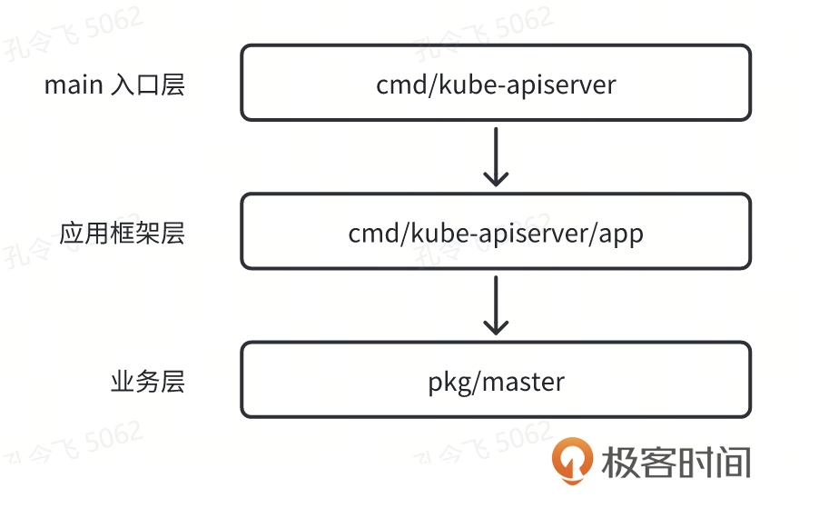
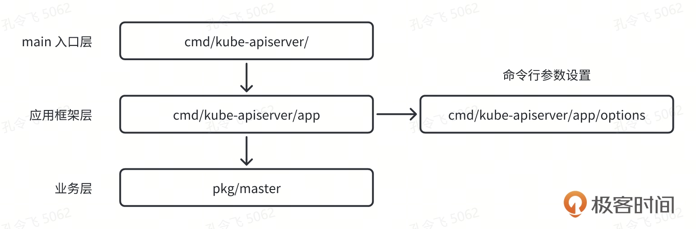
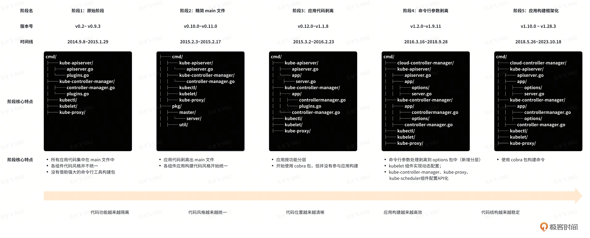

# 15 | 通过Kubernetes应用构建模型来看如何构建应用？

你好，我是孔令飞。

Kubernetes 中有很多组件，如 kube-apiserver、kube-controller-manager、kube-scheduler、kubelet 等，每个组件的功能都很复杂且不同。那么 Kubernetes 是如何构建这么复杂的应用的？这些组件的应用构建方式是否一致？如果是，Kubernetes 又是如何保持一致性的？

事实上，这些组件的功能都是通过应用的启动框架去初始化、启动和运行的。因此，深入理解应用的启动框架也是掌握组件的重要一环。

在 Kubernetes 中，应用的启动框架构建方式是类似的，或者说具有一定的标准化程度。接下来的 2 节课，我会尝试将这些组件的应用构建方式归一化，并抽象出一个应用构建模型。通过这种方式学习 Kubernetes 中的应用构建方式，可以掌握优雅构建多个功能不同的大型企业级组件的方法。站在巨人的肩膀上，我们会看得更高、看得更远。

Kubernetes 源码托管在 GitHub 上，2014 年 9 月 8 号发布了其第一个版本：v0.2，至今已有近 10 年时间。这 10 年间，Kubernetes 增加了大量新的功能、特性。同时，目录结构、代码结构、应用构建方式等也在不断向前演进，以适配最新的功能和构建方法。

从 v0.2 版本开始，到当前的 v1.28.3 版本，Kubernetes 代码的目录结构主体上变化不大，但也有不少细节上的变化。另外，应用的构建方式也重构过好几次。

接下来，我们就从 Kubernetes 的应用架构演进的角度，来看下 Kubernetes 项目在构建应用时的一些变化、实现、思考和取舍。总的来说，Kubernetes 应用构建的方式大概经历了以下几个阶段：

- 阶段 1：原始阶段（v0.2～v0.9.3）

- 阶段 2：精简 main 文件（v0.10.0～v0.11.0）

- 阶段 3：应用代码分离（v0.12.0～v1.1.8）

- 阶段 4：命令行参数剥离（v1.2.0～v1.9.11）

- 阶段 5：应用构建框架化（v1.10.0～v1.28.3）

## 阶段 1：原始阶段（v0.2～v0.9.3）

v0.2～v0.9.3 版本是 Kubernetes 应用构建的第一个阶段，采用了最简单的大一统模式。我们来看看这个阶段的特性。

首先，命令行参数设置、命令行程序构建、程序初始化等代码均在

```
cmd/apiserver/apiserver.go 文件中实现。main 文件中集成了组件启动的所有核心逻
```

辑，这导致 main 文件即使在 v0.2 版本也有 143 行。在 v0.9.3 版本更是多达 285 行。随着main 文件中集成功能的增多，代码行数的变多，维护 main 文件已经变得越来越困难。

```
在 v0.2～v0.4.4 版本中，cmd/apiserver/apiserver.go 和 cmd/controller-
manager/controller-manager.go 2 个组件的实现方式不统一，前者将服务启动的核心
代码都集成在 main 文件中，后者则将应用启动的核心代码放在 pkg/ 目录下。这种不一致也
```

会带来一些维护成本。

在 v0.5.1～v0.9.3 版本区间中，Kubernetes 主要做了以下变更：

```
cmd/ 目录下各组件的构建方式保持了统一。这其实也展现了 Kubernetes 项目对规范和统
```

- 一的看重程度。如果不规范、不统一，对于 Kubernetes 这个量级的项目来说，维护成本会非常高。

```
组件名变化很大，从cmd/apiserver到cmd/kube-apiserver，再到
cmd/controller-manager、cmd/kube-controller-manager，直到从
cmd/proxy变更为cmd/kube-proxy，这个新名称一直沿用至今。我猜测，更改名字是
```

- 为了从组件名能够知道该组件的功能类别，便于理解和维护。

在 v0.9.0 版本中，新增了以下 2 个变化：

- 使用 pflag 包替代了标准库的 flag 包，pflag 包提供了更强大的命令行参数管理能力。

```
在 v0.9.0 版本中，代码生成技术首次出现，新增了 cmd/gendocs 组件，用来自动生成
```

- kubectl 命令行工具使用文档。

这一阶段最大的特点是应用构建比较原始，没有采用任何应用构建框架，应用构建也没有层次，各组件应用构建方式也并不统一。这种方式在代码量较小时问题不大，但当功能增多、代码量激增时，会带来很大的维护成本。

## 阶段 2：精简 main 文件（v0.10.0～v0.11.0）

v0.10.0～v0.11.0 阶段核心应用均采用了统一的构建方式，也就是将命令行参数设置、命令行程序构建、程序初始化等代码分别剥离到以下 2 个目录中：

```
pkg/util：日志标志的添加、日志包的初始化。
pkg/version/verflag：版本标志的添加和版本号的打印。
而 pkg/master/server、pkg/controllermanager、pkg/proxy/server 等目录应
```

用初始化、启动等核心代码。

将一些功能实现细节剥离出 main 文件，使 main 文件保持简单，剥离后的 main 文件只有 40行（cmd/kube-apiserver/apiserver.go）：

```go
func main() {
   s := server.NewAPIServer()
   s.AddFlags(pflag.CommandLine)
   util.InitFlags()
   util.InitLogs()
   defer util.FlushLogs()
   verflag.PrintAndExitIfRequested()
   s.Run(pflag.CommandLine.Args())
}
```

通过 Kubernetes 应用构建的重构方式，我们可以猜测：在 Kubernetes 项目看来，一个应用除了具有应用初始化和启动等基本功能外，还应该统一具有日志和版本功能。

这里 Kubernetes 其实也采用了服务启动最常见的代码开发模式（先创建一个服务实例，再调

```go
用其 Run/Serve/Start 方法）：
s := server.NewAPIServer()
// ...
s.Run(pflag.CommandLine.Args())
```

这个阶段最大的变化是将很多实现细节从 main 文件中剥离出，并继续保证各组件（存量 + 新增）的构建范式一致，进一步提升了代码的可维护性。

## 阶段 3：应用代码分离（v0.12.0～v1.1.8）

```
在 v0.12.0～v1.1.8 这个阶段中，应用构建最大的变化是在 cmd/ 目录下新增了 app 目录：
cmd/
├── kube-apiserver/
│   ├── apiserver.go
│   └── app/
│       ├── plugins.go
│       └── server.go
而且将之前在 pkg/master/server、pkg/controllermanager、pkg/proxy/server
实现的应用初始化、启动等核心代码迁移到了 cmd/app/ 目录下。
```

从这里开始，Kubernetes 的应用构建出现了分层的思想，即 Kubernetes 在构建应用时，采用了以下分层设计：



上图中每一层的功能解释如下：

- main 入口层：主要是组件的 main 文件，代码量很少，可以很快找到组件的代码入口，方便我们进行代码走读、开发等。

- 应用框架层：主要负责应用的命令行参数设置、应用初始化和启动等，不会涉及具体的功能代码。

- 业务层：应用功能的实现代码。

总的来说，这一阶段在构建应用时，将整个组件初始化、启动相关的代码放在了应用框架层，将具体的业务逻辑实现放在了业务层。可以看到，在之前的版本中，Kubernetes 主要是物理位置上进行隔离、划分以降低代码的学习难度和维护复杂度。在这个阶段，Kubernetes 项目已经开始尝试从功能上进行剥离，以进一步提高代码的可维护性。

通过将应用框架和业务实现进行物理隔离，也可以提高代码的健壮度。如果你修改应用框架层的代码，引入一个 Bug，这个 Bug 大概率会在启动阶段被发现，并不会影响实际的功能。

```
另外，在 v1.1.1 版本中还引入了 github.com/spf13/cobra 包。cobra 是一个非常强大的
```

命令行框架。这个阶段，cobra 包还没有参与到组件的应用构建中，主要是使用 cobra 包创建

```
了一个 *cobra.Command 类型实例，并使用实例提供的 GenMarkdownTree 方法，来自动
```

生成命令行工具的使用文档：

```go
// 位于 cmd/kube-apiserver/app/server.go 文件中
func NewAPIServerCommand() *cobra.Command {
   s := NewAPIServer()
   s.AddFlags(pflag.CommandLine)
   cmd := &cobra.Command{
       Use: "kube-apiserver",
       Long: `The Kubernetes API server validates and configures data
for the api objects which include pods, services, replicationcontrollers, and
others. The API Server services REST operations and provides the frontend to the
cluster's shared state through which all other components interact.`,
       Run: func(cmd *cobra.Command, args []string) {
       },
   }
   return cmd
}
// 位于 cmd/genkubedocs/gen_kube_docs.go 文件中
func main() {
   // ...
   switch module {
       case "kube-apiserver":
       // generate docs for kube-apiserver
       apiserver := apiservapp.NewAPIServerCommand()
       cobra.GenMarkdownTree(apiserver, outDir)
       // ...
       default:
       fmt.Fprintf(os.Stderr, "Module %s is not supported", module)
       os.Exit(1)
   }
}
```

在这个版本阶段，Kubernetes 引入了越来越多的自动代码生成功能：

```
$ ls -d cmd/gen*| pr -T -4
cmd/genbashcomp          cmd/gendeepcopy   cmd/genkubedocs   cmd/genswaggertyp
cmd/genconversion cmd/gendocs            cmd/genman              cmd/genutils
```

除此之外还有一个变化，在 v0.18.0 版本之前，Kubernetes 主要用来自动生成一些文档。而在 v0.18.0 及之后的版本中，Kubernetes 会自动生成一些非文档类的代码。这些代码会直接作为 Kubernetes 的核心源码保存在 Kubernetes 项目仓库中。

## 阶段 4：命令行参数剥离（v1.2.0～v1.9.11）

在 v1.2.0～v1.9.11 版本阶段，Kubernetes 应用构建主要有以下 2 大变化：

```
剥离命令行参数设置代码到 cmd/xxx/app/options/ 目录下。
```

2. 引入动态配置功能。

### 命令行参数代码剥离

```
在这个阶段，Kubernetes 项目将命令行参数设置相关的代码进一步剥离到 cmd/kube-
apiserver/app/options 目录下。具体命令行选项处理模式如下（cmd/kube-
```

apiserver/app/options/options.go）：

```go
// 位于 cmd/kube-apiserver/app/options/options.go 文件中
type ServerRunOptions struct {
   GenericServerRunOptions     *genericoptions.ServerRunOptions
   AllowPrivileged             bool
   // ...
}
func NewServerRunOptions() *ServerRunOptions {
   s := ServerRunOptions{
       GenericServerRunOptions: genericoptions.NewServerRunOptions().WithEtcdOpt
       AllowPrivileged: false,
   }
   return &s
}
func (s *ServerRunOptions) AddFlags(fs *pflag.FlagSet) {
   // Add the generic flags.
   s.GenericServerRunOptions.AddUniversalFlags(fs)
   //Add etcd specific flags.
   s.GenericServerRunOptions.AddEtcdStorageFlags(fs)
   // Note: the weird ""+ in below lines seems to be the only way to get gofmt t
   // arrange these text blocks sensibly. Grrr.
   // ...
   fs.BoolVar(&s.AllowPrivileged, "allow-privileged", s.AllowPrivileged,
              "If true, allow privileged containers.")
}
// 位于 cmd/kube-apiserver/app/options/validation.go 文件中
func (options *ServerRunOptions) Validate() []error {
   var errors []error
   if errs := options.Etcd.Validate(); len(errs) > 0 {
       errors = append(errors, errs...)
   }
   // ...
   return errors
}
```

模式解读（简单工厂涉及模式）：

```
创建一个 XXXOptions 结构体，用来作为命令行选项的从操作对象。
创建一个 NewXXXOptions 函数，用来创建一个带默认值的 XXXOptions 实例。
给 XXXOptions 结构体添加一个 AddFlags 方法，在该方法中，设置命令行参数，并将
```

- 命令行参数的值绑定到结构体中的字段中。

4. 通过以下方式，来设置并访问命令行选项的值：

```go
// 位于 cmd/kube-apiserver/apiserver.go 文件中
func main() {
   // ...
   s := options.NewAPIServer()
   s.AddFlags(pflag.CommandLine)
   // ...
   if err := app.Run(s); err != nil {
       fmt.Fprintf(os.Stderr, "%v\n", err)
       os.Exit(1)
   }
}
// 位于 cmd/kube-apiserver/app/server.go 文件中
func Run(s *options.APIServer) error {
   genericvalidation.VerifyEtcdServersList(s.ServerRunOptions)
   genericapiserver.DefaultAndValidateRunOptions(s.ServerRunOptions)
   // ...
}
可以看到，在将命令行参数相关的代码剥离到 cmd/kube-apiserver/app/options/ 目录
```

时，Kubernetes 也将代码按功能分别存放在了不同的源码文件下：

```
创建、命令行参数设置放在 options.go 文件中。
命令行选项值验证放在了 validation.go 文件中。
```

按功能隔离也能一定程度上减小误改代码的概率，提高代码健壮性和可维护性。通过将命令行参数进一步隔离，Kubernetes 应用构建层级中的应用框架层又包含了命令行参数设置这一大类功能：



### 动态配置

在 v1.2.0 之前的版本中，Kubernetes 各组件都是通过命令行参数来配置的。这种配置方式在命令行参数不多的情况下问题不大，但当命令行参数越来越多时会有以下问题：

- 启动命令太长，难以阅读。

- 相比于配置文件的方式，管理和分发成本更高。

所以，当命令行参数很多时，建议使用配置文件，可以简化组件配置和部署的复杂度。

对于 kubelet 组件，之前的命令行参数配置形式还有一些问题。kubelet 是部署在每个 Node节点上的 agent，在更新 kubelet 配置时，往往需要集群管理员通过 SSH（手动或通过脚本）登录到节点上，再配置 kubelet 命令行参数，并重启 kubelet。在这种方式下，更新 kubelet 的配置成本比较高。

所以，kubelet 组件的配置更新需要一种类似配置中心的配置机制，能够通过一个配置中心触发配置文件的变更和 kubelet 组件的重启。要实现分布式配置文件下发，你可以引入第三方配置中心组件，例如 Apollo、Nacos、Consul、etcd 等。当然，也可以直接复用现有的Kubernetes 机制，增加一个配置类型的 API 资源，并 watch kube-apiserver，从而感知 API资源的变更。kubelet 直接复用了 Kubernetes 现有的机制。

```
为此，Kubernetes v1.2.0 版本，新增了一个 KubeletConfiguration 类型的 API 定
```

义，例如：

```
apiVersion: kubelet.config.k8s.io/v1beta1
kind: KubeletConfiguration
address: "192.168.0.8"
port: 20250
serializeImagePulls: false
evictionHard:
   memory.available:  "100Mi"
   nodefs.available:  "10%"
   nodefs.inodesFree: "5%"
   imagefs.available: "15%"
上述配置会保存在 ConfigMap 资源的 data 字段中。kubelet 会 watch ConfigMap，当
ConfigMap 有变更时，kubelet 会将 ConfigMap data 字段的配置内容写到本地磁盘上，然后
```

退出进程，之后由操作系统级别的进程管理服务自动重新拉起 kubelet 进程。kubelet watch 哪

```
个 ConfigMap 是在 Node.Spec.ConfigSource.ConfigMap 中指定的。
```

更多关于 kubelet 动态配置的介绍，你可以参考以下 2 篇文章：

- Dynamic Kubelet Configuration

- Set Kubelet Parameters Via A Configuration File

将组件配置以 Kubernetes API 资源的形式进行加载，还会带来以下好处：

- 配置版本化转换：Kubernetes API 资源是有资源的，配置版本化，可以使得后续的版本转换成为可能，通过版本转换可以使配置兼容以前的版本。

- 默认值：可以复用 Kubernetes 给资源设置默认值的机制，给配置资源设置默认值。

- 配置校验：可以直接复用 Kubernetes 资源的校验机制，对各个配置项进行校验。

之后的 Kubernetes 版本中，kube-controller-manager、kube-proxy、kube-scheduler 等组件也将配置文件以 Kubernetes 资源的形式进行加载和设置。

## 阶段 5：应用构建框架化（v1.10.0 ～ v1.28.3）

v1.10.0～v1.28.3 这个阶段最大的变化就是直接复用了 cobra 框架的能力，通过 cobra 框架来构建并启动应用，其构建方式如下：

```go
// 位于 cmd/kube-apiserver/apiserver.go 文件中
func main() {
   rand.Seed(time.Now().UTC().UnixNano())
   command := app.NewAPIServerCommand()
   // TODO: once we switch everything over to Cobra commands, we can go back to
   // utilflag.InitFlags() (by removing its pflag.Parse() call). For now, we hav
   // normalize func and add the go flag set by hand.
   pflag.CommandLine.SetNormalizeFunc(utilflag.WordSepNormalizeFunc)
   pflag.CommandLine.AddGoFlagSet(goflag.CommandLine)
   // utilflag.InitFlags()
   logs.InitLogs()
   defer logs.FlushLogs()
   if err := command.Execute(); err != nil {
       fmt.Fprintf(os.Stderr, "error: %v\n", err)
       os.Exit(1)
   }
}
// 位于 cmd/kube-apiserver/app/server.go 文件中
func NewAPIServerCommand() *cobra.Command {
   s := options.NewServerRunOptions()
   cmd := &cobra.Command{
       Use: "kube-apiserver",
       Long: `The Kubernetes API server validates and configures data
for the api objects which include pods, services, replicationcontrollers, and
others. The API Server services REST operations and provides the frontend to the
cluster's shared state through which all other components interact.`,
       Run: func(cmd *cobra.Command, args []string) {
           verflag.PrintAndExitIfRequested()
           utilflag.PrintFlags(cmd.Flags())
           stopCh := server.SetupSignalHandler()
           if err := Run(s, stopCh); err != nil {
               fmt.Fprintf(os.Stderr, "%v\n", err)
               os.Exit(1)
           }
       },
   }
   s.AddFlags(cmd.Flags())
   return cmd
}
// Run runs the specified APIServer.  This should never exit.
func Run(runOptions *options.ServerRunOptions, stopCh <-chan struct{}) error {
   // To help debugging, immediately log version
   glog.Infof("Version: %+v", version.Get())
   server, err := CreateServerChain(runOptions, stopCh)
   if err != nil {
       return err
   }
   return server.PrepareRun().Run(stopCh)
}
```

可以看到，直接使用 cobra 可以快速构建出功能强大的应用。

## 课程总结

Kubernetes 的应用架构历经多个阶段，从最初的大一统模式逐步演变为分层、模块化和框架化的结构。为了让你更清晰地观察到 Kubernetes 应用构建的演进方式，我将各个演进阶段以图示的方式展示给你，如下图所示：



可以看到，Kubernetes 的应用构建方式具有以下特点：

- 代码功能越来越隔离

- 代码风格越来越统一

- 代码位置越来越清晰

- 应用构建越来越高效

- 代码结构越来越稳定

Kubernetes 最后通过按功能分层的方式，将每个功能的代码实现分别保存在不同的位置和文件，以此来进行代码隔离。代码隔离不仅易于阅读和维护，还能减少引入 Bug 的概率，提高程序的健壮性，也为开发者提供了一个更优雅的应用构建方式，更好地适应了 Kubernetes 项目的发展需求。长期以来，Kubernetes 项目的成功也体现了规范化和统一化在大型开源项目中的重要性。

## 课后练习

1. 请你思考下，Kubernetes 应用构建的演进都有哪些特点。

2. 阅读 kube-proxy 源码，你能看出 v1.32.3 版本的应用构建模型和阶段 5 的应用构建模型有什么比较大的变化吗？

欢迎你在留言区与我交流讨论，如果今天的内容让你有所收获，也欢迎转发给有需要的朋友，我们下节课再见！
