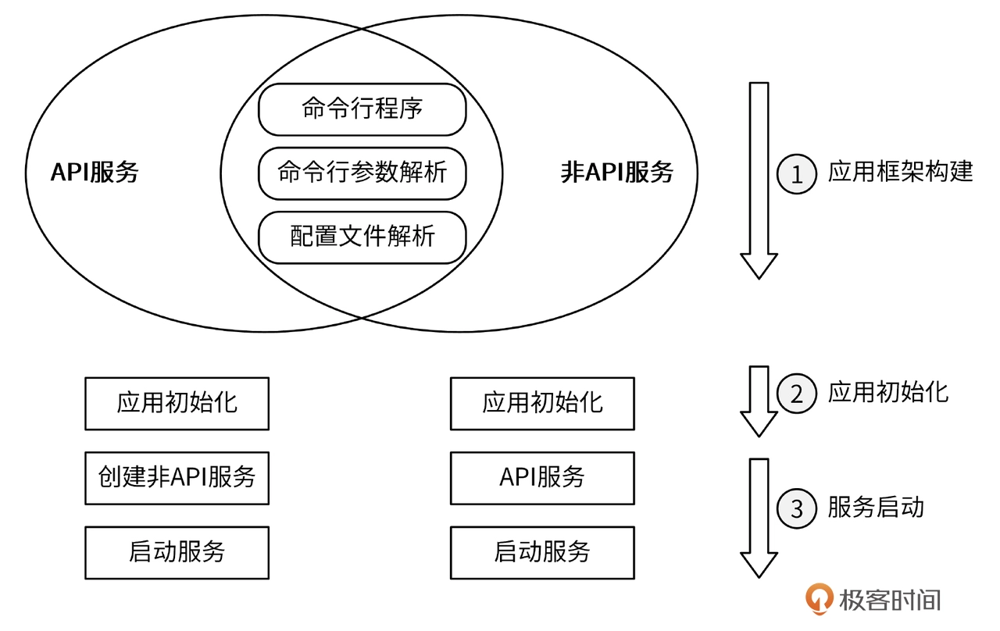
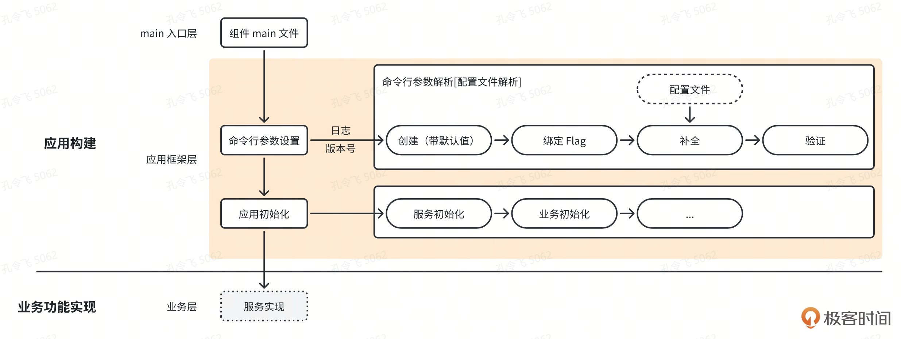

# 16-剖析Kubernetes应用构建模型

你好，我是孔令飞。

上一节课，我介绍了 Kuberenetes 应用构建方式的演进历史，了解到 Kuberenetes 开发者在项目迭代的过程中，会从功能添加、可维护性等方面不断优化应用的构建方式。

我们知道，在 v1.10.0～v1.32.3 版本中，Kuberenetes 处在一个稳定的状态。那么，稳定之后的 Kubernetes 应用构建模型是什么样的？有什么值得我们学习的地方？本节课，我们一起来看看。

## 应用三大基本功能

通常来说，一个 Go 应用可由以下功能点来构成：



其中，API 服务和非 API 服务都需要命令行程序、命令行参数解析、配置文件解析。你也可以认为，这 3 类功能大部分应用都需要。应用初始化、服务启动具有很强的业务属性，具体实现因业务不同而不同，但应用通常都需要进行这些处理。

Kubernetes 项目下的应用也符合上述应用的特点，所以我在介绍 Kubernetes 应用模型时，会重点关注命令行程序、命令行参数解析、配置文件解析这 3 大类基本功能的具体实现方式，以及应用初始化、服务启动整体流程（但不会关注业务细节）。至于每个应用功能的具体实现，不在这节课的讨论范围。

## Kubernetes 应用构建模型

Kubernetes v1.10.0（2018.5.26 发布）发布至今，已经超过 5 年，其应用构建方式几乎没有变过。我们可以理解为，当前的 Kubernetes 应用构建模型已经成熟。

因为 kubernetes 有很多组件，为了降低你的学习难度，我归纳、总结了这些应用的构建方法，并抽象成一个模型。Kubernetes 的应用构建模型如下图所示：



在 Kubernetes 应用构建模型中，根据代码功能可以分为 2 大块：

- 应用构建：用来构建 Kubernetes 组件，并启动服务。主要包括：命令行参数设置、应用初始化等功能。

- 业务功能实现：Kubernetes 组件功能的具体业务代码实现。

上述 2 大块会通过目录级的物理隔离来提高程序的健壮性和可维护性：

```
应用构建：代码实现位于 cmd/kube-xxx/ 目录下。
业务功能实现：代码实现位于 c 目录下。
```

你可以将应用构建理解为控制面，将业务功能实现理解为数据流。绝大部分情况下，应用构建出现 Bug 会影响程序的启动，但并不会影响业务逻辑。而且应用功能构建出现问题，大部分情况下在启动服务组件的时候是能感知到错误的。通过将应用构建时的代码变更进行物理隔离、影响降级，可以极大提高服务的稳定性和可维护性。

我们构建应用时，主要关注点是应用构建这块儿的功能。应用构建又细分为 main 入口层和应用框架层。

首先是 main 入口层，为了提高代码的可维护性和可阅读性，main 入口层代码比较简单，实现

```go
方式固定如下（位于文件 cmd/kube-xxx/xxx.go 中）：
import (
   // ...
   "k8s.io/kubernetes/cmd/kube-xxx/app"
)
func main() {
   command := app.NewXXXCommand()
   code := cli.Run(command)
   os.Exit(code)
}
可以看到，应用构建的具体代码实现位于 k8s.io/kubernetes/cmd/kube-xxx/app 目
```

录。

```
接着是应用框架层，这一层的代码实现位于 cmd/kube-xxx/app 目录下，该目录下的代码
```

实现又包括：

- 命令行参数设置：Kubernetes 各组件功能强大，相应的命令行参数也比较多，并且这些命令行参数通常需要进行创建、绑定、验证等处理。为了便于维护代码，将命令行参数相关的

```
代码统一存放在 cmd/kube-xxx/app/options 目录下。因为命令行参数很多，为了缩
```

- 减每个代码文件的代码行数，又按命令行参数的功能设置类别，按文件进行保存。

```
cmd/kube-xxx/app/options/options.go：命令行参数关联结构体实例创建、初
```

- 始化、命令行参数标志绑定。

```
cmd/kube-xxx/app/options/completion.go：命令行参数值补全。
cmd/kube-xxx/app/options/validation.go：命令行参数值校验。
```

- 应用初始化：该类功能主要包括服务的初始化和业务初始化。

- 服务初始化：主要涉及应用框架的初始化和命令行参数的设置，例如：

```go
// NewAPIServerCommand creates a *cobra.Command object with default parameters
func NewAPIServerCommand() *cobra.Command {
   s := options.NewServerRunOptions()
   cmd := &cobra.Command{
       Use: "kube-apiserver",
       Long: `The Kubernetes API server ...`,
       // stop printing usage when the command errors
       SilenceUsage: true,
       PersistentPreRunE: func(*cobra.Command, []string) error {
           // silence client-go warnings.
           // kube-apiserver loopback clients should not log self-issued warning
           rest.SetDefaultWarningHandler(rest.NoWarnings{})
           return nil
       },
       RunE: func(cmd *cobra.Command, args []string) error {
           verflag.PrintAndExitIfRequested()
           fs := cmd.Flags()
           // Activate logging as soon as possible, after that
           // show flags with the final logging configuration.
           if err := logsapi.ValidateAndApply(s.Logs, utilfeature.DefaultFeature
               return err
           }
           cliflag.PrintFlags(fs)
           // set default options
           completedOptions, err := s.Complete()
           if err != nil {
               return err
           }
           // validate options
           if errs := completedOptions.Validate(); len(errs) != 0 {
               return utilerrors.NewAggregate(errs)
           }
           // add feature enablement metrics
           utilfeature.DefaultMutableFeatureGate.AddMetrics()
           return Run(completedOptions, genericapiserver.SetupSignalHandler())
       },
       Args: func(cmd *cobra.Command, args []string) error {
           for _, arg := range args {
               if len(arg) > 0 {
                   return fmt.Errorf("%q does not take any arguments, got %q", c
               }
           }
           return nil
       },
   }
   fs := cmd.Flags()
   namedFlagSets := s.Flags()
   verflag.AddFlags(namedFlagSets.FlagSet("global"))
   globalflag.AddGlobalFlags(namedFlagSets.FlagSet("global"), cmd.Name(), logs.S
   options.AddCustomGlobalFlags(namedFlagSets.FlagSet("generic"))
   for _, f := range namedFlagSets.FlagSets {
       fs.AddFlagSet(f)
   }
   cols, _, _ := term.TerminalSize(cmd.OutOrStdout())
   cliflag.SetUsageAndHelpFunc(cmd, namedFlagSets, cols)
   return cmd
}
```

- 业务初始化：跟业务相关的代码初始化，如数据库创建、API 路由初始化、认证授权功能初始化、服务实例的创建和启动等，代码示例如下：

```go
// Run runs the specified APIServer.  This should never exit.
func Run(opts options.CompletedOptions, stopCh <-chan struct{}) error {
   // To help debugging, immediately log version
   klog.Infof("Version: %+v", version.Get())
   klog.InfoS("Golang settings", "GOGC", os.Getenv("GOGC"), "GOMAXPROCS", os.Get
   config, err := NewConfig(opts)
   if err != nil {
       return err
   }
   completed, err := config.Complete()
   if err != nil {
       return err
   }
   server, err := CreateServerChain(completed)
   if err != nil {
       return err
   }
   prepared, err := server.PrepareRun()
   if err != nil {
       return err
   }
   return prepared.Run(stopCh)
}
kube-apiserver 的应用初始化模块会先执行服务初始化，然后在服务初始化中调用 func
Run(opts options.CompletedOptions, stopCh <-chan struct{}) error 函数
```

进行业务初始化。可以看到，kube-apiserver 在应用初始化时又进行了更进一步的函数级隔离：隔离服务初始化相关代码和业务初始化相关代码。也就是说，在 Kubernetes 应用构建模型中，会从目录级、文件级、函数级 3 个级别来隔离相对独立的功能，以此提高代码的可维护性和可阅读性。

通过对 Kubernetes 应用构建模型的分析，我们可以发现命令行参数设置和服务初始化部分其实模式是固定的。这就具备了进一步抽象成为一个应用框架的可能性。

除此之外，在阅读 Kubernetes 源码的过程中，我还有以下 2 点体会：

1. Kubernetes 的每个组件，都用相似的构建方式和代码来编写，但代码复用度还有进一步提升的空间，这也算是 Kubernetes 应用构建实现中值得优化的地方。

2. Kubernetes 应用构建方式非常规范、统一，以至于你可以根据其构建方式，抽象出一个普适的应用构建模型。

基于以上 2 点，我们完全可以根据其应用构建模型，开发出一个更高级别的 Go 包，以进一步提高代码的复用度。

## 课程总结

上一节课，我们回顾了 Kubernetes 应用构建方式的演进历史，并了解到开发者在功能添加和可维护性方面的持续优化。目前，Kubernetes 在 v1.10.0 至 v1.32.3 版本间处于稳定状态。本节课的重点是探讨成熟后的 Kubernetes 应用构建模型。

Kubernetes 应用通常包括三大基本功能：命令行程序、命令行参数解析和配置文件解析。这些功能确保 API 服务和非 API 服务的正常运行，应用初始化和服务启动则因业务需求而异。Kubernetes 的构建模型分为两个主要部分：应用构建和业务功能实现。应用构建主要涉及命令行参数设置和服务启动，其代码实现位于 cmd/kube-xxx/ 目录下，而具体业务功能代码则位于 pkg/ 目录中。

为了增强代码的可维护性和健壮性，Kubernetes 通过物理隔离这些部分，使得应用构建出现的问题更易于发现和修正。在应用构建模型中，首先是简单的 main 入口层代码，然后是处理命令行参数和应用初始化的应用框架层。这种结构为开发者提供了清晰的实现路径和维护策略，使得 Kubernetes 成为一个功能强大且高效的容器编排平台。

## 课后练习

请你阅读 kube-apiserver、kube-scheduler 源码和其应用构建方法，再思考下：

1. 为什么 Kuberenetes 会先创建一个 Options 对象，再 Complete，再 Validate，这样做有什么好处？

2. 为什么 Kubernetes 会基于 Options 再去创建一个 Config 类型的变量，并使用 Config 启动应用？

3. Kubernetes 的应用构建方法是否过度设计？

欢迎你在留言区与我交流讨论，如果今天的内容让你有所收获，也欢迎转发给有需要的朋友，我们下节课再见！
