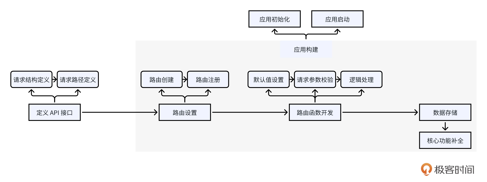
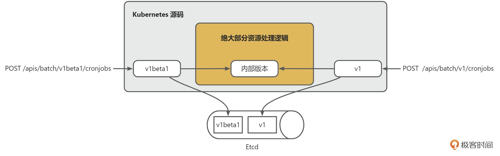

# 17-Kubernetes如何设计REST资源？

你好，我是孔令飞。

上一节课，我们详细讲了 Kubernetes 的应用构建模型，Kubernetes 中的核心组件基本都是基于它来构建的。这一节课，我们来聊聊 kube-apiserver。

kube-apiserver 是 Kubernetes 最核心、实现最复杂的组件，其他组件也都依赖它运行。接下来，我就结合 RESTful API 服务器的开发流程为你讲解 kube-apiserver 具体是如何设计REST 资源的，帮你理解 kube-apiserver 的源码及其实现。

## RESTful API 服务器开发流程

kube-apiserver 本质上是一个提供了 REST 接口的 Web 服务，在开发 Web 服务时，通常我们会以如下步骤进行开发：



首先，我们会根据项目功能定义 API 接口，将功能抽象成指定的 REST 资源，并给每一个资源指定请求路径和请求参数：

```
请求路径：请求路径是一个标准的 HTTP 请求路径，如创建 Pod 请求路径为 POST
/api/v1/namespaces/{namespace}/pods。
```

- 请求参数：HTTP 请求方法不同，参数的位置也不同，如：对于 POST、PUT 类请求，请求参数在请求 Body 中指定。GET、DELETE 类请求，请求参数在请求 Query 中指定。

- 更多关于 Kubernetes API 接口的定义，请你参考 Kubernetes API。

接着，我们需要进行路由设置。路由设置其实就是指定一个 HTTP 请求由哪个函数来处理，通常包括：路由创建和路由注册。

然后，我们需要开发路由函数。路由函数用来具体执行一个 HTTP 请求的逻辑处理。在路由函数中，我们通常会根据需要进行以下处理：

- 默认值设置：如果有些 HTTP 请求参数没有被指定，为了确保请求能够按预期执行，我们通常会评估这些参数，并设置适合的默认值。

- 请求参数校验：校验请求参数是否合法。

- 逻辑处理：编写代码，根据请求参数完成既定的业务逻辑处理。

最后，如果有些数据需要持久化保存，还需要将数据保存在后端存储中。

上面是一个 Web 服务基础功能的开发流程，在开发完基础功能之后，还会根据需要补充更多的功能、特性。

在实际开发中，我们通常会先定义 API 接口，再开发应用。应用中又包括了路由设置、路由函数、数据存储、核心功能。先定义 API 接口是为了能够将接口约定提前提供给前端，实现前后端并行开发。

这节课，我们重点来看 kube-apiserver 是如何设计 REST API 接口的。

## Kubernetes 是如何设计 REST API 接口的？

Kubernetes 作为一个超大型的分布式系统，其 kube-apiserver 组件中集成了 75 种 REST 资

```
源及操作（Kubernetes 1.32.3 版本）。通过 kubectl api-resources，我们可以列出
```

kube-apiserver 支持的资源：

```
$ kubectl api-resources |egrep 'k8s.io|batch| v1| apps| autoscaling| batch'|wc -l
75
在操作的过程中，要通过 egrep 将 Kubernetes 集群中安装的第三方资源过滤掉。
```

那么，Kubernetes 具体是如何设计这些资源的？在回答这个问题之前，我们先来看看一般的Web 服务是如何设计 REST 资源的。

1. 指定 REST 资源类型：根据项目功能将这些功能抽象成一系列的 REST 资源，如 user、secret 等。

```sql
指定 HTTP 方法：根据需要对资源进行的操作指定 HTTP 方法，如 GET、POST、PUT、
DELETE 等，不同的 HTTP 方法完成不同的操作。
```

3. 设计 API 版本的标识方法：通常将版本标识放在如下 3 个位置（第 1 个方法最常用）：

```
URL 中，比如 /v1/users。
```

- 1.

```
HTTP Header 中，比如 Accept: vnd.example-com.foo+json; version=1.0。
```

- 2.

```
Form 参数中，比如 /users?version=v1。
```

- 3.

4. 指定请求参数和返回参数：给每一个 HTTP 请求指定参数，参数位置要匹配 HTTP 请求方法。

在具体设计 REST API 接口时，除了上述需要考虑的点之外，还做了增强型设计。接下来，我们就来详细介绍下。

## 标准的 RESTful API 定义

REST 是一种 API 接口开发规范，在 HTTP 方法、请求路径、资源定义等方面给出了一些约束性规范，所有满足 REST 规范的 API 接口，我们称之为 RESTful API（详细的 REST 规范，你可以参考：REST 接口规范）。

在企业应用开发中，REST 规范通常由开发者自行遵循，多数情况下 API 接口设计能符合REST 规范。但由于缺乏强制约束，有些开发者会因为不了解规范或是开发能力有限，设计出不满足 REST 规范的 API 接口，导致 REST Web 服务器中出现不满足 REST 规范的接口。

但在 Kubernetes 中并不存在这种情况，因为 Kubernetes 会从代码层面来确保开发者的资源定义都是符合规范的，并且请求方法、请求路径等都是基于规范化的资源自动生成，不需要开发者手动指定。这种刚性的资源规范设计，以及基于规范的自动化 REST 接口生成机制，会确保 Kubernetes 中所有 API 都符合 REST 规范。

## Kubernetes 支持更多的资源操作类型

```sql
在常见的 Web 服务中， 通常只会用到 GET、PUT、POST、DELETE 四种 HTTP 请求方法，
这些请求方法映射为 Go 函数名为：Get、List、Update、Create、Delete。
```

Kubernetes 中几乎所有的 REST 资源除了支持以上 5 种操作外，还支持以下 3 种操作类型：

```
DeleteCollection：用于删除多个资源对象的操作方法。它允许用户一次性删除整个资
```

- 源集合（如某命名空间下的所有 Pod），无需逐个删除，适用于资源集合清理或者批量删

- 除。

```
Patch：用于对资源对象进行部分更新的操作方法。通过 patch 方法，可以只更新资源对
```

- 象的部分字段或属性，不需要提供完整的资源对象定义。这对于需要局部修改资源对象的场景非常有用，可以减少数据传输量和减小对资源对象的影响范围。

```
Watch：用于监视资源对象变化的操作方法。通过 watch 方法，客户端可以与 API 服务器
```

- 建立长连接，并实时地接收资源对象的变化通知，包括创建、更新、删除等操作。这对于需要实时监控资源对象状态变化的场景非常有用，比如实时监控 Pod 的状态变化。

## Kubernetes 资源组支持更多的功能

支持资源组（Group）在 Kubernetes APIServer 中也被称为 APIGroup。资源组是对 REST 资源按其功能类别进行的逻辑划分，具有相同功能类别的 Kubernetes REST 资源会被划分到同一个资源组中。例如，Deployment 和 StatefulSet 资源都用于创建工作负载，因此归属于同一

```
个 apps 资源组。
```

但很多业务开发中并不会抽象一个资源组的概念，因为普通的业务开发没有针对资源组的统一操作。不过，资源组的设计思路在业务开发中仍然值得借鉴。

在开发 REST API 服务时，我们通常也会根据需要支持资源组，并且 Web 框架通常也都支持设置资源组。例如，下面是一个使用 Gin 框架设置资源组的代码示例：

```go
package main
import "github.com/gin-gonic/gin"
func main() {
   // 创建一个默认的 Gin 引擎
   router := gin.Default()
   // 设置资源组 "/api"
   apiGroup := router.Group("/api")
   {
       // 在 "/api" 资源组中设置路由
       apiGroup.GET("/users/:userID", func(c *gin.Context) {
           c.JSON(200, gin.H{
               "message": "Get users",
           })
       })
       apiGroup.POST("/users", func(c *gin.Context) {
           c.JSON(200, gin.H{
               "message": "Create user",
           })
       })
   }
   // 设置根路由
   router.GET("/", func(c *gin.Context) {
       c.JSON(200, gin.H{
           "message": "Hello, welcome to the root path",
       })
   })
   // 启动 Gin 服务器
   router.Run(":8080")
}
在上面的示例中，首先创建了一个默认的 Gin 引擎，然后使用 router.Group("/api") 创
建了一个名为 /api 的资源组。在这个资源组中，设置了两个路由
（GET，/users/:userID）、（POST、/users）。这意味着这两个路由都会以 /api 作为
前缀，即访问路径为 /api/users/:userID 和 /api/users。
```

通过设置资源组，可以将具有相同前缀的路由进行分组，使代码结构更加清晰，同时也可以对这些路由进行统一的中间件处理等。执行以下命令运行上述代码：

```
$ go run main.go
打开一个新的 Linux 终端，执行以下 curl 命令来请求 RESTful API 接口：
$ curl http://127.0.0.1:8080/api/users # api 是资源组名
{"message":"Get users"}
```

如上述示例所示，在一般的 REST 开发中，我们并不会针对资源组进行过多管控，主要使用资源组来对请求路径进行分组。但在 Kubernetes 中，资源组是一个非常重要的概念，承担了更多的功能，后面我们会详细介绍。

## 使用资源组、资源版本、资源类型构建 HTTP 请求路径

在一般的 REST 服务开发中，HTTP 请求路径通常是直接指定的。但是在 Kubernetes 中，HTTP 请求路径很多时候，是由资源组、资源版本、资源类型共同构建的。kube-apiserver 会根据资源组、资源版本、资源类型自动构建出资源的请求路径。

```
例如：创建 Pod 的 HTTP 请求方法和请求路径为 POST
/api/v1/namespaces/{namespace}/pods，其中 api 是资源组，v1 是资源版本，
pods 是资源类型。
提示：namespaces 是命名空间（其实就是一个租户）。
```

## 标准化的资源定义

在一般的 REST 服务开发中，POST、PUT 请求的请求 Body 基本都是根据需要自行定义的，没有固定的格式。但是在 Kubernetes 中，请求 Body 是有固定格式的。这里，我们来看下Kubernetes 中 Namespace 资源的定义：

```
type Namespace struct {
   metav1.TypeMeta `json:",inline"`
   // Standard object's metadata.
   // More info: https://git.k8s.io/community/contributors/devel/sig-architectur
   // +optional
   metav1.ObjectMeta `json:"metadata,omitempty" protobuf:"bytes,1,opt,name=metad
   // Spec defines the behavior of the Namespace.
   // More info: https://git.k8s.io/community/contributors/devel/sig-architectur
   // +optional
   Spec NamespaceSpec `json:"spec,omitempty" protobuf:"bytes,2,opt,name=spec"`
   // Status describes the current status of a Namespace.
   // More info: https://git.k8s.io/community/contributors/devel/sig-architectur
   // +optional
   Status NamespaceStatus `json:"status,omitempty" protobuf:"bytes,3,opt,name=st
}
// NamespaceSpec describes the attributes on a Namespace.
type NamespaceSpec struct {
   // Finalizers is an opaque list of values that must be empty to permanently r
   // More info: https://kubernetes.io/docs/tasks/administer-cluster/namespaces/
   // +optional
   // +listType=atomic
   Finalizers []FinalizerName `json:"finalizers,omitempty" protobuf:"bytes,1,rep
}
// NamespaceStatus is information about the current status of a Namespace.
type NamespaceStatus struct {
   // Phase is the current lifecycle phase of the namespace.
   // More info: https://kubernetes.io/docs/tasks/administer-cluster/namespaces/
   // +optional
   Phase NamespacePhase `json:"phase,omitempty" protobuf:"bytes,1,opt,name=phase
   // Represents the latest available observations of a namespace's current stat
   // +optional
   // +patchMergeKey=type
   // +patchStrategy=merge
   // +listType=map
   // +listMapKey=type
   Conditions []NamespaceCondition `json:"conditions,omitempty" patchStrategy:"m
}
```

在 Namespace 结构体定义中包含以下 4 个字段：

```
TypeMeta：
定义了资源使用的 API 版本，例如 v1、apps/v1 等。
```

- 定义了资源类型，如 Pod、Service、Deployment 等。

```
ObjectMeta：存储资源的元数据，包括名称、命名空间、标签和注释。
Spec： 定义资源的期望状态。每种类型的资源在 spec 中有特定的字段。
Status：描述资源的当前状态，一般由 Kubernetes 系统自动管理，用户不需要手动设
```

- 置。

```
通常情况下，Kubernetes 资源都会有 TypeMeta、ObjectMeta、Spec 字段字段，根据情
况选择具有 Status 字段。例如，ConfigMap、Secret 等资源就没有 Status 字段。
```

Kubernetes 资源定义的规范化、标准化，使得 Kubernetes 可以基于这些规范化的定义做很多

```
通用的处理。例如：根据 TypeMeta 字段构建出资源的请求路径；根据 ObjectMeta 字段中
的 OwnerReferences 来对所有资源执行垃圾回收逻辑。根据 ResourceVersion 字段对
所有资源的更新，实行乐观锁机制。根据 Labels 字段，对所有资源实行一致的基于标签过
```

滤逻辑等。

## 支持资源版本转换

随着功能的迭代，一个企业应用的 API 接口不可避免要面临升级。在企业应用开发中，我们通常有以下 2 种方式来支持 API 接口版本的升级：

```
同一个 Web 服务进程中，不同的路由：如 POST /v1/users 和 POST /v2/users 这 2
```

- 个请求路径分别对应 2 个不同的路由函数。这个方案在企业级应用开发中用得最多。

2. 不同 Web 服务进程，相同路由：例如，我们可以请求 v1 版本的服务和 v2 版本的服务，2

```
个服务具有相同的请求路径 POST /users。
```

Kubernetes 也支持不同的版本，如

```
/apis/batch/v1beta1/cronjobs、/apis/batch/v1/cronjobs。但是 Kubernetes
```

相比于传统的 Web 服务，在版本管理上支持版本转换：



```
例如，请求 POST /apis/batch/v1beta1/cronjobs RESTful API 时，资源的版本是
v1beta1，请求 POST /apis/batch/v1/cronjobs RESTful API 时，资源的版本是
v1。但是在 Kubernetes 内部，v1beta1 版本和 v1 版本的资源都会被转换为内部版本
```

（internal version）。Kubernetes 源码中的绝大部分源码处理资源时，其实处理的是内部版本。通过将不同版本都转换为内部版本再处理，可以大大简化 Kubernetes 内部源码处理逻

```
辑，不用考虑多版本兼容的问题。否则 Kubernetes 源码可能充斥着大量 if v1beta1 ...
else if v1 ... else 语句，极大提高了多版本维护的复杂度和成本。
```

kube-apiserver 在处理完资源之后，保存在 etcd 中的是版本化的资源数据。Kubernetes 的这种版本转换机制，还会带来另外一种非常重要的能力，那就是支持将旧版本的 API 资源数据，转换为新版本的 API 资源数据，转换逻辑为：


关于 Kubernetes 资源版本的转换，后面我们还会详细介绍，这里你只需要了解这些就可以了。

## 资源处理标准化

在企业应用中，我们通常要对请求进行一些通用的逻辑处理。下面，我们列举两个最常见的逻辑处理。

第一个是资源默认值设置。用户的请求中会携带大量参数，为了提高用户传参的效率、灵活性和安全性，有些参数会有默认值，也就是用户默认可以不设置参数值。这种情况下，后台服务会检查参数值是否被设置。如果没有被设置，后台程序会在逻辑处理前设置上默认值，例如：

```
if req.Type == "" {
   req.Type = "User"
}
```

在普通的企业应用中，设置默认值的方式可能会因为不同团队、不同项目、不同开发者各不相同。

第二个是资源校验，也就是对资源参数的合法性进行校验，例如：

```
if req.Type == "" {
   return fmt.Errorf("Type cannot be empty")
}
```

同样，参数校验的方式可能会因为不同团队、不同项目、不同开发者而各不相同。同一个项目中，请求参数默认值设置方式、请求参数校验方式的不一致会提高 API 接口的维护成本。

在 Kubernetes 中，请求参数的默认值设置和参数校验方式都是统一、规范的，这极大地提高了接口的开发效率，降低了接口的维护成本。

## 大量使用代码生成技术

通过前面的介绍我们知道，在 Kubernetes 中资源定义、资源参数默认值设置、资源参数校验等都是规范的、一致的。这种规范性和一致性也使得很多操作都可以通过代码生成技术一键生成，代码生成工具只需要按照要求处理规范化、一致化的 API 资源即可。

例如，我们可以基于规范的资源定义和资源处理逻辑，通过 code-generator 来自定生成版本

```
化的 Go SDK（client-go）、版本转换函数（统一存放在 zz_generated.conversion.go
文件中 ）、默认值设置函数（统一存放在 zz_generated.defaults.go 文件中 ）等。
```

## 课程总结

这节课我们根据 Web 服务的开发流程，讲解了 Kubernetes 是如何定义 API 接口的。Kubernetes RESTful API 接口设计的先进方法也可以迁移到我们的业务应用开发中。可借鉴的设计方法有：支持更多的资源操作、通过资源组、资源版本、资源类型构建 RESTful 请求路径、规范化的资源定义、支持资源版本转换、大量使用代码生成技术等。

## 课后练习

1. 请结合我们今天讲的内容，总结 Web 服务开发的标准流程，并思考如何将其应用于实际项目。

2. 重新回顾下 Kubernetes 中 RESTful API 接口有哪些特色的地方，这些特色设计会给业务带来什么价值？

欢迎你在留言区与我交流讨论，如果今天的内容让你有所收获，也欢迎转发给有需要的朋友，我们下节课再见！
