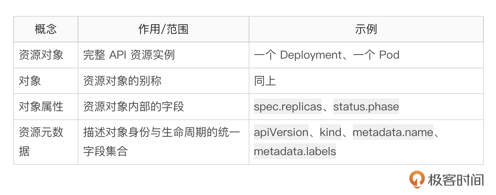
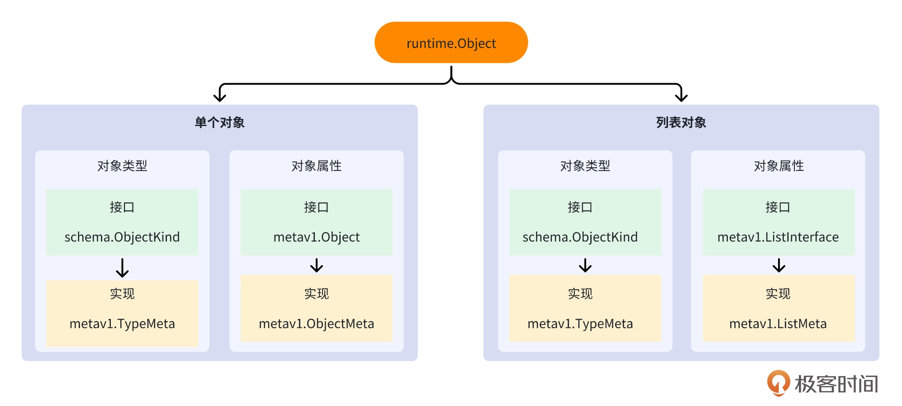
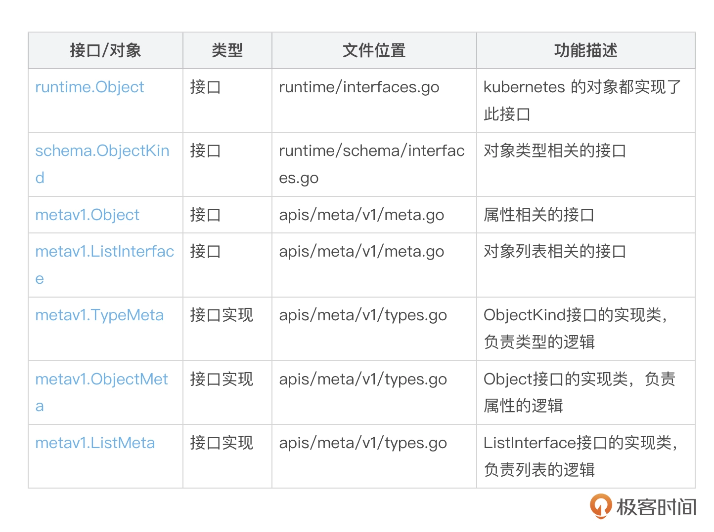
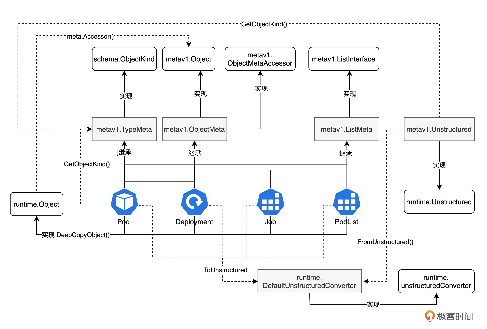

# 19 | Kubernetes资源对象实现源码剖析

你好，我是孔令飞。

Kubernetes 的对象有很多，在相关文章、书籍或者课程中，你可能经常接触到 Kubernetes 资源对象、Kubernetes 对象、Kubernetes 对象属性、Kubernetes 资源元数据这些概念，它们因为定义相近经常会被混淆。

这节课我们就来系统梳理下 Kubernetes 对象，并重点剖析 Kubernetes 资源对象的实现源码。

## Kubernetes 对象概览

首先，我们介绍下资源对象、对象、对象属性和资源元数据的概念。

Kubernetes 中“一条记录”就是一个资源对象（Resource Object），代表集群期望或当前的某个实体状态，它会持久化到 etcd，API Server 为它暴露 REST 端点。典型的资源对象如Pod、Deployment、Service、ConfigMap、CustomResource 等。Deployment 资源对象定义示例如下：

```
type Deployment struct {
   metav1.TypeMeta   `json:",inline"` // apiVersion / kind
   metav1.ObjectMeta `json:"metadata,omitempty"` // 名称、标签等
   Spec   appsv1.DeploymentSpec   `json:"spec,omitempty"`   // 期望
   Status appsv1.DeploymentStatus `json:"status,omitempty"` // 当前
}
```

Kubernetes 对象（Object）与 Kubernetes 资源对象基本等价，多指单个 API 资源实例。在代码层，二者都映射为某个 Go 结构体。但“对象”更侧重抽象概念，“资源对象”强调它通过 API暴露且可持久化。

对象属性（Object Field / Attribute）即对象结构体里的字段。最顶层常见字段如

```
metadata、spec.replicas、status.phase 等。字段既可读也可写，部分字段只由控
```

制器写（如 Status）。例如：

```
spec.replicas           # 属性：副本数
spec.template.spec.containers[0].image  # 属性：容器镜像
status.observedGeneration              # 属性：已观测版本
资源元数据（Resource Metadata）指所有描述“这个对象是谁”的信息，主要由 TypeMeta
与 ObjectMeta 组成。
TypeMeta（类型元数据）告诉 API Server 这是哪个组 / 版本里的哪种资源，示例如下：
apiVersion: apps/v1
kind: Deployment
ObjectMeta（对象元数据）介绍资源对象有哪些元数据的数据结构，典型字段如下：
metadata:
 name: web-deploy
 namespace: prod
 labels:
   app: web
 annotations:
   description: "demo"
 uid: 3c6…      # 系统生成
 resourceVersion: "74291"
 generation: 4
 creationTimestamp: "2024-04-22T10:00:00Z"
 finalizers: [...]
 ownerReferences: [...]
```

为帮助你理解，我单独列出了一些需要解释的内容：

- name/namespace：唯一定位。

- labels/annotations：查询与附加信息。

- uid/resourceVersion/generation：用于一致性与并发控制。

- finalizers/ownerReferences：级联删除、控制器关联等。

最后，我将不同概念的作用 / 范围和示例梳理到了一张表格里，方便你对比。



## Kubernetes 对象体系中的核心结构

Kubernetes 对象都实现了 runtime.Object 接口，我们可以用 runtime.Object 指代所有的Kubernetes 对象。runtime.Object 是个接口类型，可以有多个实现。在 Kubernetes 中，你可以根据需要实现多种不同的 Kubernetes 对象。当前 Kubernetes 中有 2 种对象：单个对象（如 Pod）和列表对象（如 PodList）。每种对象又有对应的对象类型和属性。



```
上图包含了 Kubernetes 对象构建体系中的多个核心结构，如 schema.ObjectKind、
metav1.TypeMeta、metav1.ObjectMeta、metav1.Object 等。
```

下表总结了 Kubernetes 对象体系中的核心结构及其源码位置和功能，帮助你快速建立整体认知：

```
提示：文件位置父路径统一为 k8s.io/apimachinery/pkg。
```



```
在深入讲解前，我们先明确相关核心包的导入路径，以便后续结合源码分析。metav1、
runtime、schema 包的导入路径如下：
metav1 "k8s.io/apimachinery/pkg/apis/meta/v1"
"k8s.io/apimachinery/pkg/runtime"
"k8s.io/apimachinery/pkg/runtime/schema"
```

接下来，我自顶向下来给你介绍这些核心结构的功能和实现。

## runtime.Object

```
runtime.Object 接口是一个非常重要的接口，用于表示 Kubernetes API 对象的通用类
```

型。这个接口定义了一些方法，使得所有 Kubernetes API 对象都能够遵循统一的规范，有助于简化开发人员对 Kubernetes 对象的处理和管理。

```
runtime.Object 位于 runtime 包中，说明 runtime.Object 是一个非常基础的接口。
事实上，所有的 Kubernetes 对象都属于 runtime.Object。
下面是 runtime.Object 接口的定义：
// Object interface must be supported by all API types registered with Scheme. Si
// expected to be serialized to the wire, the interface an Object must provide to
// serializers to set the kind, version, and group the object is represented as.
// to return a no-op ObjectKindAccessor in cases where it is not expected to be s
type Object interface {
   GetObjectKind() schema.ObjectKind
   DeepCopyObject() Object
}
runtime.Object 接口中包含了两个方法：
GetObjectKind() schema.ObjectKind 方法返回对象的类型信息。
DeepCopyObject() Object 方法用于创建对象的深层副本。在 Kubernetes 中，对象的
```

- 深层副本是一种常见的操作，用于确保对象的不可变性，避免引用共享。

schema.ObjectKind 也是一个接口，用于描述 Kubernetes API 对象的类型和版本信息，定义如下：

```
// 代码位于：staging/src/k8s.io/apimachinery/pkg/runtime/schema/interfaces.go
// All objects that are serialized from a Scheme encode their type information. T
// by serialization to set type information from the Scheme onto the serialized v
// For objects that cannot be serialized or have unique requirements, this interf
type ObjectKind interface {
   // SetGroupVersionKind sets or clears the intended serialized kind of an obje
   // should clear the current setting.
   SetGroupVersionKind(kind GroupVersionKind)
   // GroupVersionKind returns the stored group, version, and kind of an object,
   // if the object does not expose or provide these fields.
   GroupVersionKind() GroupVersionKind
}
// GroupVersionKind unambiguously identifies a kind.  It doesn't anonymously incl
// to avoid automatic coercion.  It doesn't use a GroupVersion to avoid custom ma
type GroupVersionKind struct {
   Group   string // 资源组
   Version string // 资源版本
   Kind    string // 资源类型
}
schema.ObjectKind 接口提供了 2 个核心方法用来设置和获取资源的核心信息：
SetGroupVersionKind()：设置资源组、资源版本、资源类型。3 个核心信息以字符串
的形式包含在 GroupVersionKind 结构体中。
GroupVersionKind()：获取资源组、资源版本、资源类型。3 个核心信息以字符串的形
式包含在GroupVersionKind 结构体中。
也就是说，所有的 Kubernetes 对象都可以使用 SetGroupVersionKind 方法设置 GKV 信
息、使用 GroupVersionKind 方法获取 GVK 信息，使用 DeepCopyObject 方法深拷贝该
```

对象。

```
在 runtime.Object 的接口中，包含了一个函数 DeepCopyObject，用来实现
```

Kubernetes 对象的深度拷贝。那么，为什么一定要生成 API 定义的深度拷贝方法呢？

在 Kubernetes 中，深拷贝函数的存在是为了确保在处理 API 对象时能够正确地进行对象的复制，避免因浅拷贝而导致的数据共享和引用问题。具体的原因如下：

- 避免数据共享问题：在 Kubernetes 中，API 对象通常包含复杂的嵌套结构和引用关系。如果使用浅拷贝来复制这些对象，可能会导致不同对象之间共享同一份数据，一个对象的修改会影响到其他对象，造成意外。

- 保持对象的一致性：在 Kubernetes 中，各种控制器和操作都可能涉及对 API 对象的操作和处理。使用深拷贝函数可以确保在处理对象时不会意外地修改原对象，从而保持对象的一致性和正确性。

```
基于此，我们可以知道一个 Kubernetes 一定实现了 runtime.Object 接口，一定具有以下
```

3 个核心方法：

```
SetGroupVersionKind()：设置对象的 GVK（Group、Version、Kind）。
GroupVersionKind()：获取对象的 GVK。
DeepCopyObject()：深度拷贝当前资源对象。
现在，你应该已经明白 runtime.Object 的实现和功能了。runtime.Object 代表任何
Kubernetes 对象，可能是一个 Kubernetes 资源对象，也可能只是一个 metav1.TypeMeta
```

结构体对象，但是无论如何，能直接从它那里得到的东西很少，因为它只有一个方法定义而

```
已，所以拿到 runtime.Object 之后，还需要通过转换和判断，获取原始类型对象，从而获
```

取更多的信息，执行更多的操作。

### runtime.Object 接口实现（metav1.TypeMeta）

```
上一节我说过，Kubernetes 对象定义中都要内嵌一个 metav1.TypeMeta 结构体类型，
metav1.TypeMeta 就是 runtime.Object 接口的具体实现。
metav1.TypeMeta 结构体定义如下：
// 位于 k8s.io/apimachinery/pkg/apis/meta/v1/types.go 文件中
// TypeMeta describes an individual object in an API response or request
// with strings representing the type of the object and its API schema version.
// Structures that are versioned or persisted should inline TypeMeta.
//
// +k8s:deepcopy-gen=false
type TypeMeta struct {
   // Kind is a string value representing the REST resource this object represen
   // Servers may infer this from the endpoint the client submits requests to.
   // Cannot be updated.
   // In CamelCase.
   // More info: https://git.k8s.io/community/contributors/devel/sig-architectur
   // +optional
   Kind string `json:"kind,omitempty" protobuf:"bytes,1,opt,name=kind"`
   // APIVersion defines the versioned schema of this representation of an objec
   // Servers should convert recognized schemas to the latest internal value, an
   // may reject unrecognized values.
   // More info: https://git.k8s.io/community/contributors/devel/sig-architectur
   // +optional
   APIVersion string `json:"apiVersion,omitempty" protobuf:"bytes,2,opt,name=api
}
metav1.TypeMeta 结构体具有以下方法（metav1.TypeMeta 方法列表）：
func (obj *TypeMeta) GetObjectKind() schema.ObjectKind { return obj }
// SetGroupVersionKind satisfies the ObjectKind interface for all objects that em
func (obj *TypeMeta) SetGroupVersionKind(gvk schema.GroupVersionKind) {
   obj.APIVersion, obj.Kind = gvk.ToAPIVersionAndKind()
}
// GroupVersionKind satisfies the ObjectKind interface for all objects that embed
func (obj *TypeMeta) GroupVersionKind() schema.GroupVersionKind {
   return schema.FromAPIVersionAndKind(obj.APIVersion, obj.Kind)
}
可以看到 Kubernetes 对象通过内嵌 metav1.TypeMeta 结构体实现了 GetObjectKind()
```

方法。

```
那么 DeepCopyObject() Object 方法又是如何实现的呢？这里，我们来看下 Deployment
```

的具体定义：

```
// +genclient
// +k8s:deepcopy-gen:interfaces=k8s.io/apimachinery/pkg/runtime.Object
// +k8s:prerelease-lifecycle-gen:introduced=1.6
// +k8s:prerelease-lifecycle-gen:deprecated=1.8
// +k8s:prerelease-lifecycle-gen:removed=1.16
// +k8s:prerelease-lifecycle-gen:replacement=apps,v1,Deployment
// DEPRECATED - This group version of Deployment is deprecated by apps/v1beta2/De
// more information.
// Deployment enables declarative updates for Pods and ReplicaSets.
type Deployment struct {
   metav1.TypeMeta `json:",inline"`
   // Standard object metadata.
   // +optional
   metav1.ObjectMeta `json:"metadata,omitempty" protobuf:"bytes,1,opt,name=metad
   // Specification of the desired behavior of the Deployment.
   // +optional
   Spec DeploymentSpec `json:"spec,omitempty" protobuf:"bytes,2,opt,name=spec"`
   // Most recently observed status of the Deployment.
   // +optional
   Status DeploymentStatus `json:"status,omitempty" protobuf:"bytes,3,opt,name=s
}
在 Deployment 结构体上面有一行 // +k8s:deepcopy-
gen:interfaces=k8s.io/apimachinery/pkg/runtime.Object 注释，只是
Kubernetes 源码文件中一种特殊的注释，Kubernetes 的 deepcopy-gen 代码生成工具会根
据该注释生成资源结构体的 DeepCopyObject 方法（生成的代码保存在
```

zz_generated.deepcopy.go 文件中）：

```go
// DeepCopyObject is an autogenerated deepcopy function, copying the receiver, cr
func (in *Deployment) DeepCopyObject() runtime.Object {
   if c := in.DeepCopy(); c != nil {
       return c
   }
   return nil
}
```

所以，在 Kubernetes 中，我们如果想实现一个 Kubernetes 对象，就要做以下 2 步：

```
定义的资源对象内嵌 metav1.TypeMeta 结构体。
结构体定义前面，添加 // +k8s:deepcopy-
gen:interfaces=k8s.io/apimachinery/pkg/runtime.Object 注释，并调用
deepcopy-gen 工具生成 DeepCopyObject 方法。
这个时候，你可能会问，Kubernetes 对象定义中也会固定内嵌一个 metav1.ObjectMeta
```

结构体，它的功能又是什么呢？后面我就会讲到。

### DeepCopyObject 是如何生成的？

```
上面，我多次提到过 DeepCopyObject 方法，那么 DeepCopyObject 方法具体是如何实现
的呢？在 Kubernetes 中，DeepCopyObject 方法是通过 deepcopy-gen 工具生成的。
首先，在资源对象目录下创建一个 doc.go 文件（如果没有的话），并在 doc.go 文件中添加
/ +k8s:deepcopy-gen=package 注释：
// Copyright 2022 Lingfei Kong <colin404@foxmail.com>. All rights reserved.
// Use of this source code is governed by a MIT style
// license that can be found in the LICENSE file. The original repo for
// this file is https://github.com/superproj/onex.
//
// +k8s:deepcopy-gen=package
// Package v1beta1 is the v1beta1 version of the API.
package v1beta1
这里一定要注意，// +k8s:deepcopy-gen=package 注释要在 package v1beta1 之
```

上。

```
接着，在你要生成的资源对象结构体定义之上添加 // +k8s:deepcopy-
gen:interfaces=k8s.io/apimachinery/pkg/runtime.Object 注释，例如：
// +genclient
// +k8s:deepcopy-gen:interfaces=k8s.io/apimachinery/pkg/runtime.Object
// XXX is an example definition of a Kubernetes resource object.
type XXX struct {
   metav1.TypeMeta `json:",inline"`
   // Standard object's metadata.
   // More info: https://git.k8s.io/community/contributors/devel/sig-architectur
   // +optional
   metav1.ObjectMeta `json:"metadata,omitempty" protobuf:"bytes,1,opt,name=metad
   // Spec defines the behavior of the XXX.
   // More info: https://git.k8s.io/community/contributors/devel/sig-architectur
   // +optional
   Spec XXXSpec `json:"spec,omitempty" protobuf:"bytes,2,opt,name=spec"`
   // Status describes the current status of a XXX.
   // More info: https://git.k8s.io/community/contributors/devel/sig-architectur
   // +optional
   Status XXXStatus `json:"status,omitempty" protobuf:"bytes,3,opt,name=status"`
}
// +k8s:deepcopy-
gen:interfaces=k8s.io/apimachinery/pkg/runtime.Object 注释告诉
deepcopy-gen 工具生成 runtime.Object 的接口实现。
```

## metav1.ObjectMeta

```
metav1.ObjectMeta 是 Kubernetes 资源的元数据。所有 Kubernetes 资源对象均具有统一
```

的元数据。资源具有统一的元数据，会带来很多好处：

- 提高代码复用度：所有资源对象用同一个元数据定义，可以复用跟元数据相关的方法、函数等。

- 提高代码可读性：所有资源具有统一的元数据，也可以提高代码的可读性，开发者理解了一个资源的元数据定义，相当于理解了所有资源对象的元数据定义。

- 提示：在实际的业务开发中，建议业务的 REST 资源对象也具有统一的元数据。

metav1.ObjectMeta 的具体定义及字段释义如下：

```
// Kubernetes 所有的资源对象定义中都会内嵌该字段，作为资源对象的元数据（资源List对象除外）。
type ObjectMeta struct {
 // 资源对象的名字，作为资源的唯一标识。
 // 如果资源是集群维度的，那需要集群维度唯一。如果资源是命名空间维度的，那需要命名空间唯一。
 // 如果创建资源时，没有指定 GenerateName 字段，那么必须要设置 Name 字段。
 // Name 字段不能被更新。
 // 更多信息：https://kubernetes.io/docs/concepts/overview/working-with-objects/na
 Name string `json:"name,omitempty" protobuf:"bytes,1,opt,name=name"`
 // GenerateName 是一个可选的字段，用来告诉 Kubernets 要以 GenerateName 字段为前缀自动生
 // 例如，GenerateName: agent-，当 Name 字段为空时，Kubernetes 会为该字段生成 agent-xx
 // 当 Name 字段不为空时，使用 Name 字段作为资源名，忽略 GenerateName 字段。
 // 如果指定该字段且生成的名称已存在，服务器将返回 409。
 // 更多信息：https://git.k8s.io/community/contributors/devel/sig-architecture/api
 GenerateName string `json:"generateName,omitempty" protobuf:"bytes,2,opt,name=g
 // 必须是 DNS_LABEL。
 // Namespace 定义了资源所在的命令空间。这里要注意，并非所有的对象都需要命名空间。
 // 在 Kubernetes 中有 2 大类资源：
 //   - 命名空间维度的资源，如 Pod、Service、Secret等，绝大部分资源都有 Namespace 属性；
 //   - 集群维度的资源，如 Node、ClusterRole、PV 等。
 // Namespace 字段不能被更新。
 // 更多信息：https://kubernetes.io/docs/concepts/overview/working-with-objects/na
 Namespace string `json:"namespace,omitempty" protobuf:"bytes,3,opt,name=namespa
 // 已废弃：selfLink 是一个遗留只读字段，系统不再填充该字段。
 SelfLink string `json:"selfLink,omitempty" protobuf:"bytes,4,opt,name=selfLink"
 // UID 是该资源对象在时间和空间中唯一的值。通常在资源成功创建时由服务器生成，且不允许在 PUT 操
 // UID 字段由系统填充，且只读。
 // 更多信息：https://kubernetes.io/docs/concepts/overview/working-with-objects/na
 UID types.UID `json:"uid,omitempty" protobuf:"bytes,5,opt,name=uid,casttype=k8s
 // ResourceVersion 表示该对象的内部版本，可被客户端用于确定对象何时发生变化。
 // 可用于乐观并发、变更检测和资源或资源集的观察操作。
 // 客户端必须将这些值视为不透明并未修改地传回服务器。
 // 仅对特定资源或资源集有效。
 // ResourceVersion 字段由系统填充，且只读。
 // 更多信息：https://git.k8s.io/community/contributors/devel/sig-architecture/api
 ResourceVersion string `json:"resourceVersion,omitempty" protobuf:"bytes,6,opt,
 // Generation 代表特定状态的序列号。
 // Generation 由系统填充，且只读。
 Generation int64 `json:"generation,omitempty" protobuf:"varint,7,opt,name=gener
 // CreationTimestamp 表示该对象创建时的服务器时间戳。
 // 客户端无法设置此值。其表示格式为 RFC3339，并为 UTC。
 // CreationTimestamp 由系统填充，且只读。
 // 对于资源列表为 Null。
 // 更多信息：https://git.k8s.io/community/contributors/devel/sig-architecture/api
 CreationTimestamp Time `json:"creationTimestamp,omitempty" protobuf:"bytes,8,op
 // DeletionTimestamp 表示该资源将被删除的 RFC 3339 日期和时间。
 // 当用户请求优雅删除时，服务器设置该字段，客户端无法直接设置。
 // 预期在此字段中的时间之后，资源将被删除（不再可见且无法通过名称访问）。
 // 只要 finalizers 列表中有元素，删除就会被阻止。
 // 一旦设置了 deletionTimestamp，该值不可取消或设置为将来的时间，但可缩短。
 // 例如，用户可能请求在 30 秒后删除 Pod，Kubelet 会向 Pod 中的容器发送优雅终止信号。
 // 30 秒后，Kubelet 会发送强制终止信号（SIGKILL）并在清理后从 API 中移除 Pod。
 // 如果未设置，则表示未请求对象的优雅删除。
 //
 // DeletionTimestamp 由系统在请求优雅删除时填充，且只读。
 // 更多信息：https://git.k8s.io/community/contributors/devel/sig-architecture/api
 DeletionTimestamp *Time `json:"deletionTimestamp,omitempty" protobuf:"bytes,9,o
 // 允许该对象优雅终止的秒数，在此之后将从系统中删除。
 // 仅在 deletionTimestamp 设置时才会设置。
 // 该字段只能缩短，且只读。
 DeletionGracePeriodSeconds *int64 `json:"deletionGracePeriodSeconds,omitempty"
 // Labels（标签）是资源对象非常重要的一个属性，可用于组织和分类（范围和选择）对象。
 // 在 Kubernetes 中，我们可以基于标签来查询资源，也即指定 labelSelector。
 // 更多信息：https://kubernetes.io/docs/concepts/overview/working-with-objects/la
 Labels map[string]string `json:"labels,omitempty" protobuf:"bytes,11,rep,name=l
 // Annotations（注解）是资源对象非常重要的一个属性，用来给资源对象添加额外的字段属性。
 // 外部工具可根据需要设置任意元数据。
 // 你可以将 Annotations 理解为实验性质的 Spec 定义。如果 Annotations 某个键，
 // 后来证明是资源刚需的字段，那么可以靠谱将键以 Spec 字段的方式在资源对象中定义
 // 该字段不能被查询。
 // 更多信息：https://kubernetes.io/docs/concepts/overview/working-with-objects/an
 Annotations map[string]string `json:"annotations,omitempty" protobuf:"bytes,12,
 // 此对象依赖的对象列表。如果列表中的所有对象都被删除， 则该对象将被垃圾回收。
 // 如果该对象由控制器管理，则列表中的一个条目将指向该控制器，且该控制器字段设置为 true。
 // 不能有多个管理控制器。
 OwnerReferences []OwnerReference `json:"ownerReferences,omitempty" patchStrateg
 // 在 Kubernetes 中，Finalizers（最终器）是一种机制，用于在资源被删除之前执行特定的清理操作
 // 它们允许开发者确保在 Kubernetes 资源的删除过程中，执行一些必要的步骤或逻辑，以便妥善处理依
 // 如果对象的 deletionTimestamp 非空，则此列表中的条目只能被移除。
 // Finalizers 可以以任何顺序处理和移除。未强制执行顺序，因为这会引入严重的风险，导致最终器阻
 // finalizers 是共享字段，任何拥有权限的参与者都可以重新排序。
 // 如果按顺序处理 finalizer 列表，则可能导致第一个最终器负责的组件在等待某个信号时阻塞，
 // 该信号由负责列表中后一个 finalizer 的组件产生，导致死锁。
 // 在未强制顺序的情况下，finalizers 可以自行排序并不会受到列表顺序变化的影响。
 Finalizers []string `json:"finalizers,omitempty" patchStrategy:"merge" protobuf
 // Tombstone：ClusterName 是一个遗留字段，系统会始终将其清除且从未使用。
 // ClusterName string `json:"clusterName,omitempty" protobuf:"bytes,15,opt,name
 // 在 Kubernetes 中，ManagedFields（管理字段）是一种机制，用于追踪特定字段的更新和管理状态
 // 这一机制主要用于为对象的不同字段提供版本控制和管理信息，主要用于内部管理，
 // 用户通常不需要设置或理解该字段。
 ManagedFields []ManagedFieldsEntry `json:"managedFields,omitempty" protobuf:"by
}
metav1.ObjectMeta 包含了很多资源对象的元数据信息，这些元数据信息在 Kubernetes
```

中经常被用到。比如，通过 Annotations 来给 Kubernetes 资源打上标注，Controller 会根据这些标注实现自定义的逻辑。又比如，我们删除资源时，需要指定资源的 Namespace 和Name。

### metav1.ObjectMeta 字段详细介绍

```
metav1.ObjectMeta 中包含了资源对象的标准元数据信息。以下是 metav1.ObjectMeta
```

结构体中包含的元数据信息的解释：

```
// ObjectMeta 保存所有持久化资源必须包含的元数据。
// 下面对每个字段含义逐一说明（已去掉 json / protobuf 等标签）。
type ObjectMeta struct {
 // Name 是对象在同一命名空间内唯一的名称。
 // 创建时通常必填，用于幂等与配置声明；创建后不可修改。
 Name string
 // GenerateName 是服务器在 Name 未指定时生成唯一名称的前缀。
 // 返回给客户端的最终名称会在该前缀后附加随机后缀；若生成后的名称冲突将返回 409。
 GenerateName string
 // Namespace 决定名称的作用域。不填写等同于 "default" 命名空间。
 // 并非所有资源都需要归属命名空间；集群级资源该字段为空。
 Namespace string
 // SelfLink（已废弃）曾用于存放对象的完整访问路径，现已停止填充。
 SelfLink string
 // UID 是对象在时间与空间上的唯一标识，成功创建后由服务器分配；PUT 不可变。
 UID types.UID
 // ResourceVersion 表示对象的内部版本号，用于并发控制、变更检测及 watch。
 // 客户端需视为不透明字符串，原样回传。
 ResourceVersion string
 // Generation 表示期望状态（Spec）的版本号，每次用户修改 Spec 时自动递增。
 Generation int64
 // CreationTimestamp 表示对象在服务器上的创建时间（UTC，RFC3339 格式）。
 // 由系统填充，客户端只读；列表对象中为 null。
 CreationTimestamp Time
 // DeletionTimestamp 指定资源将被删除的时间（优雅删除场景）。
 // 设置后需等待 Finalizers 清空才真正删除；若为空代表未请求删除。
 DeletionTimestamp *Time
 // DeletionGracePeriodSeconds 与 DeletionTimestamp 配合，表示优雅终止的宽限秒数。
 // 仅在 DeletionTimestamp 非空时设置，只允许缩短。
 DeletionGracePeriodSeconds *int64
 // Labels 是键值对，用于对象的分组与选择（label 选择器）。
 Labels map[string]string
 // Annotations 也是键值对，用于存放非查询型的附加信息，由外部工具自由读写。
 Annotations map[string]string
 // OwnerReferences 记录该对象依赖的父对象列表，全部父对象删除后本对象可被垃圾回收。
 // 若由控制器管理，其中一个引用的 controller 字段会为 true；同一对象最多一个控制器。
 OwnerReferences []OwnerReference
 // Finalizers 在删除前必须被清空的标记列表，用于实现外部/级联清理逻辑。
 // 条目顺序不保证，任何拥有权限的主体都可增删重排。
 Finalizers []string
 // ManagedFields 记录不同「工作流」对对象字段的管理关系，
 // 用于服务器端 Apply 等变更合并逻辑。一般用户无需关心。
 ManagedFields []ManagedFieldsEntry
}
```

### metav1.ObjectType 的接口实现

```
metav1.ObjectType 是 metav1.Object 接口的具体实现。metav1.Object 接口定义如
```

下：

```
type Object interface {
   GetNamespace() string
   SetNamespace(namespace string)
   GetName() string
   SetName(name string)
   GetGenerateName() string
   SetGenerateName(name string)
   GetUID() types.UID
   SetUID(uid types.UID)
   GetResourceVersion() string
   SetResourceVersion(version string)
   GetGeneration() int64
   SetGeneration(generation int64)
   GetSelfLink() string
   SetSelfLink(selfLink string)
   GetCreationTimestamp() Time
   SetCreationTimestamp(timestamp Time)
   GetDeletionTimestamp() *Time
   SetDeletionTimestamp(timestamp *Time)
   GetDeletionGracePeriodSeconds() *int64
   SetDeletionGracePeriodSeconds(*int64)
   GetLabels() map[string]string
   SetLabels(labels map[string]string)
   GetAnnotations() map[string]string
   SetAnnotations(annotations map[string]string)
   GetFinalizers() []string
   SetFinalizers(finalizers []string)
   GetOwnerReferences() []OwnerReference
   SetOwnerReferences([]OwnerReference)
   GetManagedFields() []ManagedFieldsEntry
   SetManagedFields(managedFields []ManagedFieldsEntry)
}
```

在 Kubernetes 开发中，我们经常需要在代码中获取资源对象的 Namespace、Name、

```
Labels、Annotations 等属性，如果操作对象是一个 Deployment/*Deployment 类型的对
```

象，我们可以直接引用其字段值即可，例如：

```go
obj := &Deployment{}
namespace := obj.ObjectMeta.Namespace
name := obj.ObjectMeta.Name
但是， 如果操作对象是 runtime.Object 类型的类型呢？在 Kubernetes 开发中，我们可以
使用 meta.Accessor 方法从 runtime.Object 类型对象中获取 metav1.Object 接口对象，
```

例如：

```go
deploy := &Deployment{}
var obj runtime.Object = deploy
accessor, _ := meta.Accessor(obj)
namespace := accessor.GetNamespace()
name := accessor.GetName()
meta.Accessor 方法在 Kubernetes 源码中也经常被使用到，是一个非常实用和常用的方
法。meta.Accessor 函数实现如下：
func Accessor(obj interface{}) (metav1.Object, error) {
   switch t := obj.(type) {
   case metav1.Object:
       return t, nil
   case metav1.ObjectMetaAccessor:
       if m := t.GetObjectMeta(); m != nil {
           return m, nil
       }
       return nil, errNotObject
   default:
       return nil, errNotObject
   }
}
可以看到，meta.Accessor 函数其实是借助了 Go 的类型断言来获取具体类型的。很多
Kubernetes 的核心结构都是在 k8s.io/apimachinery 定义的，所以，我们也可以称
apimachinery 包为“API 类型构建的基础设施”。
```

## 课程总结

本节课我们详细介绍了 Kubernetes 中的核心对象及源码实现。

在 Kuberentes 中有很多内置资源和自定义资源，这些资源有一些通用的处理逻辑，为了能够使用同一份代码，对不同资源执行相同的程序逻辑。Kubernetes 还定义了不同的 Go 接口，用来处理资源对象中的不同部分：

```
runtime.Object：用来操作 metav1.TypeMeta 域及资源对象的复制。
schema.ObjectKind：用来操作 metav1.TypeMeta 域。
metav1.Object：用来操作 metav1.ObjectMeta 域。
```

这些对象之间的关系如下：



## 课后练习

```
在 runtime.Object 单个对象中，对象类型的接口和实现分别是什么？
```

2. Kubernetes 对象之间的关系是什么？

欢迎你在留言区与我交流讨论，如果今天的内容让你有所收获，也欢迎转发给有需要的朋友，我们下节课再见！
