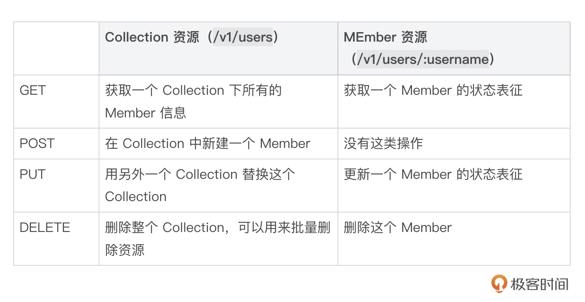
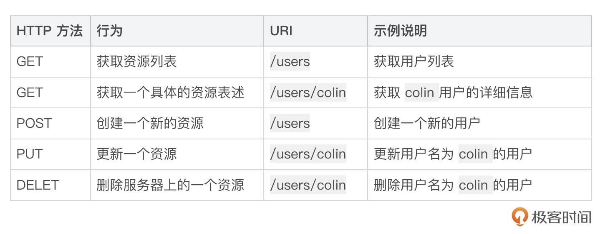
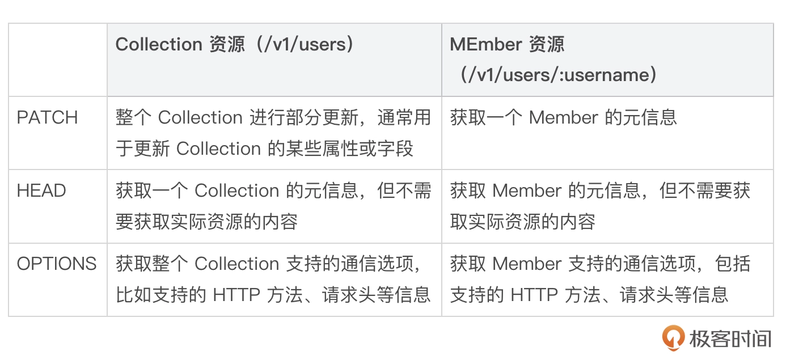
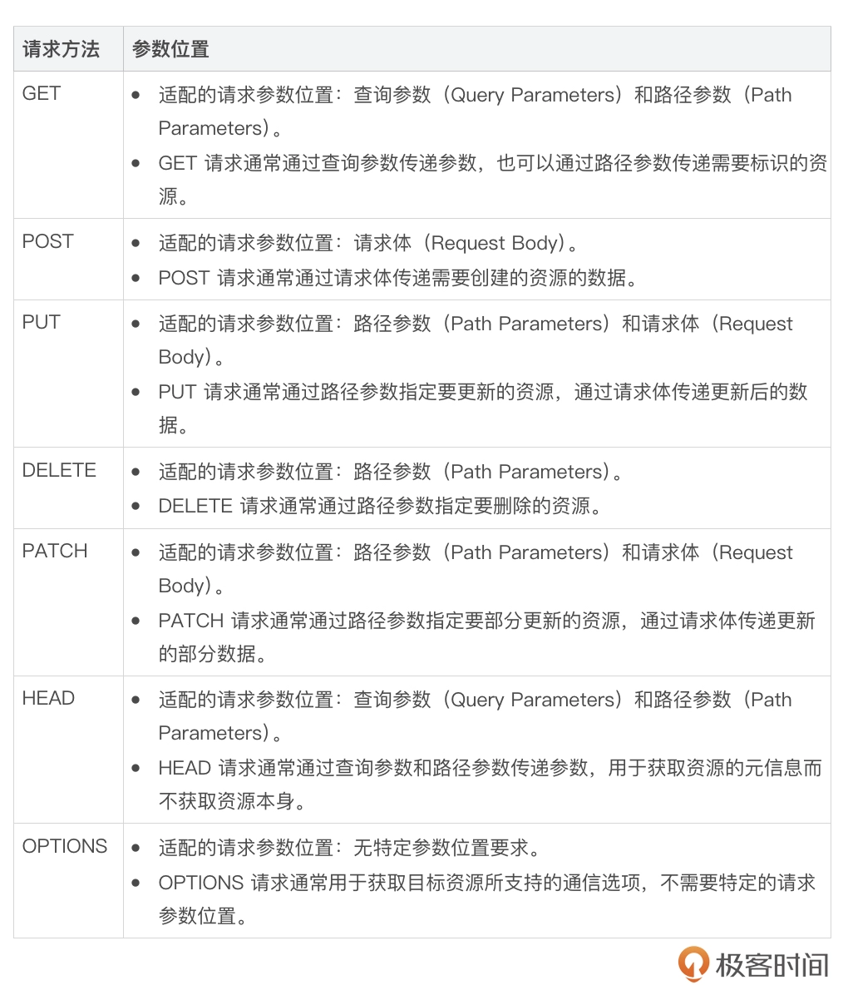
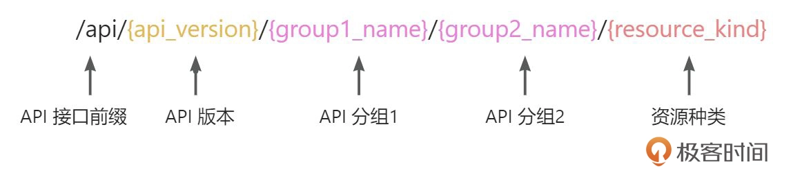
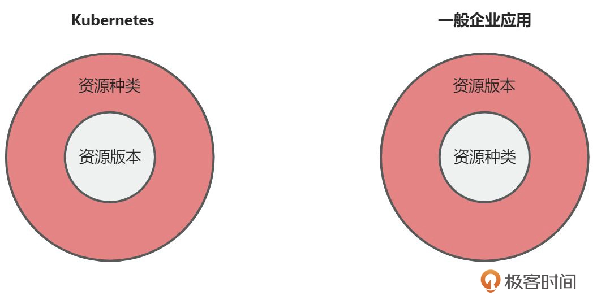

# 20-请求路径构建（上）：如何设置RESTfulAPI接口路径？

你好，我是孔令飞。

kube-apiserver 本质上是一个 Web 服务器，对外提供标准化的 RESTful API 接口。RESTfulAPI 接口由请求方法、请求路径和请求参数构成。想要深入理解 kube-apiserver 的核心实现，就需要掌握 Kubernetes 构建 RESTful API 接口的三要素。

前面两节课已经介绍了 Kubernetes 资源对象的定义方法，它正是基于这些标准化的资源对象自动构建 RESTful API 接口的请求方法、路径和参数。

请求方法可以在发送 HTTP 请求时直接指定。请求参数也可以直接通过 HTTP 请求来设置，例如，创建 Kubernetes 资源时，请求体直接就是资源对象的 YAML 定义。请求路径的构建比较复杂，所以接下来两节课会详细介绍它的构建逻辑。

## REST 接口规范

深入理解 kube-apiserver RESTful API 接口请求路径构建方式之前，我先来介绍下 REST 接口规范中的核心内容。

REST 规范中的核心点包括 URI 设计、API 版本管理等，我们一一来说。

### URI 设计

资源都是使用 URI 标识的，我们应该规范化设计 URI，让 API 接口更加易读、易用。以下是URI 设计时应该遵循的一些规范：

- 资源名使用名词而不是动词，并且用名词复数表示。资源分为 Collection 和 Member 两种。

- Collection：一堆资源的集合。例如，我们系统里有很多用户（User），这些用户的集合就是 Collection。Collection 的 URI 标识应该是域名 / 资源名复数，如

```
onex.usercenter.superproj.com/v1/users。
```

- Member：单个特定资源。例如，系统中特定名字的用户就是 Collection 里的一个Member。Member 的 URI 标识应该是域名 / 资源名复数 / 资源名称，如

```
onex.usercenter.superproj.com/v1/users/colin。
URI 结尾不应包含 /。
URI 中不能出现下划线 _，必须用中杠线 - 代替（有些人推荐用 _，有些人推荐用 -，统
一使用一种格式即可，我比较推荐用 -）。
```

- URI 路径用小写，不要用大写。

```
避免层级过深的 URI。超过 2 层的资源嵌套会很乱，建议将其他资源转化为 ? 参数，比
```

- 如：

```
/schools/tsinghua/classes/rooma/students/colin # 不推荐
/students?school=qinghua&class=rooma # 推荐
```

有个地方需要你注意：在 API 实际开发中，可能你会发现有些操作不能很好地映射为一个REST 资源，这时候你可以参考下面的做法。

- 将一个操作变成资源的一个属性。如果想在系统中暂时禁用某个用户，可以这么设计

```
URI：/users/colin?active=false。
```

- 将操作当作是一个资源的嵌套资源，如一个 GitHub 的加星操作：

```sql
PUT /gists/:id/star # github star action
DELETE /gists/:id/star # github unstar action
```

如果以上都不能解决问题，有时可以打破这类规范。比如登录操作，登录不属于任何一个资

```
源，URI 可以设计为：/v1/login。
```

另外，在设计 URI 时，如果你遇到一些不确定的地方，推荐你参考 GitHub 标准 RESTfulAPI。

### REST 资源操作映射为 HTTP 方法

```sql
基本上，RESTful API 都是使用 HTTP 协议原生的 GET、PUT、POST、DELETE 来标识对资
```

源的 CRUD 操作，形成的规范如下表所示：



下面是一个具体的映射例子：



```sql
GET、PUT、POST、DELETE 是 RESTful API 最常用的 HTTP 请求方法。HTTP 还提供了另
```

外 3 种请求方法，这些方法不经常使用，这里也列举出来供你参考：



```
注意，OPTIONS 请求方法通常用于跨域请求时的预检请求。
```

在使用 HTTP 方法的时候，你还需要注意以下两点：

```
GET 返回的结果要尽量可用于 PUT、POST 操作中。例如，用 GET 方法获得了一个 user
的信息，调用者修改 user 的邮件，然后将此结果再用 PUT 方法更新。这要求 GET、
PUT、POST 操作的资源属性类型是一样的。
如果对资源进行状态 / 属性变更，要用 PUT 方法，POST 方法仅用来创建或者批量删除这
```

- 两种场景。

另外，在设计 API 时，经常会有批量删除的需求，需要在请求中携带多个需要删除的资源名，

```sql
但是 HTTP 的 DELETE 方法不能携带多个资源名，这时候可以通过下面三种方式来解决：
发起多个 DELETE 请求。
操作路径中带多个 id，id 之间用分隔符分隔，如 DELETE /v1/users?ids=1,2,3 。
直接使用 POST 方式来批量删除，Body 中传入需要删除的资源列表。
其中，第二种方式我最推荐，因为使用了匹配的 DELETE 动词，并且不需要发送多次
DELETE 请求。这时候，你可能会问，id 列表太长会不会影响性能？其实不会的，因为真实
```

项目中每次允许删除的条目个数是有限的，通常跟每个页面的最大展示条数保持一致。

总的来说，这三种方式都有各自的使用场景，你可以根据需要自行选择。如果选择了某一种方式，那么整个项目都需要统一用这种方式。

### 匹配 HTTP 请求方法的参数

```sql
HTTP 有很多请求方法，如 GET、PUT、POST、DELETE 等。在执行 HTTP 请求时，根据请
```

求方法的类型，其参数指定位置也有规范。当 HTTP 请求方法和请求参数不匹配时，客户端会报错或者拒绝请求。

HTTP 请求参数可以视情况设置在以下位置：

```
查询参数（Query Parameters）：查询参数是附加在 URL 路径后面的键值对，使用 ? 开
头，多个参数之间使用 & 分隔，如 http://example.com/api/resource?
param1=value1&param2=value2。查询参数通常用于对资源进行过滤、分页、排序等
```

- 操作。

- 路径参数（Path Parameters）：路径参数是出现在 URL 路径中的一部分，通常用花括号

```
{} 包裹，如 http://example.com/api/resource/{id}。路径参数用于标识资源的
```

- 唯一标识符或者其他需要在 URL 中直接体现的参数。

```
请求头（Request Headers）：请求头是包含在 HTTP 请求头部中的键值对，如 Content-
Type: application/json。请求头用于传递请求的元数据、授权信息、内容类型等。
请求体（Request Body）：请求体是包含在 HTTP 请求中的主体部分，通常用于 POST、
PUT、PATCH 等方法中传递数据。请求体用于传递请求的具体数据，通常使用 JSON、
```

- XML 等格式。

- Cookie：Cookie 是存储在客户端的一小段文本信息，会随着每次请求被发送到服务器。Cookie 用于在客户端和服务器之间保持状态，通常用于会话管理、用户认证等。

下表是不同 HTTP 请求方法所支持的请求参数的设置位置：



### 统一的返回格式

一般来说，一个系统的 RESTful API 会向外界开放多个资源的接口，每个接口的返回格式要保持一致。另外，每个接口都会返回成功和失败两种消息，这两种消息的格式也要保持一致。不然客户端代码要适配不同接口的返回格式，每个返回格式又要适配成功和失败两种消息格式，会大大增加用户的学习和使用成本。返回的格式没有强制的标准，你可以根据实际的业务需要返回不同的格式。

### API 版本管理

随着时间的推移、需求的变更，一个 API 往往满足不了现有的需求，这时候就需要对 API 进行修改。为了不影响其他调用系统的正常使用，要求 API 变更做到向下兼容，也就是新老版本共存。

但在实际场景中，很可能会出现同一个 API 无法向下兼容的情况。最好的解决办法是从一开始就引入 API 版本机制，当不能向下兼容时，就引入一个新的版本，老的版本则保留原样。这样既能保证服务的可用性和安全性，同时也能满足新需求。

API 版本有不同的标识方法，在 RESTful API 开发中，通常将版本标识放在如下 3 个位置：

```
URL 中，如 /v1/users。
HTTP Header 中，如 Accept: vnd.example-com.foo+json; version=1.0。
Form 参数中，如 /users?version=v1。
```

通常建议将版本标识放在 URL 中的，这样做的好处是很直观，GitHub、Kubernetes、etcd 等很多优秀的 API 均采用这种方式。

但有些开发人员不建议这么做，因为他们觉得不同的版本可以理解成同一种资源的不同表现形式，所以应该采用同一个 URI。对于这一点，没有严格的标准，根据项目实际需要选择一种方式即可。

### API 命名

API 通常的命名方式有三种，分别是驼峰命名法（serverAddress）、蛇形命名法（server_address）和脊柱命名法（server-address）。

- 驼峰命名法有两种格式：大驼峰命名法和小驼峰命名法。将多个单词组合成一个标识符时，每个单词的首字母大写且单词间没有分隔符的方式为大驼峰命名法，如 ServerAddress。只有首单词首字母小写，后续单词首字母大写的命名方式是小驼峰命名法，如serverAddress。

- 蛇形命名法：多个单词之间用下划线 “_” 分隔，所有字母小写（或根据场景大写），如server_address。

- 脊柱命名法：多个单词之间用短横线 “-” 分隔，所有字母小写。GitHub API 用的就是脊柱命名法，例如 selected-actions。

驼峰命名法和蛇形命名法都需要切换输入法，会增加操作的复杂性，也容易出错，所以这里建议用脊柱命名法。

## RESTful API 接口请求路径设置方法

在 Kubernetes 中，RESTful API 接口路径究竟该如何设置呢？

在 REST 规范中，所有操作实体都会被视为资源。企业应用中通常会根据应用功能内置一个或多个资源，如用户资源、订单资源、商品资源等。

由于所有 API 接口都是对资源执行增删改查等操作，因此资源类型自然成为构建 API 接口请求路径的关键部分。换句话说，资源类型也会影响 API 接口的请求路径。

为了方便对企业应用内置资源的管理和维护，通常会将资源进行分组。例如，几乎所有的Web 框架都支持 API 接口分组，以下是 Gin 框架中支持 API 分组的代码：

```go
func main() {
   // 创建一个默认的 Gin 路由引擎
   r := gin.Default()
   // 用户分组
   v1 := r.Group("/api/v1") // API 版本 V1 分组
   {
       users := v1.Group("/users")
       {
           users.GET("/", getUsers)             // 获取所有用户
           users.POST("/", createUser)          // 创建新用户
           users.GET("/:id", getUserByID)       // 按 ID 获取用户
           users.PUT("/:id", updateUserByID)    // 更新用户
           users.DELETE("/:id", deleteUserByID) // 删除用户
       }
       // 产品分组
       products := v1.Group("/products")
       {
           products.GET("/", getProducts)             // 获取所有产品
           products.POST("/", createProduct)          // 创建新产品
           products.GET("/:id", getProductByID)       // 按 ID 获取产品
           products.PUT("/:id", updateProductByID)    // 更新产品
           products.DELETE("/:id", deleteProductByID) // 删除产品
       }
   }
   v2 := r.Group("/api/v2") // API 版本 V2 分组
   {
       users := v2.Group("/users")
       {
           users.GET("/", getUsersV2)             // 获取所有用户
           users.POST("/", createUserV2)          // 创建新用户
           users.GET("/:id", getUserByIDV2)       // 按 ID 获取用户
           users.PUT("/:id", updateUserByIDV2)    // 更新用户
           users.DELETE("/:id", deleteUserByIDV2) // 删除用户
       }
       // 产品分组
       products := v2.Group("/products")
       {
           products.GET("/", getProductsV2)             // 获取所有产品
           products.POST("/", createProductV2)          // 创建新产品
           products.GET("/:id", getProductByIDV2)       // 按 ID 获取产品
           products.PUT("/:id", updateProductByIDV2)    // 更新产品
           products.DELETE("/:id", deleteProductByIDV2) // 删除产品
       }
   }
   // 启动 HTTP 服务器
   r.Run(":8080")
}
上面通过 r.Group 方法设置了 2 个 API 分组：/api/v1、/api/v2，在 v1 和 v2 分组
下，又分了 users 和 products 2 个分组。如果你有需要，还可以继续使用 r.Group 方法
```

分组。因此，API 分组也是 API 接口请求路径的关键部分。

随着时间的推移、需求的变更，我们难免需要对 API 进行修改或引入新的 API。因此，API 版本也是请求路径的关键部分。

总的来说，RESTful API 接口的路径设计基于资源类型、分组和版本三要素共同构建。通常格

```
式为 /{API 接口前缀}/{API 版本}/{API 分组}/{资源种类}，如：
```



在常规企业应用中，API 路径通常遵循「先版本后资源」的结构（如 /api/v1/users），通过Web 框架（如 Gin）的分组机制将版本与业务资源（用户、商品等）解耦。随着功能迭代，每个资源集合（Collection）可能在不同版本路径下独立演化（如 /api/v2/users 中重构用户接口），但同一版本下可包含多种资源类型。

## Kubernetes API 接口请求路径构建方法

前面我们提到过 kube-apiserver 其实就是一个 REST 服务器，里面提供了众多的 RESTfulAPI 接口。Kubernetes 的 RESTful API 接口严格遵循了 REST API 接口的设计规范。

也就是说 Kubernetes 在构建 RESTful API 时，同样需要考虑以上 3 个请求路径的影响点。上述 3 个影响因素在 Kubernetes 中对应的概念或编程实体如下：

- 资源类型：Kind（资源类型）

- API 分组：Group（资源组）

- API 版本：Version（资源版本）

Kubernetes 构建请求路径的方法跟普通企业应用开发中的方法虽然相似，但在 API 版本和资源的所属关系上又有不同：



也就是说，在 Kubernetes 中，资源类型下有多个版本，而在一般企业应用中，资源版本下有多个资源类型。上述所属关系反应在 API 接口请求路径中的区别如下：

```
Kubernetes：/apis/apps/v1/namespaces。
一般企业应用：/apis/v1/apps/users。
```

## 课程总结

这节课我们先讲了 REST 的接口规范，包括 URI 设计、HTTP 方法与资源操作映射、参数设置位置、返回格式、版本管理和命名等。

Kubernetes 的路径设计则引入 Group-Version-Resource (GVR) 三元组概念，采用「资源组优

```
先 + 多版本共存」的结构：核心组 /api/v1 与非核心组 /apis/<group>/<version> 分
```

离，每个资源组内允许同一资源类型（如 Deployment）跨多个版本共存（如

```
/apis/apps/v1 和 /apis/apps/v1beta1 下均可定义 Deployment）。这种分层使得复杂
```

资源体系具备更强的演进能力——当某资源的 API Schema 需破坏性变更时，只需在新版本组路径下重新声明，而旧版路径仍保持兼容。

```
与此同时，Kubernetes 严格遵循 REST 规范：资源集合名使用复数（/deployments）、操
```

作与 HTTP 方法精确映射（GET 获取、PUT 全量更新）、URI 层级扁平化避免过深嵌套。这种设计既保证了云原生场景下海量资源的可管理性，也通过显式的路径结构为开发者提供了清晰的 API 扩展框架。

## 课后练习

1. 假设要为企业级应用设计一个订单资源的 REST 接口，需支持列举、创建、更新、删除四种操作，并允许按用户 ID 过滤。你能给出符合规范的四条 URI 与对应 HTTP 方法吗？

```
为什么 Kubernetes 要把版本信息放在 Group 前面（/apis/apps/v1/…），而多数企业
API 选择把版本直接放在根路径（/api/v1/…）。你觉得在设计上做了哪些权衡？
```

欢迎你在留言区与我交流讨论，如果今天的内容让你有所收获，也欢迎转发给有需要的朋友，我们下节课再见！
