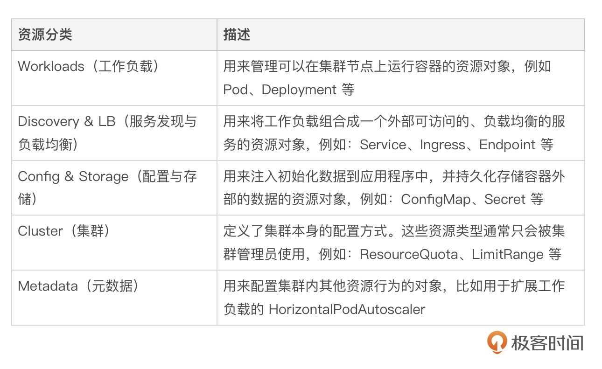
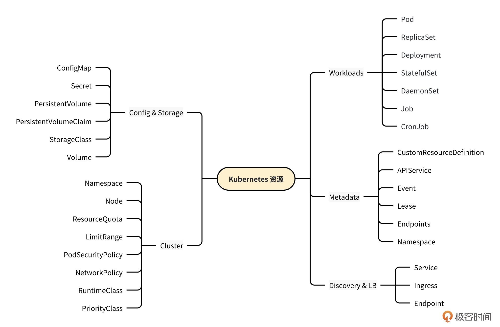
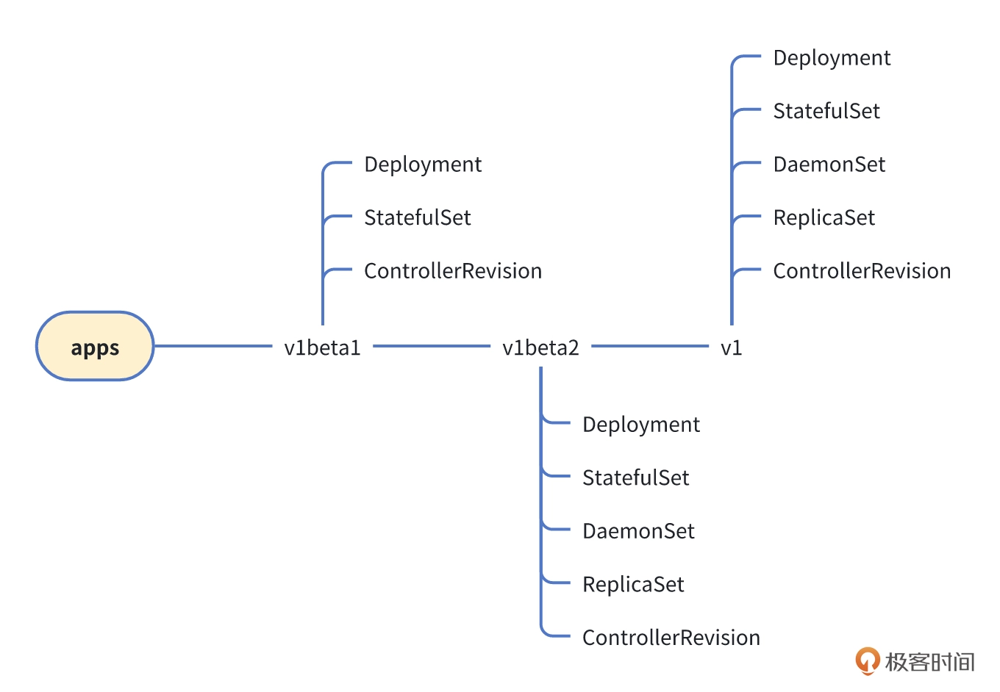
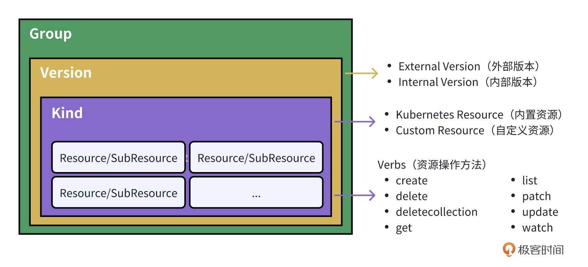
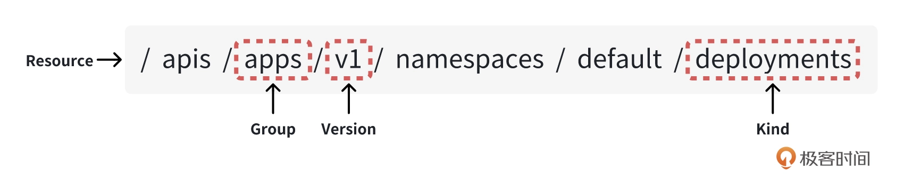
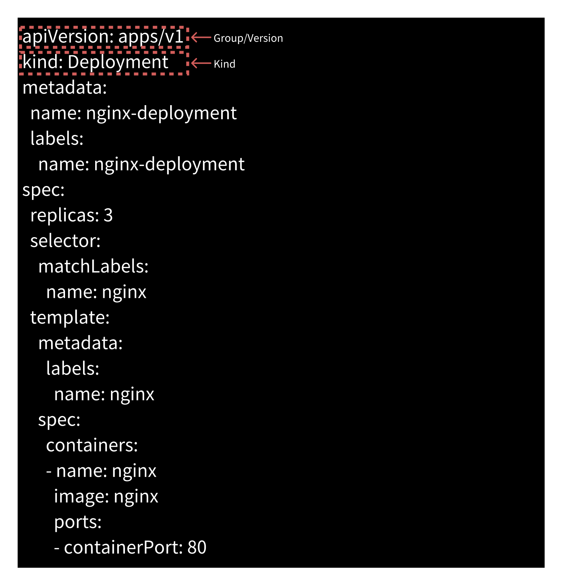

# 21-请求路径构建（下）：如何根据资源对象构建请求路径？

你好，我是孔令飞。

上一节课，我门讲了 REST 规范及如何构建符合 REST 规范的请求路径，也提到 Kubernetes在构建 REST 请求路径时，依赖于 3 个资源核心概念：Group、Version、Kind。

这节课就详细介绍下 Kubernetes 中的资源核心概念，以及 Kubernetes 是如何基于这些核心概念来构建 REST 请求路径的。

## Kubernetes 中的资源核心概念

整个 Kubernetes 的功能都是围绕着资源来构建的。想要学好 Kubernetes，就要深入细致地学习资源。

### 资源（Resource）

我们讲过，在 Kubernetes 中，资源指的是集群中可被管理和调度的任何实体，如 Pod、Service、Deployment 等。资源可以是用户定义的，也可以是 Kubernetes 自身定义的。在API 层面，这些资源本质上就是一个 REST 资源。Kubernetes 的资源又分为父资源和子资

```
源，例如：/api/v1/namespaces/default/pods 资源就包含了子资源
/api/v1/namespaces/default/pods/status。我们可以将父资源和子资源视为同一类
```

资源。

在 Kubernetes API Server 使用 APIResource 结构体来代表一个资源组，APIResource 结构体定义如下：

```sql
// APIResource specifies the name of a resource and whether it is namespaced.
type APIResource struct {
   // 资源名称
   Name string `json:"name" protobuf:"bytes,1,opt,name=name"`
   // 资源的单数名称，它必须小写字母组成，默认使用资源类型（Kind）的小写形式命名。例如：Pod
   // 资源的单数名称为 pod，复数名称为 pods
   SingularName string `json:"singularName" protobuf:"bytes,6,opt,name=singularN
   // 资源是否拥有所属命名空间
   Namespaced bool `json:"namespaced" protobuf:"varint,2,opt,name=namespaced"`
   // 资源所在的资源组名称
   Group string `json:"group,omitempty" protobuf:"bytes,8,opt,name=group"`
   // 资源所在的资源版本
   Version string `json:"version,omitempty" protobuf:"bytes,9,opt,name=version"`
   // 资源类型
   Kind string `json:"kind" protobuf:"bytes,3,opt,name=kind"`
   // 资源可操作的方法列表，例如：get、list、watch、create、update、patch、delete、dele
   Verbs Verbs `json:"verbs" protobuf:"bytes,4,opt,name=verbs"`
   // 资源的简称，例如：Pod 资源的简称为 po
   ShortNames []string `json:"shortNames,omitempty" protobuf:"bytes,5,rep,name=s
   // 资源所属的分组列表，例如 "all"
   Categories []string `json:"categories,omitempty" protobuf:"bytes,7,rep,name=c
   // 资源的存储版本的哈希值，即资源在写入数据存储时转换的版本。这是一个 alpha 特性，可能在将来
   StorageVersionHash string `json:"storageVersionHash,omitempty" protobuf:"byte
}
```

Categories 是一个列表，用来指定资源所属的资源分组。注意，这里的资源分组不是资源组。例如，我们可以将自定义资源指定到 all 资源分组中，当执行 kubectl get all 时，就能看到创建的自定义资源。

### 资源类型（Kind）

Kubernetes 中每一个资源都归属于某一个类型，这个类型就是 Kind。通常情况下一个资源归属于一个资源类型，但有时候，某个资源的子资源可能归属于不同的资源类型。例

```
如，/api/v1/namespaces/default/deployment 资源的
/api/v1/namespaces/default/deployment/scale 子资源的资源类型为 Scale，而不
```

是 Deployument。

kube-apiserver 内置了很多资源类型（如 v1.27.3 版本中内置了 55 个资源类型），这些资源类型又可以分为以下 5 类：



为了方便你了解，这里列出每一类别中比较常见的资源类型：



很多人容易混淆 Resource 和 Kind 的概念，这里我再来解释下。Kind 其实可以类比为面向对象编程中的类，用来指代某一个资源类型。Resource 可以类比为面向对象编程中的对象，是类实例化后的产物，用来指代具体的某个资源。

### 资源组（Group）

为了方便统一管理和维护所有资源，Kubernetes 根据资源的功能特性，抽象出了资源组的概念。每一个资源都归属于一个逻辑的资源组，资源组可以理解为具有相似功能的集合。

Kubernetes API Server 使用 APIGroup 结构体来代表一个资源组，APIGroup 结构体定义如下：

```
type APIGroup struct {
   // 内联字段，用于包含对象的基本元数据，比如 API 版本、资源类型等信息。
   TypeMeta `json:",inline"`
   // 资源组名称
   Name string `json:"name" protobuf:"bytes,1,opt,name=name"`
   // 资源组下所支持的资源版本列表
   Versions []GroupVersionForDiscovery `json:"versions" protobuf:"bytes,2,rep,na
   // 首选版本。当一个资源内存在多个资源版本时，Kubernetes API Server 在使用资源时，会选择一
   PreferredVersion GroupVersionForDiscovery `json:"preferredVersion,omitempty"
   // 是一个 ServerAddressByClientCIDR 类型的切片，用于描述客户端 CIDR 到服务器地址的映射
   // 这个字段是可选的，用于帮助客户端以最有效的方式访问服务器
   ServerAddressByClientCIDRs []ServerAddressByClientCIDR `json:"serverAddressBy
}
// GroupVersionForDiscovery 包含了 API 版本的信息
type GroupVersionForDiscovery struct {
   // 格式为 "group/version"，用于指定 API 的组和版本信息
   GroupVersion string `json:"groupVersion" protobuf:"bytes,1,opt,name=groupVers
   // 用于指定 API 的版本，格式为 "version"。这个字段保存了版本信息，避免了客户端需要拆分 G
   Version string `json:"version" protobuf:"bytes,2,opt,name=version"`
}
```

当前的 Kubernetes 版本支持两类资源组，分别是拥有组名的资源组和没有组名的资源组。

```
在有组名的资源组中，HTTP 请求路径以 /apis 为前缀，其表现形式为
/apis/<group>/<version>/<resource>，如
/apis/apps/v1/namespaces/{namespace}/deployments。核心组并不作为
apiVersion 字段的一部分，例如：
apiVersion: v1
kind: Pod
metadata:
 name: nginx
 labels:
   app: nginx
spec:
 containers:
 - name: nginx
   image: nginx
   ports:
   - containerPort: 80
```

没有组名的资源组被称为 Core Group（核心资源组）或 Legacy Group，也可被称为

```
GroupLess（无组）。HTTP 请求路径以 /api 为前缀，其表现形式为
/api/<version>/<resource>，如 /api/v1/namespaces/{namespace}/pods。
```

### /api 和 /apis 路径分组

```
我们看到，在有组名的资源组和没有组名的资源组中，HTTP 请求路径的前缀分别是 /apis
和 /api。在 Kubernetes 中，/api 和 /apis 是两个不同的 API 路径，它们分别用于访问核
```

心 API 组和自定义 API 组。这两个路径的区别主要是由 Kubernetes API 的演进历史和设计考虑所决定的：

```
/api 被用来访问 Kubernetes 的核心 API 组（Legacy API Group），包括 v1 版本的核心
```

- API 对象，比如 Pod、Service、Namespace 等。在较早的 Kubernetes 版本中，这是唯一的 API 组路径。

```
/apis 用于访问自定义 API 组，它提供了一种更加灵活的方式来扩展 Kubernetes API。自
```

- 定义 API 组允许用户定义自己的 API 资源类型，并将其添加到 Kubernetes 中，以满足特

```
定的业务需求。自定义 API 组通常以 <group>/<version> 的形式进行访问。这种方式
```

- 使得用户能够创建和管理自己的 API 资源，而不仅仅局限于 Kubernetes 核心 API 中提供的对象类型。

```
从历史的角度看，/api 是 Kubernetes 初始版本中唯一的 API 组路径，用于访问核心 API 对
```

象。但随着 Kubernetes 的发展和用户需求的增加，后续的 Kubernetes 版本引入了更多的

```
API 组，因此 /api 逐渐被 /apis 所取代。
在 APIGroup 的定义中，有一个匿名结构体 TypeMeta，其定义如下：
```

```
// TypeMeta 结构体用于描述 REST 资源的类型和版本信息
type TypeMeta struct {
   // 表示对象所代表的 REST 资源类型
   Kind string `json:"kind,omitempty" protobuf:"bytes,1,opt,name=kind"`
   // 定义了 REST 资源的版本信息
   APIVersion string `json:"apiVersion,omitempty" protobuf:"bytes,2,opt,name=api
}
TypeMeta 结构体用于描述 REST 资源的类型和版本信息，所有的 Kubernetes 资源都以匿名
```

的方式包含该结构体。

- 你可以在 Kubernetes API 参考文档 中查看 Kubernetes 支持的全部资源组。

### 启用或禁用资源组

知道了什么是资源组，我们再来讲讲 Kubernetes 是如何启用 / 禁用资源组的。

```xml
资源和资源组是在默认情况下被启用的，可以通过给 kube-apiserver 设置 --runtime-
config 参数来启用或禁用它们。--runtime-config 参数接受逗号分隔的 <key>[=
<value>] 键值对来指定 kube-apiserver 的配置。如果省略了 =<value> 部分，就视其指定
为 =true。
总的来说，禁用 batch/v1，对应参数设置为 --runtime-config=batch/v1=false。
启用 batch/v2alpha1，对应参数设置为 --runtime-config=batch/v2alpha1。如果
要启用特定版本的资源，如 storage.k8s.io/v1beta1/csistoragecapacities，可
以设置 --runtime-config=storage.k8s.io/v1beta1/csistoragecapacities。
```

值得注意的是，我们在启用或禁用资源组或资源时，需要重启 kube-apiserver 和 controller 来

```
使 --runtime-config 生效。
```

### 资源版本（Version）

Version 指的是 API 资源的版本。每个 API 资源都有自己的版本，用于标识 API 资源的演化和变化。Kubernetes 采用了语义化的版本号规范（Semantic Versioning）。语义化版本规范是GitHub 起草的一个具有指导意义的、统一的版本号表示规范。它规定了版本号的表示、增加和比较方式，以及不同版本号代表的含义。在这套规范下，版本号及其更新方式包含了相邻版

```
本间的底层代码和修改内容的信息。语义化版本格式为：主版本号.次版本号.修订号
（X.Y.Z），其中 X、Y 和 Z 为非负的整数，且禁止在数字前方补零。
```

语义化版本号可按以下规则递增：

```
v：所有版本号都以 v 开头。
```

- MAJOR 主版本号：意味着有大的版本更新，一般会导致 API 和之前版本不兼容。

- MINOR 次版本号：当做了向下兼容的功能性新增及修改。这里有个不成文的约定需要你注意，偶数为稳定版本，奇数为开发版本。

- PATCH 修订版本号：用户做了向后兼容的 Bug 修复。

Kubernetes API Server 使用 APIVersions 结构体来代表一个资源版本，APIVersion 结构体定义如下：

```
type APIVersions struct {
   TypeMeta `json:",inline"`
   // 支持的资源版本列表
   Versions []string `json:"versions" protobuf:"bytes,1,rep,name=versions"`
   // 是一个 ServerAddressByClientCIDR 类型的切片，用于描述客户端 CIDR 到服务器地址的映射
   ServerAddressByClientCIDRs []ServerAddressByClientCIDR `json:"serverAddressBy
}
```

Kubernetes 的资源版本控制可分为 3 种，分别是 Alpha、Beta 和 Stable。它们之间的迭代顺序为：Alpha -> Beta -> Stable，不同的资源版本代表着不同的稳定性和支持级别，我们一一来看。

首先，Alpha 的版本名称包含 alpha（如 v1alpha1）：

- 内置的 Alpha API 版本默认被禁用且必须在 kube-apiserver 配置中显式启用才能使用。

- 因为特性较新，可能没有经过完整的端到端测试，功能可能会有 Bug。例如，控制循环中的错误可能迅速创建过多的对象，耗尽 etcd 存储。

- 对某个 Alpha API 特性的支持可能会随时被删除，不会另行通知。

- API 可能在以后的软件版本中以不兼容的方式更改，不会另行通知。

- 由于缺陷风险增加和缺乏长期支持，建议该软件仅用于短期测试集群。

Beta 的版本名称也包含 beta，如 v2beta3。此外我们还要注意：

- 内置的 Beta API 版本默认被禁用且必须在 kube-apiserver 配置中显式启用才能使用 （例外情况是 Kubernetes 1.22 之前引入的 Beta 版本的 API 默认被启用）。

- 内置 Beta API 版本从引入到弃用的最长生命周期为 9 个月或 3 个次要版本（以较长者为准），从弃用到移除的最长生命周期为 9 个月或 3 个次要版本（以较长者为准）。

- 软件被很好地测试过，启用某个特性被认为是安全的。

- 尽管一些特性会发生细节上的变化，但它们将会被长期支持。

- 在随后的 Beta 版或 Stable 版中，对象的模式和（或）语义可能以不兼容的方式改变，这种情况发生时将提供迁移说明。适配后续的 Beta 或 Stable API 版本可能需要编辑或重新创建 API 对象，这可能并不简单。对于依赖此功能的应用程序，可能需要停机迁移。

- 该版本的软件不建议生产使用。后续发布版本可能会有不兼容的变动。一旦 Beta API 版本被弃用且不再提供服务，使用 Beta API 版本的用户需要转为使用后续的 Beta 或 StableAPI 版本。

Stable 的版本名称的格式为 vX，其中 X 为整数，如 v1：

- Stable 版本的特性会默认被启用。

- Stable 版本的特性都经过严格的测试，并且将在许多后续软件发布中继续存在。

- 特性的 Stable 版本会出现在后续很多版本的发布软件中。Stable API 版本仍然适用于Kubernetes 主要版本范围内的所有后续发布，并且 Kubernetes 的主要版本当前没有移除Stable API 的修订计划。

Alpha 级别的功能主要提供给那些想提前体验功能的开发者，并且强烈建议不要在生产环境中使用。Beta 级别的测试可以应用在生产集群中，但通常建议只用来进行短期的功能验证。Stable 版本的特性可以根据功能需要，在生产集群中长期使用。

- 如果你想更多地了解这 3 个资源版本级别，可参考：Alpha、Beta、 StableVersions。另外，资源版本和 Kubernetes 版本间接相关，你可以通过这个链接Kubernetes Release Versioning 了解两者的关系。

下面，我就以 apps 资源组为例，给你展示下该资源组下的资源版本和资源：



- 你可以在 staging/src/k8s.io/api/apps 目录下，找到上述资源的定义。

这里还想再补充一点，Kubernetes 在转换版本时，所有具名版本都会先转换为内部版本，再由内部版本转换为其他具名版本。所以，在 Kuberntes 中，资源版本又分为：内部版本和外部版本。外部版本会暴露给用户，用户在创建 Kubernetes 资源时，必须指定一个资源版本。内部版本不对外暴露，仅在 Kubernetes API Server 内部使用。

总的来说，Kubernetes 中支持多个资源组（Group），每个资源组中又包含多个版本（Version），每个版本中又包含多个资源类型（Kind），每个资源类型又包含多个具体的资源（Resource），部分资源类型又可以拥有子资源（SubResource），如 Deployment 资源类型就拥有 Status、Scale 子资源。

这些核心概念之间的关系如下图所示：



资源组、资源版本、资源、子资源的完整表现形式为：

```xml
<group>/<version>/<resource>/<subresource>。例如，Deployment 资源的完整表
现形式为：apps/v1/deployments/status。资源实例化后为一个资源对象，拥有资源
组、资源版本、资源类型，表现形式为：<group>/<version>，Kind=<kind>。例如，
Deployment 的完整表现形式为 apps/v1，Kind=Deployment。
```

每个资源类型又支持不同的 HTTP 方法（Verbs），几乎所有的资源类型都支持 create、delete、deletecollection、get、list、patch、update、watch 方法。

## 使用 Group、Version、Kind 构建 REST 请求路径

为了让你更直观地了解这些核心概念，我创建一个 Deployment 资源来给你展示下如何通过Group、Version、Kind 构建 REST 请求路径。

### 指定 HTTP 请求路径

首先，我们指定创建 Deployment 的各项参数。为此，我们创建一个名为

```
deployment.yaml 的 YAML 文件：
apiVersion: apps/v1
kind: Deployment
metadata:
 name: nginx-deployment
 labels:
   name: nginx-deployment
spec:
 replicas: 3
 selector:
   matchLabels:
     name: nginx
 template:
   metadata:
     labels:
       name: nginx
   spec:
     containers:
     - name: nginx
       image: nginx
       ports:
       - containerPort: 80
接下来，我们执行以下命令来创建名为 nginx-deployment 的资源：
$ kubectl create --raw /apis/apps/v1/namespaces/default/deployments -f deployment
$ kubectl get deployment nginx-deployment
NAME               READY   UP-TO-DATE   AVAILABLE   AGE
nginx-deployment   3/3     3            3           16s
```

在创建 Deployment 资源时，我们指定了 URL

```
/apis/apps/v1/namespaces/default/deployments，URL 中包含了资源组、资源版
```

本、资源等信息：



### 通过资源定义参数构建 HTTP 请求路径

```
前面，我们通过 --raw 命令行参数来指定 HTTP 请求的完整路径
/apis/apps/v1/namespaces/default/deployments。在 Kubernetes 中，我们还可
```

以通过以下方式来创建一个资源：

```
$ tee -a deployment.yaml  <<'EOF'
apiVersion: apps/v1
kind: Deployment
metadata:
 name: nginx-deployment
 labels:
   name: nginx-deployment
spec:
 replicas: 3
 selector:
   matchLabels:
     name: nginx
 template:
   metadata:
     labels:
       name: nginx
   spec:
     containers:
     - name: nginx
       image: nginx
       ports:
       - containerPort: 80
EOF
$ kubectl create -f deployment.yaml
```

你可能会问，如果创建资源时没有直接指定 HTTP 请求路径，又是如何向 kube-apiserver 发

```
送 HTTP 请求的呢？我们来看下 deployment.yaml 的内容：
```



```xml
在创建 Deployment 资源的 YAML 格式的参数定义中，我们通过 apiVersion 参数指定了
<group>/<version>，通过 kind 指定了资源类型。kubectl 命令行工具会从 YAML 文件中
解析出 apiVersion 和 kind 参数，并使用其值来构建出 HTTP 请求路
径：/apis/apps/v1/namespaces/default/deployments。
```

## GV & GVK & GVR 概念介绍

通过上面的介绍，我们知道，Kubernetes 中可以通过资源组、资源版本、资源类型来构建一个 REST 请求路径。为了方便描述和记忆，这些概念被组合为各种简称，如 GV、GVK、GVR。接下来，我们介绍下常见的简称。

```
GV（Group Version）指的是 API 资源的组和版本。例如，v1 表示 Kubernetes 核心 API 资
源的版本，而 apps/v1 表示 apps 组的 API 资源的版本。GV 用于标识和区分不同组和版本
```

的 API 资源。

GVK（Group Version Kind）是 API 资源的组、版本和类型的组合。例如，

```
apps/v1/Deployment 表示 apps 组中版本为 v1 的 Deployment 资源。GVK 用于唯一
```

标识和定位一个具体的 API 资源。

GVR（Group Version Resource）是 API 资源的组、版本和资源名称的组合。例如，

```
apps/v1/deployments 表示 apps 组中版本为 v1 的所有 Deployment 资源。GVR 用于
```

在代码中动态地构建和操作 API 资源的 URL 路径。

这些概念在 Kubernetes 中非常重要，特别是在编写自定义控制器、操作 CRD（CustomResource Definition）等场景下，开发人员需要理解和使用这些概念来操作和管理 Kubernetes的 API 资源。通过 GV、GVK 和 GVR，开发人员可以准确定位和操作集群中的各种 API 资源。

## 课程总结

本节课，我们先介绍了 Kubernetes 中资源的核心概念，以及各个概念之间的关系。Kubernetes 中支持多个资源组，每个资源组中又包含多个版本，每个版本中又包含多个资源类型，每个资源类型又包含多个具体的资源。

课程的最后，我们还通过创建 Deployment 的具体请求，理解了通过 Group、Version、Kind构建 REST 请求路径的方法，进一步加深了对这些核心资源概念的理解。

## 课后练习

1. 你能用自己的话总结出 Kubernetes 构建 RESTful API 请求路径的过程吗？

2. Kubernetes RESTful API 接口请求路径的格式是什么，组成方式有哪些？

欢迎你在留言区与我交流讨论，如果今天的内容让你有所收获，也欢迎转发给有需要的朋友，我们下节课再见！
