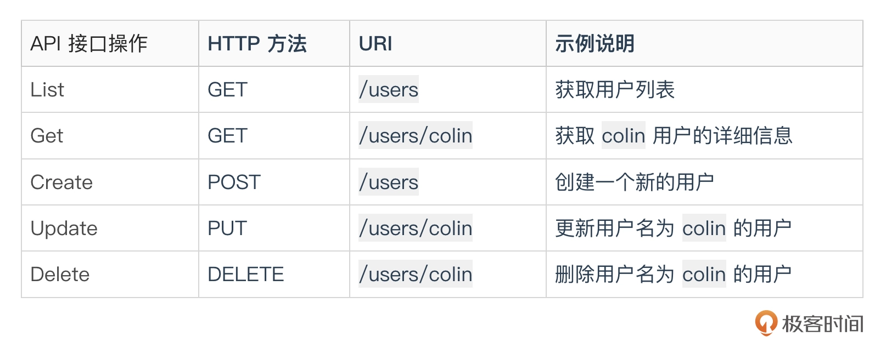
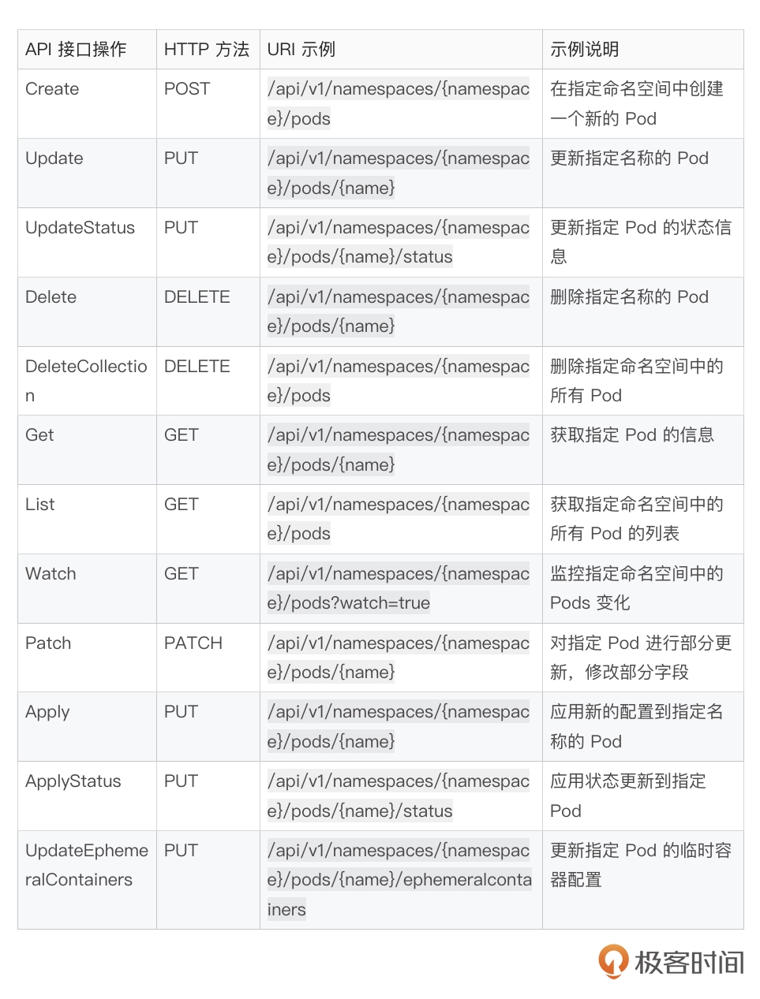

# 22 | Kubernetes支持哪些RESTfulAPI接口？

你好，我是孔令飞。

前面几节课，我从一般企业应用的 RESTful API 接口设计、开发流程和思路上，为你详细介绍了 Kubernetes 中的核心概念和资源定义方式。

接下来，我们从源码层面看下 Kubernetes 具体是如何构建一个 RESTful API 接口的。为了方便你理解，我会花三节课来讲解：

- Kubernetes 支持哪些 RESTful API 接口？

- 如何使用 go-restful 开发一个 Web 服务器？

- Kubernetes 路由构建源码剖析。

这节课，我们先来讲 Kubernetes 支持的 RESTful API 接口。

## Kubernetes 中支持哪些 HTTP 接口？

首先，我们来看下，Kubernetes 中支持哪些 HTTP 接口。一般的企业应用通常会支持以下HTTP 路由：



Kubernetes 中除了支持上述 API 接口操作之外，还支持更多的接口操作类型，如下（可参考pod.go 文件）：



## Kubernetes HTTP 路由生成方法

Kubernetes 中 HTTP 路由的构建，其实分为客户端 HTTP 路由构建和服务端 HTTP 路由指定两种方式。

- 客户端 HTTP 路由构建：指 client-go 根据 SDK 提供的接口，在最终发送 HTTP 请求时，指定 HTTP 路由。

```
服务端 HTTP 路由指定：指 kube-apiserver 在服务启动时设置 HTTP 路由，类似于 r.GET
```

- 这种形式。

接下来，我们分别来说。

### 客户端 HTTP 路由构建

通常通过 SDK 来访问 kube-apiserver。Kubernetes 提供 client-go 包供 Go 开发者高效访问 kube-apiserver。

```
client-go 是由 client-gen 工具自动生成的。在使用 client-gen 生成 client-go 代码时，
```

我们可以指定需要给资源生成的 API 操作。

```python
例如，我们新增加了一个 XXX 资源，资源定义如下（见 xxx_types.go 文件）：
package resourceobject
import (
   metav1 "k8s.io/apimachinery/pkg/apis/meta/v1"
)
// +enum
type XXXPhase string
// These are the valid phases of a xxx.
const (
   // XXXRunning means the xxx is in the running state.
   XXXRunning XXXPhase = "Running"
   // XXXPending means the xxx is in the pending state.
   XXXPending XXXPhase = "Pending"
)
// +genclient
// +k8s:deepcopy-gen:interfaces=k8s.io/apimachinery/pkg/runtime.Object
// XXX is an example definition of a Kubernetes resource object.
type XXX struct {
   metav1.TypeMeta `json:",inline"`
   // Standard object's metadata.
   // More info: https://git.k8s.io/community/contributors/devel/sig-architectur
   // +optional
   metav1.ObjectMeta `json:"metadata,omitempty" protobuf:"bytes,1,opt,name=metad
   // Spec defines the behavior of the XXX.
   // More info: https://git.k8s.io/community/contributors/devel/sig-architectur
   // +optional
   Spec XXXSpec `json:"spec,omitempty" protobuf:"bytes,2,opt,name=spec"`
   // Status describes the current status of a XXX.
   // More info: https://git.k8s.io/community/contributors/devel/sig-architectur
   // +optional
   Status XXXStatus `json:"status,omitempty" protobuf:"bytes,3,opt,name=status"`
}
// XXXSpec describes the attributes on a XXX.
type XXXSpec struct {
   // DisplayName is the display name of the XXX resource.
   DisplayName string `json:"displayName" protobuf:"bytes,1,opt,name=displayName
   // Description provides a brief summary of the XXX's purpose or functionality
   // It helps users understand what the XXX is intended for.
   // +optional
   Description string `json:"description,omitempty" protobuf:"bytes,2,opt,name=d
   // You can add more status fields as needed.
   // +optional
}
// XXXStatus is information about the current status of a XXX.
type XXXStatus struct {
   // Phase is the current lifecycle phase of the xxx.
   // +optional
   Phase XXXPhase `json:"phase,omitempty" protobuf:"bytes,1,opt,name=phase,castt
   // ObservedGeneration reflects the generation of the most recently observed X
   // +optional
   ObservedGeneration int64 `json:"observedGeneration,omitempty" protobuf:"varin
   // Represents the latest available observations of a xxx's current state.
   // +optional
   // +patchMergeKey=type
   // +patchStrategy=merge
   // +listType=map
   // +listMapKey=type
   Conditions []metav1.Condition `json:"conditions,omitempty" patchStrategy:"mer
   // You can add more status fields as needed.
   // +optional
}
// +k8s:deepcopy-gen:interfaces=k8s.io/apimachinery/pkg/runtime.Object
// XXXList is a list of XXX objects.
type XXXList struct {
   metav1.TypeMeta `json:",inline"`
   // Standard list metadata.
   // More info: https://git.k8s.io/community/contributors/devel/sig-architectur
   // +optional
   metav1.ListMeta `json:"metadata,omitempty" protobuf:"bytes,1,opt,name=metadat
   // Items is a list of schema objects.
   Items []XXX `json:"items" protobuf:"bytes,2,rep,name=items"`
}
我们可以执行以下 client-gen 命令来给 XXX 生成 SDK 方法：
$ git clone https://github.com/superproj/k8sdemo.git
$ cd resourcedefinition/
$ go mod tidy
$ client-gen -v 10 --go-header-file ./boilerplate.go.txt --output-dir ./generated
上述命令会生成 apps/v1beta1 目录中指定资源的客户端方法，用到的命令行参数释义如
```

下：

```
-v 10：设置日志级别，数值越高，输出的日志信息越详细。
--go-header-file ./boilerplate.go.txt：指定一个 Go 文件头的模板
```

- （boilerplate），通常用于添加版权信息、作者信息等。这会被添加到生成的每个文件的顶部。

```
--output-dir ./generated/clientset：指定生成代码的输出目录。在这个例子
中，生成的客户端代码将存放在 ./generated/clientset 目录下。
--output-
pkg=github.com/superproj/k8sdemo/resourcedefinition/generated/clie
ntset：设置生成代码的包名称。
--clientset-name=versioned：指定生成的客户端集的名称。此处定义的
versioned 客户端集将用于封装 API 资源的访问。
--input-base=：该参数用于设置输入基础路径。如果不设置，会默认使用当前工作目录
```

- 作为基础路径。一般来说，留空表示从输入路径开始。

```
--input $PWD/apps/v1beta1：指定要生成客户端代码的 API 资源的目录。
$PWD/apps/v1beta1 表示当前工作目录下的 apps/v1beta1 文件夹，通常这个文件夹
```

- 包含了 API 的定义文件和类型定义。

```
client-gen 工具生成的 XXX 资源方法见：
```

generated/clientset/versioned/typed/apps/v1beta1/xxx.go。

```sql
这里要注意，apps/v1beta1 目录中可能定义了很多个 Kubernetes 资源对象，client-
gen 工具会根据资源定义之上有无 // +genclient 注释，来判断是否要为该资源生成 SDK
方法。如果有 // +genclient 则生成，没有 // +genclient 则不生成，例如：
// +genclient
// +k8s:deepcopy-gen:interfaces=k8s.io/apimachinery/pkg/runtime.Object
// XXX is an example definition of a Kubernetes resource object.
type XXX struct {
   metav1.TypeMeta `json:",inline"`
   // Standard object's metadata.
   // More info: https://git.k8s.io/community/contributors/devel/sig-architectur
   // +optional
   metav1.ObjectMeta `json:"metadata,omitempty" protobuf:"bytes,1,opt,name=metad
   // Spec defines the behavior of the XXX.
   // More info: https://git.k8s.io/community/contributors/devel/sig-architectur
   // +optional
   Spec XXXSpec `json:"spec,omitempty" protobuf:"bytes,2,opt,name=spec"`
   // Status describes the current status of a XXX.
   // More info: https://git.k8s.io/community/contributors/devel/sig-architectur
   // +optional
   Status XXXStatus `json:"status,omitempty" protobuf:"bytes,3,opt,name=status"`
}
client-gen 工具在生成接口方法时，默认会生成 Create、Update、UpdateStatus、
Delete、DeleteCollection、Get、List、Watch、Patch，例如：
// XXXInterface has methods to work with XXX resources.
type XXXInterface interface {
   Create(ctx context.Context, xXX *v1beta1.XXX, opts v1.CreateOptions) (*v1beta
   Update(ctx context.Context, xXX *v1beta1.XXX, opts v1.UpdateOptions) (*v1beta
   UpdateStatus(ctx context.Context, xXX *v1beta1.XXX, opts v1.UpdateOptions) (*
   Delete(ctx context.Context, name string, opts v1.DeleteOptions) error
   DeleteCollection(ctx context.Context, opts v1.DeleteOptions, listOpts v1.List
   Get(ctx context.Context, name string, opts v1.GetOptions) (*v1beta1.XXX, erro
   List(ctx context.Context, opts v1.ListOptions) (*v1beta1.XXXList, error)
   Watch(ctx context.Context, opts v1.ListOptions) (watch.Interface, error)
   Patch(ctx context.Context, name string, pt types.PatchType, data []byte, opts
   XXXExpansion
}
我们可以通过 // +genclient:method=... 注释指定要生成的 API 接口方法、对应的
HTTP 方法、入参和回参等。例如，OneX 项目中 MinerSet 资源定义文件
```

minerset_types.go：

```sql
// +genclient
// +genclient:method=GetScale,verb=get,subresource=scale,result=k8s.io/api/autosc
// +genclient:method=UpdateScale,verb=update,subresource=scale,input=k8s.io/api/a
// +genclient:method=ApplyScale,verb=apply,subresource=scale,input=k8s.io/api/aut
// +k8s:deepcopy-gen:interfaces=k8s.io/apimachinery/pkg/runtime.Object
// MinerSet ensures that a specified number of miners replicas are running at any
type MinerSet struct {
   metav1.TypeMeta `json:",inline"`
   // If the Labels of a MinerSet are empty, they are defaulted to
   // be the same as the Miner(s) that the MinerSet manages.
   // Standard object's metadata.
   // More info: https://git.k8s.io/community/contributors/devel/sig-architectur
   // +optional
   metav1.ObjectMeta `json:"metadata,omitempty" protobuf:"bytes,1,opt,name=metad
   // Spec defines the specification of the desired behavior of the MinerSet.
   // More info: https://git.k8s.io/community/contributors/devel/sig-architectur
   // +optional
   Spec MinerSetSpec `json:"spec,omitempty" protobuf:"bytes,2,opt,name=spec"`
   // Status is the most recently observed status of the MinerSet.
   // This data may be out of date by some window of time.
   // Populated by the system.
   // Read-only.
   // More info: https://git.k8s.io/community/contributors/devel/sig-architectur
   // +optional
   Status MinerSetStatus `json:"status,omitempty" protobuf:"bytes,3,opt,name=sta
}
+genclient:method=GetScale,verb=get,subresource=scale,result=k8s.io/
api/autoscaling/v1.Scale 注释释义如下：
method: 指定要生成的方法名称。
verb: HTTP 动词，用于指定该方法的行为，如 get、update。
subresource: 指定这个方法是针对子资源的操作，通常用于扩展资源的 API，如缩放。
input: 指定该方法的输入类型。
result: 指定该方法的返回类型。
```

### 服务端 HTTP 路由指定

服务端的 HTTP 路由是由 kube-apiserver 在启动时，用静态代码的方式添加的。添加方法你可以查看 registerResourceHandlers 方法，添加 HTTP 路由的核心逻辑代码如下：

```sql
       // Handler for standard REST verbs (GET, PUT, POST and DELETE).
       // Add actions at the resource path: /api/apiVersion/resource
       actions = appendIf(actions, action{"LIST", resourcePath, resourceParams,
       actions = appendIf(actions, action{"POST", resourcePath, resourceParams,
       actions = appendIf(actions, action{"DELETECOLLECTION", resourcePath, reso
       // DEPRECATED in 1.11
       actions = appendIf(actions, action{"WATCHLIST", "watch/" + resourcePath,
       // Add actions at the item path: /api/apiVersion/resource/{name}
       actions = appendIf(actions, action{"GET", itemPath, nameParams, namer, fa
       if getSubpath {
           actions = appendIf(actions, action{"GET", itemPath + "/{path:*}", pro
       }
       actions = appendIf(actions, action{"PUT", itemPath, nameParams, namer, fa
       actions = appendIf(actions, action{"PATCH", itemPath, nameParams, namer,
       actions = appendIf(actions, action{"DELETE", itemPath, nameParams, namer,
       // DEPRECATED in 1.11
       actions = appendIf(actions, action{"WATCH", "watch/" + itemPath, namePara
       actions = appendIf(actions, action{"CONNECT", itemPath, nameParams, namer
       actions = appendIf(actions, action{"CONNECT", itemPath + "/{path:*}", pro
```

这一节课，我们先简单了解下添加 HTTP 路由的代码位置，至于如何添加路由的具体内容，后面的课程再详细介绍。

## 课程总结

Kubernetes 的 RESTful API 不仅支持常规的 CRUD 操作（如 Create、Update、Delete），还

```
扩展了状态更新、批量操作和实时监听等高级接口。例如，UpdateStatus 允许单独更新资
```

源状态字段，Watch 通过长连接实时推送资源变更事件，Patch 支持部分字段更新。这些接口的路径构建由资源组（Group）、版本（Version）、资源类型（Kind）共同决定，如

```
/apis/apps/v1/namespaces/{namespace}/deployments/{name}/status。
客户端路由生成依赖于 client-gen 工具，它通过资源定义文件中的 // +genclient 注释自
动生成 SDK 方法（如 List()、Watch()），并支持通过 // +genclient:method 扩展自
定义子资源操作（如 GetScale）。服务端路由则由 kube-apiserver 在启动时静态注册，通过
registerResourceHandlers 方法将 HTTP 动词（GET/PUT 等）与资源路径绑定，确保
```

每个操作映射到正确的 REST 端点。

## 课后练习

```
假设需要为自定义资源 Task 实现实时监听任务状态变化，以及批量删除所有失败的任
```

- 务。根据文中接口规范，分别应使用哪种 HTTP 方法和路径？请写出完整的 URI 示例（假

```
设组为 batch.superproj.io/v1，命名空间为 default）。
路由注册机制在 kube-apiserver 的 registerResourceHandlers 代码中：
actions = appendIf(actions, action{"WATCH", "watch/" + itemPath, nameParams, name
```

这行代码注册了哪种类型的接口？对应的 HTTP 请求路径可能是什么（以 Pod 资源为例）？

欢迎你在留言区与我交流讨论，如果今天的内容让你有所收获，也欢迎转发给有需要的朋友，我们下节课再见！
