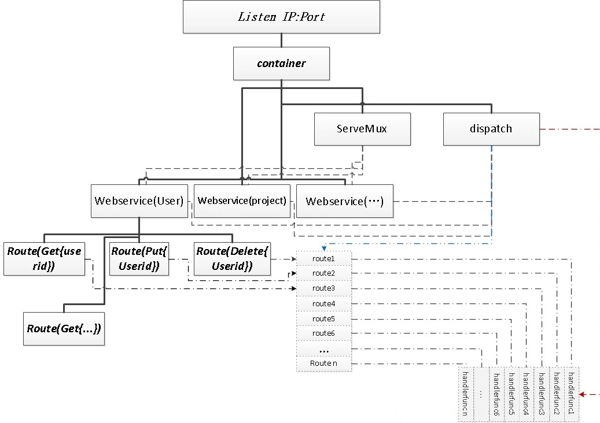

# 23 | 如何使用go-restful开发一个Web服务器？

你好，我是孔令飞。

Kubernetes 的整个 REST 路由都是基于 go-restful 包来构建的，这节课我们就来详细介绍

```
go-restful Web 框架的核心概念及使用方法。
```

## go-restful 包

```
github.com/emicklei/go-restful 是一个流行的 Go Web 框架，通过链式调用来构建
标准的 RESTful API 接口。go-restful 包提供了众多方法对 RESTful API 接口进行需要的
```

设置，包括但不限于：请求路径设置、请求和返回的 MIME 类型设置、中间件支持、自动生成API 接口文档等。

## RESTful API 框架核心要素

从应用程序开发的角度来看，RESTful API 的本质是一个 Web Application，而 RESTful API框架就是实现这个 Web Application 所封装的一系列工具库，使开发者可以忽略底层实现的复杂度，专注于自身 Application 的逻辑设计。

一个 RESTful API 框架应该具备以下几个元素：

- Resources：资源的定义，即 HTTP URI（或称之为 HTTP URL Path）的定义。RESTfulAPI 的设计围绕着 Resource 建模。

- Handlers：资源处理器，是资源业务逻辑处理的具体实现。

- Request Routers：资源请求路由器，完成 HTTP URIs、HTTP Request Methods 和Handlers 三者之间的映射与路由。

- Request Verification Schemas：HTTP Request Body 校验器，验证请求实体的合法性。

- Response View Builder：HTTP Response Body 生成器，生成合法的响应实体。

- Controllers：资源表现层状态转移控制器，每个 Resource 都有着各自的 Controller，将Resource 自身及其所拥有的 Handlers、Request Verification Schemas 以及 ResponseView Builder 进行封装，配合 Request Routers 完成 RESTful 请求的处理及响应。

go-restful 具有以下特性：

- 支持可配置的请求路由，默认使用 CurlyRouter 快速路由算法，也支持 RouterJSR311。

```
支持在 URL path 上定义正则表达式，如 /static/{subpath:*}。
```

- 提供 Request API 用于从 JSON、XML 读取路径参数、查询参数、头部参数，并转换为Struct。

- 提供 Response API 用于将 Struct 写入到 JSON、XML 以及 Header。

- 支持在服务级或路由级对请求、响应流进行过滤和拦截。

- 支持使用过滤器自动响应 OPTIONS 请求和 CORS（跨域）请求。

- 支持使用 RecoverHandler 自定义处理 HTTP 500 错误。

- 支持使用 ServiceErrorHandler 自定义处理路由错误（如 HTTP 404/405/406/415 等错误）。

- 支持对请求、响应的有效负载进行编码（如 gzip、deflate）。

- 支持使用 CompressorProvider 注册自定义的 gzip、deflate 的读入器和输出器。

- 支持使用 EntityReaderWriter 注册自定义的编码实现。

- 支持 Swagger UI 编写的 API 文档。

- 支持可配置的日志跟踪。

## go-restful 包中的核心概念



- 图片来源于网络

上图包含了 go-restful 包中几个核心概念，接下来我们一一介绍。

### Route

Route 表示一条请求路由记录，即 Resource 的 URL Path（URI），从编程的角度可细分为RootPath 和 SubPath。Route 包含了 Resource 的 URL Path、HTTP Method、Handler 三者之间的组合映射关系。go-restful 内置的 RouteSelector（请求路由分发器）根据 Route 将客户端发出的 HTTP 请求路由到相应的 Handler 进行处理。

go-restful 支持两种路由分发器：快速路由 CurlyRouter 和 RouterJSR311。实际上，CurlyRoute 也是基于 RouterJSR311 的，相比 RouterJSR11，CurlyRoute 还支持了正则表达

```
式和动态参数，同时也更加轻量级。kubernetes-apiServer 中使用的就是这种路由。
```

CurlyRouter 的元素包括：请求路径（URL Path）、请求参数（Parameter）、输入、输出类型（Writes、Reads Model）、处理函数（Handler）、响应内容类型（Accept）等。

### WebService（路由分组）

一个 WebService 由若干个 Routes 组成，并且 WebService 内的 Routes 拥有同一个RootPath、输入输出格式、基本一致的请求数据类型等等一系列的通用属性。通常，我们会根据需要将一组相关性非常强的 API 封装成一个 WebServiice，继而将 Web Application 所拥有的全部 APIs 划分若干个 Group。

```
所以 WebService 至少会有一个 Root Path 通过 ws.Path() 方法设置，作为 Group 的 “根”
（如：/user_group）。Group 下属的 APIs 都是 RootRoute（RootPath）下属的 SubRoute
```

（SubPath）。

每个 Group 就是提供一项服务的 API 集合，每个 Group 会维护一个 Version。Group 的抽象是为了能够安全隔离地对各项服务进行敏捷迭代，当我们对一项服务进行升级时，只需要通过对特定版本号的更新来升级相关的 APIs，而不会影响到整个 Web Server。根据实际情况，可能若干个 APIs 分为一个 Group，也有可能一个 API 就是一个 Group。

### Container

Container 表示一个 Web Server（服务器），由多个 WebServices 组成，此外还包含了若干个Filters（过滤器）、一个 http.ServeMux 多路复用器，以及一个 dispatch。go-restful 从Container 开始将路由分发给各个 WebService，再由 WebService 分发给具体的 Handler 函数，这些过程都在 dispatch 中实现。

开发者根据需要创建 Container 实例之后，将 Container 加载到一个 http.Server 上运行，具体示例如下：

```go
// 构建一个 WebService 实例。
ws := new(restful.WebService)
// 定义 Root Path。
ws.Path("/users")
// 定义一个 WebService 下属的 Route。
ws.Route(ws.GET("/users").To(u.findAllUsers).
        Doc("get all users").
        Metadata(restfulspec.KeyOpenAPITags, tags).
        Writes([]User{}).
        Returns(200, "OK", []User{}))
// 构建一个 Container 实例。
container := restful.NewContainer()
// 将 Container 加载到 http.Server 运行。
server := &http.Server{Addr: ":8081", Handler: container}
```

### 过滤器（Filter）

go-restful 支持服务级、路由级的请求或响应过滤。开发者可以使用 Filter 来执行常规的日志记录、计量、验证、重定向、设置响应头部等工作。go-restful 除了提供了 3 个针对请求、响应的钩子（Hooks），还可以实现自定义的 Filter。

```
每个 Filter 必须实现一个 FilterFunction：
func(req *restful.Request, resp *restful.Response, chain *restful.FilterChain)
```

并且，每个 Filter 需要使用如下语句传递请求、响应对到下一个 Filter 或 RouteFunction：

```
chain.ProcessFilter(req, resp)
```

Container Filter：在注册 WebService 之前执行处理，示例代码如下：

```
// 安装一个全局的 Filter 到 Default Container
restful.Filter(globalLogging)
```

WebService Filter：在请求路由到 WebService 之前执行处理，示例代码如下：

```
// 安装一个 WebService Filter
ws.Filter(webserviceLogging).Filter(measureTime)
```

Route Filter：在调用 Router 相关的函数之前执行处理，示例代码如下：

```
// 安装 2 个链式的 Route Filter
ws.Route(ws.GET("/{user-id}").Filter(routeLogging).Filter(NewCountFilter().routeC
```

OPTIONS Filter：使 WebService 可以响应 HTTP OPTIONS 请求，示例代码如下：

```
Filter(OPTIONSFilter())
```

CORS Filter：使 WebService 可以响应 CORS 请求，示例代码如下：

```go
cors := CrossOriginResourceSharing{
   ExposeHeaders: []string{"X-My-Header"},
   CookiesAllowed: false,
   Container: DefaultContainer
}
Filter(cors.Filter)
```

### 响应编码（Response Encoding）

如果 HTTP Request 包含了 Accept-Encoding Header，HTTP Response 就必须使用指定的编码格式进行压缩。go-restful 目前支持 zip、deflate 这两种响应编码格式。

如果要为所有的响应启用它们，可以使用如下代码：

```
restful.DefaultContainer.EnableContentEncoding(true)
```

同时，也可以通过创建一个 Filter 来实现自定义的响应编码过滤器，并将其安装到每一个WebService 和 Route 上。

## 代码示例

```
理解了 go-restful 包中的核心概念，我们再来看看如何使用 go-restful 开发一个功能相对
```

全面的 Web 服务器。

下述示例实现了对 users 资源的 CURD API ：

1. 定义 User resource。

2. 定义 User 的 Handlers。

3. 定义一个 User resource Register（资源注册器）。

4. 在 User resource Register 内构造了 WebService 实例、定义了 User 的 URL RootPath/users 以及多个 SubPath 的 Routes，并且在 Routes 内建立了 HTTP Method、User Path（RootPath + SubPath）、Handlers 之间的映射关系。最后将 Routes 关联到WebService、将 WebServices 关联到 Container。

```go
package main
import (
   "fmt"
   "log"
   "net/http"
   "time"
   restfulspec "github.com/emicklei/go-restful-openapi/v2"
   restful "github.com/emicklei/go-restful/v3"
   "github.com/go-openapi/spec"
)
// UserResource is the REST layer to the User domain
type UserResource struct {
   // normally one would use DAO (data access object)
   users map[string]User
}
// WebService creates a new service that can handle REST requests for User resour
func (u UserResource) WebService() *restful.WebService {
   ws := new(restful.WebService)
   ws.
       Path("/users").
       Consumes(restful.MIME_XML, restful.MIME_JSON).
       Produces(restful.MIME_JSON, restful.MIME_XML) // you can specify this per
   tags := []string{"users"}
   ws.Route(ws.GET("/").To(u.findAllUsers).
       // docs
       Doc("get all users").
       Metadata(restfulspec.KeyOpenAPITags, tags).
       Writes([]User{}).
       Returns(200, "OK", []User{}))
   ws.Route(ws.GET("/{user-id}").To(u.findUser).
       // docs
       Doc("get a user").
       Param(ws.PathParameter("user-id", "identifier of the user").DataType("int
       Metadata(restfulspec.KeyOpenAPITags, tags).
       Writes(User{}). // on the response
       Returns(200, "OK", User{}).
       Returns(404, "Not Found", nil))
   ws.Route(ws.PUT("/{user-id}").To(u.upsertUser).
       // docs
       Doc("update a user").
       Param(ws.PathParameter("user-id", "identifier of the user").DataType("str
       Metadata(restfulspec.KeyOpenAPITags, tags).
       Reads(User{})) // from the request
   ws.Route(ws.POST("").To(u.createUser).
       // docs
       Doc("create a user").
       Metadata(restfulspec.KeyOpenAPITags, tags).
       Reads(User{})) // from the request
   ws.Route(ws.DELETE("/{user-id}").To(u.removeUser).
       // docs
       Doc("delete a user").
       Metadata(restfulspec.KeyOpenAPITags, tags).
       Param(ws.PathParameter("user-id", "identifier of the user").DataType("str
   return ws
}
// GET http://localhost:8080/users
func (u UserResource) findAllUsers(request *restful.Request, response *restful.Re
   log.Println("findAllUsers")
   list := []User{}
   for _, each := range u.users {
       list = append(list, each)
   }
   response.WriteEntity(list)
}
// GET http://localhost:8080/users/1
func (u UserResource) findUser(request *restful.Request, response *restful.Respon
   log.Println("findUser")
   id := request.PathParameter("user-id")
   usr := u.users[id]
   if len(usr.ID) == 0 {
       response.WriteErrorString(http.StatusNotFound, "User could not be found."
   } else {
       response.WriteEntity(usr)
   }
}
// PUT http://localhost:8080/users/1
// <User><Id>1</Id><Name>Melissa Raspberry</Name></User>
func (u *UserResource) upsertUser(request *restful.Request, response *restful.Res
   log.Println("upsertUser")
   usr := User{ID: request.PathParameter("user-id")}
   err := request.ReadEntity(&usr)
   if err == nil {
       u.users[usr.ID] = usr
       response.WriteEntity(usr)
   } else {
       response.WriteError(http.StatusInternalServerError, err)
   }
}
// POST http://localhost:8080/users
// <User><Id>1</Id><Name>Melissa</Name></User>
func (u *UserResource) createUser(request *restful.Request, response *restful.Res
   log.Println("createUser")
   usr := User{ID: fmt.Sprintf("%d", time.Now().Unix())}
   err := request.ReadEntity(&usr)
   if err == nil {
       u.users[usr.ID] = usr
       response.WriteHeaderAndEntity(http.StatusCreated, usr)
   } else {
       response.WriteError(http.StatusInternalServerError, err)
   }
}
// DELETE http://localhost:8080/users/1
func (u *UserResource) removeUser(request *restful.Request, response *restful.Res
   log.Println("removeUser")
   id := request.PathParameter("user-id")
   delete(u.users, id)
}
func main() {
   u := UserResource{map[string]User{}}
   restful.DefaultContainer.Add(u.WebService())
   config := restfulspec.Config{
       WebServices:                   restful.RegisteredWebServices(), // you co
       APIPath:                       "/apidocs.json",
       PostBuildSwaggerObjectHandler: enrichSwaggerObject}
   restful.DefaultContainer.Add(restfulspec.NewOpenAPIService(config))
   // Optionally, you can install the Swagger Service which provides a nice Web
   // You need to download the Swagger HTML5 assets and change the FilePath loca
   // Open http://localhost:8080/apidocs/?url=http://localhost:8080/apidocs.json
   http.Handle("/apidocs/", http.StripPrefix("/apidocs/", http.FileServer(http.D
   log.Printf("start listening on localhost:8080")
   log.Fatal(http.ListenAndServe(":8080", nil))
}
func enrichSwaggerObject(swo *spec.Swagger) {
   swo.Info = &spec.Info{
       InfoProps: spec.InfoProps{
           Title:       "UserService",
           Description: "Resource for managing Users",
           Contact: &spec.ContactInfo{
               ContactInfoProps: spec.ContactInfoProps{
                   Name:  "john",
                   Email: "john@doe.rp",
                   URL:   "http://johndoe.org",
               },
           },
           License: &spec.License{
               LicenseProps: spec.LicenseProps{
                   Name: "MIT",
                   URL:  "http://mit.org",
               },
           },
           Version: "1.0.0",
       },
   }
   swo.Tags = []spec.Tag{spec.Tag{TagProps: spec.TagProps{
       Name:        "users",
       Description: "Managing users"}}}
}
// User is just a sample type
type User struct {
   ID   string `xml:"id" json:"id" description:"identifier of the user"`
   Name string `xml:"name" json:"name" description:"name of the user" default:"j
   Age  int    `xml:"age" json:"age" description:"age of the user" default:"21"`
}
假设，我们将上述代码保存在 user-webserver.go 文件中，执行以下命令可以启动 REST
```

服务器：

```
$ $ go run user-webserver.go
2024/08/19 08:45:42 start listening on localhost:8080
```

客户端调用命令如下：

```go
curl -X POST -v -i http://127.0.0.1:8080/users \
-H 'Content-type: application/json' \
-H 'Accept: application/xml' \
-d '{"Id": "1", "Name": "fanguiju"}'
curl -X GET -v -i http://127.0.0.1:8080/users/1
除此之外，go-restful 支持自动生成 API 文档，示例如下：
package main
// Note: this file is copied from https://github.com/emicklei/go-restful-openapi/
import (
   "log"
   "net/http"
   restfulspec "github.com/emicklei/go-restful-openapi/v2"
   restful "github.com/emicklei/go-restful/v3"
   "github.com/go-openapi/spec"
)
type UserResource struct {
   // normally one would use DAO (data access object)
   users map[string]User
}
func (u UserResource) WebService() *restful.WebService {
   ws := new(restful.WebService)
   ws.
   Path("/users").
   Consumes(restful.MIME_XML, restful.MIME_JSON).
   Produces(restful.MIME_JSON, restful.MIME_XML) // you can specify this per rou
   tags := []string{"users"}
   ws.Route(ws.GET("/").To(u.findAllUsers).
            // docs
            Doc("get all users").
            Metadata(restfulspec.KeyOpenAPITags, tags).
            Writes([]User{}).
            Returns(200, "OK", []User{}))
   ws.Route(ws.GET("/{user-id}").To(u.findUser).
            // docs
            Doc("get a user").
            Param(ws.PathParameter("user-id", "identifier of the user").DataType
            Metadata(restfulspec.KeyOpenAPITags, tags).
            Writes(User{}). // on the response
            Returns(200, "OK", User{}).
            Returns(404, "Not Found", nil))
   ws.Route(ws.PUT("/{user-id}").To(u.updateUser).
            // docs
            Doc("update a user").
            Param(ws.PathParameter("user-id", "identifier of the user").DataType
            Metadata(restfulspec.KeyOpenAPITags, tags).
            Reads(User{})) // from the request
   ws.Route(ws.PUT("").To(u.createUser).
            // docs
            Doc("create a user").
            Metadata(restfulspec.KeyOpenAPITags, tags).
            Reads(User{})) // from the request
   ws.Route(ws.DELETE("/{user-id}").To(u.removeUser).
            // docs
            Doc("delete a user").
            Metadata(restfulspec.KeyOpenAPITags, tags).
            Param(ws.PathParameter("user-id", "identifier of the user").DataType
   return ws
}
// GET http://localhost:8080/users
func (u UserResource) findAllUsers(request *restful.Request, response *restful.Re
   list := []User{}
   for _, each := range u.users {
       list = append(list, each)
   }
   response.WriteEntity(list)
}
// GET http://localhost:8080/users/1
func (u UserResource) findUser(request *restful.Request, response *restful.Respon
   id := request.PathParameter("user-id")
   usr := u.users[id]
   if len(usr.ID) == 0 {
       response.WriteErrorString(http.StatusNotFound, "User could not be found."
   } else {
       response.WriteEntity(usr)
   }
}
// PUT http://localhost:8080/users/1
// <User><Id>1</Id><Name>Melissa Raspberry</Name></User>
func (u *UserResource) updateUser(request *restful.Request, response *restful.Res
   usr := new(User)
   err := request.ReadEntity(&usr)
   if err == nil {
       u.users[usr.ID] = *usr
       response.WriteEntity(usr)
   } else {
       response.WriteError(http.StatusInternalServerError, err)
   }
}
// PUT http://localhost:8080/users/1
// <User><Id>1</Id><Name>Melissa</Name></User>
func (u *UserResource) createUser(request *restful.Request, response *restful.Res
   usr := User{ID: request.PathParameter("user-id")}
   err := request.ReadEntity(&usr)
   if err == nil {
       u.users[usr.ID] = usr
       response.WriteHeaderAndEntity(http.StatusCreated, usr)
   } else {
       response.WriteError(http.StatusInternalServerError, err)
   }
}
// DELETE http://localhost:8080/users/1
func (u *UserResource) removeUser(request *restful.Request, response *restful.Res
   id := request.PathParameter("user-id")
   delete(u.users, id)
}
func main() {
   u := UserResource{map[string]User{}}
   restful.DefaultContainer.Add(u.WebService())
   config := restfulspec.Config{
       WebServices:                   restful.RegisteredWebServices(), // you co
       APIPath:                       "/apidocs.json",
       PostBuildSwaggerObjectHandler: enrichSwaggerObject}
   restful.DefaultContainer.Add(restfulspec.NewOpenAPIService(config))
   // Optionally, you can install the Swagger Service which provides a nice Web
   // You need to download the Swagger HTML5 assets and change the FilePath loca
   // Open http://localhost:8080/apidocs/?url=http://localhost:8080/apidocs.json
   http.Handle("/apidocs/", http.StripPrefix("/apidocs/", http.FileServer(http.D
   // Optionally, you may need to enable CORS for the UI to work.
   cors := restful.CrossOriginResourceSharing{
       AllowedHeaders: []string{"Content-Type", "Accept"},
       AllowedMethods: []string{"GET", "POST", "PUT", "DELETE"},
       CookiesAllowed: false,
       Container:      restful.DefaultContainer}
   restful.DefaultContainer.Filter(cors.Filter)
   log.Printf("Get the API using http://localhost:8080/apidocs.json")
   log.Printf("Open Swagger UI using http://localhost:8080/apidocs/?url=http://l
   log.Fatal(http.ListenAndServe(":8080", nil))
}
func enrichSwaggerObject(swo *spec.Swagger) {
   swo.Info = &spec.Info{
       InfoProps: spec.InfoProps{
           Title:       "UserService",
           Description: "Resource for managing Users",
           Contact: &spec.ContactInfo{
               ContactInfoProps: spec.ContactInfoProps{
                   Name:  "john",
                   Email: "john@doe.rp",
                   URL:   "http://johndoe.org",
               },
           },
           License: &spec.License{
               LicenseProps: spec.LicenseProps{
                   Name: "MIT",
                   URL:  "http://mit.org",
               },
           },
           Version: "1.0.0",
       },
   }
   swo.Tags = []spec.Tag{spec.Tag{TagProps: spec.TagProps{
       Name:        "users",
       Description: "Managing users"}}}
}
// User is just a sample type
type User struct {
   ID   string `xml:"id" json:"id" description:"identifier of the user"`
   Name string `xml:"name" json:"name" description:"name of the user" default:"j
   Age  int    `xml:"age" json:"age" description:"age of the user" default:"21"`
}
go-restful 官方代码仓库提供了大量的使用示例，具体你可以参考：examples。
```

## 课程总结

```
这节课，我们围绕 kubernetes-apiserver 所依赖的 Go Web 框架 go-restful 展开讲解，
```

先解释了为什么需要一个 RESTful 框架，然后系统梳理了 go-restful 的设计理念、核心概念与常用特性。

RESTful API 是一种 Web 服务接口规范，实现这类 API 的框架需要解决资源建模、路由匹配、请求校验、响应构造、过滤器、版本隔离等通用问题。go-restful 通过「Route →WebService → Container」三级抽象构建路由树：

- Route 表示 “URL + HTTP Method + Handler” 的组合，Kubernetes 选用 CurlyRouter 以正则 + 动态参数的形式做高速匹配。

- WebService 是一组拥有共同 RootPath、输入 / 输出格式与版本号的 Routes，相当于逻辑上的 API Group。

- Container 则是一个真正的 HTTP 服务器，持有多个 WebService 及全局 / 局部 Filter，并将请求分发到对应 Handler。

go-restful 框架内置链式 Filter，为日志、认证、限流、CORS、异常恢复等横切逻辑提供挂载点，还支持 gzip/deflate 内容编码、Swagger/OpenAPI 文档自动生成、OPTIONS 处理等能力。

## 课后练习

1. 请根据我们今天讲解的内容绘制一张图，标注出 go-restful 中 Container、WebService、Route、Filter 的调用顺序，并说明它们与标准库 net/http 的关系。

```
kubernetes-apiserver 为什么不用 gin/echo 等更流行的框架？请你结合 CurlyRouter
```

- 特性与 kube-apiserver 的性能、兼容性诉求给出解释。

欢迎你在留言区与我交流讨论，如果今天的内容让你有所收获，也欢迎转发给有需要的朋友，我们下节课再见！
