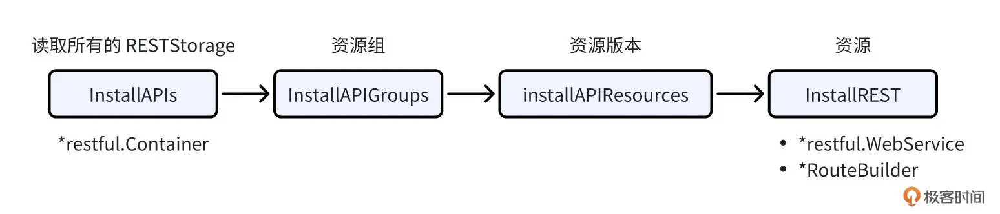
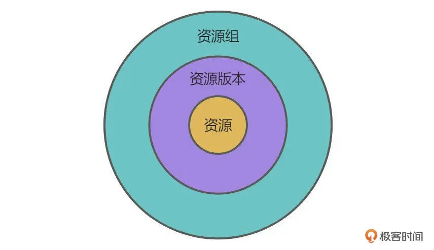
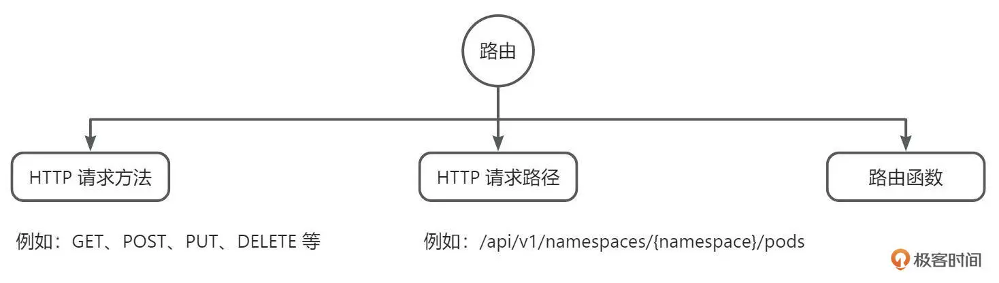
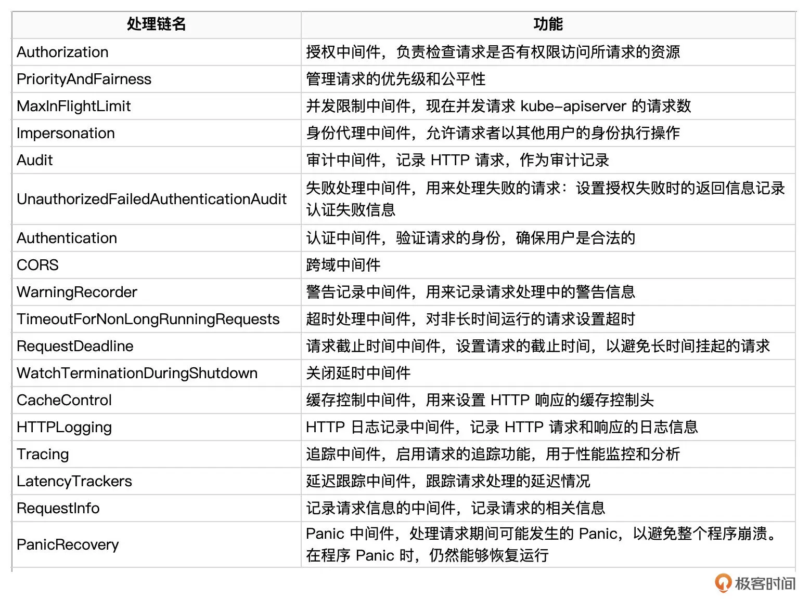
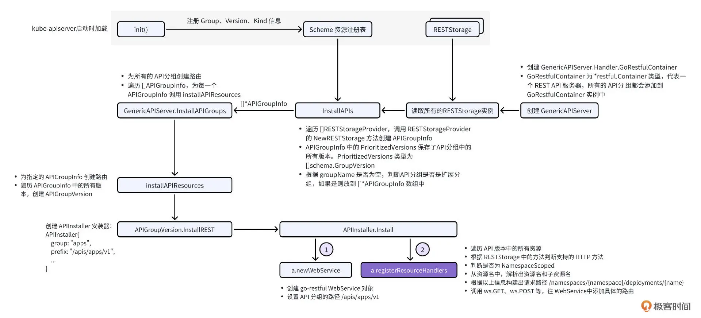

# 24 | Kubernetes路由构建源码剖析

你好，我是孔令飞。

在 kube-apiserver 源码中，路由构建是其最为核心的逻辑，本节课我将为你详细介绍 kube-apiserver 构建路由的流程和细节知识。

## Kubernetes 路由构建主体流程

我们先从整体上来看下，Kubernetes 路由的构建主体流程，具体流程如下：



首先，kube-apiserver 在启动时，会读取所有的 RESTStorage，RESTStorage 以资源组为单位，保存了资源组下所有的版本及版本下所有资源的处理函数。

接着 kube-apiserver 的 New 方法中，会读取所有的 RESTStorage，并调用

```
InstallAPIs 方法，为所有 RESTStorage 安装路由，具体是调用 InstallAPIGroups 方
```

法。

```
InstallAPIGroups 方法以资源组为单位，为所有的资源组安装路由。
InstallAPIGroups 会遍历传入的所有 APIGroupInfo，读取 APIGroupInfo 中保存的资源组
版本列表，并调用 installAPIResources 方法为具体某一个资源版本安装路由。
installAPIResources 方法负责为某一个资源版本安装路由，具体是调用 InstallREST
方法。在 InstallREST 方法中，会遍历 RESTStorage 中该版本下的所有资源类型，并为这
```

些类型安装路由。

在上述路由安装流程中，会创建 3 个核心的 go-restful 实例，分别是：

```
*restful.Container、*restful.WebService、*RouteBuilder。这些实例最终构
```

建起了 go-restful 类型的 REST 服务器。

整个路由安装顺序如下图所示：



## Kubernetes 路由格式

kube-apiserver 是一个再标准不过的 REST API 服务器了，因此其路由构建方法跟普通的RESTful API 路由构建没什么区别。

### HTTP 路由介绍

HTTP 路由是 Web 应用程序中的一个核心概念，用于根据传入的 HTTP 请求路径（Path）及其他信息（例如 HTTP 方法、请求头等）来决定将请求发送到哪个处理程序（Handler）。路由机制是实现 RESTful API 最基础、核心的功能。

HTTP 路由的构成如下图所示：



第一部分是执行 HTTP 请求时的 HTTP 请求方法，如 GET、POST、PUT、DELETE 等。

第二部分是执行 HTTP 请求时的 URL，

```
如：/api/v1/namespaces/{namespace}/pods，请求路径中可以包含路径参数，如
{namespace}。此外，请求路径可根据 API 管理的需要添加更多的语义化路径元素。例如，
```

可以在 URL 中加入 API 版本、API 分组、子资源等。这些元素以固定的格式拼接成 URL。

第三部分是路由函数，也叫处理函数（Handler 或 Controller），是 HTTP 请求到达后，执行业务逻辑处理的函数 / 方法。在 HTTP 路由函数中，我们通常会执行参数解析、参数校验、业务逻辑处理、请求返回等操作。

```go
例如，如下是 createUse 方法：
// POST http://localhost:8080/users
// <User><Id>1</Id><Name>Melissa</Name></User>
func (u *UserResource) createUser(request *restful.Request, response *restful.Res
   log.Println("createUser")
   usr := User{ID: fmt.Sprintf("%d", time.Now().Unix())}
   err := request.ReadEntity(&usr)
   if err == nil {
       u.users[usr.ID] = usr
       response.WriteHeaderAndEntity(http.StatusCreated, usr)
   } else {
       response.WriteError(http.StatusInternalServerError, err)
   }
}
```

```
在我们执行 POST http://localhost:8080/users 接口请求后，Web 服务会根据进程
内注册的路由，匹配 (HTTP 请求方法, HTTP 请求路径)，找到上述二元组所映射到的
```

HTTP 路由函数，并调用路由函数进行请求处理。

### Kubernetes 中 HTTP 请求路径格式

kube-apiserver 在构建路由时，有很多代码是用来构建 HTTP 请求路径的。我们重点看下

```
Kubernetes RESTful API HTTP 请求路径格式。其格式为 /{api,
apis}/{apiVersion}/{resourceType}/{resourceName}。格式中各个部分的介绍如
```

下：

```
apiVersion：指定 API 的版本。Kubernetes 中的 API 分为 2 大类，核心 API（Core
API）和 扩展 API（Extended API），不同 API 类型的 {apiVersion} 格式有一些区别。
核心 API：{apiVersion} 格式为 {version}。核心 API 以 /api 路径为前缀开始，
其 API 分组名为 ""。
扩展 API ：{apiVersion}  格式为 {group}/{version}。扩展 API 以 /apis 路径
```

- 为前缀开始，API 分组不为空。

```
resourceType：指定要操作的资源类型，例如 pods、services、deployments
```

- 等。

```
resourceName（可选）：指特定资源的名称，比如具体的 Pod 名称等。
namespace（可选）：用于指定资源所在的命名空间，仅在特定类型的请求中需要。
```

不同资源的请求路径拼接格式也不同，我们分别来看。

对于命名空间内的资源，完整的请求路径拼接格式为：

```
/api/{apiVersion}/namespaces/{namespace}/{resourceType}
```

对于特定命名空间内的特定资源，请求路径为：

```
/api/{apiVersion}/namespaces/{namespace}/{resourceType}/{resourceName}
```

对于 Cluster 级别的资源（即不受命名空间限制），请求路径格式为：

```
/api/{apiVersion}/{resourceType}
```

以下是 Kubernetes RESTful API 接口的 URL 示例：



## Kubernetes 请求方法构建

上面，我介绍了 Kubernetes 的路由格式，要构建一个 RESTful API 接口路由，需要分别设置：HTTP 请求方法、HTTP 请求路径以及处理函数。接下来，我们就看下 kube-apiserver 具体是如何构建的。

```
kube-apiserver 路由构建核心代码位于 pkg/controlplane/instance.go 文件中的
New 方法中。接下来，我将通过介绍 New 方法的实现，为你讲解路由构建的实现。
```

### kube-apiserver 中的路由种类

```go
在 New 方法中，会通过 c.GenericConfig.New 函数调用创建一个
*GenericAPIServer 类型的实例：
   s, err := c.GenericConfig.New("kube-apiserver", delegationTarget)
   if err != nil {
       return nil, err
   }
   if c.ExtraConfig.EnableLogsSupport {
       routes.Logs{}.Install(s.Handler.GoRestfulContainer)
   }
GenericAPIServer 结构体中，包含了创建 REST API 服务器的关键字段，以下是这些核心
```

字段的介绍：

```
// GenericAPIServer 包含了构建一个kube-apiserver的核心字段
type GenericAPIServer struct {
   // kube-apiserver的内部webhook、controller会通过 LoopbackClientConfig 连接 kube-
   LoopbackClientConfig *restclient.Config
   // 用来设置 REST 请求的最小超时时间
   minRequestTimeout time.Duration
   // 关停的超时时间，确保服务器可以在指定的时间内关停。
   ShutdownTimeout time.Duration
   // legacyAPIGroupPrefixes 用于设置授权和验证请求的 URL 解析前缀
   legacyAPIGroupPrefixes sets.String
   // admissionControl 用于构建支持 API 组的 REST 存储，控制请求是否被允许
   admissionControl admission.Interface
   // 保存 TLS 的配置信息，用来启动一个 HTTP 服务器。
   SecureServingInfo *SecureServingInfo
   // 设置对外暴露的 APIServer 地址。
   ExternalAddress string
   // Serializer 控制 API 对象的序列化，支持不同的组/版本
   Serializer runtime.NegotiatedSerializer
   // Handler 字段用来进行 HTTP 路由设置
   Handler *APIServerHandler
   // UnprotectedDebugSocket 用于提供调试信息的Unix域套接字，不进行身份验证
   UnprotectedDebugSocket *routes.DebugSocket
   listedPathProvider routes.ListedPathProvider
   DiscoveryGroupManager discovery.GroupManager
   AggregatedDiscoveryGroupManager discoveryendpoint.ResourceManager
   AggregatedLegacyDiscoveryGroupManager discoveryendpoint.ResourceManager
   // 如果 openAPIConfig 字段不为 nil，则启用 Swagger 或 OpenAPI。
   openAPIConfig *openapicommon.Config
   // 如果 OpenAPIV3Config 不为 nil，则启用 OpenAPI V3
   openAPIV3Config *openapicommon.OpenAPIV3Config
   // skipOpenAPIInstallation 指示不安装 OpenAPI 处理程序。
   // 当 API Server 自己安装 OpenAPI Handler 时，需要设置为 true，例如：kube-aggregato
   skipOpenAPIInstallation bool
   // 设置 /openapi/v2 HTTP 请求路径
   OpenAPIVersionedService *handler.OpenAPIService
   // 设置 /openapi/v3 HTTP 请求路径
   OpenAPIV3VersionedService *handler3.OpenAPIService
   // StaticOpenAPISpec 可以根据 RESTful API配置生成 OpenAPI 规范
   StaticOpenAPISpec *spec.Swagger
   // postStartHookLock 同步访问 postStartHooks 的互斥锁
   postStartHookLock sync.Mutex
   // 保存 post start 钩子
   postStartHooks map[string]postStartHookEntry
   // postStartHooksCalled 指示 postStartHooks 是否已被调用
   postStartHooksCalled bool
   // disabledPostStartHooks 用来保存禁用的 postStartHooks 列表
   disabledPostStartHooks sets.String
   // preShutdownHookLock 同步访问 preShutdownHooks 的互斥锁
   preShutdownHookLock sync.Mutex
   // 保存 pre shutdown 钩子
   preShutdownHooks map[string]preShutdownHookEntry
   // preShutdownHooksCalled 指示 preShutdownHooks 是否已被调用
   preShutdownHooksCalled bool
   // healthzRegistry 健康检查注册表，负责健康检查的处理
   healthzRegistry healthCheckRegistry
   // readyzRegistry 就绪检查注册表，处理准备状态的检查
   readyzRegistry healthCheckRegistry
   // livezRegistry 存活检查注册表，处理生存状态的监测
   livezRegistry healthCheckRegistry
   // livezGracePeriod 存活检查期间的宽限时间，指定额外等待时间
   livezGracePeriod time.Duration
   // AuditBackend 用于记录 API 请求的审计信息
   AuditBackend audit.Backend
   // Authorizer 决定用户是否被允许执行特定请求
   Authorizer authorizer.Authorizer
   // EquivalentResourceRegistry 提供与特定资源等效的资源信息和注册
   EquivalentResourceRegistry runtime.EquivalentResourceRegistry
   // delegationTarget 下一个委托目标，确保不会为 nil
   delegationTarget DelegationTarget
   // NonLongRunningRequestWaitGroup 等待所有非长时间运行请求处理完成
   NonLongRunningRequestWaitGroup *utilwaitgroup.SafeWaitGroup
   // WatchRequestWaitGroup 等待所有活动监视请求处理完成
   WatchRequestWaitGroup *utilwaitgroup.RateLimitedSafeWaitGroup
   // ShutdownDelayDuration 阻止关闭的一段时间，确保请求完成
   ShutdownDelayDuration time.Duration
   // 限制请求体的大小，0 表示没有限制
   maxRequestBodyBytes int64
   // 此 APIServer 的唯一 ID
   APIServerID string
   // StorageVersionManager保存API资源的存储版本信息
   StorageVersionManager storageversion.Manager
   // Version 如果非空，启用 /version 端点提供 API 服务器的版本信息
   Version *version.Info
   // lifecycleSignals 获取 API 服务器生命周期的各种信号
   lifecycleSignals lifecycleSignals
   // destroyFns 服务器关闭时调用的资源清理函数
   destroyFns []func()
   muxAndDiscoveryCompleteSignals map[string]<-chan struct{}
   // ShutdownSendRetryAfter 决定优雅终止期间何时启动 HTTP 服务器关闭
   ShutdownSendRetryAfter bool
   ShutdownWatchTerminationGracePeriod time.Duration
}
GenericAPIServer 结构体实例中的 Handler 字段用来设置 HTTP 路由。Handler 字段
类型为 *APIServerHandler，其定义如下：
// APIServerHandler 包含了 kube-apiserver 用到的不同的 http.Handlers。
type APIServerHandler struct {
   // FullHandlerChain is the one that is eventually served with.  It should inc
   FullHandlerChain http.Handler
   // Kubernetes 注册的 API 接口。kube-apiserver 源码中的 InstallAPIs 方法就是用此字段
   // GoRestfulContainer 使用 go-restful Web 框架来安装 HTTP 路（可称之为 go-restful
   GoRestfulContainer *restful.Container
   // API 请求链中的最后请求环节，包含了非 go-restful 路由。
   // 根据 HTTP 请求 Path 做精确和前缀匹配找到对应的Handler。
   NonGoRestfulMux *mux.PathRecorderMux
   // 最终处理 HTTP 请求的 handler，可以直接调用，也可以放在 FullHandlerChain 的最后一环。
   Director http.Handler
}
通过 APIServerHandler 的定义，我们可以知道 kube-apiserver 中包含了以下 4 类路由：
FullHandlerChain：顶层的 HTTP 处理链，也是对外真正 “Listen” 并接收请求的
```

- handler。

```
GoRestfulContainer：承载所有用 go-restful 框架注册的 Kubernetes REST API 资源
```

- （各个 API group/version 的 CRUD 路由）。

```
NonGoRestfulMux：PathRecorderMux——用于注册那些不走 go-restful 的“杂项”路由，
```

- 典型有：

- /healthz、/readyz、/livez、/metrics、/version、/logs、/swagger.json、/openapi/v2、/debug/pprof 等；

- 自定义的 HTTP 探针、监控和调试端点。

```
Director：Director 是实际将请求分发到 GoRestfulContainer 或 NonGoRestfulMux 的
```

- “分流” handler。

```
其中，GoRestfulContainer 是最核心的路由类型，用来注册 Kubernetes 各类资源的
```

HTTP 路由。

### Kubernetes 请求路径构建

```
在 New 方法中，创建好 *apiserver/pkg/server.GenericAPIServer 类型的实例 s
```

后，就可以基于实例中的字段，并使用实例提供的方法，来一步一步构建起整个 kube-apiserver 的路由。

```
例如，在 New 方法中，通过以下方法，往 go-restful 容器中，安装了一个 HTTP 路
```

由：

```
https://github.com/kubernetes/kubernetes/blob/v1.30.4/pkg/controlplane/instance.g
       routes.Logs{}.Install(s.Handler.GoRestfulContainer)
   }
routes.Logs{}.Install 方法实现如下：
// Install func registers the logs handler.
func (l Logs) Install(c *restful.Container) {
   // use restful: ws.Route(ws.GET("/logs/{logpath:*}").To(fileHandler))
   // See github.com/emicklei/go-restful/blob/master/examples/static/restful-ser
   ws.Path("/logs")
   ws.Doc("get log files")
   ws.Route(ws.GET("/{logpath:*}").To(logFileHandler).Param(ws.PathParameter("lo
   ws.Route(ws.GET("/").To(logFileListHandler))
   c.Add(ws)
}
routes.Logs{}.Install 方法中，通过调用 go-restful 包提供的路由注册函数，完成
```

路由的注册。在整个 kube-apiserver 源码中，有很多代码段，都是用以上方法安装了 REST路由。

当然，这些路由不是我要重点介绍的，我要重点介绍的是 Kubernetes 资源的路由安装方法。

```
在 New 方法中，新建了 restStorageProviders 变量，该变量保存了 Kubernetes 内置
资源的 RESTStorageProvider。
什么是 RESTStorageProvider 呢？你可以理解为是 REST 资源的存储提供者，用来实现
```

REST 资源跟底层存储（Etcd）之间的读写功能。

在 New 方法中，通过调用 m.InstallAPIs 方法安装资源的 REST 路由。

```go
m.InstallAPIs 方法实现如下：
// InstallAPIs 根据 restStorageProviders 来安装 Kubernetes 内置资源的HTTP路由。
func (m *Instance) InstallAPIs(apiResourceConfigSource serverstorage.APIResourceC
   // nonLegacy 用来保存扩展 API。通过判断 API 分组的组名是否为空，来判断是否属于扩展API。
   // 如果为空，说明是扩展API，保存在nonLegacy数组中。
   nonLegacy := []*genericapiserver.APIGroupInfo{}
   // used later in the loop to filter the served resource by those that have ex
   resourceExpirationEvaluator, err := genericapiserver.NewResourceExpirationEva
   if err != nil {
       return err
   }
   // 遍历 restStorageProviders 数组，为每一个API分组安装HTTP路由
   // 以下for循环目的有2：
   // 1. 过滤掉不可用的API分组：API分组中没有资源；
   // 2. 根据API分组的组名，将扩展API保存在nonLegacy数组中
   // 3. 调用m.GenericAPIServer.InstallLegacyAPIGroup函数，安装核心API组
   for _, restStorageBuilder := range restStorageProviders {
       // 获取API分组的组名
       groupName := restStorageBuilder.GroupName()
       // 调用NewRESTStorage方法，该方法返回genericapiserver.APIGroupInfo类型的结构体
       // 包含了安装该API分组路由的所有信息
       apiGroupInfo, err := restStorageBuilder.NewRESTStorage(apiResourceConfigS
       if err != nil {
           return fmt.Errorf("problem initializing API group %q : %v", groupName
       }
       // 如果map为空，说明该API分组没有资源，跳过安装
       if len(apiGroupInfo.VersionedResourcesStorageMap) == 0 {
           // If we have no storage for any resource configured, this API group
           // This can happen when an entire API group, version, or development-
           klog.Infof("API group %q is not enabled, skipping.", groupName)
           continue
       }
       // Remove resources that serving kinds that are removed.
       // We do this here so that we don't accidentally serve versions without r
       // This is a spot above the construction of individual storage handlers s
       // 删除已经被删除的资源类型
       resourceExpirationEvaluator.RemoveDeletedKinds(groupName, apiGroupInfo.Sc
       if len(apiGroupInfo.VersionedResourcesStorageMap) == 0 {
           klog.V(1).Infof("Removing API group %v because it is time to stop ser
           continue
       }
       klog.V(1).Infof("Enabling API group %q.", groupName)
       // 如果restStorageProvider实现了PostStartHookProvider接口，则调用其PostStartH
       // 该钩子会在kube-apiserver启动后被运行
       if postHookProvider, ok := restStorageBuilder.(genericapiserver.PostStart
           name, hook, err := postHookProvider.PostStartHook()
           if err != nil {
               klog.Fatalf("Error building PostStartHook: %v", err)
           }
           // 添加钩子到GenericAPIServer中
           m.GenericAPIServer.AddPostStartHookOrDie(name, hook)
       }
       // 如果API分组名为空，说明是核心API
       if len(groupName) == 0 {
           // the legacy group for core APIs is special that it is installed int
           // InstallLegacyAPIGroup 留个作业，你自己去看它的实现
           if err := m.GenericAPIServer.InstallLegacyAPIGroup(genericapiserver.D
               return fmt.Errorf("error in registering legacy API: %w", err)
           }
           // 如果API分组名不为空，说明是扩展API
       } else {
           // everything else goes to /apis
           nonLegacy = append(nonLegacy, &apiGroupInfo)
       }
   }
   // 调用InstallAPIGroups方法根据API分组信息，安装HTTP路由
   if err := m.GenericAPIServer.InstallAPIGroups(nonLegacy...); err != nil {
       return fmt.Errorf("error in registering group versions: %v", err)
   }
   return nil
}
InstallAPIs 方法中，最终是调用 m.GenericAPIServer.InstallAPIGroups 方法来
安装 HTTP 路由的，m.GenericAPIServer.InstallAPIGroups 方法代码如下：
// InstallAPIGroups exposes given api groups in the API.
// The <apiGroupInfos> passed into this function shouldn't be used elsewhere as t
// underlying storage will be destroyed on this servers shutdown.
func (s *GenericAPIServer) InstallAPIGroups(apiGroupInfos ...*APIGroupInfo) error
   // 以下for循环，用来检查 apiGroupInfo 的字段是否可用：确保有一个可用的版本
   for _, apiGroupInfo := range apiGroupInfos {
       if len(apiGroupInfo.PrioritizedVersions) == 0 {
           return fmt.Errorf("no version priority set for %#v", *apiGroupInfo)
       }
       // Do not register empty group or empty version.  Doing so claims /apis/
       // Catching these here places the error  much closer to its origin
       if len(apiGroupInfo.PrioritizedVersions[0].Group) == 0 {
           return fmt.Errorf("cannot register handler with an empty group for %#
       }
       if len(apiGroupInfo.PrioritizedVersions[0].Version) == 0 {
           return fmt.Errorf("cannot register handler with an empty version for
       }
   }
   openAPIModels, err := s.getOpenAPIModels(APIGroupPrefix, apiGroupInfos...)
   if err != nil {
       return fmt.Errorf("unable to get openapi models: %v", err)
   }
   // 循环 apiGroupInfos，安装 HTTP 路由
   for _, apiGroupInfo := range apiGroupInfos {
       // installAPIResources 负责具体的路由安装
       if err := s.installAPIResources(APIGroupPrefix, apiGroupInfo, openAPIMode
           return fmt.Errorf("unable to install api resources: %v", err)
       }
       ...
   }
   return nil
}
InstallAPIGroups 方法会先检查 apiGroupInfo.PrioritizedVersions 是否为空：
```

如果为空，说明没有可以安装的版本，会跳过这个 API 分组；如果不为空，则会遍历

```go
apiGroupInfos 数组，并调用 installAPIResources 方法安装路由。
那么 PrioritizedVersions 是在哪里设置的呢？其实是在创建
genericapiserver.APIGroupInfo 结构体实例时设置的，具体见
pkg/registry/apps/rest/storage_apps.go 文件中的 NewRESTStorage 方法。
genericapiserver.NewDefaultAPIGroupInfo 方法定义如下：
// 位于 pkg/registry/apps/rest/storage_apps.go 文件中
// NewRESTStorage returns APIGroupInfo object.
func (p StorageProvider) NewRESTStorage(apiResourceConfigSource serverstorage.API
   apiGroupInfo := genericapiserver.NewDefaultAPIGroupInfo(apps.GroupName, legac
   // If you add a version here, be sure to add an entry in `k8s.io/kubernetes/c
   // TODO refactor the plumbing to provide the information in the APIGroupInfo
   if storageMap, err := p.v1Storage(apiResourceConfigSource, restOptionsGetter)
       return genericapiserver.APIGroupInfo{}, err
   } else if len(storageMap) > 0 {
       apiGroupInfo.VersionedResourcesStorageMap[appsapiv1.SchemeGroupVersion.Ve
   return apiGroupInfo, nil
}
// 位于 staging/src/k8s.io/apiserver/pkg/server/genericapiserver.go 文件中
func NewDefaultAPIGroupInfo(group string, scheme *runtime.Scheme, parameterCodec
   return APIGroupInfo{
       PrioritizedVersions:          scheme.PrioritizedVersionsForGroup(group),
       VersionedResourcesStorageMap: map[string]map[string]rest.Storage{},
       // TODO unhardcode this.  It was hardcoded before, but we need to re-eval
       OptionsExternalVersion: &schema.GroupVersion{Version: "v1"},
       Scheme:                 scheme,
       ParameterCodec:         parameterCodec,        NegotiatedSerializer:   co
   }
}
// 位于 staging/src/k8s.io/apimachinery/pkg/runtime/scheme.go 文件中
// PrioritizedVersionsForGroup returns versions for a single group in priority or
func (s *Scheme) PrioritizedVersionsForGroup(group string) []schema.GroupVersion
   ret := []schema.GroupVersion{}
   for _, version := range s.versionPriority[group] {
       ret = append(ret, schema.GroupVersion{Group: group, Version: version})
   }
   for _, observedVersion := range s.observedVersions {
       if observedVersion.Group != group {
           continue        }
       found := false
       for _, existing := range ret {
           if existing == observedVersion {
               found = true
               break            }
       }
       if !found {
           ret = append(ret, observedVersion)
       }
   }
   return ret
}
上述代码中的 *Scheme 类型的实例，其实是
k8s.io/kubernetes/pkg/api/legacyscheme 包的全局示例 Scheme。通过以上代
码，我们可以知道 APIGroupInfo 结构体实例中的 PrioritizedVersions 字段值，其实
```

是通过查找资源注册表（Scheme），获取指定 API 分组中所有注册的版本而来的。

那么，kube-apiserver 又是什么时候将相同 API 分组不同的版本号注册到资源注册表中的呢？

```go
其实是在 kube-apiserver 启动时，由 init 函数调用 Install 函数注册的，具体见
Install 函数：
// 位于 pkg/apis/apps/install/install.go 文件中。
// Install registers the API group and adds types to a scheme
func Install(scheme *runtime.Scheme) {
   utilruntime.Must(apps.AddToScheme(scheme))
   utilruntime.Must(v1beta1.AddToScheme(scheme))
   utilruntime.Must(v1beta2.AddToScheme(scheme))
   utilruntime.Must(v1.AddToScheme(scheme))
   utilruntime.Must(scheme.SetVersionPriority(v1.SchemeGroupVersion, v1beta2.Sch
}
上面，我介绍了在安装 REST 路由中需要用到的重要字段 PrioritizedVersions 的设置
```

方式。接下来，我们继续解析代码，来看下真正执行 API 路由安装的

```go
installAPIResources 方法中路由安装的具体实现。
installAPIResources 方法代码实现如下：
// 位于 staging/src/k8s.io/apiserver/pkg/server/genericapiserver.go 文件中
func (s *GenericAPIServer) installAPIResources(apiPrefix string, apiGroupInfo *AP
   var resourceInfos []*storageversion.ResourceInfo
   // apiPrefix 值为 /apis
   // 编译指定API分组中的所有版本号
   for _, groupVersion := range apiGroupInfo.PrioritizedVersions {
       if len(apiGroupInfo.VersionedResourcesStorageMap[groupVersion.Version]) =
           klog.Warningf("Skipping API %v because it has no resources.", groupVe
           continue
       }
       apiGroupVersion, err := s.getAPIGroupVersion(apiGroupInfo, groupVersion,
       if err != nil {
           return err
       }
       ...
       // 安装指定API分组中指定API版本的路由
       discoveryAPIResources, r, err := apiGroupVersion.InstallREST(s.Handler.Go
       if err != nil {
           return fmt.Errorf("unable to setup API %v: %v", apiGroupInfo, err)
       }
       resourceInfos = append(resourceInfos, r...)
       ....
   }
   ...
   return nil
}
// 位于 staging/src/k8s.io/apiserver/pkg/endpoints/groupversion.go 文件中
func (g *APIGroupVersion) InstallREST(container *restful.Container) ([]apidiscove
   // g.Root = /apis
   // g.GroupVersion.Group = apps
   // g.GroupVersion.Version = v1
   // prefix = /apis/apps/v1
   prefix := path.Join(g.Root, g.GroupVersion.Group, g.GroupVersion.Version)
   installer := &APIInstaller{
       group:             g,
       prefix:            prefix,
       minRequestTimeout: g.MinRequestTimeout,
   }
   apiResources, resourceInfos, ws, registrationErrors := installer.Install()
   versionDiscoveryHandler := discovery.NewAPIVersionHandler(g.Serializer, g.Gro
   versionDiscoveryHandler.AddToWebService(ws)
   container.Add(ws)
   aggregatedDiscoveryResources, err := ConvertGroupVersionIntoToDiscovery(apiRe
   if err != nil {
       registrationErrors = append(registrationErrors, err)
   }
   return aggregatedDiscoveryResources, removeNonPersistedResources(resourceInfo
}
// 位于 staging/src/k8s.io/apiserver/pkg/endpoints/installer.go 文件中
// Install handlers for API resources.
// 1. 创建 1 个 go-restful WebService，其实就是一个API分组
// 2. 获取 a.group.Storage 哈希表中的 key，key其实就是API分组中的资源，例如：deployments
// 3. 遍历 paths，调用 registerResourceHandlers 为具体的资源安装路由
func (a *APIInstaller) Install() ([]metav1.APIResource, []*storageversion.Resourc
   var apiResources []metav1.APIResource
   var resourceInfos []*storageversion.ResourceInfo
   var errors []error
   ws := a.newWebService() // 创建一个 go-restful WebService实例，其实就是API分组。类
   // Register the paths in a deterministic (sorted) order to get a deterministi
   paths := make([]string, len(a.group.Storage))
   var i int = 0
   for path := range a.group.Storage {
       paths[i] = path
       i++
   }
   sort.Strings(paths)
   // paths 值类似于 ["deployments", "statefulsets", "daemonsets", ...]
   for _, path := range paths {
       apiResource, resourceInfo, err := a.registerResourceHandlers(path, a.grou
       if err != nil {
           errors = append(errors, fmt.Errorf("error in registering resource: %s
       }
       if apiResource != nil {
           apiResources = append(apiResources, *apiResource)
       }
       if resourceInfo != nil {
           resourceInfos = append(resourceInfos, resourceInfo)
       }
   }
   return apiResources, resourceInfos, ws, errors
}
```

- registerResourceHandlers 方法代码量有点大，如果你想深入了解，可以自行打开阅读。

```
安装路由的方法调用顺序如下：InstallAPIGroups-> installAPIResources ->
InstallREST -> (a *APIInstaller) Install()->
registerResourceHandlers。我们一一来看。
InstallAPIGroups：跟函数名一样，它的作用是遍历传入的 APIGroupInfo 数组，以
```

- API 分组为单位，安装某个 API 分组的路由。

```
installAPIResources：遍历 APIGroupInfo 中的 PrioritizedVersions，为某
```

- 个 API 版本安装路由。

```
InstallREST：构建 APIInstaller 类型的结构体实例，并调用实例的 Install 方法
来安装路由。APIInstaller 结构体内容如下：APIInstaller{group: "apps",
prefix: "/apis/apps/v1", ...}。
(a *APIInstaller) Install()：在 Install 函数中会首先调用
a.newWebService 创建一个 go-restful 的 WebService，再调用
a.registerResourceHandler 给这个 WebService 添加具体的路由。在创建
WebService 对象时，指定其路径为 /apis/apps/v1。
registerResourceHandlers：遍历 API 版本中的所有资源，根据 RESTStorage 中具
有的方法，判断支持的 HTTP 方法、根据 RESTStorage 的 NamespaceScoped 方法，判
```

- 断是否是命名空间级别的资源，并根据上述信息及资源名，构建出资源的请求路径，例

```go
如：/namespaces/{namespace}/deployments/{name}。伪代码如下：
// 从 path 中解析从资源名和子资源名
// 例如： path 为 deployments/status，则：resource=deployments，subresource=status
resource, subresource, err := splitSubresource(path)
if err != nil {
   return nil, nil, err
}
   // 判断是否支持 Create 方法
   creater, isCreater := storage.(rest.Creater)
   ...
   getter, isGetter := storage.(rest.Getter) // getter 保存了 RESTStorage的Get方法
   // 判断是否是命名空间级别
   namespaceScoped = scoper.NamespaceScoped()
   // 如果是 NamespaceScoped
   ...
       namespaceParamName := "namespaces"
       // Handler for standard REST verbs (GET, PUT, POST and DELETE).
       namespaceParam := ws.PathParameter("namespace", "object name and auth sco
       namespacedPath := namespaceParamName + "/{namespace}/" + resource
       namespaceParams := []*restful.Parameter{namespaceParam}
       resourcePath := namespacedPath
       resourceParams := namespaceParams
       itemPath := namespacedPath + "/{name}"
       nameParams := append(namespaceParams, nameParam)
       proxyParams := append(nameParams, pathParam)
       itemPathSuffix := ""
       if isSubresource {
           itemPathSuffix = "/" + subresource
           itemPath = itemPath + itemPathSuffix
           resourcePath = itemPath // namespaces/{namespace}/deployments/{name}
           resourceParams = nameParams
       }
   ...
   // 构建 actions 数组。这里会根据 RESTStorage 实现的方法，判断支持哪个HTTP方法。
   actions = appendIf(actions, action{"LIST", resourcePath, resourceParams, name
   actions = appendIf(actions, action{"POST", resourcePath, resourceParams, name
   ...
   for _, action := range actions {
       ...
       switch action.Verb {
       ...
       // 根据 action 的 Verb值，调用 WebService的相应方法添加具体的路由
       case "GET": // Get a resource.
           var handler restful.RouteFunction
           if isGetterWithOptions {
               handler = restfulGetResourceWithOptions(getterWithOptions, reqSco
           } else {
               // 会在 handler 中调用 getter 方法
               handler = restfulGetResource(getter, reqScope)
           }
           route := ws.GET(action.Path).To(handler).
               Doc(doc).
               Param(ws.QueryParameter("pretty", "If 'true', then the output is
               Operation("read"+namespaced+kind+strings.Title(subresource)+opera
               Produces(append(storageMeta.ProducesMIMETypes(action.Verb), media
               Returns(http.StatusOK, "OK", producedObject).
               Writes(producedObject)
       }
}
```

### 路由构建流程总结

最后，我们再通过一张图，来回顾下 kube-apiserver 中资源路由的构建流程：



```
首先在 kube-apiserver 启动时，会通过导入包的形式，执行包的 init() 函数，将资源的资
```

源组、资源版本、资源等信息注册到资源注册表中。

```
接着，在 kube-apiserver 的 New 方法中，会创建一个 GenericAPIServer 类型的实例，
GenericAPIServer  结构体中保存了启动一个 REST API 服务器必要的字段。在创建
GenericAPIServer 结构体时，会初始化其 Handler 字段，Handler 是一个
APIServerHandler 类型的字段，APIServerHandler 字段中会初始化一个
*restful.Container 类型的字段 GoRestfulContainer，后续资源路由都会添加到
GoRestfulContainer go-restful Container 中。
在 New 方法中，会导入 pkg/registry 目录中已经开发好的 RESTStorage，每一个
```

RESTStorage 保存了某个资源组中所有版本、资源的处理函数。

```
之后，New 方法会调用 InstallAPIs 方法执行以下操作：
遍历 []RESTStorageProvider，调用 RESTStorageProvider 的 NewRESTStorage
方法创建 APIGroupInfo。
APIGroupInfo 中的 PrioritizedVersions 保存了 API 分组中的所有版本。
PrioritizedVersions 类型为 []schema.GroupVersion。
根据 groupName 是否为空，判断 API 分组是否是扩展分组，如果是则放到
[]*APIGroupInfo 数组中。
InstallAPIs 方法最后调用 InstallAPIGroups 方法，来给扩展 API 分组安装路由。
InstallAPIGroups 方法主要会遍历 []APIGroupInfo，为每一个 APIGroupInfo 调用
installAPIResources 方法执行具体的路由安装逻辑。
installAPIResources 方法是 kube-apiserver 实现了资源路由安装的核心逻辑。
installAPIResources 会先从 APIGroupInfo.PrioritizedVersions 获取资源分组
下的所有版本，并为每个版本都创建一个 APIGroupVersion 类型的实例。
installAPIResources 会遍历这些版本实例，执行实例的 InstallREST 方法。
InstallREST 方法会先创建一个 APIInstaller 接口安装器：
APIInstaller{
   group: "apps",
   prefix: "/apis/apps/v1",
   ...
}
接口安装器的 Install 方法会先创建一个 go-restful WebService 实例，并通过调用
registerResourceHandlers 方法，将版本下的所有资源路由都注册到 WebService 实例
```

中。

```
registerResourceHandlers 方法执行了路由的最终安装逻辑，具体如下：
```

- 遍历 API 版本中的所有资源。

- 根据 RESTStorage 中的方法判断支持的 HTTP 方法。

- 判断是否为 NamespaceScoped。

- 从资源名中解析出资源名和子资源名。

```
根据以上信息构建出请求路径 /namespaces/{namespace}/deployments/{name}。
调用 ws.GET、ws.POST 等，往 WebService 中添加具体的路由。
```

## Kubernetes 处理链设置

如果你开发过 REST API 服务器就一定知道，在实际的企业生产中，基本上都会用到 HTTP中间件来统一所有的 HTTP 请求。kube-apiserver 也支持 HTTP 中间件。kube-apiserver 中添加 HTTP 处理链的流程如下：

```go
// 位于 cmd/kube-apiserver/app/server.go 文件中
// NewConfig creates all the resources for running kube-apiserver, but runs none
func NewConfig(opts options.CompletedOptions) (*Config, error) {
   c := &Config{
       Options: opts,
   }
   controlPlane, serviceResolver, pluginInitializer, err := CreateKubeAPIServerC
   if err != nil {        return nil, err
   }
   ...
   return c, nil
}
// 位于文件 pkg/controlplane/apiserver/config.go 中
func CreateKubeAPIServerConfig(opts options.CompletedOptions) (
   *controlplane.Config,
   aggregatorapiserver.ServiceResolver,
   []admission.PluginInitializer,
   error,
) {
   proxyTransport := CreateProxyTransport()
   genericConfig, versionedInformers, storageFactory, err := controlplaneapiserv
       opts.CompletedOptions,
       []*runtime.Scheme{legacyscheme.Scheme, extensionsapiserver.Scheme, aggreg
       generatedopenapi.GetOpenAPIDefinitions,
   )
   ...
   return config, serviceResolver, pluginInitializers, nil
}
// 位于文件 pkg/controlplane/apiserver/config.go 中
// BuildGenericConfig takes the master server options and produces the genericapi
func BuildGenericConfig(
   s controlplaneapiserver.CompletedOptions,
   schemes []*runtime.Scheme,
   getOpenAPIDefinitions func(ref openapicommon.ReferenceCallback) map[string]op
) (
   genericConfig *genericapiserver.Config,
   versionedInformers clientgoinformers.SharedInformerFactory,
   storageFactory *serverstorage.DefaultStorageFactory,
   lastErr error,
) {
   genericConfig = genericapiserver.NewConfig(legacyscheme.Codecs)
   genericConfig.MergedResourceConfig = controlplane.DefaultAPIResourceConfigSou
   ...
   return
}
// NewConfig returns a Config struct with the default values
func NewConfig(codecs serializer.CodecFactory) *Config {
   defaultHealthChecks := []healthz.HealthChecker{healthz.PingHealthz, healthz.L
   ...
   return &Config{
       Serializer:                     codecs,
       BuildHandlerChainFunc:          DefaultBuildHandlerChain,
       ...
   }
}
上面的代码展示了 kube-apiserver 添加 HTTP 处理链的代码流程。NewConfig 函数中创建了
Config 类型的实例，Config 结构体中的 BuildHandlerChainFunc 函数，就是用来设
置 HTTP 处理链的函数。其默认的函数实现为：DefaultBuildHandlerChain。
DefaultBuildHandlerChain 函数在 New 函数中，被添加到 kube-apiserver HTTP 请
```

求的链路中，代码如下：

```go
// 位于文件 staging/src/k8s.io/apiserver/pkg/server/config.go 中
func (c completedConfig) New(name string, delegationTarget DelegationTarget) (*Ge
   ...
   handlerChainBuilder := func(handler http.Handler) http.Handler {
       return c.BuildHandlerChainFunc(handler, c.Config)
   }
   ...
   apiServerHandler := NewAPIServerHandler(name, c.Serializer, handlerChainBuild
   ...
}
// 位于文件 staging/src/k8s.io/apiserver/pkg/server/handler.go 中
func NewAPIServerHandler(name string, s runtime.NegotiatedSerializer, handlerChai
   ...
   director := director{
       name:               name,
       goRestfulContainer: gorestfulContainer,
       nonGoRestfulMux:    nonGoRestfulMux,
   }
   return &APIServerHandler{
       FullHandlerChain:   handlerChainBuilder(director),
       GoRestfulContainer: gorestfulContainer,
       NonGoRestfulMux:    nonGoRestfulMux,
       Director:           director,
   }
}
```

以上就是在 kube-apiserver 中添加 HTTP 处理链的流程和核心代码。kube-apiserver 是在

```
DefaultBuildHandlerChain 函数中添加了几乎所有的 HTTP 处理链，因此我们可以通过
```

这个函数知道 kube-apiserver 具体添加了哪些处理链，代码如下：

```go
// 添加 HTTP 请求处理链（中间件）
func DefaultBuildHandlerChain(apiHandler http.Handler, c *Config) http.Handler {
   handler := apiHandler
   handler = filterlatency.TrackCompleted(handler)
   // 添加授权中间件，负责检查请求是否有权限访问所请求的资源。
   handler = genericapifilters.WithAuthorization(handler, c.Authorization.Author
   // 添加 Trace 中间件，记录请求处理的完成时间，以便分析延迟。
   handler = filterlatency.TrackStarted(handler, c.TracerProvider, "authorizatio
   // 如果启用了流量控制，则使用相关中间件来管理请求的优先级和公平性；否则，限制并发请求的数量
   if c.FlowControl != nil {
       workEstimatorCfg := flowcontrolrequest.DefaultWorkEstimatorConfig()
       requestWorkEstimator := flowcontrolrequest.NewWorkEstimator(
           c.StorageObjectCountTracker.Get, c.FlowControl.GetInterestedWatchCoun
       handler = filterlatency.TrackCompleted(handler)
       handler = genericfilters.WithPriorityAndFairness(handler, c.LongRunningFu
       handler = filterlatency.TrackStarted(handler, c.TracerProvider, "priority
   } else {
       // 添加并发限制中间件，现在并发请求kube-apiserver的请求数
       handler = genericfilters.WithMaxInFlightLimit(handler, c.MaxRequestsInFli
   }
   handler = filterlatency.TrackCompleted(handler)
   // 添加身份代理中间件，允许请求者以其他用户的身份执行操作。
   handler = genericapifilters.WithImpersonation(handler, c.Authorization.Author
   handler = filterlatency.TrackStarted(handler, c.TracerProvider, "impersonatio
   handler = filterlatency.TrackCompleted(handler)
   // 添加审计中间件，记录 HTTP 请求，作为审计记录
   handler = genericapifilters.WithAudit(handler, c.AuditBackend, c.AuditPolicyR
   handler = filterlatency.TrackStarted(handler, c.TracerProvider, "audit")
   // 添加失败处理中间件
   failedHandler := genericapifilters.Unauthorized(c.Serializer)
   failedHandler = genericapifilters.WithFailedAuthenticationAudit(failedHandler
   failedHandler = filterlatency.TrackCompleted(failedHandler)
   handler = filterlatency.TrackCompleted(handler)
   // 添加认证中间件，验证请求的身份，确保用户是合法的。
   handler = genericapifilters.WithAuthentication(handler, c.Authentication.Auth
   handler = filterlatency.TrackStarted(handler, c.TracerProvider, "authenticati
   // 添加跨域中间件
   handler = genericfilters.WithCORS(handler, c.CorsAllowedOriginList, nil, nil,
   // WithWarningRecorder must be wrapped by the timeout handler
   // to make the addition of warning headers threadsafe
   // 添加警告记录中间件，用来记录请求处理中的警告信息
   handler = genericapifilters.WithWarningRecorder(handler)
   // WithTimeoutForNonLongRunningRequests will call the rest of the request han
   // context with deadline. The go-routine can keep running, while the timeout
   // 添加超时处理中间件，对非长时间运行的请求设置超时
   handler = genericfilters.WithTimeoutForNonLongRunningRequests(handler, c.Long
   // 添加请求截止时间，设置请求的截止时间，以避免长时间挂起的请求。
   handler = genericapifilters.WithRequestDeadline(handler, c.AuditBackend, c.Au
       c.LongRunningFunc, c.Serializer, c.RequestTimeout)
   handler = genericfilters.WithWaitGroup(handler, c.LongRunningFunc, c.NonLongR
   // 如何设置了 ShutdownWatchTerminationGracePeriod，则添加关闭延时中间件
   if c.ShutdownWatchTerminationGracePeriod > 0 {
       handler = genericfilters.WithWatchTerminationDuringShutdown(handler, c.li
   }
   if c.SecureServing != nil && !c.SecureServing.DisableHTTP2 && c.GoawayChance
       handler = genericfilters.WithProbabilisticGoaway(handler, c.GoawayChance)
   }
   // 添加缓存控制中间件，用来设置 HTTP 响应的缓存控制头。
   handler = genericapifilters.WithCacheControl(handler)
   // 添加HSTS中间件，启用 HTTP 严格传输安全，防止中间人攻击
   handler = genericfilters.WithHSTS(handler, c.HSTSDirectives)
   if c.ShutdownSendRetryAfter {
       handler = genericfilters.WithRetryAfter(handler, c.lifecycleSignals.NotAc
   }
   // 添加HTTP 日志记录中间件，记录 HTTP 请求和响应的日志信息。
   handler = genericfilters.WithHTTPLogging(handler)
   // 添加追踪中间件，启用请求的追踪功能，用于性能监控和分析。
   if utilfeature.DefaultFeatureGate.Enabled(genericfeatures.APIServerTracing) {
       handler = genericapifilters.WithTracing(handler, c.TracerProvider)
   }
   // 添加延迟跟踪中间件，跟踪请求处理的延迟情况。
   handler = genericapifilters.WithLatencyTrackers(handler)
   // WithRoutine will execute future handlers in a separate goroutine and servi
   // handler in current goroutine to minimize the stack memory usage. It must b
   // after WithPanicRecover() to be protected from panics.
   if utilfeature.DefaultFeatureGate.Enabled(genericfeatures.APIServingWithRouti
       handler = genericfilters.WithRoutine(handler, c.LongRunningFunc)
   }
   // 添加记录请求信息的中间件，记录请求的相关信息。
   handler = genericapifilters.WithRequestInfo(handler, c.RequestInfoResolver)
   handler = genericapifilters.WithRequestReceivedTimestamp(handler)
   handler = genericapifilters.WithMuxAndDiscoveryComplete(handler, c.lifecycleS
   // 添加Panic中间件，处理请求期间可能发生的Panic，以避免整个程序崩溃
   handler = genericfilters.WithPanicRecovery(handler, c.RequestInfoResolver)
   handler = genericapifilters.WithAuditInit(handler)
   return handler
}
```

为了方便你理解，我将其中的核心处理链汇总在下表中：

## 课程总结

本节课，我们详细介绍了 kube-apiserver 中是如何安装资源路由的，包括 RESTful API 接口的构建思路、Kubernetes 中支持的 HTTP 方法、Kubernetes 路由构建流程及详细实现等。

为了方便你理解，我们用了三节课的时间带你从源码层面学习了 Kubernetes 构建一个RESTful API 接口的具体方法。如果你还没有完全掌握，建议多看几遍，加深理解和记忆。

## 课后练习

请你阅读 registerResourceHandlers 方法，用自己的话总结下 kube-apiserver 安装 REST路由的整个流程。

欢迎你在留言区与我交流讨论，如果今天的内容让你有所收获，也欢迎转发给有需要的朋友，我们下节课再见！
