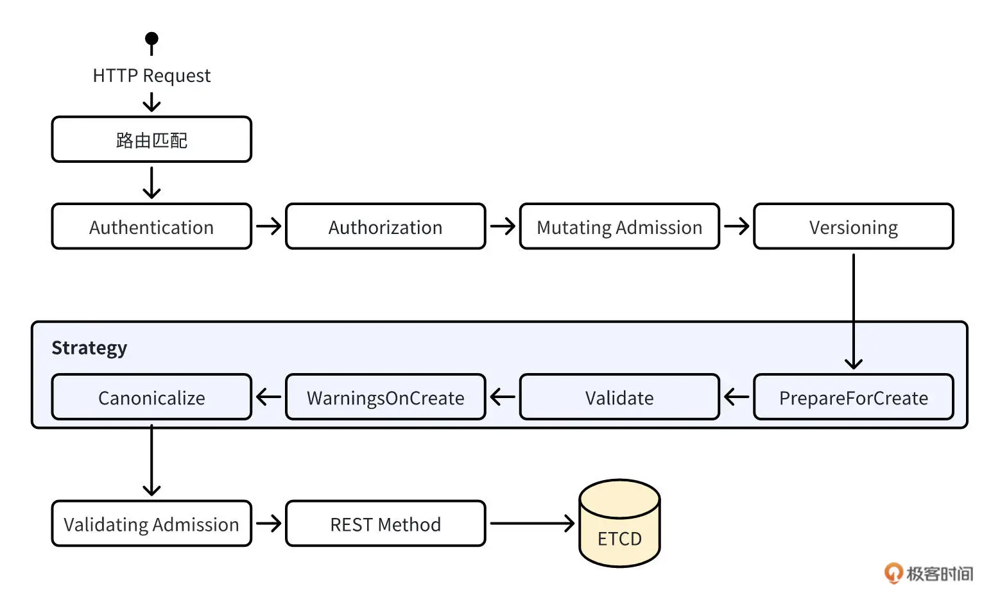
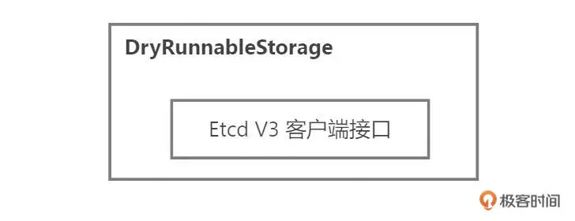

# 25 | KubernetesHTTP请求处理流程详解

你好，我是孔令飞。

上一节课，我介绍了 kube-apiserver 中安装资源路由的整个流程。在一个 REST 请求到达kube-apiserver 实例后，kube-apiserver 中的路由表会匹配 HTTP 请求方法、HTTP 请求路径，并根据匹配结果找到对应的路由函数，也即处理函数（也称 Handler/Controller），处理HTTP 请求。

本节课，我就来详细介绍下路由函数的实现，通过路由函数实现，我们可以掌握到 kube-apiserver 具体是如何处理请求的。我们先来看下，Kubernetes 中的 HTTP 请求处理流程。

## 路由函数相关目录及结构

Kuberenets 路由函数都统一存放在 registry 目录下。registry 目录内容如下：

```
$ ls registry/
admissionregistration  apps            authorization  batch         coordination
apiserverinternal      authentication  autoscaling    certificates  core
```

registry 目录结构体如下：

```
registry/
├── ...
├── apps # 保存了 apps 资源组下所有版本、所有资源的请求处理逻辑
│   ├── ...
│   ├── daemonset # daemonset 资源所有版本的路由函数
│   │   ├── doc.go # daemonset 包的文档说明
│   │   ├── storage # 保存了存储层的具体已实现
│   │   │   ├── storage.go # 这个文件定义了与 daemonset 资源对象交互的存储逻辑，包括对象的
│   │   │   └── storage_test.go # 单元测试文件，用于测试 storage.go 文件中的函数或方法
│   │   ├── strategy.go # 包含实现 daemonset 资源对象的策略（如创建、更新、删除时的验证和转
│   │   └── strategy_test.go # 单元测试文件，用于测试 strategy.go 文件中的函数或方法
│   ├── deployment # 保存了 deployment 资源所有版本的路由函数。目录下文件的功能跟 daemons
│   │   ├── doc.go
│   │   ├── storage
│   │   │   ├── storage.go
│   │   │   └── storage_test.go
│   │   ├── strategy.go
│   │   └── strategy_test.go
│   ├── ...
│   ├── rest
│   │   └── storage_apps.go # 包含了创建 apps 资源组 RESTStorage 的结构体和方法
│   └── ...
├── ...
├── batch # 保存了 batch 资源组下所有版本、所有资源的 REST 路由函数。目录下文件的功能跟 app
│   ├── ...
├── ...
```

可以看到，registry 目录下，包含了 Kubernetes 所有内置资源的 CURD 等操作的具体实现逻辑。这些处理逻辑主要包括：

- 对象的处理策略：用来告诉 kube-aiserver，在处理 HTTP 请求逻辑之前，需要执行的一些操作。例如：对象创建前执行的操作、资源更新前操作、资源验证、对象转换等操作。

- HTTP 请求处理方法：这些方法用来处理指定的 HTTP 请求。在 kube-apiserver 中，这些处理方法会进行一些逻辑处理，并将处理后的资源保存在后端存储中，也就是 etcd 中。Kubernets 资源通常会包含以下方法：

- Create：处理资源创建的 HTTP Handler；

- Get：处理获取资源详情的 HTTP Handler；

- Update：处理更新资源的 HTTP Handler；

- Destroy：处理销毁资源的 HTTP Handler；

- ConvertToTable：用来将资源对象转换为表格格式，以便在 Kubernetes 的 CLI 或 API响应中以表格形式展示。

```
另外，每个资源组目录下，还有一个 rest 目录，rest 目录中定义了一个名为
StorageProvider 的结构体，该结构体中包含了 NewRESTStorage 方法，
NewRESTStorage 方法可以用来创建 APIGroupInfo 类型的实例，APIGroupInfo 定义
```

如下：

```
// Info about an API group.
type APIGroupInfo struct {
   PrioritizedVersions []schema.GroupVersion
   // Info about the resources in this group. It's a map from version to resourc
   VersionedResourcesStorageMap map[string]map[string]rest.Storage
   // OptionsExternalVersion controls the APIVersion used for common objects in
   // schema like api.Status, api.DeleteOptions, and metav1.ListOptions. Other i
   // define a version "v1beta1" but want to use the Kubernetes "v1" internal ob
   // If nil, defaults to groupMeta.GroupVersion.
   // TODO: Remove this when https://github.com/kubernetes/kubernetes/issues/190
   OptionsExternalVersion *schema.GroupVersion
   // MetaGroupVersion defaults to "meta.k8s.io/v1" and is the scheme group vers
   // common API implementations like ListOptions. Future changes will allow thi
   // version (for when the inevitable meta/v2 group emerges).
   MetaGroupVersion *schema.GroupVersion
   // Scheme includes all of the types used by this group and how to convert bet
   // to convert objects from outside of this group that are accepted in this AP
   // TODO: replace with interfaces
   Scheme *runtime.Scheme
   // NegotiatedSerializer controls how this group encodes and decodes data
   NegotiatedSerializer runtime.NegotiatedSerializer
   // ParameterCodec performs conversions for query parameters passed to API cal
   ParameterCodec runtime.ParameterCodec
   // StaticOpenAPISpec is the spec derived from the definitions of all resource
   // It is set during InstallAPIGroups, InstallAPIGroup, and InstallLegacyAPIGr
   StaticOpenAPISpec map[string]*spec.Schema
}
APIGroupInfo 结构体包含了所有用来构建 HTTP 路由的信息。另外 StorageProvider结
构体还包含了 GroupName() 方法，该方法可以返回资源组的组名。
上面，我从目录结构维度，给你介绍了 registry 目录下的文件及其功能。接下来，我来给
```

你介绍下 kube-apiserver 具体是如何处理一个 HTTP 请求的。

## kube-apiserver 处理 HTTP 请求的流程

为了能够给你清晰地讲解 kube-apiserver 具体是如何处理 HTTP 请求的，这里按照 HTTP 请求处理流程分享，会涉及流程中的各个关键处理环节。

这里我们先通过一张图，从上层视角看一下 kube-apiserver 处理 HTTP 请求的流程。处理流程如下：



当 kube-apiserver 收到一个 HTTP 请求之后，会先执行路由匹配，找到匹配的路由之后，会执行该路由中添加的 HTTP 处理链。通过上一节课的讲解，我们知道，kube-apiserver 在启动时，添加了众多的 HTTP 处理链。上图中的 Authentication 和 Authorization 就是其中的两个处理链，分别进行请求认证和请求鉴权。关于认证和鉴权，本课程中会有专门的课程来讲解，这节课就不展开了。

在认证和鉴权通过之后，会分别执行 Mutating Admission Controller 和 Validating AdmissionController。在两个 Admission Webhook 执行完之后，Versioning 逻辑用来将版本化的资源转换为内部版本资源。这样的操作，可以使之后的处理逻辑不会因为资源版本不一致而不同。

之后会执行资源创建前的处理策略，链路为：PrepareForCreate -> Validate ->WarningsOnCreate -> Canonicalize。在 Kubernetes 开发中，我们需要关注 Validate 链路，因为我们经常需要为自定义资源添加参数校验逻辑。

在执行完 Strategy 链路之后，会进入到 REST Method 节点。REST Method 会对请求进行真正的业务逻辑处理，并将处理后的资源数据保存在 etcd 数据库中。

上面的这些处理点，每个点都包含了大量的内容。所以本门课程会分开介绍每个节点的具体实现。本节课，我们主要介绍上述处理点中的 REST Strategy 和 REST Method 部分。这两个部分是真正执行 HTTP 请求处理逻辑的 2 个节点。

## 请求到达路由函数（以创建请求为例）

通过上一节课的学习，我们可以知道 kube-apiserver 最终是通过调用以下代码来安装路由的。例如，安装资源的创建路由代码如下：

```go
// 位于文件 staging/src/k8s.io/apiserver/pkg/endpoints/installer.go 中
func (a *APIInstaller) registerResourceHandlers(path string, storage rest.Storage
       ...
       namedCreater, isNamedCreater := storage.(rest.NamedCreater)
       ...
       switch action.Verb {
       ...
       case "POST": // Create a resource.
           var handler restful.RouteFunction
           if isNamedCreater {
               handler = restfulCreateNamedResource(namedCreater, reqScope, admi
           } else {
               handler = restfulCreateResource(creater, reqScope, admit)
           }
           handler = metrics.InstrumentRouteFunc(action.Verb, group, version, re
           handler = utilwarning.AddWarningsHandler(handler, warnings)
           article := GetArticleForNoun(kind, " ")
           doc := "create" + article + kind
           if isSubresource {
               doc = "create " + subresource + " of" + article + kind
           }
           route := ws.POST(action.Path).To(handler).
               Doc(doc).
               Param(ws.QueryParameter("pretty", "If 'true', then the output is
               Operation("create"+namespaced+kind+strings.Title(subresource)+ope
               Produces(append(storageMeta.ProducesMIMETypes(action.Verb), media
               Returns(http.StatusOK, "OK", producedObject).
               // TODO: in some cases, the API may return a v1.Status instead of
               // but currently go-restful can't handle multiple different objec
               Returns(http.StatusCreated, "Created", producedObject).
               Returns(http.StatusAccepted, "Accepted", producedObject).
               Reads(defaultVersionedObject).
               Writes(producedObject)
           if err := AddObjectParams(ws, route, versionedCreateOptions); err !=
               return nil, nil, err
           }
           addParams(route, action.Params)
           routes = append(routes, route)
       case "DELETE": // Delete a resource.
}
// 位于 staging/src/k8s.io/apiserver/pkg/endpoints/installer.go 文件中。
func restfulCreateNamedResource(r rest.NamedCreater, scope handlers.RequestScope,
   return func(req *restful.Request, res *restful.Response) {
       handlers.CreateNamedResource(r, &scope, admit)(res.ResponseWriter, req.Re
   }
}
// 位于 staging/src/k8s.io/apiserver/pkg/endpoints/handlers/create.go 文件中
// CreateNamedResource returns a function that will handle a resource creation wi
func CreateNamedResource(r rest.NamedCreater, scope *RequestScope, admission admi
   return createHandler(r, scope, admission, true)
}
// 位于文件 staging/src/k8s.io/apiserver/pkg/endpoints/handlers/create.go 中
func createHandler(r rest.NamedCreater, scope *RequestScope, admit admission.Inte
   return func(w http.ResponseWriter, req *http.Request) {
       ctx := req.Context()
       // For performance tracking purposes.
       /// 初始化调用链 Span 节点
       ctx, span := tracing.Start(ctx, "Create", traceFields(req)...)
       defer span.End(500 * time.Millisecond)
       // 从请求中获取资源的命名空间和名词
       namespace, name, err := scope.Namer.Name(req)
       ...
       // 解析请求的Query参数，讲参数解析到CreateOptions类型的变量中
       options := &metav1.CreateOptions{}
       values := req.URL.Query()
       if err := metainternalversionscheme.ParameterCodec.DecodeParameters(value
           err = errors.NewBadRequest(err.Error())
           scope.err(err, w, req)
           return
       }
       // 校验CreateOptions
       if errs := validation.ValidateCreateOptions(options); len(errs) > 0 {
           err := errors.NewInvalid(schema.GroupKind{Group: metav1.GroupName, Ki
           scope.err(err, w, req)
           return
       }
       options.TypeMeta.SetGroupVersionKind(metav1.SchemeGroupVersion.WithKind("
       defaultGVK := scope.Kind
       // 创建一个空的资源示例，例如：original = &apps.Deployment{}
       original := r.New()
       ...
       // 将请求体参数解析到original变量中
       obj, gvk, err := decoder.Decode(body, &defaultGVK, original)
       ...
       // 如果name为空，则从资源对象的定义中获取资源名
       // On create, get name from new object if unset
       if len(name) == 0 {
           _, name, _ = scope.Namer.ObjectName(obj)
       }
       if len(namespace) == 0 && scope.Resource == namespaceGVR {
           namespace = name
       }
       ctx = request.WithNamespace(ctx, namespace)
       // 用于后续的请求申请
       admit = admission.WithAudit(admit)
       audit.LogRequestObject(req.Context(), obj, objGV, scope.Resource, scope.S
       ...
       requestFunc := func() (runtime.Object, error) {
           return r.Create(
               ctx,
               name,
               obj,
               rest.AdmissionToValidateObjectFunc(admit, admissionAttributes, sc
               options,
           )
       }
       ...
       result, err := finisher.FinishRequest(ctx, func() (runtime.Object, error)
           // 执行 mutationg webhook
           if mutatingAdmission, ok := admit.(admission.MutationInterface); ok &
               if err := mutatingAdmission.Admit(ctx, admissionAttributes, scope
                   return nil, err
               }
           }
           ...
           // 执行 HTTP 请求
           result, err := requestFunc()
           ...
           return result, err
       })
       ...
       code := http.StatusCreated
       status, ok := result.(*metav1.Status)
       if ok && status.Code == 0 {
           status.Code = int32(code)
       }
       ...
       // 返回规范化的返回结果：
       // - 错误时返回类型为*metav1.Status
       // - 成功时，不同请求方法返回类型不同。例如：Create/Update返回资源本身
       transformResponseObject(ctx, scope, req, w, code, outputMediaType, result
   }
}
registerResourceHandlers 方法中的 route :=
ws.POST(action.Path).To(handler). 语句调用，安装具体的路由，例如：CREATE
/apis/apps/v1/namespaces/default/daemonsets 接口的路由函数为 handler，
```

handler 实现为：

```go
func restfulCreateNamedResource(r rest.NamedCreater, scope handlers.RequestScope,
   return func(req *restful.Request, res *restful.Response) {
       handlers.CreateNamedResource(r, &scope, admit)(res.ResponseWriter, req.Re
   }
}
func (a *APIInstaller) registerResourceHandlers(path string, storage rest.Storage
   ...
   namedCreater, isNamedCreater := storage.(rest.NamedCreater)
   ...
   switch action.Verb {
   ...
    case "POST":
       ...
       handler = restfulCreateNamedResource(namedCreater, reqScope, admit)
       ...
       route := ws.POST(action.Path).To(handler).XXX
   ...
   }
   ...
}
```

阅读代码可知，请求到来时执行的函数路径如下：

```
执行 handler，即 restfulCreateNamedResource(namedCreater, reqScope,
admit) 函数。其中 namedCreater 是一个接口定义，接口定义为：
// NamedCreater is an object that can create an instance of a RESTful object usin
type NamedCreater interface {
   // New returns an empty object that can be used with Create after request dat
   // This object must be a pointer type for use with Codec.DecodeInto([]byte, r
   New() runtime.Object
   // Create creates a new version of a resource. It expects a name parameter fr
   // resource in the path.
   Create(ctx context.Context, name string, obj runtime.Object, createValidation
}
NamedCreater 接口的实现为 RESTStorage，例如：DeploymentStorage 结构体中的各
```

个字段，就是一个具体的 REST 实现：

```
// DeploymentStorage includes dummy storage for Deployments and for Scale subreso
type DeploymentStorage struct {
   Deployment *REST
   Status     *StatusREST
   Scale      *ScaleREST
   Rollback   *RollbackREST
}
// REST implements a RESTStorage for Deployments.
type REST struct {
   *genericregistry.Store
}
DeploymentStorage 结构体中的 Deployment 字段是一个 *REST 类型，REST 类型内嵌
了 *genericregistry.Store 类型的字段，实现了 NamedCreater 接口中的 Create 方
法。*REST 实现了 NamedCreater 接口中的 New 方法。
```

```
restfulCreateNamedResource 方法中执行 handlers.CreateNamedResource 方
```

- 法。

```
handlers.CreateNamedResource 方法执行 createHandler 方法。
从上述 createHandler 方法的代码实现中，我们可以知道，createHandler 方法具体
```

- 执行了以下核心逻辑：a. 初始化调用链 Span 节点；

- b. 从请求中获取资源的命名空间和名词；

```
c. 解析请求的 Query 参数，讲参数解析到 CreateOptions 类型的变量中；
d. 校验 CreateOptions；
e. 创建一个空的资源示例，例如：original = &apps.Deployment{}；
f. 将请求体参数解析到 original 变量中；
```

- g. 记录一个请求审计；

```
h. 执行 mutationg webhook；
i. 执行 HTTP 请求，其实是调用 rest.NamedCreater 的 Create 方法来完成具体的请
```

- 求处理逻辑。

## 资源请求处理逻辑实现

```
通过上面的代码分析，我们知道  createHandler 方法主要进行了参数解析、执行
mutationg webhook，并调用 rest.NamedCreater 的 Create 方法来完成具体的请求处理
```

逻辑。

```go
rest.NamedCreater 接口类型的具体实例是什么呢？我们回过头来再看下
registerResourceHandlers 函数是如何注册路由的：
func (a *APIInstaller) registerResourceHandlers(path string, storage rest.Storage
   ...
   namedCreater, isNamedCreater := storage.(rest.NamedCreater)
   ...
}
createHandler 方法中的 rest.NamedCreater 接口类型参数，你向上追踪代码，会发现
最终是 namedCreater。namedCreater 你如果再往上追踪代码，会发现其实是
```

Deployment 资源 Storage 定义文件中的 REST 类型的实例：

```sql
type REST struct {
   *genericregistry.Store
}
REST 结构体内嵌了 *genericregistry.Store 类型的匿名字段。
*genericregistry.Store 类型自带了一些跟 etcd 操作相关的方法，例如：Create、
Update、Delete 等，我们可以通过给 *REST 结构体添加 Create、Update 等方法来重
```

写默认的方法。

### genericregistry.Store 实例初始化

```sql
genericregistry.Store 结构体定义如下：
type Store struct {
   // NewFunc 返回一个新实例，通常用于根据 GET 请求获取单个对象时的类型，例如：
   // curl GET /apis/group/version/namespaces/my-ns/myresource/name-of-object
   NewFunc func() runtime.Object
   // NewListFunc 返回一个新列表，通常用于资源列表时的类型，例如：
   // curl GET /apis/group/version/namespaces/my-ns/myresource
   NewListFunc func() runtime.Object
   // DefaultQualifiedResource 是资源的复数名称。
   // 如果在上下文中没有请求信息，则使用此字段。
   // 详细信息请参见 qualifiedResourceFromContext。
   DefaultQualifiedResource schema.GroupResource
   // SingularQualifiedResource 是资源的单数名称。
   SingularQualifiedResource schema.GroupResource
   // KeyRootFunc 返回此资源的 etcd 根键；不应包含尾随的 "/"。
   // 这用于处理涉及整个集合的操作（列出和监视）。
   // KeyRootFunc 和 KeyFunc 必须一起提供或者完全不提供。
   KeyRootFunc func(ctx context.Context) string
   // KeyFunc 返回集合中特定对象的键。
   // KeyFunc 被用于创建／更新／获取／删除，这里可以从 ctx 获取 'namespace'。
   // KeyFunc 和 KeyRootFunc 必须一起提供或者完全不提供。
   KeyFunc func(ctx context.Context, name string) (string, error)
   // ObjectNameFunc 返回对象的名称或错误。
   ObjectNameFunc func(obj runtime.Object) (string, error)
   // TTLFunc 返回对象应持久化的 TTL （生存时间）。
   // existing 参数是当前的 TTL 或该操作的默认值；
   // update 参数指示这是对现有对象的操作。
   // 被持久化的对象在 TTL 到期后会被驱逐。
   TTLFunc func(obj runtime.Object, existing uint64, update bool) (uint64, error
   // PredicateFunc 返回与给定标签和字段匹配的选择器。
   // 返回的 SelectionPredicate 应该返回 true 如果对象与给定的字段和标签选择器匹配。
   PredicateFunc func(label labels.Selector, field fields.Selector) storage.Sele
   // EnableGarbageCollection 影响更新和删除请求的处理。
   // 启用垃圾收集允许最终处理器在存储删除对象之前完成工作。
   // 如果任何存储启用了垃圾收集，则在 kube-controller-manager 中也必须启用它。
   EnableGarbageCollection bool
   // DeleteCollectionWorkers 是单个 DeleteCollection 调用中的最大工作数。
   // 对集合中项目的删除请求是并行发出的。
   DeleteCollectionWorkers int
   // Decorator 是对从底层存储返回的对象的可选退出钩子。
   // 返回的对象可以是单个对象（例如 Pod）或列表类型（例如 PodList）。
   // Decorator 仅用于特定情况下的集成，因其不能被监视，因此不应用于存储值。
   Decorator func(runtime.Object)
   // CreateStrategy 实现资源特定的创建行为。
   CreateStrategy rest.RESTCreateStrategy
   // BeginCreate 是一个可选的钩子，此钩子返回一个“事务式”提交/回滚函数。
   // 这个函数将在操作结束时调用，但在 AfterCreate 和 Decorator 之前调用，
   // 通过参数指示操作是否成功。如果此函数返回错误，则不会调用。
   // 几乎没有人会使用此钩子。
   BeginCreate BeginCreateFunc
   // AfterCreate 实现创建资源后运行的进一步操作，并且在其被装饰之前，是可选的。
   AfterCreate AfterCreateFunc
   // UpdateStrategy 实现资源特定的更新行为。
   UpdateStrategy rest.RESTUpdateStrategy
   // BeginUpdate 是一个可选的钩子，此钩子返回一个“事务式”提交/回滚函数。
   // 这个函数将在操作结束时调用，但在 AfterUpdate 和 Decorator 之前调用，
   // 通过参数指示操作是否成功。如果此函数返回错误，则不会调用。
   // 几乎没有人会使用此钩子。
   BeginUpdate BeginUpdateFunc
   // AfterUpdate 实现更新资源后运行的进一步操作，并且在其被装饰之前，是可选的。
   AfterUpdate AfterUpdateFunc
   // DeleteStrategy 实现资源特定的删除行为。
   DeleteStrategy rest.RESTDeleteStrategy
   // AfterDelete 实现删除资源后运行的进一步操作，并且在其被装饰之前，是可选的。
   AfterDelete AfterDeleteFunc
   // ReturnDeletedObject 确定存储返回已删除的对象。
   // 否则返回通用的成功状态响应。
   ReturnDeletedObject bool
   // ShouldDeleteDuringUpdate 是一个可选函数，用于确定在从现有对象更新到新对象时，
   // 是否应该导致删除。若指定，此检查将与标准的最终处理器、
   // 删除时间戳和 deletionGracePeriodSeconds 检查一起进行。
   ShouldDeleteDuringUpdate func(ctx context.Context, key string, obj, existing
   // TableConvertor 是一个可选接口，用于将项目或项目列表转换为表格输出。
   // 如果未设置，将使用默认选项。
   TableConvertor rest.TableConvertor
   // ResetFieldsStrategy 提供应由策略重置的字段，这些字段不应被用户修改。
   ResetFieldsStrategy rest.ResetFieldsStrategy
   // Storage 是资源的底层存储接口。
   // 它被包装成一个 “DryRunnableStorage”，可以是直接通过或者简单的干运行。
   Storage DryRunnableStorage
   // StorageVersioner 输出一个对象在存储到 etcd 之前将转换到的 <group/version/kind>，
   // 给定对象可能的多种类型。如果 StorageVersioner 为 nil，
   // apiserver 将在发现文档中留下 storageVersionHash 为空。
   StorageVersioner runtime.GroupVersioner
   // DestroyFunc 清理底层 Storage 使用的客户端；可选。
   // 如果设置，DestroyFunc 必须以线程安全的方式实现，并准备可能被调用多次。
   DestroyFunc func()
}
*genericregistry.Store 字段是在 NewREST 中初始化，并被设置的。NewREST 函
```

数实现如下：

```go
// NewREST returns a RESTStorage object that will work against deployments.
func NewREST(optsGetter generic.RESTOptionsGetter) (*REST, *StatusREST, *Rollback
   store := &genericregistry.Store{
       NewFunc:                   func() runtime.Object { return &apps.Deploymen
       NewListFunc:               func() runtime.Object { return &apps.Deploymen
       DefaultQualifiedResource:  apps.Resource("deployments"),
       SingularQualifiedResource: apps.Resource("deployment"),
       CreateStrategy:      deployment.Strategy,
       UpdateStrategy:      deployment.Strategy,
       DeleteStrategy:      deployment.Strategy,
       ResetFieldsStrategy: deployment.Strategy,
       TableConvertor: printerstorage.TableConvertor{TableGenerator: printers.Ne
   }
   options := &generic.StoreOptions{RESTOptions: optsGetter}
   if err := store.CompleteWithOptions(options); err != nil {
       return nil, nil, nil, err
   }
   statusStore := *store
   statusStore.UpdateStrategy = deployment.StatusStrategy
   statusStore.ResetFieldsStrategy = deployment.StatusStrategy
   return &REST{store}, &StatusREST{store: &statusStore}, &RollbackREST{store: s
}
genericregistry.Store 类型中，包含了一个非常重要的字段：Storage。Storage 类
型为 DryRunnableStorage：
```

```
type DryRunnableStorage struct {
   Storage storage.Interface
   Codec   runtime.Codec
}
DryRunnableStorage 结构体包含了一系列方法，这些方法用来执行 etcd 操作。
DryRunnableStorage 结构体中的 Storage 字段是一个结构体类型，代表一个存储实现。
```

由此可知，kube-apiserver 底层除了支持 etcd 存储外，其实还可以支持其他存储，例如：MySQL、Elasticsearch 等。当然，kube-apiserver 使用的是 etcd，也建议使用 etcd。

```go
genericregistry.Store 结构体中的 Storage 字段是在
store.CompleteWithOptions 函数调用中被初始化的，初始化代码段如下：
       e.Storage.Storage, e.DestroyFunc, err = opts.Decorator(
           opts.StorageConfig,
           prefix,
           keyFunc,
           e.NewFunc,
           e.NewListFunc,
           attrFunc,
           options.TriggerFunc,
           options.Indexers,
       )
opts.Decorator 函数的实现初始化和实现代码如下：
// 位于 staging/src/k8s.io/apiserver/pkg/server/options/etcd.go 文件中
func (f *StorageFactoryRestOptionsFactory) GetRESTOptions(resource schema.GroupRe
   // 创建用于存储资源的配置
   storageConfig, err := f.StorageFactory.NewConfig(resource)
   if err != nil {
       // 如果无法找到存储配置，则返回错误
       return generic.RESTOptions{}, fmt.Errorf("unable to find storage destinat
   }
   // 初始化 RESTOptions，用于存储配置和其他设置
   ret := generic.RESTOptions{
       StorageConfig:             storageConfig, // 指定存储的配置
       Decorator:                 generic.UndecoratedStorage, // 设置装饰器为未装饰
       DeleteCollectionWorkers:   f.Options.DeleteCollectionWorkers, // 配置删除集
       EnableGarbageCollection:   f.Options.EnableGarbageCollection, // 启用垃圾回
       ResourcePrefix:            f.StorageFactory.ResourcePrefix(resource), //
       CountMetricPollPeriod:     f.Options.StorageConfig.CountMetricPollPeriod,
       StorageObjectCountTracker: f.Options.StorageConfig.StorageObjectCountTrac
   }
   // 如果启用了观察缓存
   if f.Options.EnableWatchCache {
       // 解析观察者缓存大小配置
       sizes, err := ParseWatchCacheSizes(f.Options.WatchCacheSizes)
       if err != nil {
           // 解析失败，返回错误
           return generic.RESTOptions{}, err
       }
       size, ok := sizes[resource] // 获取当前资源的缓存大小
       if ok && size > 0 {
           // 如果缓存大小有效且大于0，则记录警告
           klog.Warningf("Dropping watch-cache-size for %v - watchCache size is
       }
       if ok && size <= 0 {
           // 如果缓存大小为0，则不使用观察缓存
           klog.V(3).InfoS("Not using watch cache", "resource", resource)
           ret.Decorator = generic.UndecoratedStorage // 设置为未装饰状态
       } else {
           // 正在使用观察缓存
           klog.V(3).InfoS("Using watch cache", "resource", resource)
           ret.Decorator = genericregistry.StorageWithCacher() // 设置为使用缓存的存
       }
   }
   return ret, nil // 返回构造的 RESTOptions
}
// 位于 staging/src/k8s.io/apiserver/pkg/registry/generic/registry/storage_factory
// 创建一个缓存存储，根据提供的存储配置生成
func StorageWithCacher() generic.StorageDecorator {
   return func(
       storageConfig *storagebackend.ConfigForResource, // 接收存储配置
       resourcePrefix string, // 资源前缀
       keyFunc func(obj runtime.Object) (string, error), // 生成对象键的函数
       newFunc func() runtime.Object, // 创建新对象的函数
       newListFunc func() runtime.Object, // 创建新列表对象的函数
       getAttrsFunc storage.AttrFunc, // 获取对象属性的函数
       triggerFuncs storage.IndexerFuncs, // 索引器的触发函数
       indexers *cache.Indexers) (storage.Interface, factory.DestroyFunc, error)
       // 创建原始存储
       s, d, err := generic.NewRawStorage(storageConfig, newFunc, newListFunc, r
       if err != nil {
           return s, d, err // 返回错误
       }
       if klogV := klog.V(5); klogV.Enabled() {
           // 记录启用存储缓存的信息
           klogV.InfoS("Storage caching is enabled", objectTypeToArgs(newFunc())
       }
       // 配置缓存存储
       cacherConfig := cacherstorage.Config{
           Storage:        s, // 原始存储
           Versioner:      storage.APIObjectVersioner{}, // 对象版本控制
           GroupResource:  storageConfig.GroupResource, // 资源组
           ResourcePrefix: resourcePrefix, // 资源前缀
           KeyFunc:        keyFunc, // 对象键生成函数
           NewFunc:        newFunc, // 创建新对象的函数
           NewListFunc:    newListFunc, // 创建新列表对象的函数
           GetAttrsFunc:   getAttrsFunc, // 获取属性的函数
           IndexerFuncs:   triggerFuncs, // 索引器函数
           Indexers:       indexers, // 索引器
           Codec:          storageConfig.Codec, // 编解码器
       }
       // 创建缓存实例
       cacher, err := cacherstorage.NewCacherFromConfig(cacherConfig)
       if err != nil {
           return nil, func() {}, err // 返回错误
       }
       var once sync.Once // 确保仅调用一次的函数
       destroyFunc := func() {
           once.Do(func() {
               cacher.Stop() // 停止缓存
               d() // 调用销毁函数
           })
       }
       return cacher, destroyFunc, nil // 返回缓存和销毁函数
   }
}
// 位于文件 staging/src/k8s.io/apiserver/pkg/registry/generic/storage_decorator.go
// NewRawStorage 创建底层的 KV 存储。这是当前两个相同存储接口的解决方法。
// TODO: 一旦缓存被启用在所有注册表上（事件注册表是特殊情况），我们将移除此方法。
func NewRawStorage(config *storagebackend.ConfigForResource, newFunc, newListFunc
   return factory.Create(*config, newFunc, newListFunc, resourcePrefix) // 调用工
}
// 位于文件 staging/src/k8s.io/apiserver/pkg/storage/storagebackend/factory/factory
// Create 根据提供的配置创建存储后端
func Create(c storagebackend.ConfigForResource, newFunc, newListFunc func() runti
   switch c.Type { // 根据存储类型创建相应的存储
   case storagebackend.StorageTypeETCD2:
       // 不再支持 ETCD2 存储
       return nil, nil, fmt.Errorf("%s is no longer a supported storage backend"
   case storagebackend.StorageTypeUnset, storagebackend.StorageTypeETCD3:
       // 支持创建 ETCD3 存储类型
       return newETCD3Storage(c, newFunc, newListFunc, resourcePrefix)
   default:
       // 返回未知存储类型错误
       return nil, nil, fmt.Errorf("unknown storage type: %s", c.Type)
   }
}
上面的代码有点多，大概意思就是，在初始化 genericregistry.Store 类型的实例，初
始化 DryRunnableStorage 结构体类型 Storage 实例时，底层最终会调用
go.etcd.io/etcd/client/v3 包创建一个 etcd 实例。然后，在 DryRunnableStorage
结构体的 Create、Get、Update 等方法中，调用 etcd V3 的客户端方法，完成数据从 etcd
中的读写。可以理解为，DryRunnableStorage 是底层 etcd 客户端的一个代理，用来将资
```

源数据保存到 etcd 存储中，或者从 etcd 存储中查询资源数据。



```
上面，我临时插入了 genericregistry.Store 实例的具体初始化方法，因为这是 HTTP
```

调用链中的关键一环。接下来，我们继续分析 HTTP 请求处理流程。

```
从上面的分析，我们可以知道 rest.NamedCreater 的 Create 方法，其实是
*genericregistry.Store 的 Create 方法。*genericregistry.Store 类型的
Create 方法的实际代码实现如下：
// 位于 staging/src/k8s.io/apiserver/pkg/registry/generic/registry/store.go 文件中
// Create inserts a new item according to the unique key from the object.
// Note that registries may mutate the input object (e.g. in the strategy
// hooks).  Tests which call this might want to call DeepCopy if they expect to
// be able to examine the input and output objects for differences.
func (e *Store) Create(ctx context.Context, obj runtime.Object, createValidation
   if utilfeature.DefaultFeatureGate.Enabled(features.RetryGenerateName) && need
       return e.createWithGenerateNameRetry(ctx, obj, createValidation, options)
   }
   return e.create(ctx, obj, createValidation, options)
}
可以看到，Create 方法最终是调用 e.create 执行具体的创建请求的，e.create 方法实
```

现了 Kubernetes 中资源创建的完整流程，包括元数据的初始化、前置和后置处理、参数验证、对象存储等多个步骤。下一小节，我就来介绍下，具体是如何执行创建请求的。

### HTTP 请求处理详情

```
从上面的代码分析，我们知道 createHandler 方法用来执行 HTTP 请求的核心逻辑。请求
最终是通过 Store 类型的 create 方法来执行实际的 HTTP 请求处理逻辑。create 方法
```

内容如下：

```go
// 位于 staging/src/k8s.io/apiserver/pkg/registry/generic/registry/store.go 文件中
func (e *Store) create(ctx context.Context, obj runtime.Object, createValidation
   // 用于在创建操作结束时执行特定的清理工作，初始值为 finishNothing
   var finishCreate FinishFunc = finishNothing
   // Init metadata as early as possible.
   // 1. 从资源对象中获取 metav1.Object 类型的实例，metav1.Object 实例可以用来获取资源的元
   if objectMeta, err := meta.Accessor(obj); err != nil {
       return nil, err
   } else {
       // 2. 填充系统字段，例如：创建时间、UID。
       rest.FillObjectMetaSystemFields(objectMeta)
       // 3. 如果设置了 GenerateName 字段，并且资源 Name 是空，则调用 GenerateName() 方
       if len(objectMeta.GetGenerateName()) > 0 && len(objectMeta.GetName()) ==
           objectMeta.SetName(e.CreateStrategy.GenerateName(objectMeta.GetGenera
       }
   }
   // 如果 e.BeginCreate 不为 nil，则执行创建前 Hook
   // BeginCreate 是一个可选的钩子，此钩子返回一个“事务式”提交/回滚函数。
   // 这个函数将在操作结束时调用，但在 AfterCreate 和 Decorator 之前调用，
   // 通过参数指示操作是否成功。如果此函数返回错误，则不会调用。
   // 几乎没有人会使用此钩子。
   if e.BeginCreate != nil {
       fn, err := e.BeginCreate(ctx, obj, options)
       if err != nil {
           return nil, err
       }
       finishCreate = fn
       defer func() {
           finishCreate(ctx, false)
       }()
   }
   // 4. 执行创建前处理，执行与创建相关的前置验证或处理。
   if err := rest.BeforeCreate(e.CreateStrategy, ctx, obj); err != nil {
       return nil, err
   }
   // at this point we have a fully formed object.  It is time to call the valid
   // handling chain wants to enforce.
   // 5. 资源参数校验
   if createValidation != nil {
       if err := createValidation(ctx, obj.DeepCopyObject()); err != nil {
           return nil, err
       }
   }
   // 6. 获取资源对象的名字
   name, err := e.ObjectNameFunc(obj)
   if err != nil {
       return nil, err
   }
   // 7. 根据资源对象的名字，拼接 Etcd 键
   key, err := e.KeyFunc(ctx, name)
   if err != nil {
       return nil, err
   }
   // 从 ctx 中提取出来，schema.GroupResource 类型的实例
   // schema.GroupResource 包含了 Group 和 Resource 字段
   qualifiedResource := e.qualifiedResourceFromContext(ctx)
   ttl, err := e.calculateTTL(obj, 0, false)
   if err != nil {
       return nil, err
   }
   // 8. 创建资源对象，要来保存资源对象内容
   // 使用 NewFunc 创建一个新的对象实例
   out := e.NewFunc()
   // 9. 调用 Storage 的 Create 方法，将资源对象保存在 Etcd 中
   if err := e.Storage.Create(ctx, key, obj, out, ttl, dryrun.IsDryRun(options.D
       // 创建失败时的错误处理
       err = storeerr.InterpretCreateError(err, qualifiedResource, name)
       err = rest.CheckGeneratedNameError(ctx, e.CreateStrategy, err, obj)
       if !apierrors.IsAlreadyExists(err) {
           return nil, err
       }
       if errGet := e.Storage.Get(ctx, key, storage.GetOptions{}, out); errGet !
           return nil, err
       }
       accessor, errGetAcc := meta.Accessor(out)
       if errGetAcc != nil {
           return nil, err
       }
       if accessor.GetDeletionTimestamp() != nil {
           msg := &err.(*apierrors.StatusError).ErrStatus.Message
           *msg = fmt.Sprintf("object is being deleted: %s", *msg)
       }
       return nil, err
   }
   // The operation has succeeded.  Call the finish function if there is one,
   // and then make sure the defer doesn't call it again.
   // 10. 执行创建成功后的处理
   fn := finishCreate
   finishCreate = finishNothing
   fn(ctx, true)
   // 11. 执行创建后 Hook
   if e.AfterCreate != nil {
       e.AfterCreate(out, options)
   }
   if e.Decorator != nil {
       e.Decorator(out)
   }
   return out, nil
}
```

```
create 方法核心执行逻辑如下：
```

1. 从资源对象中获取 metav1.Object 类型的实例，metav1.Object 实例可以用来获取资源的元数据。

2. 填充系统字段，例如：创建时间、UID。

3. 如果设置了 GenerateName 字段，并且资源 Name 是空，则调用 GenerateName() 方法自动生成资源名。

4. 执行创建前处理，执行与创建相关的前置验证或处理。

5. 资源参数校验。

6. 获取资源对象的名字。

7. 根据资源对象的名字，拼接 etcd 键。

8. 创建资源对象，要来保存资源对象内容。

9. 调用 Storage 的 Create 方法，将资源对象保存在 etcd 中。

10. 执行创建成功后的处理。

11. 执行创建后 Hook。

至此，整个 HTTP 请求链的核心处理逻辑，我就给你介绍完了。

上面介绍了核心流程，其中还有很多重要的细节功能点。在接下来的课程中，我会给你一一介绍。

## 课程总结

本节课以 Deployment 资源的创建请求为例，详细介绍了 kube-apiserver 处理创建请求的流程和实现。

首先通过流程图，概括介绍了 kube-apiserver 具体是如何处理创建请求的。之后，重点介绍了资源创建逻辑执行前的处理策略实现及策略内容。最后，我们学习了具体如何处理 HTTP 请求，并最终将资源数据保存在 etcd 存储中。

## 课后练习

1. 在 HTTP 请求处理流程中，我没有介绍如何给资源设置默认值，请阅读 kube-apiserver 代码，查看 kube-apiserver 是如何给资源设置默认值的。

2. 请再次梳理下 kube-apiserver 具体是如何处理资源创建请求的。

欢迎你在留言区与我交流讨论，如果今天的内容让你有所收获，也欢迎转发给有需要的朋友，我们下节课再见！
