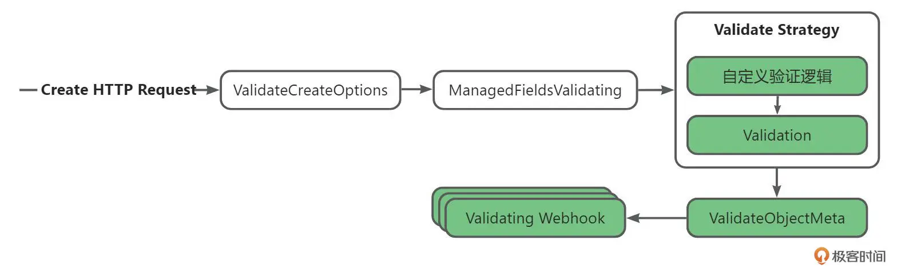

# 27 | Kubernetes如何进行请求参数校验？

你好，我是孔令飞。

绝大部分企业应用，都是通过 API 接口的形式对外提供功能，API 接口的通信协议通常是HTTP 或者 RPC。使用 RPC 作为通信协议的 API 接口又称作 RPC 接口，使用 HTTP 作为通信协议的 API 接口又称作 HTTP 接口。不管哪种类型的 API 接口，在请求到来时，都要进行请求参数校验。

Kubernetes 中有大量的 RESTful API 接口，在请求这些接口的时候，同样要进行请求参数校验。

本节课，我们就来看下 Kuberentes 是如何进行请求参数校验的（请求参数，其实就是资源定义，所以也叫资源定义校验）。希望通过本节课的学习，你可以掌握 Kubernetes 请求参数校验的实现方式。更重要的是，通过学习 Kubernetes 请求参数校验的设计和实现，你可以掌握优秀开源项目的参数校验设计和实现，并迁移到未来的业务开发中。

## Kubernetes 参数校验流程

kube-apiserver 真正开始处理 HTTP 请求的函数是 createHandler 函数，跟验证相关的逻辑如下：

```go
func createHandler(r rest.NamedCreater, scope *RequestScope, admit admission.Inte
   return func(w http.ResponseWriter, req *http.Request) {
       ctx := req.Context()
       // For performance tracking purposes.
       ...
       namespace, name, err := scope.Namer.Name(req)
       ...
       options := &metav1.CreateOptions{}
       values := req.URL.Query()
       // 将 HTTP 请求的 Query 参数解析到 metav1.CreateOptions 类型的变量 options 中
       if err := metainternalversionscheme.ParameterCodec.DecodeParameters(value
           ...
           return
       }
       // 验证创建资源的CreateOptions是否合法
       if errs := validation.ValidateCreateOptions(options); len(errs) > 0 {
           ...
           return
       }
       // WithAudit 封装了 admit，做了更多的逻辑处理，例如记录Annotations
       admit = admission.WithAudit(admit)
       audit.LogRequestObject(req.Context(), obj, objGV, scope.Resource, scope.S
       if objectMeta, err := meta.Accessor(obj); err == nil {
           // 这里会校验资源定义中的 namespace 和请求的 namespace 是一致的
           if err := rest.EnsureObjectNamespaceMatchesRequestNamespace(rest.Expe
               scope.err(err, w, req)
               return
           }
       }
       requestFunc := func() (runtime.Object, error) {
           return r.Create(
               ctx,
               name,
               obj,
               rest.AdmissionToValidateObjectFunc(admit, admissionAttributes, sc
               options,
           )
       }
       ...
       result, err := finisher.FinishRequest(ctx, func() (runtime.Object, error)
           ...
           // 用来校验ManagedFields，其实是在mutation webhook中校验的
           admit = fieldmanager.NewManagedFieldsValidatingAdmissionController(ad
           // 执行mutation webhook
           if mutatingAdmission, ok := admit.(admission.MutationInterface); ok &
               if err := mutatingAdmission.Admit(ctx, admissionAttributes, scope
                   return nil, err
               }
           }
           ...
           // 请求流程转到 r.Create 方法中
           result, err := requestFunc()
           ...
           return result, err
       })
       ...
   }
}
```

createHandler 函数有 4 个入参：

```
r rest.NamedCreater：这个其实就是 Deployment 资源的存储层实现 REST。REST
结构体中的 CreateStrategy 字段包含了 Validate 方法，用来对资源定义进行参数校
```

- 验。

```
scope *RequestScope：RequestScope 封装了所有 RESTful 处理方法中的常见字
```

- 段。

```
admit admission.Interface：Kubernetes Admission Controller 链，里面包含了多个
```

- Admission Webhook 插件。在执行时，会按初始化时的先后顺序串行执行这些插件。

```
admit 准入控制链是在 kube-apiserver 启动时被初始化的，具体代码如下：
```

```go
func (a *AdmissionOptions) ApplyTo(
   c *server.Config,
   informers informers.SharedInformerFactory,
   kubeClient kubernetes.Interface,
   dynamicClient dynamic.Interface,
   features featuregate.FeatureGate,
   pluginInitializers ...admission.PluginInitializer,
) error {
   ...
   admissionChain, err := a.Plugins.NewFromPlugins(pluginNames, pluginsConfigPro
   if err != nil {
       return err
   }
   ...
}
includeName bool：inclusterName 用来判断请求是否是指定 Name 来请求的。如
```

- 果是指定 Name，Request 中又没有 Name，则会报错返回。如果不是指定 Name 来请求，则会从资源的 MetaData 中获取 Name。指定 Name 和不指定 Name 请求的接口区别如下：

```
指定名字：Create(ctx context.Context, name string, obj
runtime.Object, createValidation ValidateObjectFunc, options
*metav1.CreateOptions) (runtime.Object, error);
不指定名字：Create(ctx context.Context, obj runtime.Object,
createValidation ValidateObjectFunc, options
*metav1.CreateOptions) (runtime.Object, error)。
```

- Kubernetes 绝大部分资源请求接口都是不指定 Name 来请求的。

```
createHandler 方法中，会使用方法入参完成整个 HTTP 请求链路，包括参数校验。下
```

面，我们来详细看下。

## CreateOptions 校验

```
在 createHandler 方法中，通过以下代码来完成 CreateOptions 的校验（代码点为
```

create.go#L108）。

```go
       options := &metav1.CreateOptions{}
       values := req.URL.Query()
       if err := metainternalversionscheme.ParameterCodec.DecodeParameters(value
           err = errors.NewBadRequest(err.Error())
           scope.err(err, w, req)
           return
       }
       if errs := validation.ValidateCreateOptions(options); len(errs) > 0 {
           err := errors.NewInvalid(schema.GroupKind{Group: metav1.GroupName, Ki
           scope.err(err, w, req)
           return
       }
上述代码，首先将 HTTP 请求的 Query 参数解析到 metav1.CreateOptions 类型的变量
options。之后调用 validation.ValidateCreateOptions 函数，对 options 变量进
```

行参数校验。

```go
validation.ValidateCreateOptions 代码实现如下：
func ValidateCreateOptions(options *metav1.CreateOptions) field.ErrorList {
   allErrs := field.ErrorList{}
   allErrs = append(allErrs, ValidateFieldManager(options.FieldManager, field.Ne
   allErrs = append(allErrs, ValidateDryRun(field.NewPath("dryRun"), options.Dry
   allErrs = append(allErrs, ValidateFieldValidation(field.NewPath("fieldValidat
   return allErrs
}
ValidateCreateOptions 分别校验了 metav1.CreateOptions 结构体中的
fieldManager、dryRun、fieldValidation 字段。
k8s.io/apimachinery/pkg/apis/meta/v1/validation 包封装了多个通用的资源校
```

验函数，这些函数被 kube-apiserver 代码大量用于各类资源的校验逻辑中。在我们的

```
Kubernetes 编程开发中，也可以复用 validation 包提供的校验方法，OneX 项目就使用了
```

该包中的大量校验函数。这些校验方法列表如下：

```
LabelSelectorHasInvalidLabelValue(ps *metav1.LabelSelector) bool
ValidateLabelSelector(ps *metav1.LabelSelector, opts LabelSelectorValidationOptio
ValidateLabelSelectorRequirement(sr metav1.LabelSelectorRequirement, opts LabelSe
ValidateLabelName(labelName string, fldPath *field.Path) field.ErrorList
ValidateLabels(labels map[string]string, fldPath *field.Path) field.ErrorList
ValidateDeleteOptions(options *metav1.DeleteOptions) field.ErrorList
ValidateCreateOptions(options *metav1.CreateOptions) field.ErrorList
ValidateUpdateOptions(options *metav1.UpdateOptions) field.ErrorList
ValidatePatchOptions(options *metav1.PatchOptions, patchType types.PatchType) fie
ValidateFieldManager(fieldManager string, fldPath *field.Path) field.ErrorList
ValidateDryRun(fldPath *field.Path, dryRun []string) field.ErrorList
ValidateFieldValidation(fldPath *field.Path, fieldValidation string) field.ErrorL
ValidateTableOptions(opts *metav1.TableOptions) field.ErrorList
ValidateManagedFields(fieldsList []metav1.ManagedFieldsEntry, fldPath *field.Path
ValidateConditions(conditions []metav1.Condition, fldPath *field.Path) field.Erro
ValidateCondition(condition metav1.Condition, fldPath *field.Path) field.ErrorLis
```

## ManagedFieldsValidating

```
createHandler 中，在校验完 CreateOptions 之后，会继续处理 HTTP 请求。当执行到以
下代码段时，会对资源 ObjectMeta 字段中的 ManagedFields 字段进行校验（代码点为
```

create.go#L199）。

```go
           admit = fieldmanager.NewManagedFieldsValidatingAdmissionController(ad
           if mutatingAdmission, ok := admit.(admission.MutationInterface); ok &
               if err := mutatingAdmission.Admit(ctx, admissionAttributes, scope
                   return nil, err
               }
           }
通过阅读上述代码，我们可以知道在校验资源定义中的 ObjectMeta.ManagedFields 字段
```

时，其实是走的 Mutating Webhook，这是因为 Kubernetes 需要在

```
ObjectMeta.ManagedFields 校验失败时，给 ObjectMeta.ManagedFields 设置默认
```

值。

## Validating Webhook

```go
createHandler 方法中，HTTP 处理流程继续前行，通过调用 r.Create 方法，HTTP 请
求流程会进入到存储层的 create 方法中。
// 位于文件 staging/src/k8s.io/apiserver/pkg/endpoints/handlers/create.go 中
func createHandler(r rest.NamedCreater, scope *RequestScope, admit admission.Inte
   ...
       requestFunc := func() (runtime.Object, error) {
           return r.Create(
               ctx,
               name,
               obj,
               rest.AdmissionToValidateObjectFunc(admit, admissionAttributes, sc
               options,
           )
       }
       result, err := finisher.FinishRequest(ctx, func() (runtime.Object, error)
           ...
           result, err := requestFunc()
           ...
           }
           return result, err
       })
       ...
}
// 位于文件 staging/src/k8s.io/apiserver/pkg/registry/generic/registry/store.go 中
func (e *Store) create(ctx context.Context, obj runtime.Object, createValidation
   ...
   // 执行创建前处理，执行与创建相关的前置验证或处理。
   if err := rest.BeforeCreate(e.CreateStrategy, ctx, obj); err != nil {
       return nil, err
   }
   // at this point we have a fully formed object.  It is time to call the valid
   // handling chain wants to enforce.
   // 资源参数校验
   if createValidation != nil {
       if err := createValidation(ctx, obj.DeepCopyObject()); err != nil {
           return nil, err
       }
   }
   ...
}
// 位于文件 staging/src/k8s.io/apiserver/pkg/registry/rest/create.go 中
func BeforeCreate(strategy RESTCreateStrategy, ctx context.Context, obj runtime.O
   ...
   if errs := strategy.Validate(ctx, obj); len(errs) > 0 {
       return errors.NewInvalid(kind.GroupKind(), objectMeta.GetName(), errs)
   }
   ...
   if errs := genericvalidation.ValidateObjectMetaAccessor(objectMeta, strategy.
       return errors.NewInvalid(kind.GroupKind(), objectMeta.GetName(), errs)
   }
   ...
}
在 rest.BeforeCreate 函数中，会先调用 strategy.Validate 方法来进行资源校验，
strategy.Validate 方法实现如下：
// 位于文件 pkg/registry/apps/deployment/strategy.go 中
func (deploymentStrategy) Validate(ctx context.Context, obj runtime.Object) field
   deployment := obj.(*apps.Deployment)
   opts := pod.GetValidationOptionsFromPodTemplate(&deployment.Spec.Template, ni
   return appsvalidation.ValidateDeployment(deployment, opts)
}
可以看到，deploymentStrategy 的 Validate 方法会调用
k8s.io/kubernetes/pkg/apis/apps/validation 包中的 ValidateXXX 方法来校验
资源的参数是否合法。基于此，请求流程，我们分别可以在 deploymentStrategy 的
Validate 方法中和 appsvalidation.ValidateDeployment 方法中添加自定义资源参
```

数校验逻辑。在添加校验逻辑的时候，你可以参考现有的校验代码实现，编写你自己的资源校验逻辑。

```
rest.BeforeCreate 函数中接着会调用 ValidateObjectMetaAccessor 函数，来校验
资源的 ObjectMeta 字段。
rest.BeforeCreate 方法执行成功后，如果 createValidation 不为 nil 则会调用
createValidation 方法，createValidation 方法实现为
```

AdmissionToValidateObjectFunc：

```go
// AdmissionToValidateObjectFunc converts validating admission to a rest validate
func AdmissionToValidateObjectFunc(admit admission.Interface, staticAttributes ad
   validatingAdmission, ok := admit.(admission.ValidationInterface)
   if !ok {
       return func(ctx context.Context, obj runtime.Object) error { return nil }
   }
   return func(ctx context.Context, obj runtime.Object) error {
       name := staticAttributes.GetName()
       // in case the generated name is populated
       if len(name) == 0 {
           if metadata, err := meta.Accessor(obj); err == nil {
               name = metadata.GetName()
           }
       }
       finalAttributes := admission.NewAttributesRecord(
           obj,
           staticAttributes.GetOldObject(),
           staticAttributes.GetKind(),
           staticAttributes.GetNamespace(),
           name,
           staticAttributes.GetResource(),
           staticAttributes.GetSubresource(),
           staticAttributes.GetOperation(),
           staticAttributes.GetOperationOptions(),
           staticAttributes.IsDryRun(),
           staticAttributes.GetUserInfo(),
       )
       if !validatingAdmission.Handles(finalAttributes.GetOperation()) {
           return nil
       }
       return validatingAdmission.Validate(ctx, finalAttributes, o)
   }
}
可以看到，其实 createValidation 用来执行 Validating Webhook 列表。也就是说，如果
```

kube-apiserver 在启动时，加载了 Validating Webhook，则会执行 Validating Webhook 链。

```
在执行之前会调用 validatingAdmission.Handles 方法来判断，是否需要对请求资源执
行 Validate 逻辑，如果需要，则对资源进行校验。
```

## 课程总结

通过本节课的学习，你应该已经了解了 Kubernetes 中资源校验的流程、校验点和具体的实现方式。这里我用一张图来带着你一起回顾下。

下图是 Kubernetes 中创建资源的资源定义校验逻辑：



当 POST 类型的 HTTP 请求到来时，通过路由匹配将请求转到到路由函数中，路由函数的核

```
心逻辑从 createHandler 方法开始。之后 HTTP 的校验流程如下（按校验顺序）：
```

1. 校验 CreateOptions：校验请求 Query 参数是否合法。

```
校验资源的 ObjectMeta.ManagedFields 是否合法，这个校验逻辑是在 Mutating
```

- Webhook 中校验的。

3. 资源校验策略：在资源策略结构体（例如deploymentStrategy）的 Validate 方法中，可以执行你的自定义校验逻辑，并调用

```
k8s.io/kubernetes/pkg/apis/xxx/validation 包中的自定义校验逻辑。
校验资源的 ObjectMeta 字段是否合法。
```

5. 执行 Validating Webhook 校验资源。

上图中，绿色部分是我们在 Kubernetes 开发中经常需要开发或修改的地方。

希望通过本节课的学习，你能够反哺业务，用更好的方式实现业务请求参数校验。

## 课后练习

```
请你通过 AdmissionOptions 的 ApplyTo 方法中的 NewFromPlugins 调用，查看准
```

- 入控制链具体是如何被初始化的。

2. 阅读 kube-apiserver 代码，学习更新资源的校验流程和实现。

欢迎你在留言区与我交流讨论，如果今天的内容让你有所收获，也欢迎转发给有需要的朋友，我们下节课再见！
