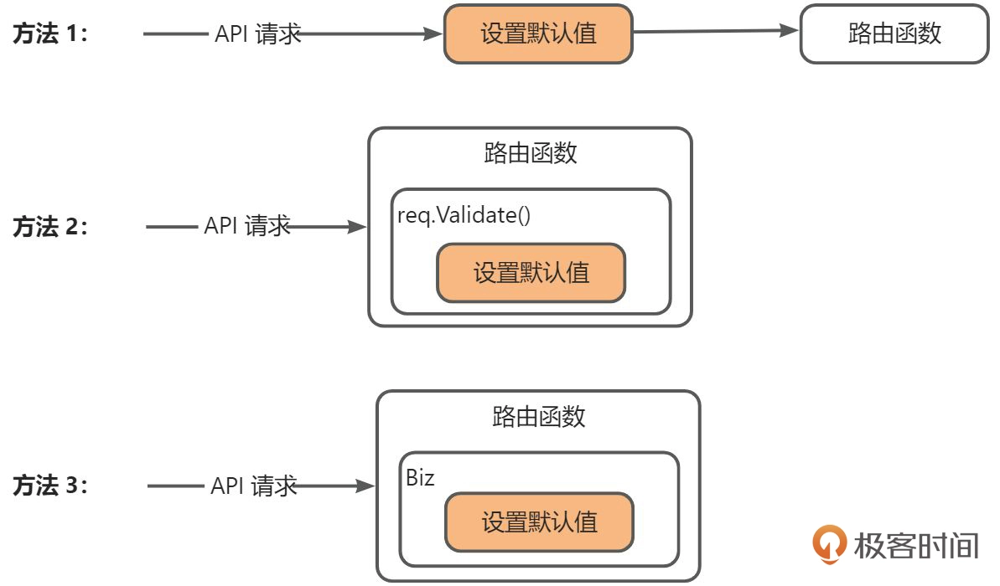

# 28 | Kubernetes如何设置默认值？

你好，我是孔令飞。

大部分企业应用都是通过 API 接口的形式对外提供功能，API 接口的通信协议通常是 HTTP或者 RPC。使用 RPC 作为通信协议的 API 接口又称作 RPC 接口；使用 HTTP 作为通信协议的 API 接口又称作 HTTP 接口。不管哪种类型的 API 接口，在请求到来时，都要进行参数校验，并且在校验之前设置参数默认值。

上一节课，我介绍了如何校验请求参数。本节课，我再来介绍下如何给参数设置默认值。

## 为什么要设置默认值

在 API 请求中设置默认值的原因有多种，总结起来主要有以下 3 个：

- 提高用户体验：设置默认值，可以降低用户或开发者设置请求参数的难度和工作量，用户不必在每次请求中都输入所有参数，只需要关注必要的或特定的参数即可，提高了 API 调用的便利性。

- 降低错误发生率，提高接口稳定性：设定合理的默认值可以减少因缺失参数而导致的错误。当参数未提供时，接口使用默认值则可以使请求得以成功执行，而不是返回错误信息。

- 支持向后兼容：当 API 有变更时，对于新增的字段，我们还需要根据兼容性要求，给新增字段设置默认值。这样可以确保客户端能够正常使用旧的 API 版本。

设置默认值是后台代码的行为，为了能够将程序的默认行为有感知地暴露给开发者，我们还需要在 API 接口文档或者产品文档中，清晰地给用户说明参数未设置时后台设置的默认值。这样，开发者才能够清晰地理解 API 的行为和使用方式。

## 设置默认值的方式

在项目开发中，我们通常有以下几种方式设置默认值，这几种方式分别代表了程序开发中的不同链路：



第 1 种方法是我们可以在请求到达路由函数之前，为请求参数设置默认值。例如，在 Web 中间件或在类似于 BeforeCreate 这样的处理链路中。Kubernetes 就是采用的这种方法，在类似BeforeCreate 这样的处理节点中调用默认值设置函数，来对请求参数设置默认值。

第 2 种方法是当一个 API 请求到来时，我们在进行参数校验的过程中，根据校验情况设置默认值，代码如下：

```go
package main
import (
   "github.com/gin-gonic/gin"
   "net/http"
)
// 定义请求结构体
type Request struct {
   Limit  int    `form:"limit" json:"limit"`
   Offset int    `form:"offset" json:"offset"`
   Filter string `form:"filter" json:"filter"`
}
// 校验参数并设置默认值的函数
func (req *Request) Validate() error {
   // 设置默认值
   if req.Limit <= 0 {
       req.Limit = 10 // 默认值
   }
   if req.Offset < 0 {
       req.Offset = 0 // 默认值
   }
   if req.Filter == "" {
       req.Filter = "all" // 默认值
   }
   return nil
}
func main() {
   r := gin.Default()
   r.GET("/api/resource", func(c *gin.Context) {
       var req Request
       // 使用 gin.Bind 来解析参数
       if err := c.ShouldBindQuery(&req); err != nil {
           c.JSON(http.StatusBadRequest, gin.H{"error": err.Error()})
           return
       }
       // 调用校验函数设置默认值
       if err := req.Validate(); err != nil {
           c.JSON(http.StatusBadRequest, gin.H{"error": err.Error()})
           return
       }
       // 返回响应
       c.JSON(http.StatusOK, gin.H{"limit": req.Limit, "offset": req.Offset, "fi
   })
   // 启动服务器
   r.Run(":8080")
}
```

第 3 种方法是在业务处理时，根据需要设置默认值。在这种方式中，设置默认值的时机和代码位置都不可控，完全由开发者自己选择。

在实际的项目开发中，我用得最多的是第 2 种方法，因为该方法简单，并且设置默认值的机制统一。在第 2 种方法中，我们不用编写设置默认值 Web 中间件，不用在路由函数之上再次封装一个类似于 BeforeCreate 的处理机制。另外，在第 2 种方法中，设置默认值的时机和位置都是固定的，我们可以很快找到在哪里设置默认值，然后对参数进行统一的默认值设置。这可以提高项目的可维护性，降低阅读难度。

不过，本节课不会讲第 2 种设置默认值的方法，而是主要介绍 Kubernetes 是如何设置默认值的，也即第 1 种方法。

## Kubernetes 设置默认值的代码在哪里？

Kubernetes 中只会给版本化的 API 设置默认值，内部 API 是不会设置默认值的。我们先来看下 kube-apiserver 源码中进行参数默认值设置的代码位置，参数值设置是在 createHandler方法中，代码如下：

```go
// 位于文件 staging/src/k8s.io/apiserver/pkg/endpoints/handlers/create.go 中
func createHandler(r rest.NamedCreater, scope *RequestScope, admit admission.Inte
   return func(w http.ResponseWriter, req *http.Request) {
       ...
       original := r.New()
       ...
       decoder := scope.Serializer.DecoderToVersdecoderion(decodeSerializer, sco
       span.AddEvent("About to convert to expected version")
       obj, gvk, err := decoder.Decode(body, &defaultGVK, original)
       ...
   }
}
在 createHandler 函数中调用了 scope.Serializer.DecoderToVersdecoderion 创
建一个 decoder，并调用 decoder 的 Decode 方法将 body 解析到 original 变量中。
original 变量由 r.New() 创建，对于创建 Deployment 资源的请求，r.New() 其实是
```

NewFunc：

```go
// 位于文件 pkg/registry/apps/deployment/storage/storage.go 中
func NewREST(optsGetter generic.RESTOptionsGetter) (*REST, *StatusREST, *Rollback
   store := &genericregistry.Store{
       // NewFunc 用来创建一个空的 &apps.Deployment{}
       // 该空对象会被用来保存 Etcd 中的 Deployment 对象内容
       NewFunc: func() runtime.Object { return &apps.Deployment{} },
       ...
   }
   ...
   return &REST{store}, &StatusREST{store: &statusStore}, &RollbackREST{store: s
}
可以看到， r.New() 方法用来创建一个空的 apps.Deployment{} 变量。obj, gvk,
err := decoder.Decode(body, &defaultGVK, original) 实现的功能就是：将
HTTP 请求 Body 解析到 original 变量中，并处理 original 保存的资源对象，最终返回
处理后的资源对象 obj。那么 decoder.Decode 方法中，到底做了哪些处理呢？这里先来
做个“剧透”，decoder.Decode 其实就是 &codec{}.Decode 方法，该方法中对资源对象进
```

行了默认值设置、版本转换等操作。

```
至于如何找到 decoder.Decode 就是 &codec{}.Decode 方法，我们接着往下看。
```

## Kubernetes 是如何设置默认值的？

调用设置默认值函数的整个请求链路如下：

```go
// 位于文件 taging/src/k8s.io/apiserver/pkg/endpoints/handlers/create.go 中
createHandler(r rest.NamedCreater, scope *RequestScope, admit admission.Interface
   ...
   decoder := scope.Serializer.DecoderToVersdecoderion(decodeSerializer, scope.H
   ...
   obj, gvk, err := decoder.Decode(body, &defaultGVK, original)
   ...
}
从上述代码 decoder.Decode 调用可知，要想知道 Decode 方法的具体实现，首先要知道
scope 参数是如何创建的。从 createHandler 根据调用关系，可以很容易找到 scope 的
```

创建位置（代码段 installer.go#L656）：

```go
func (a *APIInstaller) registerResourceHandlers(path string, storage rest.Storage
   ...
   reqScope := handlers.RequestScope{
       Serializer:      a.group.Serializer,
       ParameterCodec:  a.group.ParameterCodec,
       Creater:         a.group.Creater,
       Convertor:       a.group.Convertor,
       Defaulter:       a.group.Defaulter,
       ...
   }
   ...
}
从上述代码可以知道，scope.Serializer 其实就是 a.group.Serializer。那么
a.group.Serializer 是怎么来的呢？往上追踪代码，可以知道 a.group.Serializer
其实就是 apiGroupInfo.NegotiatedSerializer（代码段
```

genericapiserver.go#L915）：

```go
// 位于文件 staging/src/k8s.io/apiserver/pkg/server/genericapiserver.go 中
func (s *GenericAPIServer) newAPIGroupVersion(apiGroupInfo *APIGroupInfo, groupVe
   ...
   allServedVersionsByResource := map[string][]string{}
   for version, resourcesInVersion := range apiGroupInfo.VersionedResourcesStora
       for resource := range resourcesInVersion {
           if len(groupVersion.Group) == 0 {
               allServedVersionsByResource[resource] = append(allServedVersionsB
           } else {
               allServedVersionsByResource[resource] = append(allServedVersionsB
           }
       }
   }
   return &genericapi.APIGroupVersion{
       GroupVersion:                groupVersion,
       AllServedVersionsByResource: allServedVersionsByResource,
       MetaGroupVersion:            apiGroupInfo.MetaGroupVersion,
       ParameterCodec:        apiGroupInfo.ParameterCodec,
       Serializer:            apiGroupInfo.NegotiatedSerializer,
       Creater:               apiGroupInfo.Scheme,
       Convertor:             apiGroupInfo.Scheme,
       ...
   }
}
那么 apiGroupInfo.NegotiatedSerializer 又是如何创建的呢？继续安装调用链往上
追溯，我们知道了 apiGroupInfo 是由以下代码创建的（代码段 instance.go#L689）：
func (m *Instance) InstallAPIs(apiResourceConfigSource serverstorage.APIResourceC
   ...
   for _, restStorageBuilder := range restStorageProviders {
       groupName := restStorageBuilder.GroupName()
       apiGroupInfo, err := restStorageBuilder.NewRESTStorage(apiResourceConfigS
       ...
   }
   ...
}
我们再来看下 restStorageBuilder.NewRESTStorage 的实现：
// 位于文件 pkg/registry/apps/rest/storage_apps.go 中
func (p StorageProvider) NewRESTStorage(apiResourceConfigSource serverstorage.API
   apiGroupInfo := genericapiserver.NewDefaultAPIGroupInfo(apps.GroupName, legac
   // If you add a version here, be sure to add an entry in `k8s.io/kubernetes/c
   // TODO refactor the plumbing to provide the information in the APIGroupInfo
   if storageMap, err := p.v1Storage(apiResourceConfigSource, restOptionsGetter)
       return genericapiserver.APIGroupInfo{}, err
   } else if len(storageMap) > 0 {
       apiGroupInfo.VersionedResourcesStorageMap[appsapiv1.SchemeGroupVersion.Ve
   }
   return apiGroupInfo, nil
}
```

```go
可以知道 apiGroupInfo 最终是由 NewDefaultAPIGroupInfo 方法创建的。
NewDefaultAPIGroupInfo 方法实现如下：
// 位于文件 staging/src/k8s.io/apiserver/pkg/server/genericapiserver.go 中
func NewDefaultAPIGroupInfo(group string, scheme *runtime.Scheme, parameterCodec
   return APIGroupInfo{
       PrioritizedVersions:          scheme.PrioritizedVersionsForGroup(group),
       VersionedResourcesStorageMap: map[string]map[string]rest.Storage{},
       // TODO unhardcode this.  It was hardcoded before, but we need to re-eval
       OptionsExternalVersion: &schema.GroupVersion{Version: "v1"},
       Scheme:                 scheme,
       ParameterCodec:         parameterCodec,
       NegotiatedSerializer:   codecs,
   }
}
上述代码中 NegotiatedSerializer 的实现是 codecs，codecs 其实就是
legacyscheme.Codecs（包 k8s.io/kubernetes/pkg/api/legacyscheme）。
至此，我们找到了 NegotiatedSerializer 的实现，也就找到了 createHandler 方法中
的 scope.Serializer 实现，也即 legacyscheme.Codecs。
接下来，我们来看 legacyscheme.Codecs 的 DecoderToVersion 方法的实现：
// 位于文件 pkg/api/legacyscheme/scheme.go 中
var (
   ...
   // Codecs provides access to encoding and decoding for the scheme
   Codecs = serializer.NewCodecFactory(Scheme)
   ...
)
// 位于文件 staging/src/k8s.io/apimachinery/pkg/runtime/serializer/codec_factory.go
func NewCodecFactory(scheme *runtime.Scheme, mutators ...CodecFactoryOptionsMutat
   options := CodecFactoryOptions{Pretty: true}
   for _, fn := range mutators {
       fn(&options)
   }
   serializers := newSerializersForScheme(scheme, json.DefaultMetaFactory, optio
   return newCodecFactory(scheme, serializers)
}
// 位于文件 staging/src/k8s.io/apimachinery/pkg/runtime/serializer/codec_factory.go
// DecoderToVersion returns a decoder that targets the provided group version.
func (f CodecFactory) DecoderToVersion(decoder runtime.Decoder, gv runtime.GroupV
   return f.CodecForVersions(nil, decoder, nil, gv)
}
// 位于文件 staging/src/k8s.io/apimachinery/pkg/runtime/serializer/codec_factory.go
// CodecForVersions creates a codec with the provided serializer. If an object is
// it will default to runtime.APIVersionInternal. If encode is not specified for
// converted. If encode or decode are nil, no conversion is performed.
func (f CodecFactory) CodecForVersions(encoder runtime.Encoder, decoder runtime.D
   // TODO: these are for backcompat, remove them in the future
   if encode == nil {
       encode = runtime.DisabledGroupVersioner
   }
   if decode == nil {
       decode = runtime.InternalGroupVersioner
   }
   return versioning.NewDefaultingCodecForScheme(f.scheme, encoder, decoder, enc
}
// 位于文件 staging/src/k8s.io/apimachinery/pkg/runtime/serializer/versioning/vers
// NewDefaultingCodecForScheme is a convenience method for callers that are using
func NewDefaultingCodecForScheme(
   // TODO: I should be a scheme interface?
   scheme *runtime.Scheme,
   encoder runtime.Encoder,
   decoder runtime.Decoder,
   encodeVersion runtime.GroupVersioner,
   decodeVersion runtime.GroupVersioner,
) runtime.Codec {
   return NewCodec(encoder, decoder, runtime.UnsafeObjectConvertor(scheme), sche
}
// 位于文件 staging/src/k8s.io/apimachinery/pkg/runtime/serializer/versioning/vers
func NewCodec(
   encoder runtime.Encoder,
   decoder runtime.Decoder,
   convertor runtime.ObjectConvertor,
   creater runtime.ObjectCreater,
   typer runtime.ObjectTyper,
   defaulter runtime.ObjectDefaulter,
   encodeVersion runtime.GroupVersioner,
   decodeVersion runtime.GroupVersioner,
   originalSchemeName string,
) runtime.Codec {
   internal := &codec{
       encoder:   encoder,
       decoder:   decoder,
       convertor: convertor, // 注意：convertor 用来进行版本转换，后面小节会用到！
       creater:   creater,
       typer:     typer,
       defaulter: defaulter, // defaulter 用来设置默认值
       encodeVersion: encodeVersion,
       decodeVersion: decodeVersion,
       identifier: identifier(encodeVersion, encoder),
       originalSchemeName: originalSchemeName,
   }
   return internal
}
通过上述调用链追溯，我们可以知道 legacyscheme.Codecs 是 CodecFactory 类型的变
量，CodecFactory 变量的DecoderToVersion 方法最终返回的是 codec 类型的结构体
实例。也就是说，createHandler 方法中 decoder :=
scope.Serializer.DecoderToVersion(decodeSerializer,
scope.HubGroupVersion) 中的decoder 其实就是 *codec 类型。其 Decode 方法的具
```

体代码实现如下：

```go
// 位于文件 staging/src/k8s.io/apimachinery/pkg/runtime/serializer/versioning/vers
// Decode attempts a decode of the object, then tries to convert it to the intern
// successful, the returned runtime.Object will be the value passed as into. Note
// into that matches the serialized version.
func (c *codec) Decode(data []byte, defaultGVK *schema.GroupVersionKind, into run
   // If the into object is unstructured and expresses an opinion about its grou
   // create a new instance of the type so we always exercise the conversion pat
   decodeInto := into
   if into != nil {
       if _, ok := into.(runtime.Unstructured); ok && !into.GetObjectKind().Grou
           decodeInto = reflect.New(reflect.TypeOf(into).Elem()).Interface().(ru
       }
   }
   var strictDecodingErrs []error
   obj, gvk, err := c.decoder.Decode(data, defaultGVK, decodeInto)
   ...
   // if we specify a target, use generic conversion.
   // 解析到内部版本
   if into != nil {
       // perform defaulting if requested
       if c.defaulter != nil {
           c.defaulter.Default(obj)
       }
       // Short-circuit conversion if the into object is same object
       if into == obj {
           return into, gvk, strictDecodingErr
       }
       // 注意：这里执行版本转换逻辑，后面小节会用到！
       if err := c.convertor.Convert(obj, into, c.decodeVersion); err != nil {
           return nil, gvk, err
       }
       return into, gvk, strictDecodingErr
   }
   // perform defaulting if requested
   if c.defaulter != nil {
       c.defaulter.Default(obj)
   }
   // 解析到指定API版本的资源对象中
   out, err := c.convertor.ConvertToVersion(obj, c.decodeVersion)
   if err != nil {
       return nil, gvk, err
   }
   return out, gvk, strictDecodingErr
}
在 Decode 方法中，通过 c.decoder.Decode(data, defaultGVK, decodeInto) 函
数调用，data（其实就是 HTTP 请求 Body）解析到 decodeInt 变量（其实就是
original变量）中。你如果跟踪了代码就会发现，c.decoder.Decode 其实就是
json.Unmarshal(data, &decodeInto)。也就是说，将 JSON 格式的请求体解析到
apps.Deployment 结构体变量中。
在 Decode 方法中，获得了 obj 对象之后，会调用以下方法来处理资源对象 obj（代码段
```

versioning.go#L167）：

```go
// 位于文件 staging/src/k8s.io/apimachinery/pkg/runtime/serializer/versioning/vers
func (c *codec) Decode(data []byte, defaultGVK *schema.GroupVersionKind, into run
   ...
   // if we specify a target, use generic conversion.
   if into != nil {
       // perform defaulting if requested
       if c.defaulter != nil {
           c.defaulter.Default(obj)
       }
       // Short-circuit conversion if the into object is same object
       if into == obj {
           return into, gvk, strictDecodingErr
       }
       if err := c.convertor.Convert(obj, into, c.decodeVersion); err != nil {
           return nil, gvk, err
       }
       return into, gvk, strictDecodingErr
   }
   ...
}
也就是说会先执行 c.defaulter.Default(obj) 来设置默认值，再执行
c.convertor.Convert 进行版本转换。
那么，c.defaulter.Default(obj) 具体实现在哪里，以及 Default 方法又是如何设置
```

默认值的呢？

## Kubernetes 默认值函数注册方法

```
我们知道，在创建 Deployment 资源时，是通过 Decode 方法中的
c.defaulter.Default(obj) 调用来设置默认值的。这里要注意，Decode 方法中也会进
```

行版本转换。版本转换的具体实现细节，我们下一节课再详细介绍。

```
c.defaulter.Default 方法的具体实现如下（位于
```

apimachinery/pkg/runtime/scheme.go文件中）：

```go
// Default sets defaults on the provided Object.
func (s *Scheme) Default(src Object) {
   if fn, ok := s.defaulterFuncs[reflect.TypeOf(src)]; ok {
       fn(src)
   }
}
```

可以看到，上述代码会调用 Scheme 中注册的默认值设置函数进行注册。默认值设置函数是在 kube-apiserver 启动时注册的。注册代码位于pkg/apis/core/v1/register.go文件中，代码如下：

```go
func init() {
 // We only register manually written functions here. The registration of the
 // generated functions takes place in the generated files. The separation
 // makes the code compile even when the generated files are missing.
 localSchemeBuilder.Register(addDefaultingFuncs, addConversionFuncs)
}
我们再来看下创建 *codec 的 NewCodec 函数代码：
// 位于文件 staging/src/k8s.io/apimachinery/pkg/runtime/serializer/versioning/vers
func NewDefaultingCodecForScheme(
   // TODO: I should be a scheme interface?
   scheme *runtime.Scheme,
   encoder runtime.Encoder,
   decoder runtime.Decoder,
    runtime.GroupVersioner,
   decodeVersion runtime.GroupVersioner,
) runtime.Codec {
   return NewCodec(encoder, decoder, runtime.UnsafeObjectConvertor(scheme), sche
}
// 位于文件 staging/src/k8s.io/apimachinery/pkg/runtime/serializer/versioning/vers
func NewCodec(
   encoder runtime.Encoder,
   decoder runtime.Decoder,
   convertor runtime.ObjectConvertor,
   creater runtime.ObjectCreater,
   typer runtime.ObjectTyper,
   defaulter runtime.ObjectDefaulter,
   encodeVersion runtime.GroupVersioner,
   decodeVersion runtime.GroupVersioner,
   originalSchemeName string,
) runtime.Codec {
   internal := &codec{
       encoder:   encoder,
       decoder:   decoder,
       convertor: convertor,
       creater:   creater,
       typer:     typer,
       defaulter: defaulter,
       encodeVersion: encodeVersion,
       decodeVersion: decodeVersion,
       identifier: identifier(encodeVersion, encoder),
       originalSchemeName: originalSchemeName,
   }
   return internal
}
可以知道， c.defaulter 其实就是 scheme，scheme 其实就是
pkg/api/legacyscheme/scheme.go 文件中的 Scheme 全局变量：
import (
   "k8s.io/apimachinery/pkg/runtime"
   "k8s.io/apimachinery/pkg/runtime/serializer"
)
var (
   // Scheme is the default instance of runtime.Scheme to which types in the Kub
   // NOTE: If you are copying this file to start a new api group, STOP! Copy th
   // extensions group instead. This Scheme is special and should appear ONLY in
   // the api group, unless you really know what you're doing.
   // TODO(lavalamp): make the above error impossible.
   Scheme = runtime.NewScheme()
   // Codecs provides access to encoding and decoding for the scheme
   Codecs = serializer.NewCodecFactory(Scheme)
   ...
)
Scheme全局变量由 runtime.NewScheme() 函数创建，其类型为 *Scheme。所以
c.defaulter.Default，其实就是 &Scheme{}.Default，其代码实现如下：
// 位于文件 staging/src/k8s.io/apimachinery/pkg/runtime/scheme.go 中
func (s *Scheme) Default(src Object) {
   if fn, ok := s.defaulterFuncs[reflect.TypeOf(src)]; ok {
       fn(src)
   }
}
// 位于文件 staging/src/k8s.io/apimachinery/pkg/runtime/scheme.go 中
func (s *Scheme) AddTypeDefaultingFunc(srcType Object, fn func(interface{})) {
   s.defaulterFuncs[reflect.TypeOf(srcType)] = fn
}
*Scheme 变量中的 defaulterFuncs 类型为
map[reflect.Type]func(interface{})，key 是资源类型（例如：
&v1.DaemonSet{}），value 是该资源类型的设置默认值方法。s.defaulterFuncsmap
中的 key-value 对，由 AddTypeDefaultingFunc 来添加。
接下来，我们再来看下究竟在哪里调用 AddTypeDefaultingFunc 方法来添加 map 的 key-
```

value 对。

我们来看下面的函数调用链：

```go
// 位于文件 staging/src/k8s.io/api/apps/v1/register.go 中
var (
   // TODO: move SchemeBuilder with zz_generated.deepcopy.go to k8s.io/api.
   // localSchemeBuilder and AddToScheme will stay in k8s.io/kubernetes.
   SchemeBuilder      = runtime.NewSchemeBuilder(addKnownTypes)
   localSchemeBuilder = &SchemeBuilder
   AddToScheme        = localSchemeBuilder.AddToScheme
)
// 位于文件 pkg/apis/apps/v1/register.go 中
var (
   localSchemeBuilder = &appsv1.SchemeBuilder
   AddToScheme        = localSchemeBuilder.AddToScheme
)
func init() {
   // We only register manually written functions here. The registration of the
   // generated functions takes place in the generated files. The separation
   // makes the code compile even when the generated files are missing.
   localSchemeBuilder.Register(addDefaultingFuncs) // 注册 addDefaultingFuncs Sch
}
// 位于文件 pkg/controlplane/import_known_versions.go 中
package controlplane
import (
   ...
   _ "k8s.io/kubernetes/pkg/apis/apps/install"
   ...
}
// 位于文件 pkg/apis/apps/install/install.go 中
import (
   "k8s.io/apimachinery/pkg/runtime"
   utilruntime "k8s.io/apimachinery/pkg/util/runtime"
   "k8s.io/kubernetes/pkg/api/legacyscheme"
   "k8s.io/kubernetes/pkg/apis/apps"
   "k8s.io/kubernetes/pkg/apis/apps/v1"
   "k8s.io/kubernetes/pkg/apis/apps/v1beta1"
   "k8s.io/kubernetes/pkg/apis/apps/v1beta2"
)
func init() {
   Install(legacyscheme.Scheme)
}
// Install registers the API group and adds types to a scheme
func Install(scheme *runtime.Scheme) {
   utilruntime.Must(apps.AddToScheme(scheme))
   utilruntime.Must(v1beta1.AddToScheme(scheme))
   utilruntime.Must(v1beta2.AddToScheme(scheme))
   utilruntime.Must(v1.AddToScheme(scheme))
   utilruntime.Must(scheme.SetVersionPriority(v1.SchemeGroupVersion, v1beta2.Sch
}
```

我们来看看上述代码中调用流程的解释。

```go
在导入 k8s.io/kubernetes/pkg/apis/apps/v1 包的时候会初始化全局变量
SchemeBuilder，SchemeBuilder 是 Scheme 构建器数组，类型是 func(*Scheme)
error 数组：
// 位于文件 staging/src/k8s.io/apimachinery/pkg/runtime/scheme_builder.go 中
type SchemeBuilder []func(*Scheme) error
在导入 k8s.io/kubernetes/pkg/apis/apps/v1 包的时候会执行该包的 init 函
数，在 init 函数中会将 addDefaultingFuncs Scheme 构建器加入SchemeBuilder
中，init 函数实现如下：
// 位于文件 pkg/apis/apps/v1/register.go 中
func init() {
   // We only register manually written functions here. The registration of the
   // generated functions takes place in the generated files. The separation
   // makes the code compile even when the generated files are missing.
   localSchemeBuilder.Register(addDefaultingFuncs) // 注册 addDefaultingFuncs Sch
}
// 位于文件 staging/src/k8s.io/apimachinery/pkg/runtime/scheme_builder.go 中
// Register adds a scheme setup function to the list.
func (sb *SchemeBuilder) Register(funcs ...func(*Scheme) error) {
   for _, f := range funcs {
       *sb = append(*sb, f)
   }
}
上述代码的意思是将 addDefaultingFuncs 加入到全局变量 SchemeBuilder 数组中。
在 kube-apiserver 启动时，会导入 k8s.io/kubernetes/pkg/apis/apps/install
```

- 包。

```go
执行 k8s.io/kubernetes/pkg/apis/apps/install 包的 init 函数，init 函数会
执行 Install 函数。
在 Install 函数中，会调用 utilruntime.Must(v1.AddToScheme(scheme))。其
中，scheme 其实就是 legacyscheme.Scheme。
v1.AddToScheme(scheme) 其实就是调用 *SchemeBuilder 类型的 AddToScheme 方
法，AddToScheme 方法实现如下：
// 位于文件 staging/src/k8s.io/apimachinery/pkg/runtime/scheme_builder.go 中
func (sb *SchemeBuilder) AddToScheme(s *Scheme) error {
   for _, f := range *sb {
       if err := f(s); err != nil {
           return err
       }
   }
   return nil
}
上述代码的意思是，遍历全局变量 SchemeBuilder 数组中保存的 Scheme 构建器（类型为
func(*Scheme) error，入参为 legacyscheme.Scheme）。addDefaultingFuncs 就
```

是其中的一个 Scheme 构建器，具体实现如下：

```go
// 位于文件 pkg/apis/apps/v1/defaults.go 中
func addDefaultingFuncs(scheme *runtime.Scheme) error {
   return RegisterDefaults(scheme)
}
RegisterDefaults 函数实现如下：
// 位于文件 pkg/apis/apps/v1/zz_generated.defaults.go 中
func RegisterDefaults(scheme *runtime.Scheme) error {
   scheme.AddTypeDefaultingFunc(&v1.DaemonSet{}, func(obj interface{}) { SetObje
   scheme.AddTypeDefaultingFunc(&v1.DaemonSetList{}, func(obj interface{}) { Set
   scheme.AddTypeDefaultingFunc(&v1.Deployment{}, func(obj interface{}) { SetObj
   scheme.AddTypeDefaultingFunc(&v1.DeploymentList{}, func(obj interface{}) { Se
   scheme.AddTypeDefaultingFunc(&v1.ReplicaSet{}, func(obj interface{}) { SetObj
   scheme.AddTypeDefaultingFunc(&v1.ReplicaSetList{}, func(obj interface{}) { Se
   scheme.AddTypeDefaultingFunc(&v1.StatefulSet{}, func(obj interface{}) { SetOb
   scheme.AddTypeDefaultingFunc(&v1.StatefulSetList{}, func(obj interface{}) { S
   return nil
}
func SetObjectDefaults_Deployment(in *v1.Deployment) {
   SetDefaults_Deployment(in)
   corev1.SetDefaults_PodSpec(&in.Spec.Template.Spec)
   ...
   corev1.SetDefaults_ResourceList(&in.Spec.Template.Spec.Overhead)
}
// 位于文件 staging/src/k8s.io/apimachinery/pkg/runtime/scheme.go 中
func (s *Scheme) AddTypeDefaultingFunc(srcType Object, fn func(interface{})) {
   s.defaulterFuncs[reflect.TypeOf(srcType)] = fn
}
上述代码的执行逻辑是将资源的设置默认值的函数保存在 legacyscheme.Scheme 变量的
defaulterFuncs 字段，defaulterFuncs 字段类型为 map 类型，key 为资源，如
&v1.Deployment{}。value 为 func(obj interface{} 类型，其实就是资源设置默认值
的函数，如 SetObjectDefaults_Deployment。
通过上面的代码分析，我们可以知道，请求到来时，最终会调用 legacyscheme.Scheme 的
Default 方法，Default 方法代码实现如下：
```

```go
// 位于文件 staging/src/k8s.io/apimachinery/pkg/runtime/scheme.go 中
func (s *Scheme) Default(src Object) {
   if fn, ok := s.defaulterFuncs[reflect.TypeOf(src)]; ok {
       fn(src)
   }
}
Default 方法会根据资源类型，从 legacyscheme.Scheme 的 defaulterFuncs map 字
```

段中查找资源对应的设置默认值函数，如果找到则执行设置默认值的函数，也即

```
SetObjectDefaults_Deployment。SetObjectDefaults_Deployment 方法实现如
```

下：

```go
func SetObjectDefaults_Deployment(in *v1.Deployment) {
   SetDefaults_Deployment(in)
   ...
}
所以，最终我们可以在 SetDefaults_Deployment 方法中添加自定义默认值设置逻辑，并
```

被 HTTP 请求链路调用，以设置资源的默认值。

通过上面的分析，我们知道 kube-apiserver 是通过调用

```
SetObjectDefaults_Deployment 方法来给资源设置默认值，那么
SetObjectDefaults_Deployment 方法又是从哪里来的呢？
```

## Kubernetes 默认值设置函数是如何生成的？

```
默认值设置函数 func SetDefaults_<Type>(obj *<Type>) 是由 defaulter-gen 工
```

具自动生成的。具体可通过以下 3 步来生成：

```
生成 zz_generated.defaults.go 文件。
```

2. 添加自定义默认值设置代码。

3. 注册资源定义的默认值设置函数。

### 生成 zz_generated.defaults.go 文件

```
defaulter-gen 工具根据 +k8s:defaulter-gen=TypeMeta 注释来判断，是否要为所在
包的资源定义生成设置默认值函数。所以，我们首先要添加 +k8s:defaulter-
gen=TypeMeta 标签。+k8s:defaulter-gen=TypeMeta 标签的意思是：为所有包含
TypeMeta（也可以是 ObjectMeta、ListMeta）的所有资源定义结构体生成设置默认值
函数。如果你想为所有的结构体都生成设置默认值函数，可以设置 +k8s:defaulter-gen
的值为 +k8s:defaulter-gen=true。
在实际的 Kubernetes 开发中，我们通常使用 +k8s:defaulter-gen=TypeMeta 标签，只
```

给需要的资源定义结构体生成设置默认值函数。

为了方便理解，这里我使用之前的示例代码来给你演示。首先克隆示例代码：

```
$ git clone https://github.com/superproj/k8sdemo
$ cd k8sdemo/resourcedefinition
$ go mod tidy
我们可以在 apps/v1beta1/doc.go 文件中添加 +k8s:defaulter-gen=TypeMeta 注
```

释，例如：

```
$ cat apps/v1beta1/doc.go
// Copyright 2022 Lingfei Kong <colin404@foxmail.com>. All rights reserved.
// Use of this source code is governed by a MIT style
// license that can be found in the LICENSE file. The original repo for
// this file is https://github.com/superproj/onex.
//
// +k8s:deepcopy-gen=package
// +k8s:defaulter-gen=TypeMeta
// +k8s:defaulter-gen-input=github.com/superproj/k8sdemo/resourcedefinition/apps/
// Package v1beta1 is the v1beta1 version of the API.
package v1beta1
注意，在 doc.go 文件中，我们还添加了 // +k8s:defaulter-gen-
input=github.com/superproj/k8sdemo/resourcedefinition/apps/v1beta1 注
```

释，该行注释只说明了资源结构体的来源。

```
我们添加了必要的 // +_k8s: 注释之后，便可以运行以下命令，来为资源结构体生成设置默
```

认值函数：

```
$ defaulter-gen -v 1 --go-header-file ./boilerplate.go.txt --output-file zz_gener
执行完上述命令后，会生成 apps/v1beta1/zz_generated.defaults.go 文件，文件内
```

容如下：

```go
//go:build !ignore_autogenerated
// +build !ignore_autogenerated
// Copyright 2022 Lingfei Kong <colin404@foxmail.com>. All rights reserved.
// Use of this source code is governed by a MIT style
// license that can be found in the LICENSE file. The original repo for
// this file is https://github.com/superproj/onex.
// Code generated by defaulter-gen. DO NOT EDIT.
package v1beta1
import (
   runtime "k8s.io/apimachinery/pkg/runtime"
)
// RegisterDefaults adds defaulters functions to the given scheme.
// Public to allow building arbitrary schemes.
// All generated defaulters are covering - they call all nested defaulters.
func RegisterDefaults(scheme *runtime.Scheme) error {
   return nil
}
zz_generated.defaults.go 中生成了  RegisterDefaults 函数，用来向 scheme 函
```

数中注册资源的设置默认值函数。

### 添加自定义默认值设置代码

```
上面的操作生成的 RegisterDefaults 函数设置方法为空，是因为我们没有添加自定义的
```

默认值设置逻辑。

```
这里我们可以根据需要自己添加。例如，新建 apps/v1beta1/defaults.go 文件，内容如
```

下：

```go
package v1beta1
func addDefaultingFuncs(scheme *runtime.Scheme) error {
   return RegisterDefaults(scheme)
}
// SetDefaults_XXX sets defaults for XXX.
func SetDefaults_XXX(obj *XXX) {
   // XXX name prefix is fixed to `hello-`
   if obj.ObjectMeta.GenerateName == "" {
       obj.ObjectMeta.GenerateName = "hello-"
   }
   SetDefaults_XXXSpec(&obj.Spec)
}
// SetDefaults_XXXSpec sets defaults for XXX spec.
func SetDefaults_XXXSpec(obj *XXXSpec) {
   if obj.DisplayName == "" {
       obj.DisplayName = "xxxdefaulter"
   }
}
```

注意上述默认值设置函数是有固定格式的，设置默认值函数的函数命名、入参、返回值都需要符合规范：

```
设置默认值的函数名需要为 SetDefaults_<Type>，其中 <Type> 是资源定义结构体名
```

- 字。

```
入参固定为 <Type>。
```

- 没有返回值。

```
在添加完自定义的默认值设置逻辑之后，再次运行 defaulter-gen 命令，来生成设置默认
```

值函数：

```go
$ defaulter-gen -v 1 --go-header-file ./boilerplate.go.txt --output-file zz_gener
运行上述命令之后，apps/v1beta1/zz_generated.defaults.go 文件内容会变为：
//go:build !ignore_autogenerated
// +build !ignore_autogenerated
// Copyright 2022 Lingfei Kong <colin404@foxmail.com>. All rights reserved.
// Use of this source code is governed by a MIT style
// license that can be found in the LICENSE file. The original repo for
// this file is https://github.com/superproj/onex.
// Code generated by defaulter-gen. DO NOT EDIT.
package v1beta1
import (
   runtime "k8s.io/apimachinery/pkg/runtime"
)
// RegisterDefaults adds defaulters functions to the given scheme.
// Public to allow building arbitrary schemes.
// All generated defaulters are covering - they call all nested defaulters.
func RegisterDefaults(scheme *runtime.Scheme) error {
   scheme.AddTypeDefaultingFunc(&XXX{}, func(obj interface{}) { SetObjectDefault
   scheme.AddTypeDefaultingFunc(&XXXList{}, func(obj interface{}) { SetObjectDef
   return nil
}
func SetObjectDefaults_XXX(in *XXX) {
   SetDefaults_XXX(in)
   SetDefaults_XXXSpec(&in.Spec)
}
func SetObjectDefaults_XXXList(in *XXXList) {
   for i := range in.Items {
       a := &in.Items[i]
       SetObjectDefaults_XXX(a)
   }
}
可以看到，RegisterDefaults 中自动生成了一些函数调用，这些函数调用用来将指定的资
```

源定义方法注册到 Scheme 中。

### 注册资源定义的默认值设置函数

在添加完自己的设置默认值函数之后，还有非常重要的一步操作，就是要把该默认值设置

```
Scheme 构造器添加到 legacyscheme.Scheme Scheme 构造列表中， 以便在初始化
Scheme 构造器列表时，能够将指定资源的设置默认值方法添加到 *Scheme 结构体的
defaulterFuncs 中。
我们来看下添加默认值设置 Scheme 构造器方法。新建 apps/v1beta1/register.go 文
```

件，内容如下：

```go
package v1beta1
import (
   metav1 "k8s.io/apimachinery/pkg/apis/meta/v1"
   "k8s.io/apimachinery/pkg/runtime"
   "k8s.io/apimachinery/pkg/runtime/schema"
   "k8s.io/kubernetes/pkg/apis/autoscaling"
)
// GroupName is the group name used in this package.
const GroupName = "apps.k8sdemo.io"
// SchemeGroupVersion is group version used to register these objects.
var SchemeGroupVersion = schema.GroupVersion{Group: GroupName, Version: "v1beta1"
// Resource takes an unqualified resource and returns a Group qualified GroupReso
func Resource(resource string) schema.GroupResource {
   return SchemeGroupVersion.WithResource(resource).GroupResource()
}
var (
   // TODO: move SchemeBuilder with zz_generated.deepcopy.go to k8s.io/api.
   // localSchemeBuilder and AddToScheme will stay in k8s.io/kubernetes.
   SchemeBuilder      = runtime.NewSchemeBuilder(addKnownTypes, addDefaultingFun
   localSchemeBuilder = &SchemeBuilder
   AddToScheme        = localSchemeBuilder.AddToScheme
)
// Adds the list of known types to the given scheme.
func addKnownTypes(scheme *runtime.Scheme) error {
   scheme.AddKnownTypes(SchemeGroupVersion,
       &XXX{},
       &XXXList{},
   )
   // Add the watch version that applies
   metav1.AddToGroupVersion(scheme, SchemeGroupVersion)
   return nil
}
通过 SchemeBuilder = runtime.NewSchemeBuilder(addKnownTypes,
addDefaultingFuncs) 变量设置，添加了构造器 addDefaultingFuncs。
```

## 课程总结

```
本节课，我们详细介绍了资源默认值设置的代码实现入口 decoder.Decode。并反向跟踪代
码调用逻辑，找到了 decoder.Decode 的具体实现其实是 codec 的 Decode 方法，codec
的 Decode 方法中调用了 c.defaulter.Default 来给资源设置默认值。
本节课仍然使用调用链倒推的方法，找到了 c.defaulter 的具体实现，其实就是
legacyscheme.Scheme 的 Default 方法。在 Default 方法中，会从
legacyscheme.Scheme 变量的 map 类型字段 defaulterFuncs 中找到请求资源的设置
默认值函数 SetObjectDefaults_Deployment。
课程的最后，我们还介绍了如何添加设置默认值的函数，以及如何使用 defaulter-gen 工
```

具来生成设置默认值的代码，并介绍了生成规则。

## 课后练习

1. 请阅读 kube-apiserver 源码，思考下为什么 r.New() 方法是 NewFunc 方法，并查看c.decoder.Decode 的具体实现。

2. 请试着用一张图总结下 kube-apiserver 中默认值设置的流程。

欢迎你在留言区与我交流讨论，如果今天的内容让你有所收获，也欢迎转发给有需要的朋友，我们下节课再见！
