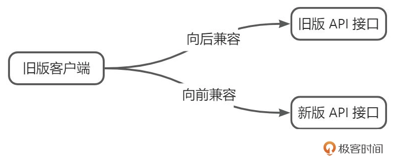

# 30 | KubernetesAPI的版本兼容性机制详解

你好，我是孔令飞。

Kubernetes 作为一个超大型的分布式项目，是很多企业部署重要生产级项目的首选。由于社区迭代节奏很快，新功能持续推出与旧功能阶段性废弃成为常态。那么 Kubernetes 如何能在快速更新迭代的同时，让企业应用所依赖的 API 版本实现平滑升级？

本节课，我们就来一窥 Kubernetes 的 API 版本兼容性机制，帮助你在未来的企业应用开发中更好地处理相关工作。

## 什么是 API 版本兼容性？

Kubernetes 在进行 API 版本变更的时候，将 API 版本的兼容性视为首要任务。那么，什么样的 API 变更符合兼容性的要求呢？一个 API 变更被视为符合兼容性要求，需要满足以下几点：

- 添加了可选的功能，如：API 接口添加了可选的字段。

- 不改变现有的语义，包括：

- 默认值的行为和语义。

- 不改变现有 API 类型、字段、值的释义。

- 不改变 API 请求字段的可选性，如：某个字段的可选和必选设置。

- 可选字段不能变成必选字段（意味着必选字段可以变成可选字段）。

- 有效值不能变成无效值。

- 明确注明的无效值，不能变成有效值。

这里，我们可以从 API 调用的视角，来看一个具备兼容性的 API 变更应该满足的条件：

1. 任何 API 调用，如果在版本变更前可以成功请求，那在版本变更后也要能成功请求。

2. 如果一个 API 请求不涉及你的 API 变更，那么这个 API 请求需要保持跟之前一样的行为。

3. 任何涉及本次变更的 API 请求必须成功，且不引入新的问题。

4. 必须能够实现 API 更改的双向转换（转换为不同的 API 版本再返回）而不会丢失信息。

5. 现有的客户端应该对 API 变更无感知。

6. API 变更需要支持回滚操作，也就是可以回滚到之前的版本，并且不引入问题。

如果你的 API 变更不符合上面的要求，它就会被认为是不兼容的变更。这种不兼容的 API 变更可能会导致已经在使用的客户端请求失败，或者新的请求发生未知的行为，在大型的企业级应用中通常是不被允许的。

例如，在腾讯云和字节，如果你的服务已经上线，那么所有的 API 变更都需要满足兼容性要求。

## 向前兼容和向后兼容

在 API 版本变更的过程中，我们经常会听到向前兼容和向后兼容，我发现很多开发者会混淆这两个概念。接下来，我们分别介绍下向前兼容和向后兼容，为你后面的学习做一些知识预热。

API 接口的向前兼容（Forward Compatibility）和向后兼容（Backward Compatibility）是指在设计和版本化 API 时，确保新版本和旧版本之间的兼容性。

下面这张图可以形象描述向前兼容和向后兼容：



接下来，我们详细解释下向后兼容和向前兼容的概念。

向后兼容（或称为向后兼容性）指的是新版本的 API 能够支持旧版本的客户端。也就是说，使用旧版本 API 的客户端在调用新版本 API 时，仍然能够正常工作，无需对客户端进行任何修改。例如：

- 如果 API 的返回结构增加了一个新的字段，但没有删除或改变已有字段的名称和类型，那么旧版本的客户端仍然可以正常解析和使用这个返回对象，而忽略新增的字段。

- 在 REST API 中，如果一个新的 HTTP 接口增加了某些新参数，但旧接口仍然有效，那么客户端不需要更新即可继续使用旧的接口。

向后兼容确保现有客户和应用程序在 API 更新后不需要立即做出改变，从而降低了更新的风险和成本。

向前兼容（或称为向前兼容性）指的是旧版本的客户端能够处理新版本的 API。也就是说，旧版本的客户端在调用新版本 API 时，尽可能继续正常工作，即使它可能无法利用新版本的所有功能。例如：

- 如果 API 的响应结构增加了新字段或者新的功能，而旧客户端在处理响应时忽略那些新字段或新功能，那么它仍然能够正常工作。

- 如果 API 返回的数据格式更新了，但旧版本的客户端能够适应这种变化，不会因未识别的字段或数据结构而崩溃。

向前兼容在逐步推广新版本的 API 时非常重要，它可以避免客户端软件在不升级的情况下失效，助力逐步迁移与版本更新，减少用户和开发者的负担。

## 版本兼容性案例

上面我从概念上讲解了 API 变更兼容性的一些要求，接下来，我们结合具体的示例，来看下什么样的变更是满足兼容性要求的。

### 案例 1：添加一个字段

```
假设我们有一个 API，当前版本为 v6，API 接口的 Frobber 结构体定义如下：
// API v6.
type Frobber struct {
   Height int    `json:"height"`
   Param  string `json:"param"`
}
这里我们需要给 Frobber 结构体添加一个新字段 Width。通常情况下，我们可以在不变更
API 版本的情况下给请求结构体添加一个新的字段。所以，我们简单在 Frobber 结构体中添
加新的字段 Width 即可：
```

```
// Still API v6.
type Frobber struct {
   Height int    `json:"height"`
   Width  int    `json:"width"`
   Param  string `json:"param"`
}
我们一定要给新增的字段设置一个合理的默认值（参考规则 #1、#2），并且确保之前的 API
```

接口调用仍然可以成功。

### 案例 2：将单数字段变为复数

```
假设，随着业务的发展，我们需要支持多个 Param，也即要变更 Frobber 的 Param 字段，
```

有以下几种变更方法：

```
移除 Param 字段，新增一个 Params []string 字段，而不新建一个 API 版本。这种变
更方式是不兼容变更，因为它违背了规则 #1、#2、#3和 #6。旧的请求因为使用了
Param 字段，而没有使用 Params 字段，导致传参丢失，造成请求失败。
添加一个 Params []string 字段并使用。这种变更方式也是一个非兼容性变更，违背了
规则 #2、#6。旧的请求因为使用了 Param 字段，而没有使用 Params 字段，导致传参丢
```

- 失，造成请求失败。

```go
添加一个 Params []string 字段，并使 Param 字段和 Params 字段进行关联，例如：
// 定义结构体 Frobber
type Frobber struct {
   Height int      `json:"height"`
   Width  int      `json:"width"`
   Param  string   `json:"param"`  // 旧版参数
   Params []string `json:"params"` // 新版参数
}
// 假设一个存储，用于示例
var frobberStorage = make(map[string]*Frobber)
// CreateFrobber 创建 Frobber，同时兼容旧版和新版参数
func CreateFrobber(ctx context.Context, frobber *Frobber) {
   // 检查旧版参数，如果存在则添加到新版参数中
   if frobber.Param != "" {
       frobber.Params = append(frobber.Params, frobber.Param)
   }
   // 假设用 "frobber1" 作为标识符存储
   frobberStorage["frobber1"] = frobber
}
// GetFrobber 获取 Frobber，确保新旧参数都是可用的
func GetFrobber(ctx context.Context) *Frobber {
   // 从存储中获取 Frobber
   frobber := frobberStorage["frobber1"]
   if frobber == nil {
       return nil // 如果没有找到，返回 nil
   }
   // 如果新版参数为空但旧版参数存在，则转移旧版参数
   if len(frobber.Params) == 0 && frobber.Param != "" {
       frobber.Params = append(frobber.Params, frobber.Param)
   }
   return frobber
}
// UpdateFrobber 更新 Frobber，同时兼容旧版和新版参数
func UpdateFrobber(ctx context.Context, after *Frobber) error {
   // 从存储中获取当前 Frobber
   existingFrobber := frobberStorage["frobber1"]
   if existingFrobber == nil {
       return fmt.Errorf("frobber not found")
   }
   // 检查旧版参数，如果存在则添加到新版参数中
   if newFrobber.Param != "" {
       // 如果 Params 为空，转移旧版参数到新版参数
       if len(existingFrobber.Params) == 0 {
           existingFrobber.Params = append(existingFrobber.Params, newFrobber.Pa
       } else {
           // 如果 Params 不为空且与新 Param 不相等，返回错误
           if newFrobber.Param != existingFrobber.Params[0] {
               return fmt.Errorf("param is not equal to params[0]")
           }
       }
   }
   // 更新现有字段
   existingFrobber.Height = newFrobber.Height
   existingFrobber.Width = newFrobber.Width
   // 更新新版参数
   existingFrobber.Params = newFrobber.Params
   return nil
}
```

第 3 种变更方法是一个兼容性变更，但要在 API 接口中处理新旧参数的兼容性。

- 创建操作：

```
如果指定了 Param，说明是一个旧客户端请求，需要将旧客户端的参数 Param 转换为
新版参数 Params，以此兼容旧客户端的请求。
如果同时指定了 Param 和 Params，则这里要校验 Param 和 Param[0] 值是否一致。
```

- 任何其他情况都是错误的，必须被拒绝。这包括指定了复数字段而未指定单一字段的情况。因为在更新中，无法区分旧客户端通过补丁清空单一字段和新客户端设置复数字段的情况。为了兼容性，我们必须假设前者，而且我们不希望更新语义与创建有差异。

```
读取操作：Params 为空，但是 Param 不为空，则要执行赋值 Params[0] = Param。
这是为了新版客户端能够使用 Params。
```

- 更新操作：

```
如果 Param 被清除，但是 Params 没有被更改，API 逻辑必须清除复数。这是为了兼
```

- 容旧版接口的更新操作。

```
如果 Params 被清除，但是 Param 没有被更改，那么 API 逻辑必须执行以下赋值
Params[0] = Param。
如果 Param 被更改，但是 Params 字段未被更改，则必须执行 Params[0] =
Param。这是为了兼容旧版接口，因为旧版接口不感知 Params。
```

Kubernetes 中使用内部版本的其中一个原因，就是用来简化这种复杂的兼容性逻辑，

```
Frobber 内部表示可以实现为：
// Internal, soon to be v7beta1.
type Frobber struct {
   Height int
   Width  int
   Params []string
}
```

### 案例 3： 多个 API 版本

```
上面，我介绍了如何满足规则 #1、#2 和 #3。规则 #4 意味着你不能扩展一个版本化的 API
```

而不扩展其他版本。例如，一个 API 调用，使用 API v7beta1 的格式 POST 对象，该版本的

```
API 使用新的 Params 字段，但是 APIServer 可能以稳定的 v6 格式保存在底层存储中（因为
v7beta1 是 beta 版本）。当用户用 v7beta1 版本的 API 读取该对象时，就会丢失 Params 字
```

段的值。这是不可接受的，意味着即使我们不愿意，也必须要对 v6 API 进行兼容性更改。

在某些情况下，要确保 API 多版本兼容是具有挑战性的。你可能需要在同一个 API 资源中，对相同的信息进行多次表示，并且需要实时保持同步。例如，你想在同一个 API 版本中，重命名某个 / 某些字段，可以通过新增字段来实现这个目的（以下是具有挑战性多版本兼容案例）：

```
type Frobber struct {
   Height         *int          `json:"height"`
   Width          *int          `json:"width"`
   HeightInInches *int          `json:"heightInInches"`
   WidthInInches  *int          `json:"widthInInches"`
}
```

我们将所有的字段转换为指针以区分未设置和零值，并且在默认值设置逻辑中，设置每个字段

```
（例如，从 height 设置 heightInInches，反之亦然）。这样做的话，客户端可以读取任
```

何字段。

但是当基于 GET 后的资源内容进行创建或更新，又或是通过 PATCH 进行更新时，这 2 个字

```
段将发生冲突，因为旧客户端只知道旧字段（例如 height），这种情况下，只会有一个字段
```

被更新。

假设客户端创建了：

```json
{
 "height": 10,
 "width": 5
}
```

并且 GET 返回：

```json
{
 "height": 10,
 "heightInInches": 10,
 "width": 5,
 "widthInInches": 5
}
```

然后进行 PUT：

```json
{
 "height": 13,
 "heightInInches": 10,
 "width": 5,
 "widthInInches": 5
}
```

根据兼容性规则，更新不能失败，因为在更改之前它是有效的。

## Kubernetes 如何进行不兼容的 API 变更？

Kubernetes 允许进行不兼容的 API 变更，虽然这是不推荐的，但又无法避免。在进行不兼容API 变更时，Kubernetes 团队建议先进行充分讨论。

```
在 Kubernetes 中破坏 beta 或者稳定性的 API 版本的兼容性（如 v1）是不可接受的。实验性
```

或 alpha API 的兼容性要求不是很严格，但也不能轻易就被破坏了，因为这会影响使用该功能的所有用户。Alpha 和 beta API 版本可以被启用，并最终移除。具体如何弃用，可参考Kubernetes 的弃用策略：deprecation policy。

如果 Kubernetes API 变更导致了向后不兼容，Kubernetes 社区需要在变更生效前向

```
dev@kubernetes.io 发送变更公告，并且还要确保将变更标记为 release-note-
action-required GitHub 标签，以便在下一个版本的发布说明中记录。
```

简而言之，预期的 API 演进如下：

```
newapigroup/v1alpha1 -> … -> newapigroup/v1alphaN ->
newapigroup/v1beta1 -> … -> newapigroup/v1betaN ->
newapigroup/v1 ->
newapigroup/v2alpha1 -> …
```

在 alpha 阶段，版本可以依次往前迭代，但 API 接口可能会被破坏。一旦进入 beta 阶段，就

```
需要确保 API 接口的变更是向前兼容的，但可能会引入新版本，并删除旧版本。v1 版本必须
```

在相当长的时间内保持向后兼容。我们期望继续前进，但可能会破坏它。

## 课程总结

本节课详细介绍了 Kubernetes 的 API 版本兼容机制，讲解了 API 变更需满足的兼容性要求，如添加可选功能、不改变语义等。区分了向前兼容和向后兼容，还列举了 Kubernetes 版本兼容性规范，通过添加字段、单复数变更等案例说明兼容实践，来协助你理解这些规范。

## 课后练习

```
请你分析一个 API 变更的兼容性案例。假设，你负责维护一个名为 User 的 API 资源，当前
```

的结构体定义如下：

```
type User struct {
   ID    string `json:"id"`
   Name  string `json:"name"`
   Email string `json:"email"`
}
现在你需要添加一个新的字段 Phone 来存储用户的电话号码，考虑将它设计为一个可选字段
```

（optional），确保这个变更符合向后兼容性，具体讨论以下几点：

```
如何添加 Phone 字段？
```

2. 这个添加对现有 API 客户端的影响是什么？

3. 如何确保旧版本的客户端在调用新版本 API 时能正常工作？

欢迎你在留言区与我交流讨论，如果今天的内容让你有所收获，也欢迎转发给有需要的朋友，我们下节课再见！
