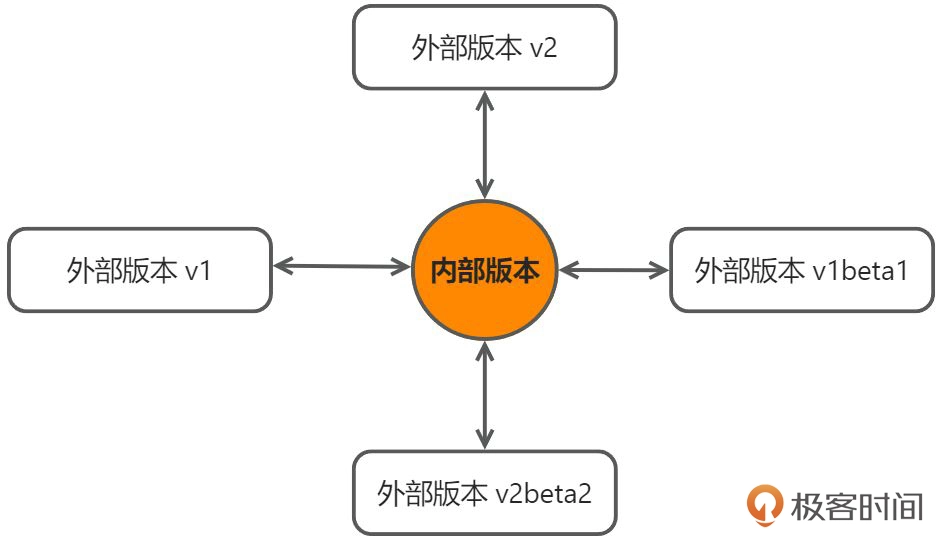
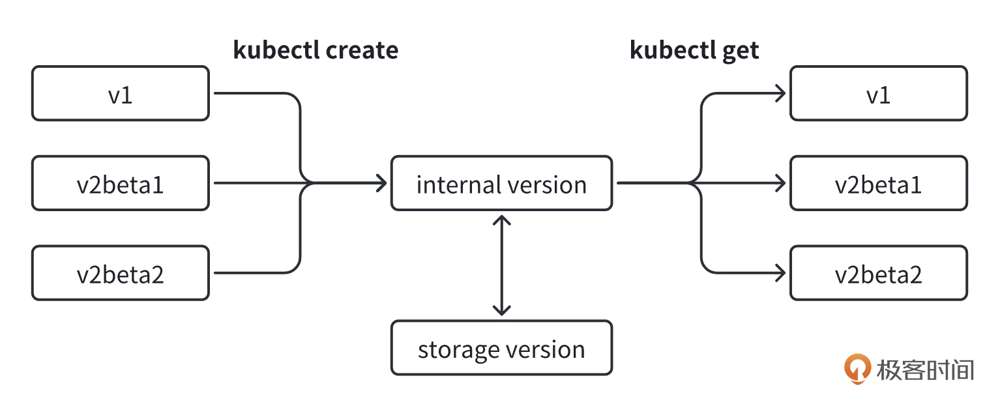

# 32 | Kubernetes版本转换源码剖析

你好，我是孔令飞。

通过上一节课的学习，我们知道随着 Kubernetes 功能的新增、变更等，API 接口会进行一些兼容性或不兼容性变更，这些变更会导致 API 接口的版本号往前增加，出现同一个资源多个版本并存的情况。

那么，Kubernetes 是如何处理这么多的 API 版本带来的复杂度问题的呢？Kubernetes 引入了奇妙的内部版本概念，简化多版本带来的代码处理复杂度。另外，为了确保 API 接口是向后兼容的，还需要进行多版本之间的 API 转换。

本节课，我们就来看下 Kubernetes 各种类型的版本之间是如何进行相互转换的。

## Kubernetes 版本转换机制

Kubernetes 有 3 大版本号类型：

- 外部版本号（External Version）：Kubernetes 对外暴露的版本号，具有明确的版本标识，如 v1/v2beta1 等。在实际开发中，使用者可以根据需要选择指定的版本号。

- 内部版本号（Internal Version）：Kubernetes 内部使用的版本号，不直接暴露给用户。内部版本号对应的请求参数，是同类资源所有版本参数字段的超集。默认是最新的外部版本号所定义的参数字段。

- 存储版本号（Storage Version）：etcd 中使用的版本号，通常是外部版本中稳定的版本，比如 v1/v2 等。

Kubernetes 的版本转换是基于以上 3 类 API 类型来实现的。那么，具体的机制是什么呢？kube-apiserver 中内外部版本转换的机制如下图所示：



Kubernetes 的版本转换呈星状结构。外部版本号不会直接互转，通常都是先转换成内部版本号，再转换为期望的外部版本号。例如：

```
v1 --> internal version --> v2beta1
```

这种方式可以让整个版本转换更加简洁、高效。否则，每增加一个新的版本，其他版本都要实现一个新的向目标版本转换的方法，让程序变得非常难以维护、臃肿。

kube-apiserver 的版本号转换过程如下：



```
首先，通过 kubectl create 创建资源对象时，客户端使用 External Version，即 kube-
```

apiserver 暴露的 version 和 scheme。

其次，在 kube-apiserver 中，External Version 的对象先被转换为 Interval version，再将Internal version 转换为 storage version。

```
最后，通过 kubectl get 查询资源对象时，根据客户端使用的 Version，先将 Storage
```

Version 对象转换为 Internal version，再将 Internal version 转换为 External version，返回给客户端。

## Kubernetes 版本转换实现

《Kubernetes 如何设置默认值？》这节课中介绍了设置默认值的整个流程，其实版本转换的实现流程跟设置默认值的实现流程是一致的。主要代码段分为 3 个，我们一一来看。

```go
在 createHandler 方法中，调用 decoder.Decode 方法来进行资源的版本转换：
// 位于文件 staging/src/k8s.io/apiserver/pkg/endpoints/handlers/create.go 中
func createHandler(r rest.NamedCreater, scope *RequestScope, admit admission.Inte
   return func(w http.ResponseWriter, req *http.Request) {
       decoder := scope.Serializer.DecoderToVersion(decodeSerializer, scope.HubG
       span.AddEvent("About to convert to expected version")
       obj, gvk, err := decoder.Decode(body, &defaultGVK, original)
       ...
}
```

decoder.Decode 的具体实现为：

```go
// 位于文件 staging/src/k8s.io/apimachinery/pkg/runtime/serializer/versioning/vers
func (c *codec) Decode(data []byte, defaultGVK *schema.GroupVersionKind, into run
   // If the into object is unstructured and expresses an opinion about its grou
   // create a new instance of the type so we always exercise the conversion pat
   decodeInto := into
   if into != nil {
       if _, ok := into.(runtime.Unstructured); ok && !into.GetObjectKind().Grou
           decodeInto = reflect.New(reflect.TypeOf(into).Elem()).Interface().(ru
       }
   }
   var strictDecodingErrs []error
   obj, gvk, err := c.decoder.Decode(data, defaultGVK, decodeInto)
   ...
   // if we specify a target, use generic conversion.
   if into != nil {
       // perform defaulting if requested
       if c.defaulter != nil {
           c.defaulter.Default(obj)
       }
       // Short-circuit conversion if the into object is same object
       if into == obj {
           return into, gvk, strictDecodingErr
       }
       // 转换版本化 API 为内部 API
       if err := c.convertor.Convert(obj, into, c.decodeVersion); err != nil {
           return nil, gvk, err
       }
       return into, gvk, strictDecodingErr
   }
   // perform defaulting if requested
   if c.defaulter != nil {
       c.defaulter.Default(obj)
   }
   // 转换内部 API 为版本化 API
   out, err := c.convertor.ConvertToVersion(obj, c.decodeVersion)
   if err != nil {
       return nil, gvk, err
   }
   return out, gvk, strictDecodingErr
}
可以看到，在 Decode 方法中，通过调用 c.convertor 实例的 Convert 和
ConvertToVersion 方法来完成指定版本的转换。
为了搞明白 c.convertor 具体是如何实现版本号转换的，我们先来看下 c.convertor 实
例的创建方法。c.convertor 的赋值代码如下（代码段为 versioning.go#L60）：
// 位于文件 staging/src/k8s.io/apimachinery/pkg/runtime/serializer/versioning/vers
// NewDefaultingCodecForScheme is a convenience method for callers that are using
func NewDefaultingCodecForScheme(
   // TODO: I should be a scheme interface?
   scheme *runtime.Scheme,
   encoder runtime.Encoder,
   decoder runtime.Decoder,
   encodeVersion runtime.GroupVersioner,
   decodeVersion runtime.GroupVersioner,
) runtime.Codec {
   return NewCodec(encoder, decoder, runtime.UnsafeObjectConvertor(scheme), sche
}
// 位于文件 staging/src/k8s.io/apimachinery/pkg/runtime/serializer/versioning/vers
func NewCodec(
   encoder runtime.Encoder,
   decoder runtime.Decoder,
   convertor runtime.ObjectConvertor,
   creater runtime.ObjectCreater,
   typer runtime.ObjectTyper,
   defaulter runtime.ObjectDefaulter,
   encodeVersion runtime.GroupVersioner,
   decodeVersion runtime.GroupVersioner,
   originalSchemeName string,
) runtime.Codec {
   internal := &codec{
       encoder:   encoder,
       decoder:   decoder,
       convertor: convertor, // 注意：convertor 用来进行版本转换，后面小节会用到！
       creater:   creater,
       typer:     typer,
       defaulter: defaulter, // defaulter 用来设置默认值
       encodeVersion: encodeVersion,
       decodeVersion: decodeVersion,
       identifier: identifier(encodeVersion, encoder),
       originalSchemeName: originalSchemeName,
   }
   return internal
}
可以看到，convertor 字段的赋值是通过 NewCodec 函数的 convertor 入参来赋值的。
convertor 入参是在 NewDefaultingCodecForScheme 函数中，调用 NewCodec 函数
```

时，通过以下代码来赋值的：

```go
runtime.UnsafeObjectConvertor(scheme)
再来看下，runtime.UnsafeObjectConvertor(scheme) 的实现代码：
// unsafeObjectConvertor implements ObjectConvertor using the unsafe conversion p
type unsafeObjectConvertor struct {
   *Scheme
}
// UnsafeObjectConvertor performs object conversion without copying the object st
// for use when the converted object will not be reused or mutated. Primarily for
// versioned codecs, which use the external object for serialization but do not r
func UnsafeObjectConvertor(scheme *Scheme) ObjectConvertor {
   return unsafeObjectConvertor{scheme}
}
通过上述代码，可以知道 UnsafeObjectConvertor 返回了一个 ObjectConvertor 接口
类型的实例。其实现为 unsafeObjectConvertor，通过匿名结构体的方式继承了 Scheme
的方法。由此可以知道，Scheme 结构体的 Convert 和 ConvertToVersion 方法实现了具
```

体的版本转换逻辑。

```
我们来看下 *Scheme 类型的 Convert 和 ConvertToVersion。
```

首先，Convert 方法代码实现如下：

```go
func (s *Scheme) Convert(in, out interface{}, context interface{}) error {
   unstructuredIn, okIn := in.(Unstructured)
   unstructuredOut, okOut := out.(Unstructured)
   switch {
   case okIn && okOut:
       // converting unstructured input to an unstructured output is a straight
       // is a "smart holder" and the contents are passed by reference between t
       // 将 unstructured 输入转换为 unstructured 输出只是一次直接复制 —— unstructured
       // 是一个“智能持有者”，其内容在两个对象之间通过引用传递
       unstructuredOut.SetUnstructuredContent(unstructuredIn.UnstructuredContent
       return nil
   case okOut:
       // if the output is an unstructured object, use the standard Go type to u
       // conversion. The object must not be internal.
       obj, ok := in.(Object)
       if !ok {
           return fmt.Errorf("unable to convert object type %T to Unstructured,
       }
       gvks, unversioned, err := s.ObjectKinds(obj)
       if err != nil {
           return err
       }
       gvk := gvks[0]
       // if no conversion is necessary, convert immediately
       if unversioned || gvk.Version != APIVersionInternal {
           content, err := DefaultUnstructuredConverter.ToUnstructured(in)
           if err != nil {
               return err
           }
           unstructuredOut.SetUnstructuredContent(content)
           unstructuredOut.GetObjectKind().SetGroupVersionKind(gvk)
           return nil
       }
       // attempt to convert the object to an external version first.
       target, ok := context.(GroupVersioner)
       if !ok {
           return fmt.Errorf("unable to convert the internal object type %T to U
       }
       // Convert is implicitly unsafe, so we don't need to perform a safe conve
       versioned, err := s.UnsafeConvertToVersion(obj, target)
       if err != nil {
           return err
       }
       content, err := DefaultUnstructuredConverter.ToUnstructured(versioned)
       if err != nil {
           return err
       }
       unstructuredOut.SetUnstructuredContent(content)
       return nil
   case okIn:
       // converting an unstructured object to any type is modeled by first conv
       // the input to a versioned type, then running standard conversions
       typed, err := s.unstructuredToTyped(unstructuredIn)
       if err != nil {
           return err
       }
       in = typed
   }
   meta := s.generateConvertMeta(in)
   meta.Context = context
   return s.converter.Convert(in, out, meta)
}
Convert 方法用来在两个已知 Go 类型之间做字段级转换（比如内部类型 <-> 外部类型、A
```

版本 Go 结构体 <-> B 版本 Go 结构体，或者任意注册过转换函数的类型）。

```
Convert 方法在进行版本转换时，会特殊处理 in 和 out 为 Unstructured 类型的场景：
in/out 都是 Unstructured 时，直接浅拷贝底层 map[string]interface{}，只是引用
```

- 传递。

```
out 是 Unstructured 时，把任意 runtime.Object → 先转外部版本（或按 context 指定版
```

- 本）→ 再序列化为 unstructured。

```
in 是 Unstructured 时，先反序列化为对应的 Typed 对象，然后继续走通用转换逻辑。
```

再来看 ConvertToVersion 方法的代码实现：

```go
// ConvertToVersion attempts to convert an input object to its matching Kind in a
// version within this scheme. Will return an error if the provided version does
// contain the inKind (or a mapping by name defined with AddKnownTypeWithName). W
// return an error if the conversion does not result in a valid Object being
// returned. Passes target down to the conversion methods as the Context on the s
func (s *Scheme) ConvertToVersion(in Object, target GroupVersioner) (Object, erro
   return s.convertToVersion(true, in, target)
}
// convertToVersion handles conversion with an optional copy.
func (s *Scheme) convertToVersion(copy bool, in Object, target GroupVersioner) (O
   var t reflect.Type
   if u, ok := in.(Unstructured); ok {
       typed, err := s.unstructuredToTyped(u)
       if err != nil {
           return nil, err
       }
       in = typed
       // unstructuredToTyped returns an Object, which must be a pointer to a st
       t = reflect.TypeOf(in).Elem()
   } else {
       // determine the incoming kinds with as few allocations as possible.
       t = reflect.TypeOf(in)
       if t.Kind() != reflect.Pointer {
           return nil, fmt.Errorf("only pointer types may be converted: %v", t)
       }
       t = t.Elem()
       if t.Kind() != reflect.Struct {
           return nil, fmt.Errorf("only pointers to struct types may be converte
       }
   }
   kinds, ok := s.typeToGVK[t]
   if !ok || len(kinds) == 0 {
       return nil, NewNotRegisteredErrForType(s.schemeName, t)
   }
   gvk, ok := target.KindForGroupVersionKinds(kinds)
   if !ok {
       // try to see if this type is listed as unversioned (for legacy support)
       // TODO: when we move to server API versions, we should completely remove
       if unversionedKind, ok := s.unversionedTypes[t]; ok {
           if gvk, ok := target.KindForGroupVersionKinds([]schema.GroupVersionKi
               return copyAndSetTargetKind(copy, in, gvk)
           }
           return copyAndSetTargetKind(copy, in, unversionedKind)
       }
       return nil, NewNotRegisteredErrForTarget(s.schemeName, t, target)
   }
   // target wants to use the existing type, set kind and return (no conversion
   for _, kind := range kinds {
       if gvk == kind {
           return copyAndSetTargetKind(copy, in, gvk)
       }
   }
   // type is unversioned, no conversion necessary
   if unversionedKind, ok := s.unversionedTypes[t]; ok {
       if gvk, ok := target.KindForGroupVersionKinds([]schema.GroupVersionKind{u
           return copyAndSetTargetKind(copy, in, gvk)
       }
       return copyAndSetTargetKind(copy, in, unversionedKind)
   }
   out, err := s.New(gvk)
   if err != nil {
       return nil, err
   }
   if copy {
       in = in.DeepCopyObject()
   }
   meta := s.generateConvertMeta(in)
   meta.Context = target
   if err := s.converter.Convert(in, out, meta); err != nil {
       return nil, err
   }
   setTargetKind(out, gvk)
   return out, nil
}
ConvertToVersion 方法用来把一个 runtime.Object 转成某个 group/version 对应的对
```

象实例。

内部流程如下：

```
若 in 是 Unstructured，先 unstructuredToTyped → 得到具体 Typed 对象。
通过反射拿到 in 的 Go 结构体类型，在 scheme 注册表里找它所有的 GVK。
用 targetGV.KindForGroupVersionKinds(...) 选出目标 GVK。
若目标 GVK 与 in 的 GVK 相同（无版本变化）或属于 unversioned 类型，直接拷贝并设
```

- 置 .APIVersion/.Kind。

5. 否则 New(gvk) 创建一个 out 实例，必要时对 in 做 DeepCopy，再调用底层 converter（其实就是调用 Convert(in, out, context=targetGV))，最后给 out 填上 GVK。

```
ConvertToVersion 使用场景是，当你只知道要转换到哪个 API 版本（GroupVersion），但
```

不关心具体 Go 类型时，一行代码搞定类型创建、字段 copy、TypeMeta 填写。

```
可以看到，Convert 和ConvertToVersion 方法都会调用 s.converter.Convert 方法
```

完成两个具体 Go 类型之间的字段级转换。

s.converter.Convert 方法代码如下：

```go
// Convert will translate src to dest if it knows how. Both must be pointers.
// If no conversion func is registered and the default copying mechanism
// doesn't work on this type pair, an error will be returned.
// 'meta' is given to allow you to pass information to conversion functions,
// it is not used by Convert() other than storing it in the scope.
// Not safe for objects with cyclic references!
func (c *Converter) Convert(src, dest interface{}, meta *Meta) error {
   pair := typePair{reflect.TypeOf(src), reflect.TypeOf(dest)}
   scope := &scope{
       converter: c,
       meta:      meta,
   }
   // ignore conversions of this type
   if _, ok := c.ignoredUntypedConversions[pair]; ok {
       return nil
   }
   if fn, ok := c.conversionFuncs.untyped[pair]; ok {
       return fn(src, dest, scope)
   }
   if fn, ok := c.generatedConversionFuncs.untyped[pair]; ok {
       return fn(src, dest, scope)
   }
   dv, err := EnforcePtr(dest)
   if err != nil {
       return err
   }
   sv, err := EnforcePtr(src)
   if err != nil {
       return err
   }
   return fmt.Errorf("converting (%s) to (%s): unknown conversion", sv.Type(), d
}
s.converter.Convert 方法的整体流程如下：
```

1. 如果该类型对在忽略表中什么也不做。

2. 查开发者手写的转换函数，若找到，则执行转换函数，并返回。

3. 查自动生成的转换函数（conversion-gen），若找到，则执行转换函数，并返回。

4. 检查指针合法性并报错，提示没有已知转换路径。

至此，我们发现，2 个具体 Go 版本之间的转换，其实会调用开发者手写的转换函数和代码自动生成的转换函数。

接下来，我们再来看下，这些手写的转换函数和代码生成的转换函数是如何实现的。

## Kubernetes 版本转换函数是如何生成的？

Kubernetes 版本转换函数是由 conversion-gen 工具来自动生成的，具体可分为 3 步：

```
生成 zz_generated.conversion.go 文件。
```

2. 添加自定义版本转换代码。

3. 注册资源版本转换函数。

### 生成 zz_generated.conversion.go 文件

```
conversion-gen 工具根据 // +k8s:conversion-
gen=k8s.io/kubernetes/pkg/apis/apps 注释来判断，是否要为所在包的资源定义生
成版本转换函数。所以，我们首先要添加 +k8s:conversion-gen=XXX 标签。
+k8s:conversion-gen=XXX 标签的意思是：在你指定的包（通常是“外部版本”包）下扫描
```

所有类型（struct），为它们和另一个版本包（通常是 API 内部版本）之间自动生成

```
Convert<Internal>To<External>、Convert<External>To<Internal> 这类深拷
```

贝转换函数。

```
XXX 必须是一个合法的 Go import path，指向“另一端” API 包的位置。例如，在
k8s.io/kubernetes/pkg/apis/apps 包的 doc.go 里写 +k8s:conversion-
gen=k8s.io/kubernetes/pkg/apis/apps，就是告诉 conversion-gen 工具：
这里是外部（pkg/apis/apps/v1）类型。
请为它和位于 k8s.io/kubernetes/pkg/apis/apps 的外部类型生成双向转换函数。
```

为了方便你理解，我使用之前的示例代码来给你演示。首先克隆示例代码：

```
$ git clone https://github.com/onexstack/kubernetes-examples
$ cd kubernetes-examples/resourcedefinition
$ go mod tidy
我们可以在 apps/v1beta1/doc.go 文件中，添加 +k8s:conversion-
gen=github.com/onexstack/kubernetes-examples/resourcedefinition/apps
```

注释，例如：

```
// +k8s:deepcopy-gen=package
// +k8s:defaulter-gen=TypeMeta
// +k8s:defaulter-gen-input=github.com/onexstack/kubernetes-examples/resourcedefi
// +k8s:conversion-gen=github.com/onexstack/kubernetes-examples/resourcedefinitio
// +k8s:conversion-gen=k8s.io/kubernetes/pkg/apis/core
// +k8s:conversion-gen-external-types=github.com/onexstack/kubernetes-examples/re
// Package v1beta1 is the v1beta1 version of the API.
package v1beta1
+k8s:conversion-gen-external-types 用来直接指定外部类型的包，如果不指定
conversion-gen-external-types，则说明外部类型就定义在当前包中。
在我们添加了必要的 // +_k8s: 注释之后，便可以运行以下命令，来为资源结构体生成设置
```

默认值函数：

```
$ defaulter-gen -v 1 --go-header-file ./boilerplate.go.txt --output-file zz_gener
```

执行完上述命令后，会生成 resourcedefinition/apps/v1beta1/zz_generated.conversion.go文件，文件内容如下：

```go
package v1beta1
import (
 unsafe "unsafe"
 apps "github.com/onexstack/kubernetes-examples/resourcedefinition/apps"
 v1 "k8s.io/apimachinery/pkg/apis/meta/v1"
 conversion "k8s.io/apimachinery/pkg/conversion"
 runtime "k8s.io/apimachinery/pkg/runtime"
)
func init() {
 localSchemeBuilder.Register(RegisterConversions)
}
// RegisterConversions adds conversion functions to the given scheme.
// Public to allow building arbitrary schemes.
func RegisterConversions(s *runtime.Scheme) error {
 if err := s.AddGeneratedConversionFunc((*XXX)(nil), (*apps.XXX)(nil), func(a, b
   return Convert_v1beta1_XXX_To_apps_XXX(a.(*XXX), b.(*apps.XXX), scope)
 }); err != nil {
   return err
 }
 ...
 if err := s.AddGeneratedConversionFunc((*apps.XXXStatus)(nil), (*XXXStatus)(nil
   return Convert_apps_XXXStatus_To_v1beta1_XXXStatus(a.(*apps.XXXStatus), b.(*X
 }); err != nil {
   return err
 }
 return nil
}
func autoConvert_v1beta1_XXX_To_apps_XXX(in *XXX, out *apps.XXX, s conversion.Sco
 out.ObjectMeta = in.ObjectMeta
 if err := Convert_v1beta1_XXXSpec_To_apps_XXXSpec(&in.Spec, &out.Spec, s); err
   return err
 }
 if err := Convert_v1beta1_XXXStatus_To_apps_XXXStatus(&in.Status, &out.Status,
   return err
 }
 return nil
}
// Convert_v1beta1_XXX_To_apps_XXX is an autogenerated conversion function.
func Convert_v1beta1_XXX_To_apps_XXX(in *XXX, out *apps.XXX, s conversion.Scope)
 return autoConvert_v1beta1_XXX_To_apps_XXX(in, out, s)
}
func autoConvert_apps_XXX_To_v1beta1_XXX(in *apps.XXX, out *XXX, s conversion.Sco
 out.ObjectMeta = in.ObjectMeta
 if err := Convert_apps_XXXSpec_To_v1beta1_XXXSpec(&in.Spec, &out.Spec, s); err
   return err
 }
 if err := Convert_apps_XXXStatus_To_v1beta1_XXXStatus(&in.Status, &out.Status,
   return err
 }
 return nil
}
// Convert_apps_XXX_To_v1beta1_XXX is an autogenerated conversion function.
func Convert_apps_XXX_To_v1beta1_XXX(in *apps.XXX, out *XXX, s conversion.Scope)
 return autoConvert_apps_XXX_To_v1beta1_XXX(in, out, s)
}
...
// Convert_apps_XXXStatus_To_v1beta1_XXXStatus is an autogenerated conversion fun
func Convert_apps_XXXStatus_To_v1beta1_XXXStatus(in *apps.XXXStatus, out *XXXStat
 return autoConvert_apps_XXXStatus_To_v1beta1_XXXStatus(in, out, s)
}
zz_generated.conversion.go 中生成了  RegisterConversions 函数，用来向
scheme 函数中注册资源的版本转换函数。
```

### 添加自定义版本转换函数

```
上面操作生成的 RegisterConversions 函数中默认注册了自动生成的转换函数。这些函数
名都有一定规则：Convert_<源版本包名>_<资源类型>_To_<目标版本包名>_<资源类型
>。
```

如果想自定义转换方法，只需要根据转换函数命名规则，在 kubernetes/pkg/apis/apps/v1 目录下新建一个 conversion.go 文件，并在该文件内根据转换函数命名规则开发期望的转换函数即可。conversion-gen 工具在生成转换函数代码时，会自动忽略已经存在的转换函数的代码生成。

例如，下面是 Deployment v1 版本向内部版本转换的自定义转换函数实现：

```go
func Convert_v1_Deployment_To_apps_Deployment(in *appsv1.Deployment, out *apps.De
   if err := autoConvert_v1_Deployment_To_apps_Deployment(in, out, s); err != ni
       return err
   }
   // Copy annotation to deprecated rollbackTo field for roundtrip
   // TODO: remove this conversion after we delete extensions/v1beta1 and apps/v
   if revision := in.Annotations[appsv1.DeprecatedRollbackTo]; revision != "" {
       if revision64, err := strconv.ParseInt(revision, 10, 64); err != nil {
           return fmt.Errorf("failed to parse annotation[%s]=%s as int64: %v", a
       } else {
           out.Spec.RollbackTo = new(apps.RollbackConfig)
           out.Spec.RollbackTo.Revision = revision64
       }
       out.Annotations = deepCopyStringMap(out.Annotations)
       delete(out.Annotations, appsv1.DeprecatedRollbackTo)
   } else {
       out.Spec.RollbackTo = nil
   }
   return nil
}
自定义版本转换函数的参数也要满足转换需求，一般来说需要包括：in、out 和 s。
在添加完自定义的转换函数之后，再次运行 conversion-gen 命令，来生成版本转换函数。
```

命名格式如下：

```
conversion-gen -v 1 --go-header-file ./boilerplate.go.txt --output-file zz_genera
```

运行上述命令之后，会生成 apps/v1beta1/zz_generated.conversion.go 文件。

### 注册版本转换函数

在 zz_generated.conversion.go 文件中会自动生成版本转换方法注册代码：

```go
func init() {
   localSchemeBuilder.Register(RegisterConversions)
}
上述代码会在包被导入时，将版本转换方法注册到资源注册表中 Scheme 中。之后，在
Scheme 的 Convert 和 ConvertToVersion 方法中，会使用这些版本转换方法来转换不同
```

版本的资源类型。

## 课程总结

Kubernetes 为了解决同一资源多版本并存带来的复杂度，引入了“内部版本”（InternalVersion）的概念。所有对外暴露的版本（External Version）在处理链路中都会先被转换成内部版本，再根据需要转换成目标外部版本或存储版本，从而把 N² 次转换关系简化为星形结构。

kube-apiserver 在处理请求时，利用 runtime.Scheme、serializer 以及 convertor 组件完成版本转换：接收端把外部对象解码成内部对象；持久化前再把内部对象转成存储版本；响应端按客户端请求把存储对象经内部版本转换回目标外部版本。

版本转换的核心代码在 Scheme 的 Convert 和 ConvertToVersion 两个方法中：Convert 负责“已知 Go 类型 A→B”字段级拷贝，ConvertToVersion 负责“任意对象→指定 GroupVersion”并自动创建目标对象、填充 TypeMeta。两者最终都会调用底层 s.converter.Convert。

s.converter.Convert 按优先级依次查找：忽略表、自定义转换函数、由 conversion-gen 生成的自动转换函数；若全部缺失则报错。

大量的字段拷贝函数由 code-generator 子工具 conversion-gen 自动生成。开发者在包的

```
doc.go 中用 +k8s:conversion-gen= 和 +k8s:conversion-gen-external-types=
```

标签声明“内部 - 外部”包配对后，运行 conversion-gen 即可得到

```
zz_generated.conversion.go，其中包含双向转换函数和 RegisterConversions。对于
```

有语义差异的字段，可以手写同名 Convert_* 函数覆盖默认行为。

## 课后练习

```
请阅读 kube-apiserver 源码，探索为什么 c.convertor 是 *Scheme 类型的实例？
```

2. 阅读 Scheme.ConvertToVersion 的源码流程，说明当目标 GroupVersion 与输入对象已有

```
的 GVK 完全一致时，函数为什么仍然会执行一次 copyAndSetTargetKind 而不是直接
```

- 返回原对象？

欢迎你在留言区与我交流讨论，如果今天的内容让你有所收获，也欢迎转发给有需要的朋友，我们下节课再见！
