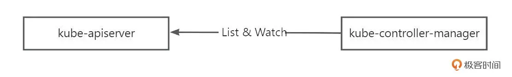

# 33 | kube-controller-mananger框架核心原理及源码剖析

你好，我是孔令飞。

Kubernetes 的基石是声明式编程，模式如下：



开发者通过调用 kube-apiserver 向 etcd 中添加 / 修改 / 删除资源，kube-apiserver 会保存资源的定义，资源定义中会声明资源期望的状态。kube-controller-mananger 通过 List-Watch 机制感知到 kube-apiserver 中资源的变更，会根据资源的定义进行（期望的状态）调谐。所谓的调谐，就是运行程序将资源的状态维持在期望的状态。

课程的前半部分，我详细介绍了 kube-apiserver 中的核心内容。接下来将介绍声明式编程中另外一个核心角色：控制器 kube-controller-manager。

## kube-controller-manager 的功能

```
kube-controller-manager 是 Kubernetes 主控节点（Master Node）上的一个关键组
件，它负责运行核心控制循环，这些控制循环处理集群范围内的各种功能。kube-
controller-manager 通过监听 API Server 的变化来触发相应的控制器逻辑，从而实现对
```

整个集群的管理和自动化操作。

kube-controller-manager 中聚合了多个控制器，这些控制器可以在 names 包中找到。控制

```
器的具体实现位于 pkg/controller/ 目录下。
```

## kube-controller-manager 启动源码解析

kube-controller-manager 应用的启动框架前面已经详细介绍过，这节课我们来重点看看跟kube-controller-manager 功能关系比较紧密的核心启动代码。

kube-controller-manager 的启动代码位于 Run 方法中。在 Run 方法中，首先会启动事件记录器：

```go
// Run runs the KubeControllerManagerOptions.
func Run(ctx context.Context, c *config.CompletedConfig) error {
   ...
   // Start events processing pipeline.
   // 初始化事件广播器，并开始以结构化的格式记录事件。参数 0 表示不添加额外的信息（可以调整日志
   c.EventBroadcaster.StartStructuredLogging(0)
   // 启动事件录制，将事件发送到 Kubernetes API，特别是 Events 接口
   // &v1core.EventSinkImpl{...} 创建了一个用于接收事件的 EventSinkImpl 对象，从而使事件
   c.EventBroadcaster.StartRecordingToSink(&v1core.EventSinkImpl{Interface: c.Cl
   // 使用 defer 语句，在当前函数运行结束时触发 Shutdown() 方法，以确保在程序退出时干净地关
   defer c.EventBroadcaster.Shutdown()
   ...
}
```

接下来会创建 2 个 ClientBuilder：

```
rootClientBuilder：提供一种基础方式去创建具有根级权限的 Kubernetes 客户端。
clientBuilder：根据是否启用了服务账户凭证有不同的行为。如果启用了，它会尝试使
用服务账户的身份进行更安全的操作；如果没有启用，则直接复用 rootClientBuilder
```

- 的行为模式。

```go
之后定义一个 run 方法，run 方法代码如下：
   run := func(ctx context.Context, controllerDescriptors map[string]*Controller
       controllerContext, err := CreateControllerContext(ctx, c, rootClientBuild
       if err != nil {
           logger.Error(err, "Error building controller context")
           klog.FlushAndExit(klog.ExitFlushTimeout, 1)
       }
       if err := StartControllers(ctx, controllerContext, controllerDescriptors,
           logger.Error(err, "Error starting controllers")
           klog.FlushAndExit(klog.ExitFlushTimeout, 1)
       }
       controllerContext.InformerFactory.Start(stopCh)
       controllerContext.ObjectOrMetadataInformerFactory.Start(stopCh)
       close(controllerContext.InformersStarted)
       <-ctx.Done()
   }
run 方法用来创建一个控制器上下文，控制器上下文中包括了控制器启动时需要的各种信
息。之后，基于该控制器上下文及 controllerDescriptors 变量来启动注册的控制器。
```

### 创建控制器上下文

通过 CreateControllerContext 方法来创建一个控制器上下文实例。实例类型为

```go
ControllerContext，定义如下：
type ControllerContext struct { // ClientBuilder will provide a client for this c
   // 提供一个用于与 Kubernetes API 交互的客户端。控制器可以使用此客户端执行
   ClientBuilder clientbuilder.ControllerClientBuilder
   // 提供访问共享的 informer。informer 用于监控 Kubernets API 中的资源变化。通过 infor
   // 控制器可以获得资源状态的更新，并对其作出反应，保持其内部状态与集群状态的一致性
   InformerFactory informers.SharedInformerFactory
   // 提供对某些特定资源的 informer 访问。这些资源可以是类型化的（具有确定类型）或动态的（无需
   ObjectOrMetadataInformerFactory informerfactory.InformerFactory
   // 提供控制器的初始化选项访问。这个配置一般包含控制器的运行参数，控制器行为的各种布置。
   // 例如，它可能包含控制器的同步周期、并发工作线程数等参数
   ComponentConfig kubectrlmgrconfig.KubeControllerManagerConfiguration
   // 这是一个延迟初始化的 RESTMapper，用于在需要时确定资源的 REST 端点。它只有在第一次请求
   RESTMapper *restmapper.DeferredDiscoveryRESTMapper
   // 这是一个通道，当所有控制器被初始化并开始运行时将被关闭。使用此通道，控制器可以在信号到达时
   // 这管理了控制器之间的启动顺序，保证在开始使用 informer 之前所有控制器都已就绪
   InformersStarted chan struct{}
   // ResyncPeriod 每次被调用时生成一个持续时间；这样可以避免多个控制器在同步时步调一致，
   // 同时向 API Server 发送大量的列表请求。
   ResyncPeriod func() time.Duration
   // 提供一个代理，用于设置与控制器特定的指标
   ControllerManagerMetrics *controllersmetrics.ControllerManagerMetrics
   // 提供对垃圾收集器依赖图构建的访问。它负责跟踪集群中的资源，以及它们之间的依赖关系。在 Kub
   GraphBuilder *garbagecollector.GraphBuilder
}
CreateControllerContext 函数实现代码如下：
func CreateControllerContext(ctx context.Context, s *config.CompletedConfig, root
   // Informer transform to trim ManagedFields for memory efficiency.
   trim := func(obj interface{}) (interface{}, error) {
       if accessor, err := meta.Accessor(obj); err == nil {
           if accessor.GetManagedFields() != nil {
               accessor.SetManagedFields(nil)
           }
       }
       return obj, nil
   }
   versionedClient := rootClientBuilder.ClientOrDie("shared-informers")
   sharedInformers := informers.NewSharedInformerFactoryWithOptions(versionedCli
   metadataClient := metadata.NewForConfigOrDie(rootClientBuilder.ConfigOrDie("m
   metadataInformers := metadatainformer.NewSharedInformerFactoryWithOptions(met
   // If apiserver is not running we should wait for some time and fail only the
   // important when we start apiserver and controller manager at the same time.
   if err := genericcontrollermanager.WaitForAPIServer(versionedClient, 10*time.
       return ControllerContext{}, fmt.Errorf("failed to wait for apiserver bein
   }
   // Use a discovery client capable of being refreshed.
   discoveryClient := rootClientBuilder.DiscoveryClientOrDie("controller-discove
   cachedClient := cacheddiscovery.NewMemCacheClient(discoveryClient)
   restMapper := restmapper.NewDeferredDiscoveryRESTMapper(cachedClient)
   go wait.Until(func() {
       restMapper.Reset()
   }, 30*time.Second, ctx.Done())
   controllerContext := ControllerContext{
       ClientBuilder:                   clientBuilder,
       InformerFactory:                 sharedInformers,
       ObjectOrMetadataInformerFactory: informerfactory.NewInformerFactory(share
       ComponentConfig:                 s.ComponentConfig,
       RESTMapper:                      restMapper,
       InformersStarted:                make(chan struct{}),
       ResyncPeriod:                    ResyncPeriod(s),
       ControllerManagerMetrics:        controllersmetrics.NewControllerManagerM
   }
   if controllerContext.ComponentConfig.GarbageCollectorController.EnableGarbage
       controllerContext.IsControllerEnabled(NewControllerDescriptors()[names.Ga
       ignoredResources := make(map[schema.GroupResource]struct{})
       for _, r := range controllerContext.ComponentConfig.GarbageCollectorContr
           ignoredResources[schema.GroupResource{Group: r.Group, Resource: r.Res
       }
       controllerContext.GraphBuilder = garbagecollector.NewDependencyGraphBuild
           ctx,
           metadataClient,
           controllerContext.RESTMapper,
           ignoredResources,
           controllerContext.ObjectOrMetadataInformerFactory,
           controllerContext.InformersStarted,
       )
   }
   controllersmetrics.Register()
   return controllerContext, nil
}
上述代码首先定义了一个 trim 函数，从资源对象中获取资源的 metav1.ObjectMeta 信
息，返回的是 metav1.Object 接口类型。然后，调用 metav1.Object 接口的
SetManagedFields 方法将 ManagedFields 设为 nil，这可以减少内存占用，因为
ManagedFields 信息是不必要的。
```

接下来，分别创建版本化客户端、共享 informer、元数据客户端和元数据 informer，并调用

```
WaitForAPIServer 函数，等待 kube-apiserver 成功运行。WaitForAPIServer 函数中通
过轮询的方式调用 kube-apiserver 的 /healthz 接口，来判断 kube-apiserver 是否健康。
```

接着创建动态 RESTMapper，用来构建动态资源的 REST 请求路径。

最后，判断 kube-controller-manager 是否开启了 GC。如果配置启用了垃圾收集器，并且garbage-collector-controller 控制器被启用，则创建用于构建资源依赖图的 GraphBuilder，并将被忽略的资源映射到一个集合中，传递给依赖图构建器以进行垃圾收集的管理。

```
CreateControllerContext 函数最后返回 ControllerContext 类型的结构体实例。结
```

构体实例中的各个字段，用来在后面的程序中启动各个控制器。

### 创建控制器集合

要想启动控制器，首先需要获取需要启动的控制器列表。在 kube-controller-manager 中是通过 NewControllerDescriptors 函数来构建一个控制器集合的。控制器集合是一个 map 类型的实例，其中 key 是控制器的名称，value 中包含了控制器的一些核心参数。这些参数用来初始化和启动控制器。

```go
NewControllerDescriptors 函数代码如下：
func NewControllerDescriptors() map[string]*ControllerDescriptor {
   controllers := map[string]*ControllerDescriptor{}
   aliases := sets.NewString()
   // All the controllers must fulfil common constraints, or else we will explod
   register := func(controllerDesc *ControllerDescriptor) {
       if controllerDesc == nil {
           panic("received nil controller for a registration")
       }
       name := controllerDesc.Name()
       if len(name) == 0 {
           panic("received controller without a name for a registration")
       }
       if _, found := controllers[name]; found {
           panic(fmt.Sprintf("controller name %q was registered twice", name))
       }
       if controllerDesc.GetInitFunc() == nil {
           panic(fmt.Sprintf("controller %q does not have an init function", nam
       }
       for _, alias := range controllerDesc.GetAliases() {
           if aliases.Has(alias) {
               panic(fmt.Sprintf("controller %q has a duplicate alias %q", name,
           }
           aliases.Insert(alias)
       }
       controllers[name] = controllerDesc
   }
   // First add "special" controllers that aren't initialized normally. These co
   // in the main controller loop initialization, so we add them here only for t
   // app.ControllerDescriptor#RequiresSpecialHandling should return true for su
   // The only known special case is the ServiceAccountTokenController which *mu
   // first to ensure that the SA tokens for future controllers will exist. Thin
   // special controllers.
   register(newServiceAccountTokenControllerDescriptor(nil))
   ...
   for _, alias := range aliases.UnsortedList() {
       if _, ok := controllers[alias]; ok {
           panic(fmt.Sprintf("alias %q conflicts with a controller name", alias)
       }
   }
   return controllers
}
```

```
上述代码先定义了一个 register 函数，用来注册一系列控制器。该函数接收一个
*ControllerDescriptor 类型的参数，ControllerDescriptor 结构体定义如下：
type ControllerDescriptor struct {
   name                      string
   initFunc                  InitFunc
   requiredFeatureGates      []featuregate.Feature
   aliases                   []string
   isDisabledByDefault       bool
   isCloudProviderController bool
   requiresSpecialHandling   bool
}
接下来对 *ControllerDescriptor 结构体中的字段进行一些校验：
name、initFunc 字段不能为空。如果为空，控制器无法正常启动。
NewControllerDescriptors 函数中会注册多个控制器，这些控制器不能重名，也不能
```

- 有重复的 alias。

```
register 方法中校验 ControllerDescriptor 通过后，会将控制器注册到
map[string]*ControllerDescriptor{} 类型的变量 controllers 中。
NewControllerDescriptors 方法中会多次调用 register 函数，用来注册多个控制
器。这些控制器都会以 key-value 的形式保存在 controllers map 类型的变量中并返回。
```

注册的控制器有很多，详细请参考register(newServiceAccountTokenControllerDescriptor(nil)) 部分代码块。

```go
我们可以看到，在调用 register 函数注册控制器时，*ControllerDescriptor 类型的
实例是通过 newXXXControllerDescriptor 函数来创建的。我们来看其中一个
newXXXControllerDescriptor 实现：
func newDaemonSetControllerDescriptor() *ControllerDescriptor {
   return &ControllerDescriptor{
       name:     names.DaemonSetController,
       aliases:  []string{"daemonset"},
       initFunc: startDaemonSetController,
   }
}
在 newDaemonSetControllerDescriptor 函数中，指定了控制器的名称
names.DaemonSetController。kube-controller-manager 中有很多控制器，为了方便统
一维护，将所有的控制器名称统一定义在 k8s.io/kubernetes/cmd/kube-controller-
manager/names 包中。所以，如果我们想知道 kube-controller-manager 支持哪些控制器，
```

直接查看 names 包即可。

```go
newDaemonSetControllerDescriptor 函数通过 startDaemonSetController 函数
来创建并启动一个控制器。startDaemonSetController 代码如下：
func startDaemonSetController(ctx context.Context, controllerContext ControllerCo
   dsc, err := daemon.NewDaemonSetsController(
       ctx,
       controllerContext.InformerFactory.Apps().V1().DaemonSets(),
       controllerContext.InformerFactory.Apps().V1().ControllerRevisions(),
       controllerContext.InformerFactory.Core().V1().Pods(),
       controllerContext.InformerFactory.Core().V1().Nodes(),
       controllerContext.ClientBuilder.ClientOrDie("daemon-set-controller"),
       flowcontrol.NewBackOff(1*time.Second, 15*time.Minute),
   )
   if err != nil {
       return nil, true, fmt.Errorf("error creating DaemonSets controller: %v",
   }
   go dsc.Run(ctx, int(controllerContext.ComponentConfig.DaemonSetController.Con
   return nil, true, nil
}
在 startDaemonSetController 函数中，通过 daemon.NewDaemonSetsController
函数来创建一个具体的控制器实例。daemon 包的导入路径为
k8s.io/kubernetes/pkg/controller/daemon。由此可见，kube-controller-manager
将控制器的具体实现放在了 pkg/controller/ 目录下。
创建的 DaemonSet 控制器实例为 dsc，之后通过调用 go dsc.Run 来启动 DaemonSet 控
```

制器。至于 kube-controller-manager 控制器的具体实现，我们下一节课会讲到。

### 启动控制器

```
在有了控制器上下文和控制器集合之后，就可以启动这些控制器了。run 函数中是通过
```

StartControllers 函数来启动这些控制器的。

```
StartControllers 函数是 kube-controller-manager 中一个非常重要的函数，其代码实现
```

如下：

```go
func StartControllers(ctx context.Context, controllerCtx ControllerContext, contr
   unsecuredMux *mux.PathRecorderMux, healthzHandler *controllerhealthz.MutableH
   var controllerChecks []healthz.HealthChecker
   // Always start the SA token controller first using a full-power client, sinc
   // If this fails, just return here and fail since other controllers won't be
   if serviceAccountTokenControllerDescriptor, ok := controllerDescriptors[names
       check, err := StartController(ctx, controllerCtx, serviceAccountTokenCont
       if err != nil {
           return err
       }
       if check != nil {
           // HealthChecker should be present when controller has started
           controllerChecks = append(controllerChecks, check)
       }
   }
   // Each controller is passed a context where the logger has the name of
   // the controller set through WithName. That name then becomes the prefix of
   // of all log messages emitted by that controller.
   //
   // In StartController, an explicit "controller" key is used instead, for two
   // - while contextual logging is alpha, klog.LoggerWithName is still a no-op,
   //   so we cannot rely on it yet to add the name
   // - it allows distinguishing between log entries emitted by the controller
   //   and those emitted for it - this is a bit debatable and could be revised.
   for _, controllerDesc := range controllerDescriptors {
       if controllerDesc.RequiresSpecialHandling() {
           continue
       }
       check, err := StartController(ctx, controllerCtx, controllerDesc, unsecur
       if err != nil {
           return err
       }
       if check != nil {
           // HealthChecker should be present when controller has started
           controllerChecks = append(controllerChecks, check)
       }
   }
   healthzHandler.AddHealthChecker(controllerChecks...)
   return nil
}
上述代码其实是遍历控制器集合 controllerDescriptors 获取其中的每个控制器，并根
据该控制器 ControllerDescriptor 中的字段值来启动控制器。
启动控制器是通过 StartController 函数实现的，StartController 函数中会执行以下
```

核心操作：

1. 检查控制器是否通过 FeatureGate 开启，如果禁止启动，则跳过该控制器的启动。

2. 判断该控制器是否是云提供商相关的控制器。在 Kubernetes 中，云提供商控制器负责与底层云基础设施进行交互，例如管理负载均衡器、路由规则等。如果是，则忽略。

3. 判断控制器是否开启，如果没有开启，则跳过启动（这里的控制器不是通过FeatureGate）。

```
通过 time.Sleep 等待一段时间，再启动控制器。通过这个时间间隔，防止同时启动控制
```

- 器，给 kube-apiserver 带来压力。

```
使用 ControllerDescriptor 中的 initFunc 来启动控制器。
```

### 启动 Informer

```
kube-controller-manager 在 CreateControllerContext 函数中分别创建了共享 informer
```

和元数据 informer。接下来还需要通过以下代码来启动上述 2 个 informer：

```
       controllerContext.InformerFactory.Start(stopCh)
       controllerContext.ObjectOrMetadataInformerFactory.Start(stopCh)
       close(controllerContext.InformersStarted)
启动完成之后，通过 close(controllerContext.InformersStarted) 来告知
```

Informer 已经启动成功。

## 启动领导者选举

kube-controller-manager 为了实现多副本容灾，会同时启动多个实例。但是 kube-controller-manager 的执行是有状态的。为了确保执行的正确性，kube-controller-manager 通过领导者选举，来确保同一时间只有一个 kube-controller-manager 实例在运行。

```
在 Run 方法中，创建了控制器启动函数 run 之后，就可以基于 run 函数来启动领导者选举
```

的主逻辑。kube-controller-manager 的领导者选举源码实现，我们不再深入讲解，如果你感兴趣可以课后自行阅读、学习。

## 课程总结

本节课我们介绍了 kube-controller-manager 的核心启动逻辑。

首先，创建控制器启动上下文，用来启动 kube-controller-manager 中注册的各种控制器。接着创建了一个控制器集合，在创建控制器集合的过程中，可以指定控制器的初始化和启动方法。然后运行控制器，这些控制器会通过 List-Watch 的方式跟 kube-apiserver 保持连接，持续获取关注事件的变更，并触发调谐动作。这些调谐动作会根据资源的定义参数执行预定的逻辑。最后，启动共享 Informer，从 kube-apiserver 中获取事件用于调谐。

## 课后练习

1. 阅读 kube-controller-manager 源码，了解 kube-controller-manager 是如何启用领导者选举的。

2. 请你介绍下，kube-controller-manager 在多副本启动时，副本的实例 ID 如何生成的？

欢迎你在留言区与我交流讨论，如果今天的内容让你有所收获，也欢迎转发给有需要的朋友，我们下节课再见！
