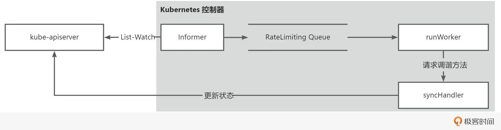

# 34 | kube-controller-mananger控制器插件源码剖析

你好，我是孔令飞。

上一节课，我介绍了 kube-controller-manager 框架层面的核心实现。Kubernetes 中有很多控制器，这些控制器分别用来完成不同的功能，例如：deployment-controller 根据 Deployment资源定义创建 ReplicaSet 资源。job-controller 根据 Job 资源定义，创建并运行作业 Pod 等。

本节课，我将通过一个相对简单的具体控制器——clusterrole-aggregation，为你展示控制器内部的源码结构及执行方式。

## clusterrole-aggregation 控制器功能

Kubernetes 使用 RBAC 的授权模式来进行资源鉴权。在 RBAC 授权模式中，需要定义一个角色，并通过角色绑定将其绑定到指定的主体列表中（subjects）。

在 Kubernetes 中，角色分为两类：命名空间级别和集群级别。这节课介绍的 clusterrole-aggregation 控制器就是用来对集群级别的角色进行角色聚合的。

所谓的角色聚合，就是将一系列通过 label selector 选定的集群角色聚合到当前的角色中，形成一个复合的 ClusterRole。

```
clusterrole-aggregation 控制器会监视带有 aggregationRule 的 ClusterRole 对象集合。
aggregationRule 为控制器定义一个标签选择算符，供后者匹配应该组合到当前
ClusterRole 的 roles 字段中的 ClusterRole 对象。clusterrole-aggregation 控制器会以覆
盖的方式，更新 roles 字段中的ClusterRole 对象。
```

下面是一个聚合 ClusterRole 的示例：

```
apiVersion: rbac.authorization.k8s.io/v1
kind: ClusterRole
metadata:
 name: monitoring
aggregationRule:
 clusterRoleSelectors:
 - matchLabels:
     rbac.example.com/aggregate-to-monitoring: "true"
rules: [] # 控制面自动填充这里的规则
如果你创建一个与某个已存在的聚合 ClusterRole 的标签选择算符匹配的
ClusterRole，这一变化会触发新的规则被添加到聚合 ClusterRole 的操作。
下面的例子中，通过创建一个标签同样为 rbac.example.com/aggregate-to-
monitoring: true 的 ClusterRole，新的规则可被添加到 monitoring ClusterRole
```

中：

```
apiVersion: rbac.authorization.k8s.io/v1
kind: ClusterRole
metadata:
 name: monitoring-endpoints
 labels:
   rbac.example.com/aggregate-to-monitoring: "true"
# 当你创建 "monitoring-endpoints" ClusterRole 时，
# 下面的规则会被添加到 "monitoring" ClusterRole 中
rules:
- apiGroups: [""]
 resources: ["services", "endpointslices", "pods"]
 verbs: ["get", "list", "watch"]
```

聚合后的 monitoring 资源定义如下：

```
apiVersion: rbac.authorization.k8s.io/v1
kind: ClusterRole
metadata:
 name: monitoring
aggregationRule:
 clusterRoleSelectors:
 - matchLabels:
     rbac.example.com/aggregate-to-monitoring: "true"
rules:
- apiGroups: [""]
 resources: ["services", "endpointslices", "pods"]
 verbs: ["get", "list", "watch"]
通过 aggregationRule 可以实现更加灵活的角色定义方式。
```

## 控制器工作原理

上述角色聚合就是由 clusterrole-aggregation 来实现的。在详细介绍 clusterrole-aggregation 实现之前，我们先来看下 Kubernetes 控制器的通用实现原理。

下图为 Kubernetes 控制器的一般实现原理：



首先，控制器在启动时，会创建并启动一个 Shared Informer，Informer 负责 List-Watchkube-apiserver，获取指定资源的变更事件，并将事件保存在一个限速队列中。控制器在启动

```
时，还会启动一个 Go 协程 runWorker。runWorker方法中会不断从 RateLimiting Queue
```

中获取事件的 key，并调用 syncHandler 方法。syncHandler 方法就是执行资源调谐的执行函数，该函数会根据 key 从 Infromer 的 Indexer 中获取完整的资源对象（Object），并根据资源对象的 Spec，执行一系列的业务逻辑，完成最终的调谐，并将调谐结果和状态更新到 kube-apiserver 中。

## 控制器实现

上面，我介绍了控制器的实现原理。接下来，我们结合 clusterrole-aggregation 控制器的源码，来具体看下 Kubernetes 是如何实现一个控制器的。

### 创建控制器

在 kube-controller-manager 启动时，通过register(newClusterRoleAggregrationControllerDescriptor()) 初始化并注册了 clusterrole-aggregation-controller。

newClusterRoleAggregrationControllerDescriptor 函数实现如下：

```go
func newClusterRoleAggregrationControllerDescriptor() *ControllerDescriptor {
   return &ControllerDescriptor{
       name:     names.ClusterRoleAggregationController,
       aliases:  []string{"clusterrole-aggregation"},
       initFunc: startClusterRoleAggregationController,
   }
}
func startClusterRoleAggregationController(ctx context.Context, controllerContext
   go clusterroleaggregation.NewClusterRoleAggregation(
       controllerContext.InformerFactory.Rbac().V1().ClusterRoles(),
       controllerContext.ClientBuilder.ClientOrDie("clusterrole-aggregation-cont
   ).Run(ctx, 5)
   return nil, true, nil
}
```

通过上述代码可以知道，kube-controller-mananger 通过调用

```
clusterroleaggregation.NewClusterRoleAggregation 来创建 clusterrole-
aggregation 控制器（*ClusterRoleAggregationController 类型的实例），并通过调
用 Run 方法来启动控制器。
在创建 *ClusterRoleAggregationController 类型实例的时候，指定了 Informer 为
ClusterRoles，也即告诉 Informer  List-Watch 集群中的 ClusterRole 资源对象。
```

NewClusterRoleAggregation 函数代码如下：

```go
// NewClusterRoleAggregation creates a new controller
func NewClusterRoleAggregation(clusterRoleInformer rbacinformers.ClusterRoleInfor
   c := &ClusterRoleAggregationController{
       clusterRoleClient:  clusterRoleClient,
       clusterRoleLister:  clusterRoleInformer.Lister(),
       clusterRolesSynced: clusterRoleInformer.Informer().HasSynced,
       queue: workqueue.NewTypedRateLimitingQueueWithConfig(
           workqueue.DefaultTypedControllerRateLimiter[string](),            wor
               Name: "ClusterRoleAggregator",
           },
       ),
   }
   c.syncHandler = c.syncClusterRole
   clusterRoleInformer.Informer().AddEventHandler(cache.ResourceEventHandlerFunc
       AddFunc: func(obj interface{}) {
           c.enqueue()
       },
       UpdateFunc: func(old, cur interface{}) {
           c.enqueue()
       },
       DeleteFunc: func(uncast interface{}) {
           c.enqueue()
       },
   })
   return c
}
在 NewClusterRoleAggregation 函数中，创建了
*ClusterRoleAggregationController 类型的控制器实例，其定义如下：
```

```sql
// ClusterRoleAggregationController 负责监听 ClusterRole 的变化，
// 将满足聚合标签(selector)的子角色规则合并到目标 ClusterRole 中。
type ClusterRoleAggregationController struct {
   // clusterRoleClient 用于 写 操作：
   // - 当控制器计算出新的规则集合后，通过该客户端调用
   //   rbac.k8s.io/v1 ClusterRole API，将变更 PATCH/UPDATE 回集群。
   clusterRoleClient rbacclient.ClusterRolesGetter
   // clusterRoleLister 提供 只读 本地缓存：
   // - 来自 SharedInformer 的索引器，支持快速 Get/List，
   //   避免每次都发请求到 API Server，降低延迟与 QPS。
   clusterRoleLister rbaclisters.ClusterRoleLister
   // clusterRolesSynced 是一个 “informer 已完成首次 List&Watch” 的布尔函数。
   // - Start 时会使用 wait.PollUntil 条件阻塞，只有返回 true
   //   才开始处理队列，确保本地缓存已与 APIServer 同步，避免漏算。
   clusterRolesSynced cache.InformerSynced
   // syncHandler 业务回调：
   // - 参数 key 由 MetaNamespaceKeyFunc 生成（ClusterRole 无命名空间，等于对象名）。
   // - 负责读取当前 ClusterRole 及其候选子角色，计算并集，
   //   如有变更则更新 `.rules` 字段。
   // - 抽成函数指针便于单元测试注入 fake 实现。
   syncHandler func(ctx context.Context, key string) error
   // queue 是带限速的泛型工作队列：
   // - Add() 在收到 informer 事件时入队，
   // - Get()/Done() 在 worker goroutine 中消费。
   // - 失败时调用 AddRateLimited 实现指数退避重试，
   //   避免瞬时错误导致的热循环。
   queue workqueue.TypedRateLimitingInterface[string]
}
ClusterRoleAggregationController 结构体中每个字段的指定方法，比较简单，你可
以直接看源码。要注意的是，syncHandler 字段的值其实是 syncClusterRole 方法，我
```

们后面会介绍。

```
另外，在 NewClusterRoleAggregation 函数中，也给 ClusterRole Informer 指定了事件
```

处理器（EventHandler）：

```
   clusterRoleInformer.Informer().AddEventHandler(cache.ResourceEventHandlerFunc
       AddFunc: func(obj interface{}) {
           c.enqueue()                                                   },
       UpdateFunc: func(old, cur interface{}) {
           c.enqueue()
       },
       DeleteFunc: func(uncast interface{}) {
           c.enqueue()
       },
   })
```

上述事件处理器会在收到 ClusterRole 资源的增加、更新、删除事件时，将变更资源及事件类型保存在限速队列中。

enqueue 方法实现代码如下：

```go
func (c *ClusterRoleAggregationController) enqueue() {
   // this is unusual, but since the set of all clusterroles is small and we don
   // graph, just queue up every thing each time.  This allows errors to be sele
   // is a problem updating a single role
   allClusterRoles, err := c.clusterRoleLister.List(labels.Everything())
   if err != nil {
       utilruntime.HandleError(fmt.Errorf("Couldn't list all objects %v", err))
       return
   }
   for _, clusterRole := range allClusterRoles {
       // only queue ones that we may need to aggregate
       if clusterRole.AggregationRule == nil {
           continue
       }
       key, err := controller.KeyFunc(clusterRole)
       if err != nil {
           utilruntime.HandleError(fmt.Errorf("Couldn't get key for object %#v:
           return
       }
       c.queue.Add(key)
   }
}
在 enqueue 方法中，会从调用 c.clusterRoleLister.List 从 Informer 的 Indexer 缓存
中列出所有的 ClusterRole，并调用 controller.KeyFunc 方法基于 ClusterRole 资源生成
```

Key，并将 Key 加入到限速队列中。

至此，clusterrole-aggregation 控制器已经创建并初始化完成。

### 启动控制器

```go
上面介绍了通过 *ClusterRoleAggregationController 的 Run 方法来启动控制器，
Run 方法的代码如下：
// Run starts the controller and blocks until stopCh is closed.
func (c *ClusterRoleAggregationController) Run(ctx context.Context, workers int)
   defer utilruntime.HandleCrash()
   logger := klog.FromContext(ctx)
   logger.Info("Starting ClusterRoleAggregator controller")
   defer logger.Info("Shutting down ClusterRoleAggregator controller")
   if !cache.WaitForNamedCacheSync("ClusterRoleAggregator", ctx.Done(), c.cluste
       return
   }
   for i := 0; i < workers; i++ {
       go wait.UntilWithContext(ctx, c.runWorker, time.Second)
   }
   <-ctx.Done()
}
在 Run 方法中，首先会等待 Informer 启动完成，确保本地缓存已经与 kube-apiserver 保持一
致。之后会启动 workers 个数的 Go 协程 c.runWorker 用来从限速队列中获取变更的
key，并进行资源调谐。workers 的值在调用 Run 方法时指定，clusterrole-aggregation 控制
器的 wokers 值是 5。
接下来，我们再看下 c.runWoker 具体是如何消费限速队列中的资源 Key 的。
```

### 消费资源变更事件

```
runWorker 方法会持续消费限速队列中的 ClusterRole key，并调用调谐函数进行资源状态调
```

谐。runWorker 方法实现如下：

```go
func (c *ClusterRoleAggregationController) runWorker(ctx context.Context) {
   for c.processNextWorkItem(ctx) {
   }
}
func (c *ClusterRoleAggregationController) processNextWorkItem(ctx context.Contex
   dsKey, quit := c.queue.Get()
   if quit {
       return false
   }
   defer c.queue.Done(dsKey)
   err := c.syncHandler(ctx, dsKey)
   if err == nil {
       c.queue.Forget(dsKey)
       return true
   }
   utilruntime.HandleError(fmt.Errorf("%v failed with : %v", dsKey, err))
   c.queue.AddRateLimited(dsKey)
   return true
}
可以看到，runWorker 通过循环调用 processNextWorkItem 方法，来消费资源变更事
件。在 processNextWorkItem 方法中，会从限速队列中获取一个 key。因为 ClusterRole
```

是集群维度，不是命名空间维度的资源，所以其 key 即为资源的名字，例如：

```
monitoring。
接着，调用 c.syncHandler 方法调谐 key monitoring。c.syncHandler 方法我们介绍
```

过，其实就是 syncClusterRole 方法，代码如下：

```go
func (c *ClusterRoleAggregationController) syncClusterRole(ctx context.Context, k
   _, name, err := cache.SplitMetaNamespaceKey(key)
   if err != nil {
       return err
   }
   sharedClusterRole, err := c.clusterRoleLister.Get(name)
   if errors.IsNotFound(err) {
       return nil
   }
   if err != nil {
       return err
   }
   if sharedClusterRole.AggregationRule == nil {
       return nil
   }
   newPolicyRules := []rbacv1.PolicyRule{}
   for i := range sharedClusterRole.AggregationRule.ClusterRoleSelectors {
       selector := sharedClusterRole.AggregationRule.ClusterRoleSelectors[i]
       runtimeLabelSelector, err := metav1.LabelSelectorAsSelector(&selector)
       if err != nil {
           return err
       }
       clusterRoles, err := c.clusterRoleLister.List(runtimeLabelSelector)
       if err != nil {
           return err
       }
       sort.Sort(byName(clusterRoles))
       for i := range clusterRoles {
           if clusterRoles[i].Name == sharedClusterRole.Name {
               continue
           }
           for j := range clusterRoles[i].Rules {
               currRule := clusterRoles[i].Rules[j]
               if !ruleExists(newPolicyRules, currRule) {
                   newPolicyRules = append(newPolicyRules, currRule)
               }
           }
       }
   }
   if equality.Semantic.DeepEqual(newPolicyRules, sharedClusterRole.Rules) {
       return nil
   }
   err = c.applyClusterRoles(ctx, sharedClusterRole.Name, newPolicyRules)
   if errors.IsUnsupportedMediaType(err) { // TODO: Remove this fallback at leas
       // When Server Side Apply is not enabled, fallback to Update. This is req
       // 1.21 since api-server can be 1.20 during the upgrade/downgrade.
       // Since Server Side Apply is enabled by default in Beta, this fallback o
       // if the feature has been disabled using its feature flag.
       err = c.updateClusterRoles(ctx, sharedClusterRole, newPolicyRules)
   }
   return err
}
syncClusterRole 在每次收到 ClusterRole 变更事件后被调用，负责将目标 ClusterRole
（即包含 aggregationRule 字段的那个角色）的 .rules 字段与其“子角色”保持一致。
函数首先把工作队列中的 key 拆解为名称，从本地 lister 中获取同名的 ClusterRole。若对象
已被删除（IsNotFound），或它本身就没有 aggregationRule（意味着这不是需要聚合的
```

角色），函数直接返回，不做任何处理。

```
如果目标 ClusterRole 含有 aggregationRule，代码会逐个遍历其中定义的
ClusterRoleSelectors。每个 LabelSelector 会被转换成可执行的 selector 对象，然
```

后在本地索引器里列出所有匹配的 ClusterRole，并按名字排序（排序纯为确定性输出，便于审计和测试）。对每个匹配到的子角色，若它不是目标角色本身，就把其规则逐条加入

```
newPolicyRules，并用 ruleExists 过滤掉重复项，最终得到一个去重后的规则并集。
并集计算完成后，函数用 equality.Semantic.DeepEqual 比较新的规则数组与目标
ClusterRole 当前持有的 .rules。若两者相同，说明无需更新；若不同，则意味着有新增或
```

删除的权限规则，需要把最新的并集写回 API Server。

```
更新优先走 applyClusterRoles，即 Server-Side Apply (SSA) 方式，可自动完成三方合
并、保留注释等。如果 API Server 回以 UnsupportedMediaType（表示 SSA 被关闭或未
升级到支持版本），便退回到传统的 updateClusterRoles。整个同步流程到此结束；执行
```

过程中任何不可恢复的错误都会原样返回并由队列机制决定是否重试。

## 课程总结

本节课通过 clusterrole-aggregation 控制器这一“最小可读例”展示了 Kubernetes 控制器的典型结构与运行流程。

首先，回顾了 RBAC 中 ClusterRole 聚合的概念：通过 AggregationRule 中的 labelselector，把一组子 ClusterRole 的 PolicyRule 合并进目标 ClusterRole，从而形成可动态扩展的复合角色。

随后阐释了通用控制器模型：Informer 负责 List-Watch 资源变动并把对象 key 投递到限速队列；多个 worker goroutine 不断从队列取 key，调用 syncHandler 做业务调谐，最终把最新状态写回 apiserver。

```
在 kube-controller-manager 启动阶段，startClusterRoleAggregationController 创
建并运行 *ClusterRoleAggregationController。该控制器注入了 ClusterRole
```

informer（读缓存）、ClusterRole client（写回集群）、TypedRateLimitingQueue（限速重试）

```
以及同步函数 syncClusterRole。Informer 的事件处理器会调用 enqueue：枚举所有带
```

AggregationRule 的 ClusterRole，生成 key（ClusterRole 名称）并入队。

```
Run 方法先等待 informer 首次同步完成，再启动若干 worker，通过 runWorker →
processNextWorkItem 循环消费 key。syncClusterRole 是核心逻辑：
```

1. 取出 key，借 lister 获取目标 ClusterRole；若对象被删除或无 AggregationRule 则退出。

2. 遍历 AggregationRule 中的 selectors，用 lister 列出符合标签的子 ClusterRole；对每条

```
PolicyRule 去重后汇总成 newPolicyRules。
若并集与现有 .rules 完全一致则无需更新；否则优先用 Server-Side Apply 写回，SSA
```

- 不可用时回退到传统 Update。

4. 出错则返回，让 workqueue 按指数退避重试。

## 课后练习

1. 请阅读 replicaset-controller 的源码，了解其实现。

```
仿照 syncClusterRole 的写法，设计一个伪代码函数 syncNamespaceLabels：它监
```

- 听所有 Namespace，对带特定注解的 Namespace 自动补充一组标准标签。简述主要步骤。

欢迎你在留言区与我交流讨论，如果今天的内容让你有所收获，也欢迎转发给有需要的朋友，我们下节课再见！
