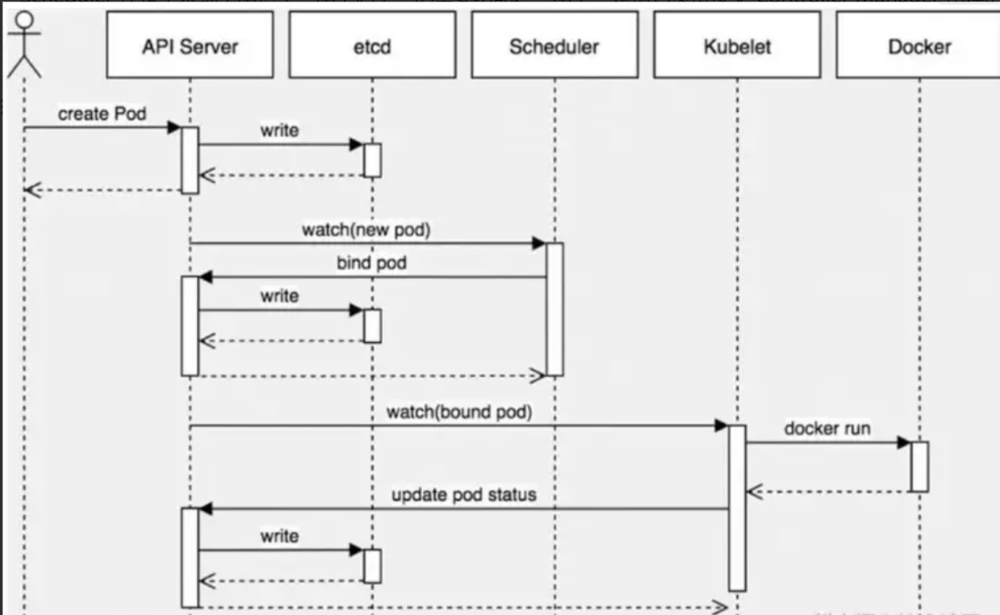
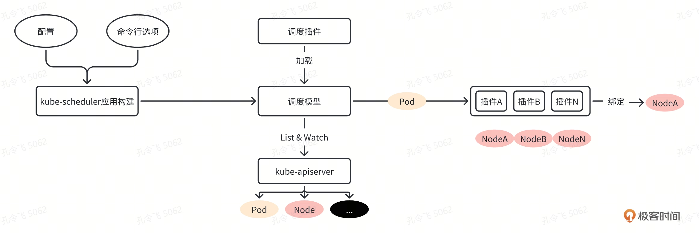

# 35 | kube-scheduler框架核心原理及源码剖析

你好，我是孔令飞。

Kubernetes 中有很多核心组件，其中一个非常重要的组件是 kube-scheduler。kube-scheduler 负责将新创建的 Pod 调度到集群中的合适节点上运行，如果没有 kube-scheduler，我们创建的 Pod 就无法调度到合适的 Node 上，也就没办法运行我们的业务。

在企业使用 Kubernetes 的过程中，需要改造 Kubernetes 的地方不多，在这些需要改造的部分中，调度器占了很大一部分比例。

本节课，我就来通过剖析 kube-scheduler 的源码，来让你深入学习 Kubernetes 的调度原理和实现。

因为 kube-scheduler 实现代码量大、逻辑复杂，所以本节课难免会出现一些逻辑、语义的错误，但这些错误还不至于严重误导对 kube-scheduler 源码的学习。所以，你可以放心阅读，也希望能包容其中的一些错误。后面我会不断细化文章逻辑以及调度细节，争取能够清晰、准确地介绍 kube-shceduler 实现的方方面面。

## kube-scheduler 的设计

Scheduler 在整个系统中承担了“承上启下”的重要功能。“承上”是指它负责接受 ControllerManager 创建的新 Pod，为其安排 Node。“启下”是指安置工作完成后，目标 Node 上的kubelet 服务进程接管后续工作。

Pod 是 Kubernetes 中最小的调度单元，Pod 被创建出来的工作流程如图所示：



- 图片来自网络

在上面这张图中：

- 第一步通过 apiserver REST API 创建一个 Pod。

- 然后 apiserver 接收到数据后将数据写入到 etcd 中。

- 由于 kube-scheduler 通过 apiserver watch API 一直在监听资源的变化，这个时候发现有一个新的 Pod，但是这个时候该 Pod 还没和任何 Node 节点进行绑定，所以 kube-scheduler就进行调度，选择出一个合适的 Node 节点，将该 Pod 和该目标 Node 进行绑定，绑定之后再更新消息到 etcd 中。

- 这个时候，一样的目标 Node 节点上的 kubelet 通过 apiserver watch API 检测到有一个新的 Pod 被调度过来了，它就将该 Pod 的相关数据传递给后面的容器运行时（containerruntime），比如 Docker，让它们去运行该 Pod。

- 而且 kubelet 还会通过 container runtime 获取 Pod 的状态，然后更新到 apiserver 中，当然最后也是写入到 etcd 中去的。

通过这个流程，我们可以看出整个过程中最重要的就是 apiserver watch API 和 kube-scheduler 的调度策略。

总之，kube-scheduler 的功能是：为还没有和任何 Node 节点绑定的 Pods 逐个地挑选最合适Pod 的 Node 节点，并将绑定信息写入 etcd 中。整个调度流程分为，预选（Predicates）和优选（Priorities）两个步骤。

1. 预选（Predicates、Filter）：kube-scheduler 根据预选策略（xxx Predicates）过滤掉不满足策略的 Nodes。例如，官网中给的例子 Node3 因为没有足够的资源而被剔除。

2. 优选（Priorities、Score）：优选会根据优先策略（xxx Priority）为通过预选的 Nodes 进行打分排名，选择得分最高的 Node。例如，资源越富裕、负载越小的 Node 可能具有越高的排名。

## 如何学习 kube-scheduler 源码？

v1.29.2 版本的 kube-scheduler 源码有 70764 行代码，规模庞大，需要有一个有效的学习方法。我根据自己的理解，根据功能将 kube-scheduler 分成了以下几部分：

1. kube-scheduler 应用构建

2. kube-scheduler 调度原理

3. kube-scheduler 支持的调度策略



这节课我们会重点关注第一部分，下节课再学习另外两部分。

## kube-scheduler 应用构建

kube-scheduler 的应用构建方式，跟其他 Kubernetes 组件的构建方式保持一致。具体创建步骤如下。

### 步骤 1：创建 main 文件

在 cmd/kube-scheduler 目录下创建 main 文件 scheduler.go，代码如下：

```go
package main
import (
   "os"
   "k8s.io/component-base/cli"
   _ "k8s.io/component-base/logs/json/register" // for JSON log format registrat
   _ "k8s.io/component-base/metrics/prometheus/clientgo"
   _ "k8s.io/component-base/metrics/prometheus/version" // for version metric re
   "k8s.io/kubernetes/cmd/kube-scheduler/app"
)
func main() {
   command := app.NewSchedulerCommand()
   code := cli.Run(command)
   os.Exit(code)
}
```

可以看到，kue-scheduler 的应用层的具体实现都在 k8s.io/kubernetes/cmd/kube-scheduler/app 包中。

cli.Run 是运行 *cobra.Command 实例的通用函数。在 cli.Run 函数中，会执行一些通用的处理。Kubernetes 的其他组件，也是使用 cli.Run 来运行 *cobra.Command 实例的，例如：

```go
$ grep -R cli.Run *
cloud-controller-manager/main.go:        code := cli.Run(command)
kube-apiserver/apiserver.go:        code := cli.Run(command)
kube-controller-manager/controller-manager.go:        code := cli.Run(command)
kubectl/kubectl.go:        if err := cli.RunNoErrOutput(command); err != nil {
kubectl-convert/kubectl-convert.go:        code := cli.Run(cmd)
kubelet/kubelet.go:        code := cli.Run(command)
kubemark/hollow-node.go:        code := cli.Run(command)
kube-proxy/proxy.go:        code := cli.Run(command)
kube-scheduler/scheduler.go:        code := cli.Run(command)
```

组件通过 cli.Run 来运行 Cobra 命令，可以确保各个组件运行时的某些行为保持一致。一致的行为，也意味着低代码维护和学习成本。将一些通用功能统一在 cli.Run 中实现，也能有效提高整个 Kubernetes 代码仓库的代码复用度。

具体来说 cli.Run 中会执行以下通用处理：

1. 设置全局的参数标准化函数，用于规范化参数的名称。通过设置全局的参数标准化函数，可以确保在命令行中使用参数时，不同的参数名称形式（例如使用下划线或连字符）都能被正确识别和处理。这有助于提高命令行工具的用户友好性和灵活性。设置方式如下：

```
cmd.SetGlobalNormalizationFunc(cliflag.WordSepNormalizeFunc)
```

```
cliflag.WordSepNormalizeFunc 是一个参数标准化函数的示例，它用于将参数名称中
```

的下划线替换为连字符，并将参数名称转换为小写。

```
检查是否为 Cobra 命令（cmd）启用了错误打印。如果启用了错误打印
（cmd.SilenceUsage=false），首先会打印标志解析错误，然后是可选的通常很长的用
```

- 法文本。然而，这种顺序在 Linux 终端中可能会导致不可读，因为屏幕上可见的最后几行不包括错误信息。为了解决这个问题，cli.Run 代码实现了先打印用法文本，然后再打印错误。这样做是为了确保错误在控制台上可见，即使它们在输出的末尾。注意，当出现命令行

```
标志用法错误时，cli.Run 会设置 c.SilenceUsage = false，也就是说当错误是命令行
```

- 标志错误时，会打印用法文本，以补全命令行使用信息。

3. 确保日志包被正确设置：a. 幂等的添加日志包相关的命令行参数，并且通过 defer logs.FlushLogs() 调用，确保在应用退出时，日志缓存被保存到磁盘中；

- b. 在 cobra 的 PersistentPreRun、PersistentPreRunE 函数中，进行日志包初始化。通过这些设置，能够确保在执行 *cobra.Command 任何类型的 Run 函数中，日志均被正确初始化。

4. 根据日志包是否被初始化，选择错误打印方式：a. 如果日志包没有被初始化，在标准错误输出错误信息；

```
b. 如果日志包被初始化过，则调用 klog.ErrorS 打印日志。
```

### 步骤 2：创建 *cobra.Command 实例

创建实例的代码如下：

```go
// NewSchedulerCommand creates a *cobra.Command object with default parameters an
func NewSchedulerCommand(registryOptions ...Option) *cobra.Command {
   opts := options.NewOptions()
   cmd := &cobra.Command{
       Use: "kube-scheduler",
       Long: `The Kubernetes scheduler is a control plane process which assigns
Pods to Nodes. The scheduler determines which Nodes are valid placements for
each Pod in the scheduling queue according to constraints and available
resources. The scheduler then ranks each valid Node and binds the Pod to a
suitable Node. Multiple different schedulers may be used within a cluster;
kube-scheduler is the reference implementation.
See [scheduling](https://kubernetes.io/docs/concepts/scheduling-eviction/)
for more information about scheduling and the kube-scheduler component.`,
       RunE: func(cmd *cobra.Command, args []string) error {
           return runCommand(cmd, opts, registryOptions...)
       },
       Args: func(cmd *cobra.Command, args []string) error {
           for _, arg := range args {
               if len(arg) > 0 {
                   return fmt.Errorf("%q does not take any arguments, got %q", c
               }
           }
           return nil
       },
   }
   nfs := opts.Flags
   verflag.AddFlags(nfs.FlagSet("global"))
   globalflag.AddGlobalFlags(nfs.FlagSet("global"), cmd.Name(), logs.SkipLogging
   fs := cmd.Flags()
   for _, f := range nfs.FlagSets {
       fs.AddFlagSet(f)
   }
   nfs := opts.Flags
   verflag.AddFlags(nfs.FlagSet("global"))
   globalflag.AddGlobalFlags(nfs.FlagSet("global"), cmd.Name(), logs.SkipLogging
   fs := cmd.Flags()
   for _, f := range nfs.FlagSets {
       fs.AddFlagSet(f)
   }
   cols, _, _ := term.TerminalSize(cmd.OutOrStdout())
   cliflag.SetUsageAndHelpFunc(cmd, *nfs, cols)
   if err := cmd.MarkFlagFilename("config", "yaml", "yml", "json"); err != nil {
       klog.Background().Error(err, "Failed to mark flag filename")
   }
   return cmd
}
上述代码段，通过 NewSchedulerCommand 创建并设置了一个 *cobra.Command 类型的对
```

象，表示一个命令行命令。

```
首先，在 NewSchedulerCommand 函数内部，创建了一个 *options.Options 类型的对象
```

opts，opts 是一个包含了默认配置的 kube-scheduler 结构体实例。

```
然后创建了一个 cobra.Command 对象 cmd。这个 cmd 对象具有一些属性，包括Use、
Long、RunE 和 Args：
Use：Use 字段用于设置命令的使用说明，即在命令行中使用该命令时显示的命令名称。
在上述代码中，Use: "kube-scheduler" 将命令的使用说明设置为 “kube-scheduler”，
```

- 这意味着在命令行中使用该命令时，用户需要输入 “kube-scheduler” 来调用这个命令。

```
Long：Long 字段用于设置命令的长说明，即命令的详细介绍和用法说明，通常会包含一
```

- 段详细的文字描述，解释命令的功能、用法和其他相关信息。长说明通常用于生成命令的帮助文档，以便用户了解命令的具体用法和功能。

```
RunE：RunE 函数，用于执行命令的实际逻辑。在这里，它调用了 runCommand 函数。
Args：Args 函数，用于验证命令的参数。在这里，它检查了参数列表，如果发现执行
kube-scheduler 命令时，指定了非选项命令行参数，则返回一个错误。
```

接下来，将 opts 中的标志添加到命令中，并设置了一些用于命令行帮助和使用信息的函数。

```
最后，使用 cmd.MarkFlagFilename 标记了一个名为 config 的标志，指定了该标志允许
```

的文件扩展名。

```go
最终，函数返回了创建的 cmd 对象。
在 NewSchedulerCommand 函数中，还进行了命令行参数设置。具体流程如下。
首先，通过 opts := options.NewOptions() 创建了一个带有默认值的 *options.Options
```

类型的结构体实例。*options.Options 定义如下：

```go
// Options has all the params needed to run a Scheduler
type Options struct {
   // 用于存储调度器的配置信息
   ComponentConfig *kubeschedulerconfig.KubeSchedulerConfiguration
   // 用于配置安全服务选项，包括安全连接信息
   SecureServing  *apiserveroptions.SecureServingOptionsWithLoopback
   // 用于配置身份验证选项，指定身份验证方式
   Authentication *apiserveroptions.DelegatingAuthenticationOptions
   // 用于配置授权选项，指定授权方式
   Authorization  *apiserveroptions.DelegatingAuthorizationOptions
   // Metrics 配置
   Metrics        *metrics.Options
   // 日志配置
   Logs           *logs.Options
   // 用于存储已弃用的选项，可能是为了向后兼容性而保留的字段
   Deprecated     *DeprecatedOptions
   // 用于配置 Leader 选举的相关设置，确保只有一个调度器实例成为 Leader
   LeaderElection *componentbaseconfig.LeaderElectionConfiguration
   // ConfigFile is the location of the scheduler server's configuration file.
   // 调度器配置文件的位置
   ConfigFile string
   // 指定调度器配置写入文件路径
   WriteConfigTo string
   // 指定 kube-apiserver 的地址
   Master string
   // 存储解析后的命令行标志，用于传递给调度器程序
   Flags *cliflag.NamedFlagSets
}
NewOptions 函数代码如下：
func NewOptions() *Options {
   o := &Options{
       SecureServing:  apiserveroptions.NewSecureServingOptions().WithLoopback()
       Authentication: apiserveroptions.NewDelegatingAuthenticationOptions(),
       Authorization:  apiserveroptions.NewDelegatingAuthorizationOptions(),
       Deprecated: &DeprecatedOptions{
           PodMaxInUnschedulablePodsDuration: 5 * time.Minute,
       },
       LeaderElection: &componentbaseconfig.LeaderElectionConfiguration{
           LeaderElect:       true,
           LeaseDuration:     metav1.Duration{Duration: 15 * time.Second},
           RenewDeadline:     metav1.Duration{Duration: 10 * time.Second},
           RetryPeriod:       metav1.Duration{Duration: 2 * time.Second},
           ResourceLock:      "leases",
           ResourceName:      "kube-scheduler",
           ResourceNamespace: "kube-system",
       },
       Metrics: metrics.NewOptions(),
       Logs:    logs.NewOptions(),
   }
   o.Authentication.TolerateInClusterLookupFailure = true
   o.Authentication.RemoteKubeConfigFileOptional = true
   o.Authorization.RemoteKubeConfigFileOptional = true
   // Set the PairName but leave certificate directory blank to generate in-memo
   o.SecureServing.ServerCert.CertDirectory = ""
   o.SecureServing.ServerCert.PairName = "kube-scheduler"
   o.SecureServing.BindPort = kubeschedulerconfig.DefaultKubeSchedulerPort
   o.initFlags()
   return o
}
```

上述代码，创建了一个具有默认值的 *options.Options 类型的变量，并且调用

```
o.initFlags() 初始化了命令行标志。初始化的原理，就是通过类似下面的 pflag 设置，
```

将命令行参数的值保存在 *options.Options 结构体变量中指定的字段中：

```
fs.StringVar(&o.ConfigFile, "config", o.ConfigFile, "The path to the configuratio
```

上述语句解析如下：

```
fs：这是一个 *pflag.FlagSet 类型的变量。FlagSet 是 pflag 库中的一个类型，用
于创建不同的命令行参数选项组。如果 fs 是通过 pflag.NewFlagSet 创建的，它可能
```

- 代表一个特定的命令或子命令的参数集合。

```
StringVar：这是 FlagSet 类型的一个方法，用于定义一个字符串类型的命令行参数。
StringVar 方法将命令行参数的值绑定到一个字符串变量上。
&o.ConfigFile：这是一个指向字符串变量的指针，该变量将存储命令行参数的值。当命
```

- 令行参数被解析时，这个变量将被赋予相应的值。

```
"config"：这是定义的命令行参数的名称。在命令行中，它可以通过 --config 来指
```

- 定。

```
o.ConfigFile：这是定义命令行参数的默认值。如果用户在命令行中没有指定 --
config 参数，那么默认值会被设置为 o.ConfigFile。
"The path to the configuration file."：这是命令行参数的帮助信息，当用户
在命令行中使用帮助选项（如 --help）时，这段文本将被显示，告诉用户这个参数的用
```

- 途。

```
在创建了 opts 变量之后，还需要通过以下代码段，来将我们创建的 FlagSet 中各个 Flag 添
```

加到 cobra.Command 实例的 FlagSet 中，只有这样，运行 Cobra 命令时，才能正确解析到我们所创建的命令行标志。

```go
verflag.AddFlags(nfs.FlagSet("global"))
   globalflag.AddGlobalFlags(nfs.FlagSet("global"), cmd.Name(), logs.SkipLogging
   fs := cmd.Flags()
   for _, f := range nfs.FlagSets {
       fs.AddFlagSet(f)
   }
```

### 步骤 3：根据应用配置，启动应用

在步骤 2 中，我们创建了 *cobra.Command 类型的变量，并指定了 RunE 字段的值。

```go
cmd := &cobra.Command{
       // ...
       RunE: func(cmd *cobra.Command, args []string) error {
           return runCommand(cmd, opts, registryOptions...)
       },
       // ...
}
```

可以看到，在 Cobra 命令行程序运行时，实际上执行的 runCommand 函数，它负责启动调度器（scheduler），其代码如下：

```go
// runCommand runs the scheduler.
func runCommand(cmd *cobra.Command, opts *options.Options, registryOptions ...Opt
   verflag.PrintAndExitIfRequested()
   // Activate logging as soon as possible, after that
   // show flags with the final logging configuration.
   if err := logsapi.ValidateAndApply(opts.Logs, utilfeature.DefaultFeatureGate)
       fmt.Fprintf(os.Stderr, "%v\n", err)
       os.Exit(1)
   }
   cliflag.PrintFlags(cmd.Flags())
   ctx, cancel := context.WithCancel(context.Background())
   defer cancel()
   go func() {
       stopCh := server.SetupSignalHandler()
       <-stopCh
       cancel()
   }()
   cc, sched, err := Setup(ctx, opts, registryOptions...)
   if err != nil {
       return err
   }
   // add feature enablement metrics
   utilfeature.DefaultMutableFeatureGate.AddMetrics()
   return Run(ctx, cc, sched)
}
```

以下是该函数执行的逻辑流程的概述：

```
版本标志处理：使用 verflag.PrintAndExitIfRequested() 函数来检查是否有任何
与版本相关的命令行标志被设置（例如，--version）。如果有，则打印相应的信息并退
```

- 出程序。

```
日志配置激活：通过调用 logsapi.ValidateAndApply(opts.Logs,
utilfeature.DefaultFeatureGate) 来验证和应用日志配置。如果在日志配置中出现
错误，将错误信息输出到标准错误流（os.Stderr），然后以状态码 1 退出程序。
打印命令行标志：通过调用 cliflag.PrintFlags(cmd.Flags()) 打印当前命令行标
```

- 志的最终配置，这有助于调试和记录当前使用的配置。

```
创建上下文和信号处理：使用 context.WithCancel(context.Background()) 创建
一个可取消的上下文 ctx，并定义一个 cancel 函数用于取消该上下文。随后定义并启动
一个 Go 协程，该协程使用 server.SetupSignalHandler() 设置一个信号处理通道
stopCh，当接收到终止信号时，调用 cancel() 函数取消上下文。
调度器设置：调用 Setup(ctx, opts, registryOptions...) 函数来进行调度器的
设置工作。Setup 函数的具体实现，后文会分析。
```

6. 启用特性度量：通过调用

```
utilfeature.DefaultMutableFeatureGate.AddMetrics() 添加相关的功能启用
```

- 度量，这有助于监控和度量特性的使用情况。

```go
运行调度器：最后调用 Run(ctx, cc, sched) 函数来启动并运行调度器。
runCommand 函数中调用了 Setup 函数，Setup 根据命令行参数和选项创建一个完整的配
置和一个调度器实例。Setup 核心逻辑代码如下：
func Setup(ctx context.Context, opts *options.Options, outOfTreeRegistryOptions .
   // 尝试获取默认配置，如果失败则返回错误。latest.Default 返回的配置实例版本为内部版本
   if cfg, err := latest.Default(); err != nil {
       return nil, nil, err
   } else {
       // 如果成功，将默认配置赋值给选项中的组件配置。
       opts.ComponentConfig = cfg
   }
   // 校验选项是否有效，如果有错误则返回错误。
   if errs := opts.Validate(); len(errs) > 0 {
       return nil, nil, utilerrors.NewAggregate(errs)
   }
   // 通过命令行选项生成应用配置，如果出错则返回错误
   c, err := opts.Config(ctx)
   if err != nil {
       return nil, nil, err
   }
   // Complete 填充了任何未设置但需要的字段的值。
   cc := c.Complete()
   // 初始化外部调度器插件
   outOfTreeRegistry := make(runtime.Registry)
   for _, option := range outOfTreeRegistryOptions {
       if err := option(outOfTreeRegistry); err != nil {
           return nil, nil, err
       }
   }
   // 获取事件记录器工厂。
   recorderFactory := getRecorderFactory(&cc)
   completedProfiles := make([]kubeschedulerconfig.KubeSchedulerProfile, 0)
   // 创建调度器实例
   sched, err := scheduler.New(ctx,
       cc.Client,
       cc.InformerFactory,
       cc.DynInformerFactory,
       recorderFactory,
       // 以下是一些调度器设置
       scheduler.WithComponentConfigVersion(cc.ComponentConfig.TypeMeta.APIVersi
       scheduler.WithKubeConfig(cc.KubeConfig),
       scheduler.WithProfiles(cc.ComponentConfig.Profiles...),
       scheduler.WithPercentageOfNodesToScore(cc.ComponentConfig.PercentageOfNod
       scheduler.WithFrameworkOutOfTreeRegistry(outOfTreeRegistry),
       scheduler.WithPodMaxBackoffSeconds(cc.ComponentConfig.PodMaxBackoffSecond
       scheduler.WithPodInitialBackoffSeconds(cc.ComponentConfig.PodInitialBacko
       scheduler.WithPodMaxInUnschedulablePodsDuration(cc.PodMaxInUnschedulableP
       scheduler.WithExtenders(cc.ComponentConfig.Extenders...),
       scheduler.WithParallelism(cc.ComponentConfig.Parallelism),
       scheduler.WithBuildFrameworkCapturer(func(profile kubeschedulerconfig.Kub
           // Profiles are processed during Framework instantiation to set defau
           completedProfiles = append(completedProfiles, profile)
       }),
   )
   if err != nil {
       return nil, nil, err
   }
   // 打印或者记录调度器配置项
   if err := options.LogOrWriteConfig(klog.FromContext(ctx), opts.WriteConfigTo,
       return nil, nil, err
   }
   return &cc, sched, nil
}
```

上述代码，创建了一个可用的 *schedulerserverconfig.CompletedConfig 类型的应用配置。之后程序会根据此配置，进行程序初始化，并最终启动 kube-scheduler 服务。

上述代码，还返回了 *scheduler.Scheduler 类型的 sched 变量，sched 变量提供的 Run 方法，可以启动 kube-scheduler 的核心逻辑。

runCommand 函数最终调用 Run 函数来启动 kube-scheduler 服务，Run 函数代码量很多，这里就不粘贴出来了。Run 函数的核心逻辑如下。

1. 启动事件广播器

通过以下代码段来启动事件广播器：

```
// Start events processing pipeline.
   cc.EventBroadcaster.StartRecordingToSink(ctx.Done())
   defer cc.EventBroadcaster.Shutdown()
```

cc.EventBroadcaster 是一个 events.EventBroadcasterAdapter 类型的变量，用来启动事件广播器。cc.EventBroadcaster 创建方法如下（伪代码）：

```go
import (
   "k8s.io/client-go/tools/events"
)
eventClient, err := clientset.NewForConfig(kubeConfig) // kubeConfig *restclient.
if err != nil {
   return nil, nil, err
}
c.EventBroadcaster = events.NewEventBroadcasterAdapter(eventClient)
```

events.EventBroadcasterAdapter 接口类型提供了以下方法：

```
type EventBroadcasterAdapter interface {
   // 这个方法接受一个 stopCh 通道作为参数，该通道用于接收停止信号。当从 stopCh 接收到信号时
   // StartRecordingToSink 方法启动事件广播器，使其开始监听事件并将它们发送到配置的接收器
   StartRecordingToSink(stopCh <-chan struct{})
   // NewRecorder 方法创建并返回一个新的 EventRecorder 对象。这个记录器用于生成和发送事件。
   // 参数 name 通常是记录事件的组件的名称，它会被包含在生成的事件中，以帮助识别事件的来源。
   NewRecorder(name string) EventRecorder
   // DeprecatedNewLegacyRecorder 方法创建一个遗留的事件记录器。这个方法被标记为“已弃用”，
   // 遗留事件记录器可能不支持一些新的特性或者可能使用了不推荐的API模式。参数 name 与 NewRec
   DeprecatedNewLegacyRecorder(name string) record.EventRecorder
   // Shutdown 方法关闭事件广播器，停止事件的监听和发送。这个方法在组件被终止时调用，以确保资
   Shutdown()
}
```

2. 启动 Informer，并等待缓存同步完成

kube-scheduler 会启动以下 2 类 Informer：

- InformerFactory：用于创建动态 SharedInformer，可以监视任何 Kubernetes 资源对象，不需要提前生成对应的 clientset。

- DynInformerFactory：用于创建针对特定 API 组的 SharedInformer，需要提供对应 API 组的 clientset。

为了方便启动 Informer，kube-scheduler 将 Informer 的启动逻辑封装在匿名函数startInformersAndWaitForSync 中。

```go
startInformersAndWaitForSync := func(ctx context.Context) {
       // Start all informers.
       cc.InformerFactory.Start(ctx.Done())
       // DynInformerFactory can be nil in tests.
       if cc.DynInformerFactory != nil {
           cc.DynInformerFactory.Start(ctx.Done())
       }
       // Wait for all caches to sync before scheduling.
       cc.InformerFactory.WaitForCacheSync(ctx.Done())
       // DynInformerFactory can be nil in tests.
       if cc.DynInformerFactory != nil {
           cc.DynInformerFactory.WaitForCacheSync(ctx.Done())
       }
       // Wait for all handlers to sync (all items in the initial list delivered
       if err := sched.WaitForHandlersSync(ctx); err != nil {
           logger.Error(err, "waiting for handlers to sync")
       }
       logger.V(3).Info("Handlers synced")
   }
```

可以看到，startInformersAndWaitForSync 函数会启动 Informer，并等待 Informer 缓存完成。之后会根据 KubeSchedulerConfiguration 配置来决定是否需要启动 Informer。

- 当 DelayCacheUntilActive 为 true 时，调度器在启动时不会立即填充 informer 缓存，而会等待成为领导者后再开始填充缓存。

- 当 DelayCacheUntilActive 为 false 时，调度器在启动时会立即开始填充 informer 缓存。

当 DelayCacheUntilActive =true 时，kube-scheduler 会等待 kube-scheduler 实例成为Leader 后，再加载缓存。非 Leader 的实力不需要加载缓存，这样可以节省一部分内存空间。通常我们可以设置 DelayCacheUntilActive =false，忽略这点内存消耗。

3. 设置并启动领导选举逻辑

通过以下逻辑，创建并启动了一个选举器：

```go
if cc.LeaderElection != nil {
       cc.LeaderElection.Callbacks = leaderelection.LeaderCallbacks{
           OnStartedLeading: func(ctx context.Context) {
               close(waitingForLeader)
               if cc.ComponentConfig.DelayCacheUntilActive {
                   logger.Info("Starting informers and waiting for sync...")
                   startInformersAndWaitForSync(ctx)
                   logger.Info("Sync completed")
               }
               sched.Run(ctx)
           },
           OnStoppedLeading: func() {
               select {
               case <-ctx.Done():
                   // We were asked to terminate. Exit 0.
                   logger.Info("Requested to terminate, exiting")
                   os.Exit(0)
               default:
                   // We lost the lock.
                   logger.Error(nil, "Leaderelection lost")
                   klog.FlushAndExit(klog.ExitFlushTimeout, 1)
               }
           },
       }
       leaderElector, err := leaderelection.NewLeaderElector(*cc.LeaderElection)
       if err != nil {
           return fmt.Errorf("couldn't create leader elector: %v", err)
       }
       leaderElector.Run(ctx)
       return fmt.Errorf("lost lease")
   }
```

根据选举器的配置，当 kube-scheduler 成为 Leader 后，会重新运行startInformersAndWaitForSync(ctx)、sched.Run(ctx) 以启动 kube-scheduler 处理逻辑。

4. 运行调度器

最后调用 sched.Run(ctx) 运行调度器。调度器运行期间，kube-scheduler 主进程会一直阻塞在 sched.Run(ctx) 函数调用处。

## 课程总结

kube-scheduler 是 Kubernetes 控制平面中专门负责把新建 Pod 安排到合适节点上的组件。它通过 watch API 持续监听尚未绑定节点的 Pod，将预选过滤和优选打分两阶段的调度结果写回etcd，然后由目标节点上的 kubelet 拉取并真正启动容器。

在生产集群中，调度器往往是用户最常改造的部分。源码层面，kube-scheduler 入口文件极薄，只负责创建一个 cobra.Command 对象并把运行逻辑交给通用的 cli.Run，以便与其他核心组件保持一致。

runCommand 函数完成日志初始化、上下文与信号处理，随后通过 Setup 解析配置、构建客户端和 informer、注册插件并生成调度器实例，最后进入 Run 启动事件广播器、同步缓存、执行 Leader 选举，并在成为 Leader 后调用 sched.Run 进入持续调度循环。

整个流程保证了多副本部署时只有一个实例真正承担调度工作，同时提供了插件化框架方便扩展策略。

## 课后练习

1. kube-scheduler 在调度时为什么要先做“预选”再做“优选”？请用一句话说明两阶段各自的目的。

2. 多副本部署调度器时，哪个机制保证同一时刻只有一个实例真正生效？

欢迎你在留言区与我交流讨论，如果今天的内容让你有所收获，也欢迎转发给有需要的朋友，我们下节课再见！
