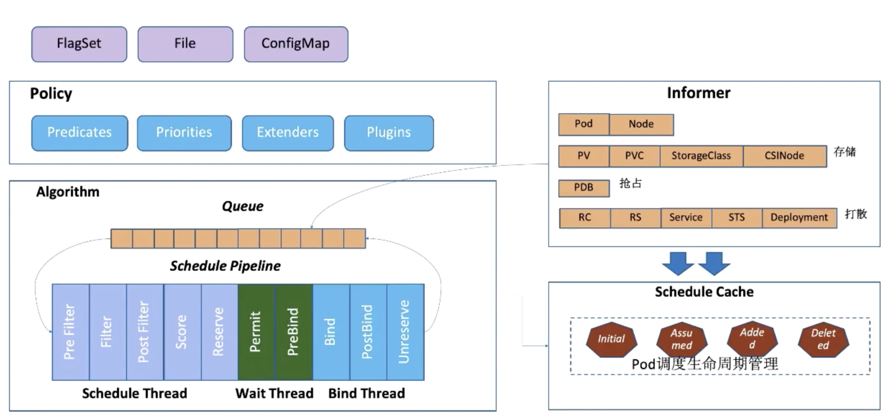
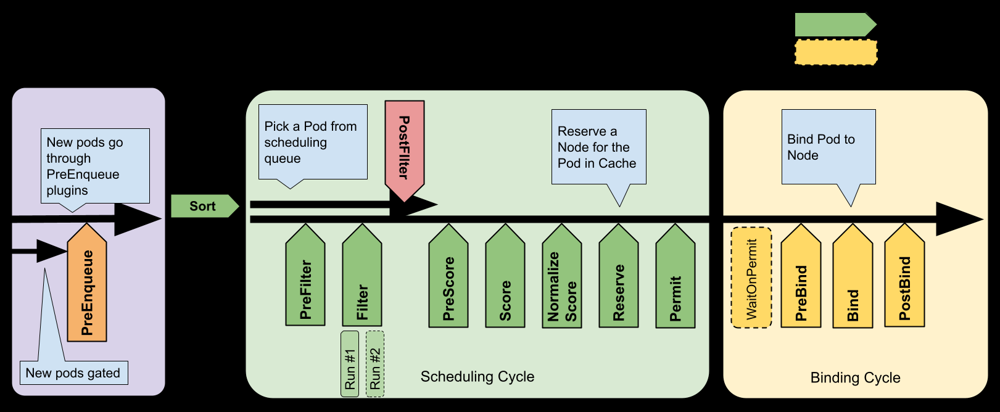
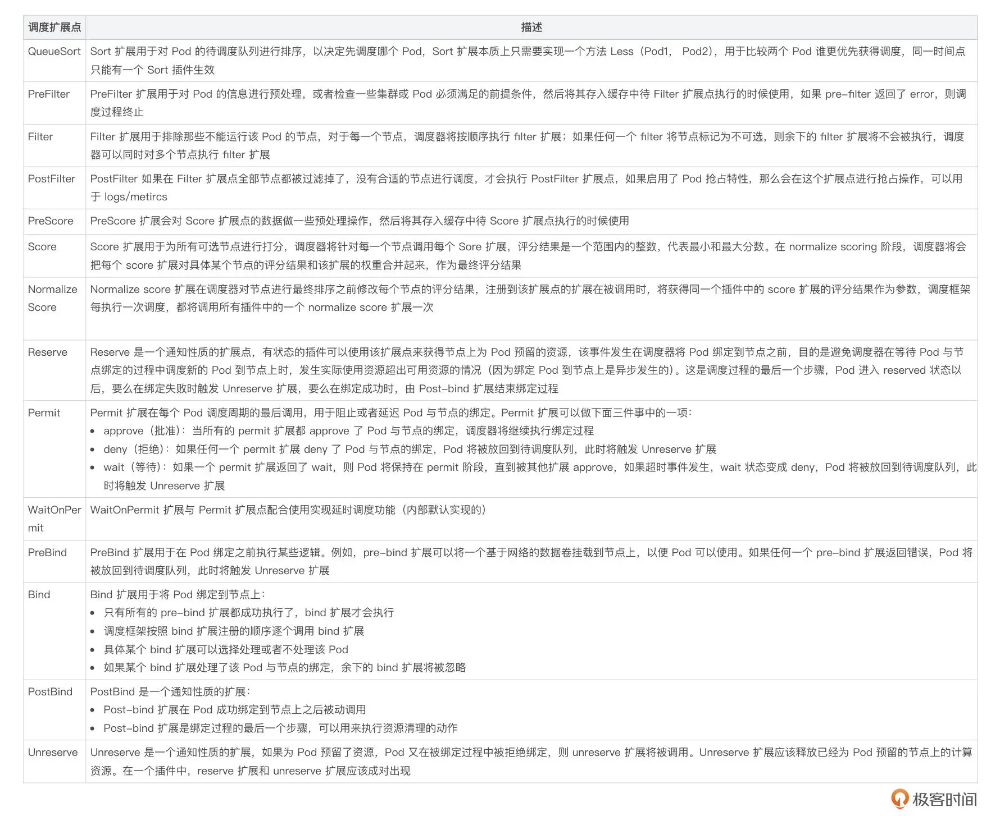

# 36 | kube-scheduler调度器源码剖析（上）

你好，我是孔令飞。

上一节课，我们学习了 kube-scheduler 应用具体是如何构建的。接下来，我们将深入探讨kube-scheduler 的调度原理。

kube-scheduler 源码很多，要把它讲通、讲透很有挑战性。为此，我将借助两节课的时间，通过自顶向下的讲解逻辑：先为你系统介绍整体调度原理，再根据调度的先后顺序，分析调度原理中每个关键点的代码实现。

通过这种将调度原理与关联代码实现相结合的讲解方式，既能帮助你掌握 kube-scheduler 的核心实现，又能避免单纯阅读代码后难以串联整个调度逻辑的问题。

## kube-scheduler 调度模型

我们跟着源码，先从最上层视角来看下 kube-scheduler 具体是如何启动调度流程的。整个kube-scheduler 核心调度逻辑通过 sched.Run(ctx) 来启动，sched.Run() 代码如下：

```go
// Run begins watching and scheduling. It starts scheduling and blocked until the
func (sched *Scheduler) Run(ctx context.Context) {
   logger := klog.FromContext(ctx)
   // 启动调度队列，调度队列会 Watch kube-apiserver，并存储待调度的 Pod
   sched.SchedulingQueue.Run(logger)
   // We need to start scheduleOne loop in a dedicated goroutine,
   // because scheduleOne function hangs on getting the next item
   // from the SchedulingQueue.
   // If there are no new pods to schedule, it will be hanging there
   // and if done in this goroutine it will be blocking closing
   // SchedulingQueue, in effect causing a deadlock on shutdown.
   // 不断轮询，执行 sched.scheduleOne 函数，sched.scheduleOne 函数会消费调度队列中待调度
   // 执行调度流程，完成 Pod 的调度。
   go wait.UntilWithContext(ctx, sched.scheduleOne, 0)
   <-ctx.Done()
   // 清理并释放资源
   sched.SchedulingQueue.Close()
}
```

接着我们再来看 kube-scheduler 的调度模型。调度模型图如下：



- 图片来源网络

kube-scheduler 的调度原理如上图所示，主要分为 3 大部分：

- Policy：Scheduler 的调度策略启动配置目前支持三种方式，配置文件 / 命令行参数 /ConfigMap。调度策略可以配置指定调度主流程中要用哪些过滤器（Predicates）、打分器（Priorities）、外部扩展的调度器（Extenders），以及最新支持的 SchedulerFramwork 的自定义扩展点（Plugins）。

- Informer：Scheduler 在启动的时候通过 K8s 的 informer 机制以 List+Watch 从 kube-apiserver 获取调度需要的数据例如：Pods、Nodes、Persistant Volume（PV），Persistant Volume Claim（PVC）等等，并将这些数据做一定的预处理，作为调度器的Cache。

- 调度流水线：通过 Informer 将需要调度的 Pod 插入 Queue 中，Pipeline 会循环从 QueuePop 等待调度的 Pod 放入 Pipeline 执行。调度流水线（Schedule Pipeline）主要有三个阶段：Scheduler Thread、Wait Thread 和 Bind Thread。

- Scheduler Thread 阶段：从如上的架构图可以看到 Schduler Thread 会经历 Pre Filter -> Filter -> Post Filter-> Score -> Reserve，简单记为 Filter -> Score -> Reserve。Filter阶段用于选择符合 Pod Spec 描述的 Nodes；Score 阶段用于从 Filter 过后的 Nodes 进行打分和排序；Reserve 阶段将 Pod 存入排序后的最优 Node 的 NodeCache 中，表示这个 Pod 已经分配到这个 Node 上， 让下一个等待调度的 Pod 对这个 Node 执行 Filter和 Score 时能看到刚才分配的 Pod。

- Wait Thread 阶段：这个阶段可以用来等待 Pod 关联资源就绪，例如等待 PVC 的 PV 创建成功，或者 Gang 调度中等待关联的 Pod 调度成功等。

- Bind Thread 阶段：用于将 Pod 和 Node 的关联持久化 Kube APIServer。

整个调度流水线只有在 Scheduler Thread 阶段以串行方式调度 Pod，即一个 Pod 一个 Pod地进行调度；在 Wait 和 Bind 阶段，Pod 都以异步并行方式执行。

## Scheduling Framework 调度框架

在真实的企业开发中，业务对 kube-scheduler 的调度需求各种各样。为了能够灵活支持业务多样性的调度需求，同时最小化对 kube-scheduler 的调度实现，kube-scheduler 从 v1.15 版本开始，引入了一种非常灵活的调度框架。

调度框架是面向 Kubernetes 调度器的一种插件架构， 它由一组直接编译到调度程序中的“插件” API 组成。这些 API 允许大多数调度功能以插件的形式实现，同时使调度“核心”保持简单且可维护（请参考调度框架的设计提案获取框架设计的更多技术信息）。

调度框架定义了一些扩展点。调度器插件注册后在一个或多个扩展点处被调用。这些插件中的一些可以改变调度决策，而另一些仅用于提供信息。每个插件支持不同的调度扩展点，一个插件可以在多个扩展点处注册，以执行更复杂或有状态的任务。

每次调度一个 Pod 的尝试都分为两个阶段，即调度周期和绑定周期。调度周期为 Pod 选择一个节点，绑定周期将该决策应用于集群。调度周期和绑定周期一起被称为“调度上下文”。调度周期是串行运行的，而绑定周期可能是同时运行的。如果确定 Pod 不可调度或者存在内部错误，则可以终止调度周期或绑定周期。Pod 将返回队列并重试。

下图显示了一个 Pod 的调度上下文以及调度框架公开的扩展点。在此图中，“过滤器”等同于“断言”，“评分”相当于“优先级函数”。



- 图片来源网络

调度扩展点功能描述如下：



## 调度器实例创建

kube-scheduler 调度逻辑的运行依托于 Scheduler 结构体类型的实例，Scheduler 结构体中包含了调度逻辑运行时需要的各类数据和方法。Scheduler 结构体类型的实例创建逻辑如下（代码释义见注释）：

```go
// 位于文件 cmd/kube-scheduler/app/server.go 中
func Setup(ctx context.Context, opts *options.Options, outOfTreeRegistryOptions .
   // 设置默认 KubeSchedulerConfiguration 配置。注意：这里只是设置一个默认值，后面 opts.
   if cfg, err := latest.Default(); err != nil {
       return nil, nil, err
   } else {
       opts.ComponentConfig = cfg
   }
   // 检查 *options.Options 各字段的值合法。提前校验，降低出错成本。
   if errs := opts.Validate(); len(errs) > 0 {
       return nil, nil, utilerrors.NewAggregate(errs)
   }
   // 将 *options.Options 中的值（其实就是命令行选项设置的值）转换为 *schedulerappconfi
   // 注意：opts.Config 中会根据是否设置 `--config` 参数来决定是否从 --config 指定的配置
   // SharedInformerFactory 和 DynamicSharedInformerFactory 也是在opts.Config 中被
   c, err := opts.Config(ctx)
   if err != nil {
       return nil, nil, err
   }
   // 补全需要的字段
   cc := c.Complete()
   // 初始化一个 runtime.Registry 类型的变量，用来保存所有的Out-Of-Tree 插件（其实就是自定
   outOfTreeRegistry := make(runtime.Registry)
   for _, option := range outOfTreeRegistryOptions {
       if err := option(outOfTreeRegistry); err != nil {
           return nil, nil, err
       }
   }
   recorderFactory := getRecorderFactory(&cc)
   completedProfiles := make([]kubeschedulerconfig.KubeSchedulerProfile, 0)
   // 创建调度器实例，该实例用来运行所有的 kube-scheduler 调度逻辑。
   sched, err := scheduler.New(ctx,
                               cc.Client,
                               cc.InformerFactory, // SharedInformerFactory类型的
                               cc.DynInformerFactory, // DynamicSharedInformerFa
                               recorderFactory,
                               // 使用选项模式，来对 Sheduler 对象进行配置
                               scheduler.WithComponentConfigVersion(cc.Component
                               scheduler.WithKubeConfig(cc.KubeConfig),
                               scheduler.WithProfiles(cc.ComponentConfig.Profile
                               scheduler.WithPercentageOfNodesToScore(cc.Compone
                               scheduler.WithFrameworkOutOfTreeRegistry(outOfTre
                               scheduler.WithPodMaxBackoffSeconds(cc.ComponentCo
                               scheduler.WithPodInitialBackoffSeconds(cc.Compone
                               scheduler.WithPodMaxInUnschedulablePodsDuration(c
                               scheduler.WithExtenders(cc.ComponentConfig.Extend
                               scheduler.WithParallelism(cc.ComponentConfig.Para
                               scheduler.WithBuildFrameworkCapturer(func(profile
                                   // Profiles are processed during Framework in
                                   completedProfiles = append(completedProfiles,
                               }),
                              )
   if err != nil {
       return nil, nil, err
   }
   if err := options.LogOrWriteConfig(klog.FromContext(ctx), opts.WriteConfigTo,
       return nil, nil, err
   }
   return &cc, sched, nil
}
上述代码使用了多个 scheduler.WithXXX 来对 Scheduler 进行设置，具体支持的设置如
```

下：

```
type schedulerOptions struct {
   // KubeSchedulerConfiguration 的 APIVersion，例如：kubescheduler.config.k8s.io/
   componentConfigVersion string
   // 访问 kube-apiserver 的 REST 客户端
   kubeConfig             *restclient.Config
   // Overridden by profile level percentageOfNodesToScore if set in v1.
   // 节点得分所使用的节点百分比，如果在 v1 中设置了 profile 级别的 percentageOfNodesToS
   percentageOfNodesToScore          int32
   // Pod 的初始退避时间
   podInitialBackoffSeconds          int64
   // Pod 的最大退避时间
   podMaxBackoffSeconds              int64
   // 最大不可调度 Pod 的持续时间
   podMaxInUnschedulablePodsDuration time.Duration
   // Contains out-of-tree plugins to be merged with the in-tree registry.
   // 包含了外部插件，用于与内部注册表进行合并
   frameworkOutOfTreeRegistry frameworkruntime.Registry
   // 调度器的配置文件
   profiles                   []schedulerapi.KubeSchedulerProfile
   // 调度器的扩展程序
   extenders                  []schedulerapi.Extender
   // 用于捕获构建调度框架的函数
   frameworkCapturer          FrameworkCapturer
   // 调度器的并行度
   parallelism                int32
   // 表示是否应用默认配置文件
   applyDefaultProfile        bool
}
```

另外，上述这些配置项，我们都可以通过 KubeSchedulerConfiguration 类型的配置文件进行配置。KubeSchedulerConfiguration 可配置的字段如下：

```
type KubeSchedulerConfiguration struct {
   // TypeMeta包含API版本和类型。在kube-scheduler中，从版本化的KubeSchedulerConfigura
   // 我们将APIVersion字段设置为我们转换的类型的scheme组/版本。这是在cmd/kube-scheduler中
   // (1) 从文件加载配置时，(2) 生成默认配置。根据此字段中设置的版本化类型，我们做出决策；例如
   // (1) 在验证期间检查已移除插件的使用情况，(2) 将配置写入文件，(3) 初始化调度器。
   metav1.TypeMeta
   // Parallelism定义了调度Pod的算法中的并行度。必须大于0。默认值为16。
   Parallelism int32
   // LeaderElection定义了领导者选举客户端的配置。
   LeaderElection componentbaseconfig.LeaderElectionConfiguration
   // ClientConnection指定了代理服务器在与apiserver通信时使用的kubeconfig文件和客户端连接
   ClientConnection componentbaseconfig.ClientConnectionConfiguration
   // HealthzBindAddress是健康检查服务器要提供服务的IP地址和端口。
   HealthzBindAddress string
   // MetricsBindAddress是度量服务器要提供服务的IP地址和端口。
   MetricsBindAddress string
   // DebuggingConfiguration包含了与调试相关功能的配置
   // TODO: 我们可能希望将其设置为子结构，如Debugging componentbaseconfig.DebuggingCo
   componentbaseconfig.DebuggingConfiguration
   // PercentageOfNodesToScore 允许调度器在找到一定数量的可调度节点之后就停止继续寻找可调度
   // 这有助于提高调度器的性能。调度器始终尝试找到至少"minFeasibleNodesToFind"个适合的节点
   // 例如：如果集群大小为500个节点，此标志的值为30，则一旦找到150个适合的节点，调度器就停止继
   // 当值为0时，将对节点的默认百分比（根据集群大小为5%--50%）进行评分。它会被profile级别的P
   PercentageOfNodesToScore *int32
   // PodInitialBackoffSeconds是不可调度Pod的初始退避时间。
   // 如果指定了，必须大于0。如果此值为null，则将使用默认值（1秒）。
   PodInitialBackoffSeconds int64
   // PodMaxBackoffSeconds是不可调度Pod的最大退避时间。
   // 如果指定了，必须大于或等于podInitialBackoffSeconds。如果此值为null，则将使用默认值
   PodMaxBackoffSeconds int64
   // Profiles是kube-scheduler支持的调度配置文件。Pod可以通过设置其关联的调度器名称来选择在
   // 如果Pod没有指定任何调度器名称，并且此处存在"default-scheduler"配置文件，则将使用"def
   Profiles []KubeSchedulerProfile
   // Extenders是调度器扩展程序的列表，每个扩展程序都包含了与扩展程序通信的值。这些扩展程序被
   Extenders []Extender
   // DelayCacheUntilActive指定何时开始缓存。
   // 当 DelayCacheUntilActive 为 true 时，调度器在启动时不会立即填充 informer 缓存，而
   // 当 DelayCacheUntilActive 为 false 时，调度器在启动时会立即开始填充 informer 缓存。
   DelayCacheUntilActive bools
}
```

Setup 函数中，最终通过 scheduler.New 函数来创建一个 *Sheduler 实例，其代码如下（代码解析见注释）：

```go
// New returns a Scheduler
func New(ctx context.Context,
        client clientset.Interface,
        informerFactory informers.SharedInformerFactory,
        dynInformerFactory dynamicinformer.DynamicSharedInformerFactory,
        recorderFactory profile.RecorderFactory,
        opts ...Option) (*Scheduler, error) {
   logger := klog.FromContext(ctx)
   stopEverything := ctx.Done()
   options := defaultSchedulerOptions
   for _, opt := range opts {
       opt(&options)
   }
   // 设置默认的调度策略
   if options.applyDefaultProfile {
       var versionedCfg configv1.KubeSchedulerConfiguration
       scheme.Scheme.Default(&versionedCfg)
       cfg := schedulerapi.KubeSchedulerConfiguration{}
       if err := scheme.Scheme.Convert(&versionedCfg, &cfg, nil); err != nil {
           return nil, err
       }
       options.profiles = cfg.Profiles
   }
   // 创建一个In-Tree Registry用来保存 kube-scheduer 自带的调度插件，后面会详细介绍
   registry := frameworkplugins.NewInTreeRegistry()
   // 将In-Tree调度插件和Out-Of-Tree调度插件进行合并，后面会详细介绍
   if err := registry.Merge(options.frameworkOutOfTreeRegistry); err != nil {
       return nil, err
   }
   metrics.Register()
   // 构建 Extender 调度器插件，后面会详细介绍
   extenders, err := buildExtenders(logger, options.extenders, options.profiles)
   if err != nil {
       return nil, fmt.Errorf("couldn't build extenders: %w", err)
   }
   // 创建  Pod、Node 的 lister，用来 List & Watch Pod 和 Node 资源
   podLister := informerFactory.Core().V1().Pods().Lister()
   nodeLister := informerFactory.Core().V1().Nodes().Lister()
   snapshot := internalcache.NewEmptySnapshot()
   metricsRecorder := metrics.NewMetricsAsyncRecorder(1000, time.Second, stopEve
   // 根据调度器策略和调度插件，创建调度框架集合。每一个调度策略，都有一个调度框架。该调度框架负
   profiles, err := profile.NewMap(ctx, options.profiles, registry, recorderFact
                                   frameworkruntime.WithComponentConfigVersion(o
                                   frameworkruntime.WithClientSet(client),
                                   frameworkruntime.WithKubeConfig(options.kubeC
                                   frameworkruntime.WithInformerFactory(informer
                                   frameworkruntime.WithSnapshotSharedLister(sna
                                   frameworkruntime.WithCaptureProfile(framework
                                   frameworkruntime.WithParallelism(int(options.
                                   frameworkruntime.WithExtenders(extenders),
                                   frameworkruntime.WithMetricsRecorder(metricsR
                                  )
   if err != nil {
       return nil, fmt.Errorf("initializing profiles: %v", err)
   }
   if len(profiles) == 0 {
       return nil, errors.New("at least one profile is required")
   }
   preEnqueuePluginMap := make(map[string][]framework.PreEnqueuePlugin)
   queueingHintsPerProfile := make(internalqueue.QueueingHintMapPerProfile)
   for profileName, profile := range profiles {
       preEnqueuePluginMap[profileName] = profile.PreEnqueuePlugins()
       queueingHintsPerProfile[profileName] = buildQueueingHintMap(profile.Enque
   }
   // 创建调度队列
   podQueue := internalqueue.NewSchedulingQueue(
       profiles[options.profiles[0].SchedulerName].QueueSortFunc(),
       informerFactory,
       internalqueue.WithPodInitialBackoffDuration(time.Duration(options.podInit
       internalqueue.WithPodMaxBackoffDuration(time.Duration(options.podMaxBacko
       internalqueue.WithPodLister(podLister),
       internalqueue.WithPodMaxInUnschedulablePodsDuration(options.podMaxInUnsch
       internalqueue.WithPreEnqueuePluginMap(preEnqueuePluginMap),
       internalqueue.WithQueueingHintMapPerProfile(queueingHintsPerProfile),
       internalqueue.WithPluginMetricsSamplePercent(pluginMetricsSamplePercent),
       internalqueue.WithMetricsRecorder(*metricsRecorder),
   )
   for _, fwk := range profiles {
       fwk.SetPodNominator(podQueue)
   }
   // 创建缓存，主要用来缓存 Node、Pod等信息，用来提高调度性能
   schedulerCache := internalcache.New(ctx, durationToExpireAssumedPod)
   // Setup cache debugger.
   debugger := cachedebugger.New(nodeLister, podLister, schedulerCache, podQueue
   debugger.ListenForSignal(ctx)
   sched := &Scheduler{
       Cache:                    schedulerCache,
       client:                   client,
       nodeInfoSnapshot:         snapshot,
       percentageOfNodesToScore: options.percentageOfNodesToScore,
       Extenders:                extenders,
       StopEverything:           stopEverything,
       SchedulingQueue:          podQueue,
       Profiles:                 profiles,
       logger:                   logger,
   }
   // 设置 NextPod 的具体实现
   sched.NextPod = podQueue.Pop
   // 设置 sched.SchedulePod 的实现为 sched.schedulePod
   // sched.schedulePod 具体用来调度一个Pod，后面会详细介绍
   sched.applyDefaultHandlers()
   // 添加 EventHandlers，根据 Pod、Node 资源的更新情况，将资源放入合适的Cache中。根据CSI
   if err = addAllEventHandlers(sched, informerFactory, dynInformerFactory, unio
       return nil, fmt.Errorf("adding event handlers: %w", err)
   }
   return sched, nil
}
```

## 调度插件设置

kube-scheduler 是通过一系列的调度插件最终完成 Pod 调度的。在启动 kube-scheduler 时，首先要加载调度插件。调度插件又分为 in-tree 和 out-of-tree 两种。

- In-tree 插件（内建插件）：这些插件是作为 Kubernetes 核心组件的一部分直接编译和交付的。它们与 Kubernetes 的源代码一起维护，并与 Kubernetes 版本保持同步。这些插件以静态库形式打包到 kube-scheduler 二进制文件中，因此在使用时不需要单独安装和配置。一些常见的 in-tree 插件包括默认的调度算法、Packed Scheduling 等。

- Out-of-tree 插件（外部插件）：这些插件是作为独立项目开发和维护的，它们与Kubernetes 核心代码分开，并且可以单独部署和更新。本质上，out-of-tree 插件是基于Kubernetes 的调度器扩展点进行开发的。这些插件以独立的二进制文件形式存在，并通过自定义的方式与 kube-scheduler 进行集成。为了使用 out-of-tree 插件，您需要单独安装和配置它们，并在 kube-scheduler 的配置中指定它们。

可以看到 in-tree 插件与 Kubernetes 的核心代码一起进行维护和发展，而 out-of-tree 插件可以单独开发并以独立的二进制文件部署。因此 out-of-tree 插件具有更大的灵活性，可以根据需求进行自定义和扩展，而 in-tree 插件受限于 Kubernetes 核心代码的功能和限制。对于版本升级 in-tree 插件与 Kubernetes 版本保持同步，而 out-of-tree 插件可以单独进行版本升级或兼容。一般开发都是采用 out-of-tree 这个机制。

## 调度策略初始化

上面，kube-scheduler 加载并初始化了 Out-Of-Tree 插件和 In-Tree 插件，但还不能够进行调度，因为还没有初始化调度策略，调度策略用来执行具体的调度逻辑。

kube-scheduler 在调度时，会选定并使用一个调度策略。同时，kube-scheduler 也支持自定义调度策略，有以下 3 种：

- Scheduler Extender：社区最初提供的方案是通过 Extender 的形式来扩展 scheduler。Extender 是外部服务，支持 Filter、Preempt、Prioritize 和 Bind 的扩展，scheduler 运行到相应阶段时，通过调用 Extender 注册的 webhook 来运行扩展的逻辑，影响调度流程中各阶段的决策结果。

- Multiple schedulers：Scheduler 在 Kubernetes 集群中其实类似于一个特殊的Controller，通过监听 Pod 和 Node 的信息，给 Pod 挑选最佳的节点，更新 Pod 的spec.NodeName 的信息来将调度结果同步到节点。所以对于部分有特殊调度需求的用户，可以通过自研 Custom Scheduler 来完成以上的流程，再通过和 default-scheduler 同时部

```
署的方式支持自己特殊的调度需求。在 Pod.Spec.SchedulerName 字段中，可以设置该
```

- Pod 的调度策略，默认为 default。

- Scheduling Framework：Scheduling Framework 在原有的调度流程中， 定义了丰富扩展点接口，开发者可以通过实现扩展点所定义的接口来实现插件，将插件注册到扩展点。Scheduling Framework 在执行调度流程时，运行到相应的扩展点时，会调用用户注册的插件，影响调度决策的结果。通过这种方式来将用户的调度逻辑集成到 SchedulingFramework 中。

kube-scheduler 源码分析中，只会涉及 Scheduler Extender 和 Scheduling Framework，因为Multiple schedulers 中的 Custom Scheduler 实现已经不属于 kube-scheduler 代码了。

这里，我们来看下 kube-scheduler 是如何设置调度策略的。kube-scheduler 调度策略的设置是在 scheduler.New 函数中，相关代码段如下：

```go
func New(ctx context.Context,
        client clientset.Interface,
        informerFactory informers.SharedInformerFactory,
        dynInformerFactory dynamicinformer.DynamicSharedInformerFactory,
        recorderFactory profile.RecorderFactory,
        opts ...Option) (*Scheduler, error) {
   ...
   // applyDefaultProfile 值恒为 false，该代码分支不会运行
   if options.applyDefaultProfile {
       var versionedCfg configv1.KubeSchedulerConfiguration
       scheme.Scheme.Default(&versionedCfg)
       cfg := schedulerapi.KubeSchedulerConfiguration{}
       if err := scheme.Scheme.Convert(&versionedCfg, &cfg, nil); err != nil {
           return nil, err
       }
       options.profiles = cfg.Profiles
   }
   registry := frameworkplugins.NewInTreeRegistry()
   if err := registry.Merge(options.frameworkOutOfTreeRegistry); err != nil {
       return nil, err
   }
   metrics.Register()
   extenders, err := buildExtenders(logger, options.extenders, options.profiles)
   if err != nil {
       return nil, fmt.Errorf("couldn't build extenders: %w", err)
   }
   ...
   profiles, err := profile.NewMap(ctx, options.profiles, registry, recorderFact
                                   frameworkruntime.WithComponentConfigVersion(o
                                   frameworkruntime.WithClientSet(client),
                                   frameworkruntime.WithKubeConfig(options.kubeC
                                   frameworkruntime.WithInformerFactory(informer
                                   frameworkruntime.WithSnapshotSharedLister(sna
                                   frameworkruntime.WithCaptureProfile(framework
                                   frameworkruntime.WithParallelism(int(options.
                                   frameworkruntime.WithExtenders(extenders),
                                   frameworkruntime.WithMetricsRecorder(metricsR
                                  )
   if err != nil {
       return nil, fmt.Errorf("initializing profiles: %v", err)
   }
   if len(profiles) == 0 {
       return nil, errors.New("at least one profile is required")
   }
   preEnqueuePluginMap := make(map[string][]framework.PreEnqueuePlugin)
   queueingHintsPerProfile := make(internalqueue.QueueingHintMapPerProfile)
   for profileName, profile := range profiles {
       preEnqueuePluginMap[profileName] = profile.PreEnqueuePlugins()
       queueingHintsPerProfile[profileName] = buildQueueingHintMap(profile.Enque
   }
   podQueue := internalqueue.NewSchedulingQueue(
       profiles[options.profiles[0].SchedulerName].QueueSortFunc(),
       informerFactory,
       internalqueue.WithPodInitialBackoffDuration(time.Duration(options.podInit
       internalqueue.WithPodMaxBackoffDuration(time.Duration(options.podMaxBacko
       internalqueue.WithPodLister(podLister),
       internalqueue.WithPodMaxInUnschedulablePodsDuration(options.podMaxInUnsch
       internalqueue.WithPreEnqueuePluginMap(preEnqueuePluginMap),
       internalqueue.WithQueueingHintMapPerProfile(queueingHintsPerProfile),
       internalqueue.WithPluginMetricsSamplePercent(pluginMetricsSamplePercent),
       internalqueue.WithMetricsRecorder(*metricsRecorder),
   )
   for _, fwk := range profiles {
       fwk.SetPodNominator(podQueue)
   }
   ...
   sched := &Scheduler{
       ...
       Profiles:                 profiles,
       ...
   }
   ...
}
```

为了能够让你直观清晰地看到 kube-scheduler 初始化调度策略的流程，我仅列出了相关的代码段。

首先，根据 options.applyDefaultProfile 是否为 true，来决定是否设置默认的调度策略。我们在 Setup 函数中调用 scheduler.New 函数时，传入了scheduler.WithProfiles(cc.ComponentConfig.Profiles…) 配置，结合 WithProfiles 的具体实现，可知 applyDefaultProfile 值为 false：

```go
func WithProfiles(p ...schedulerapi.KubeSchedulerProfile) Option {
   return func(o *schedulerOptions) {
       o.profiles = p
       o.applyDefaultProfile = false
   }
}
```

因为 applyDefaultProfile 值为 false，所以 options.profiles 的值，其实就是KubeSchedulerConfiguration 配置文件中 Profiles 部分所设置的调度策略。

```go
接着，调用 registry := frameworkplugins.NewInTreeRegistry() 创建了调度插
```

件注册表，注册表中，保存了所有的 in-tree 和 out-of-tree 调度插件。

然后，调用 buildExtenders 构建 Extender 调度策略。buildExtenders 调用方式如下：

```go
extenders, err := buildExtenders(logger, options.extenders, options.profiles)
if err != nil {
   return nil, fmt.Errorf("couldn't build extenders: %w", err)
}
```

options.extender 是通过 KubeSchedulerConfiguration 配置文件中的字段来设置的（字段释义见注释）：

```
type KubeSchedulerConfiguration struct {
   ...
   Extenders []Extender
   ...
}
type Extender struct {
   // URLPrefix是extender可用的URL前缀
   URLPrefix string
   // FilterVerb是过滤调用的动词，如果不支持则为空。当向extender发出过滤调用时，此动词将附加
   FilterVerb string
   // PreemptVerb是抢占调用的动词，如果不支持则为空。当向extender发出抢占调用时，此动词将附
   PreemptVerb string
   // PrioritizeVerb是优先调用的动词，如果不支持则为空。当向extender发出优先调用时，此动词将
   PrioritizeVerb string
   // Prioritize调用生成的节点分数的数值乘数。
   // 权重应为正整数
   Weight int64
   // BindVerb是绑定调用的动词，如果不支持则为空。当向extender发出绑定调用时，此动词将附加到
   // 如果此方法由extender实现，则由extender负责将Pod绑定到apiserver。只有一个extender可
   BindVerb string
   // EnableHTTPS指定是否应使用https与extender通信
   EnableHTTPS bool
   // TLSConfig指定传输层安全配置
   TLSConfig *ExtenderTLSConfig
   // HTTPTimeout指定与extender的调用的超时持续时间。过滤超时会导致Pod的调度失败。优先超时将
   HTTPTimeout metav1.Duration
   // NodeCacheCapable指定extender是否能够缓存节点信息，因此调度器应该只发送有关符合条件的
   NodeCacheCapable bool
   // ManagedResources是由此extender管理的扩展资源的列表。
   // - 如果Pod请求了此列表中至少一个扩展资源，则Pod将在过滤、优先和绑定（如果extender是绑定
   // - 如果资源的IgnoredByScheduler设置为true，kube-scheduler将跳过在谓词中检查该资源。
   // +optional
   ManagedResources []ExtenderManagedResource
   // Ignorable指定extender是否可忽略，即当extender返回错误或不可访问时，调度不应失败。
   Ignorable bool
}
```

可以看到 Extender 类型的调度器插件其实就是一个 HTTP 服务器，通过请求 HTTP 服务，来决定调度是否成功。kube-scheduler 支持设置多个 Extender 类型的调度插件。

buildExtenders 函数会返回 []framework.Extender 类型的变量，framework.Extender 接口定义如下：

```
type Extender interface {
   // Name returns a unique name that identifies the extender.
   Name() string
   // Filter based on extender-implemented predicate functions. The filtered lis
   // expected to be a subset of the supplied list.
   // The failedNodes and failedAndUnresolvableNodes optionally contains the lis
   // of failed nodes and failure reasons, except nodes in the latter are
   // unresolvable.
   Filter(pod *v1.Pod, nodes []*v1.Node) (filteredNodes []*v1.Node, failedNodesM
   // Prioritize based on extender-implemented priority functions. The returned
   // are used to compute the weighted score for an extender. The weighted score
   // the scores computed by Kubernetes scheduler. The total scores are used to
   Prioritize(pod *v1.Pod, nodes []*v1.Node) (hostPriorities *extenderv1.HostPri
   // Bind delegates the action of binding a pod to a node to the extender.
   Bind(binding *v1.Binding) error
   // IsBinder returns whether this extender is configured for the Bind method.
   IsBinder() bool
   // IsInterested returns true if at least one extended resource requested by
   // this pod is managed by this extender.
   IsInterested(pod *v1.Pod) bool
   // ProcessPreemption returns nodes with their victim pods processed by extend
   // given:
   //   1. Pod to schedule
   //   2. Candidate nodes and victim pods (nodeNameToVictims) generated by prev
   // The possible changes made by extender may include:
   //   1. Subset of given candidate nodes after preemption phase of extender.
   //   2. A different set of victim pod for every given candidate node after pr
   ProcessPreemption(
       pod *v1.Pod,
       nodeNameToVictims map[string]*extenderv1.Victims,
       nodeInfos NodeInfoLister,
   ) (map[string]*extenderv1.Victims, error)
   // SupportsPreemption returns if the scheduler extender support preemption or
   SupportsPreemption() bool
   // IsIgnorable returns true indicates scheduling should not fail when this ex
   // is unavailable. This gives scheduler ability to fail fast and tolerate non
   IsIgnorable() bool
}
```

通过 framework.Extender 接口定义，我们不难发现，Extender 类型的调度策略，只支持以下调度阶段的处理： Filter、Preempt、Prioritize 和 Bind。

接着，通过 profile.NewMap 创建了调度策略，并将调度策略保存在 Map 类型的变量中。Map类型定义如下：

```
type Map map[string]framework.Framework
```

可以看到，profiles 中保存了所有的调度策略，map 的 key 是调度策略的名称，value 是调度策略框架。通过 key 查找到需要用到的调度策略，通过 value 来执行具体的 Pod 调度。framework.Framework 定义如下：

```javascript
type Framework interface {
   Handle
   // PreEnqueuePlugins returns the registered preEnqueue plugins.
   PreEnqueuePlugins() []PreEnqueuePlugin
   // EnqueueExtensions returns the registered Enqueue extensions.
   EnqueueExtensions() []EnqueueExtensions
   // QueueSortFunc returns the function to sort pods in scheduling queue
   QueueSortFunc() LessFunc
   // RunPreFilterPlugins runs the set of configured PreFilter plugins. It retur
   // *Status and its code is set to non-success if any of the plugins returns
   // anything but Success. If a non-success status is returned, then the schedu
   // cycle is aborted.
   // It also returns a PreFilterResult, which may influence what or how many no
   // evaluate downstream.
   RunPreFilterPlugins(ctx context.Context, state *CycleState, pod *v1.Pod) (*Pr
   // RunPostFilterPlugins runs the set of configured PostFilter plugins.
   // PostFilter plugins can either be informational, in which case should be co
   // to execute first and return Unschedulable status, or ones that try to chan
   // cluster state to make the pod potentially schedulable in a future scheduli
   RunPostFilterPlugins(ctx context.Context, state *CycleState, pod *v1.Pod, fil
   // RunPreBindPlugins runs the set of configured PreBind plugins. It returns
   // *Status and its code is set to non-success if any of the plugins returns
   // anything but Success. If the Status code is "Unschedulable", it is
   // considered as a scheduling check failure, otherwise, it is considered as a
   // internal error. In either case the pod is not going to be bound.
   RunPreBindPlugins(ctx context.Context, state *CycleState, pod *v1.Pod, nodeNa
   // RunPostBindPlugins runs the set of configured PostBind plugins.
   RunPostBindPlugins(ctx context.Context, state *CycleState, pod *v1.Pod, nodeN
   // RunReservePluginsReserve runs the Reserve method of the set of
   // configured Reserve plugins. If any of these calls returns an error, it
   // does not continue running the remaining ones and returns the error. In
   // such case, pod will not be scheduled.
   RunReservePluginsReserve(ctx context.Context, state *CycleState, pod *v1.Pod,
   // RunReservePluginsUnreserve runs the Unreserve method of the set of
   // configured Reserve plugins.
   RunReservePluginsUnreserve(ctx context.Context, state *CycleState, pod *v1.Po
   // RunPermitPlugins runs the set of configured Permit plugins. If any of thes
   // plugins returns a status other than "Success" or "Wait", it does not conti
   // running the remaining plugins and returns an error. Otherwise, if any of t
   // plugins returns "Wait", then this function will create and add waiting pod
   // to a map of currently waiting pods and return status with "Wait" code.
   // Pod will remain waiting pod for the minimum duration returned by the Permi
   RunPermitPlugins(ctx context.Context, state *CycleState, pod *v1.Pod, nodeNam
   // WaitOnPermit will block, if the pod is a waiting pod, until the waiting po
   WaitOnPermit(ctx context.Context, pod *v1.Pod) *Status
   // RunBindPlugins runs the set of configured Bind plugins. A Bind plugin may
   // whether or not to handle the given Pod. If a Bind plugin chooses to skip t
   // binding, it should return code=5("skip") status. Otherwise, it should retu
   // or "Success". If none of the plugins handled binding, RunBindPlugins retur
   // code=5("skip") status.
   RunBindPlugins(ctx context.Context, state *CycleState, pod *v1.Pod, nodeName
   // HasFilterPlugins returns true if at least one Filter plugin is defined.
   HasFilterPlugins() bool
   // HasPostFilterPlugins returns true if at least one PostFilter plugin is def
   HasPostFilterPlugins() bool
   // HasScorePlugins returns true if at least one Score plugin is defined.
   HasScorePlugins() bool
   // ListPlugins returns a map of extension point name to list of configured Pl
   ListPlugins() *config.Plugins
   // ProfileName returns the profile name associated to a profile.
   ProfileName() string
   // PercentageOfNodesToScore returns percentageOfNodesToScore associated to a
   PercentageOfNodesToScore() *int32
   // SetPodNominator sets the PodNominator
   SetPodNominator(nominator PodNominator)
}
```

framework.Framework 中包含了各个调度扩展点的调用方法，每个扩展点又可能包含多个调度插件。后面会详细介绍具体是如何调度 Pod 的。

这里，我们再来看下 profile.NewMap 如何创建调度策略的 map 结构体。NewMap 定义如下：

```go
func NewMap(ctx context.Context, cfgs []config.KubeSchedulerProfile, r frameworkr
           opts ...frameworkruntime.Option) (Map, error) {
   m := make(Map)
   v := cfgValidator{m: m}
   for _, cfg := range cfgs {
       p, err := newProfile(ctx, cfg, r, recorderFact, opts...)
       if err != nil {
           return nil, fmt.Errorf("creating profile for scheduler name %s: %v",
       }
       if err := v.validate(cfg, p); err != nil {
           return nil, err
       }
       m[cfg.SchedulerName] = p
   }
   return m, nil
}
```

不难发现，NewMap 遍历 KubeSchedulerConfiguration 配置文件中的 Profiles 字段，针对每一个调度策略配置，调用 newProfile 创建 framework.Framework，并以 map 的形式保存在Map 类型的变量中。framework.Framework 是一个接口类型，具体实现为frameworkImpl。frameworkImpl 是一个非常重要的结构体，可以理解为是一个具体的调度引擎。frameworkImpl 包含了很多方法，这些方法用来完成一次完整的 Pod 调度。

再然后，调用 internalqueue.NewSchedulingQueue 创建了一个优先级调度队列，并使用调度策略对调度队列进行了设置。

调度器在对 Pod 进行调度时，需要首先初始化并加载 kube-scheduler 调度插件，并根据配置初始化调度策略。这里，我们来看下 kube-scheduler 如何实现这些功能。

上述代码设置了默认的调度策略，调度策略的配置 KubeSchedulerProfile（配置文档见KubeSchedulerProfile 配置说明）定义如下：

```
// KubeSchedulerProfile is a scheduling profile.
type KubeSchedulerProfile struct {
   // SchedulerName是与此配置文件关联的调度器的名称。
   // 如果SchedulerName与Pod的"spec.schedulerName"匹配，那么Pod将使用此配置文件进行调度
   SchedulerName string
   // PercentageOfNodesToScore 允许调度器在找到一定数量的可调度节点之后就停止继续寻找可调度
   // 这有助于提高调度器的性能。调度器始终尝试找到至少"minFeasibleNodesToFind"个适合的节点
   // 例如：如果集群大小为500个节点，此标志的值为30，则一旦找到150个适合的节点，调度器就停止继
   // 当值为0时，将对节点的默认百分比（根据集群大小为5%--50%）进行评分。
   PercentageOfNodesToScore *int32
   // Plugins指定应启用或禁用的一组插件。
   // 已启用的插件是除默认插件外应启用的插件。已禁用的插件是应禁用的任何默认插件。
   // 如果未为扩展点指定已启用或已禁用的插件，则将使用该扩展点的默认插件（如果有）。
   // 如果指定了QueueSort插件，则必须为所有配置文件指定相同的QueueSort插件和PluginConfig。
   Plugins *Plugins
   // PluginConfig是每个插件的自定义插件参数的可选集合。
   // 对于插件省略配置参数等同于使用该插件的默认配置。
   PluginConfig []PluginConfig
}
```

我们在创建 Scheduler 时，可以指定调度器配置，也可不指定。如果不指定调度器配置，则会使用默认的调度器配置，默认的调度器的各项配置是在SetDefaults_KubeSchedulerConfiguration 设置的。默认调度器的设置代码如下：

```go
// SetDefaults_KubeSchedulerConfiguration sets additional defaults
func SetDefaults_KubeSchedulerConfiguration(obj *configv1.KubeSchedulerConfigurat
   ...
   if len(obj.Profiles) == 0 {
       obj.Profiles = append(obj.Profiles, configv1.KubeSchedulerProfile{})
   }
   // Only apply a default scheduler name when there is a single profile.
   // Validation will ensure that every profile has a non-empty unique name.
   if len(obj.Profiles) == 1 && obj.Profiles[0].SchedulerName == nil {
       // 设置默认调度器的名称为 default-scheduler
       obj.Profiles[0].SchedulerName = pointer.String(v1.DefaultSchedulerName)
   }
   // Add the default set of plugins and apply the configuration.
   for i := range obj.Profiles {
       prof := &obj.Profiles[i]
       setDefaults_KubeSchedulerProfile(logger, prof)
   }
   ...
}
func setDefaults_KubeSchedulerProfile(logger klog.Logger, prof *configv1.KubeSche
   // Set default plugins.
   prof.Plugins = mergePlugins(logger, getDefaultPlugins(), prof.Plugins)
   // 设置默认插件的配置
   scheme := GetPluginArgConversionScheme()
   existingConfigs := sets.New[string]()
   for j := range prof.PluginConfig {
       existingConfigs.Insert(prof.PluginConfig[j].Name)
       args := prof.PluginConfig[j].Args.Object
       if _, isUnknown := args.(*runtime.Unknown); isUnknown {
           continue
       }
       scheme.Default(args)
   }
   // Append default configs for plugins that didn't have one explicitly set.
   for _, name := range pluginsNames(prof.Plugins) {
       if existingConfigs.Has(name) {
           continue
       }
       gvk := configv1.SchemeGroupVersion.WithKind(name + "Args")
       args, err := scheme.New(gvk)
       if err != nil {
           // This plugin is out-of-tree or doesn't require configuration.
           continue
       }
       scheme.Default(args)
       args.GetObjectKind().SetGroupVersionKind(gvk)
       prof.PluginConfig = append(prof.PluginConfig, configv1.PluginConfig{
           Name: name,
           Args: runtime.RawExtension{Object: args},
       })
   }
}
```

我们可以看到，针对每一个自定义调度策略，都会通过 mergePlugin 将策略中的调度插件和kube-scheduler 中默认的调度插件进行合并。通过 getDefaultPlugins 可以获取默认的调度插件（默认的调度插件后面会详细介绍）：

```go
func getDefaultPlugins() *v1.Plugins {
   plugins := &v1.Plugins{
       MultiPoint: v1.PluginSet{
           Enabled: []v1.Plugin{
               {Name: names.PrioritySort},
               {Name: names.NodeUnschedulable},
               {Name: names.NodeName},
               {Name: names.TaintToleration, Weight: pointer.Int32(3)},
               {Name: names.NodeAffinity, Weight: pointer.Int32(2)},
               {Name: names.NodePorts},
               {Name: names.NodeResourcesFit, Weight: pointer.Int32(1)},
               {Name: names.VolumeRestrictions},
               {Name: names.EBSLimits},
               {Name: names.GCEPDLimits},
               {Name: names.NodeVolumeLimits},
               {Name: names.AzureDiskLimits},
               {Name: names.VolumeBinding},
               {Name: names.VolumeZone},
               {Name: names.PodTopologySpread, Weight: pointer.Int32(2)},
               {Name: names.InterPodAffinity, Weight: pointer.Int32(2)},
               {Name: names.DefaultPreemption},
               {Name: names.NodeResourcesBalancedAllocation, Weight: pointer.Int
               {Name: names.ImageLocality, Weight: pointer.Int32(1)},
               {Name: names.DefaultBinder},
           },
       },
   }
   // 根据 FeatureGate 开启更多的调度插件，例如：SchedulingGates、DynamicResources。
   applyFeatureGates(plugins)
   return plugins
}
```

## 课程总结

这节课，我们解析了 Kubernetes kube-scheduler 的调度模型、Scheduling Framework 调度框架、调度器实例创建、调度插件设置和调度策略初始化。

其中，调度流程分为 3 部分：

1. Policy 配置：支持配置文件、命令行或 ConfigMap 定义调度策略（如过滤器、打分器、扩展器及插件）。

2. Informer 机制：通过 List+Watch 从 API Server 获取 Pods/Nodes/PVC 等数据，预处理后缓存。

3. 调度流水线：

- Scheduler Thread：串行执行 PreFilter → Filter → PostFilter → Score → Reserve，完1.成节点筛选、打分与资源预留。

- Wait Thread：异步等待关联资源就绪（如 PV 创建）。2.

- Bind Thread：异步持久化 Pod 与 Node 绑定关系至 API Server。3.

调度框架通过插件化架构扩展功能，支持调度周期（串行）与绑定周期（并行）的多阶段扩展点（如 PreFilter、Score、Bind）。调度器启动时加载 in-tree/out-of-tree 插件，依据配置初始化策略框架，最终通过调度队列与缓存协同完成调度。

下节课，我们将讲解调度队列管理和调度 Pod 流程。欢迎你在留言区与我交流讨论，如果今天的内容让你有所收获，也欢迎转发给有需要的朋友，我们下节课再见！
