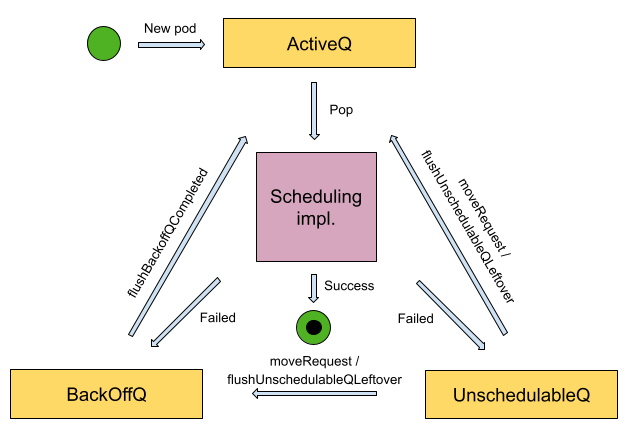
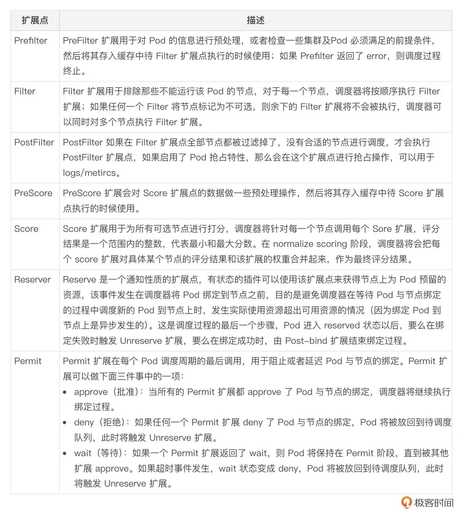

# 37 | kube-scheduler调度器源码剖析（下）

你好，我是孔令飞。

上节课，我介绍了 kube-scheduler 在启动时，需要加载的调度插件和调度策略，可以理解为kube-scheduler 的静态部分。接下来要介绍的调度队列管理、调度 Pod 流程是 kube-scheduler 的动态部分，是调度器的最核心逻辑。

## 调度队列管理

kube-scheduler 会从调度队列中获取需要调度的 Pod 和目标 Node 列表，通过调度流程，最终将 Pod 调度到合适的 Node 节点上。

### 创建调度队列

我们先来看下调度队列是如何创建的。

在 scheduler.New 中，通过以下代码创建了优先级调度队列 podQueue：

```go
func New(ctx context.Context,
        client clientset.Interface,
        informerFactory informers.SharedInformerFactory,
        dynInformerFactory dynamicinformer.DynamicSharedInformerFactory,
        recorderFactory profile.RecorderFactory,
        opts ...Option) (*Scheduler, error) {
   ...
   // 首先遍历 profiles 获取其对应的已注册好的 PreEnqueuePlugins 插件，这些插件会在 Pods
   preEnqueuePluginMap := make(map[string][]framework.PreEnqueuePlugin)
   queueingHintsPerProfile := make(internalqueue.QueueingHintMapPerProfile)
   for profileName, profile := range profiles {
       preEnqueuePluginMap[profileName] = profile.PreEnqueuePlugins()
       queueingHintsPerProfile[profileName] = buildQueueingHintMap(profile.Enque
   }
   // 初始化一个优先队列作为调度队列
   podQueue := internalqueue.NewSchedulingQueue(
       profiles[options.profiles[0].SchedulerName].QueueSortFunc(),
       informerFactory,
       // 设置 pod 的 Initial阶段的 Backoff 的持续时间
       internalqueue.WithPodInitialBackoffDuration(time.Duration(options.podInit
       // 最大backoff持续时间
       internalqueue.WithPodMaxBackoffDuration(time.Duration(options.podMaxBacko
       internalqueue.WithPodLister(podLister),
       // 设置一个pod在 unschedulablePods 队列停留的最长时间
       internalqueue.WithPodMaxInUnschedulablePodsDuration(options.podMaxInUnsch
       internalqueue.WithPreEnqueuePluginMap(preEnqueuePluginMap),
       internalqueue.WithQueueingHintMapPerProfile(queueingHintsPerProfile),
       // 指标相关
       internalqueue.WithPluginMetricsSamplePercent(pluginMetricsSamplePercent),
       internalqueue.WithMetricsRecorder(*metricsRecorder),
   )
   ...
   sched := &Scheduler{
       Cache:                    schedulerCache,
       client:                   client,
       nodeInfoSnapshot:         snapshot,
       percentageOfNodesToScore: options.percentageOfNodesToScore,
       Extenders:                extenders,
       StopEverything:           stopEverything,
       SchedulingQueue:          podQueue,
       Profiles:                 profiles,
       logger:                   logger,
   }
   sched.NextPod = podQueue.Pop
   sched.applyDefaultHandlers()
   if err = addAllEventHandlers(sched, informerFactory, dynInformerFactory, unio
       return nil, fmt.Errorf("adding event handlers: %w", err)
   }
   return sched, nil
}
```

podQueue 数据结构如下：

```javascript
type PriorityQueue struct {
   *nominator
   stop  chan struct{}
   clock clock.Clock
   // pod initial backoff duration.
   podInitialBackoffDuration time.Duration
   // pod maximum backoff duration.
   podMaxBackoffDuration time.Duration
   // the maximum time a pod can stay in the unschedulablePods.
   podMaxInUnschedulablePodsDuration time.Duration
   cond sync.Cond
   // inFlightPods holds the UID of all pods which have been popped out for whic
   // hasn't been called yet - in other words, all pods that are currently being
   // processed (being scheduled, in permit, or in the binding cycle).
   //
   // The values in the map are the entry of each pod in the inFlightEvents list
   // The value of that entry is the *v1.Pod at the time that scheduling of that
   // pod started, which can be useful for logging or debugging.
   inFlightPods map[types.UID]*list.Element
   // inFlightEvents holds the events received by the scheduling queue
   // (entry value is clusterEvent) together with in-flight pods (entry
   // value is *v1.Pod). Entries get added at the end while the mutex is
   // locked, so they get serialized.
   //
   // The pod entries are added in Pop and used to track which events
   // occurred after the pod scheduling attempt for that pod started.
   // They get removed when the scheduling attempt is done, at which
   // point all events that occurred in the meantime are processed.
   //
   // After removal of a pod, events at the start of the list are no
   // longer needed because all of the other in-flight pods started
   // later. Those events can be removed.
   inFlightEvents *list.List
   // activeQ is heap structure that scheduler actively looks at to find pods to
   // schedule. Head of heap is the highest priority pod.
   activeQ *heap.Heap
   // podBackoffQ is a heap ordered by backoff expiry. Pods which have completed
   // are popped from this heap before the scheduler looks at activeQ
   podBackoffQ *heap.Heap
   // unschedulablePods holds pods that have been tried and determined unschedul
   unschedulablePods *UnschedulablePods
   // schedulingCycle represents sequence number of scheduling cycle and is incr
   // when a pod is popped.
   schedulingCycle int64
   // moveRequestCycle caches the sequence number of scheduling cycle when we
   // received a move request. Unschedulable pods in and before this scheduling
   // cycle will be put back to activeQueue if we were trying to schedule them
   // when we received move request.
   // TODO: this will be removed after SchedulingQueueHint goes to stable and th
   moveRequestCycle int64
   // preEnqueuePluginMap is keyed with profile name, valued with registered pre
   preEnqueuePluginMap map[string][]framework.PreEnqueuePlugin
   // queueingHintMap is keyed with profile name, valued with registered queuein
   queueingHintMap QueueingHintMapPerProfile
   // closed indicates that the queue is closed.
   // It is mainly used to let Pop() exit its control loop while waiting for an
   closed bool
   nsLister listersv1.NamespaceLister
   metricsRecorder metrics.MetricAsyncRecorder
   // pluginMetricsSamplePercent is the percentage of plugin metrics to be sampl
   pluginMetricsSamplePercent int
   // isSchedulingQueueHintEnabled indicates whether the feature gate for the sc
   isSchedulingQueueHintEnabled bool
}
```

PriorityQueue 优先级队列中，包含了 activeQ、backoffQ、unschedulableQ 3 个重要的子队列：

- activeQ：Scheduler 启动的时候所有等待被调度的 Pod 都会进入 activeQ，activeQ 会按照Pod 的 priority 进行排序，Scheduler Pipeline 会从 activeQ 获取一个 Pod 并执行调度流程（Pipeline），当调度失败之后会直接根据情况选择进入 unschedulableQ 或者 backoffQ，如果在当前 Pod 调度期间 Node Cache、Pod Cache 等 Scheduler Cache 有变化就进入backoffQ，否则进入 unschedulableQ。

- podBackoffQ（backoffQ）称为 退避队列，持有从 unschedulablePods 中移走的 Pod，并将在其 backoff periods 退避期结束时移动到 activeQ 队列。Pod 在退避队列中等待并定期尝试进行重新调度。重新调度的频率会按照一个指数级的算法定时增加，从而充分探索可用的资源，直到找到可以分配给该 Pod 的节点。

- unschedulablePods（unschedulableQ）：不可调度 Pod 的列表，也可以将其理解为不可调度队列 unschedulable queue，持有已尝试进行调度且当前确定为不可调度的 Pod。

unschedulableQ 会定期较长时间（例如 60 秒）刷入 activeQ 或者 backoffQ，或者在Scheduler Cache 发生变化的时候触发关联的 Pod 刷入 activeQ 或者 backoffQ。

backoffQ 采用 backoff 机制，会让待调度的 Pod 比 unschedulableQ 更快地进入 activeQ 进行重新调度。

提示：Node Cache、Pod Cache 有变化，就意味着调度失败的 Pod 可能会在新的调度上下文中被调度成功，所以需要放在 activeQ 中。

Pod 在 3 个队列的移动过程如下图所示：



- 图片来源网络

这 3 个队列都是 Kubernetes 调度器的基本导向队列，调度器将使用其内置策略和其他算法来对它们进行维护和管理。

在创建调度队列时，对队列进行了以下设置：

- 指定了队列中 Pod 排序方法，默认为调度策略列表中第一个调度策略的 QueueSortFunc 函数。

- PodInitialBackoffDuration 定义了在尝试调度失败后的初始回退时间间隔。当调度器无法成功调度 Pod 时，会等待一段时间后再尝试重新调度。这个参数指定了初始的等待时间间隔。

- PodMaxBackoffDuration 定义了在尝试调度失败后的最大回退时间间隔。如果调度器多次尝试调度失败，会逐渐增加等待时间间隔，但不会超过此参数定义的最大值。

- PodMaxInUnschedulablePodsDuration 定义了 Pod 在无法调度的情况下最大的等待时间。如果 Pod 一直无法被调度成功，会在达到此参数定义的最大等待时间后被放弃。

- PreEnqueuePluginMap 是一个映射，将调度器的预调度插件与其配置进行关联。预调度插件在调度器尝试将 Pod 放入调度队列之前运行，用于对 Pod 进行预处理或过滤。

- QueueingHintMapPerProfile 是一个映射，将调度器的队列提示（queueing hint）与调度器配置文件中的配置文件进行关联。队列提示是指在调度器中为 Pod 提供的提示，以影响其在调度队列中的位置和优先级。

- PluginMetricsSamplePercent 定义了插件度量指标采样的百分比。在 Kubernetes 调度器中，插件可以生成度量指标来监控其性能和效果。此参数定义了对多少调度周期进行度量指标采样。

上面，我们创建了优先级调度队列，那么 Pod 具体如何入队和出队呢？入队和出队，是 Pod调度中非常关键的流程。

- 入队：新增一个待调度的 Pod。

- 出队：去除一个待调度的 Pod 进行调度。

接下来，我们就来看下 kube-scheduler 中 Pod 具体是如何入队和出队的。

### Pod 入队列

kube-scheduler 中通过 Kubernetes EventHandler 的方式，在 Pod、Node 有变更时将 Pod添加到指定的调度队列和缓冲中。如果 len(pod.Spec.NodeName) == 0，说明 Pod 还没有被调度过，则会将 Pod 添加到 activeQ 或 podBackoffQ。

### Pod 出队列（准备调度）

在 cmd/kube-scheduler/app/server.go 文件中，通过 sched.Run 启动了调度器。sched.Run函数实现如下：

```go
func (sched *Scheduler) Run(ctx context.Context) {
   logger := klog.FromContext(ctx)
   sched.SchedulingQueue.Run(logger)
   // We need to start scheduleOne loop in a dedicated goroutine,
   // because scheduleOne function hangs on getting the next item
   // from the SchedulingQueue.
   // If there are no new pods to schedule, it will be hanging there
   // and if done in this goroutine it will be blocking closing
   // SchedulingQueue, in effect causing a deadlock on shutdown.
   go wait.UntilWithContext(ctx, sched.scheduleOne, 0)
   <-ctx.Done()
   sched.SchedulingQueue.Close()
}
```

首先，通过调用 sched.SchedulingQueue.Run() 启用优先队列服务。

```
// Run starts the goroutine to pump from podBackoffQ to activeQ
func (p *PriorityQueue) Run(logger klog.Logger) {
   go wait.Until(func() {
       p.flushBackoffQCompleted(logger)
   }, 1.0*time.Second, p.stop)
   go wait.Until(func() {
       p.flushUnschedulablePodsLeftover(logger)
   }, 30*time.Second, p.stop)
}
```

这里就干两件事：

- 每 1 秒执行一个 p.flushBackoffQCompleted() 函数，将所有已完成的 Pod 从 backoffQ 队列移动到 activeQ 队列。

- 每 30 秒执行一次 flushUnschedulablePodsLeftover() 函数，将所有停留在unschedulablePods 中时间超出 podMaxInUnschedulablePodsDuration 的 Pod 移动到backoffQ 或 activeQ 队列。

接着，go wait.UntilWithContext(ctx, sched.scheduleOne, 0) 会新建一个 goroutine，在goroutine 中，会不断地循环执行 sched.scheduleOne。sched.scheduleOne 用来从 Pod 调度队列中取出一个待调度的 Pod，根据调度策略和插件进行 Pod 调度。

## 调度 Pod 流程（调度始点：scheduleOne 函数）

调度流程是 kube-scheduler 最核心的流程。为了能够让你充分理解其调度逻辑，解析每个核心调度方法具体实现时，我可能会讲得稍微细一点。

scheduleOne 函数实现了对一个 Pod 的完整调度逻辑，实现代码如下：

```go
// scheduleOne does the entire scheduling workflow for a single pod. It is serial
func (sched *Scheduler) scheduleOne(ctx context.Context) {
   logger := klog.FromContext(ctx)
   // 从 scheduler 的待调度 pod 队列中取出一个 pod 进行调度
   podInfo, err := sched.NextPod(logger)
   if err != nil {
       logger.Error(err, "Error while retrieving next pod from scheduling queue"
       return
   }
   // 如果获取的 podInfo 或p odInfo.Pod 为 nil，说明队列中暂无需要调度的 Pod，直接退出当前
   if podInfo == nil || podInfo.Pod == nil {
       return
   }
   pod := podInfo.Pod
   // TODO(knelasevero): Remove duplicated keys from log entry calls
   // When contextualized logging hits GA
   // https://github.com/kubernetes/kubernetes/issues/111672
   logger = klog.LoggerWithValues(logger, "pod", klog.KObj(pod))
   ctx = klog.NewContext(ctx, logger)
   logger.V(4).Info("About to try and schedule pod", "pod", klog.KObj(pod))
   // sched.frameworkForPod(pod) 函数调用，会根据 pod.Spec.SchedulerName 获取 pod 指
   // 之后，从调度策略注册表中，获取个该调度策略的 framework.Framework，framework.Framew
   fwk, err := sched.frameworkForPod(pod)
   if err != nil {
       // This shouldn't happen, because we only accept for scheduling the pods
       // which specify a scheduler name that matches one of the profiles.
       logger.Error(err, "Error occurred")
       return
   }
   // 检查是否需要调度，以下 Pod 不会被调度：
   // 1. 如果 Pod 正在被删除中，则不会调度该 Pod；
   // 2. 如果该 Pod 已经被 Assumed 过，则不会调度该 Pod。被 Assumed 过的 Pod 会被存放到一
   if sched.skipPodSchedule(ctx, fwk, pod) {
       return
   }
   logger.V(3).Info("Attempting to schedule pod", "pod", klog.KObj(pod))
   // Synchronously attempt to find a fit for the pod.
   start := time.Now()
   // 如果 Pod 能够被调度，会使用 framework.NewCycleState() 函数，创建一个新的调度周期状态
   // 用来保存调度过程中的状态信息，比如已经被调度的 Pod、还未被调度的 Pod 等。
   // 这个调度周期状态对象在 kube-scheduler 的调度过程中会被使用，来记录和管理调度的状态，具
   // 1. 已经被调度的 Pod 列表：记录已经被成功调度到节点上的 Pod。
   // 2. 待调度的 Pod 列表：记录还未被调度的 Pod。
   // 3. 节点状态信息：记录集群中各个节点的状态，比如资源利用情况、标签信息等。
   // 4. 调度器的配置信息：记录调度器的配置参数，比如调度策略、优先级规则等。
   // 这些信息会在 kube-scheduler 的调度循环中被不断更新和引用，以保证调度器能够根据最新的状
   state := framework.NewCycleState()
   state.SetRecordPluginMetrics(rand.Intn(100) < pluginMetricsSamplePercent)
   // Initialize an empty podsToActivate struct, which will be filled up by plug
   podsToActivate := framework.NewPodsToActivate()
   state.Write(framework.PodsToActivateKey, podsToActivate)
   schedulingCycleCtx, cancel := context.WithCancel(ctx)
   defer cancel()
   // 调用 sched.schedulingCycle 函数，进入到调度循环中，调度循环的输出是调度结果。
   scheduleResult, assumedPodInfo, status := sched.schedulingCycle(schedulingCyc
   if !status.IsSuccess() {
       sched.FailureHandler(schedulingCycleCtx, fwk, assumedPodInfo, status, sch
       return
   }
   // bind the pod to its host asynchronously (we can do this b/c of the assumpt
   // 如果调度成功，则会创建一个 goroutine，该 goroutine 是一个绑定循环，用来异步的将待调度
   // 也即设置 pod.Spec.NodeName 字段。可以看到，调度 Pod 是同步的，但是绑定 Pod 的调度结
   go func() {
       bindingCycleCtx, cancel := context.WithCancel(ctx)
       defer cancel()
       metrics.Goroutines.WithLabelValues(metrics.Binding).Inc()
       defer metrics.Goroutines.WithLabelValues(metrics.Binding).Dec()
       // 进度到绑定循环中，绑定循环后面会详细介绍
       status := sched.bindingCycle(bindingCycleCtx, state, fwk, scheduleResult,
       if !status.IsSuccess() {
           sched.handleBindingCycleError(bindingCycleCtx, state, fwk, assumedPod
           return
       }
       // Usually, DonePod is called inside the scheduling queue,
       // but in this case, we need to call it here because this Pod won't go ba
       // 标记 Pod 调度完成
       sched.SchedulingQueue.Done(assumedPodInfo.Pod.UID)
   }()
}
```

### 调度循环（Scheduling Cycle）

当获取到一个待调度的 Pod 后，就会调用 sched.schedulingCycle 进入到调度循环中。schedulingCycle 函数执行 Pod 调度逻辑。schedulingCycle 函数中，会按顺序执行以下调度扩展点：



schedulingCycle 比较重要，所以这里我列出完整的代码，并在核心的代码调用处加上注释，方便你理解 schedulingCycle 函数中的核心调度逻辑：

```go
// schedulingCycle tries to schedule a single Pod.
func (sched *Scheduler) schedulingCycle(
   ctx context.Context,
   state *framework.CycleState,
   fwk framework.Framework,
   podInfo *framework.QueuedPodInfo,
   start time.Time,
   podsToActivate *framework.PodsToActivate,
) (ScheduleResult, *framework.QueuedPodInfo, *framework.Status) {
   logger := klog.FromContext(ctx)
   // 获取调度的 Pod 对象，类型为 *v1.Pod
   pod := podInfo.Pod
   // 尝试调度该 Pod 到合适的 Node 上，Node 列表通过 sched.nodeInfoSnapshot.NodeInfos
   scheduleResult, err := sched.SchedulePod(ctx, fwk, state, pod)
   if err != nil {
       // 如果返回的调度错误是 ErrNoNodesAvailable，则调度失败，退出调度循环
       if err == ErrNoNodesAvailable {
           status := framework.NewStatus(framework.UnschedulableAndUnresolvable)
           return ScheduleResult{nominatingInfo: clearNominatedNode}, podInfo, s
       }
       fitError, ok := err.(*framework.FitError)
       if !ok {
           logger.Error(err, "Error selecting node for pod", "pod", klog.KObj(po
           return ScheduleResult{nominatingInfo: clearNominatedNode}, podInfo, f
       }
       // SchedulePod() may have failed because the pod would not fit on any hos
       // preempt, with the expectation that the next time the pod is tried for
       // will fit due to the preemption. It is also possible that a different p
       // into the resources that were preempted, but this is harmless.
       // 执行 PostFilter 调度扩展点
       if !fwk.HasPostFilterPlugins() {
           logger.V(3).Info("No PostFilter plugins are registered, so no preempt
           return ScheduleResult{}, podInfo, framework.NewStatus(framework.Unsch
       }
       // Run PostFilter plugins to attempt to make the pod schedulable in a fut
       // 如果调度失败，并且调度策略的插件列表中，有插件实现了 PostFilter 扩展点，则执行调度
       result, status := fwk.RunPostFilterPlugins(ctx, state, pod, fitError.Diag
       msg := status.Message()
       fitError.Diagnosis.PostFilterMsg = msg
       if status.Code() == framework.Error {
           logger.Error(nil, "Status after running PostFilter plugins for pod",
       } else {
           logger.V(5).Info("Status after running PostFilter plugins for pod", "
       }
       var nominatingInfo *framework.NominatingInfo
       if result != nil {
           nominatingInfo = result.NominatingInfo
       }
       return ScheduleResult{nominatingInfo: nominatingInfo}, podInfo, framework
   }
   metrics.SchedulingAlgorithmLatency.Observe(metrics.SinceInSeconds(start))
   // Tell the cache to assume that a pod now is running on a given node, even t
   // This allows us to keep scheduling without waiting on binding to occur.
   assumedPodInfo := podInfo.DeepCopy()
   assumedPod := assumedPodInfo.Pod
   // assume modifies `assumedPod` by setting NodeName=scheduleResult.SuggestedH
   // 调用 sched.assume，在 scheduler 的 cache 中记录这个 pod 已经调度了，因为更新 pod
   // 防止 pod 被重复调度
   err = sched.assume(logger, assumedPod, scheduleResult.SuggestedHost)
   if err != nil {
       // This is most probably result of a BUG in retrying logic.
       // We report an error here so that pod scheduling can be retried.
       // This relies on the fact that Error will check if the pod has been boun
       // to a node and if so will not add it back to the unscheduled pods queue
       // (otherwise this would cause an infinite loop).
       return ScheduleResult{nominatingInfo: clearNominatedNode}, assumedPodInfo
   }
   // Run the Reserve method of reserve plugins.
   // 执行 Reserve 插件扩展点，Reserve 是一个通知性质的扩展点，有状态的插件可以使用该扩展点来
   // 该事件发生在调度器将 Pod 绑定到节点之前，目的是避免调度器在等待 Pod 与节点绑定的过程中调
   // 发生实际使用资源超出可用资源的情况（因为绑定 Pod 到节点上是异步发生的）。这是调度过程的最
   // Pod 进入 reserved 状态以后，要么在绑定失败时触发 Unreserve 扩展，要么在绑定成功时，由
   if sts := fwk.RunReservePluginsReserve(ctx, state, assumedPod, scheduleResult
       // trigger un-reserve to clean up state associated with the reserved Pod
       fwk.RunReservePluginsUnreserve(ctx, state, assumedPod, scheduleResult.Sug
       if forgetErr := sched.Cache.ForgetPod(logger, assumedPod); forgetErr != n
           logger.Error(forgetErr, "Scheduler cache ForgetPod failed")
       }
       if sts.IsRejected() {
           fitErr := &framework.FitError{
               NumAllNodes: 1,
               Pod:         pod,
               Diagnosis: framework.Diagnosis{
                   NodeToStatusMap: framework.NodeToStatusMap{scheduleResult.Sug
               },
           }
           fitErr.Diagnosis.AddPluginStatus(sts)
           return ScheduleResult{nominatingInfo: clearNominatedNode}, assumedPod
       }
       return ScheduleResult{nominatingInfo: clearNominatedNode}, assumedPodInfo
   }
   // Run "permit" plugins.
   // 执行 Permit 插件扩展点，用于阻止或者延迟 Pod 与节点的绑定。Permit 扩展可以做下面三件事
   // 1. approve（批准）：当所有的 permit 扩展都 approve 了 Pod 与节点的绑定，调度器将继续
   // 2. deny（拒绝）：如果任何一个 permit 扩展 deny 了 Pod 与节点的绑定，Pod 将被放回到待
   // 3. wait（等待）：如果一个 permit 扩展返回了 wait，则 Pod 将保持在 permit 阶段，直到
   //    如果超时事件发生，wait 状态变成 deny，Pod 将被放回到待调度队列，此时将触发 Unrese
   //    为某些资源预留（reserve）空间，以确保在节点上可以为指定的 Pod 预留需要的资源。
   runPermitStatus := fwk.RunPermitPlugins(ctx, state, assumedPod, scheduleResul
   if !runPermitStatus.IsWait() && !runPermitStatus.IsSuccess() {
       // trigger un-reserve to clean up state associated with the reserved Pod
       fwk.RunReservePluginsUnreserve(ctx, state, assumedPod, scheduleResult.Sug
       if forgetErr := sched.Cache.ForgetPod(logger, assumedPod); forgetErr != n
           logger.Error(forgetErr, "Scheduler cache ForgetPod failed")
       }
       if runPermitStatus.IsRejected() {
           fitErr := &framework.FitError{
               NumAllNodes: 1,
               Pod:         pod,
               Diagnosis: framework.Diagnosis{
                   NodeToStatusMap: framework.NodeToStatusMap{scheduleResult.Sug
               },
           }
           fitErr.Diagnosis.AddPluginStatus(runPermitStatus)
           return ScheduleResult{nominatingInfo: clearNominatedNode}, assumedPod
       }
       return ScheduleResult{nominatingInfo: clearNominatedNode}, assumedPodInfo
   }
   // At the end of a successful scheduling cycle, pop and move up Pods if neede
   if len(podsToActivate.Map) != 0 {
       sched.SchedulingQueue.Activate(logger, podsToActivate.Map)
       // Clear the entries after activation.
       podsToActivate.Map = make(map[string]*v1.Pod)
   }
   return scheduleResult, assumedPodInfo, nil
}
```

schedulingCycle 函数会调用 sched.SchedulePod 进行 Pod 调度，sched.SchedulePod 的具体实现如下：

```go
// schedulePod tries to schedule the given pod to one of the nodes in the node li
// If it succeeds, it will return the name of the node.
// If it fails, it will return a FitError with reasons.
func (sched *Scheduler) schedulePod(ctx context.Context, fwk framework.Framework,
   trace := utiltrace.New("Scheduling", utiltrace.Field{Key: "namespace", Value:
   defer trace.LogIfLong(100 * time.Millisecond)
   // 更新调度器的缓存快照，以确保调度器的节点信息是最新的
   if err := sched.Cache.UpdateSnapshot(klog.FromContext(ctx), sched.nodeInfoSna
       return result, err
   }
   trace.Step("Snapshotting scheduler cache and node infos done")
   // 如果缓存快照中，没有可调度的 Node，则直接返回 ErrNoNodesAvailable 错误
   if sched.nodeInfoSnapshot.NumNodes() == 0 {
       return result, ErrNoNodesAvailable
   }
   // 调用 sched.findNodesThatFitPod 方法，查找适合调度给定 Pod 的节点，获取可行节点列表、
   feasibleNodes, diagnosis, err := sched.findNodesThatFitPod(ctx, fwk, state, p
   if err != nil {
       return result, err
   }
   trace.Step("Computing predicates done")
   // 如果没有找到适合的节点，返回一个 FitError，其中包含未能调度的 Pod、所有节点数量和诊断信
   if len(feasibleNodes) == 0 {
       return result, &framework.FitError{
           Pod:         pod,
           NumAllNodes: sched.nodeInfoSnapshot.NumNodes(),
           Diagnosis:   diagnosis,
       }
   }
   // When only one node after predicate, just use it.
   // 如果只有一个适合的节点，则直接将 Pod 调度到该节点上
   if len(feasibleNodes) == 1 {
       return ScheduleResult{
           SuggestedHost:  feasibleNodes[0].Name,
           EvaluatedNodes: 1 + len(diagnosis.NodeToStatusMap),
           FeasibleNodes:  1,
       }, nil
   }
   // 调用 prioritizeNodes 方法对可行节点进行优先级排序，获取一个优先级列表
   // prioritizeNodes 函数中执行了 PreScore、Score 扩展点
   priorityList, err := prioritizeNodes(ctx, sched.Extenders, fwk, state, pod, f
   if err != nil {
       return result, err
   }
   // 调用 selectHost 方法选择最终的节点，并返回建议的节点名称、评估节点的数量和可行节点的数量
   host, _, err := selectHost(priorityList, numberOfHighestScoredNodesToReport)
   trace.Step("Prioritizing done")
   return ScheduleResult{
       SuggestedHost:  host,
       EvaluatedNodes: len(feasibleNodes) + len(diagnosis.NodeToStatusMap),
       FeasibleNodes:  len(feasibleNodes),
   }, err
}
```

schedulePod 根据一系列的调度扩展点，最终为 Pod 选择一个最佳调度节点。schedulePod方法中有 3 个核心函数调用：

- sched.findNodesThatFitPod(ctx, fwk, state, pod)：查找适合调度给定 Pod 的节点，获取可行节点列表、诊断信息和可能的错误。

- prioritizeNodes(ctx, sched.Extenders, fwk, state, pod, feasibleNodes)：对可行节点进行优先级排序，获取一个优先级列表。

- selectHost(priorityList, numberOfHighestScoredNodesToReport)：选择最终的节点，并返回建议的节点名称、评估节点的数量和可行节点的数量。

接下来，我们分别来看下 findNodesThatFitPod、prioritizeNodes、selectHost 函数的具体实现。

findNodesThatFitPod 方法实现了 kube-scheduler 调度扩展点中的 PreFilter、Filter 扩展点，具体实现代码如下：

```go
// findNodesThatFitPod 实现了 kube-scheduler 调度扩展点中的以下扩展点：PreFilter、Filte
func (sched *Scheduler) findNodesThatFitPod(ctx context.Context, fwk framework.Fr
   logger := klog.FromContext(ctx)
   diagnosis := framework.Diagnosis{
       NodeToStatusMap: make(framework.NodeToStatusMap),
   }
   // 获取待调度的节点列表
   allNodes, err := sched.nodeInfoSnapshot.NodeInfos().List()
   if err != nil {
       return nil, diagnosis, err
   }
   // 执行 PreFilter 扩展点
   preRes, s := fwk.RunPreFilterPlugins(ctx, state, pod)
   // 如果预过滤结果不成功，根据状态处理不同情况
   // 1. 如果状态不是被拒绝，则将所有节点标记为相同状态，并记录预过滤消息；
   // 2. 返回相应的诊断信息和错误。
   if !s.IsSuccess() {
       if !s.IsRejected() {
           return nil, diagnosis, s.AsError()
       }
       // All nodes in NodeToStatusMap will have the same status so that they ca
       // Some non trivial refactoring is needed to avoid this copy.
       for _, n := range allNodes {
           diagnosis.NodeToStatusMap[n.Node().Name] = s
       }
       // Record the messages from PreFilter in Diagnosis.PreFilterMsg.
       msg := s.Message()
       diagnosis.PreFilterMsg = msg
       logger.V(5).Info("Status after running PreFilter plugins for pod", "pod",
       diagnosis.AddPluginStatus(s)
       return nil, diagnosis, nil
   }
   // "NominatedNodeName" can potentially be set in a previous scheduling cycle
   // This node is likely the only candidate that will fit the pod, and hence we
   if len(pod.Status.NominatedNodeName) > 0 {
       feasibleNodes, err := sched.evaluateNominatedNode(ctx, pod, fwk, state, d
       if err != nil {
           logger.Error(err, "Evaluation failed on nominated node", "pod", klog.
       }
       // Nominated node passes all the filters, scheduler is good to assign thi
       if len(feasibleNodes) != 0 {
           return feasibleNodes, diagnosis, nil
       }
   }
   nodes := allNodes
   if !preRes.AllNodes() {
       nodes = make([]*framework.NodeInfo, 0, len(preRes.NodeNames))
       for n := range preRes.NodeNames {
           nInfo, err := sched.nodeInfoSnapshot.NodeInfos().Get(n)
           if err != nil {
               return nil, diagnosis, err
           }
           nodes = append(nodes, nInfo)
       }
   }
   // 运行 Filter 扩展点，对节点进行过滤，获取符合条件的节点列表
   feasibleNodes, err := sched.findNodesThatPassFilters(ctx, fwk, state, pod, &d
   // always try to update the sched.nextStartNodeIndex regardless of whether an
   // this is helpful to make sure that all the nodes have a chance to be search
   processedNodes := len(feasibleNodes) + len(diagnosis.NodeToStatusMap)
   sched.nextStartNodeIndex = (sched.nextStartNodeIndex + processedNodes) % len(
   if err != nil {
       return nil, diagnosis, err
   }
   feasibleNodes, err = findNodesThatPassExtenders(ctx, sched.Extenders, pod, fe
   if err != nil {
       return nil, diagnosis, err
   }
   return feasibleNodes, diagnosis, nil
}
```

prioritizeNodes 函数代码实现如下：

```go
// prioritizeNodes prioritizes the nodes by running the score plugins,
// which return a score for each node from the call to RunScorePlugins().
// The scores from each plugin are added together to make the score for that node
// any extenders are run as well.
// All scores are finally combined (added) to get the total weighted scores of al
func prioritizeNodes(
   ctx context.Context,
   extenders []framework.Extender,
   fwk framework.Framework,
   state *framework.CycleState,
   pod *v1.Pod,
   nodes []*v1.Node,
) ([]framework.NodePluginScores, error) {
   logger := klog.FromContext(ctx)
   // If no priority configs are provided, then all nodes will have a score of o
   // This is required to generate the priority list in the required format
   if len(extenders) == 0 && !fwk.HasScorePlugins() {
       result := make([]framework.NodePluginScores, 0, len(nodes))
       for i := range nodes {
           result = append(result, framework.NodePluginScores{
               Name:       nodes[i].Name,
               TotalScore: 1,
           })
       }
       return result, nil
   }
   // Run PreScore plugins.
   preScoreStatus := fwk.RunPreScorePlugins(ctx, state, pod, nodes)
   if !preScoreStatus.IsSuccess() {
       return nil, preScoreStatus.AsError()
   }
   // Run the Score plugins.
   nodesScores, scoreStatus := fwk.RunScorePlugins(ctx, state, pod, nodes)
   if !scoreStatus.IsSuccess() {
       return nil, scoreStatus.AsError()
   }
   // Additional details logged at level 10 if enabled.
   loggerVTen := logger.V(10)
   if loggerVTen.Enabled() {
       for _, nodeScore := range nodesScores {
           for _, pluginScore := range nodeScore.Scores {
               loggerVTen.Info("Plugin scored node for pod", "pod", klog.KObj(po
           }
       }
   }
   if len(extenders) != 0 && nodes != nil {
       // allNodeExtendersScores has all extenders scores for all nodes.
       // It is keyed with node name.
       allNodeExtendersScores := make(map[string]*framework.NodePluginScores, le
       var mu sync.Mutex
       var wg sync.WaitGroup
       for i := range extenders {
           if !extenders[i].IsInterested(pod) {
               continue
           }
           wg.Add(1)
           go func(extIndex int) {
               metrics.Goroutines.WithLabelValues(metrics.PrioritizingExtender).
               defer func() {
                   metrics.Goroutines.WithLabelValues(metrics.PrioritizingExtend
                   wg.Done()
               }()
               prioritizedList, weight, err := extenders[extIndex].Prioritize(po
               if err != nil {
                   // Prioritization errors from extender can be ignored, let k8
                   logger.V(5).Info("Failed to run extender's priority function.
                   return
               }
               mu.Lock()
               defer mu.Unlock()
               for i := range *prioritizedList {
                   nodename := (*prioritizedList)[i].Host
                   score := (*prioritizedList)[i].Score
                   if loggerVTen.Enabled() {
                       loggerVTen.Info("Extender scored node for pod", "pod", kl
                   }
                   // MaxExtenderPriority may diverge from the max priority used
                   // therefore we need to scale the score returned by extenders
                   finalscore := score * weight * (framework.MaxNodeScore / exte
                   if allNodeExtendersScores[nodename] == nil {
                       allNodeExtendersScores[nodename] = &framework.NodePluginS
                           Name:   nodename,
                           Scores: make([]framework.PluginScore, 0, len(extender
                       }
                   }
                   allNodeExtendersScores[nodename].Scores = append(allNodeExten
                       Name:  extenders[extIndex].Name(),
                       Score: finalscore,
                   })
                   allNodeExtendersScores[nodename].TotalScore += finalscore
               }
           }(i)
       }
       // wait for all go routines to finish
       wg.Wait()
       for i := range nodesScores {
           if score, ok := allNodeExtendersScores[nodes[i].Name]; ok {
               nodesScores[i].Scores = append(nodesScores[i].Scores, score.Score
               nodesScores[i].TotalScore += score.TotalScore
           }
       }
   }
   if loggerVTen.Enabled() {
       for i := range nodesScores {
           loggerVTen.Info("Calculated node's final score for pod", "pod", klog.
       }
   }
   return nodesScores, nil
}
```

selectHost 函数代码如下：

```go
// selectHost takes a prioritized list of nodes and then picks one
// in a reservoir sampling manner from the nodes that had the highest score.
// It also returns the top {count} Nodes,
// and the top of the list will be always the selected host.
func selectHost(nodeScoreList []framework.NodePluginScores, count int) (string, [
   // 如果 nodeScoreList 为空，说明其中没有适合调度的 Node，直接返回空的列表
   if len(nodeScoreList) == 0 {
       return "", nil, errEmptyPriorityList
   }
   var h nodeScoreHeap = nodeScoreList
   heap.Init(&h)
   cntOfMaxScore := 1
   selectedIndex := 0    // The top of the heap is the NodeScoreResult with the
   sortedNodeScoreList := make([]framework.NodePluginScores, 0, count)
   sortedNodeScoreList = append(sortedNodeScoreList, heap.Pop(&h).(framework.Nod
   // This for-loop will continue until all Nodes with the highest scores get ch
   // and sortedNodeScoreList gets (count - 1) elements.
   for ns := heap.Pop(&h).(framework.NodePluginScores); ; ns = heap.Pop(&h).(fra
       if ns.TotalScore != sortedNodeScoreList[0].TotalScore && len(sortedNodeSc
           break
       }
       if ns.TotalScore == sortedNodeScoreList[0].TotalScore {
           cntOfMaxScore++
           if rand.Intn(cntOfMaxScore) == 0 {
               // Replace the candidate with probability of 1/cntOfMaxScore
               selectedIndex = cntOfMaxScore - 1
           }
       }
       sortedNodeScoreList = append(sortedNodeScoreList, ns)
       if h.Len() == 0 {
           break
       }
   }
   if selectedIndex != 0 {
       // replace the first one with selected one
       previous := sortedNodeScoreList[0]
       sortedNodeScoreList[0] = sortedNodeScoreList[selectedIndex]
       sortedNodeScoreList[selectedIndex] = previous
   }
   if len(sortedNodeScoreList) > count {
       sortedNodeScoreList = sortedNodeScoreList[:count]
   }
   return sortedNodeScoreList[0].Name, sortedNodeScoreList, nil
}
```

### 绑定循环（Binding Cycle）

在 scheduleOne 函数中，当调度循环（sched.schedulingCycle 函数调用）返回了一个可用的节点后，接下来就需要进入到绑定循环中。绑定循环可以将该 Node 和待调度的 Pod 进行绑定。所谓的绑定，其实就是设置 Pod.Spec.NodeName 字段的值为节点的名字（通常是 IP 地址）。

这里，我们再次回顾下 scheduleOne 函数的实现，scheduleOne 函数实现了对 Pod 的整个调度流程，主要包含了调度循环和绑定循环。为了提高调度效率，绑定循环是在 goroutine 中进行绑定的。代码概览如下：

```go
func (sched *Scheduler) scheduleOne(ctx context.Context) {
   // ...
   // 1. 调度循环
   scheduleResult, assumedPodInfo, status := sched.schedulingCycle(schedulingCyc
   if !status.IsSuccess() {
       sched.FailureHandler(schedulingCycleCtx, fwk, assumedPodInfo, status, sch
       return
   }
   // ...
   // bind the pod to its host asynchronously (we can do this b/c of the assumpt
   go func() {
       // ....
       // 2. 绑定循环
       status := sched.bindingCycle(bindingCycleCtx, state, fwk, scheduleResult,
       if !status.IsSuccess() {
           sched.handleBindingCycleError(bindingCycleCtx, state, fwk, assumedPod
           return
       }
       // Usually, DonePod is called inside the scheduling queue,
       // but in this case, we need to call it here because this Pod won't go ba
       sched.SchedulingQueue.Done(assumedPodInfo.Pod.UID)
   }()
}
```

所以接下来，我们来看下 sched.bindingCycle 函数的具体实现，以此来理解 kube-scheduler是如何将 Node 绑定给 Pod 的。sched.bindingCycle 实现了 PreBind、Bind 和 PostBind 调度扩展点。

sched.bindingCycle 函数代码如下：

```go
// bindingCycle tries to bind an assumed Pod.
func (sched *Scheduler) bindingCycle(
   ctx context.Context,
   state *framework.CycleState,
   fwk framework.Framework,
   scheduleResult ScheduleResult,
   assumedPodInfo *framework.QueuedPodInfo,
   start time.Time,
   podsToActivate *framework.PodsToActivate) *framework.Status {
   logger := klog.FromContext(ctx)
   assumedPod := assumedPodInfo.Pod
   // Run "permit" plugins.
   // 如果 Pod 处在等待状态，则等待 Pod 被所有的 Permit 插件 allow 或者 reject。否则，阻塞
   if status := fwk.WaitOnPermit(ctx, assumedPod); !status.IsSuccess() {
       if status.IsRejected() {
           fitErr := &framework.FitError{
               NumAllNodes: 1,
               Pod:         assumedPodInfo.Pod,
               Diagnosis: framework.Diagnosis{
                   NodeToStatusMap:      framework.NodeToStatusMap{scheduleResul
                   UnschedulablePlugins: sets.New(status.Plugin()),
               },
           }
           return framework.NewStatus(status.Code()).WithError(fitErr)
       }
       return status
   }
   // Run "prebind" plugins.
   // 执行 PreBind 调度扩展点
   if status := fwk.RunPreBindPlugins(ctx, state, assumedPod, scheduleResult.Sug
       return status
   }
   // Run "bind" plugins.
   // 执行 Bind 调度扩展点
   if status := sched.bind(ctx, fwk, assumedPod, scheduleResult.SuggestedHost, s
       return status
   }
   // Calculating nodeResourceString can be heavy. Avoid it if klog verbosity is
   logger.V(2).Info("Successfully bound pod to node", "pod", klog.KObj(assumedPo
   metrics.PodScheduled(fwk.ProfileName(), metrics.SinceInSeconds(start))
   metrics.PodSchedulingAttempts.Observe(float64(assumedPodInfo.Attempts))
   if assumedPodInfo.InitialAttemptTimestamp != nil {
       metrics.PodSchedulingDuration.WithLabelValues(getAttemptsLabel(assumedPod
       metrics.PodSchedulingSLIDuration.WithLabelValues(getAttemptsLabel(assumed
   }
   // Run "postbind" plugins.
   // 执行 PostBind 调度扩展点
   fwk.RunPostBindPlugins(ctx, state, assumedPod, scheduleResult.SuggestedHost)
   // At the end of a successful binding cycle, move up Pods if needed.
   if len(podsToActivate.Map) != 0 {
       sched.SchedulingQueue.Activate(logger, podsToActivate.Map)
       // Unlike the logic in schedulingCycle(), we don't bother deleting the en
       // as `podsToActivate.Map` is no longer consumed.
   }
   return nil
}
```

## 课程总结

kube-scheduler 的调度原理就讲到这里，我们再整体梳理一下。

kube-scheduler 的核心调度流程从 sched.Run() 展开：首先通过 SchedulingQueue.Run() 启动三段式优先级队列（activeQ、backoffQ、unschedulableQ），随后在独立的 goroutine 中不断调用 scheduleOne 消费待调度 Pod。

在调度器实例创建阶段，系统会读取 KubeSchedulerConfiguration，加载 in-tree 与 out-of-tree 插件，构建 Extender，生成每个 Profile 对应的 framework.Framework，并据此确定队列的排序函数等运行参数。

Scheduling Framework 将一次调度分为串行执行的“调度周期”和并发执行的“绑定周期”。调度周期依次经过 PreFilter、Filter、PostFilter、PreScore、Score、Reserve、Permit 等扩展点：

先筛掉不合规节点，再为可行节点打分排序，并在 Reserve 阶段做资源预留；若所有插件都批准，进入绑定周期。

绑定周期在 goroutine 中异步完成 PreBind、Bind、PostBind，实现最终的Pod.Spec.NodeName 写入。整个架构既保持默认调度逻辑的高效，又允许开发者通过插件或Extender 对关键节点进行定制，从而满足企业多样化的调度需求。

## 课后练习

1. 说明 activeQ、backoffQ、unschedulableQ 三个子队列的作用差异，并举例说明 Pod 在它们之间的流转条件。

2. 写出 Scheduling Framework 调度周期中 Filter 和 Score 两个扩展点的主要职责，并各列举一种可能的自定义插件场景。

3. 为什么绑定周期可以与调度周期并发执行？试描述并发绑定对调度吞吐量的影响。

欢迎你在留言区与我交流讨论，如果今天的内容让你有所收获，也欢迎转发给有需要的朋友，我们下节课再见！
