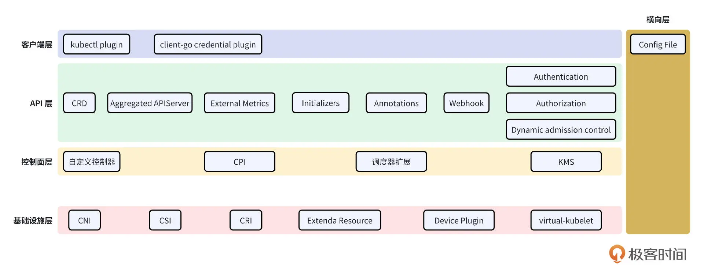

# 38 | 扩展能力：Kubernetes提供了哪些扩展机制？

你好，我是孔令飞。

Kubernetes 项目已经被各公司广泛使用，例如：谷歌、亚马逊、腾讯、阿里巴巴、字节跳动。这些互联网公司将各类业务逐步迁移到 Kubernetes 集群中，但它们的业务类型极其复杂，技术栈需求也各不相同。

为了满足多样化的业务需求，Kubernetes 提供了极其强大的扩展能力。具体来说，Kubernetes 提供了极多的扩展点，比如 CNI、CRI、CSI、Device Plugin、CRD 等。本节课，我们就来分类讲解这些扩展点。通过本节课的学习，你可以更好地理解 Kubernetes 的扩展性机制及扩展点，知道如何利用这些扩展点来增强 Kubernetes 的原生功能，打造一个基于Kubernetes 的更加灵活完备的平台。另外，在面试相关岗位的时候，面试官也会经常问到Kubernetes 扩展机制相关的问题，你也可以利用这节课学到的内容从容应对。

但由于 Kubernetes 扩展点的内容比较多，我会分 3 节课来系统介绍。这节课，我们先来聊聊Kubernetes 提供了哪些扩展机制。

## Kubernetes 为什么要提供这么多的扩展能力？

Kubernetes 目前是容器编排领域的事实标准，也是云原生技术栈的基石。但这并不意味着Kubernetes 发展很顺利，没有任何问题。事实上，Kubernetes 发展初期也面临过很多问题，其中一个比较重要的问题就是：Kubernetes 为了满足企业多种多样的功能需求，以 in-tree的方式加入很多功能，并被编译到它的二进制文件中。这使得 Kubernetes 变得越来越臃肿和不稳定，并且企业需要的功能特性也很难快捷、顺利地被合入 Kubernetes 的主干代码中。

具体来说，这个大问题又可以拆分为 3 个更详细的问题，分别是：功能臃肿、系统不稳定和企业需要的功能特性支持困难。我们一一来看。

首先来看问题 1：功能臃肿。企业在使用 Kubernetes 的过程中，可能会因为自身公司技术环境、功能需求的不同，而需要各种定制化的功能。如果这些功能都以 in-tree 的方式加入到Kubernetes 项目仓库中，会让 Kubernetes 的源码量越来越大。一个功能特性由 A 企业开发，对 A 企业是有用的，但对于 B 企业不一定适用。这种冗余的功能，会使 Kubernetes 中集成大量很少使用的功能特性，导致 Kubernetes 功能臃肿，代码量巨大。

再来看问题 2：系统不稳定。很多新的功能特性被加入到 Kubernetes 主仓库中，这些功能特性由不同的公司、团队贡献，可能在没有经过充分测试的情况下就加入到了仓库中。这种未经充分测试的代码会存在很多 Bug，导致 Kubernetes 运行不稳定。

最后来看问题 3：企业需要的功能特性支持困难。

企业需要的功能特性都需要先开发，再合入 Kubernetes 主仓库。Kubernetes 代码维护人员会对这些功能特性进行严格的评审、讨论、验证后才可能被接纳，并且其发布时间需要跟随Kubernetes 的整体发布进度，而不是企业的进度。如果功能审核不通过，则会被拒绝合入。

这不仅会导致企业需要的新功能特性很难被支持并快速发布上线，还会导致 Kubernetes 很难满足企业的应用场景，从而影响 Kubernetes 的普及。

Kubernetes 开发者为了解决上述 3 个问题，改造了很多核心的功能特性，并将它们变成可扩展的。如果企业需要定制化开发自己的功能特性，现在只需要按照 Kubernetes 的插件规范，开发自己的插件即可。插件的开发、测试、发布、维护完全交给企业，并且源码独立维护。这种方式极大地提高了 Kubernetes 的扩展能力。

随着 Kubernetes 插件能力的不断增强，到 v1.30.4 版本，Kubernetes 已经有多达 24 处扩展点。这使得 Kubernetes 的适应能力极强，并且越来越稳定。

## Kubernetes 提供了哪些扩展点？

那么，Kubernetes 具体提供了哪些扩展点呢？我将这些扩展点分层后，绘制在下面这张图中：



根据功能特性在 Kubernetes 中所处的层级，它可以划分为 5 层：客户端层、API 层、控制面层、基础设施层、横向层。横向层中的插件机制会被所有层使用，例如：配置。

首先来看横向层。Config File 对应之前 Kubernetes 组件里的 flag，在启动组件时，根据实际需要去配置那些 flag 对应的启动参数。以前，当你执行某个组件时，比如 kube-apiserver -h，就能看到有两到三屏的 flag，这是一个海量的 flag，现在已经利用配置文件的方式代替flag。

再来看客户端层：

```bash
kubectl plugin：kubectl 的扩展插件，提供额外的功能或命令，用户可以开发自定义插件
```

- 来简化操作。

- client-go credential plugin：用于管理 Kubernetes 客户端库中身份验证凭据的组件，支持外部身份验证提供者的配置。

接着来看 API 层：

- Extended APIServer（CRD，自定义资源）：允许用户通过定义新的资源类型来扩展Kubernetes，从而创建自定义 API。

- Aggregated APIServer：kube-apiserver 支持的一种 APIServer 类型，允许用户开发一个新的 Web 服务，并将 Web 服务的路径注册到 kube-apiserver 的路由中，通过 kube-apiserver 以标准的 REST API 接口请求来访问自定义的 REST 服务。

- External Metrics：自定义监控指标，允许开发者自定义 Kubernetes 集群的监控指标，满足多样化的监控需求。

- Webhook：

- Authentication Webhook（身份验证 webhook）：请求 kube-apiserver 时，通过调用Webhook 对用户进行身份认证。

- Authorization Webhook（授权 Webhook）：类似于身份验证 webhook，将授权决策委派给外部服务以实现自定义授权逻辑。

- Dynamic admission control Webhook（动态准入控制 webhook）：在创建或更新请求过程中，允许验证或修改资源，通过外部服务影响请求。

- Initializers：现已弃用的功能，曾用于在对象激活前初始化对象，已被动态准入控制webhook 替代。

- Annotations（注解）：以键值对形式存储在 Kubernetes 对象中的元数据，通常用于存储非标识性的信息，相当于 Kubernetes 新特性的试验场。

下一个看控制面层：

- 自定义控制器：Kubernetes 提供工具、包、示例项目等，支持开发者方便、快捷地开发自己的控制器调和资源。

- CPI（Cloud Provider Interface）：类似于 kube-controller-mananger，允许云厂商开发控制器，以处理厂商特有的云资源及特有的处理逻辑。

- 调度器扩展：允许开发者实现各类自定义的 Pod 调度逻辑。

- KMS（密钥管理服务）：用于管理加密密钥的服务，可以与 Kubernetes 集成，用于加密敏感信息。

最后来看基础设施层：

- CNI（容器网络接口）：Kubernetes 最早提供的一种扩展能力，允许开发者自定义网络实现。开发者按照 CNI 的规范实现网络插件，从而无缝接入 Kubernetes 系统。

- CSI（容器存储接口）：开发者遵循 CSI 的规范，实现自定义的存储逻辑，从而支持各类不同的存储，例如：Ceph、GlusterFS 等。

- CRI（容器运行时接口）：开发者遵循 CRI 接口规范，便可以实现自己的容器运行时。例如：Docker、Containerd、CRI-O 等。

- Extended Resource（扩展资源）：不由 Kubernetes 直接管理的自定义资源，在 Pod 调度时可以考虑（如自定义硬件加速器）。

- Device Plugin（设备插件）：用于注册和监控设备资源（如 GPU、ENI）的接口，使工作负载能够请求和使用这些资源。

- Virtual Kubelet：可以支持我们将 Pod 部署在期望的位置及形态，是对 Kubelet 的一种扩展。

## 课程总结

本节课先介绍了 Kubernetes 在快速迭代过程中，为了满足各企业多样化的功能需求，不断以in-tree 方式将新特性直接编译入主二进制中，导致代码臃肿、系统不稳定、企业难以快速上线自定义功能等三大痛点。为了解决这些问题，Kubernetes 开发者将核心功能改造为插件化的扩展点，允许用户在不改动主仓库代码的前提下，通过符合规范的插件独立开发、测试和发布所需功能，从而既保持主项目的轻量与稳定，又能满足高度定制化需求。

接着，我按组件层级将 Kubernetes 的扩展点分为横向层、客户端层、API 层、控制面层和基础设施层。在横向层，可通过配置文件（Config File）替代海量启动 flag；在客户端层，有

```bash
kubectl plugin 和 client-go 的凭证插件；API 层则涵盖 CRD、Aggregated APIServer、
```

各类 Webhook、外部指标扩展等；控制面层支持自定义控制器、CPI、调度器扩展和 KMS；基础设施层提供 CNI、CSI、CRI、Device Plugin、Extended Resource、Virtual Kubelet 等多种标准化接口。

通过这些分层的扩展点，Kubernetes 保持了核心系统的轻量与稳定，同时赋予用户高度定制化和可插拔的能力，满足了复杂企业级场景下的多样化需求。

## 课后练习

列举并简要说明 Kubernetes 在 API 层的三种主要扩展机制（例如 CRD、AggregatedAPIServer、Webhook）。

欢迎你在留言区与我交流讨论，如果今天的内容让你有所收获，也欢迎转发给有需要的朋友，我们下节课再见！
