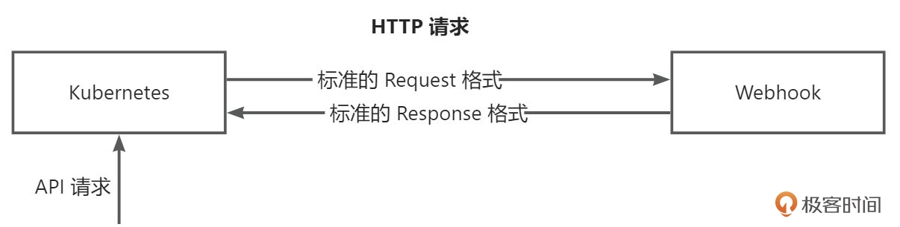

# 39 | 扩展能力：横向层、客户端层、API层扩展机制详解

你好，我是孔令飞。

上一节课，我概括介绍了 Kubernetes 提供的扩展机制。本节课，我来详细介绍 Kubernetes在横向层、客户端层、API 层所提供的扩展机制。

## 横向层

横向层的扩展能力适用于 Kubernetes 的一个或多个组件 / 功能特性。当前横向层最重要的扩展能力是配置文件。

### Config File

Kubernetes 各组件在启动时都会读取 flag，但这种方式存在着诸多问题，例如：

- 不能支持多版本：Kubernetes 组件升级后，组件的 flag 也要一起进行适配，不能向后兼容。

- 可读性差：Kubernetes 组件往往有着大量的 flag，无结构化、冗长的 flag 在可读性上要比yaml 和 json 格式的配置文件更差。

- 不好维护：通过 flag 来配置组件，在可维护性上，要比单个配置文件差，也不利于集中管理。

- 难以审计：使用 flag 来配置组件，难以追踪和审计每次启动命令的变化。

为了解决通过命令行选项来配置组件带来的各种问题， Kubernetes 引入了版本化的Component Config 机制，通过版本化的配置文件来配置组件。

Config File 也可以算作 Kubernetes 扩展系统中的一个扩展点。下面是一个 kubelet 组件config file 的示例：

```
apiVersion: kubelet.config.k8s.io/v1beta1
kind: KubeletConfiguration
cgroupDriver: cgroupfs
cgroupRoot: /
# Assign a fixed CIDR to the node because we do not run a node controller
# This MUST be in sync with IPs in:
# - cluster/gce/config-test.sh and
# - test/e2e_node/conformance/run_test.sh
podCIDR: "10.100.0.0/24"
# Aggregate volumes frequently to reduce test wait times
volumeStatsAggPeriod: 10s
# Check files frequently to reduce test wait times
fileCheckFrequency: 10s
evictionPressureTransitionPeriod: 30s
evictionHard:
 memory.available: 250Mi
 nodefs.available: 10%
 nodefs.inodesFree: 5%
evictionMinimumReclaim:
 nodefs.available: 5%
 nodefs.inodesFree: 5%
serializeImagePulls: false
```

## 客户端层

客户端层的扩展能力有 2 个：

- kubectl plugin

- client-go credential plugin

下面，我们一一来看。

### Kubectl plugin

kubectl 插件是用于扩展 Kubernetes 命令行工具 kubectl 功能的附加组件。通过插件，用户可以添加自定义命令，以便更好地满足特定的需求或简化常见的操作。

很多基于 Kubernetes 的开源项目都使用了 kubectl plugin 来集成自己的管理命令。例如：多集群管理开源项目 clusternet 就提供了 kubectl 插件 kubectl-clusternet。安装 kubectl-

```
clusternet 插件之后，开发者可以直接使用 kubectl clusternet -h 命令来操作部署在
```

Kubernetes 集群中的 clusternet 相关资源。

```bash
kubectl 插件是一个独立的可执行文件，名字以 kubectl- 开头。安装 kubectl 插件也非常方
便，只需要将 kubectl-xxx 放到 Linux 中的 PATH 路径下即可。当然，你也可以使用 krew
```

来安装 kubectl 插件。Krew 是一个由 Kubernetes SIG CLI 社区维护的插件管理器。例如，你

```sql
可以使用以下命令来安装 kubectl-clusternet 插件：
$ kubectl krew update
$ kubectl krew install clusternet
# check plugin version
$ kubectl clusternet version
$ kubectl plugin list # 安装完之后，可以使用 kubectl plugin list 查看系统中当前已安装的插
```

使用 kubectl 插件也会有一些限制：插件无法覆盖 kubectl 自有的命令，例如：创建一个插件

```bash
kubectl-version 将导致该插件永远不会被执行， 因为现有的 kubectl version 命令
```

总是优先于它执行。

编写 kubectl 插件也非常简单。你可以使用任何编程语言来开发 kubectl 插件。例如，下面是

```bash
一个用 Bash 脚本编写的 kubectl 插件 kubectl-foo。新建一个 $HOME/bin/kubectl-
foo 文件，内容如下：
#!/bin/bash
# 可选的参数处理
if [[ "$1" == "version" ]]
then
   echo "1.0.0"
   exit 0
fi
# 可选的参数处理
if [[ "$1" == "config" ]]
then
   echo $KUBECONFIG
   exit 0
fi
echo "I am a plugin named kubectl-foo"
编辑完上述文件之后，执行以下命令来安装和使用 kubectl-foo 插件：
$ chmod +x $HOME/bin/kubectl-foo
$ kubectl foo
I am a plugin named kubectl-foo
$ kubectl foo version
1.0.0
```

上面是一些 Demo，用来让你快速了解和体验 kubectl 插件功能。更多关于 kubectl 插件的介绍，你也可以参考官方的文档 kubectl-plugins 先学习。

### client-go credential plugins

client-go 凭证插件（credential plugin）允许用户使用外部身份验证机制来认证 Kubernetes集群。这在与云服务提供商或自定义身份验证系统集成时尤其有用。用户可以利用插件动态获取令牌或其他凭证，而不是将凭证硬编码在配置文件中。这增强了安全性和灵活性，特别是在凭证可能频繁变化的环境中。

Kubernetes client-go credential plugins 扩展能力在 Kubernetes v1.22 版本达到 stable 状态。client-go credential plugins 工作原理是：当 Kubernetes 客户端（如 kubectl）需要进行身份

```
验证时，它会检查配置文件（通常位于 ~/.kube/config）中指定的凭证插件。插件被执行
```

并返回所需的凭证。客户端随后使用这些凭证与 Kubernetes API 服务器进行交互。

要使用凭证插件，你需要在 kubeconfig 文件中进行配置。以下是一个示例配置：

```yaml
apiVersion: v1
kind: Config
clusters:
- cluster:
   server: https://your-kubernetes-api-server
 name: your-cluster
contexts:
- context:
   cluster: your-cluster
   user: your-user
 name: your-context
current-context: your-context
kind: Config
preferences: {}
users:
- name: your-user
 user:
   exec:
     apiVersion: client.authentication.k8s.io/v1
     command: your-credential-plugin
     # Environment variables to set when executing the plugin. Optional.
     env:
     - name: FOO
       value: bar
     # Arguments to pass when executing the plugin. Optional.
     args:
       - arg1
       - arg1
     # Text shown to the user when the executable doesn't seem to be present. Op
     installHint: |
       example-client-go-exec-plugin is required to authenticate
       to the current cluster.  It can be installed:
       On macOS: brew install example-client-go-exec-plugin
       On Ubuntu: apt-get install example-client-go-exec-plugin
       On Fedora: dnf install example-client-go-exec-plugin
       ...
     # Whether or not to provide cluster information, which could potentially co
     # very large CA data, to this exec plugin as a part of the KUBERNETES_EXEC_
     # environment variable.
     provideClusterInfo: true
     # The contract between the exec plugin and the standard input I/O stream. I
     # contract cannot be satisfied, this plugin will not be run and an error wi
     # returned. Valid values are "Never" (this exec plugin never uses standard
     # "IfAvailable" (this exec plugin wants to use standard input if it is avai
     # or "Always" (this exec plugin requires standard input to function). Requi
     interactiveMode: Never
```

在上面这个示例中：

```
exec 部分指定了获取凭证时要运行的命令。
your-credential-plugin 是将被调用的可执行文件的名称。
env 可以传递环境变量给插件。
args 可以用于传递任何必要的参数给插件。
```

更多关于 client-go credential plugins 的介绍，你可以参考官方文档：client-go credentialplugins。

实现一个 client-go credential plugins 也很简单。例如：我可以通过以下步骤编写一个简单的凭证插件：

1. 创建插件

2. 构建插件

3. 更新 kubeconfig

4. 测试插件

下面，我们一一来看。

```go
步骤 1：创建插件。创建一个名为 simple-credential-plugin.go 的文件：
package main
import (
   "encoding/json"
   "fmt"
   "os"
)
type Credential struct {
   Token string `json:"token"`
}
func main() {
   // 模拟获取一个令牌
   token := "your-static-token"
   // 创建凭证响应
   credential := Credential{Token: token}
   // 将响应序列化为 JSON
   response, err := json.Marshal(credential)
   if err != nil {
       fmt.Fprintf(os.Stderr, "Error marshaling response: %v\n", err)
       os.Exit(1)
   }
   // 输出 JSON 响应
   fmt.Println(string(response))
}
```

步骤 2： 构建插件。构建插件可执行文件：

```
$ go build -o simple-credential-plugin simple-credential-plugin.go
步骤 3：更新 kubeconfig。更新你的 ~/.kube/config 文件以使用新插件：
users:
- name: your-user
 user:
   exec:
     apiVersion: client.authentication.k8s.io/v1
     command: ./simple-credential-plugin
```

步骤 4：测试插件。现在，你可以通过运行 kubectl 命令来测试插件：

```
$ kubectl get pods --context your-context
```

如果一切设置正确，kubectl 将调用你的凭证插件，该插件将返回静态令牌，从而允许你与Kubernetes API 进行身份验证。

## API 层

上面我介绍了 Kubernetes 客户端层的扩展能力。接下来，我再介绍下 API 层的扩展能力。

Kubernetes 所有的能力都是通过一个标准的 RESTful API 服务器对外提供服务的。所以，API层包含了大量的扩展能力，主要包括：

- Extended APIServer（CRD）

- Aggregated API Server

- External Metrics

- Webhoook

- Initializers

- Annotations

接下来，我一一为你介绍。

### Extended APIServer（CRD）

自定义资源定义（CRD）是 Kubernetes 中一种重要的扩展机制，允许用户定义新的 API 资源类型。利用 CRD，用户可以在 Kubernetes 中创建自定义资源，并像操作内置资源一样进行管理。这种机制提升了 Kubernetes 的灵活性，使其能够支持多种应用场景和业务需求。

CRD 的结构与 Kubernetes 的内置资源相似。通过 CRD，用户能够执行创建、更新、删除和查询自定义资源的操作。自定义资源的定义通常包含资源名称、版本、规范（spec）和状态（status）等关键字段，确保其可以在 Kubernetes 环境中有效地被使用和管理。

下面是一个 CRD 的实例：

```
apiVersion: apiextensions.k8s.io/v1
kind: CustomResourceDefinition
metadata:
 # name must match the spec fields below, and be in the form: <plural>.<group>
 name: crontabs.stable.example.com
spec:
 # group name to use for REST API: /apis/<group>/<version>
 group: stable.example.com
 # list of versions supported by this CustomResourceDefinition
 versions:
   - name: v1
     # Each version can be enabled/disabled by Served flag.
     served: true
     # One and only one version must be marked as the storage version.
     storage: true
     schema:
       openAPIV3Schema:
         type: object
         properties:
           spec:
             type: object
             properties:
               cronSpec:
                 type: string
               image:
                 type: string
               replicas:
                 type: integer
 # either Namespaced or Cluster
 scope: Namespaced
 names:
   # plural name to be used in the URL: /apis/<group>/<version>/<plural>
   plural: crontabs
   # singular name to be used as an alias on the CLI and for display
   singular: crontab
   # kind is normally the CamelCased singular type. Your resource manifests use
   kind: CronTab
   # shortNames allow shorter string to match your resource on the CLI
   shortNames:
   - ct
假设上述内容保存在 resourcedefinition.yaml 文件中，执行以下命令在 Kubernetes 中
```

安装 CRD：

```
$ kubectl apply -f resourcedefinition.yaml
customresourcedefinition.apiextensions.k8s.io/crontabs.stable.example.com created
```

执行完上述命令后，就在 Kubernetes 的 APIServer 中安装了以下 REST 路由：

```
/apis/stable.example.com/v1/namespaces/*/crontabs/...
接下来，我们创建一个自定义资源，新建 my-crontab.yaml 文件，内容如下：
apiVersion: "stable.example.com/v1"
kind: CronTab
metadata:
 name: my-new-cron-object
spec:
 cronSpec: "* * * * */5"
 image: my-awesome-cron-image
```

执行以下命令，安装并查看 CronTab 资源：

```
$ kubectl apply -f my-crontab.yaml
$ kubectl get crontab
NAME                 AGE
my-new-cron-object   16s
$ kubectl get ct -o yaml
apiVersion: v1
items:
- apiVersion: stable.example.com/v1
 kind: CronTab
 metadata:
   creationTimestamp: "2024-09-05T17:24:53Z"
   generation: 1
   name: my-new-cron-object
   namespace: default
   resourceVersion: "64945226"
   uid: 3eb6852f-32fd-4e7b-84ba-1580a0a07659
 spec:
   cronSpec: '* * * * */5'
   image: my-awesome-cron-image
kind: List
metadata:
 resourceVersion: ""
```

在安装完 CRD 之后，就可以像使用内置资源一样，通过 kube-apiserver 访问这些内置资源。

### Aggregated APIServer（聚合 API 服务器）

Aggregated API Server 允许用户将多个 API 服务器聚合到 Kubernetes 的主 API 服务器中。通过这种方式，用户可以将外部 RESTful API 作为 Kubernetes API 的一部分进行访问和管理。这使得用户能够在 Kubernetes 中统一管理不同的服务和资源。并复用 Kubernetes 提供的各种能力，例如：认证、鉴权、标准化的 API 接口等。

Kubernetes 引入 Aggregated API Server 可以带来很多重要收益，比如：

- 提高 Kubernetes 的扩展性。

- 用户的 API Server 以扩展的形式复用 Kubernetes 的能力，Kubernetes 社区不需要Review 用户的 API 实现。

- Kubernetes 可以支持各类用户自定义的 API 服务，提高了其场景适应能力。

- 给开发者提供一个非常好的机制去复用 Kubernetes 的现有能力，例如：认证、鉴权、API规范等。

更多关于 Aggregated API Server 的介绍，你可以参考官方文档：Kubernetes APIAggregation Layer。Aggregated API Server 的设计文档请参考：aggregated-api-servers。

另外，为了让你更加透彻地理解 Aggregated API Server，这里我为你展示一个很小的示例，带你直观感受下 Aggregated API Server 的开发和部署方式。具体分为以下几步：

1. 创建外部 API 服务器

2. 注册 API 服务器

3. 创建 Kubernetes 服务

4. 应用配置

5. 测试 API

### 步骤 1：创建外部 API 服务器

首先，我们需要创建一个简单的 Go 应用程序，作为外部 API 服务器。这个服务器将提供一个

```
/api/v1/customresource 的 GET 接口。
```

创建一个名为 custom-resource-server.go 的文件，内容如下：

```go
package main
import (
   "encoding/json"
   "github.com/gorilla/mux"
   "net/http"
)
type CustomResource struct {
   Message string `json:"message"`
}
func main() {
   r := mux.NewRouter()
   r.HandleFunc("/api/v1/customresource", func(w http.ResponseWriter, r *http.Re
       response := CustomResource{Message: "Hello from Custom Resource API!"}
       w.Header().Set("Content-Type", "application/json")
       json.NewEncoder(w).Encode(response)
   }).Methods("GET")
   http.ListenAndServe(":8080", r)
}
```

在终端中，运行以下命令以构建 Docker 镜像：

```
$ go mod init aggregated-apiserver
$ go get github.com/gorilla/mux
$ go build -o aggregated-apiserver aggregated-apiserver.go
$ docker build . -t ccr.ccs.tencentyun.com/superproj/aggregated-apiserver:v0.0.1
$ docker push ccr.ccs.tencentyun.com/superproj/aggregated-apiserver:v0.0.1
```

### 步骤 2：注册 API 服务器

```
接下来，我们需要在 Kubernetes 中注册这个 API 服务器。创建一个名为 custom-
resource-api-service.yaml 的文件，内容如下：
apiVersion: apiregistration.k8s.io/v1
kind: APIService
metadata:
 name: v1.example.com
spec:
 service:
   name: custom-resource-service
   namespace: default
 group: example.com
 version: v1
 groupPriorityMinimum: 100
 versionPriority: 100
```

### 步骤 3：创建 Kubernetes 服务

为了让 Kubernetes 能够访问我们的 API 服务器，我们需要创建一个 Kubernetes 服务。创建

```bash
一个名为 custom-resource-service.yaml 的文件，内容如下：
apiVersion: v1
kind: Service
metadata:
 name: custom-resource-service
 namespace: default
spec:
 ports:
 - port: 8080
   targetPort: 8080
 selector:
   app: custom-resource
---
apiVersion: apps/v1
kind: Deployment
metadata:
 name: custom-resource
 namespace: default
spec:
 replicas: 1
 selector:
   matchLabels:
     app: custom-resource
 template:
   metadata:
     labels:
       app: custom-resource
   spec:
     containers:
     - name: custom-resource
       image: ccr.ccs.tencentyun.com/superproj/custom-resource-server:v0.0.1  #
       ports:
       - containerPort: 8080
```

### 步骤 4：应用配置

在终端中，运行以下命令以应用服务和 API 注册配置：

```
$ kubectl apply -f custom-resource-service.yaml
$ kubectl apply -f custom-resource-api-service.yaml
```

### 步骤 5：测试 API

一旦所有配置都应用成功，你可以通过 Kubernetes API 访问外部 API 服务器。运行以下命令：

```
$ kubectl get --raw /apis/example.com/v1/customresource
```

如果一切设置正确，你能看到来自外部 API 服务器的响应，例如：

```json
{
 "message": "Hello from Custom Resource API!"
}
```

### External Metrics

Kubernetes 集群内置了一些常用的监控指标，例如：CPU、Memory、Pod 级别的指标等。HPA 根据这些指标来扩缩容 Pod，但这些指标并不一定能满足所有的企业需求。所以Kubernetes 也提供了 Kubernetes External Metrics 扩展能力，以允许用户自定义自己的指标，并根据这些指标来扩缩容 Pod。

External Metrics 的工作流程如下：

1. 指标收集：外部系统（如 Prometheus、Datadog 等）收集应用程序的性能指标。

2. 指标 API：Kubernetes 集群通过 Metrics API 访问这些外部指标。用户需要实现一个Metrics Adapter，它将外部指标转换为 Kubernetes 可以理解的格式。

3. HPA 调整：HPA 根据这些外部指标的值来决定是否需要增加或减少 Pod 的副本数。

实现 External Metrics 通常需要以下步骤：

1. 安装 Metrics Adapter：选择一个适合的 Metrics Adapter（如 Prometheus Adapter），并在Kubernetes 集群中安装。

2. 配置 Adapter：根据外部系统的指标配置 Adapter，使其能够正确地从外部系统获取数据。

3. 创建 HPA：使用 External Metrics 创建 HPA，指定要监控的外部指标。

```bash
以下是一个简单的 HPA 配置示例，使用外部指标 http_requests：
apiVersion: autoscaling/v2
kind: HorizontalPodAutoscaler
metadata:
 name: my-app-hpa
spec:
 scaleTargetRef:
   apiVersion: apps/v1
   kind: Deployment
   name: my-app
 minReplicas: 1
 maxReplicas: 10
 metrics:
 - type: External
   external:
     metric:
       name: http_requests
     target:
       type: AverageValue
       averageValue: 100
```

### Webhook

Kubernetes 中提供了不同种类的 Webhook，这些 Webhook 允许开发者通过 HTTP 请求的方式调用外部服务，通过这些外部服务来扩展 Kubernetes 的能力。企业中经常会通过这些Webhook 将公司内的认证、鉴权能力接入 Kubernetes 中。Kubernetes Webhook 机制工作原理如下：



客户端请求 Kubernetes，Kubernetes 发现涉及功能配置了 Webhook，就会查询 Webhook 配置，并根据 Webhook 中配置的请求地址、请求路径等信息发送 HTTP 请求，其中 HTTP 请求的入参和回参都是规范、标准化的，这些规范化的参数，可以很方便地供客户端和服务端进行解析。

Kubernetes 中支持的 Webhook 种类有以下几种：

- Authorization Webhook 用于在 API 请求被处理之前，决定请求是否被允许，可以根据自定义的逻辑来验证用户的权限。

- Authentication Webhook 用于验证用户的身份，可以通过外部系统（如 LDAP、OAuth服务器等）来验证用户的凭证。

- Admission Webhook 又分为 Mutating Webhook 和 Validating Webhook。

- Mutating Webhook：在资源创建或更新之前，可以修改请求的对象，允许用户在资源被存储之前对其进行更改。

- Validating Webhook：在资源创建或更新之前，可以验证请求的对象是否合法，主要用于确保资源符合特定的安全和合规性标准。

此外，调度器的 Policy 也用到 Webhook。在 Container 生命周期中，像 PostStart、Prestop也可以用 Webhook 方式实现。

### Initializers

Kubernetes 中的 object 在创建之前会有一个 pre-initialization tasks 列表，还有一个相应的自定义 Controller。这个 Controller 会执行相应的 task 列表，做一些相应的初始化处理，controller 执行完就删掉，再执行对象创建。

### Annotations

Kubernetes 的 Annotation 机制其实也是一种扩展机制。通过 Annotation，用户可以向Kubernetes 资源中添加自定义的信息，而不用修改资源的定义（Spec）。

在 Kubernetes 的迭代过程中，很多实验性质的特性（字段），通常都优先通过 Annotation 来控制，之后在该字段定义、功能稳定之后，才会将字段迁移到资源的 Spec 定义中，如亲和性策略、Storage Class、初始化容器、Critical Pod 等，这些特性都是通过先配置在Annotations 中来实验的。

## 课程总结

这节课，我们详细介绍了 Kubernetes 在横向层、客户端层和 API 层的主要扩展机制。横向层以版本化的 Component Config 配置文件替代传统 flag，解决了兼容性、可读性和可维护性的问题，并通过 YAML/JSON 形式对组件进行统一管理和审计。客户端层包括两种插件机制：一

```
是以独立可执行文件形式扩展 kubectl 命令；二是 client-go 凭证插件，通过 exec 方式
```

动态获取和刷新登录凭证，增强了安全性与灵活性。

在 API 层，Kubernetes 提供了多种可插拔的扩展点：

- CustomResourceDefinition（CRD）允许用户定义并管理全新的资源类型。

- Aggregated API Server 能将外部 REST 服务聚合到主 APIServer 中复用认证、鉴权等能力。

- External Metrics 通过 Metrics Adapter 把外部监控数据注入 HPA，实现基于自定义指标的自动伸缩。

- 各类 Webhook（Authentication、Authorization、Mutating、Validating）可在请求生命周期的不同阶段调用外部服务执行认证、授权或准入逻辑。

- Initializers（已弃用）与 Annotations 则为试验性或元数据扩展提供了轻量级手段。

## 课后练习

1. 请编写一个简单的 Component Config 配置文件（YAML 格式），设置 kubelet 的

```
cgroupDriver 为 systemd，evictionHard 中 memory.available 为 200Mi。
```

2. 设计一个最小化的 Validating Admission Webhook 配置，要求在创建 Pod 时校验其

```
metadata.labels 必须包含 team 字段（只需提供
MutatingWebhookConfiguration 或 ValidatingWebhookConfiguration 的关键
```

- 字段示例）。

欢迎你在留言区与我交流讨论，如果今天的内容让你有所收获，也欢迎转发给有需要的朋友，我们下节课再见！
