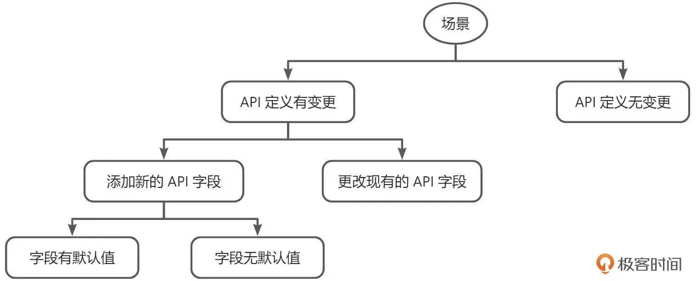

# 43 | FeatureGates（上）：Kubernetes中的FeatureGates设计

你好，我是孔令飞。

在 Go 项目开发中，我们通常使用配置文件或者命令行选项来控制是否开启某个功能，这个功能可能是新加入的实验性质的功能，也可能是已经稳定的功能。总之，我们需要一种机制，来让应用进程内感知到是否开启此功能，或者此功能的配置是什么。

为此，Kubernetes 提供了一种灵活、强大的重要机制——Feature Gates（功能门控）。本节课，我就来详细介绍下 Feature Gates（简称 FG）。

## 什么是 Feature Gates？

功能门控是 Kubernetes 中用于控制特性启用与否的一种机制。它允许开发者在集群中逐步引入新特性，便于测试和验证，同时也为用户提供了选择是否启用某些功能的灵活性。功能门控通常用于实验性特性或尚未完全稳定的功能。通过功能门控，开发者可以在不影响整个系统的情况下，逐步推出新特性。

几乎所有的软件都有漏洞，而且新软件往往比成熟的软件有更多、更严重的漏洞。FeatureGates 旨在快速停止一个新功能，并减轻漏洞带来的损害。新功能的作者和审阅者，应该花点时间思考下，Feature Gates 是否达到了这一目标。

这里需要注意，Feature Gates 并不会作为长期控制开启 / 禁用某个功能的手段。通常情况下，Feature Gates 所管控的功能在 GA 或者被弃用后，都会从 Feature Gates 中被废弃或移除。如果新功能经过验证，决定加入 Kubernetes 长期存在，那么功能的开启 / 禁用方式应该从 Feature Gates 中移除，并用其他更加适配的方式来管控，例如：配置文件、命令行选项等。

Feature Gates 中包含 2 类信息和含义：

- Feature：功能。

- Gates：门控，用来控制是否开启功能。

所以，Kubernetes 中 Feature Gate 功能其实就是用来配置某个功能是否开启的。而且这个功能，通常具有试验性质，稳定后会从 Feature Gates 中被移除，并作为稳定的功能添加到Kubernetes API 中或者主干代码中。

- 注意：本课程从较高的维度来介绍 Feature Gates。如果你想了解更多的细节、代码片段等，请参考 api_changes.md。

## 如何定义一个 Feature Gates？

接下来，我先来介绍下，如何定义一个功能门控。

功能门控的定义包括以下结构字段（见文件 feature_gate.go#L72）：

```
type FeatureSpec struct {
   // Default 是特性的默认启用状态。如果门控值没有明确设置，就会使用该值。
 Default bool
 // LockToDefault 表示特性是否锁定为默认值且不可更改。
 LockToDefault bool
 // PreRelease 表示特性的成熟度。可能的值有 "featuregate.Alpha"、"featuregate.Beta"、
   // "featuregate.GA" 或 "featuregate.Deprecated"。
 PreRelease prerelease
   // Version 表示该 FeatureSpec 有效的最早版本。
   // 如果一个功能有多个 FeatureSpec，则使用版本号最高且小于或等于组件的有效版本的那个。
   Version *version.Version
}
```

除非某个 Feature Gate 经过 Production Readiness Review 文件的审查和批准，否则Feature Gate 预期具有以下行为：

- 切换功能门控不会影响其他组件。例如：在 kube-apiserver 中禁用一个 Feature Gate，不会影响在 kubelet 或 kube-scheduler 中同一个 Feature Gate 的启用 / 禁用状态，并且组件之间不需要有关联。

- 切换 Feature Gate 的影响应该仅限于 Feature 的范围。启用或禁用 Feature Gate 不应影响不使用该 Feature Gate 的工作负载。

- 切换 Feature Gate 不应导致集群中的传播效应或级联交互。

- 禁用 Feature Gate 应可以防止因该特性的 Bug 造成的进一步损害。

此外，我们还可以通过标志（见 --feature-gates）或组件配置文件（见 featureGates 配置项）启用或禁用门控，有些还可以通过环境变量启用。以及，生产环境 Kubernetes 中不支持在运行时更改 Feature Gates，通常通过重启组件来切换 Feature Gate。

## Feature Gates 的生命周期

```
Feature Gates 中的功能一般会按顺序经历 Alpha -> Beta -> GA 3 个发布阶段。如果某个
Feature 不再被支持，可以将它们标记为 Deprecated。有些 Feature 也可能会跳过某个阶
```

段，但大多数 Feature 都会经历上述 3 个阶段。

Feature 的版本在发布时，需要遵循以下规范：

- 涉及 API 变更 的功能必须经过 Alpha、Beta、GA 阶段。

- 目标 Feature 未经过验证，或复杂性较高，或具有缺陷、风险、性能、扩展性等问题，应该经过 Alpha、Beta、GA 阶段。

- 目标 Feature 复杂度低且性能、扩展性影响不大，但仍然存在影响应用的风险，可能会跳过 Alpha，直接进入 Beta 阶段（前提是到达 Beta 的发布标准）。应该默认处在关闭状态，直到在生产环境中充分验证该功能。

- 在某些情况下，如果目标 Feature 可能导致之前正常的功能异常，需要默认关闭。

- 风险非常小的改动，如果想通过 Feature Gate 控制开启 / 禁用，可以选择跳过 Alpha，直接进入 Beta 阶段（前提是达到 Beta 的发布标准），并且从一开始就默认启用。

- 对于一些风险较高的 Bug 修复，也可以通过 Feature Gate 来控制是否开启，建议直接进入Beta 阶段，并且从一开始就默认启用。对于可能被移除的 Bug 修复，可以使用Deprecated 状态，但仍然需要确保 Bug Fix 可以被禁用。

接下来，我们看看每个发布阶段，Feature Gate 的参数设置。

首先是 Alpha 阶段。

```
PreRelease 设置为featuregate.Alpha
Default 始终设置为 false
LockToDefault 设置为 false（或未指定）
```

Alpha 功能默认不启用，但用户可以明确开启。

其次是 Beta 阶段。

```
PreRelease 设置为 featuregate.Beta
Default 通常设置为 true
LockToDefault 设置为 false（或未指定）
```

Beta 功能通常默认启用（注意 beta 功能和 beta API 不同），但用户可以选择关闭该功能。

在很少的情况下，虽然 Feature Gate 是 Beta 阶段，但这个功能默认会被禁用。这告诉用户，尽管这个功能是 Beta，但该功能仍然需要一些工作，来确保该功能可以默认处在开启状态。

```
例如，CSIMigration 功能门控如下所示：
 CSIMigration:          {Default: true,  PreRelease: featuregate.Beta},
 CSIMigrationGCE:       {Default: false, PreRelease: featuregate.Beta}, // Off b
 CSIMigrationAWS:       {Default: false, PreRelease: featuregate.Beta}, // Off b
 CSIMigrationAzureDisk: {Default: false, PreRelease: featuregate.Beta}, // Off b
 CSIMigrationAzureFile: {Default: false, PreRelease: featuregate.Beta}, // Off b
 CSIMigrationvSphere:   {Default: false, PreRelease: featuregate.Beta}, // Off b
```

最后是 GA 阶段。

```
PreRelease 设置为 featuregate.GA
Default 始终设置为 true
LockToDefault 通常设置为 true
```

GA 功能始终默认开启，并且通常不能被禁用。

在很少的情况下，一个 GA 功能可以被设置为禁用。这意味着，尽管这个功能处在 GA 状态，但用户需要时间来确保自己可以使用该功能。这给了用户一些开启的缓冲时间，但该功能最终

```
仍然会被设置为 LockToDefault=true，并像其他功能一样退役。
在 GA 和弃用至少 2 次发布后，Feature Gate 应该被移除。通常我们会在代码中添加 //
remove in 1.23 这样的注释，表示计划什么时候移除这个 Feature Gate。这样的提示可以
```

使用户提前移除对功能门控的引用，否则在 Kubernetes 移除功能门控后，可能会导致程序出现异常。

```
当设置为 LockToDefault=true 时，Kubernetes 还会从代码库中删除对功能门控的引用代
```

码。

最后是 Deprecation。

```
PreRelease 设置为 featuregate.Deprecated
Default 设置为 false
```

- 你可以查看 Kubernetes 弃用政策

- 以获取更多详细信息

如果 Kubernetes 用户在某个 Feature Gate 被移除时受到了影响，用户可以将该 Feature

```
Gate 设置为 Default=true，然后提交 Bug。此时，Kubernetes 社区会重新考虑是否需要
启用该功能，并可能选择在未来 2 个版本将 Default 设置为 true，直到最终移除该
```

Feature Gate。

上面介绍了 Kubernetes 添加新功能时的功能门控参数设置，但如果是功能替换，功能门控参数又该如何设置呢？

这种情况下，Kubernetes 会通过 Feature Gate 控制旧功能是否可用。在旧功能没有达到 GA

```
状态之前，Feature Gate 参数设置如下：{Default: true, PreRelease:
featuregate.Beta}。
```

同时，Kubernetes 会将新功能以非 Feature Gate 的方式添加到 Kubernetes 代码中，供用户使用。当新的功能达到 GA 状态后，并且需要弃用旧功能时，旧功能的 Feature Gate 可以设

```
置为：{Default: false, PreRelease: featuregate.GA, LockToDefault:
true}。例如：LegacyNodeRoleBehavior & ServiceNodeExclusion。
```

## 在代码中使用功能门控

功能门控其实就是高级的 bool 变量，它们要么启用，要么禁用。但是，在实现功能门控的时候，有一些模式可供你遵循。

接下来，我们就看看不同功能类别下应该如何编程。我们具体讨论以下场景：



### 添加新 API 字段的功能

所有新增 API 字段的功能，必须先从 Alpha 开始。这保证了功能进入 Beta 后（开始使用这些字段），可以回滚到之前的版本，而不丢失数据。用户在回滚到 Alpha 版本的时候，不保证回滚成功。

当功能门控被禁用时，系统应该表现得像这些 API 字段不存在一样。尝试使用这些 API 字段的操作，应该能够继续使用，并且新的 API 字段相关的数据需要被丢弃。

```
API 注册代码（位于 pkg/registry/… 目录下），需要在 Validation 之前检查门控。如果门
控被禁用，并且操作时 CREATE，那么新字段必须被移除（设置为 nil）；如果门控被禁用并
```

且操作时 UPDATE，那么必须检查资源对象之前的形式。只有当这个资源对象没有使用这个字段时，才可以移除新的字段。例如：

```
if disabled(gate) && !newFieldInUse(oldObj) {
   obj.NewField = nil
}
```

### 验证：无默认值的字段

对于没有默认值的可选字段，API validation 时不应检查门控。相反，这种情况下的常见处理模式为：如果字段有值，则必须验证该值。这确保了在启用功能门控的条件下，对象一旦通过验证并被接受，后续的门控改变不会导致已保存对象验证失败。其实也就是说，不管该功能门控是否开启，新字段有值的时候必须检查值。

### 验证：有默认值的字段

对于有默认值的可选字段，这意味着新字段是必选字段，一旦 Feature Gate 功能达到 GA 阶段，并移除 Feature Gate，不应该存在这些字段没有值的情况。

这些字段的验证方法通常如下所示：

```
if obj.NewField == nil {
   allErrs = append(allErrs, field.Required(...))
} else {
   if !newFieldValid(obj.NewField, fldPath.Child("newField")) {
       allErrs = append(allErrs, field.Invalid(...))
   }
}
```

当功能门控处在开启状态，Validation 时必须同时考虑功能门控的开关状态、相关的 API 操作类型及资源对象之前的状态。当功能门控被禁用时，不应该校验该功能为必须项；当功能门控被开启时，应该校验该字段必须要设置值。

```
API 注册代码（位于 pkg/registry/… 目录下），必须在验证之前检查门控，并传递一个标
志到验证逻辑中（通常作为 Option 结构中的字段）来告诉验证代码，是否需要验证新字
```

段，例如：

```
if enabled(gate) || newFieldInUse(oldObj) {
   options.EnableNewField = true
}
ValidateThisObject(obj, oldObj, options)
```

然后验证代码看起来像这样：

```
if opts.EnableNewField {
   if obj.NewField == nil {
       allErrs = append(allErrs, field.Required(...))
   } else {
       if !newFieldValid(obj.NewField, fldPath.Child("newField")) {
           allErrs = append(allErrs, field.Invalid(...))
       }
   }
}
```

新增 API 字段时，通常需要检查功能门控。当功能门控被禁用时，系统应该表现得像新的 API字段不存在一样，API 字段虽然有值，但不会触发任何功能逻辑。这种实现可以确保：当新字段引入 Bug 需要关闭新功能时，能够消除新字段对系统的影响。

### 更改现有 API 字段的功能

对于不添加新字段，但扩展了 API 中允许的值的功能（例如，向枚举中添加值或放宽验证），功能门控必须从 alpha 开始，原因与添加新字段的功能相同。如果 Feature 不改变 API 的定义，仅仅改变了 API 的操作（如允许更新以前不可变更的字段），可以直接跳过 Alpha。

这里我们其实也能了解到，Kubernetes 对 API 定义的变更非常慎重，因为它会直接影响到外部用户是否需要改变现有的 API 接口调用，从而影响用户的体验。

```
API 注册代码（位于 pkg/registry/… 目录下）必须在验证之前检查门控。与新字段的情况
```

一样，此逻辑必须考虑字段的值、当前操作以及（在 UPDATE 的情况下）资源对象的先前状

```
态。类似于有默认值的新字段，它必须将一个标志传递到验证逻辑中（通常作为 Option 结
```

构中的字段）来指示验证代码是否应该允许新值。验证代码实现如下：

```
if enabled(gate) || newFieldValueInUse(oldObj) {
   options.AllowNewFieldValue = true
}
ValidateThisObject(obj, oldObj, options)
```

这种功能的实现可能需要检查门控，也可能不需要，这取决于具体的功能。与添加新字段不同，当功能门控被禁用时，无法简单地忽略该功能的存在。功能实现必须决定在门控被禁用但功能相关的值已经被使用和存储的情况下该如何处理。

有些功能可以回退到类似的值，而有些则必须继续使用新值。重点应该放在风险控制上：如果功能存在 Bug，禁用门控应该能够停止或至少限制潜在的损害。

### 没有改变 API 的功能

没有改变 API 的定义，但需要修改功能实现的 Feature 可能从 alpha 开始（很少从 beta 开始）。与那些改变 API 定义的功能不同，实现逻辑是应用功能门控的唯一地方。这通常表现为

```
一个简单的 if/else 块：
if enabled(gate) {
   doNewThing()
} else {
   doOldThing()
}
```

与基于 API 的功能一样，系统应在功能门控被禁用时表现得像功能不存在一样。鉴于功能的多样性，“表现得像功能不存在”的确切含义必须由每个功能的实现确定。重点应放在风险缓解上：如果功能有 Bug，禁用门控应该停止或至少限制损害。

## Feature Gates 的类型

在 Kubernetes 中，Feature Gates 分为 2 类。

首先是 FeatureGate（不可变功能门控），可以理解为只读的 Feature Gates，提供了 3 个方法，分别用来判断功能是否开启、列出所有注册的功能列表、深拷贝自身。接口定义如下：

```
// FeatureGate indicates whether a given feature is enabled or not
type FeatureGate interface {
   // Enabled returns true if the key is enabled.
   Enabled(key Feature) bool
   // KnownFeatures returns a slice of strings describing the FeatureGate's know
   KnownFeatures() []string
   // DeepCopy returns a deep copy of the FeatureGate object, such that gates ca
   // set on the copy without mutating the original. This is useful for validati
   // config against potential feature gate changes before committing those chan
   DeepCopy() MutableFeatureGate
}
```

其次是 MutableFeatureGate（可变功能门控），可以理解为可读写的 Feature Gates，除了

```
包含 FeatureGate 接口实现之外，还添加了一些写接口，用来改变 Feature Gates 内的数
```

据，例如：新增功能、添加 Feature Gates 命令行 Flag。接口定义如下：

```
// MutableFeatureGate parses and stores flag gates for known features from
// a string like feature1=true,feature2=false,...
type MutableFeatureGate interface {
   FeatureGate
   // AddFlag adds a flag for setting global feature gates to the specified Flag
   AddFlag(fs *pflag.FlagSet)
   // Set parses and stores flag gates for known features
   // from a string like feature1=true,feature2=false,...
   Set(value string) error
   // SetFromMap stores flag gates for known features from a map[string]bool or
   SetFromMap(m map[string]bool) error
   // Add adds features to the featureGate.
   Add(features map[Feature]FeatureSpec) error
   // GetAll returns a copy of the map of known feature names to feature specs.
   GetAll() map[Feature]FeatureSpec
   // AddMetrics adds feature enablement metrics
   AddMetrics()
   // OverrideDefault sets a local override for the registered default value of
   // feature. If the feature has not been previously registered (e.g. by a call
   // locked default, or if the gate has already registered itself with a FlagSe
   // error is returned.
   //
   // When two or more components consume a common feature, one component can ov
   // default at runtime in order to adopt new defaults before or after the othe
   // components. For example, a new feature can be evaluated with a limited bla
   // overriding its default to true for a limited number of components without
   // changing its default for all consuming components.
   OverrideDefault(name Feature, override bool) error
}
在实际开发中，MutableFeatureGate 通常在应用初始化的阶段使用；FeatureGate 通
```

常在应用运行阶段使用，用来判断一个功能是否开启。

## 课程总结

Kubernetes 的 Feature Gates 是控制功能启用的灵活机制，用于实验性或待稳定功能，区别于配置文件等长期管控方式。功能门控生命周期分 Alpha、Beta、GA 阶段，各阶段参数设置不同，GA 后或弃用后会被移除。本节课，我们详细介绍了 Kubernetes Feature Gates 的设计方式，并且给出了在不同场景下使用 Feature Gates 的方式。这些方式既是建议也是规范，可以让我们避免很多没必要的 Bug。

## 课后练习

请你思考下：

- 在新增 API 字段时，如何验证没有默认值的新字段？

- 如何在代码中使用功能门控？

欢迎你在留言区与我交流讨论，如果今天的内容让你有所收获，也欢迎转发给有需要的朋友，我们下节课再见！
