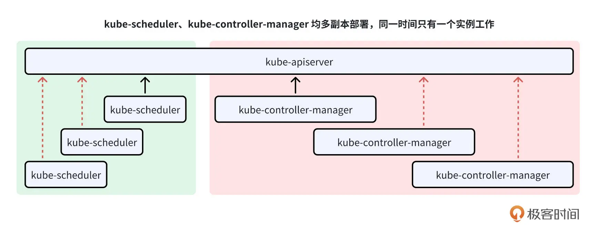

# 46 | LeaderElection：在Kubernetes中使用LeaderElection的场景

你好，我是孔令飞。

上一节课，我详细介绍了 Leader Election 的原理。本节课，我们来看 Kubernetes 中使用Leader Election 的场景：让你对 Kubernetes 有更多深入理解，并且知道如何在一个大型项目中使用 Leader Election。

## 使用 Leader Election 机制实现竞态资源的抢锁访问

我们都知道，如果你的业务部署在 Kubernetes 集群中，通常是以 Deployment、StatefulSet的资源形态部署的。在部署的时候会指定多个副本，并且当某个副本不健康或者异常退出的话，Deployment/StatefulSet 控制器也会自动重新创建一个新的、健康的 Pod。

那么问题来了，既然当 Pod 异常时，Kubernetes 会自动创建一个新的、健康的 Pod，为什么不可以使用这种方式来实现组件的容灾？对于上面说的需要抢锁运行的组件，我们可以在Kubernetes 集群中只部署一个 Pod，当 Pod 异常时，由 Kubernetes 自动拉起即可。这样既能避免多副本同时处理竞态资源，又能实现 Pod 容灾能力。

这种方式叫做单副本异常重启，虽然它确实能具备一定程度的容灾能力，但并不优雅，可能会出现以下问题：

- Pod 异常时，Kubernetes 会重新创建 Pod，创建 Pod 时会重新调度 Pod。这时候，如果集群资源不足就会导致 Pod 调度失败，从而没有健康的 Pod 可提供服务，也就会导致业务长时间中断。

- Kubernetes 在重新创建 Pod 时，需要经过 Pod 调度、镜像下载、Pod 启动等流程，整个流程相较于多副本抢锁的机制延时较久，更久的延时意味着更长的业务中断。

这个时候，通过使用 Leader Election 机制实现竞态资源的抢锁访问，可以在另外一个实例异常时，快速切换到健康的实例处理业务，实现方式更加优雅。

## Kubernetes 中组件对 Leader Election 机制的强依赖



Kubernetes 的自有组件：kube-scheduler、kube-controller-manager 在运行时，都需要确保一个资源同一时间段内只能被一个组件处理：

- kube-scheduler：kube-scheduler 组件负责 Pod 的调度，在调度 Pod 的过程中，需要读取当前节点的资源状态、当前集群中 Pod 的状态，并在选择好 Node 后，将 Node 名字写入Pod。这种情况下，如果有多个副本同时进行调度，会导致组件进程缓存中的节点资源状态、集群中 Pod 的状态不一致，这种不一致会带来调度结果的不一致和不准确。

- kube-controller-manager：kube-controller-manager 包含了众多的 controller，controller 在操作资源的时候，需要确保同一个资源只有一个 controller 同时处理，否则会带来写入数据不一致的情况。

kube-scheduler、kube-controller-manager 是 Kubernetes 集群的核心组件，需要确保其可用性，因此需要多副本部署，在生产环境中，建议最少的副本数为 3 个。为了避免多个副本同时处理同一个资源，就需要这 2 个组件通过 Leader Election 机制，确保同时只有一个组件访问某个资源。

Kubernetes 中 kube-scheduler、kube-controller-manager 2 个组件的高可用，强依赖 LeaderElection 机制。

除了 Kubernetes 的自有组件使用了 Leader Election 之外，Kubernetes 生态中的很多其他组件也都用到了 Leader Election 机制，例如：cluster-autoscaler。

## Kubernetes 组件如何通过 Leader Election 来抢锁运行？

接下来，我为你介绍 Kuberentes 项目组件是如何通过 Leader Election 机制抢锁运行的。我们以 kube-controller-manager 组件为例，具体实现分为以下几步：

1. 添加 Leader Election 相关配置项，启动时指定配置项值。

2. 启动 Leader Election。

### 步骤 1：添加 Leader Election 相关配置项，启动时指定配置项值

kube-controller-manager 启动时会加载 Leader Election 相关的配置项，用于配置该机制。kube-controller-manager Leader Election 的配置实现如下：

```
// 位于文件 staging/src/k8s.io/controller-manager/config/types.go 中
// GenericControllerManagerConfiguration holds configuration for a generic contro
type GenericControllerManagerConfiguration struct {
   ...
   LeaderElection componentbaseconfig.LeaderElectionConfiguration
   ...
}
GenericControllerManagerConfiguration 是 kube-controller-manager 的组件配置
API 定义，定义中包含了 LeaderElection 配置项，用来配置 Leader Election。
LeaderElection 字段类型为
componentbaseconfig.LeaderElectionConfiguration。
LeaderElectionConfiguration 类型具体定义如下：
```

```
// 位于文件 staging/src/k8s.io/component-base/config/types.go 中
// LeaderElectionConfiguration defines the configuration of leader election
// clients for components that can run with leader election enabled.
type LeaderElectionConfiguration struct {
   // 控制是否开启 Leader Election。true 开启，false 不开启。默认 true。
   LeaderElect bool
   // leaseDuration 是指资源锁定后的租约时间，竞争者在该时间间隔内不能锁定资源，如果领导者在
   // 则竞争者可以认为领导者已经挂掉，不能正常工作了，将重新选举领导者。默认是 15s。这个时间也
   // leaseDuration 可以理解为是锁的 TTL 时间。
   LeaseDuration metav1.Duration
   // renewDeadline 是指，领导者主动放弃锁，当它在 renewDeadline 内没有成功地更新锁，它将
   // 当然如果更新锁无法成功地执行，那么释放锁大概率也无法成功地执行，所以在 Kubernetes 中这种
   // renewDeadline 必须小于或者等于 leaseDuration。否则，在 Leader 等待续约超时的时候，
   RenewDeadline metav1.Duration
   // retryPeriod 是指竞争者获取锁和领导者更新锁的时间间隔，默认是 2s。这种 Leader Electi
   // 如果领导者因为某种原因无法继续提供服务，则由其他竞争者副本竞争成为新的领导者，继续执行业务
   RetryPeriod metav1.Duration
   // ResourceLock 表示领导者选举时所使用的资源类型。可以是 ConfigMap、Endpoints、Lease。
   ResourceLock string
   // ResourceName 表示领导者选举时所使用的资源名字
   ResourceName string
   // ResourceNamespace 表示领导者选举时所使用资源所在的命名空间。
   ResourceNamespace string
}
```

上面的 Go 结构体字段对应的命令行 Flag 如下：

```
--leader-elect                               Default: true
--leader-elect-lease-duration duration       Default: 15s
--leader-elect-renew-deadline duration       Default: 10s
--leader-elect-retry-period duration         Default: 2s
--leader-elect-resource-lock string          Default: "leases"
--leader-elect-resource-name string          Default: "kube-controller-manager"
--leader-elect-resource-namespace string     Default: "kube-system"
这里我们要注意 LeaseDuration 和 RetryPeriod 2 个字段的区别，RetryPeriod 表示
```

Leader 在不续约的情况下持有锁的最大时间，在这段时间内，候选节点可能会多次发起抢锁

```
（Leader 选举），抢锁时间间隔为 RetryPeriod。在 LeaseDuration 时间内发起 Leader
选举失败，在 LeaseDuration 时间之后发起 Leader 选举成功。
ResourceLock 字段的可能取值为 ConfigMap、Endpoints、Lease。这里建议使用
Lease，这也是 Kubernetes 推荐的使用方式，Lease 资源类型本来就是用来作为资源锁
```

的，其 Spec 定义与 Leader 选举机制需要操控的属性是一致的。使用 ConfigMap、Endpoint对象，更多是为了向后兼容，并伴随着一定的负面影响。例如：以 Endpoints 为例，Leader每隔固定周期就要续约，这使得 Endpoints 对象处于不断变化中。Endpoints 对象会被每个节点的 kube-proxy 等监听，任何 Endpoints 对象的变更都会推送给所有节点的 kube-proxy，这为集群引入了不必要的网络流量。

```
LeaderElectionConfiguration 中各个字段的默认值设置见
```

staging/src/k8s.io/component-base/config/v1alpha1/defaults.go 文件。

启动 kube-controller-manager 时，可通过命令行 Flag 配置上述 Leader Election 相关项，例如：

```
kube-controller-manager \
 --leader-elect=true \
 --lease-duration=40s \
 --renew-deadline=30s \
 --retry-period=10s \
 --resource-lock=leases \
 --namespace=kube-system \
 --kubeconfig=/etc/kubernetes/controller-manager.conf \
 ...
```

上述命令行 Flag 解释如下：

```
--leader-elect=true：启用领导者选举。
--lease-duration=40s：领导者持有锁的时长为 40 秒。
--renew-deadline=30s：领导者续约的时间间隔为 30 秒。
--retry-period=10s：其他候选者尝试获取锁的重试时间间隔为 10 秒。
--resource-lock=leases：使用 Lease 作为锁定资源。
--namespace=kube-system：指定用于锁定的资源所在的命名空间。
--kubeconfig=/etc/kubernetes/controller-manager.conf：指定 kubeconfig
```

- 文件的路径，用于访问 Kubernetes API。

### 步骤 2：启动 Leader Election

kube-controller-manager 通过 leaderElectAndRun 来启动 Leader Election，启动逻辑如下：

```go
// 位于文件 cmd/kube-controller-manager/app/controllermanager.go 中
func Run(ctx context.Context, c *config.CompletedConfig) error {
   ...
   var electionChecker *leaderelection.HealthzAdaptor // 资源锁健康检查方法
   if c.ComponentConfig.Generic.LeaderElection.LeaderElect {
       electionChecker = leaderelection.NewLeaderHealthzAdaptor(time.Second * 20
       ...
   }
   ...
   id, err := os.Hostname() // id 为节点名称，例如：k8s-01
   if err != nil {
       return err
   }
   // add a uniquifier so that two processes on the same host don't accidentally
   id = id + "_" + string(uuid.NewUUID()) // id 例如：k8s-01_105bfb92-3c68-4a29-a
   ...
   // Start the main lock
   go leaderElectAndRun(ctx, c, id, electionChecker,
       c.ComponentConfig.Generic.LeaderElection.ResourceLock, // 值为 leases
       c.ComponentConfig.Generic.LeaderElection.ResourceName, // 值为kube-control
       leaderelection.LeaderCallbacks{
           OnStartedLeading: func(ctx context.Context) { // 指定抢锁成功时要运行的逻
               controllerDescriptors := NewControllerDescriptors()
               if leaderMigrator != nil {
                   // If leader migration is enabled, we should start only non-m
                   //  for the main lock.
                   controllerDescriptors = filteredControllerDescriptors(control
                   logger.Info("leader migration: starting main controllers.")
               }
               controllerDescriptors[names.ServiceAccountTokenController] = saTo
               run(ctx, controllerDescriptors)
           },
           OnStoppedLeading: func() { // 指定丢失 Leader 时要指定的逻辑
               logger.Error(nil, "leaderelection lost")
               klog.FlushAndExit(klog.ExitFlushTimeout, 1)
           },
       })
   ...
}
```

通过上面的代码可以知道，kube-controller-manager 副本实例的 ID 格式为：

```xml
<hostName>_<64 位 UUID>。
c.ComponentConfig.Generic.LeaderElection.ResourceLock 和
c.ComponentConfig.Generic.LeaderElection.ResourceName 值分别为 leases
和 kube-controller-manager。在调用 leaderElectAndRun 函数时还指定了抢锁成功
```

时执行的逻辑：

```go
           OnStartedLeading: func(ctx context.Context) {
               controllerDescriptors := NewControllerDescriptors()
               if leaderMigrator != nil {
                   // If leader migration is enabled, we should start only non-m
                   //  for the main lock.
                   controllerDescriptors = filteredControllerDescriptors(control
                   logger.Info("leader migration: starting main controllers.")
               }
               controllerDescriptors[names.ServiceAccountTokenController] = saTo
               run(ctx, controllerDescriptors)
           },
```

上述逻辑其实就是启动 kube-controller-manager 中注册的 controllers。

```go
leaderElectAndRun 函数实现如下：
// 位于文件 cmd/kube-controller-manager/app/controllermanager.go 中
// leaderElectAndRun runs the leader election, and runs the callbacks once the le
// TODO: extract this function into staging/controller-manager
func leaderElectAndRun(ctx context.Context, c *config.CompletedConfig, lockIdenti
   logger := klog.FromContext(ctx)
   rl, err := resourcelock.NewFromKubeconfig(resourceLock,
       c.ComponentConfig.Generic.LeaderElection.ResourceNamespace, // 值为kube-sy
       leaseName, // 值为 kube-controller-manager
       resourcelock.ResourceLockConfig{
           Identity:      lockIdentity, // 值例如：k8s-01_105bfb92-3c68-4a29-ae9e
           EventRecorder: c.EventRecorder, // 用来记录抢锁的事件
       },
       c.Kubeconfig,
       c.ComponentConfig.Generic.LeaderElection.RenewDeadline.Duration)
   if err != nil {
       logger.Error(err, "Error creating lock")
       klog.FlushAndExit(klog.ExitFlushTimeout, 1)
   }
   // 启动 Leader Election 的函数
   leaderelection.RunOrDie(ctx, leaderelection.LeaderElectionConfig{
       Lock:          rl,
       LeaseDuration: c.ComponentConfig.Generic.LeaderElection.LeaseDuration.Dur
       RenewDeadline: c.ComponentConfig.Generic.LeaderElection.RenewDeadline.Dur
       RetryPeriod:   c.ComponentConfig.Generic.LeaderElection.RetryPeriod.Durat
       Callbacks:     callbacks,
       WatchDog:      electionChecker,
       Name:          leaseName,
       Coordinated:   utilfeature.DefaultFeatureGate.Enabled(kubefeatures.Coordi
   })
   panic("unreachable")
}
在 leaderElectAndRun 函数中，首先创建了一个 leases 类型的资源锁，接着调用
leaderelection 的 RunOrDie 函数启动整个 Leader Election。在调用 RunOrDie 函数
时，传入了 Leader Election 的配置，类型为 LeaderElectionConfig，定义如下：
type LeaderElectionConfig struct {
 // 资源锁的实现对象
 Lock rl.Interface
 // Leader 持有资源锁的最大时长
 LeaseDuration time.Duration
 // 当前 leader 尝试更新锁状态的期限。
 RenewDeadline time.Duration
 // 非 Leader 节点抢锁时尝试间隔
 RetryPeriod time.Duration
 // 锁状态发生变化的时候，需要进行处理的一组回调函数
 Callbacks LeaderCallbacks
}
leaderelection 包的具体实现，我们会在下一节课详细介绍。
```

## kube-controller-manager 抢锁演示

首先，我们在节点 k8s-01 和节点 k8s-02 上分别启动一个 kube-controller-manager 实例，连接到同一个 kube-apiserver，以组成 2 副本容灾（注意，生产环境通常至少需要 3 个副本）。为了确保同一个资源同时只能被一个 kube-controller-manager 进程处理，我们在启动 kube-controller-manager 时开启了 Leader Election 机制。

kube-controller-manager 的启动命令如下：

```
kube-controller-manager \
 --leader-elect=true \
 --lease-duration=40s \
 --renew-deadline=30s \
 --retry-period=10s \
 --resource-lock=configmaps \
 --namespace=kube-system \
 --kubeconfig=/etc/kubernetes/controller-manager.conf \
 ...
```

因为 kube-controller-manager 组件启动命令太多，上面只列出了跟 Leader Election 相关的命令行选项。

```
启动完成后，执行以下命令会发现，kube-system 命令空间下多了一个名为 kube-
controller-manager 的 Lease 资源，这个 Lease 资源就是 kube-controller-manager 的
```

锁：

```
$ kubectl -n kube-system get lease
NAME                                      HOLDER
...
kube-controller-manager                   k8s-01_105bfb92-3c68-4a29-ae9e-fc42f789
kube-scheduler                            k8s-01_5c0342f7-b706-483f-98cd-594c117e
kube-controller-manager Lease 资源内容如下：
$ kubectl -n kube-system get lease kube-controller-manager -oyaml
apiVersion: coordination.k8s.io/v1
kind: Lease
metadata:
 creationTimestamp: "2024-09-21T09:30:15Z"
 name: kube-controller-manager
 namespace: kube-system
 resourceVersion: "230678335"
 uid: 12b5ff43-3d59-4a5d-b5cb-a6d7c877e556
spec:
 acquireTime: "2024-09-21T09:30:15.924355Z"
 holderIdentity: k8s-01_105bfb92-3c68-4a29-ae9e-fc42f78982dd
 leaseDurationSeconds: 15
 leaseTransitions: 0
 renewTime: "2024-09-21T09:31:54.185351Z"
```

通过 Lease 资源的内容，我们可以获知以下信息：

```
kube-controller-manager 资源锁持有的示例 ID（holderIdentity 字段） 为：k8s-
01_105bfb92-3c68-4a29-ae9e-fc42f78982dd。这个 ID 所对应的 kube-controller-
```

- manager 就是当前的 Leader，只有该 Leader 会执行 controller 逻辑。另外一个 kube-controller-manager 实例每隔固定时间抢锁。

```
资源锁被抢锁成功的时间为 2024-09-21T09:30:15.924355Z（acquireTime 字
```

- 段）。

```
锁被 Leader 续约的时间为 2024-09-21T09:31:54.185351Z（renewTime 字段）。
当前锁被切换的次数为 0（leaseTransitions 字段），锁被切换其实就是重新选 Leader
```

- 的次数。

```
Leader 持有锁的最大时间为 15s（leaseDurationSeconds 字段）。
```

那么，我们该如何找到当前持有锁的实例呢？这很容易，我们可以通过 Lease 资源中的

```xml
holderIdentity 找到具体的 kube-controller-manager 实例。当前 holderIdentity 值
为 k8s-01_105bfb92-3c68-4a29-ae9e-fc42f78982dd，其格式为：
<hostName>_<64 位 UUID>。所以，通过 holderIdentity 的值，我们不难发现 kube-
```

controller-manager 所在的节点名字，知道了节点名字自然就知道 Leader 是具体哪个 kube-controller-manager 实例，答案是部署在节点 k8s-01 上的 kube-controller-manager 实例。

这里需要注意，每个节点只能部署一个 kube-controller-manager 实例，不能同时部署 2 个。因为将 2 个实例部署在一个节点上起不到容灾作用，如果节点挂了，实例就全挂了。所以，部署时，要尽可能打散部署。

```
这里，我们将 k8s-01 节点上的 kube-controller-manager 实例停止掉，再来看下 kube-
controller-manager Lease 的资源变化：
$ kubectl -n kube-system get lease kube-controller-manager -oyaml # 第一次获取
apiVersion: coordination.k8s.io/v1
kind: Lease
metadata:
 creationTimestamp: "2024-09-21T09:30:15Z"
 name: kube-controller-manager
 namespace: kube-system
 resourceVersion: "230954931"
 uid: 12b5ff43-3d59-4a5d-b5cb-a6d7c877e556
spec:
 acquireTime: "2024-09-21T09:30:15.924355Z"
 holderIdentity: k8s-01_105bfb92-3c68-4a29-ae9e-fc42f78982dd
 leaseDurationSeconds: 15
 leaseTransitions: 0
 renewTime: "2024-09-21T09:56:07.941376Z"
$ kubectl -n kube-system get lease kube-controller-manager -oyaml # 第 2 次获取
apiVersion: coordination.k8s.io/v1
kind: Lease
metadata:
 creationTimestamp: "2024-09-21T09:30:15Z"
 name: kube-controller-manager
 namespace: kube-system
 resourceVersion: "230961725"
 uid: 12b5ff43-3d59-4a5d-b5cb-a6d7c877e556
spec:
 acquireTime: "2024-09-21T09:56:27.066473Z"
 holderIdentity: k8s-02_e131e9f7-316a-4125-b1f5-13ccaf6794d5
 leaseDurationSeconds: 15
 leaseTransitions: 1
 renewTime: "2024-09-21T09:56:43.726486Z"
可以看到，在停掉 k8s-01 节点上的 kube-controller-manager 实例后，立马查看 kube-
controller-manager Lease 资源，这时候 Leader 还是旧的实例；过了 15s 后再查看，会
发现 Leader 已经变成了新的实例 k8s-02_e131e9f7-316a-4125-b1f5-
13ccaf6794d5。
```

这时候，我们可以查看 Event：

```
$ kubectl -n kube-system get event
LAST SEEN   TYPE      REASON             OBJECT                                 M
...
2m24s       Normal    LeaderElection     lease/kube-controller-manager          k
...
可以看到 kube-controller-manager Lease 的切主事件记录。
```

## 课程总结

这节课，我们通过对比单副本 Pod 异常重启和多副本抢锁两种容灾方式，说明了在Kubernetes 中使用 Leader Election 的必要性。接着列举了 Kubernetes 核心组件（如 kube-scheduler、kube-controller-manager）及生态组件（如 cluster-autoscaler）如何依赖 LeaderElection 确保同一时刻只有一个实例处理共享资源，避免并发写入和状态不一致。

```
以 kube-controller-manager 为例，我们详细梳理了其 Leader Election 的配置项（包括 --
leader-elect、--lease-duration、--renew-deadline、--retry-period、
```

ResourceLock 类型及命名空间等），以及内部如何构建 Lease 资源、生成唯一

```
holderIdentity，并通过 leaderelection.RunOrDie 启动选举流程。
```

最后，我们结合实际操作示例，展示了在两个节点上启动 controller-manager，观察 Lease 对

```
象的 holderIdentity 变更和切换事件，直观地演示了 Leader 切换的整个生命周期。
```

## 课后练习

请你思考下：

1. Leader Election 中有哪些关键的参数，这些参数功能是什么？

```
Kubernetes Leader Election 实现中的 LeaseDuration 和 RenewDeadline 2 个参数分
```

- 别代表什么意思？有什么区别？

欢迎你在留言区与我交流讨论，如果今天的内容让你有所收获，也欢迎转发给有需要的朋友，我们下节课再见！
