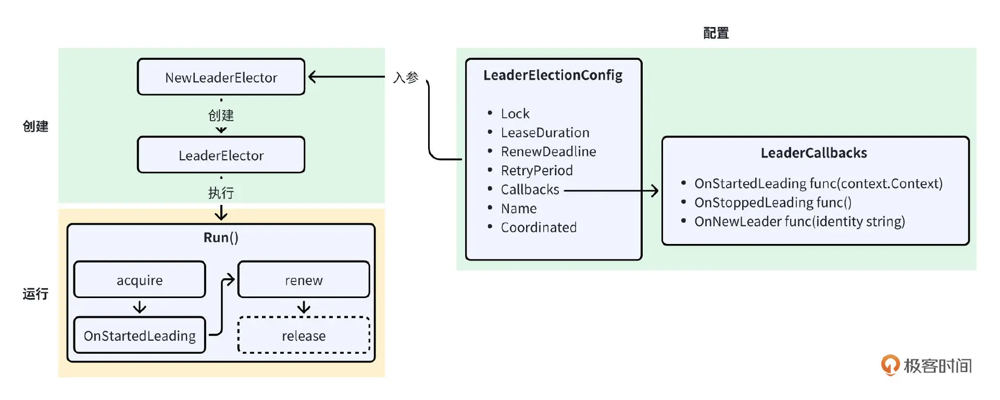

# 47 | LeaderElection：基于Lease的LeaderElection源码剖析

你好，我是孔令飞。

上一节课，我详细介绍了 Kubernetes 中 Leader Election 机制的原理，以及 kube-controller-manager 具体是如何通过 Leader Election 来实现多副本容灾的。

本节课，我将详细介绍如何在自己的项目中使用 Kubernetes 的 Leader Election 能力开发竞态资源处理组件，并结合实战示例与剖析源码，讲解基于 Lease 资源的 Leader Election 具体实现。

## Leader Election 使用实战

Kubernetes client-go 项目仓库中，其实已经有一个优秀的 Leader Election 使用示例：examples/leader-election/main.go，示例代码如下：

```go
/*
该示例来自于：https://github.com/kubernetes/client-go/blob/master/examples/leader-e
*/
package main
import (
   "context"
   "flag"
   "os"
   "os/signal"
   "syscall"
   "time"
   "github.com/google/uuid"
   metav1 "k8s.io/apimachinery/pkg/apis/meta/v1"
   clientset "k8s.io/client-go/kubernetes"
   "k8s.io/client-go/rest"
   "k8s.io/client-go/tools/clientcmd"
   "k8s.io/client-go/tools/leaderelection"
   "k8s.io/client-go/tools/leaderelection/resourcelock"
   "k8s.io/klog/v2"
)
func buildConfig(kubeconfig string) (*rest.Config, error) {
   // 如果指定了 kubeconfig，则使用指定的 kubeconfg 构建客户端
   if kubeconfig != "" {
       cfg, err := clientcmd.BuildConfigFromFlags("", kubeconfig)
       if err != nil {
           return nil, err
       }
       return cfg, nil
   }
   // 如果程序部署在 Kubernetes 集群内，则使用 In-Cluster Config
   cfg, err := rest.InClusterConfig()
   if err != nil {
       return nil, err
   }
   return cfg, nil
}
func main() {
   klog.InitFlags(nil)
   var kubeconfig string
   var leaseLockName string
   var leaseLockNamespace string
   var id string
   flag.StringVar(&kubeconfig, "kubeconfig", "", "absolute path to the kubeconfi
   flag.StringVar(&id, "id", uuid.New().String(), "the holder identity name")
   flag.StringVar(&leaseLockName, "lease-lock-name", "", "the lease lock resourc
   flag.StringVar(&leaseLockNamespace, "lease-lock-namespace", "", "the lease lo
   flag.Parse()
   if leaseLockName == "" {
       klog.Fatal("unable to get lease lock resource name (missing lease-lock-na
   }
   if leaseLockNamespace == "" {
       klog.Fatal("unable to get lease lock resource namespace (missing lease-lo
   }
   // leader election uses the Kubernetes API by writing to a
   // lock object, which can be a LeaseLock object (preferred),
   // a ConfigMap, or an Endpoints (deprecated) object.
   // Conflicting writes are detected and each client handles those actions
   // independently.
   config, err := buildConfig(kubeconfig)
   if err != nil {
       klog.Fatal(err)
   }
   // 创建 Kubernetes 客户端实例，用来同 kube-apiserver 进行交互
   client := clientset.NewForConfigOrDie(config)
   // 执行程序的主业务逻辑
   run := func(ctx context.Context) {
       // complete your controller loop here
       klog.Info("Controller loop...")
       select {}
   }
   // use a Go context so we can tell the leaderelection code when we
   // want to step down
   ctx, cancel := context.WithCancel(context.Background())
   defer cancel()
   // listen for interrupts or the Linux SIGTERM signal and cancel
   // our context, which the leader election code will observe and
   // step down
   // 优雅关停实现
   ch := make(chan os.Signal, 1)
   signal.Notify(ch, os.Interrupt, syscall.SIGTERM)
   go func() {
       <-ch
       klog.Info("Received termination, signaling shutdown")
       cancel()
   }()
   // we use the Lease lock type since edits to Leases are less common
   // and fewer objects in the cluster watch "all Leases".
   // 指定锁的资源对象，这里使用了 Lease 资源，还支持 configmap，endpoint，或者 multiloc
   lock := &resourcelock.LeaseLock{
       LeaseMeta: metav1.ObjectMeta{
           Name:      leaseLockName,
           Namespace: leaseLockNamespace,
       },
       Client: client.CoordinationV1(),
       LockConfig: resourcelock.ResourceLockConfig{
           Identity: id,
       },
   }
   // start the leader election code loop
   // 开始 Leader Election 循环
   leaderelection.RunOrDie(ctx, leaderelection.LeaderElectionConfig{
       Lock: lock,
       // IMPORTANT: you MUST ensure that any code you have that
       // is protected by the lease must terminate **before**
       // you call cancel. Otherwise, you could have a background
       // loop still running and another process could
       // get elected before your background loop finished, violating
       // the stated goal of the lease.
       ReleaseOnCancel: true,
       LeaseDuration:   60 * time.Second, // Leader 持有租约的最大时间
       RenewDeadline:   15 * time.Second, // Leader 续租租约的超时时间
       RetryPeriod:     5 * time.Second,  // 候选节点重试时间
       Callbacks: leaderelection.LeaderCallbacks{
           OnStartedLeading: func(ctx context.Context) {
               // we're notified when we start - this is where you would
               // usually put your code
               // 变为 Leader 后需要执行的业务代码
               run(ctx)
           },
           OnStoppedLeading: func() {
               // we can do cleanup here
               // 打印日志，并退出进程
               klog.Infof("leader lost: %s", id)
               os.Exit(0)
           },
           OnNewLeader: func(identity string) {
               // we're notified when new leader elected
               // 当产生新的 Leader 后执行的业务逻辑
               if identity == id {
                   // I just got the lock
                   return
               }
               klog.Infof("new leader elected: %s", identity)
           },
       },
   })
}
```

上述示例通过以下 2 个包来实现 Leader Election 功能：

```
k8s.io/client-go/tools/leaderelection：leaderelection 包是 Leader Election
```

- 核心实现代码所在的包，leaderelection 包支持通过多种 Kubernetes 资源来实现资源锁。例如：ConfigMap、Endpoints、Lease。

```
k8s.io/client-go/tools/leaderelection/resourcelock：resourcelock 是具
```

- 体的资源锁实现。

我们来解释一下这段示例。首先使用了 Go 标准库中的 flag 包初始化一些命令行选项，通过这些命令行选项配置 kubeconfig、候选节点的唯一 ID、资源锁所在的命名空间和资源锁的名字。

接着创建了 kube-apiserver 的客户端，用来通 kube-apiserver 进行交互。

然后通过以下代码实现了程序的优雅关停：

```go
   ch := make(chan os.Signal, 1)
   signal.Notify(ch, os.Interrupt, syscall.SIGTERM)
   go func() {
       <-ch
       klog.Info("Received termination, signaling shutdown")
       cancel()
   }()
```

接着创建了一个 Lease 类型的资源锁，创建代码如下：

```go
   lock := &resourcelock.LeaseLock{
       LeaseMeta: metav1.ObjectMeta{
           Name:      leaseLockName,
           Namespace: leaseLockNamespace,
       },
       Client: client.CoordinationV1(),
       LockConfig: resourcelock.ResourceLockConfig{
           Identity: id,
       },
   }
```

创建 Lease 锁实例的时候，我们指定了锁资源的命名空间和名字，还指定了实例的唯一 ID。client.CoordinationV1() 是版本化的 Lease 客户端，通过该客户端访问 kube-apiserver 进行Lease 资源的 CURD 操作。

接着通过调用 leaderelection.RunOrDie() 函数运行程序。leaderelection.RunOrDie 是 LeaderElection 的核心实现。leaderelection.LeaderElectionConfig 类型的配置中，我们配置了OnStartedLeading、OnStoppedLeading、OnNewLeader 3 个 Hook。通过这 3 个 Hook，我们不难猜测出 leaderelection.RunOrDie 函数中，会在抢锁成功、抢锁失败、Leader 切换 3 个节点分别运行指定的函数。其中，在 OnStartedLeading Hook 中会执行我们期望的程序主逻辑（run 函数），也就是每次抢锁成功都会执行这些程序主逻辑。

打开 3 个 Linux 终端 A、B、C。在 A 中运行以下命令：

```
$ go run main.go -kubeconfig=/path/to/kubeconfig -logtostderr=true -lease-lock-na
I0921 20:36:39.598707  184529 leaderelection.go:250] attempting to acquire leader
I0921 20:36:39.617600  184529 leaderelection.go:260] successfully acquired lease
I0921 20:36:39.617812  184529 main.go:87] Controller loop...
```

启动参数说明如下：

```
-kubeconfig：指定 kubeconfig 文件路径。
-logtostderr：设置日志输出的目标为标准错误（stderr）。
-lease-lock-name：指定了用于领导者选举的租约锁的名称。
-lease-lock-namespace：指定了租约锁所在的命名空间。
-id：指定当前实例的唯一标识符。
```

通过启动日志，可以发现 ID 为 1 的实例成功抢锁，并且执行了业务代码：

```go
   run := func(ctx context.Context) {
       // complete your controller loop here
       klog.Info("Controller loop...")
       select {}
   }
```

也即往标准输出打印了一个 Info 级别的日志：I0921 20:39:41.236657 207526 main.go:87]Controller loop…。

在 B 中运行以下命令：

```
$ go run main.go -kubeconfig=/path/to/kubeconfig -logtostderr=true -lease-lock-na
I0921 20:39:41.944049  207565 leaderelection.go:250] attempting to acquire leader
I0921 20:39:41.956150  207565 main.go:151] new leader elected: 1
```

通过启动日志，可以发现 ID 为 2 的实例参与了 Leader 选举，选举出来的 Leader ID 为 1。该实例因为不是 Leader，所以无法运行 run 函数，也就没有 Controller loop… 日志输出。

执行以下命令，可以查看锁资源的信息：

```
$ kubectl -n default get lease example -oyaml
apiVersion: coordination.k8s.io/v1
kind: Lease
metadata:
 creationTimestamp: "2024-09-21T12:36:39Z"
 name: example
 namespace: default
 resourceVersion: "232912420"
 uid: 0ad0cfd1-c5cb-4b82-b332-1fec942c8d28
spec:
 acquireTime: "2024-09-21T12:39:41.222004Z"
 holderIdentity: "1"
 leaseDurationSeconds: 60
 leaseTransitions: 5
 renewTime: "2024-09-21T12:42:11.469684Z"
```

通过 example Lease 资源的内容可以知道：当前的 Leader 是 ID 为 1 的实例。当前已经有过5 次 Leader 选举，并且还能看到上次抢锁成功的时间、续约的时间。

现在，在 A 终端中键入 CTRL + C，终止掉 ID 为 1 的实例：

```
I0921 20:47:55.078334  207526 main.go:104] Received termination, signaling shutdo
I0921 20:47:55.082827  207526 main.go:142] leader lost: 1
```

切换到 B 终端，查看 ID 为 2 实例的日志：

```
I0921 20:47:55.597436  207565 leaderelection.go:260] successfully acquired lease
I0921 20:47:55.597660  207565 main.go:87] Controller loop...
```

我们发现，ID 为 2 的实例成功抢锁，并运行了 run 函数，打印了日志。

接着查看 example Lease 的资源内容：

```
$ kubectl -n default get lease example -oyaml
apiVersion: coordination.k8s.io/v1
kind: Lease
metadata:
 creationTimestamp: "2024-09-21T12:36:39Z"
 name: example
 namespace: default
 resourceVersion: "233005011"
 uid: 0ad0cfd1-c5cb-4b82-b332-1fec942c8d28
spec:
 acquireTime: "2024-09-21T12:47:55.586494Z"
 holderIdentity: "2"
 leaseDurationSeconds: 60
 leaseTransitions: 6
 renewTime: "2024-09-21T12:50:00.862201Z"
```

通过 example Lease 的内容，我们可以知道刚才发生了 Leader 选举（leaseTransitions 数值增 1），并且当前的 Leader 变为 ID 为 2 的实例。

## 基于 Lease 的 Leader Election 源码剖析

上面，我通过一个简单的示例演示了如何使用 k8s.io/client-go/tools/leaderelection 包，实现多实例的 Leader Election。接下来，我们再看下 Kubernetes 中 Leader Election 的具体实现方式。

Kubernetes Leader Election 机制是通过 k8s.io/client-go/tools/leaderelection 包来实现的。

这里，我们再回忆下 Leader Election 的实现原理，也是 leaderelection 包的实现原理， 简单概括就是：使用 configmap、endpoints 和 lease 资源实现一个分布式锁。抢（acquire）到锁的节点成为 leader，并且定期更新（renew）。其他进程也在不断尝试进行抢占，抢占不到则继续等待下次循环。当 leader 节点挂掉之后，租约到期，其他节点就成为新的 leader。锁相关的信息，保存在 configmap、endpoints、lease 资源中。

接下来，我们就看下 leaderelection 具体是如何按照上述思路实现 Leader Election 的。

### Kubernetes Leader Election 实现源码概述

先来看下 leaderelection 包的源码结构：

```
$ tree -F client-go/tools/leaderelection/
client-go/tools/leaderelection/
├── healthzadaptor.go
├── leaderelection.go # 领导选举的核心实现，包含选举逻辑的主要代码
├── leasecandidate.go
├── metrics.go # 该文件实现了与领导选举相关的指标收集功能
└── resourcelock/ # 该子目录包含与资源锁定相关的实现，资源锁定是领导选举的基础
   ├── interface.go # 该文件定义了资源锁定的接口，允许用户实现不同的锁定机制
   ├── leaselock.go # 该文件实现了基于租约（Lease）的锁定机制
   └── multilock.go # 多锁实现
```

leaderelection.go 文件实现了 Leader Election 的核心逻辑，整个实现原理图如下：



在 Go 中，设计一个功能的通用思路是先创建一个配置型 Go 结构体，用来保存功能的各类配

```
置，再使用 NewXXX 或 CreateXXX 这类函数创建一个实例，然后调用实例的方法实现期望
```

的功能。

Leader Election 的关键影响因素我们已经提到过很多次，例如：持锁时间、续约时间、回调函数、锁名称、抢锁间隔等。这些信息会保存在一个存储实体中，如 MySQL 表记录或Kubernees 资源中。

上面是设计一个稍具规模的功能特性的一般设计思路，Kubernetes Leader Election 机制的设计和实现与其保持一致。具体包括以下几步：

1. 创建 Leader Election 配置

2. 创建 *LeaderElector 类型实例

3. 运行 Leader Election 逻辑

4. 运行业务逻辑

5. 定期续约

### 步骤 1：创建 Leader Election 配置

首先，leaderelection 包定义了一个 LeaderElectionConfig 类型的结构体，结构体中包含了Leader Election 需要的各类配置项：

```
type LeaderElectionConfig struct {
   // Lock is the resource that will be used for locking
   Lock rl.Interface
   // LeaseDuration is the duration that non-leader candidates will
   // wait to force acquire leadership. This is measured against time of
   // last observed ack.
   //
   // A client needs to wait a full LeaseDuration without observing a change to
   // the record before it can attempt to take over. When all clients are
   // shutdown and a new set of clients are started with different names against
   // the same leader record, they must wait the full LeaseDuration before
   // attempting to acquire the lease. Thus LeaseDuration should be as short as
   // possible (within your tolerance for clock skew rate) to avoid a possible
   // long waits in the scenario.
   //
   // Core clients default this value to 15 seconds.
   LeaseDuration time.Duration
   // RenewDeadline is the duration that the acting master will retry
   // refreshing leadership before giving up.
   //
   // Core clients default this value to 10 seconds.
   RenewDeadline time.Duration
   // RetryPeriod is the duration the LeaderElector clients should wait
   // between tries of actions.
   //
   // Core clients default this value to 2 seconds.
   RetryPeriod time.Duration
   // Callbacks are callbacks that are triggered during certain lifecycle
   // events of the LeaderElector
   Callbacks LeaderCallbacks
   // WatchDog is the associated health checker
   // WatchDog may be null if it's not needed/configured.
   WatchDog *HealthzAdaptor
   // ReleaseOnCancel should be set true if the lock should be released
   // when the run context is cancelled. If you set this to true, you must
   // ensure all code guarded by this lease has successfully completed
   // prior to cancelling the context, or you may have two processes
   // simultaneously acting on the critical path.
   ReleaseOnCancel bool
   // Name is the name of the resource lock for debugging
   Name string
   // Coordinated will use the Coordinated Leader Election feature
   // WARNING: Coordinated leader election is ALPHA.
   Coordinated bool
}
```

字段的含义你可以看注释，关键的字段前面也反复介绍过。接着，可以调用NewLeaderElector 函数来创建一个 *LeaderElector 类型的实例。

### 步骤 2：创建 LeaderElector 类型实例

NewLeaderElector 函数实现如下：

```go
// NewLeaderElector creates a LeaderElector from a LeaderElectionConfig
func NewLeaderElector(lec LeaderElectionConfig) (*LeaderElector, error) {
   if lec.LeaseDuration <= lec.RenewDeadline {
       return nil, fmt.Errorf("leaseDuration must be greater than renewDeadline"
   }
   if lec.RenewDeadline <= time.Duration(JitterFactor*float64(lec.RetryPeriod))
       return nil, fmt.Errorf("renewDeadline must be greater than retryPeriod*Ji
   }
   if lec.LeaseDuration < 1 {
       return nil, fmt.Errorf("leaseDuration must be greater than zero")
   }
   if lec.RenewDeadline < 1 {
       return nil, fmt.Errorf("renewDeadline must be greater than zero")
   }
   if lec.RetryPeriod < 1 {
       return nil, fmt.Errorf("retryPeriod must be greater than zero")
   }
   if lec.Callbacks.OnStartedLeading == nil {
       return nil, fmt.Errorf("OnStartedLeading callback must not be nil")
   }
   if lec.Callbacks.OnStoppedLeading == nil {
       return nil, fmt.Errorf("OnStoppedLeading callback must not be nil")
   }
   if lec.Lock == nil {
       return nil, fmt.Errorf("Lock must not be nil.")
   }
   id := lec.Lock.Identity()
   if id == "" {
       return nil, fmt.Errorf("Lock identity is empty")
   }
   le := LeaderElector{
       config:  lec,
       clock:   clock.RealClock{},
       metrics: globalMetricsFactory.newLeaderMetrics(),
   }
   le.metrics.leaderOff(le.config.Name)
   return &le, nil
}
```

NewLeaderElector 函数的入参是 LeaderElectionConfig 类型的实例，这个你应该很容易能理解。该函数内部基于互不信任原则校验了入参字段，这里再解释几个关键的校验项：

```
   // 领导者续约的时间间隔 RenewDeadline 要小于领导者持锁的时间。
   // 否则，会导致领导者还在等待续约超时的时候，就导致锁被释放，进而导致续锁失败
   if lec.LeaseDuration <= lec.RenewDeadline {
       return nil, fmt.Errorf("leaseDuration must be greater than renewDeadline"
   }
   if lec.RenewDeadline <= time.Duration(JitterFactor*float64(lec.RetryPeriod))
       return nil, fmt.Errorf("renewDeadline must be greater than retryPeriod*Ji
   }
```

在 NewLeaderElector 函数中，通过调用 lec.Lock.Identity() 方法生成了候选者唯一 ID：

```go
   id := lec.Lock.Identity()
   if id == "" {
       return nil, fmt.Errorf("Lock identity is empty")
   }
```

Identity() 方法实现如下（Lease 锁的实现）：

```
// Identity returns the Identity of the lock
func (ll *LeaseLock) Identity() string {
   return ll.LockConfig.Identity
}
```

Identity 字段是在创建 Lease Lock 时指定的：

```go
   lock := &resourcelock.LeaseLock{
       LeaseMeta: metav1.ObjectMeta{
           Name:      leaseLockName,
           Namespace: leaseLockNamespace,
       },
       Client: client.CoordinationV1(),
       LockConfig: resourcelock.ResourceLockConfig{
           Identity: id,
       },
}
```

上面，我们通过 NewLeaderElector 函数创建了一个 *LeaderElector 类型的实例，接着就可以调用实例的 run 方法来启动整个 Leader Election 逻辑。

### 步骤 3：运行 Leader Election 逻辑

LeaderElector 实例的 run 方法实现如下：

```go
func (le *LeaderElector) Run(ctx context.Context) {
   // 处理 Panic，防止业务代码 Panic，导致整个 Leader Election 逻辑 Panic
   defer runtime.HandleCrash()
   defer le.config.Callbacks.OnStoppedLeading()
   // 先去抢锁，阻塞操作
   if !le.acquire(ctx) {
       return // ctx signalled done
   }
   ctx, cancel := context.WithCancel(ctx)
   defer cancel()
   // 抢到锁后，执行主业务逻辑，通过 Callbacks.OnStartedLeading 回调启动
   go le.config.Callbacks.OnStartedLeading(ctx)
   // 抢到锁后，需要定期更新，确保自己一直持有该锁
   le.renew(ctx)
}
```

在 run 方法中，为了防止 Panic 导致整个 Leader Election 协程退出，使用了 deferruntime.HandleCrash() 来捕获并处理 Panic。需要注意的是，这里捕获的 Panic 主要是OnStartedLeading Hook（业务主逻辑）函数抛出的 Panic。因为业务主逻辑中是否有Panic，leaderelection 包是无法提前预知的，所以这里只能考虑最坏的情况，进而提高整个Leader Election 运行时的稳定性。

接着，会调用 le.acquire(ctx) 函数抢锁。如果抢锁失败，直接返回；如果抢锁成功，则运行。这里，我们来看下 acquire 方法具体是如何抢锁的，acquire 方法实现如下：

```go
// acquire loops calling tryAcquireOrRenew and returns true immediately when tryA
// Returns false if ctx signals done.
func (le *LeaderElector) acquire(ctx context.Context) bool {
   ctx, cancel := context.WithCancel(ctx)
   defer cancel()
   succeeded := false
   desc := le.config.Lock.Describe()
   klog.Infof("attempting to acquire leader lease %v...", desc)
   wait.JitterUntil(func() {
       if !le.config.Coordinated {
           succeeded = le.tryAcquireOrRenew(ctx)
       } else {
           succeeded = le.tryCoordinatedRenew(ctx)
       }
       le.maybeReportTransition()
       if !succeeded {
           klog.V(4).Infof("failed to acquire lease %v", desc)
           return
       }
       le.config.Lock.RecordEvent("became leader")
       le.metrics.leaderOn(le.config.Name)
       klog.Infof("successfully acquired lease %v", desc)
       cancel()
   }, le.config.RetryPeriod, JitterFactor, true, ctx.Done())
   return succeeded
}
```

acquire 方法主要是调用了 le.tryAcquireOrRenew(ctx) 方法来抢锁，通过 tryAcquireOrRenew方法的名字，我们可以知道该方法会抢锁，如果抢到锁会续约。

acquire 方法中通过 wait.JitterUntil 函数来定期调用 le.tryAcquireOrRenew(ctx) 方法抢锁，直到成功为止。如果获取不到锁，则会以 RetryPeriod 为间隔不断尝试；如果获取到锁，就会调用 cancel() 函数，通知 wait.JitterUntil 停止尝试。tryAcquireOrRenew 是 Leader Election 实现中最核心的方法。

acquire 方法中的 le.maybeReportTransition() 调用很关键，会判断是否出现了 leader 的切换，进而调用 Callbacks 的 OnNewLeader 方法，尽管 kube-controller-manager 初始化时并没有设置这个 Callback 方法。maybeReportTransition 方法实现如下：

```
func (le *LeaderElector) maybeReportTransition() {
   if le.observedRecord.HolderIdentity == le.reportedLeader {
       return
   }
   le.reportedLeader = le.observedRecord.HolderIdentity
   if le.config.Callbacks.OnNewLeader != nil {
       go le.config.Callbacks.OnNewLeader(le.reportedLeader)
   }
}
```

acquire 方法中调用的 tryAcquireOrRenew 方法实现了核心的抢锁逻辑，其实现代码如下：

```go
// tryAcquireOrRenew tries to acquire a leader lease if it is not already acquire
// else it tries to renew the lease if it has already been acquired. Returns true
// on success else returns false.
func (le *LeaderElector) tryAcquireOrRenew(ctx context.Context) bool {
   now := metav1.NewTime(le.clock.Now())
   // 这个 leaderElectionRecord 就是保存在 Lease 资源 Spec 中的值。
   // 每个节点都将 HolderIdentity 设置为自己，以及关于获取和更新锁的时间。后面会对时间进行修
   leaderElectionRecord := rl.LeaderElectionRecord{
       HolderIdentity:       le.config.Lock.Identity(),
       LeaseDurationSeconds: int(le.config.LeaseDuration / time.Second),
       RenewTime:            now,
       AcquireTime:          now,
   }
   // 1. fast path for the leader to update optimistically assuming that the rec
   // last time is the current version.
   // 如果当前实例时Leader，并且 Lease 资源存在，则更新Lease资源
   if le.IsLeader() && le.isLeaseValid(now.Time) {
       oldObservedRecord := le.getObservedRecord()
       leaderElectionRecord.AcquireTime = oldObservedRecord.AcquireTime
       leaderElectionRecord.LeaderTransitions = oldObservedRecord.LeaderTransiti
       err := le.config.Lock.Update(ctx, leaderElectionRecord)
       if err == nil {
           le.setObservedRecord(&leaderElectionRecord)
           return true
       }
       klog.Errorf("Failed to update lock optimitically: %v, falling back to slo
   }
   // 2. obtain or create the ElectionRecord
   oldLeaderElectionRecord, oldLeaderElectionRawRecord, err := le.config.Lock.Ge
   if err != nil {
       if !errors.IsNotFound(err) {
           klog.Errorf("error retrieving resource lock %v: %v", le.config.Lock.D
           return false
       }
       // 记录不存在的话，则创建一条新的记录
       if err = le.config.Lock.Create(ctx, leaderElectionRecord); err != nil {
           klog.Errorf("error initially creating leader election record: %v", er
           return false
       }
       le.setObservedRecord(&leaderElectionRecord)
       // 创建记录成功，同时表示获得了锁，返回 true
       return true
   }
   // 3. Record obtained, check the Identity & Time
   // 正常获取了锁资源的记录，检查锁持有者和更新时间。
   if !bytes.Equal(le.observedRawRecord, oldLeaderElectionRawRecord) {
       // 记录之前的锁持有者，其实有可能就是自己。
       le.setObservedRecord(oldLeaderElectionRecord)
       le.observedRawRecord = oldLeaderElectionRawRecord
   }
   // 在满足以下所有的条件下，认为锁由他人持有，并且还没有过期，返回 false
   // a. 当前锁持有者的并非自己
   // b. 上一次观察时间 + 观测检查间隔大于现在时间，即距离上次观测的间隔，小于 `LeaseDurati
   if len(oldLeaderElectionRecord.HolderIdentity) > 0 && le.isLeaseValid(now.Tim
       klog.V(4).Infof("lock is held by %v and has not yet expired", oldLeaderEl
       return false
   }
   // 4. We're going to try to update. The leaderElectionRecord is set to it's d
   // here. Let's correct it before updating.
   // 在本函数开头 leaderElectionRecord 有一些字段被设置成了默认值，这里来设置正确的值。
   if le.IsLeader() {
       leaderElectionRecord.AcquireTime = oldLeaderElectionRecord.AcquireTime
       leaderElectionRecord.LeaderTransitions = oldLeaderElectionRecord.LeaderTr
       le.metrics.slowpathExercised(le.config.Name)
   } else {
       // 发生 leader 切换，所以 LeaderTransitions + 1
       leaderElectionRecord.LeaderTransitions = oldLeaderElectionRecord.LeaderTr
   }
   // update the lock itself
   // 更新锁资源对象
   if err = le.config.Lock.Update(ctx, leaderElectionRecord); err != nil {
       klog.Errorf("Failed to update lock: %v", err)
       return false
   }
   le.setObservedRecord(&leaderElectionRecord)
   return true
}
```

tryAcquireOrRenew 方法本身不是一个阻塞操作，只返回 true/false，对应为获取到锁和没有获取到锁的状态。另外，在 Kubernetes 源码中，你会发现有大量的类似 tryAcquireOrRenew这种函数：集创建和更新为一体，这种方式可以简化 Kubernetes 源码实现，提高了代码的复用度。

我们再来解释一下上述代码的核心逻辑。

首先，创建了一个 leaderElectionRecord 变量，该变量保存了锁的信息，变量设置了以下默认值：当前锁的持有者（ID）为当前实例 ID、续约时间为当前时间、获取锁的时间为当前时间。

接着，判断当前实例是否是 Leader，如果是 Leader，并且 Leader 处在持锁周期内，那么更新 Lease 资源。这里需要注意：

- 因为 Leader 没有切换，所以 AcquireTime 和 LeaderTransitions 需要为上一次的观察值。

- 因为 Leader 健康，所以这里只需要续约即可继续持有资源锁。

如果不是 Leader，说明有 2 种情况：Lease 资源不存在，或者 Lease 资源存在但当前实例不是 Leader。

接下来，会先通过调用 le.config.Lock.Get(ctx) 来获取 Lease 资源。如果没有 Lease 资源，则调用 le.config.Lock.Create(ctx, leaderElectionRecord) 新建一个 Lease 资源。这时候，当前实例也即为锁资源的持有者，抢锁成功并返回。

如果当前节点不是 Leader ，并且 Leader 持有锁的时间小于 LeaseDuration，说明候选节点还无法发起新一轮的 Leader 选举，返回抢锁失败。

如果当前节点是 Leader，并且不处在持锁周期内，说明资源锁已经被其他节点持有，这时候需要将资源锁的信息重新同步到本地的缓存中。

### 步骤 4：运行业务逻辑

在 run 方法中，抢锁成功后便会在 Go 协程中调用 OnStartedLeading 方法来运行业务逻辑。

### 步骤 5：定期续约

run 方法的最后会调用 le.renew(ctx) 定期续约以保持自己的 Leader 位置，renew 方法实现如下：

```go
// renew loops calling tryAcquireOrRenew and returns immediately when tryAcquireO
func (le *LeaderElector) renew(ctx context.Context) {
   defer le.config.Lock.RecordEvent("stopped leading")
   ctx, cancel := context.WithCancel(ctx)
   defer cancel()
   wait.Until(func() {
       timeoutCtx, timeoutCancel := context.WithTimeout(ctx, le.config.RenewDead
       defer timeoutCancel()
       err := wait.PollImmediateUntil(le.config.RetryPeriod, func() (bool, error
           if !le.config.Coordinated {
               return le.tryAcquireOrRenew(timeoutCtx), nil
           } else {
               return le.tryCoordinatedRenew(timeoutCtx), nil
           }
       }, timeoutCtx.Done())
       le.maybeReportTransition()
       desc := le.config.Lock.Describe()
       if err == nil {
           klog.V(5).Infof("successfully renewed lease %v", desc)
           return
       }
       le.metrics.leaderOff(le.config.Name)
       klog.Infof("failed to renew lease %v: %v", desc, err)
       cancel()
   }, le.config.RetryPeriod, ctx.Done())
   // if we hold the lease, give it up
   if le.config.ReleaseOnCancel {
       le.release()
   }
}
```

在 renew 方法中，wait.Until 方法会每隔 RetryPeriod 调用 le.tryAcquireOrRenew(timeoutCtx)方法续约资源锁。

### Leader Election 语法糖

通过上面的源码分析，我们知道要启用整个 Leader Election 需要执行以下步骤：创建配置 ->创建 Leader Elector 实例 -> 执行 run 方法。leaderelection 提供了一个名为 RunOrDie 的语法糖函数，在该语法糖函数中，同时创建了 Leader Elector 实例，并调用了其 run 方法。RunOrDie 函数实现如下：

```go
// RunOrDie starts a client with the provided config or panics if the config
// fails to validate. RunOrDie blocks until leader election loop is
// stopped by ctx or it has stopped holding the leader lease
func RunOrDie(ctx context.Context, lec LeaderElectionConfig) {
   le, err := NewLeaderElector(lec)
   if err != nil {
       panic(err)
   }
   if lec.WatchDog != nil {
       lec.WatchDog.SetLeaderElection(le)
   }
   le.Run(ctx)
}
```

在实际的 Kubernetes 开发中，通常是用 RunOrDie 函数来快捷启动整个 Leader Election 逻辑的。

## 资源锁实现

leaderelection.LeaderElectionConfig 中有一个 Lock 字段，类型为 k8s.io/client-go/tools/leaderelection/resourcelock.Interface，Interface 接口定义如下：

```sql
type Interface interface {
   // Get returns the LeaderElectionRecord
   Get(ctx context.Context) (*LeaderElectionRecord, []byte, error)
   // Create attempts to create a LeaderElectionRecord
   Create(ctx context.Context, ler LeaderElectionRecord) error
   // Update will update and existing LeaderElectionRecord
   Update(ctx context.Context, ler LeaderElectionRecord) error
   // RecordEvent is used to record events
   RecordEvent(string)
   // Identity will return the locks Identity
   Identity() string
   // Describe is used to convert details on current resource lock
   // into a string
   Describe() string
}
```

我们在调用 leaderelection.RunOrDie 运行 Leader Election 时，首先需要创建一个resourcelock.Interface 类型的实例。例如，在本节课开始的实战部分，创建了一个 leases 类型的 Lock：

```go
   lock := &resourcelock.LeaseLock{
       LeaseMeta: metav1.ObjectMeta{
           Name:      leaseLockName,
           Namespace: leaseLockNamespace,
       },
       Client: client.CoordinationV1(),
       LockConfig: resourcelock.ResourceLockConfig{
           Identity: id,
       },
   }
```

leases 是 Lock 的一个实现，leaderelection 还支持 endpoints、configmaps、endpointsleases、multilock 类型的锁，见文件：

tools/leaderelection/resourcelock/interface.go。

那么，具体应该如何实现一个新的锁资源呢？这里，我们以 leases 锁为例。

Lease 是 Kubernetes 控制平面中通过 etcd 实现的一种 Leases 资源，主要用于提供分布式租约的控制机制。关于该 API 的描述可参考：Lease 。

在 Kubernetes 集群中，我们可以使用如下命令来查看对应的 lease：

```sql
$ kubectl get leases -A
NAMESPACE         NAME                      HOLDER
kube-node-lease   master-machine            master-machine
kube-system       kube-controller-manager   master-machine_06730140-a503-487d-850
kube-system       kube-scheduler            master-machine_1724e2d9-c19c-48d7-ae4
$ kubectl describe leases kube-controller-manager -n kube-system
Name:         kube-controller-manager
Namespace:    kube-system
Labels:       <none>
Annotations:  <none>
API Version:  coordination.k8s.io/v1
Kind:         Lease
Metadata:
 Creation Timestamp:  2022-06-24T11:01:51Z
 Managed Fields:
   API Version:  coordination.k8s.io/v1
   Fields Type:  FieldsV1
   fieldsV1:
     f:spec:
       f:acquireTime:
       f:holderIdentity:
       f:leaseDurationSeconds:
       f:leaseTransitions:
       f:renewTime:
   Manager:         kube-controller-manager
   Operation:       Update
   Time:            2022-06-24T11:01:51Z
 Resource Version:  56012
 Self Link:         /apis/coordination.k8s.io/v1/namespaces/kube-system/leases/k
 UID:               851a32d2-25dc-49b6-a3f7-7a76f152f071
Spec:
 Acquire Time:            2022-06-27T15:30:46.000000Z
 Holder Identity:         master-machine_06730140-a503-487d-850b-1fe1619f1fe1
 Lease Duration Seconds:  15
 Lease Transitions:       2
 Renew Time:              2022-06-28T06:09:26.837773Z
Events:                    <none>
```

下面来看下 leases 锁的实现，leases 锁实现了资源锁的抽象。leases 锁定义如下：

```
type LeaseLock struct {
   // LeaseMeta 就是类似于其他资源类型的属性，包含name、namespace 以及其他关于 lease 的属
   LeaseMeta  metav1.ObjectMeta
   // Client 就是提供了informer中的功能
   Client     coordinationv1client.LeasesGetter
   // lockconfig 包含上面通过 describe 看到的 Identity 与 recoder 用于记录资源锁的更改
   LockConfig ResourceLockConfig
   // lease 就是 API 中的 Lease 资源，可以参考下上面给出的这个 API 的使用
   lease      *coordinationv1.Lease
}
```

接下来，我们再看看 LeaseLock 实现了哪些方法。

首先是 Get 方法：获取选举记录。Get 用来从 LeaseSpec 中返回选举的记录*LeaderElectionRecord，其实现代码如下：

```go
// Get returns the election record from a Lease spec
func (ll *LeaseLock) Get(ctx context.Context) (*LeaderElectionRecord, []byte, err
   lease, err := ll.Client.Leases(ll.LeaseMeta.Namespace).Get(ctx, ll.LeaseMeta.
   if err != nil {
       return nil, nil, err
   }
   ll.lease = lease
   record := LeaseSpecToLeaderElectionRecord(&ll.lease.Spec)
   recordByte, err := json.Marshal(*record)
   if err != nil {
       return nil, nil, err
   }
   return record, recordByte, nil
}
// 可以看出是返回这个资源spec里面填充的值
func LeaseSpecToLeaderElectionRecord(spec *coordinationv1.LeaseSpec) *LeaderElect
   var r LeaderElectionRecord
   if spec.HolderIdentity != nil {
       r.HolderIdentity = *spec.HolderIdentity
   }
   if spec.LeaseDurationSeconds != nil {
       r.LeaseDurationSeconds = int(*spec.LeaseDurationSeconds)
   }
   if spec.LeaseTransitions != nil {
       r.LeaderTransitions = int(*spec.LeaseTransitions)
   }
   if spec.AcquireTime != nil {
       r.AcquireTime = metav1.Time{Time: spec.AcquireTime.Time}
   }
   if spec.RenewTime != nil {
       r.RenewTime = metav1.Time{Time: spec.RenewTime.Time}
   }
   if spec.PreferredHolder != nil {
       r.PreferredHolder = *spec.PreferredHolder
   }
   if spec.Strategy != nil {
       r.Strategy = *spec.Strategy
   }
   return &r
}
```

然后是 Create 方法：创建一个租约。Create 是在 Kubernetes 集群中尝试去创建一个租约，可以看到，Client 就是 API 提供的对应资源的 REST 客户端，结果会在 Kubernetes 集群中创建这个 Lease。Create 方法实现如下：

```javascript
// Create attempts to create a Lease
func (ll *LeaseLock) Create(ctx context.Context, ler LeaderElectionRecord) error
   var err error
   ll.lease, err = ll.Client.Leases(ll.LeaseMeta.Namespace).Create(ctx, &coordin
       ObjectMeta: metav1.ObjectMeta{
           Name:      ll.LeaseMeta.Name,
           Namespace: ll.LeaseMeta.Namespace,
       },
       Spec: LeaderElectionRecordToLeaseSpec(&ler),
   }, metav1.CreateOptions{})
   return err
}
```

接着是 Update 方法，用来更新 LeaseSpec，代码实现如下：

```go
// Update will update an existing Lease spec.
func (ll *LeaseLock) Update(ctx context.Context, ler LeaderElectionRecord) error
   if ll.lease == nil {
       return errors.New("lease not initialized, call get or create first")
   }
   ll.lease.Spec = LeaderElectionRecordToLeaseSpec(&ler)
   lease, err := ll.Client.Leases(ll.LeaseMeta.Namespace).Update(ctx, ll.lease,
   if err != nil {
       return err
   }
   ll.lease = lease
   return nil
}
```

下一个是 RecordEvent 方法，用来记录选举时出现的各类事件，代码实现如下：

```go
// RecordEvent in leader election while adding meta-data
func (ll *LeaseLock) RecordEvent(s string) {
   if ll.LockConfig.EventRecorder == nil {
       return
   }
   events := fmt.Sprintf("%v %v", ll.LockConfig.Identity, s)
   subject := &coordinationv1.Lease{ObjectMeta: ll.lease.ObjectMeta}
   // Populate the type meta, so we don't have to get it from the schema
   subject.Kind = "Lease"
   subject.APIVersion = coordinationv1.SchemeGroupVersion.String()
   ll.LockConfig.EventRecorder.Eventf(subject, corev1.EventTypeNormal, "LeaderEl
}
```

最后是 Describe 方法，用来返回当前锁的字符串信息，代码实现如下：

```
// Describe is used to convert details on current resource lock
// into a string
func (ll *LeaseLock) Describe() string {
   return fmt.Sprintf("%v/%v", ll.LeaseMeta.Namespace, ll.LeaseMeta.Name)
}
```

可以看到 Describe 方法以字符串的形式返回了 Lease 资源的命名空间和名字信息，例如：kube-system/kube-controller-manager。

## 课程总结

本节课围绕 Kubernetes 的 Leader Election 的使用和实现展开。

首先演示了如何使用 Lease 资源实现 Leader Election：配置命令行参数、创建客户端与Lease 锁，调用 RunOrDie 函数启动选举，通过多终端实验展示了 Leader 切换过程。

接着，我们重点剖析 k8s.io/client-go/tools/leaderelection 包中的 Leader Election 实现源码，为你讲解其实现步骤。创建 LeaderElectionConfig 配置、生成 LeaderElector 实例、运行选举逻辑（抢锁、执行业务、定期续约），并介绍了 RunOrDie 语法糖及 LeaseLock 的具体实现方法，包括 Get、Create 等核心方法。

k8s.io/client-go/tools/leaderelection 支持的锁资源是可以扩展的，本节课最后展示了应该如何开发一个新的锁资源。

## 课后练习

1. leaderelection 包中的 LeaderElectionConfig 类型中的 Lock 字段是一个接口类型：

```sql
type Interface interface {
   // Get returns the LeaderElectionRecord
   Get(ctx context.Context) (*LeaderElectionRecord, []byte, error)
   // Create attempts to create a LeaderElectionRecord
   Create(ctx context.Context, ler LeaderElectionRecord) error
   // Update will update and existing LeaderElectionRecord
   Update(ctx context.Context, ler LeaderElectionRecord) error
   // RecordEvent is used to record events
   RecordEvent(string)
   // Identity will return the locks Identity
   Identity() string
   // Describe is used to convert details on current resource lock
   // into a string
   Describe() string
}
```

也就是说，你可以扩展 leaderelection 所支持的资源锁类型（当前有 ConfigMap、Endpoints、Lease），试着实现一个基于 MySQL 的资源锁。

欢迎你在留言区与我交流讨论，如果今天的内容让你有所收获，也欢迎转发给有需要的朋友，我们下节课再见！
