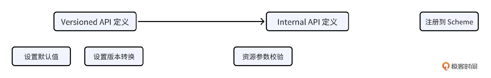

# 48 | 通过API接口的定义流程学习KubernetesAPIServer

你好，我是孔令飞。

在 Kubernetes API Server 的设计中，值得我们去了解、学习的功能和设计比较多。为了能够给你清晰地介绍 Kubernetes API Server 中的核心机制，这节课我以 Deployment 资源的添加流程为主线，来给你介绍下定义过程中涉及到的核心 API Server 机制及其实现。

## Kubernetes 资源定义流程

Kubernetes 中有很多内置资源，随着版本的迭代有很多新的资源类型被集成到 Kubernetes 源码中。那么如何给 Kubernetes 添加一个新的资源类型？流程和细节又是什么呢？

Kubernetes 新资源添加流程如下：



上述流程介绍了，Kuberentes 添加一个新资源的详细流程。在实际的 Kubernetes 开发中，有些流程可能是不需要的，例如：如果你新添加一个资源，这个资源的创建参数可能不需要设置默认值，或者这个资源现在及未来只有一个版本，不需要进行版本转换。为了能够给你详细介绍添加新资源涉及的 Kubernetes 知识，这里，我会假设每一步都需要，并且会详细介绍每一步。

接下来，我们来看下 Kubernetes 具体是如何添加一个 Deployment 资源的。

- 提示：Kubernetes 支持自定义资源（CRD），添加一个自定义资源非常简便快捷，但隐藏了很多实现细节，不利于了解 Kubernetes 的实现机制。所以，这里，我介绍 Kubernetes内置资源的添加流程。

## 步骤一：确定资源组、资源版本、资源类型的名字

定义一个新的 Kubernetes 资源，首先要确定好资源组、资源版本、资源类型的名字。起名要符合 Kubernetes 的规范：

- 资源组

- 资源版本

- 资源类型

```
Deployment 的资源组、资源版本、资源类型名字分别为：apps、v1beta1、
Deployment。这里因为添加的 Deployment 是一个新的资源，所以这时候其版本化 API 和内
```

部 API 字段其实是一样的。

## 步骤二：版本化 API 定义

```
接下来，我们要定义 Deployment v1beta1 版本的 API 定义（其实就是 Go 结构体），定义文
件为 staging/src/k8s.io/api/<group>/<version>/types.go，也即：
staging/src/k8s.io/api/apps/v1beta1/types.go。
这里要确保 staging/src/k8s.io/api/apps/v1beta1/types.go 文件和路径目录存
```

在，如果没有则需要新建。

### 定义 Deployment 结构体（v1beta1版本）

Deployment 结构体具体定义如下：

```
// +genclient
// +k8s:deepcopy-gen:interfaces=k8s.io/apimachinery/pkg/runtime.Object
// +k8s:prerelease-lifecycle-gen:introduced=1.6
// +k8s:prerelease-lifecycle-gen:deprecated=1.8
// +k8s:prerelease-lifecycle-gen:removed=1.16
// +k8s:prerelease-lifecycle-gen:replacement=apps,v1,Deployment
// DEPRECATED - This group version of Deployment is deprecated by apps/v1beta2/De
// more information.
// Deployment enables declarative updates for Pods and ReplicaSets.
type Deployment struct {
   metav1.TypeMeta `json:",inline"`
   // Standard object metadata.
   // +optional
   metav1.ObjectMeta `json:"metadata,omitempty" protobuf:"bytes,1,opt,name=metad
   // Specification of the desired behavior of the Deployment.
   // +optional
   Spec DeploymentSpec `json:"spec,omitempty" protobuf:"bytes,2,opt,name=spec"`
   // Most recently observed status of the Deployment.
   // +optional
   Status DeploymentStatus `json:"status,omitempty" protobuf:"bytes,3,opt,name=s
}
DeploymentSpec、DeploymentStatus 的定义这里忽略，感兴趣，你可以自行阅读源
码。上面的定义中有一些 // + 开头的注释，Kubernetes 会根据这些注释生成对应的代码。
```

Kubernetes 有很多代码生成器，不同的代码生成器会解析 Go 文件，从中找到生成器支持的标签，并根据标签的值生成对应的代码。在我们的业务开发中，也可以参考 Kubernetes 这种代码生成方式来生成业务代码，提高开发效率。

上述代码涉及到的注释标签释义如下：

```
// +genclient：client-gen 工具会根据改标签，生成 Go SDK。client-go 中包含的
```

- API 接口，就是根据这个标签来生成的。

```
// +k8s:deepcopy-
gen:interfaces=k8s.io/apimachinery/pkg/runtime.Object：deepcopy-
gen 工具会根据该标签，生成深度拷贝方法。
// +k8s:prerelease-lifecycle-gen:introduced=1.6：prerelease-
lifecycle-gen 工具会根据该标签，生成 api-status.csv 文件，用来标记 API 对象
的生命周期状态。introduced=1.6 指定该 API 对象在 Kubernetes 版本 1.6 中被引入。
// +k8s:prerelease-lifecycle-gen:deprecated=1.8：deprecated=1.8 指
```

- 定该 API 对象在 Kubernetes 版本 1.8 中被废弃。

```
// +k8s:prerelease-lifecycle-gen:removed=1.16：removed=1.16 指定该
```

- API 对象在 Kubernetes 版本 1.16 中被移除。

```
// +k8s:prerelease-lifecycle-gen:replacement=apps,v1,Deployment：
replacement=apps,v1,Deployment 指定该 API 对象的替代方案为 apps/v1 版本的
Deployment。
```

这里仅仅介绍下涉及到的标签的功能，关于代码生成器，后面会详细介绍。对于一个资源类型

```
定义，我们可以根据需要添加需要的 // + 标签，来生成不同的代码。但通常，我们都需要添
```

加以下两个标签：

```
// +genclient：生成 Go SDK，Go SDK 可供 Go 程序直接调用，提高调用效率和使用
```

- 体验。

```
// +k8s:deepcopy-
gen:interfaces=k8s.io/apimachinery/pkg/runtime.Object：生成对应类型对
```

- 象的深度拷贝方法。

```
在 Deployment 的定义中，字段注释中还有 // +optional 这种类型的注释，//
+optional 是 Kubernetes 资源定义时经常用到的一个注释类型，用来标识所备注的字段是
可选的，可以根据实际情况选择性地提供这些字段的值。这里要注意，// +optional 注释
需要紧跟字段定义，也即位于字段定义的上一行，而且 // +optional 和字段定义之间不能
```

有空格。

```
在 Deployment 定义中，使用了一些标签。标签（tag）是一种用于给结构体字段添加元数据
```

的特殊注释。在 Go 语言中，结构体标签通常用于在结构体字段上附加额外的信息，例如序列化和反序列化的规则、JSON 编码和解码的规则等。以下是上述结构体中使用到的标签释义：

```
json:",inline"：这个标签告诉编码器在编码或解码时将 metav1.TypeMeta 结构体
中的字段“内联”到 Deployment 结构体中，而不是作为单独的字段进行处理。
json:"metadata,omitempty" 指示编码器在生成 JSON 时将该字段命名为
metadata。omitempty 是一个选项，用于告诉序列化器在生成的 JSON 或 YAML 中省
```

- 略该字段的空值。如果字段的值为空，那么在序列化时将不会包含该字段。只有当字段的值非空时，才会在序列化时包含该字段。

```
protobuf:"bytes,1,opt,name=metadata" 指示使用 Protocol Buffers 编码时，将该
```

- 字段编码为字节类型，字段的序号为 1，字段名为 “metadata”。

我们可以根据需要，对 Deployment 结构体及其字段给出详细的注释，Kubernetes 工具会基于这些注释，生成文档。

### 编辑 defaults.go，设置字段的默认值

上面，我们定义了 Deployment 结构体，结构体中包含了需要的字段。Kubernetes 支持对这些字段设置默认值。设置默认值的文件为

```
pkg/apis/<group>/<version>/defaults.go，也即：
pkg/apis/apps/v1beta1/defaults.go。这里要注意，设置的默认值函数名字是有固定
格式的，格式为：func SetDefaults_XXX(obj *appsv1beta1.XXX)，其中 XXX 就是
资源定义结构体名，这里是 Deployment。
```

添加完默认值函数之后，还需要在

```
pkg/apis/<group>/<version>/defaults_test.go 文件中添加一个测试用例。在 Go
```

语言中，如果一个字段是非指针类型，你很难通过值是否为零值，来判断该字段是否被设置过。因为 Go 结构体在未设置字段值的情况下，字段值默也是零值。这时候，你可以设置字段

```
的类型为指针类型，然后通过判断字段值是否为 nil 来判断用户是否设置过该字段，例如：
   if obj.Spec.Replicas == nil {
       obj.Spec.Replicas = new(int32)
       *obj.Spec.Replicas = 1
   }
```

## 步骤三：内部版本定义

上面，我们定义了外部版本。接下来，还要定义内部版本。因为 Deployment 是一个新资源，所以，当前只有一个版本，还不涉及多版本转换，所以，这里的内部版本和外部版本在字段上保持一致。

### 定义 Deployment 结构体（内部版本）

最简单的方法就是将内部版本 Deployment 的定义拷贝一份到外部版本定义源文件中。内部版

```
本在 pkg/apis/<group>/types.go 文件中定义，也即：pkg/apis/apps/types.go。
这里要确保 pkg/apis/<group>/types.go 文件和路径目录存在，如果没有则需要新建。
```

因为内部版本不需要暴露给用户，所以就不需要进行 JSON 的序列化和反序列化，我们需要

```
把结构体标签删掉。例如，v1beta1 外部版本定义如下：
// +k8s:deepcopy-gen:interfaces=k8s.io/apimachinery/pkg/runtime.Object
// Deployment provides declarative updates for Pods and ReplicaSets.
type Deployment struct {
   metav1.TypeMeta
   // +optional
   metav1.ObjectMeta
   // Specification of the desired behavior of the Deployment.
   // +optional
   Spec DeploymentSpec
   // Most recently observed status of the Deployment.
   // +optional
   Status DeploymentStatus
}
```

去掉结构体 Tag 后的内部版本定义如下：

```
type Deployment struct {
   metav1.TypeMeta
   // +optional
   metav1.ObjectMeta
   // Specification of the desired behavior of the Deployment.
   // +optional
   Spec DeploymentSpec
   // Most recently observed status of the Deployment.
   // +optional
   Status DeploymentStatus
}
```

可以看到，除了没有结构体 tag，其他内容都一样，包括注释。这里要注意，如果Deployment 存在多个版本，每个版本资源定义结构体字段都会有差异，这些差异最直接的反应就是内外版本字段的不一致。后面介绍 API 版本升级时，会详细介绍。

```
因为内部版本也是一个 Kubernetes 资源对象，所以内部版本也需要生成 DeepCopyObject
方法，需要在内部版本定义时添加 // +k8s:deepcopy-
gen:interfaces=k8s.io/apimachinery/pkg/runtime.Object 注释。
```

### 编辑 validation.go，添加参数校验

```
内部版本参数校验统一在 pkg/apis/<group>/validation/validation.go 文件中添
```

加，也即：pkg/apis/apps/validation/validation.go 文件。

对参数验证有以下好处：

- 提高系统稳定性：参数校验，可以检查一些非法的输入，这些非法输入可能会造成程序panic、运行异常、数据异常或丢失等，通过参数校验，可以使我们的组件规避掉这类风险，从而提高系统的稳定性。

- 更好的用户体验：参数校验可以在逻辑执行前检查非法参数，并返回友好的错误信息，这些错误信息可以让用户知道错误为什么产生以及如何修复，这可以极大地提高用户体验。

- 提高用户信心：通过参数校验， 可以让用户感知到接口调用失败，是因为用户输入非法，而非系统运行异常，这有助于提高用户对产品的信任。

在添加完校验函数之后，还需要在

```
pkg/apis/<group>/validation/validation_test.go 文件中添加测试用例，来测试
```

新加入的校验函数。

## 步骤四：注册新的资源类型定义

在步骤二和步骤三，我们分别创建了版本化的 API 定义和内部版本定义，我们只是在创建文件路径时，指定了新的资源组名、资源版本号，而且直到现在我们也没有指定过资源类型名。如果想让新的类型正常工作，这些 GVK 肯定是要指定的，那么具体在哪里指定呢？本小节，我就来给你详细介绍下。

在 Kubernetes 中，所有的资源对象，都要注册到一个 Scheme 类型的对象中，Scheme 类型的对象也叫资源注册表。Kubernetes 中的资源注册表非常重要，kube-apiserver、controller组件，会查询资源注册表，获取其中注册的资源及其信息，使用这些信息来构建诸如 REST路由、编解码等操作。

像新创建资源的 GVK 信息，需要注册到资源注册表中，才能够被 Kubernetes 代码感知到，加载、初始化并使用。我们需要将版本化 API 和内部 API 都注册到资源注册表中。注册逻辑

```
都是包含在一个名叫 register.go 的文件中。
```

### 版本化 API 注册

```
版本化 API 的注册逻辑在 staging/src/k8s.io/api/apps/v1beta1/register.go 文
```

件中，内容如下：

```go
// GroupName is the group name use in this package
const GroupName = "apps"
// SchemeGroupVersion is group version used to register these objects
var SchemeGroupVersion = schema.GroupVersion{Group: GroupName, Version: "v1beta1"
// Resource takes an unqualified resource and returns a Group qualified GroupReso
func Resource(resource string) schema.GroupResource {
   return SchemeGroupVersion.WithResource(resource).GroupResource()
}
var (
   // TODO: move SchemeBuilder with zz_generated.deepcopy.go to k8s.io/api.
   // localSchemeBuilder and AddToScheme will stay in k8s.io/kubernetes.
   SchemeBuilder      = runtime.NewSchemeBuilder(addKnownTypes)
   localSchemeBuilder = &SchemeBuilder
   AddToScheme        = localSchemeBuilder.AddToScheme
)
// Adds the list of known types to the given scheme.
func addKnownTypes(scheme *runtime.Scheme) error {
   scheme.AddKnownTypes(SchemeGroupVersion,
       &Deployment{},
       &DeploymentList{},
       &DeploymentRollback{},
       &Scale{},
       &StatefulSet{},
       &StatefulSetList{},
       &ControllerRevision{},
       &ControllerRevisionList{},
   )
   metav1.AddToGroupVersion(scheme, SchemeGroupVersion)
   return nil
}
上述代码中，资源组名保存在 GroupName 变量中，资源组和资源版本号保存在
SchemeGroupVersion 变量中。
addKnownTypes 函数的入参是一个资源注册表对象，函数中的代码逻辑，用来将资源的定
```

义注册到资源注册表中。

```
metav1.AddToGroupVersion 函数用来将新的资源对象的 GV 信息注册到资源注册表中。
SchemeBuilder 是一个 runtime.SchemeBuilder 类型的变量，定义如下：
type SchemeBuilder []func(*Scheme) error
可以看到，SchemeBuilder 变量，其实是保存了一些初始化函数，这些初始化函数接受资
```

源注册表对象，在初始化函数中，会执行一些逻辑，将对应的信息注册到资源注册表中。

```go
staging/src/k8s.io/api/apps/v1beta1/register.go 文件中的 SchemeBuilder 变
量中，保存了用来将版本化 API 定义注册到资源注册表的 addKnownTypes 函数。
接下来，还要创建 pkg/apis/apps/v1beta1/register.go 文件，内容如下：
// GroupName is the group name use in this package
const GroupName = "apps"
// SchemeGroupVersion is group version used to register these objects
var SchemeGroupVersion = schema.GroupVersion{Group: GroupName, Version: "v1beta1"
// Resource takes an unqualified resource and returns a Group qualified GroupReso
func Resource(resource string) schema.GroupResource {
   return SchemeGroupVersion.WithResource(resource).GroupResource()
}
var (
   localSchemeBuilder = &appsv1beta1.SchemeBuilder
   AddToScheme        = localSchemeBuilder.AddToScheme
)
func init() {
   // We only register manually written functions here. The registration of the
   // generated functions takes place in the generated files. The separation
   // makes the code compile even when the generated files are missing.
   localSchemeBuilder.Register(addDefaultingFuncs, addConversionFuncs)
}
pkg/apis/apps/v1beta1/register.go 文件的内容跟
staging/src/k8s.io/api/apps/v1beta1/register.go 比较像，区别是
pkg/apis/apps/v1beta1/register.go 文件中会将 addDefaultingFuncs、
addConversionFuncs 信息也保存到 SchemeBuilder 中，两个文件的 SchemeBuilder
对象其实是一个。addDefaultingFuncs、addConversionFuncs 函数的内容，一般是从
其他资源组的 defaults.go、conversion.go 文件中拷贝过来的。
为什么要将这些信息放在两个 register.go 文件中，分开注册呢？是因为
staging/src/k8s.io/api/apps/v1beta1/register.go 是对外公开的包，其他应用
程序可以直接引用，而 pkg/apis/apps/v1beta1/register.go 文件中的内容原则上不
```

建议外部程序直接引用。所以，要分开存放。

```
接下来是最关键的一个操作，运行 addKnownTypes、addDefaultingFuncs、
addConversionFuncs 函数，将函数中指定的信息，注册到资源注册表中。为此，我们需
```

要在 pkg/apis/apps/install/install.go 文件中，添加以下一行：

```go
// Install registers the API group and adds types to a scheme
func Install(scheme *runtime.Scheme) {
   ...
   utilruntime.Must(v1beta1.AddToScheme(scheme))
   ...
   utilruntime.Must(scheme.SetVersionPriority(v1.SchemeGroupVersion, v1beta2.Sch
}
k8s.io/kubernetes/pkg/apis/apps/install 会被 kube-controller-manager、kube-
apiserver 等组件导入，从而触发 install.go 文件中的 init 函数，进而触发 Install 函
数的执行，在 Install 函数中，通过 1beta1.AddToScheme(scheme) 函数调用，触发
addKnownTypes、addDefaultingFuncs、addConversionFuncs 函数的执行，从而将
```

资源对象 API 定义、转换函数、默认值函数等注册到资源注册表中。

```
Install 函数中，有下面一行代码：
utilruntime.Must(scheme.SetVersionPriority(v1.SchemeGroupVersion, v1beta2.SchemeG
如果同一个 Kubernetes 资源组，有多个版本，scheme.SetVersionPriority 可用来设置
```

指定组的 API 版本的优先级顺序。

### 内部 API 注册

接下来，我们还需要将内部 API 注册到资源注册表中。注册逻辑保存在pkg/apis/apps/register.go 文件中，文件内容如下：

```go
var (
   // SchemeBuilder stores functions to add things to a scheme.
   SchemeBuilder = runtime.NewSchemeBuilder(addKnownTypes)
   // AddToScheme applies all stored functions t oa scheme.
   AddToScheme = SchemeBuilder.AddToScheme
)
// GroupName is the group name use in this package
const GroupName = "apps"
// SchemeGroupVersion is group version used to register these objects
var SchemeGroupVersion = schema.GroupVersion{Group: GroupName, Version: runtime.A
// Kind takes an unqualified kind and returns a Group qualified GroupKind
func Kind(kind string) schema.GroupKind {
   return SchemeGroupVersion.WithKind(kind).GroupKind()
}
// Resource takes an unqualified resource and returns a Group qualified GroupReso
func Resource(resource string) schema.GroupResource {
   return SchemeGroupVersion.WithResource(resource).GroupResource()
}
// Adds the list of known types to the given scheme.
func addKnownTypes(scheme *runtime.Scheme) error {
   // TODO this will get cleaned up with the scheme types are fixed
   scheme.AddKnownTypes(SchemeGroupVersion,
       &DaemonSet{},
       &DaemonSetList{},
       &Deployment{},
       &DeploymentList{},
       &DeploymentRollback{},
       &autoscaling.Scale{},
       &StatefulSet{},
       &StatefulSetList{},
       &ControllerRevision{},
       &ControllerRevisionList{},
       &ReplicaSet{},
       &ReplicaSetList{},
   )
   return nil
}
```

上述注册逻辑，跟版本化 API 的注册逻辑是一致的。有两个不同点：

```
版本化 API 注册时（pkg/apis/apps/v1beta1/register.go 和
staging/src/k8s.io/api/apps/v1beta1/register.go）指定的版本号是
v1beta1。而内部 API 注册时指定的版本号是 runtime.APIVersionInternal，也
即：__internal。
版本化 API（staging/src/k8s.io/api/apps/v1beta1/register.go）注册的
API 结构体类型是 k8s.io/api/apps/v1beta1.Deployment，而内部 API 注册的 API
结构体类型是 apps.Deployment。
```

内部 API 注册动作也是由 Install 函数来触发的，代码如下：

```go
// Install registers the API group and adds types to a scheme
func Install(scheme *runtime.Scheme) {
   utilruntime.Must(apps.AddToScheme(scheme))
   ...
   utilruntime.Must(scheme.SetVersionPriority(v1.SchemeGroupVersion, v1beta2.Sch
}
```

至此，我们创建创建了版本化 API 和内部 API，并将资源组名、资源版本号、资源类型等信息注册到了资源注册表中。Kubernetes 中的组件，例如：kube-apiserver、kube-controller-manager 通过查询资源注册表，获取注册的资源的详细信息，从而完成指定的逻辑。

## 步骤五：生成代码

最后一步，我们还需要生成代码。可以执行以下命令来生成：

```
make clean && make generated_files
除了 defaulter-gen、deepcopy-gen、conversion-gen 和 openapi-gen 之外，还
```

有一些其他生成器：

- go-to-protobuf

- client-gen

- lister-gen

- informer-gen

- codecgen（用于使用 ugorji 编解码器进行快速 json 序列化）

```
许多生成器都基于 gengo ，并共享常见标志。--verify-only 标志将检查磁盘上的现有文
```

件，并在它们不是将要生成的内容时失败。

```sql
创建 Go 代码的生成器有一个 --go-header-file 标志，该标志应该是包含应包含的标头的
文件。这个标头是应该出现在生成文件顶部的版权声明，并且应该使用 repo-
infra/verify/verify-boilerplane.sh 脚本在构建的后期阶段进行检查。
要调用这些生成器，你可以运行 make update，它运行一堆 scripts。请继续阅读下面的
几个部分，因为一些生成器有先决条件，也因为它们介绍了如何在发现 make update 运行
```

时间太长时单独调用生成器。

### 生成 protobuf 对象

对于任何核心 API 对象，我们还需要生成 Protobuf IDL 和编组器。可以使用以下命令进行生成：

```sql
hack/update-generated-protobuf.sh
```

绝大多数对象在转换为 protobuf 时不需要任何考虑，但请注意，如果你依赖于标准库中的Golang 类型，则可能需要额外的工作，尽管在实践中，我们通常使用自己的 JSON 序列化相

```
当值。pkg/api/serialization_test.go 将验证你的 protobuf 序列化是否保留了所有字
```

段，请运行几次以确保没有计算不完整的字段。

### 生成客户端集

```
client-gen 是一个用于为顶级 API 对象生成客户端集的工具。
client-gen 要求在内部 pkg/apis/<group>/types.go 和每个特定版本的
staging/src/k8s.io/api/<group>/<version>/types.go 中的每个导出类型上都有
// +genclient 注释。
如果 apiserver 在文件系统中的 <group> 名称下托管你的 API 与 <group> 不同（通常是因
为文件系统中的 <group> 省略了 “k8s.io” 后缀，例如，admission vs admission.k8s.io），你
可以通过在内部 pkg/apis/<group>/doc.go 以及每个特定版本的
staging/src/k8s.io/api/<group>/<version>/types.go 中添加 //
+groupName= 注释来指示 client-gen 使用正确的组名。
```

添加了注释后，使用以下命令生成客户端：

```sql
hack/update-codegen.sh
请注意，你可以使用可选的 // +groupGoName= 来指定一个自定义的 CamelCase Golang
标识符，以解决例如 policy.authorization.k8s.io 和 policy.k8s.io 的冲突。这
两个将映射到 clientsets 中的 Policy()。
```

client-gen 是灵活的。如果需要非 Kubernetes API 的 client-gen，请参阅 this document。

### 生成 Listers

```sql
lister-gen 是一个为客户端生成 Listers 的工具。它重用了 // +genclient 和 //
+groupName= 注释，因此你不需要指定额外的注释。
你之前运行的 hack/update-codegen.sh 已调用了 lister-gen。
```

### 生成 Informer

```sql
informer-gen 生成非常有用的 Informer，用于监视 API 资源的更改。它重用了
//+genclient 和 //+groupName= 注释，因此你不需要指定额外的注释。
你之前运行的 hack/update-codegen.sh 已调用了 informer-gen。
```

### 编辑 JSON（解）编组代码

我们正在自动生成用于编组和解组 API 对象的 JSON 表示的代码，这是为了提高整个系统的性能。

自动生成的代码存储在每个版本化的 API 中：

```
staging/src/k8s.io/api/<group>/<version>/generated.proto
staging/src/k8s.io/api/<group>/<version>/generated.pb.go
```

要重新生成它们，请运行：

```sql
hack/update-generated-protobuf.sh
```

## 课程总结

这节课我们以“向 Kubernetes 主线代码中新增 Deployment 资源”为范例，把 API Server 处理一个内置资源所涉及的全部机制拆解成五大步骤。

首先，要确定资源的组（Group）、版本（Version）和类型（Kind），并在 staging 目录下为该

```
版本编写带有 // +genclient、// +deepcopy-gen 等标签的版本化 API 结构体，同时
```

在 pkg 目录下定义字段相同、但去掉 JSON/Protobuf 标签的内部版本结构体。

```
第二步，通过 defaults.go 为字段配置默认值，并在 validation.go 中写参数校验逻辑
```

与测试用例，保证对象合法性。

第三步，要把版本化定义和内部定义分别写入对应的 register.go 文件，通过

```sql
SchemeBuilder 把 GVK、默认值函数、转换函数等信息注册进全局 Scheme，并在
install.go 里调用 AddToScheme 与 SetVersionPriority 完成初始化。
第四步，运行 make generated_files（或 hack/update-codegen.sh 等脚本）触发
```

大量代码生成器：deepcopy-gen、defaulter-gen、conversion-gen、openapi-gen、client-gen、lister-gen、informer-gen 以及 protobuf 相关脚本。这些生成的文件负责高效的序列化、版本转换和客户端 SDK。

整套流程展示了 Kubernetes 通过代码生成与 Scheme 注册把“声明式 API + 多版本演进”落到工程实现的核心机制。

## 课后练习

```
阅读 Kubernetes 代码段，pkg/apis/apps/install/install.go 文件中的以下调
```

- 用：

```
utilruntime.Must(v1beta1.AddToScheme(scheme))
```

跟踪函数调用流程，观察 Kubernetes 具体是如何将版本化资源定义、默认值函数、转换函数，注册到资源注册表中的。

2. 假设你要为 batch 组新增一个名为 JobTemplate 的内置资源，版本号 v1alpha1。请写出下列文件的完整相对路径（相对于 Kubernetes 源码根目录）：a) 版本化 API 结构体 JobTemplate 应放在哪个 types.go？

- b) 内部版本 JobTemplate 的结构体应放在哪个 types.go？

- c) 负责把版本化 API 注册进 Scheme 的 register.go 应放在哪？

欢迎你在留言区与我交流讨论，如果今天的内容让你有所收获，也欢迎转发给有需要的朋友，我们下节课再见！
