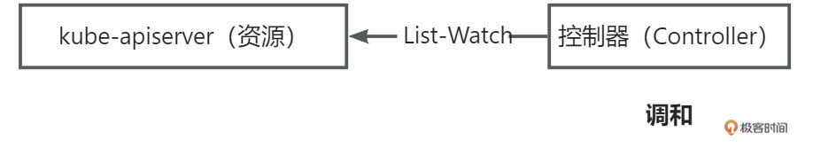
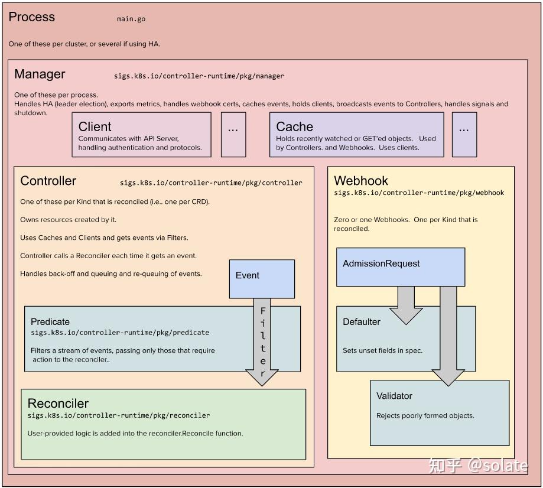

# 49 | 动手实现一个KubernetesOperator

你好，我是孔令飞。Kubernetes 基于声明式 API 构建了 Kubernetes 强大的功能。声明式 API的经典架构如下：



控制器通过 List-Watch 的方式监听 kube-apiserver 中的资源变化，并根据资源变化进行状态调和。为了让你体验 Kubernetes 的声明式 API 开发模式，本节课教你一步一步动手实现一个Kubernetes Operator。

因为整个 Kubernetes 编程涉及的内容很多，无法通过一节课完整实现，所以本节课仅抛砖引玉，作为 Kubernetes 编程的引导课程。关于 Kubernetes 编程更详细的内容，可以参考我的Kubernetes 开发实战课。

## 什么是 Operator?

Operator 是在 Kubernetes 基础上通过扩展 Kubernetes API，用来创建、配置和管理复杂的有状态应用，如分布式数据库等。Operator 基于 Kubernetes 1.7 版本以来引入的自定义控制器的概念，在自定义资源和控制器之上构建，同时又包含了应用程序特定的领域知识。实现一个Operator 的关键是 CRD（自定义资源）和 Controller（控制器）的设计。

在实际开发中，经常有开发者不理解 Operator 和 Controller 的区别。Controller 指代的是单个Kubernetes 控制器，Operator 不仅包含了 Controller，还包括了自定义资源。自定义资源 +Controller 围绕着某一领域，来实现完备的功能。

开发 Operator 的核心是实现自定义资源和 Controller。其中，自定义资源，可以通过定义

```
CustomResourceDefinition 类型的 Kubernetes 资源来创建。Controller 的开发是
```

Operator 开发中最复杂的，所以本节课重点围绕如何开发一个 Controller 来介绍。

## 有哪些方法可以创建一个控制器？

本小节，我们来看下有哪些方法可以创建一个控制器。方法有以下 3 种：

1. 基于 sample-controller 二开实现一个控制器：如果你想学习具体如何实现一个kubernetes controller，以及 controller 内部的调和逻辑，可以采用此方法；

2. 基于 controller-runtime 实现一个 controller：相较于方法 1，此方法封装了大部分控制器的调和实现，开发者只需要开发具体的调和逻辑即可；

3. 基于 kubebuilder 实现：kubebuilder 是一个命令行工具，可以一条命令生成一个kubernetes 控制器。kubebuilder 内部使用了 controller-runtime 框架。

在实际开发中，建议使用方法 3 来开发一个控制器。通过 kubebuilder 工具可以一条命令直接生成一个控制器，并且控制器的代码实现也是规范的，开发者只需要开发调和逻辑即可。

kubebuilder 可以自动生成模版 API 及相关的 manifests，可以极大地提高开发效率。

## 基于 kubebuilder 开发一个控制器

本小节，就来介绍如何基于 kubebuilder 命令行工具，来开发一个控制器。该控制器实例将实现以下功能：

- 调和 Memcached CR，一个 Memcached CR 代表部署在集群中的一个 Memcached 实例。

- 使用 Memcached 镜像创建一个 Memcached CR 实例。

- 确保 Memcached 的实例个数不超过在 Memcached CR 中定义的副本数。

- 更新 Memcached CR 的状态。

## 安装 kubebuilder 工具

执行以下命令安装 kubebuilder 工具：

```
# download kubebuilder and install locally.
<!--§§MATH_0§§-->(go env GOOS)/$(go env GOARCH)"
$ chmod +x kubebuilder && sudo mv kubebuilder /usr/local/bin/
$ kubebuilder version # 测试是否安装成功
```

## kubebuilder 工具架构



- 图片来源知乎@solate

上面是整个 kubebuilder 的架构图。可以看到，最外层是 Manager 组件。Manager 组件是整个控制器的框架，内部实现了各种组件，来完成不同的功能。其中 Cache 中保存了 gvk 和informer 的映射关系，用于通过 informer 的方式缓存 kubernetes 的对象。Client 是一个Unstructured 类型的客户端，用来同 kube-apiserver 交互，以实现对资源的 CURD。

整个 kubebuilder 架构中，最核心的是 Controller 模块。该模块会从队列中以先进先出的方式获取待调和的资源，并经过 Predicate 模块，决定该资源是否需要调和。如果需要调和，则触发 Reconcile 方法，实现对该资源的调和。

另外，kubebuilder 也集成了对 Webhook 的支持。Webhook 实现包含了 Defaulter 模块，用来对自定义资源设置默认值。包含 Validator 模块用来对自定义资源进行校验。

## 开发 Memcached Operator

开发一个 Memcached Operator 可以分为以下几步：

1. 初始化项目

2. 定义自定义资源

3. 实现控制器

完整代码见：memcached-operator

### 初始化项目

```
首先，创建并进入项目的目录。然后，使用 kubebuilder 初始化它：
<!--§§MATH_1§§-->GOPATH/src/github.com/onexstack/memcached-operator
<!--§§MATH_2§§-->GOPATH/src/github.com/onexstack/memcached-operator
$ kubebuilder init --domain=onexstack.com --repo=github.com/onexstack/memcached-o
```

kubebuilder 会根据当前目录自动推倒 Go 模块名，但有时候会推导错误，这里直接在命令行

```
参数中通过 --repo=github.com/onexstack/memcached-operator 来直接指定模块
```

名。

```
执行完 init 子命令后，会生成以下文件：
├── cmd                                        # 可执行程序入口所在目录
│   └── main.go                                # 程序入口：初始化 controller-runtime
├── config                                     # 部署到集群所需的 Kustomize 清单与环境
│   ├── default                                # 默认部署 overlay（组合 manager、RBA
│   │   ├── cert_metrics_manager_patch.yaml    # 为 metrics 端点启用 TLS/证书的 patc
│   │   ├── kustomization.yaml                 # default 目录的 Kustomize 入口，汇总
│   │   ├── manager_metrics_patch.yaml         # 为 controller-manager 注入/调整 me
│   │   └── metrics_service.yaml               # 暴露控制器 metrics 端口的 Service（
│   ├── manager                                # controller-manager（部署/运行时）相
│   │   ├── kustomization.yaml                 # manager 目录的 Kustomize 入口
│   │   └── manager.yaml                       # controller-manager Deployment/Po
│   ├── network-policy                         # 网络策略相关清单（限制/放通流量）
│   │   ├── allow-metrics-traffic.yaml         # 允许 Prometheus/监控组件访问 metric
│   │   └── kustomization.yaml                 # network-policy 目录的 Kustomize 入
│   ├── prometheus                             # 与 Prometheus Operator 集成的资源
│   │   ├── kustomization.yaml                 # prometheus 目录的 Kustomize 入口
│   │   ├── monitor_tls_patch.yaml             # 为 ServiceMonitor 启用 TLS/证书抓取
│   │   └── monitor.yaml                       # ServiceMonitor（Prometheus Opera
│   └── rbac                                   # 运行控制器所需的 RBAC（角色、绑定、服务
│       ├── kustomization.yaml                 # rbac 目录的 Kustomize 入口
│       ├── leader_election_role_binding.yaml  # 绑定 Leader 选举所需权限到服务账号的
│       ├── leader_election_role.yaml          # Leader 选举所需的 Role（对 leases/
│       ├── metrics_auth_role_binding.yaml     # 绑定 metrics 认证代理所需权限（kube-
│       ├── metrics_auth_role.yaml             # metrics 认证代理所需权限（SubjectAc
│       ├── metrics_reader_role.yaml           # 只读访问 /metrics（NonResourceURL）
│       ├── role_binding.yaml                  # 将控制器运行所需的主权限绑定到服务账号
│       ├── role.yaml                          # 控制器主权限（对自定义/原生资源的读写；
│       └── service_account.yaml               # controller-manager 使用的 Service
├── Dockerfile                                 # 构建控制器镜像的 Dockerfile
├── go.mod                                     # Go 模块声明与依赖版本约束（模块名、Go
├── go.sum                                     # Go 依赖校验文件（模块下载校验和）
├── hack                                       # 辅助脚本/模板等（不参与业务逻辑）
│   └── boilerplate.go.txt                     # 代码生成时添加的版权/License 头模板
├── Makefile                                   # 常用构建/代码生成/测试命令（make bui
├── PROJECT                                    # Kubebuilder 工程元数据（domain、lay
├── README.md                                  # 项目说明文档（使用、开发、贡献指南等）
└── test                                       # 测试代码（含 e2e 测试与工具）
   ├── e2e                                    # 端到端测试（运行在真实/仿真集群）
   │   ├── e2e_suite_test.go                  # e2e 测试套件初始化（Ginkgo/Gomega 引
   │   └── e2e_test.go                        # e2e 用例示例（创建资源、断言控制器行为
   └── utils                                  # 测试辅助函数/工具
       └── utils.go                           # e2e/集成测试通用辅助代码
```

### 定义自定义资源

定义新的自定义资源分为以下几步：

1. 创建 Memcached API（CRD）

2. 定义 Memcached API

3. 生成 DeepCopy 代码

4. 生成部署清单

### 步骤 1：创建 Memcached API（CRD）

Kubernetes 基于 REST 资源来实现各类功能。控制器的调和对象也是 REST 资源对象。所以，接下来还需要生成 REST 资源 API 定义。执行以下命令来初始化一个模板 API：

```
$ kubebuilder create api --group cache --version v1alpha1 --kind Memcached
INFO Create Resource [y/n]
y
INFO Create Controller [y/n]
y
上述命令创建了一个 REST API，组名为 cache.onexstack.com，版本为 v1alpha1，用
```

来唯一标识 Memcached 类型 CRD。

```
在执行 kubebuilder create api 命令时，会让你选择是否生成自定义资源及
Controller，这里都选择 y。
```

生成的 API 接口定义位于 api/v1alpha1/memcached_types.go 文件中，内容如下：

```go
package v1alpha1
import (
   metav1 "k8s.io/apimachinery/pkg/apis/meta/v1"
)
// EDIT THIS FILE!  THIS IS SCAFFOLDING FOR YOU TO OWN!
// NOTE: json tags are required.  Any new fields you add must have json tags for
// MemcachedSpec defines the desired state of Memcached
type MemcachedSpec struct {
   // INSERT ADDITIONAL SPEC FIELDS - desired state of cluster
   // Important: Run "make" to regenerate code after modifying this file
   // The following markers will use OpenAPI v3 schema to validate the value
   // More info: https://book.kubebuilder.io/reference/markers/crd-validation.ht
   // foo is an example field of Memcached. Edit memcached_types.go to remove/up
   // +optional
   Foo *string `json:"foo,omitempty"`
}
// MemcachedStatus defines the observed state of Memcached.
type MemcachedStatus struct {
   // INSERT ADDITIONAL STATUS FIELD - define observed state of cluster
   // Important: Run "make" to regenerate code after modifying this file
   // For Kubernetes API conventions, see:
   // https://github.com/kubernetes/community/blob/master/contributors/devel/sig
   // conditions represent the current state of the Memcached resource.
   // Each condition has a unique type and reflects the status of a specific asp
   //
   // Standard condition types include:
   // - "Available": the resource is fully functional
   // - "Progressing": the resource is being created or updated
   // - "Degraded": the resource failed to reach or maintain its desired state
   //
   // The status of each condition is one of True, False, or Unknown.
   // +listType=map
   // +listMapKey=type
   // +optional
   Conditions []metav1.Condition `json:"conditions,omitempty"`
}
// +kubebuilder:object:root=true
// +kubebuilder:subresource:status
// Memcached is the Schema for the memcacheds API
type Memcached struct {
   metav1.TypeMeta `json:",inline"`
   // metadata is a standard object metadata
   // +optional
   metav1.ObjectMeta `json:"metadata,omitempty,omitzero"`
   // spec defines the desired state of Memcached
   // +required
   Spec MemcachedSpec `json:"spec"`
   // status defines the observed state of Memcached
   // +optional
   Status MemcachedStatus `json:"status,omitempty,omitzero"`
}
// +kubebuilder:object:root=true
// MemcachedList contains a list of Memcached
type MemcachedList struct {
   metav1.TypeMeta `json:",inline"`
   metav1.ListMeta `json:"metadata,omitempty"`
   Items           []Memcached `json:"items"`
}
func init() {
   SchemeBuilder.Register(&Memcached{}, &MemcachedList{})
}
[colin@dev memcached-operator]$ cats api/v1alpha1/memcached_types.go
[colin@dev memcached-operator]$ cats api/v1alpha1/memcached_types.go
/*
Copyright 2025.
Licensed under the Apache License, Version 2.0 (the "License");
you may not use this file except in compliance with the License.
You may obtain a copy of the License at
   http://www.apache.org/licenses/LICENSE-2.0
Unless required by applicable law or agreed to in writing, software
distributed under the License is distributed on an "AS IS" BASIS,
WITHOUT WARRANTIES OR CONDITIONS OF ANY KIND, either express or implied.
See the License for the specific language governing permissions and
limitations under the License.
*/
package v1alpha1
import (
   metav1 "k8s.io/apimachinery/pkg/apis/meta/v1"
)
// EDIT THIS FILE!  THIS IS SCAFFOLDING FOR YOU TO OWN!
// NOTE: json tags are required.  Any new fields you add must have json tags for
// MemcachedSpec defines the desired state of Memcached
type MemcachedSpec struct {
   // INSERT ADDITIONAL SPEC FIELDS - desired state of cluster
   // Important: Run "make" to regenerate code after modifying this file
   // The following markers will use OpenAPI v3 schema to validate the value
   // More info: https://book.kubebuilder.io/reference/markers/crd-validation.ht
   // foo is an example field of Memcached. Edit memcached_types.go to remove/up
   // +optional
   Foo *string `json:"foo,omitempty"`
}
// MemcachedStatus defines the observed state of Memcached.
type MemcachedStatus struct {
   // INSERT ADDITIONAL STATUS FIELD - define observed state of cluster
   // Important: Run "make" to regenerate code after modifying this file
   // For Kubernetes API conventions, see:
   // https://github.com/kubernetes/community/blob/master/contributors/devel/sig
   // conditions represent the current state of the Memcached resource.
   // Each condition has a unique type and reflects the status of a specific asp
   //
   // Standard condition types include:
   // - "Available": the resource is fully functional
   // - "Progressing": the resource is being created or updated
   // - "Degraded": the resource failed to reach or maintain its desired state
   //
   // The status of each condition is one of True, False, or Unknown.
   // +listType=map
   // +listMapKey=type
   // +optional
   Conditions []metav1.Condition `json:"conditions,omitempty"`
}
// +kubebuilder:object:root=true
// +kubebuilder:subresource:status
// Memcached is the Schema for the memcacheds API
type Memcached struct {
   metav1.TypeMeta `json:",inline"`
   // metadata is a standard object metadata
   // +optional
   metav1.ObjectMeta `json:"metadata,omitempty,omitzero"`
   // spec defines the desired state of Memcached
   // +required
   Spec MemcachedSpec `json:"spec"`
   // status defines the observed state of Memcached
   // +optional
   Status MemcachedStatus `json:"status,omitempty,omitzero"`
}
// +kubebuilder:object:root=true
// MemcachedList contains a list of Memcached
type MemcachedList struct {
   metav1.TypeMeta `json:",inline"`
   metav1.ListMeta `json:"metadata,omitempty"`
   Items           []Memcached `json:"items"`
}
func init() {
   SchemeBuilder.Register(&Memcached{}, &MemcachedList{})
}
```

上面的文件中，包含了以下结构体定义：

```
Memcached：Memcached Kubernetes 资源对象定义
MemcachedSpec：Memcached 资源的期望状态定义
MemcachedStatus：Memcached 资源的当前状态定义
MemcachedList：Memcached 资源列表结构体定义
```

上述 4 个结构体，也是 Kubernetes 标准资源及自定义资源的标准定义方式。

```
在 MemcachedSpec 中只有一个示例字段 Foo，我们可以移除 Foo 字段，并根据需要添加更
```

多的 API 参数定义。

### 步骤 2：定义 Memcached API

这里，我们定义了一个字段 Size 字段，用来表示期望的 Memcached 实例的个数，修改后的MemcachedSpec 定义如下：

```
// MemcachedSpec defines the desired state of Memcached
type MemcachedSpec struct {
   // +kubebuilder:validation:Minimum=0
   // +required
   Size *int32 `json:"size,omitempty"`
}
```

Size 类型是指针类型，意味着在创建 Memcached 资源时，可以不设置 Size 字段，由后端程序自动填充为默认值。

```
此外，我们还想记录 Memcached 实例的各种状态。所以，还需要给 MemcachedStatus 结
```

构体定义中添加一些期望的字段，来保存 Memcached 的状态。修改后的

```sql
MemcachedStatus 定义如下：
// MemcachedStatus defines the observed state of Memcached.
type MemcachedStatus struct {
   // INSERT ADDITIONAL STATUS FIELD - define observed state of cluster
   // Important: Run "make" to regenerate code after modifying this file
   // For Kubernetes API conventions, see:
   // https://github.com/kubernetes/community/blob/master/contributors/devel/sig
   // conditions represent the current state of the Memcached resource.
   // Each condition has a unique type and reflects the status of a specific asp
   //
   // Standard condition types include:
   // - "Available": the resource is fully functional
   // - "Progressing": the resource is being created or updated
   // - "Degraded": the resource failed to reach or maintain its desired state
   //
   // The status of each condition is one of True, False, or Unknown.
   // +listType=map
   // +listMapKey=type
   // +optional
   Conditions []metav1.Condition `json:"conditions,omitempty"`
}
```

Kubernetes 资源对于资源状态的定义，其实是有一系列规范的，关于资源状态的规范详见：Typical status properties。

在创建好资源 API 定义后，还需要校验这些 API 的合法性。不合法的 API 入参，不仅可能会导致调和逻辑失败，还可能会导致系统不稳定。

在使用 kubebuilder 生成的 API 接口定义文件中，可以标记来对资源进行校验，例如：

```
+kubebuilder:validation:Minimum=1。
```

为了校验 Size 字段，我们给 Size 字段添加一下标记：

```sql
// MemcachedSpec defines the desired state of Memcached
type MemcachedSpec struct {
   // INSERT ADDITIONAL SPEC FIELDS - desired state of cluster
   // Important: Run "make" to regenerate code after modifying this file
   // The following markers will use OpenAPI v3 schema to validate the value
   // More info: https://book.kubebuilder.io/reference/markers/crd-validation.ht
   // size defines the number of Memcached instances
   // The following markers will use OpenAPI v3 schema to validate the value
   // More info: https://book.kubebuilder.io/reference/markers/crd-validation.ht
   // +kubebuilder:validation:Minimum=1
   // +kubebuilder:validation:Maximum=3
   // +kubebuilder:validation:ExclusiveMaximum=false
   // +optional
   Size *int32 `json:"size,omitempty"`
}
```

这里要注意，基于标记来校验字段，只能实现简单的校验。更复杂的校验，需要通过WebHook 中的 Validator 模块进行校验。关于如何实现一个 Validator 留个课后小作业，交由你去实现。

### 步骤 3：生成 DeepCopy 代码

```
执行以下命令生成 DeepCopy、DeepCopyInto、DeepCopyObject 代码：
$ make generate
```

生成的代码位于：api/v1alpha1/zz_generated.deepcopy.go 文件中。

```
make generate 规则使用了 controller-gen 工具来生成 DeepCopy 代码。generate
规则依赖 controller-gen 规则，controller-gen 规则用来安装 controller-gen 命
```

令行工具。

### 步骤 4：生成部署清单

接下来，还要执行以下命令，来生成部署清单：

```
$ make manifests
生成的文件位于 config/crd/bases/ 目录下。
config/crd/bases/cache.onexstack.com_memcacheds.yaml 文件是 Memcached
```

资源的定义文件。

### 开发控制器

上面我们定义了 API 接口。接下来就可以开发控制器代码。开发控制器代码分为以下几步：

1. 实现控制器启动代码

2. 实现 Reconcile 方法

### 步骤 1：实现控制器启动代码

控制器启动代码的实现位于 cmd/main.go 文件中。因为内容较多，本小节就不详细介绍，只介绍其中核心的源码。

```
在 main.go 文件中，通过以下代码创建一个 manager.Manager 类型的实例，该实例用来完
```

成除调和逻辑之外的控制器功能，例如：监听资源、调和错误重试、初始化客户端等。创建代码如下：

```go
   mgr, err := ctrl.NewManager(ctrl.GetConfigOrDie(), ctrl.Options{
       Scheme:                 scheme,
       Metrics:                metricsServerOptions,
       WebhookServer:          webhookServer,
       HealthProbeBindAddress: probeAddr,
       LeaderElection:         enableLeaderElection,
       LeaderElectionID:       "99f2c5f5.onexstack.com",
       // LeaderElectionReleaseOnCancel defines if the leader should step down v
       // when the Manager ends. This requires the binary to immediately end whe
       // Manager is stopped, otherwise, this setting is unsafe. Setting this si
       // speeds up voluntary leader transitions as the new leader don't have to
       // LeaseDuration time first.
       //
       // In the default scaffold provided, the program ends immediately after
       // the manager stops, so would be fine to enable this option. However,
       // if you are doing or is intended to do any operation such as perform cl
       // after the manager stops then its usage might be unsafe.
       // LeaderElectionReleaseOnCancel: true,
   })
   if err != nil {
       setupLog.Error(err, "unable to start manager")
       os.Exit(1)
   }
上述代码通过 ctrl.Options 结构体来配置 manager.Manager 类型的实例。
ctrl.Options 各字段含义如下：
// Options are the arguments for creating a new Manager.
type Options struct {
   // 说明：全局 Scheme，负责把 Go 类型与 GVK 映射起来，决定 Client/Cache 能识别哪些资源。
   // 建议：务必把你的 CRD 类型注册进来（apis/v1alpha1.AddToScheme）。
   // 默认：若不显式传入，通常使用 client-go 自带的 scheme.Scheme。
   // 影响：用于创建默认 Client 与 Cache。
   Scheme *runtime.Scheme
   // 说明：自定义 RESTMapper 的提供者（把 Go 类型映射到 Kubernetes API 资源）。
   // 使用：一般用默认即可；仅在需要特殊发现逻辑、代理或多集群时自定义。
   // 影响：用于创建 Client 与 Cache 所用的 RESTMapper。
   MapperProvider func(c *rest.Config, httpClient *http.Client) (meta.RESTMapper
   // 说明：共享缓存（Informer）配置项。
   // 默认：监听与列举所有命名空间的请求对象。
   // 常用：通过 Namespaces/ByObject 仅缓存特定命名空间或对象类型，优化内存与带宽。
   Cache cache.Options
   // 说明：完全自定义 Cache 的构造方式。
   // 注意：低级原语，仅在明确知道需求（如特别索引器、跨集群）时使用。
   // 影响：Manager 创建 Cache 时调用，并传入上面的 Cache.Options。
   NewCache cache.NewCacheFunc
   // 说明：默认 Client 的配置项。
   // 默认：读走缓存、写直连 APIServer。
   // 常用：通过 DisableFor 为某些对象禁用读缓存（如 Secret）以保证强一致读。
   Client client.Options
   // 说明：完全自定义 Client 的构造方式。
   // 默认：基于缓存的读 + 直连写。
   // 注意：低级原语，除非有特别需求，否则不建议替换。
   NewClient client.NewClientFunc
   // 说明：Manager 及其子组件使用的日志器。
   // 默认：log.Log 全局 logger；常用 zap。
   Logger logr.Logger
   // 说明：是否启用 Leader 选举，保证同一时刻只有一个活跃实例。
   // 建议：生产环境启用（true）。
   LeaderElection bool
   // 说明：Leader 选举所用的资源锁类型。
   // 默认："leases"；历史迁移链路有 "configmaps" -> "configmapsleases"/"endpointsle
   // 注意：跨版本迁移时按官方建议分步切换，避免出现多主并发操作。
   LeaderElectionResourceLock string
   // 说明：Leader 选举资源（锁对象）所在命名空间。
   // 默认：通常为控制器运行所在的命名空间，未设定时由底层推断。
   LeaderElectionNamespace string
   // 说明：Leader 选举资源（锁对象）的名称。
   // 用途：区分不同项目/控制器的锁。
   LeaderElectionID string
   // 说明：为 Leader 选举单独提供的 REST 配置（链路、限流、代理等）。
   // 使用：当选举客户端与业务 Client 有不同 QPS/Burst/网络要求时。
   LeaderElectionConfig *rest.Config
   // 说明：Manager 结束时是否主动释放领导权，加速切主。
   // 要求：进程在 Manager 停止后必须立刻退出，否则不安全。
   LeaderElectionReleaseOnCancel bool
   // 说明：外部构造并注入的自定义资源锁实现。
   // 影响：一旦设置，会忽略 LeaderElectionID/Namespace/ResourceLock/LeaseDuration/R
   // 使用：极高级场景（如跨集群 MultiLock）。
   LeaderElectionResourceLockInterface resourcelock.Interface
   // 说明：非主节点为强制竞争领导权等待的最长时间（相对上次确认的 ack）。
   // 默认：约 15s。网络抖动大可适当上调。
   LeaseDuration *time.Duration
   // 说明：当前领导者在放弃前尝试续约的最长时间窗口。
   // 默认：约 10s。
   RenewDeadline *time.Duration
   // 说明：选举客户端进行操作尝试之间的重试间隔。
   // 默认：约 2s。
   RetryPeriod *time.Duration
   // 说明：metrics 服务器配置（监听地址、TLS 等）。
   // 配合：Service、ServiceMonitor 暴露并抓取 /metrics。
   Metrics metricsserver.Options
   // 说明：健康探针服务监听地址（liveness/readiness）。
   // 设为 "0" 或 "" 可禁用探针端口。
   HealthProbeBindAddress string
   // 说明：Readiness 探针的路径名，默认 "readyz"。
   ReadinessEndpointName string
   // 说明：Liveness 探针的路径名，默认 "healthz"。
   LivenessEndpointName string
   // 说明：pprof 调试端口监听地址。
   // 设为 "" 或 "0" 禁用。对外开放前需做好访问控制，避免敏感信息泄露。
   PprofBindAddress string
   // 说明：外部自定义注入的 Webhook Server；未设置时 Manager 使用默认配置创建。
   // 使用：需要自定义端口、TLS、证书加载或统一复用现有服务时。
   WebhookServer webhook.Server
   // 说明：为所有 Runnables 提供基础 context 的函数。
   // 用途：注入 trace、请求 ID、日志字段等上下文信息。
   // 默认：若未提供，则使用 context.Background()。
   BaseContext BaseContextFunc
   // 说明：事件广播器（把事件发送到 K8s API，带相关去重/限流器）。
   // 状态：已弃用（Deprecated），可能导致 goroutine 泄漏。
   // 建议：使用 mgr.GetEventRecorderFor("component")。
   EventBroadcaster record.EventBroadcaster
   // 说明：优雅退出超时时间。Manager 停止时给予各 runnable 的清理时间。
   // 设为 0：禁用优雅退出；设为负值：无限等待。
   // 注意：若失去选举租约，为安全起见会跳过优雅退出（避免并发操作）。
   GracefulShutdownTimeout *time.Duration
   // 说明：控制器的全局默认配置（如并发度、RecoverPanic、CacheSyncTimeout 等）。
   // 作用：作为 baseline，单个控制器可在 Options/Builder 层面覆盖。
   // +optional
   Controller config.Controller
}
之后通过以下代码来设置 manager.Manager 类型的实例：
   if err := (&controller.MemcachedReconciler{
       Client: mgr.GetClient(),
       Scheme: mgr.GetScheme(),
   }).SetupWithManager(mgr); err != nil {
       setupLog.Error(err, "unable to create controller", "controller", "Memcach
       os.Exit(1)
   }
上述代码，创建了一个 *controller.MemcachedReconciler 类型的实例（也是一个控
制器实例，实现了 Reconcile 方法），实例中的 Client 字段，用来在控制器中调用，跟
```

kube-apiserver 交互，完成 Kubernetes 资源的 CURD 操作。

SetupWithManager 方法的具体实现位于

```
internal/controller/memcached_controller.go 文件中，代码如下：
// SetupWithManager sets up the controller with the Manager.
func (r *MemcachedReconciler) SetupWithManager(mgr ctrl.Manager) error {
   return ctrl.NewControllerManagedBy(mgr).
       For(&cachev1alpha1.Memcached{}).
       Owns(&appsv1.Deployment{}).
       Named("memcached").
       Complete(r)
}
```

方法解析如下：

```
ctrl.NewControllerManagedBy(mgr)：基于给定的 Manager 创建一个控制器构建
```

- 器。

```
For(&cachev1alpha1.Memcached{})：声明该控制器的“主资源”（Primary Resource）
为 Memcached 自定义资源。意味着，控制器会 Watch cachev1alpha1.Memcached 类
```

- 型的资源，并进行资源状态调和。当 Memcached 对象被创建 / 更新 / 删除时，会向队列入

```
队一个 reconcile.Request，从而触发 Reconcile。
Owns(&appsv1.Deployment{})：声明控制器“拥有”的二级资源（Secondary/Owned
```

- Resource）为 Deployment。即监听被主资源拥有的 Deployment 的变化。当这些被拥有的Deployment 发生变化时，会将“其拥有者”对应的 Memcached 入队，从而驱动一次主资源

```
的 Reconcile。在 Reconcile 中创建 / 更新 Deployment 时，需要设置 OwnerReference
```

- 指向对应的 Memcached，否则无法从 Deployment 映射回其拥有的 Memcached。

```
Named("memcached")：为该控制器命名为 memcached。
Complete(r)：完成构建并将控制器注册到 Manager，其中 r 必须实现
reconcile.Reconciler 接口。
```

### 步骤 2：实现 Reconcile 方法

```
Reconcile 源码实现位于 internal/controller/memcached_controller.go 文件
```

中，代码实现逻辑如下：

```go
// - https://pkg.go.dev/sigs.k8s.io/controller-runtime@v0.21.0/pkg/reconcile
func (r *MemcachedReconciler) Reconcile(ctx context.Context, req ctrl.Request) (c
   log := logf.FromContext(ctx)
   // 1. 获取资源定义，解析其定义，基于定义进行状态调和
   memcached := &cachev1alpha1.Memcached{}
   err := r.Get(ctx, req.NamespacedName, memcached)
   if err != nil {
       // 如果找不到资源，直接返回成功。因为资源不存在，当然不需要调和了。
       if apierrors.IsNotFound(err) {
           log.Info("memcached resource not found. Ignoring since object must be
           return ctrl.Result{}, nil
       }
       log.Error(err, "Failed to get memcached")
       // 如果获取失败，则返回错误。controller-runtime 会退避重试
       return ctrl.Result{}, err
   }
   // 2. 获取跟 Memcached 实例同名的 Deployment。
   // 因为控制器实现的逻辑上基于 Memcached 的定义来部署 Memcached，部署的方式是通过 Deploy
   // 所以，这里要先获取 Deployment 查看是否已经部署了。
   // - 如果没有部署：需要创建 Deployment
   // - 如果已经部署：需要检查 Deployment 的 Replicas 是否和 Memcached.Spec.Size 是否一
   found := &appsv1.Deployment{}
   err = r.Get(ctx, types.NamespacedName{Name: memcached.Name, Namespace: memcac
   if err != nil && apierrors.IsNotFound(err) {
       // 创建并返回一个 *cachev1alpha1.Memcached 类型的实例
       dep, err := r.deploymentForMemcached(memcached)
       if err != nil {
           log.Error(err, "Failed to define new Deployment resource for Memcache
           // 如果创建实例，设置 Memcached.Status.Conditions 记录错误
           meta.SetStatusCondition(&memcached.Status.Conditions, metav1.Conditio
               Type:    typeAvailableMemcached,
               Status:  metav1.ConditionFalse,
               Reason:  "Reconciling",
               Message: fmt.Sprintf("Failed to create Deployment for the custom
           })
           // 更新 Memcached. 因为更新了 Memcached.Status.Conditions 所以要重新更新 m
           if err := r.Status().Update(ctx, memcached); err != nil {
               log.Error(err, "Failed to update Memcached status")
               return ctrl.Result{}, err
           }
           return ctrl.Result{}, err
       }
       log.Info("Creating a new Deployment", "Deployment.Namespace", dep.Namespa
       // 创建 Deployment
       if err = r.Create(ctx, dep); err != nil {
           log.Error(err, "Failed to create new Deployment", "Deployment.Namespa
           return ctrl.Result{}, err
       }
       // 如果部署成功，需要重新放回调和队列，确保再次调和，通过再次调和逻辑，确保创建了 Depl
       return ctrl.Result{RequeueAfter: time.Minute}, nil
   } else if err != nil {
       log.Error(err, "Failed to get Deployment")
       return ctrl.Result{}, err
   }
   // If the size is not defined in the Custom Resource then we will set the des
   var desiredReplicas int32 = 0
   if memcached.Spec.Size != nil {
       desiredReplicas = *memcached.Spec.Size
   }
   // 如果 Deployment 存在，并且 Deployment.Spec.Replicas 和 memcached.Spec.Size 不
   if found.Spec.Replicas == nil || *found.Spec.Replicas != desiredReplicas {
       found.Spec.Replicas = ptr.To(desiredReplicas)
       if err = r.Update(ctx, found); err != nil {
           log.Error(err, "Failed to update Deployment", "Deployment.Namespace",
           // 更新前再次获取 Memcached 实例，防止更新时出现冲突
           if err := r.Get(ctx, req.NamespacedName, memcached); err != nil {
               log.Error(err, "Failed to re-fetch memcached")
               return ctrl.Result{}, err
           }
           // The following implementation will update the status
           meta.SetStatusCondition(&memcached.Status.Conditions, metav1.Conditio
               Type:    typeAvailableMemcached,
               Status:  metav1.ConditionFalse,
               Reason:  "Resizing",
               Message: fmt.Sprintf("Failed to update the size for the custom re
           })
           if err := r.Status().Update(ctx, memcached); err != nil {
               log.Error(err, "Failed to update Memcached status")
               return ctrl.Result{}, err
           }
           return ctrl.Result{}, err
       }
       // 如果部署成功，需要重新放回调和队列，确保再次调和，通过再次调和逻辑，确保 Deploymen
       return ctrl.Result{Requeue: true}, nil
   }
   meta.SetStatusCondition(&memcached.Status.Conditions, metav1.Condition{
       Type:    typeAvailableMemcached,
       Status:  metav1.ConditionTrue,
       Reason:  "Reconciling",
       Message: fmt.Sprintf("Deployment for custom resource (%s) with %d replica
   })
   if err := r.Status().Update(ctx, memcached); err != nil {
       log.Error(err, "Failed to update Memcached status")
       return ctrl.Result{}, err
   }
   // 调和成功，成功返回
   return ctrl.Result{}, nil
}
```

上述代码中，已经有注释，这里不再介绍。

## 编译并部署控制器

执行以下命令安装 Memcached CR，编译，运行控制器：

```
$ make install
$ make run
打开另一个 Linux 终端，修改 config/samples/cache_v1alpha1_memcached.yaml 文
```

件，设置 Size 为 2。修改后的文件为：

```
apiVersion: cache.onexstack.com/v1alpha1
kind: Memcached
metadata:
 labels:
   app.kubernetes.io/name: memcached-operator
   app.kubernetes.io/managed-by: kustomize
 name: memcached-sample
spec:
 size: 2
```

执行以下命令，创建 Memcached 资源：

```
$ kubectl apply -k config/samples/
memcached.cache.onexstack.com/memcached-sample created
```

执行以下命令查看 Memcached 资源：

```
$ kubectl get memcached
NAME               AGE
memcached-sample   60s
$ kubectl get deployment
NAME               READY   UP-TO-DATE   AVAILABLE   AGE
memcached-sample   2/2     2            2           3m56s
```

可以看到我们成功创建了 Memcached 资源，控制器基于 Memcached 资源创建出了memcached-sample Deployment，并且 Deployment 的副本数跟 Memcached 的 Size 是保持一致的。

## 课程总结

在 Kubernetes 编程中，开发控制器的方式有 3 种：基于 sample-controller 二开、基于controller-runtime 编写、以及使用 Kubebuilder 脚手架快速生成。目前推荐的开发方式是基于kubebuilder 工具快速生成控制器代码。

本节课，我们开发了一个 Memcached Operator，演示了从定义 CRD 类型（将示例字段 Foo替换为 Size 并添加校验标记）到生成 DeepCopy 代码与 CRD 清单（make generate、makemanifests），再到在 main.go 配置 manager.Options、通过 SetupWithManager 构建器声明主资源与被拥有资源，以及在 Reconcile 中确保 Deployment 与 Memcached.Spec.Size 一致、并维护 Status.Conditions 的完整流程。最终通过 make install、make run 与样例 CR 验证控制器按期望工作。

## 课后练习

```
在 MemcachedSpec 中新增 Image 字段（加上非空校验与默认值 Marker），并修改
deploymentForMemcached 使用该镜像，运行 make generate && make
manifests 并重新验证创建的 Pod 镜像是否生效？
```

2. 试着使用 kubebuilder 工具生成、部署、测试 Memcached 的 Validator Webhook。

欢迎你在留言区与我交流讨论，如果今天的内容让你有所收获，也欢迎转发给有需要的朋友，我们下节课再见！
