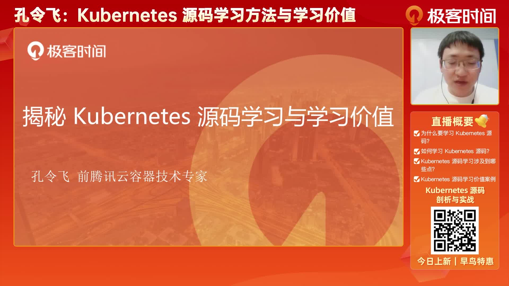

# 加餐 | 探索Kubernetes源码学习方法与学习价值

此为开课直播回放。

直播简介：

Kubernetes 作为企业云原生的基石，是企业必备的技术栈，伴随着海量的工作岗位。掌握好Kubernetes 源码，就具备了从事相关岗位的技术优势。本次直播，老师会结合实际企业工作经验，分享 Kubernetes 源码的学习价值，并介绍如何学习 Kubernetes 源码。

你将获得：

- 了解 Kubernetes 源码学习的价值

- 了解如何学习 Kubernetes 源码

- 了解 Kubernetes 中源码学习的技术点

- 了解 Kubernetes 源码学习的价值及案例

