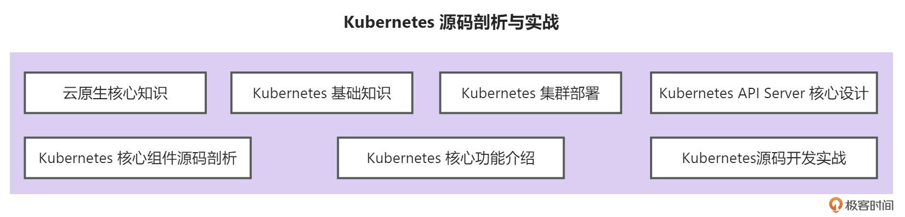

# 开篇词 | 如何从源码视角深度学习Kubernetes？

你好，我是孔令飞，欢迎和我学习这门课程。

我先做个自我介绍吧。我在互联网行业已经工作了 11 年，一线经验主要聚焦在 Go、云原生、AI Infra 领域。这期间我见证了互联网的黄金十年，也看到了 AI 时代工程师们的技术焦虑。现在，仍然坚信学习能带来实打实的提升，充分认可技术所带来的价值，可以说，编程仍然是当前值得去选择的一个方向。

过去 11 年，我开发过很多知名的项目，例如：RedHat 开源的 Linux 发行版 RHEL、知名的虚拟化软件 Xen、腾讯云容器服务 TKE、腾讯云云函数 SCF 等。过去几年，也写过课程、出版过图书，例如：极客时间《Go 语言项目开发实战》专栏、《企业级 Go 项目开发实战》图书，以及今年会出版的《从零开发企业级 Go 应用》图书。

此外，我今年也上线了自己的知识星球「云原生 AI 实战营」，里面有大量的高质量体系课和实战项目，旨在帮助 Go 开发者在 AI 时代打造不可替代的技术竞争力。如果你对云原生、AIInfra 相关的课程或技术感兴趣，也欢迎加入我的知识星球。

我自己平时也会学习很多优质的极客时间课程，今年也很荣幸能在极客时间再上线一门新专栏。希望本套体系课能让你更好地掌握 Kubernetes，提高你的技术水平和职业竞争力。

## 为什么鼓励你学习 Kubernetes？

我在腾讯、字节跳动工作了近 10 年，这两个国内一线大厂内部的应用软件几乎都会选择部署在内部的 Kubernetes 集群中，例如腾讯的 TKEx、字节跳动的 TCE。其实，不仅大厂如此，中小企业也正越来越多地将企业应用采用原生化的方式部署，有些应用可能还会与Kubernetes 强耦合，例如：应用可能会调用 Kubernetes API 接口执行一些监控、自运维相关的操作；有些应用还需要编写 Kubernetes Operator 来对应用进行生命周期管理。而到了 AI时代，应用部署的标准仍然是云原生部署，即部署在 Kubernetes 集群中。

这就使得，从 2018 年到现在，甚至在可以预见的未来，Kubernetes 仍然是基建领域的基石。这必然会带来大量的机会和岗位需求。另外，在基建领域，很多产品也离不开 Kubernetes，例如：DevOps、机器学习平台、容器服务、FaaS、离线任务、定时任务等等。

作为开发者，如果能够深入掌握 Kubernetes，包括其功能、实现原理和实现方式，可以让我们以很强的竞争力，参与到以 Kubernetes 为基石的云原生开发岗位中。当然，也包括目前火热的 AI Infra 相关岗位。如果简历上有熟悉 Kubernetes 源码等内容，也会大大提高简历的竞争力。

这门课也正是在这样的背景下诞生的，旨在帮助你从开发视角更透彻地掌握 Kubernetes，实现个人职业竞争力的提升及延伸。

## 为什么要学习 Kubernetes 源码？

顾名思义，可以看到，这门课我们的重点在 Kubernetes 源码，我想先分享下我的学习看法。

目前有两个视角可以学习 Kubernetes。一个是运维视角，掌握 Kubernetes 的概念、核心机制、操作，这个视角关注在 Kubernetes 的操作和运维。另外一个视角是开发视角，从源码层面掌握 Kubernetes，熟悉 client-go、controller-runtime 等框架的使用方式。

在我看来，后者更加透彻和全面，对 Kubernetes 的掌握程度会是运维视角的超集，而且还能掌握如何进行 Kubernetes 编程，从而快速切入开发岗位。

此外，Kubernetes 是分布式架构的王者，其软件设计方法、代码实现方法以及 Kubernetes 生态中的各种 Go 包、方案、设计理念等，都很值得我们学习。这些东西，从源码视角切入学习，可以大大提升你的开发能力。值得一提的是，这种开发能力是横向能力，如果你是一名业务开发，也会因此受益。当你用 Kubernetes 中的方法和技术去开发业务应用时，会更容易获得上级的关注和认可，从而让你获得更好的绩效和职业晋升。

这里推荐两门书，《Kubernetes 权威指南》与《Kubernetes 源码剖析》，都是不错的学习资料。但是，这两本书更多的是从运维或者浅开发角度去介绍 Kubernetes 的，可以作为辅助学习，我们的课程会更加深入源码细节，让你从源码层面更通透地掌握 Kubernetes 的实现方式、核心原理等。

## 课程是如何设计的？

我们知道，Kubernetes 是云原生的基石，因此我们会从云原生的核心概念和技术栈入手，也会带你梳理 Kubernetes 的基础知识。这两部分是帮助我们打好基础。课程既然是从开发视角讲解 Kuberentes 源码的，所以接下来我会带你部署一个 Kubernetes 集群。

一切准备就绪，接下来就是深入学习 Kubernetes 中最核心的组件及其源码实现，也是课程最重磅的部分。此外，Kubernetes 中还有很多值得介绍的功能特性，因此也会对其实现和使用方法做讲解。

最后，为了提高你的动手能力，我们还会通过实战赋能业务开发。

具体章节如下：

- 云原生核心知识：详细介绍什么是云原生，以及云原生领域中的核心技术栈。

- Kubernetes 基础知识：介绍 Kubernetes 相关基础，从源码学习方式逐步切入到Kubernetes 的必备基础，从而帮助你更好地理解和学习接下来的课程内容。

- Kubernetes 集群部署：介绍 Kubernetes 集群部署的方式，并带你部署一个开发学习用的Kubernetes 集群，并在集群中部署一个 Web 应用。

- Kubernetes API Server 核心设计：介绍 kube-apiserver 中的核心编程概念，以及核心机制的实现原理，例如：如何构建 REST 路由、如何进行版本转换、如何解析请求参数、如何校验请求参数、如何设置默认值……掌握这些机制，也能够应用于我们的业务开发中。

- Kubernetes 核心组件源码剖析：解析 Kubernetes 核心组件 kube-apiserver、kube-controller-manager、kube-scheduler 的原理及源码。

- Kubernetes 核心功能介绍：从源码层面详细介绍 Kubernetes 中的核心功能实现，例如：扩展能力、组件配置、功能门控、领导者选举等。

- Kubernetes 源码开发实战：通过实践如何给 Kubernetes 添加一个新的 REST 资源、如何开发 Kubernetes 控制器、如何添加一个调度器插件，让你快速掌握 Kubernetes 的编程技术。

学完整套课程，相信你对 Kubernetes 会有一个更加深刻的理解和掌握，也希望能助力你的职业发展越走越远！

最后，作为课程讲师，我也想了解下，关于 Kubernetes 你还想学习哪方面的内容？欢迎你在留言区与我交流讨论，我们课程里见！
