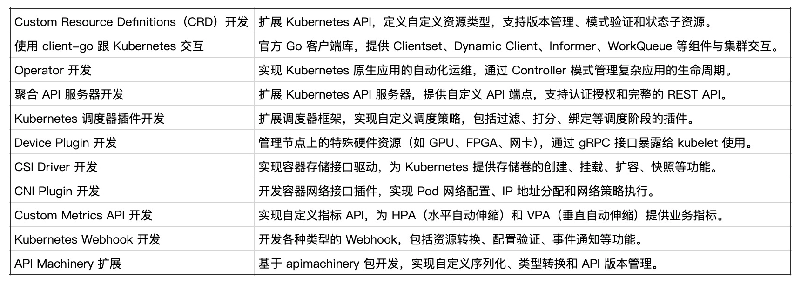
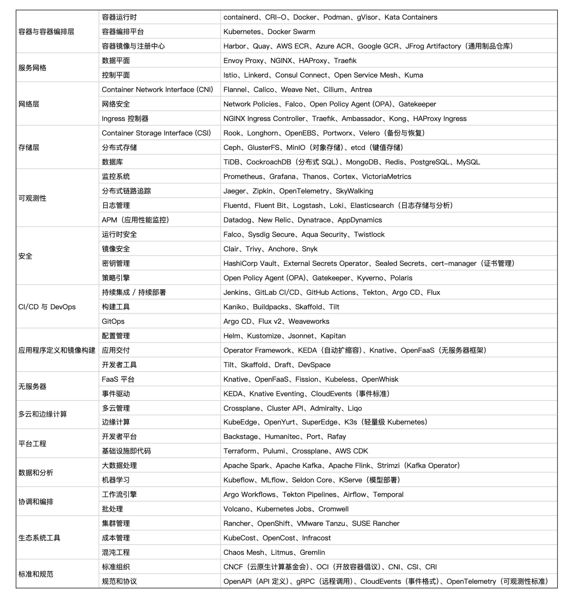

# 结束语 | 如何在Kubernetes之路上走得更远？

你好，我是孔令飞。

恭喜你，通过努力，完成了《Kubernetes 源码剖析与实战》专栏的学习。通过本套课程，相信你已经对 Kubernetes 源码有了一个不错的掌握。基于这些掌握，你可以开启更深度的Kubernetes 学习之旅了。

最后一节课，我想来和你分享下，未来如何在云原生 / Kubernetes 之路上走得更远。

## 学习 Kubernetes 编程实战课

通过源码剖析课程，你已经深入理解了 Kubernetes 的内部机制，包括 API Server、Scheduler、Controller Manager 等核心组件的工作原理。但是，仅仅理解源码还不够，你需要将这些理论知识转化为实际的编程能力。

Kubernetes 编程有很多内容，常见的有以下内容：

围绕 Kuberentes 的编程内容有很多，其中，最尝遇到的编程需求是：使用 client-go 跟Kubernetes 交互、Operator 开发、聚合 API 服务器开发、Kubernetes Webhook 开发、Kubernetes 调度器插件开发。

如果你在团队中主要负责网络、存储等细分方向，那你大概率会涉及到 CSI Driver 开发、CNIPlugin 开发。

Kubernetes 编程内容很多，你可以循序渐进的进行学习，这里推荐几本书或者一些优质的课程：

- 首推我的「云原生 AI 实战营」中的 Kuberentes 编程实战课，该课程包含了Kuberentes 编程的各个编程原理及实战，如果你想学习 Kubernetes 编程，非常建议加入。

- 除此之外，行业中也有一些教程可供你学习，例如书籍《云原生应用开发：Operator 原理与实践》、《Kubernetes 编程》、《Kubernetes Operator 开发进阶》等。

## 熟悉以 Kubernetes 为中心的云原生生态

除了学习 Kubernetes 编程技术之外，你还可以了解整个云原生生态。云原生生态是一个庞大而复杂的技术栈，Kubernetes 作为容器编排的核心，但它只是整个生态的一部分。要在云原生领域走得更远，需要对整个生态有全面的了解。

以下是云原生生态的详细介绍：

上面只列了一些常见的生态，云原生更全的生态图可参考：CNCF landscape。

## 参与 AI Infra 的技术构建

当前 AI 非常火，行业中也有很多 AI 相关的岗位。AI 的训练和部署都离不开 Kubernetes。在你具备了扎实的 Kubernetes 源码基础、Kubernetes 编程技能外，便有足够的能力，加入 AI的构建中。不过，AI 的构建有很多方面，Kubernetes 工程师最易参与的是 AI Infra 的构建。

## 写在最后

现在，你已经具备了深入理解云原生技术栈的基础。接下来的学习和发展需要：

1. 理论到实践的转化：将源码理解应用到实际的开发工作中

2. 生态视野的拓展：从 Kubernetes 扩展到整个云原生生态

3. 个人品牌的建立：通过开源贡献和技术分享提升影响力

4. 职业路径的规划：明确技术发展方向和职业目标

5. 持续学习的习惯：保持对新技术的敏感度和学习能力

原生领域正在快速发展，新的技术和工具层出不穷。但是，有了扎实的 Kubernetes 源码基础，你就已经具备了在这个领域长期发展的核心竞争力。更重要的是，要保持学习的热情，勇于实践，积极分享，这样才能在技术的道路上走得更远。

最后我想说，技术学习是一个长期的过程，需要耐心和坚持，希望你能继续在云原生领域深耕，成为专家和贡献者。

最后感谢你对我课程的支持，预祝你在云原生的技术之路上越走越宽广！

