# 前沿技术追踪（一） | OpenClaw保姆式安装部署指南

你好，我是李锟。

光阴荏苒，时间一晃就进入了 2026 年阴历的马年，基于 LLM 的 AI Agent 的发展速度仍然如同脱缰野马一样。我们这套开发课程，是国内罕见的完全基于开源技术栈开发 AutonomousAgent 的系列课程。而在开源 AI Agent 开发领域，一片大干快上、只争朝夕的火热气氛。今年的形势不是小好，而是大好。

在开源 AI Agent 开发领域，过去一年中发生了很多重大事件，这其中中国人主导的团队扮演了非常重要的角色。我在这里一一罗列会非常啰嗦，我只说其中最重要的一件事，这件事足以震动整个行业，那就是开源 AI Agent 开发平台 OpenClaw 的发布。

OpenClaw 的官网在：https://openclaw.ai官方文档在：https://docs.openclaw.ai/zh-CN

github 上的项目地址为：https://github.com/openclaw/openclaw

原创作者 Peter Steinberger 是一位奥地利的天才程序员，现在已经正式加入 OpenAI 公司。你可以看一下 Peter 对 OpenClaw 的介绍：

搜狗百科上对 OpenClaw 的介绍：

- OpenClaw（曾用名：Clawdbot、Moltbot）是一款开源的个人 AI 助手平台，由 PeterSteinberger (彼得·斯坦伯格) 开发，于 2026 年 1 月 29 日对外开源。 OpenClaw 的核心架构由 Gateway（网关）、Agent（智能体）、Skills（技能）和 Memory（记忆）构成，能运行在用户本地设备上，并通过 WhatsApp、Telegram、Discord 等聊天 App 与之互动。

我们中国开发者把 OpenClaw 亲切地称为“小龙虾”，因为这个项目的 Logo，就是一只很萌的龙虾，虽然 Peter 的原意估计不是中国人很爱吃的那种“小龙虾”。


OpenClaw 发布之后，立即引起全球轰动，基于 OpenClaw 平台开发的各种各样的 AI Agent应用 (中文翻译为“AI 智能体”) 就像雨后春笋一样蓬勃发展，在短短一个月内，就达到了惊人的数量。我本人对于突然爆火的新技术、新产品一向很钝感，包括去年爆火的 Manus 在内。然而这次我对 OpenClaw 的态度却与之前的那些产品完全不同，它很值得我们花时间去好好研究。

首先我给大家简单介绍一下 OpenClaw 诞生的重大意义，如果不理解这个，你就无法评估自己是否需要尽快掌握这个工具。

## OpenClaw 的重大意义

OpenClaw 的出现有如下几个重大意义：

1. 基于 OpenClaw 开发的 Agent 是真正意义上的 Autonoumous Agent，而不是那些自称Autonomous Agent 其实只是 ChatBot 的假冒伪劣产品。我在这套课程的第一节中，为大家剖析了 Autonomous Agent 与 ChatBot 的主要区别，OpenClaw 具有 AutonomousAgent 的大多数特征。它能通过 IM 工具与用户积极互动，并且积极主动地工作。它高度智能和自动化，用户并不需要与它反复沟通，它就能完成一些高度复杂的工作。而且它还能7x24 不眠不休地工作，不达目的誓不罢休。马斯克说过，Agent 的未来是 AutonomousAgent，在硅谷这个就是共识，根本不需要争论。

2. OpenClaw 把将近 3 年前 AutoGPT 最初的 Classic 版曾经吹牛的那些愿景变成了现实。其实在 AI Agent 开发领域并不存在什么“天生石猴孙悟空”，后来者都是站在前人基础之上的，好的创意会激发更多的好创意，最终形成链式反应。AutoGPT Classic 版失败了，原因我在去年的课程中曾经介绍过。但是比 AutoGPT Classic 版更强大 100 倍的 OpenClaw 最终成功了，达到了高度的 PMF（产品市场匹配），成为了令大量用户惊叫的 killer 级产品，即将跨越鸿沟 (请请参阅名著《跨越鸿沟》)。

3. OpenClaw 代表了任务型 AI Agent 的正确打开方式。过去由大公司开发的那些任务型 AIAgent 有三大类：

- 1.完全部署在云端，与用户本地环境的数据源和各种工具距离遥远，用户必须把数据上传到云端，使用很不方便。

- 作为手机 App 部署，有能力在操作系统级操纵微信、支付宝等国民级 App。例如字节跳2.动出品的 豆包手机助手，发布之后很快遭到了腾讯、阿里巴巴等公司的封杀。

- 完全基于 Web 浏览器开发，运行在浏览器的沙箱环境，无法访问主机的本地资源。3.

过去的这些任务型 AI Agent 开发团队之所以这样选择，大多都有容易理解的商业原因。而OpenClaw 则是安装在 PC 主机或者服务器上面，用户使用即时通信工具来与 OpenClaw 交互。任何桌面应用能做到的事情，OpenClaw 都能做到。只要给 OpenClaw 配备足够的Skill，OpenClaw 的能力几乎是无限的。使用过像 OpenClaw 这样超级强大的任务型 AI Agent的用户，几乎不再想使用那些笨拙的传统软件。传统软件和传统 SaaS 的没落，已经是大多数人肉眼可见的趋势。在超级强大的任务型 AI Agent 面前，它们几乎毫无招架之力，除非它们自己也能尽快进化为任务型 AI Agent。在我看来，OpenClaw 未来会大幅推动人机交互方式的一场范式转换。

其他重大意义还有很多，网上各路评论家的文章已经汗牛充栋，我就不赘述了。本着注重实战的精神，我们首先还是把 OpenClaw 安装部署起来，然后在使用、增强 OpenClaw 的过程中不断地学习。

## 安装 OpenClaw 前的准备工作

### 硬件和操作系统

为了安装 OpenClaw 首先你需要准备一台独立的主机，这台主机也可以是虚拟机。配置方面跟这套课程最初介绍的硬件配置相同就可以了（参考 02）。出于安全和隐私方面的原因，我不建议将 OpenClaw 安装在你自己工作用的主力机器上面。

安装 OpenClaw 推荐的操作系统是 Linux 和 macOS，所以我不建议你把 OpenClaw 安装在Windows 环境。如果必须使用 Windows，可以在 WSL2 的 Linux 环境中安装 OpenClaw。

运行 OpenClaw 的这台主机，通常是不关机的，以便于发挥 OpenClaw 的最大效力。很多人使用 mac mini 来安装 OpenClaw，因为 mac mini 耗电很少，性价比很高。我还见过有人将OpenClaw 安装在刷了 Armbian 系统 (属于 Ubuntu 的一个变种) 的机顶盒上。

这台主机虽然并不需要公网的 IP，但是需要有稳定可靠的公网连接。如果使用国外厂商的LLM，还需要有稳定可靠的代理服务器，这些问题需要你自己解决。

这台主机位于本地环境，还是位于云端 (公有云或私有云)，需要你根据自己的需要决定。以下的安装步骤我是基于 Ubuntu Linux 来展示的，如果你是使用的 macOS 就需要自行做一些改动。

### 预装的软件

首先需要在安装 NodeJS，并且确保 node 的大版本号高于等于 22。

```
node -v
```

然后执行：

```bash
echo >> ~/.bashrc
echo "export PATH=\"\$HOME/.npm-global/bin:\$PATH\"" >> ~/.bashrc
```

然后检查是否安装了 git 客户端，如果未安装，执行以下命令安装 git。

```bash
sudo apt install -y git
```

还要提前安装好 linuxbrew，可以使用以下命令来安装：

```
/bin/bash -c "$(curl -fsSL https://raw.githubusercontent.com/Homebrew/install/HEA
```

安装好 linuxbrew 之后需要执行：

```bash
echo >> ~/.bashrc
echo 'eval "$(/home/linuxbrew/.linuxbrew/bin/brew shellenv bash)"' >> ~/.bashrc
```

执行上述命令修改了 ~/.bashrc 文件后，需要登出并重新登录，以便设置的环境变量生效。

### 大模型

需要提前准备好要使用的 LLM。国内厂商、国外厂商的 LLM 都可以使用。在这节课里面，我使用的是国内公司 MiniMax 最新的 LLM M2.5。你可以去 MiniMax 官网完成注册、实名认证、充值。

虽然在这套课程中，我们使用了通过 Ollama 本地部署的开源 LLM。但是因为 OpenClaw 是个很复杂的 AI Agent 开发平台，使用本地部署的开源 LLM 都表现不佳，甚至完全无法支持OpenClaw 正常工作。此外，使用本地部署的开源 LLM，哪怕只是能支持 OpenClaw 正常工作，也需要使用那些参数量很高的版本，因此需要配置很高的硬件 (GPU、CPU、内存)，成本会很高。在现阶段，我完全不推荐你使用本地部署的开源 LLM。等未来时机成熟之后我再给你介绍，我相信也不会很遥远。

### 即时通讯工具

还需要准备好即时通讯 (IM) 工具，当然必须是 OpenClaw 官方支持的即时通讯工具。OpenClaw 官方支持的国内即时通讯工具比较少，目前只有飞书一种，当然这也是因为飞书团队与 OpenClaw 团队积极配合。在这节课中，我会使用飞书来展示。使用微信、企业微信、钉钉可能也可以，但是需要你自己 DIY。而使用国外的即时通讯工具都需要科学上网，我就不介绍了。

OpenClaw 的服务使用的是即时通讯工具的机器人用户，因此需要先创建一个机器人用户。在飞书中创建机器人用户有些繁琐，机器人用户是跟一个应用绑定的，首先需要创建一个应用，还需要设置应用的权限。我来详细讲一下具体的步骤。

首先登录飞书开放平台，然后进入开发者后台，选择“创建企业自建应用”。这里我创建的应用名称为 openclaw_test。

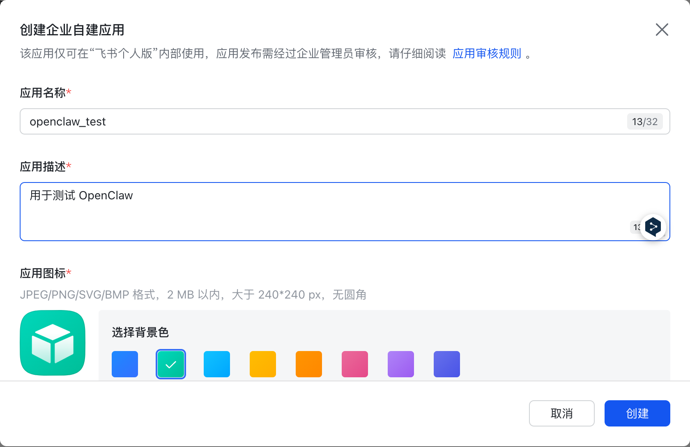

应用创建后，选择“添加应用能力”中的“机器人”。

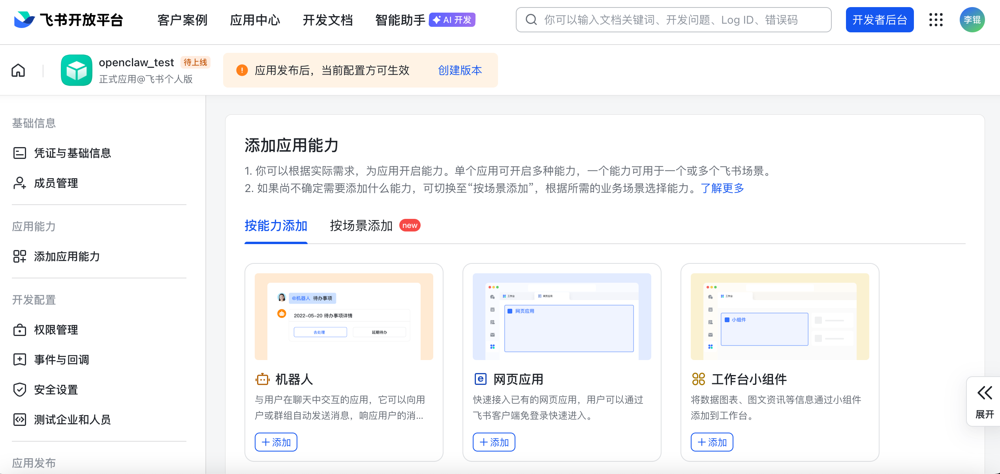

然后选择左侧菜单栏中的“权限管理”，为应用设置权限。

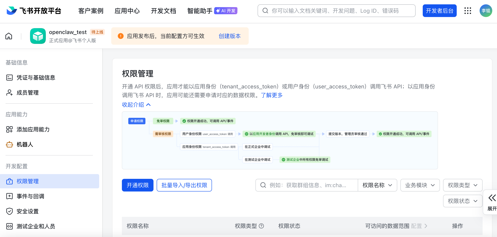

选择“批量导入 / 导出权限”，出现以下对话框：

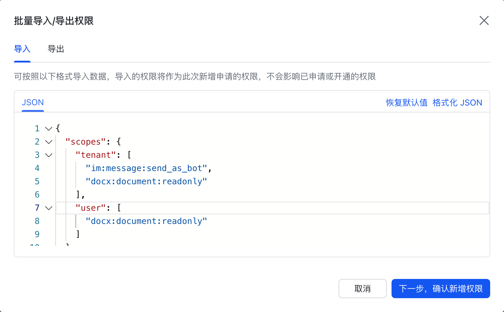

复制以下内容，替换上面对话框中的 JSON 内容，然后点击“下一步，确认新增权限”。

```json
{
 "scopes": {
   "tenant": [
     "aily:file:read",
     "aily:file:write",
     "application:application.app_message_stats.overview:readonly",
     "application:application:self_manage",
     "application:bot.menu:write",
     "cardkit:card:write",
     "contact:contact.base:readonly",
     "contact:user.base:readonly",
     "contact:user.employee_id:readonly",
     "corehr:file:download",
     "docs:document.content:read",
     "event:ip_list",
     "im:chat",
     "im:chat.access_event.bot_p2p_chat:read",
     "im:chat.members:bot_access",
     "im:chat:create",
     "im:message",
     "im:message.group_at_msg:readonly",
     "im:message.group_msg",
     "im:message.p2p_msg:readonly",
     "im:message:readonly",
     "im:message:send_as_bot",
     "im:resource",
     "sheets:spreadsheet",
     "wiki:wiki:readonly"
   ],
   "user": [
     "aily:file:read",
     "aily:file:write",
     "contact:user.employee_id:readonly",
     "im:chat",
     "im:chat.access_event.bot_p2p_chat:read",
     "im:chat:read",
     "im:chat:readonly"
   ]
 }
}
```

出现新的对话框，点击“申请开通”。

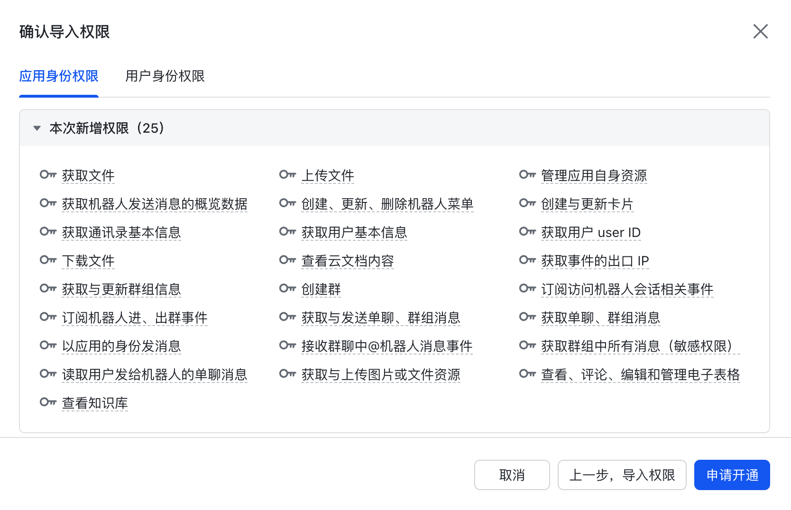

出现下面这个界面，不需要做任何修改，直接点击“确认”。

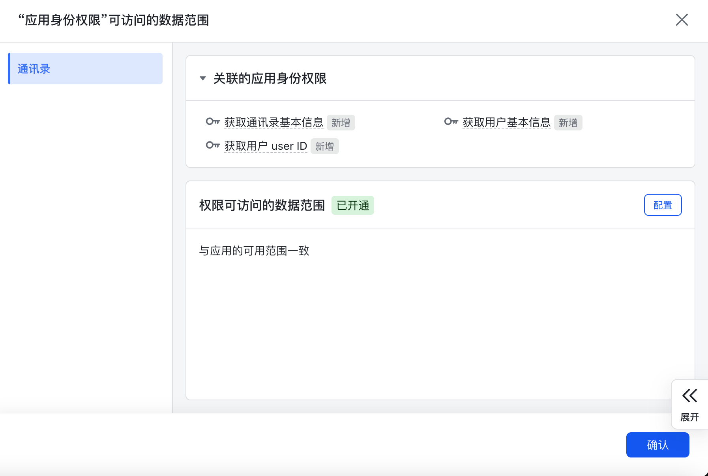

点击“创建版本”，输入应用版本号和更新说明，然后点击下方的“保存”按钮。

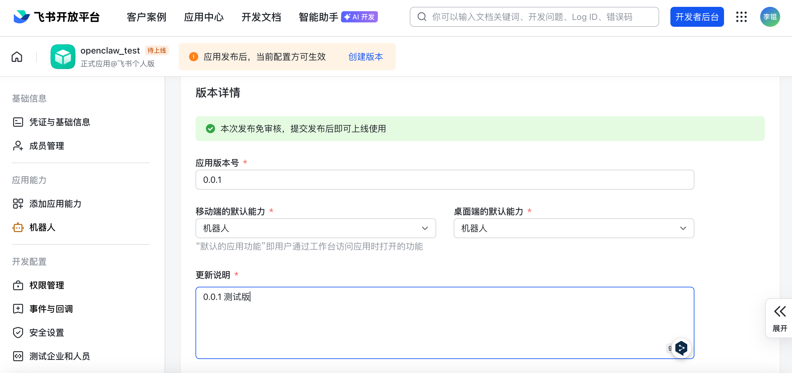

出现这个对话框，点击“确认发布”。


选择左侧菜单栏中的“凭证与基础信息”，复制 App ID 和 App Secret，将这两个信息保存在一个安全的地方，之后会用到。

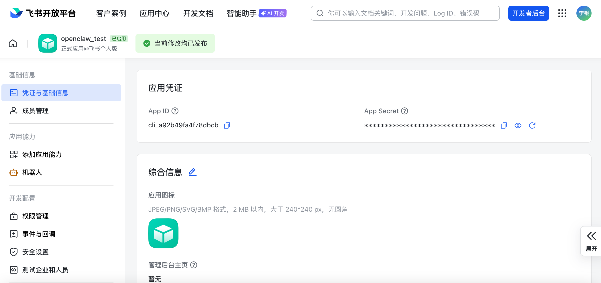

在浏览器中打开新的 Tab 页，访问链接，进入 API 调试台，创建一个新的飞书群。

注意：链接中的 “cli_a92b49fa4f78dbcb”是我创建的应用 openclaw_test 的 App ID，需要替换为你创建的应用的 App ID。

在下面界面中点击“获取 Token”按钮，然后点击“快速复制 open_id”。

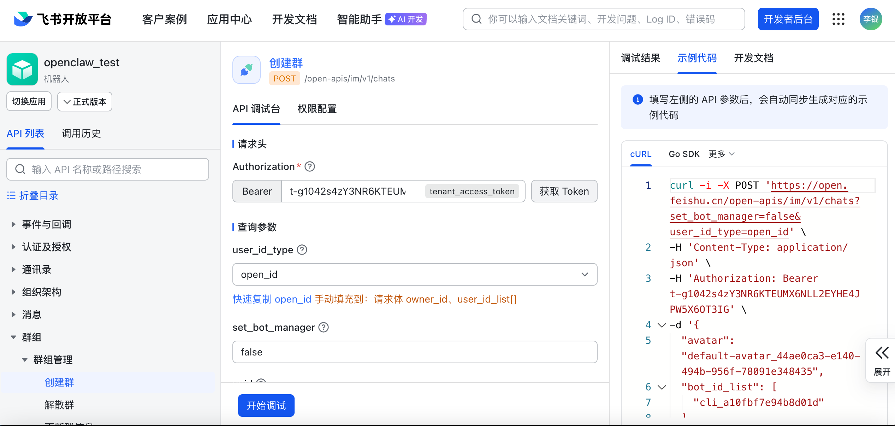

在下面对话框中，选择你的飞书用户，点击“复制成员 ID”.

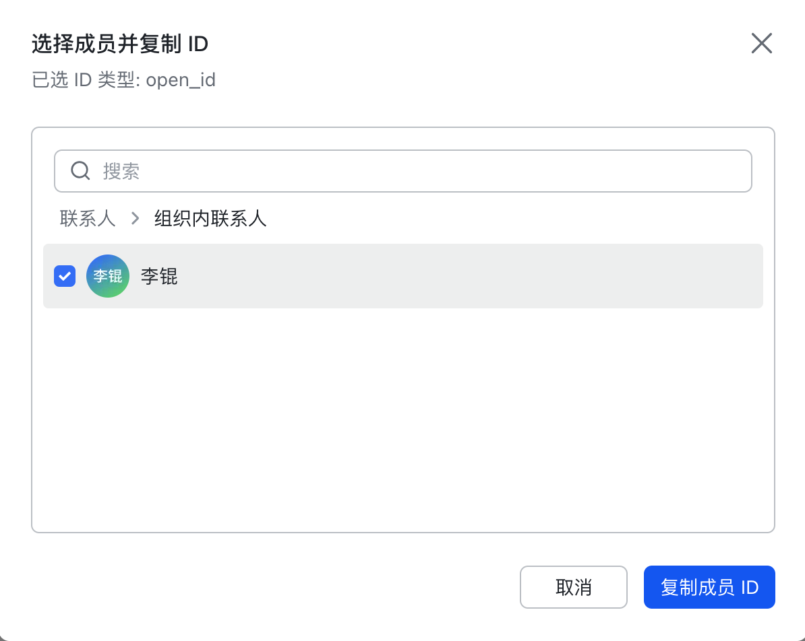

将 JSON 内容中的 owner_id、user_id_list 都替换为刚才复制的用户的 open_id，将bot_id_list 修改为刚才创建的应用的 App ID。要创建的群的 name、description 可以做一下修改。然后点击“开始调试”。

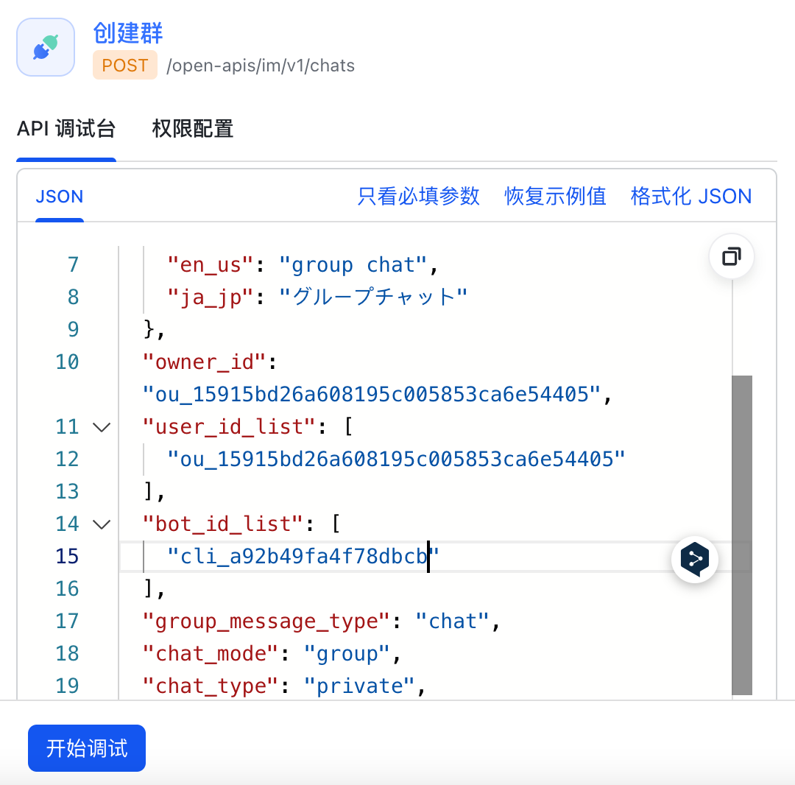

在这个对话框点击“调试”。


如果在右侧调试结果下面显示“调用成功”，群就创建好了。然后复制响应体中这个群的chat_id，还有之前复制的用户的 open_id，可以与 App ID、App Secret 保存在一起，后面很快会用到。

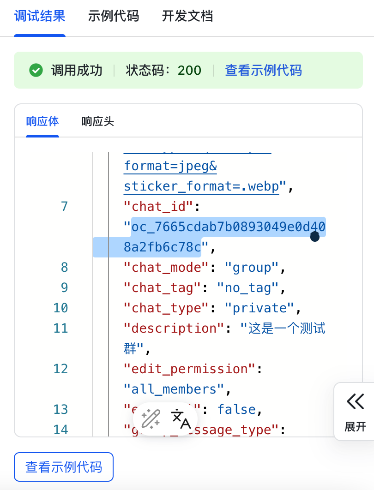

这一小节后续的步骤可以暂时略过，等安装好了 OpenClaw 之后再来执行。

选择左侧菜单栏中的“事件与回调”，为应用设置事件。订阅方式选择“使用长连接接收事件”，然后点击“保存”。

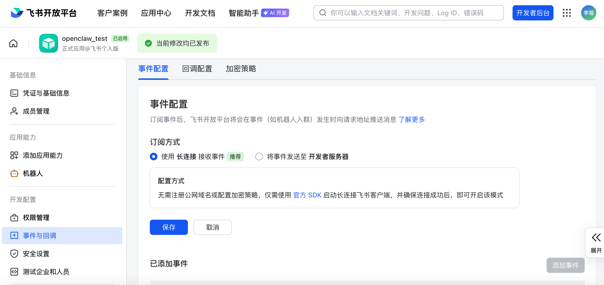

然后点击“添加事件”，添加以下 4 个事件：

```
im.chat.member.bot.added_v1
im.chat.member.bot.deleted_v1
im.message.message_read_v1
im.message.receive_v1
```

事件添加成功后会显示：

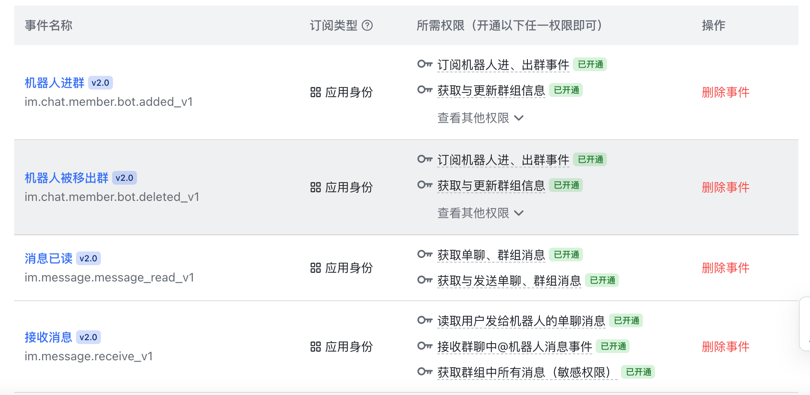

然后需要创建新版本，并重新发布。

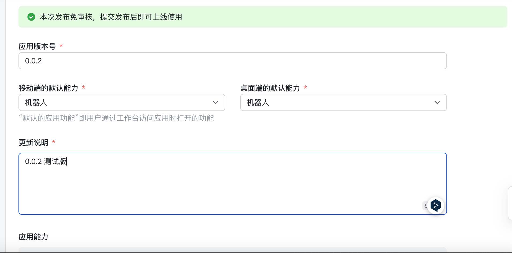

以后只要你在飞书的开发者后台看到警告“应用发布后，当前配置方可生效”，你都需要创建新版本并且重新发布。

## 在本地环境安装部署 OpenClaw

OpenClaw 的安装有些复杂，在 OpenClaw 爆火之后，阿里云、腾讯云、字节火山引擎等云平台厂商纷纷推出了一键安装 OpenClaw 的工具。但是这些工具都是与这些平台绑定的，其实有很多限制。我在这节课里面还是介绍 OpenClaw 官方的通用安装方法，这个方法对用户如何使用 OpenClaw 没有做任何限制。

### 安装 OpenClaw

使用以下命令来安装 OpenClaw：

```bash
curl -sSL https://openclaw.ai/install.sh | bash
```

提前说一下，以后要升级 OpenClaw，还是用上面这条命令。

在安装过程中，命令行中会出现以下问题。

```
I understand this is personal-by-default and shared/multi-user use requires lock-
选择 Yes
Onboarding mode
选择 QuickStart
Model/auth provider
选择 MiniMax
```

OpenClaw 官方可用的 LLM 厂商很多，国外厂商 / 平台可以选择 OpenAI、Anthropic、Google、Copilot、xAI、Kilo Gateway、OpenRouter、Hugging Face 等等，国内厂商可以选择 Qwen、Qianfan、MiniMax、Moonshot AI 、Xiaomi，还有在本地通过 vLLM、LiteLLM 部署的开源模型。

注意：这里的 Qwen 是国际版的千问，而不是国内版的千问。国际版的千问需要另外注册用户。

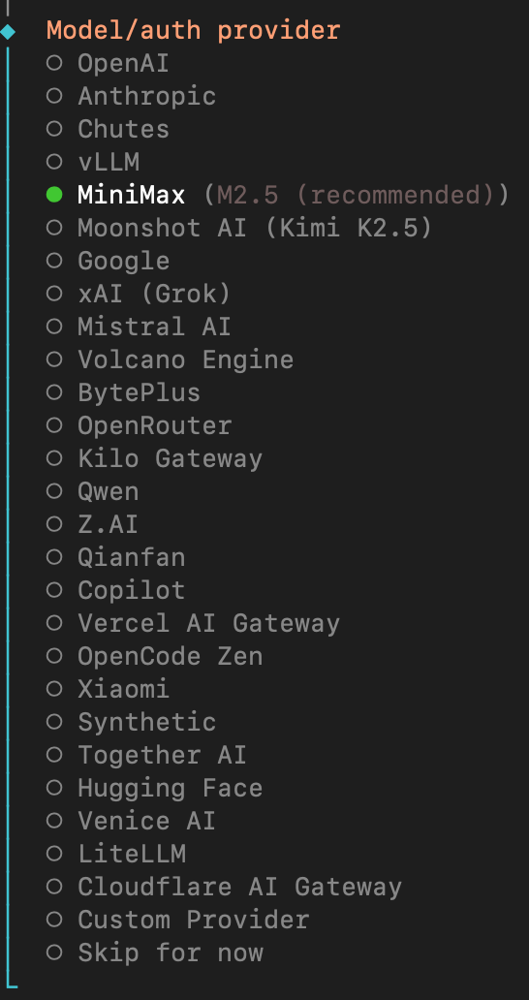

接下来的 MiniMax auth method 选择 MiniMax M2.5。这里不要选择 MiniMax OAuth，因为即使通过了 OAuth 授权，之后 OpenClaw 调用 MiniMax 的模型时仍然会报错：No API keyfound for provider xxxx，这个肯定是一个 bug。

How do you want to provide this API key ?

选择 Paste API key now

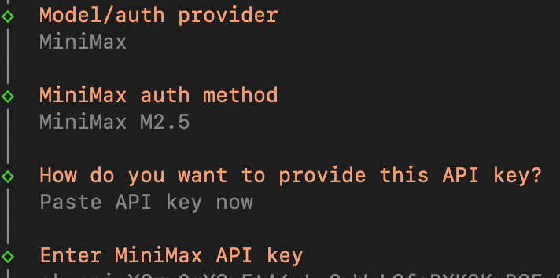

然后使用浏览器打开以下地址：

https://platform.minimaxi.com/user-center/basic-information/interface-key

选择左侧菜单中的“接口密钥”，然后点击页面中的“创建新的 API Key”，创建并复制一个 APIKey。

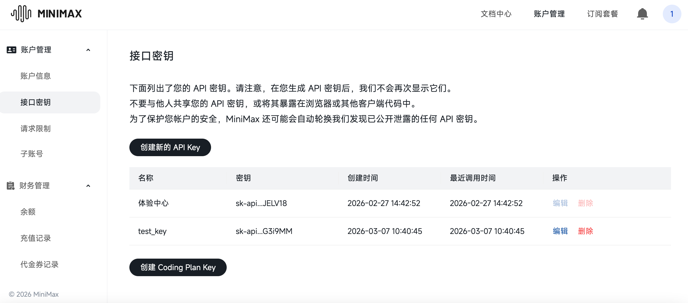

接下来在 Enter MiniMax API key 下面输入刚才创建的 API Key。

Default model 选择 Keep current。

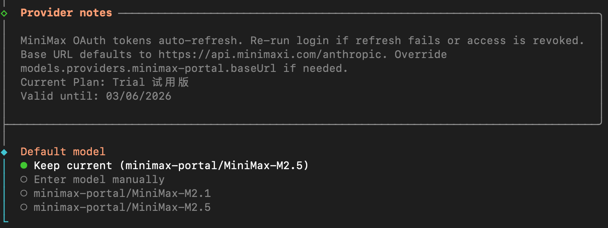

接下来配置 IM 工具。

Select channel (QuickStart)，选择 Feishu。

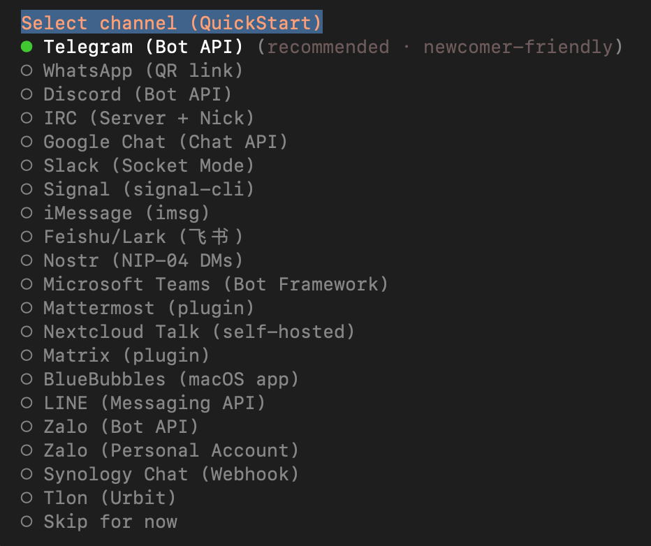

Install Feishu plugin，选择 Download from npm

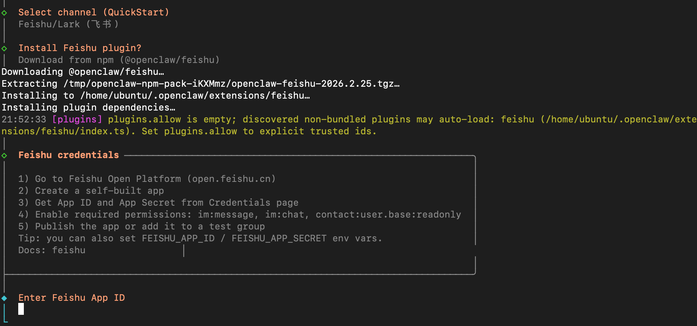

然后输入上一节创建的飞书应用的 App ID 和 App Secret。

Which Feishu domain，选择 Feishu (feishu.cn) - China。

Group chat policy，选择 Allowlist。

Group chat allowlist，输入刚刚在飞书 API 调试台创建的群的 chat_id。

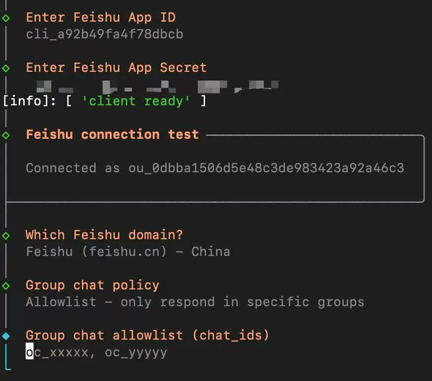

Configure skills now? (recommended)，选择 Yes，然后根据需要选择所需的 Skill。不过这一步略过也关系不大，可以以后再单独安装需要的 Skill。

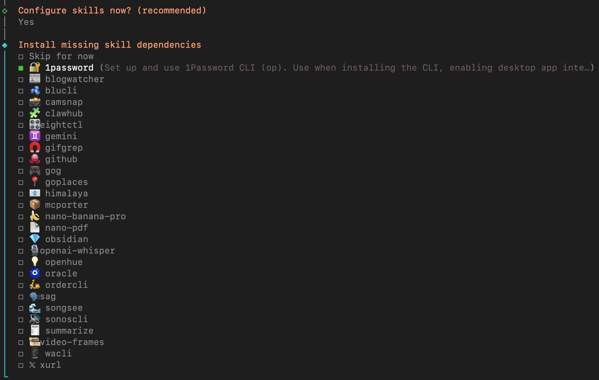

接下来会要求输入很多 API_KEY，这些服务都在国外，全部选择 No。

Enable hooks? 选择 Skip for now。

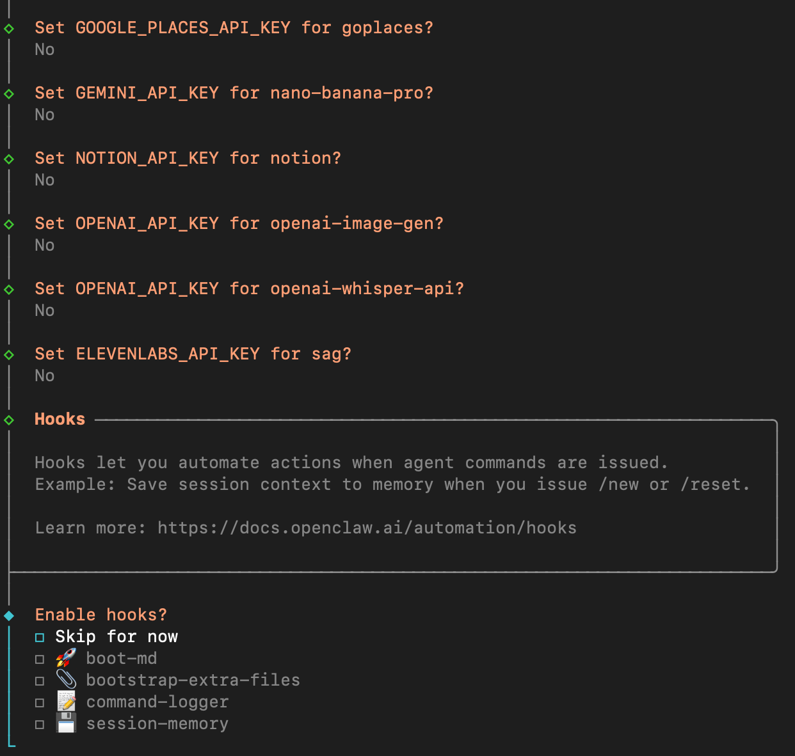

这时候会报很多警告，后面我说如何解决。

- Config warnings:\n- plugins.entries.feishu: plugin feishu: duplicate plugin id detected; laterplugin may be overridden (/home/ubuntu/.npm-global/lib/node_modules/openclaw/extensions/feishu/index.ts)How do you want to hatch your bot? 选择 Hatch in TUI。

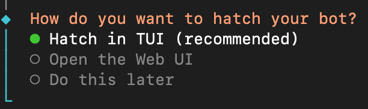

出现 TUI 界面之后，可以随便问一个问题，如果有正确回答，说明 MiniMax 的 LLM 已经连接成功了。

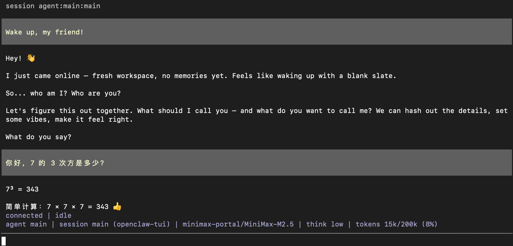

然后使用 ctrl-c 两次退出 TUI 界面。

### 实现飞书机器人的配对

到了这里，重新回到上一节那个中断的位置，为飞书应用添加事件，并且重新发布应用。

注意，每次当飞书应用重新发布后，都需要执行以下命令重新启动 OpenClaw 的 gateway。

```
openclaw gateway restart
```

gateway 重新启动成功后，使用以下命令给人类用户 (就是你自己) 发一个消息。

```
openclaw message send --channel feishu --target 'ou_15915bd26a608195c005853ca6e54
```

注意：其中的 “ou_15915bd26a608195c005853ca6e54405” 需要替换为在前面保存的用户的open_id。

飞书机器人有一个奇怪的问题，那就是新创建的机器人，如果它不首先给人类用户发消息，人类用户就无法首先给这个机器人发消息。在飞书 App 的界面中，你能够找到这个机器人，但是没有消息输入框。我感觉这个设计有点莫名其妙。因此你必须像前面这样先使用 OpenClaw以机器人的身份给用户发一个消息。

在飞书 App 中，你收到机器人发的这条消息之后，随便回一个消息，例如“你好”。然后你就会收到机器人发给你的 8 个字符的配对码，记住这个配对码，在主机上执行：

```
openclaw pairing approve feishu XXXXXXXX
```

注意：把 XXXXXXXX 替换为你收到的配对码。

配对成功之后，你肯定会很兴奋地想要跟 OpenClaw 深入交流一番，看到 OpenClaw 大显身手。且慢，别高兴的太早，这里还有一个大坑。此时你会发现无论你发什么消息，机器人都会不停回复新的配对码。

解决方法是重新配置 Feishu 这个 channel。执行以下命令：

```
openclaw channels add
```

Feishu already configured. What do you want to do? 选择 Modify settings。

选择 Finished，敲回车。

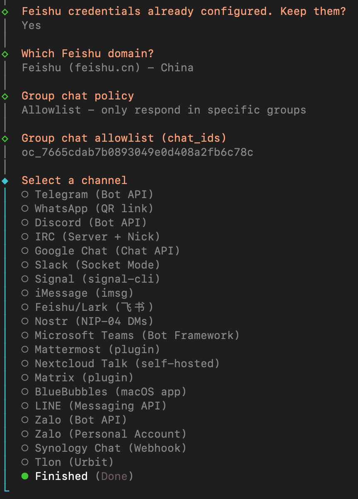

```
Configure DM access policies now? (default: pairing)
选择 Yes
Feishu DM policy
选择 Allowlist (这里非常关键)
Feishu allowlist
输入上一节保存的用户的 open_id
```

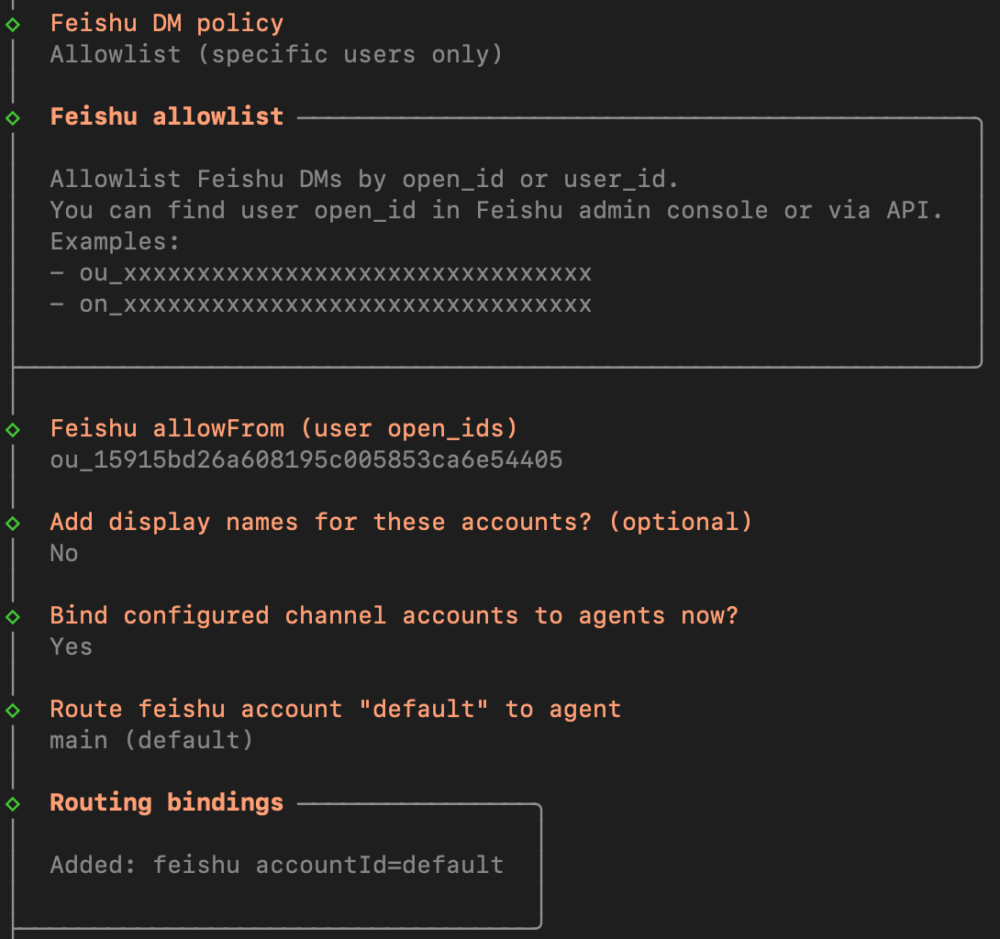

后面那些选项全部都用默认值就好了。

我顺便讲一下如何解决前面提到的那个 duplicate plugin id detected 警告，

因为 feishu 这个插件已经是 OpenClaw 官方自带的，但是在前面在安装过程中配置 feishu 这个 channel (即 IM) 时，安装过程又使用 npm 安装了一遍，这样 OpenClaw 就发现系统中有两个 feishu 插件。

```
~/.npm-global/lib/node_modules/openclaw/extensions/feishu # OpenClaw 官方自带
~/.openclaw/extensions/feishu # OpenClaw 安装过程安装
```

可以执行以下命令删除安装过程多余安装的 feishu 插件：

```
rm -rf ~/.openclaw/extensions/feishu
```

然后使用以下命令启用官方的 feishu 插件：

```
openclaw plugins enable feishu
```

每次修改了 channel 配置之后，也需要重新启动 gateway。

```
openclaw gateway restart
```

然后在飞书 App 向机器人发消息“你好，请列出当前可用的所有 model”，如果机器人正常返回了 OpenClaw 可用的大模型列表，恭喜你，OpenClaw + 飞书已经可以正常工作了。接下来你可以指挥它利用它所在主机上的资源 (软件 + 网络)，做一些你希望它完成的工作。

### 完全删除 OpenClaw

前面我们已经感受到了，在目前阶段，安装配置 OpenClaw 相当麻烦，其健壮性不是很令人满意。我无法预料到你所使用的主机上可能发生的一切异常情况，当你遇到了自己无法解决的问题时，可能你需要完全删除 OpenClaw，然后重新安装。所以这里我再介绍一下完全删除OpenClaw 的方法。

第一步：彻底停止所有 OpenClaw 相关进程 / 服务。

先终止运行中的网关、系统服务，避免删除文件时被占用：

```
# 1. 停止 OpenClaw 网关（命令行方式）
openclaw gateway stop 2>/dev/null
# 2. 停止并禁用 OpenClaw 系统服务（关键，避免开机自启残留）
systemctl --user stop openclaw-gateway.service 2>/dev/null
systemctl --user disable openclaw-gateway.service 2>/dev/null
systemctl --user daemon-reload 2>/dev/null
# 3. 强制杀死所有 OpenClaw 进程（确保无僵死进程）
pkill -9 openclaw 2>/dev/null
killall -9 openclaw 2>/dev/null
```

第二步：删除所有 OpenClaw 残留文件（核心）。

Ubuntu 下 OpenClaw 的文件分布在 4 个目录，全部删除才能彻底清理：

```bash
# 1. 删除用户级配置/缓存/日志（最核心，之前的重复插件、损坏配置都在这里）
rm -rf ~/.openclaw/
# 2. 删除临时日志/缓存（网关崩溃的临时文件）
rm -rf /tmp/openclaw/
# 3. 删除 npm 全局安装的 OpenClaw 程序文件（卸载主程序）
npm uninstall -g openclaw
# 4. 清理 npm 缓存（避免重装时用旧缓存）
npm cache clean --force
# 5. （可选）删除系统级残留（若曾手动安装过）
sudo rm -rf /usr/local/bin/openclaw 2>/dev/null
sudo rm -rf /usr/lib/node modules/openclaw 2>/dev/null
```

第三步：验证是否彻底删除（确认无残留）

执行以下命令，若无任何输出，说明清理干净；有输出则对应删除：

```bash
# 1. 检查是否还有 OpenClaw 进程
ps aux | grep openclaw | grep -v grep
# 2. 检查是否还有残留文件
ls -la ~/.openclaw/ 2>/dev/null
ls -la /tmp/openclaw/ 2>/dev/null
which openclaw 2>/dev/null
# 3. 检查 npm 包是否残留
npm list -g | grep openclaw 2>/dev/null
```

## 总结时刻

在这节课中，我首先隆重介绍了 OpenClaw 这个令人激动的开源 AI Agent 开发平台。然后我手把手带你过了一遍 OpenClaw 的安装过程。我使用的 LLM 是最优秀的国产 LLM 之一 ——MiniMax M2.5，使用的即时通讯工具是飞书。这些都配置好之后，不需要科学上网，就可以基于 OpenClaw 开发自己的 AI Agent，满足自己或者客户的各种需求。

安装部署 OpenClaw 比较麻烦，初学者很容易陷入到一些坑里，最终无奈放弃。我写这节课的目的，就是希望学习这门课程的你们能够平滑地度过这个阶段，尽快把 OpenClaw 顺利用起来，遵照 Altman 的忠告，在做中学，渐入佳境。

最后我还要讲一下 OpenClaw 的安全性问题，这个问题确实非常重要。如上所述 OpenClaw是部署在本地的 PC 主机上面，具有运行 OpenClaw 的用户的所有权限，万一它使用的某些Skill 存在安全问题，就可能会把敏感信息泄露到外网。对于商业公司来说，这些风险是无法承受的。但是 OpenClaw 是开源软件，可以本着“免费使用，后果自负” (AS IS) 的原则，规避掉这些风险。

我认为一个新生事物，首先还是应该有用，在有用的基础之上谈安全才是有价值的。一个虽然安全但是无用的事物，根本就不会有人使用。我们注重保护用户的安全，但是也需要理解用户作为一个成年人，也有冒险的权利，只要他愿意为自己的行为承担责任和风险。一味以“安全”为名限制一切新生事物，在我看来是不可取的。莱特兄弟造出来的第一架飞机，你觉得会很安全吗？很多人都说《徒手攀岩》的主人公 Alex 会教坏小孩子，但是他的冒险精神、极端的自律和刻苦，难道就没有一点正面意义吗？其实所有的创新，一开始都是极大的冒险。

这节课的篇幅已经严重超支了，但是才讲完了 OpenClaw 的安装。当然我也感觉意犹未尽，在下一课，我将会介绍 OpenClaw 的更多有趣话题，下一课的内容一定会有趣的多。

## 思考题

为何 OpenClaw 代表着任务型 AI Agent 的正确打开方式？它与之前那些任务型 AI Agent 有那些重大区别？欢迎你把你的想法分享到评论区，另外如果你在安装和使用 OpenClaw 的过程中遇到了问题也欢迎你分享出来，我们一起讨论、一起解决，如果你觉得有所收获，也欢迎你分享给需要的朋友，我们下节课再见！
