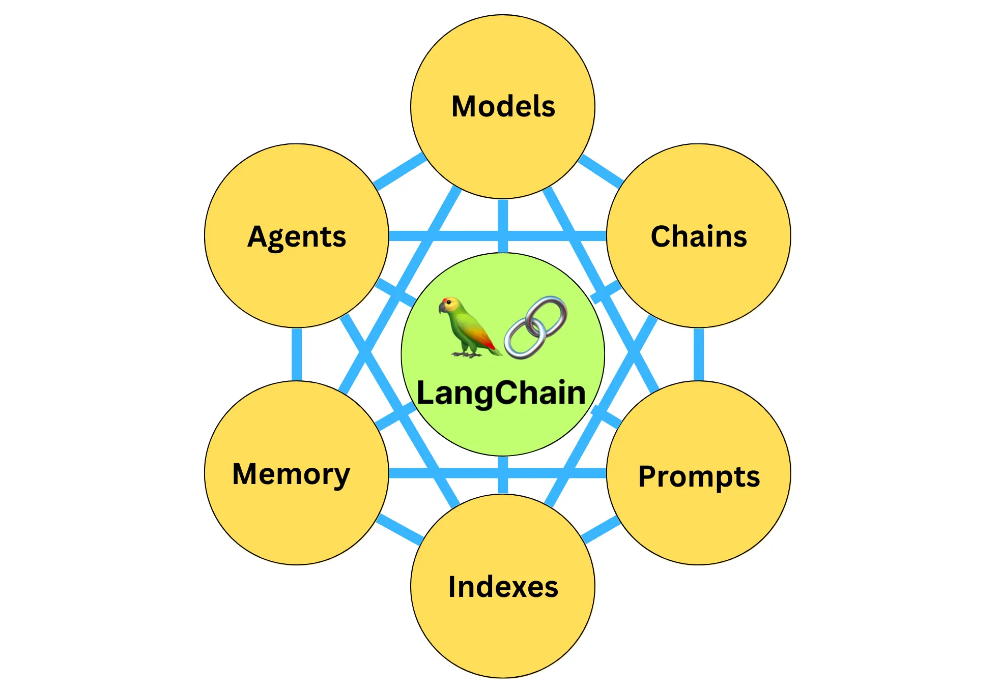
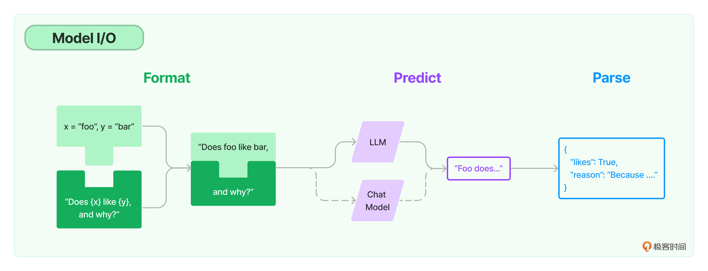
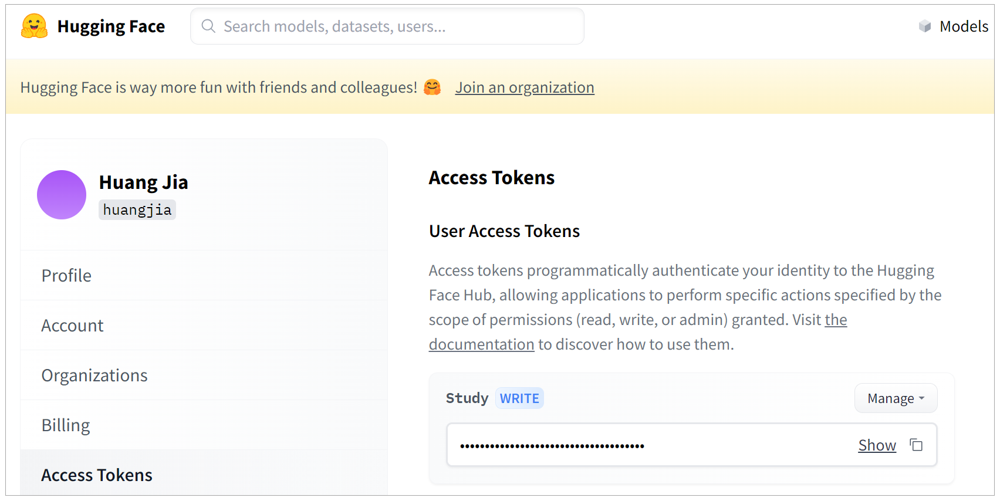
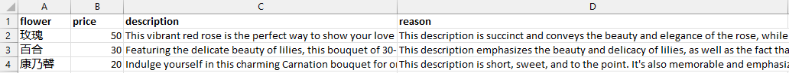

# 03 | 模型I-O：输入提示、调用模型、解析输出

你好，我是黄佳，欢迎来到 LangChain 实战课！

从这节课开始，我们将对 LangChain 中的六大核心组件一一进行详细的剖析。

模型，位于 LangChain 框架的最底层，它是基于语言模型构建的应用的核心元素，因为所谓LangChain 应用开发，就是以 LangChain 作为框架，通过 API 调用大模型来解决具体问题的过程。

可以说，整个 LangChain 框架的逻辑都是由 LLM 这个发动机来驱动的。没有模型，LangChain 这个框架也就失去了它存在的意义。那么这节课我们就详细讲讲模型，最后你会收获一个能够自动生成鲜花文案的应用程序。



## Model I/O

我们可以把对模型的使用过程拆解成三块，分别是输入提示（对应图中的 Format）、调用模型（对应图中的 Predict）和输出解析（对应图中的 Parse）。这三块形成了一个整体，因此在LangChain 中这个过程被统称为 Model I/O（Input/Output）。



- Model I/O：从输入到输出

在模型 I/O 的每个环节，LangChain 都为咱们提供了模板和工具，快捷地形成调用各种语言模型的接口。

1. 提示模板：使用模型的第一个环节是把提示信息输入到模型中，你可以创建 LangChain 模板，根据实际需求动态选择不同的输入，针对特定的任务和应用调整输入。

2. 语言模型：LangChain 允许你通过通用接口来调用语言模型。这意味着无论你要使用的是哪种语言模型，都可以通过同一种方式进行调用，这样就提高了灵活性和便利性。

3. 输出解析：LangChain 还提供了从模型输出中提取信息的功能。通过输出解析器，你可以精确地从模型的输出中获取需要的信息，而不需要处理冗余或不相关的数据，更重要的是还可以把大模型给回的非结构化文本，转换成程序可以处理的结构化数据。

下面我们用示例的方式来深挖一下这三个环节。先来看看 LangChain 中提示模板的构建。

## 提示模板

语言模型是个无穷无尽的宝藏，人类的知识和智慧，好像都封装在了这个“魔盒”里面了。但是，怎样才能解锁其中的奥秘，那可就是仁者见仁智者见智了。所以，现在“提示工程”这个词特别流行，所谓 Prompt Engineering，就是专门研究对大语言模型的提示构建。

我的观点是，使用大模型的场景千差万别，因此肯定不存在那么一两个神奇的模板，能够骗过所有模型，让它总能给你最想要的回答。然而，好的提示（其实也就是好的问题或指示啦），肯定能够让你在调用语言模型的时候事半功倍。

那其中的具体原则，不外乎吴恩达老师在他的提示工程课程中所说的：

1. 给予模型清晰明确的指示

2. 让模型慢慢地思考

说起来很简单，对吧？是的，道理总是简单，但是如何具体实践这些原则，又是个大问题。让我从创建一个简单的 LangChain 提示模板开始。

这里，我们希望为销售的每一种鲜花生成一段简介文案，那么每当你的员工或者顾客想了解某种鲜花时，调用该模板就会生成适合的文字。

这个提示模板的生成方式如下：

```
# 导入LangChain中的提示模板
from langchain.prompts import PromptTemplate
# 创建原始模板
template = """您是一位专业的鲜花店文案撰写员。\n
对于售价为 {price} 元的 {flower_name} ，您能提供一个吸引人的简短描述吗？
"""
# 根据原始模板创建LangChain提示模板
prompt = PromptTemplate.from_template(template)
# 打印LangChain提示模板的内容
print(prompt)
```

提示模板的具体内容如下：

```
input_variables=['flower_name', 'price']
output_parser=None partial_variables={}
template='/\n您是一位专业的鲜花店文案撰写员。
\n对于售价为 {price} 元的 {flower_name} ，您能提供一个吸引人的简短描述吗？\n'
template_format='f-string'
validate_template=True
```

在这里，所谓“模板”就是一段描述某种鲜花的文本格式，它是一个 f-string，其中有两个变量{flower_name} 和 {price} 表示花的名称和价格，这两个值是模板里面的占位符，在实际使用模板生成提示时会被具体的值替换。

代码中的 from_template 是一个类方法，它允许我们直接从一个字符串模板中创建一个PromptTemplate 对象。打印出这个 PromptTemplate 对象，你可以看到这个对象中的信息包

```
括输入的变量（在这个例子中就是 flower_name 和 price）、输出解析器（这个例子中没有
指定）、模板的格式（这个例子中为'f-string'）、是否验证模板（这个例子中设置为
True）。
```

因此 PromptTemplate 的 from_template 方法就是将一个原始的模板字符串转化为一个更丰富、更方便操作的 PromptTemplate 对象，这个对象就是 LangChain 中的提示模板。LangChain 提供了多个类和函数，也为各种应用场景设计了很多内置模板，使构建和使用提示变得容易。我们下节课还会对提示工程的基本原理和 LangChain 中的各种提示模板做更深入的讲解。

下面，我们将会使用这个刚刚构建好的提示模板来生成提示，并把提示输入到大语言模型中。

## 语言模型

LangChain 中支持的模型有三大类。

1. 大语言模型（LLM） ，也叫 Text Model，这些模型将文本字符串作为输入，并返回文本字符串作为输出。Open AI 的 text-davinci-003、Facebook 的 LLaMA、ANTHROPIC 的Claude，都是典型的 LLM。

2. 聊天模型（Chat Model），主要代表 Open AI 的 ChatGPT 系列模型。这些模型通常由语言模型支持，但它们的 API 更加结构化。具体来说，这些模型将聊天消息列表作为输入，并返回聊天消息。

3. 文本嵌入模型（Embedding Model），这些模型将文本作为输入并返回浮点数列表，也就是Embedding。而文本嵌入模型如 OpenAI 的 text-embedding-ada-002，我们之前已经见过了。文本嵌入模型负责把文档存入向量数据库，和我们这里探讨的提示工程关系不大。

然后，我们将调用语言模型，让模型帮我们写文案，并且返回文案的结果。

```python
# 设置OpenAI API Key
import os
os.environ["OPENAI_API_KEY"] = '你的Open AI API Key'
# 导入LangChain中的OpenAI模型接口
from langchain_openai import OpenAI
# 创建模型实例
model = OpenAI(model_name='gpt-3.5-turbo-instruct')
# 输入提示
input = prompt.format(flower_name=["玫瑰"], price='50')
# 得到模型的输出
output = model.invoke(input)
# 打印输出内容
print(output)
input = prompt.format(flower_name=["玫瑰"], price='50') 这行代码的作用是
将模板实例化，此时将 {flower_name} 替换为 "玫瑰"，{price} 替换为 '50'，形成了
```

具体的提示：“您是一位专业的鲜花店文案撰写员。对于售价为 50 元的玫瑰，您能提供一个吸引人的简短描述吗？”

接收到这个输入，调用模型之后，得到的输出如下：

```
让你心动！50元就可以拥有这支充满浪漫气息的玫瑰花束，让TA感受你的真心爱意。
```

复用提示模板，我们可以同时生成多个鲜花的文案。

```python
# 导入LangChain中的提示模板
from langchain import PromptTemplate
# 创建原始模板
template = """您是一位专业的鲜花店文案撰写员。\n
对于售价为 {price} 元的 {flower_name} ，您能提供一个吸引人的简短描述吗？
"""
# 根据原始模板创建LangChain提示模板
prompt = PromptTemplate.from_template(template)
# 打印LangChain提示模板的内容
print(prompt)
# 设置OpenAI API Key
import os
os.environ["OPENAI_API_KEY"] = '你的Open AI API Key'
# 导入LangChain中的OpenAI模型接口
from langchain import OpenAI
# 创建模型实例
model = OpenAI(model_name='gpt-3.5-turbo-instruct')
# 多种花的列表
flowers = ["玫瑰", "百合", "康乃馨"]
prices = ["50", "30", "20"]
# 生成多种花的文案
for flower, price in zip(flowers, prices):
   # 使用提示模板生成输入
   input_prompt = prompt.format(flower_name=flower, price=price)
   # 得到模型的输出
   output = model.invoke(input_prompt)
   # 打印输出内容
   print(output)
```

模型的输出如下：

- 这支玫瑰，深邃的红色，传递着浓浓的深情与浪漫，令人回味无穷！

```
百合：美丽的花朵，多彩的爱恋！30元让你拥有它！
康乃馨—20元，象征爱的祝福，送给你最真挚的祝福。
```

你也许会问我，在这个过程中，使用 LangChain 的意义究竟何在呢？我直接调用 Open AI 的API，不是完全可以实现相同的功能吗？

的确如此，让我们来看看直接使用 Open AI API 来完成上述功能的代码。

```python
import openai # 导入OpenAI
openai.api_key = 'Your-OpenAI-API-Key' # API Key
prompt_text = "您是一位专业的鲜花店文案撰写员。对于售价为{}元的{}，您能提供一个吸引人的简短描述
flowers = ["玫瑰", "百合", "康乃馨"]
prices = ["50", "30", "20"]
# 循环调用Text模型的Completion方法，生成文案
for flower, price in zip(flowers, prices):
   prompt = prompt_text.format(price, flower)
   response = openai.completions.create(
       engine="gpt-3.5-turbo-instruct",
       prompt=prompt,
       max_tokens=100
   )
   print(response.choices[0].text.strip()) # 输出文案
```

上面的代码是直接使用 Open AI 和带有 {} 占位符的提示语，同时生成了三种鲜花的文案。看起来也是相当简洁。

不过，如果你深入思考一下，你就会发现 LangChain 的优势所在。我们只需要定义一次模板，就可以用它来生成各种不同的提示。对比单纯使用 f-string 来格式化文本，这种方法更加简洁，也更容易维护。而 LangChain 在提示模板中，还整合了 output_parser、template_format 以及是否需要 validate_template 等功能。

更重要的是，使用 LangChain 提示模板，我们还可以很方便地把程序切换到不同的模型，而不需要修改任何提示相关的代码。

下面，我们用完全相同的提示模板来生成提示，并发送给 HuggingFaceHub 中的开源模型来创建文案。（注意：需要注册 HUGGINGFACEHUB_API_TOKEN）



```python
# 导入LangChain中的提示模板
from langchain.prompts import PromptTemplate
# 创建原始模板
template = """You are a flower shop assitiant。\n
For {price} of {flower_name} ，can you write something for me？
"""
# 根据原始模板创建LangChain提示模板
prompt = PromptTemplate.from_template(template)
# 打印LangChain提示模板的内容
print(prompt)
import os
os.environ['HUGGINGFACEHUB_API_TOKEN'] = '你的HuggingFace API Token'
# 导入LangChain中的OpenAI模型接口
from langchain_community.llms import HuggingFaceHub
# 创建模型实例
model= HuggingFaceHub(repo_id="google/flan-t5-large")
# 输入提示
input = prompt.format(flower_name=["rose"], price='50')
# 得到模型的输出
output = model(input)
# 打印输出内容
print(output)
```

输出：

```
i love you
```

真是一分钱一分货，当我使用较早期的开源模型 T5，得到了很粗糙的文案 “i love you”（哦，还要注意 T5 还没有支持中文的能力，我把提示文字换成英文句子，结构其实都没变）。

当然，这里我想要向你传递的信息是：你可以重用模板，重用程序结构，通过 LangChain 框架调用任何模型。如果你熟悉机器学习的训练流程的话，这 LangChain 是不是让你联想到PyTorch 和 TensorFlow 这样的框架——模型可以自由选择、自主训练，而调用模型的框架往往是有章法、而且可复用的。

因此，使用 LangChain 和提示模板的好处是：

1. 代码的可读性：使用模板的话，提示文本更易于阅读和理解，特别是对于复杂的提示或多变量的情况。

2. 可复用性：模板可以在多个地方被复用，让你的代码更简洁，不需要在每个需要生成提示的地方重新构造提示字符串。

3. 维护：如果你在后续需要修改提示，使用模板的话，只需要修改模板就可以了，而不需要在代码中查找所有使用到该提示的地方进行修改。

4. 变量处理：如果你的提示中涉及到多个变量，模板可以自动处理变量的插入，不需要手动拼接字符串。

5. 参数化：模板可以根据不同的参数生成不同的提示，这对于个性化生成文本非常有用。

那我们就接着介绍模型 I/O 的最后一步，输出解析。

## 输出解析

LangChain 提供的解析模型输出的功能，使你能够更容易地从模型输出中获取结构化的信息，这将大大加快基于语言模型进行应用开发的效率。

为什么这么说呢？请你思考一下刚才的例子，你只是让模型生成了一个文案。这段文字是一段字符串，正是你所需要的。但是，在开发具体应用的过程中，很明显我们不仅仅需要文字，更多情况下我们需要的是程序能够直接处理的、结构化的数据。

比如说，在这个文案中，如果你希望模型返回两个字段：

- description：鲜花的说明文本

- reason：解释一下为何要这样写上面的文案

那么，模型可能返回的一种结果是：

A：“文案是：让你心动！50 元就可以拥有这支充满浪漫气息的玫瑰花束，让 TA 感受你的真心爱意。为什么这样说呢？因为爱情是无价的，50 元对应热恋中的情侣也会觉得值得。”

上面的回答并不是我们在处理数据时所需要的，我们需要的是一个类似于下面的 Python 字典。

B：{description: “让你心动！50 元就可以拥有这支充满浪漫气息的玫瑰花束，让 TA 感受你的真心爱意。” ; reason: “因为爱情是无价的，50 元对应热恋中的情侣也会觉得值得。”}

那么从 A 的笼统言语，到 B 这种结构清晰的数据结构，如何自动实现？这就需要 LangChain中的输出解析器上场了。

下面，我们就通过 LangChain 的输出解析器来重构程序，让模型有能力生成结构化的回应，同时对其进行解析，直接将解析好的数据存入 CSV 文档。

```python
# 导入OpenAI Key
import os
os.environ["OPENAI_API_KEY"] = '你的OpenAI API Key'
# 导入LangChain中的提示模板
from langchain.prompts import PromptTemplate
# 创建原始提示模板
prompt_template = """您是一位专业的鲜花店文案撰写员。
对于售价为 {price} 元的 {flower_name} ，您能提供一个吸引人的简短描述吗？
{format_instructions}"""
# 通过LangChain调用模型
from langchain_openai import OpenAI
# 创建模型实例
model = OpenAI(model_name='gpt-3.5-turbo-instruct')
# 导入结构化输出解析器和ResponseSchema
from langchain.output_parsers import StructuredOutputParser, ResponseSchema
# 定义我们想要接收的响应模式
response_schemas = [
   ResponseSchema(name="description", description="鲜花的描述文案"),
   ResponseSchema(name="reason", description="问什么要这样写这个文案")
]
# 创建输出解析器
output_parser = StructuredOutputParser.from_response_schemas(response_schemas)
# 获取格式指示
format_instructions = output_parser.get_format_instructions()
# 根据原始模板创建提示，同时在提示中加入输出解析器的说明
prompt = PromptTemplate.from_template(prompt_template,
               partial_variables={"format_instructions": format_instructions})
# 数据准备
flowers = ["玫瑰", "百合", "康乃馨"]
prices = ["50", "30", "20"]
# 创建一个空的DataFrame用于存储结果
import pandas as pd
df = pd.DataFrame(columns=["flower", "price", "description", "reason"]) # 先声明列名
for flower, price in zip(flowers, prices):
   # 根据提示准备模型的输入
   input = prompt.format(flower_name=flower, price=price)
   # 获取模型的输出
   output = model.invoke(input)
   # 解析模型的输出（这是一个字典结构）
   parsed_output = output_parser.parse(output)
   # 在解析后的输出中添加“flower”和“price”
   parsed_output['flower'] = flower
   parsed_output['price'] = price
   # 将解析后的输出添加到DataFrame中
   df.loc[len(df)] = parsed_output
# 打印字典
print(df.to_dict(orient='records'))
# 保存DataFrame到CSV文件
df.to_csv("flowers_with_descriptions.csv", index=False)
```

输出：

```
[{'flower': '玫瑰', 'price': '50', 'description': 'Luxuriate in the beauty of this
{'flower': '百合', 'price': '30', 'description': '30元的百合，象征着坚定的爱情，带给你的
{'flower': '康乃馨', 'price': '20', 'description': 'This beautiful carnation is th
```

这段代码中，首先定义输出结构，我们希望模型生成的答案包含两部分：鲜花的描述文案（description）和撰写这个文案的原因（reason）。所以我们定义了一个名为response_schemas 的列表，其中包含两个 ResponseSchema 对象，分别对应这两部分的输出。

根据这个列表，我通过 StructuredOutputParser.from_response_schemas 方法创建了一个输出解析器。

然后，我们通过输出解析器对象的 get_format_instructions() 方法获取输出的格式说明（format_instructions），再根据原始的字符串模板和输出解析器格式说明创建新的提示模板（这个模板就整合了输出解析结构信息）。再通过新的模板生成模型的输入，得到模型的输出。此时模型的输出结构将尽最大可能遵循我们的指示，以便于输出解析器进行解析。

对于每一个鲜花和价格组合，我们都用 output_parser.parse(output) 把模型输出的文案解析成之前定义好的数据格式，也就是一个 Python 字典，这个字典中包含了 description 和 reason这两个字段的值。

```
parsed_output
{'description': 'This 50-yuan rose is... feelings.', 'reason': 'The description i
len(): 2
```

最后，把所有信息整合到一个 pandas DataFrame 对象中（需要安装 Pandas 库）。这个DataFrame 对象中包含了 flower、price、description 和 reason 这四个字段的值。其中，description 和 reason 是由 output_parser 从模型的输出中解析出来的，flower 和 price 是我们自己添加的。

我们可以打印出 DataFrame 的内容，也方便地在程序中处理它，比如保存为下面的 CSV 文件。因为此时数据不再是模糊的、无结构的文本，而是结构清晰的有格式的数据。输出解析器在这个过程中的功劳很大。



到这里，我们今天的任务也就顺利完成了。

## 总结时刻

这样，你就从头到尾利用大模型开发出来了一个能够自动生成鲜花文案的应用程序！怎么样，是不是感觉和我们平时所做的基于 SQL 和数据库表以及固定业务逻辑的应用开发很不一样？

你看，每一次运行都有不同的结果，而我们完全不知道大模型下一次会给我们带来怎样的新东西。因此，基于大模型构建的应用可以说充满了创造力。

总结一下使用 LangChain 框架的好处，你会发现它有这样几个优势。

1. 模板管理：在大型项目中，可能会有许多不同的提示模板，使用 LangChain 可以帮助你更好地管理这些模板，保持代码的清晰和整洁。

2. 变量提取和检查：LangChain 可以自动提取模板中的变量并进行检查，确保你没有忘记填充任何变量。

3. 模型切换：如果你想尝试使用不同的模型，只需要更改模型的名称就可以了，无需修改代码。

4. 输出解析：LangChain 的提示模板可以嵌入对输出格式的定义，以便在后续处理过程中比较方便地处理已经被格式化了的输出。

在下节课中，我们将继续深入探索 LangChain 中的提示模板，看一看如何通过高质量的提示工程让模型创造出更为精准、更高质量的输出。

## 思考题

1. 请你用自己的理解，简述 LangChain 调用大语言模型来做应用开发的优势。

2. 在上面的示例中，format_instructions，也就是输出格式是怎样用 output_parser 构建出来的，又是怎样传递到提示模板中的？

3. 加入了 partial_variables，也就是输出解析器指定的 format_instructions 之后的提示，为什么能够让模型生成结构化的输出？你可以打印出这个提示，一探究竟。

4. 使用输出解析器后，调用模型时有没有可能仍然得不到所希望的输出？也就是说，模型有没有可能仍然返回格式不够完美的输出？

题目较多，可以选择性思考，期待在留言区看到你的分享。如果你觉得内容对你有帮助，也欢迎分享给有需要的朋友！最后如果你学有余力，可以进一步学习下面的延伸阅读。

## 延伸阅读

1. 吴恩达老师的提示工程课程，吴老师也有 LangChain 的简单介绍课程呦！网上也有这些课程的中文翻译版！

2. LangChain 官方文档中，关于模型 I/O 的资料在此。
