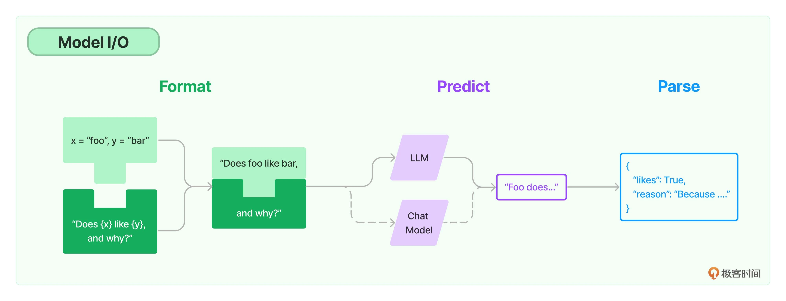
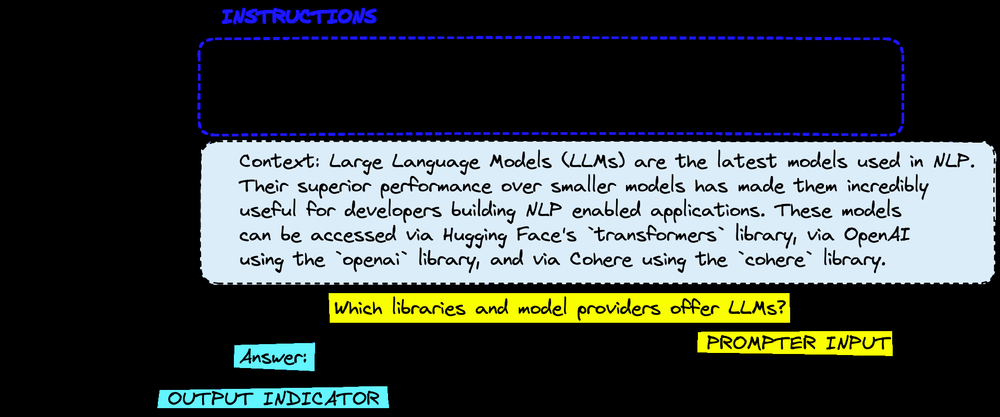
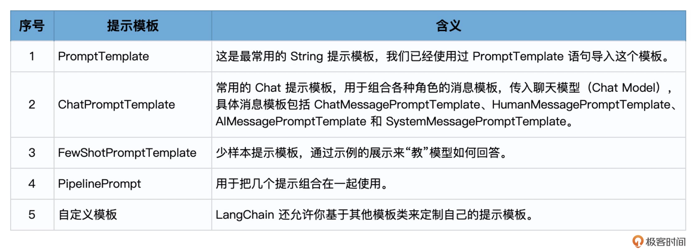
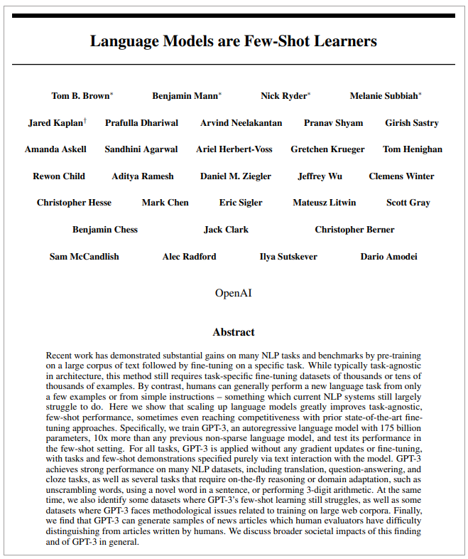
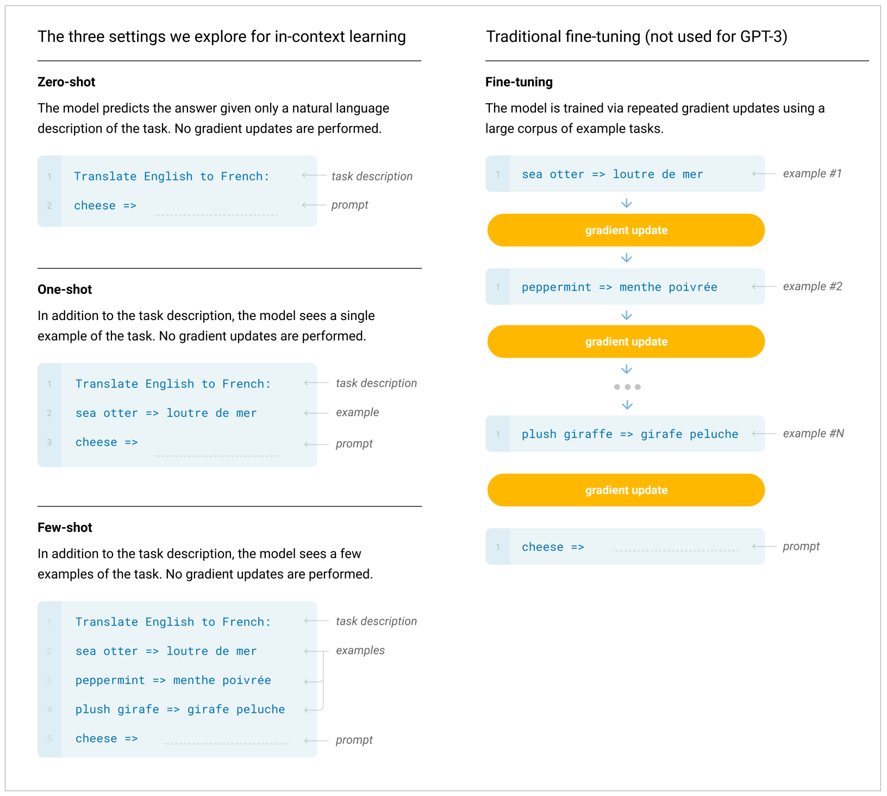
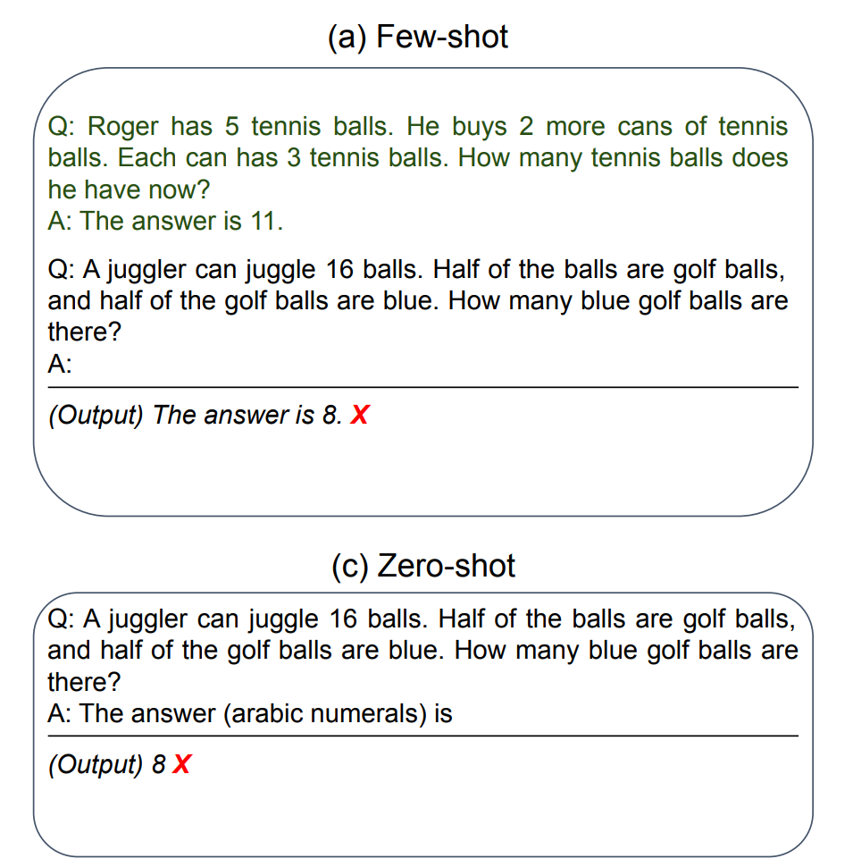

# 04 | 提示工程（上）：用少样本FewShotTemplate和ExampleSelector创建应景文案

你好，我是黄佳，欢迎来到 LangChain 实战课！

上节课我给你留了一个思考题：在提示模板的构建过程中加入了 partial_variables，也就是输出解析器指定的 format_instructions 之后，为什么能够让模型生成结构化的输出？

当你用 print 语句打印出最终传递给大模型的提示时，一切就变得非常明了。

- 您是一位专业的鲜花店文案撰写员。

```
对于售价为 50 元的 玫瑰 ，您能提供一个吸引人的简短描述吗？
The output should be a markdown code snippet formatted in the following schema, i
```json
{
       "description": string  // 鲜花的描述文案
       "reason": string  // 问什么要这样写这个文案
}
```

秘密在于，LangChain 的输出解析器偷偷的在提示中加了一段话，也就是{format_instructions} 中的内容。这段由 LangChain 自动添加的文字，就清楚地指示着我们希望得到什么样的回答以及回答的具体格式。提示指出，模型需要根据一个 schema 来格式化输出文本，这个 schema 从 ```json 开始，到 ``` 结束。

这就是在告诉模型，你就 follow 这个 schema（schema，可以理解为对数据结构的描述）的格式，就行啦！

这就是一个很棒、很典型的提示工程。有了这样清晰的提示，智能程度比较高的模型（比如GPT3.5 及以上版本），肯定能够输出可以被解析的数据结构，如 JSON 格式的数据。

那么这节课我就带着你进一步深究，如何利用 LangChain 中的提示模板，做好提示工程。



- 提示工程：模型 I/O 的输入部分

上节课我说过，针对大模型的提示工程该如何做，吴恩达老师在他的 ChatGPT PromptEngineering for Developers 公开课中，给出了两个大的原则：第一条原则是写出清晰而具体的指示，第二条原则是给模型思考的时间。

无独有偶，在 Open AI 的官方文档 GPT 最佳实践中，也给出了和上面这两大原则一脉相承的 6 大策略。分别是：

1. 写清晰的指示

2. 给模型提供参考（也就是示例）

3. 将复杂任务拆分成子任务

4. 给 GPT 时间思考

5. 使用外部工具

6. 反复迭代问题

怎么样，这些原则和策略是不是都是大白话？这些原则其实不仅能够指导大语言模型，也完全能够指导你的思维过程，让你处理问题时的思路更为清晰。所以说，大模型的思维过程和我们人类的思维过程，还是蛮相通的。

## 提示的结构

当然了，从大原则到实践，还是有一些具体工作需要说明，下面我们先看一个实用的提示框架。



在这个提示框架中：

- 指令（Instuction）告诉模型这个任务大概要做什么、怎么做，比如如何使用提供的外部信息、如何处理查询以及如何构造输出。这通常是一个提示模板中比较固定的部分。一个常见用例是告诉模型“你是一个有用的 XX 助手”，这会让他更认真地对待自己的角色。

- 上下文（Context）则充当模型的额外知识来源。这些信息可以手动插入到提示中，通过矢量数据库检索得来，或通过其他方式（如调用 API、计算器等工具）拉入。一个常见的用例时是把从向量数据库查询到的知识作为上下文传递给模型。

- 提示输入（Prompt Input）通常就是具体的问题或者需要大模型做的具体事情，这个部分和“指令”部分其实也可以合二为一。但是拆分出来成为一个独立的组件，就更加结构化，便于复用模板。这通常是作为变量，在调用模型之前传递给提示模板，以形成具体的提示。

- 输出指示器（Output Indicator）标记​要生成的文本的开始。这就像我们小时候的数学考卷，先写一个“解”，就代表你要开始答题了。如果生成 Python 代码，可以使用 “import” 向模型表明它必须开始编写 Python 代码（因为大多数 Python 脚本以 import 开头）。这部分在我们和 ChatGPT 对话时往往是可有可无的，当然 LangChain 中的代理在构建提示模板时，经常性的会用一个“Thought：”（思考）作为引导词，指示模型开始输出自己的推理（Reasoning）。

下面，就让我们看看如何使用 LangChain 中的各种提示模板做提示工程，将更优质的提示输入大模型。

## LangChain 提示模板的类型

LangChain 中提供 String（StringPromptTemplate）和 Chat（BaseChatPromptTemplate）两种基本类型的模板，并基于它们构建了不同类型的提示模板：



这些模板的导入方式如下：

```
from langchain.prompts.prompt import PromptTemplate
from langchain.prompts import FewShotPromptTemplate
from langchain.prompts.pipeline import PipelinePromptTemplate
from langchain.prompts import ChatPromptTemplate
from langchain.prompts import (
   ChatMessagePromptTemplate,
   SystemMessagePromptTemplate,
   AIMessagePromptTemplate,
   HumanMessagePromptTemplate,
)
```

我发现有时候不指定 .prompts，直接从 LangChain 包也能导入模板。

```python
from langchain import PromptTemplate
```

下面我们通过示例来介绍上面这些模版，前两个我们简单了解就好，其中最典型的FewShotPromptTemplate 会重点讲。至于 PipelinePrompt 和自定义模板，使用起来比较简单，请你参考 LangChain 文档自己学习。

## 使用 PromptTemplate

下面通过示例简单说明一下 PromptTemplate 的使用。

```python
from langchain import PromptTemplate
template = """\
```

- 你是业务咨询顾问。

```
你给一个销售{product}的电商公司，起一个好的名字？
"""
prompt = PromptTemplate.from_template(template)
print(prompt.format(product="鲜花"))
```

输出：

- 你是业务咨询顾问。你给一个销售鲜花的电商公司，起一个好的名字？

这个程序的主要功能是生成适用于不同场景的提示，对用户定义的一种产品或服务提供公司命名建议。

```
在这里，"你是业务咨询顾问。你给一个销售{product}的电商公司，起一个好的名字？" 就
```

是原始提示模板，其中 {product} 是占位符。

然后通过 PromptTemplate 的 from_template 方法，我们创建了一个提示模板对象，并通过

```
prompt.format 方法将模板中的 {product} 替换为 "鲜花"。
```

这样，就得到了一句具体的提示：你是业务咨询顾问。你给一个销售鲜花的电商公司，起一个好的名字？——这就要求大语言模型，要有的放矢。

在上面这个过程中，LangChain 中的模板的一个方便之处是 from_template 方法可以从传入的字符串中自动提取变量名称（如 product），而无需刻意指定。上面程序中的 product 自动成为了 format 方法中的一个参数。

当然，也可以通过提示模板类的构造函数，在创建模板时手工指定 input_variables，示例如下：

```
prompt = PromptTemplate(
   input_variables=["product", "market"],
   template="你是业务咨询顾问。对于一个面向{market}市场的，专注于销售{product}的公司，你会
)
print(prompt.format(product="鲜花", market="高端"))
```

输出：

- 你是业务咨询顾问。对于一个面向高端市场的，专注于销售鲜花的公司，你会推荐哪个名字？

上面的方式直接生成了提示模板，并没有通过 from_template 方法从字符串模板中创建提示模板。二者效果是一样的。

## 使用 ChatPromptTemplate

对于 OpenAI 推出的 ChatGPT 这一类的聊天模型，LangChain 也提供了一系列的模板，这些模板的不同之处是它们有对应的角色。

下面代码展示了 OpenAI 的 Chat Model 中的各种消息角色。

```python
import openai
openai.ChatCompletion.create(
 model="gpt-3.5-turbo",
 messages=[
       {"role": "system", "content": "You are a helpful assistant."},
       {"role": "user", "content": "Who won the world series in 2020?"},
       {"role": "assistant", "content": "The Los Angeles Dodgers won the World S
       {"role": "user", "content": "Where was it played?"}
   ]
)
```

OpenAI 对传输到 gpt-3.5-turbo 和 GPT-4 的 messsage 格式说明如下：

- 消息必须是消息对象的数组，其中每个对象都有一个角色（系统、用户或助理）和内容。对话可以短至一条消息，也可以来回多次。

- 通常，对话首先由系统消息格式化，然后是交替的用户消息和助理消息。

- 系统消息有助于设置助手的行为。例如，你可以修改助手的个性或提供有关其在整个对话过程中应如何表现的具体说明。但请注意，系统消息是可选的，并且没有系统消息的模型的行为可能类似于使用通用消息，例如“你是一个有用的助手”。

- 用户消息提供助理响应的请求或评论。

- 助理消息存储以前的助理响应，但也可以由你编写以给出所需行为的示例。

LangChain 的 ChatPromptTemplate 这一系列的模板，就是跟着这一系列角色而设计的。

下面，我给出一个示例。

```python
# 导入聊天消息类模板
from langchain.prompts import (
   ChatPromptTemplate,
   SystemMessagePromptTemplate,
   HumanMessagePromptTemplate,
)
# 模板的构建
template="你是一位专业顾问，负责为专注于{product}的公司起名。"
system_message_prompt = SystemMessagePromptTemplate.from_template(template)
human_template="公司主打产品是{product_detail}。"
human_message_prompt = HumanMessagePromptTemplate.from_template(human_template)
prompt_template = ChatPromptTemplate.from_messages([system_message_prompt, human_
# 格式化提示消息生成提示
prompt = prompt_template.format_prompt(product="鲜花装饰", product_detail="创新的鲜花
# 下面调用模型，把提示传入模型，生成结果
import os
os.environ["OPENAI_API_KEY"] = '你的OpenAI Key'
from langchain.chat_models import ChatOpenAI
chat = ChatOpenAI()
result = chat(prompt)
print(result)
```

输出：

```
content='1. 花语创意\n2. 花韵设计\n3. 花艺创新\n4. 花漾装饰\n5. 花语装点\n6. 花翩翩\n7. 花
additional_kwargs={}
example=False
```

好吧，尽管模型成功地完成了任务，但是感觉没有咱“易速鲜花”响亮！

讲完上面两种简单易用的提示模板，下面开始介绍今天的重点内容，FewShotPromptTemplate。FewShot，也就是少样本这一概念，是提示工程中非常重要的部分，对应着 OpenAI 提示工程指南中的第 2 条——给模型提供参考（也就是示例）。

## FewShot 的思想起源

讲解概念之前，我先分享个事儿哈，帮助你理解。

今天我下楼跑步时，一个老爷爷教孙子学骑车，小孩总掌握不了平衡，蹬一两下就下车。

- 爷爷说：“宝贝，你得有毅力！”

- 孙子说：“爷爷，什么是毅力？”

- 爷爷说：“你看这个叔叔，绕着楼跑了 10 多圈了，这就是毅力，你也得至少蹬个 10 几趟才能骑起来。”

这老爷爷就是给孙子做了一个 One-Shot 学习。如果他的孙子第一次听说却上来就明白什么是毅力，那就神了，这就叫 Zero-Shot，表明这孩子的语言天赋不是一般的高，从知识积累和当前语境中就能够推知新词的涵义。有时候我们把 Zero-Shot 翻译为“顿悟”，聪明的大模型，某些情况下也是能够做到的。

Few-Shot（少样本）、One-Shot（单样本）和与之对应的 Zero-Shot（零样本）的概念都起源于机器学习。如何让机器学习模型在极少量甚至没有示例的情况下学习到新的概念或类别，对于许多现实世界的问题是非常有价值的，因为我们往往无法获取到大量的标签化数据。

这几个重要概念并非在某一篇特定的论文中首次提出，而是在机器学习和深度学习的研究中逐渐形成和发展的。

- 对于 Few-Shot Learning，一个重要的参考文献是 2016 年 Vinyals, O. 的论文《小样本学习的匹配网络》。

- 这篇论文提出了一种新的学习模型——匹配网络（Matching Networks），专门针对单样本学习（One-Shot Learning）问题设计，而 One-Shot Learning 可以看作是一种最常见的Few-Shot 学习的情况。

- 对于 Zero-Shot Learning，一个代表性的参考文献是 Palatucci, M. 在 2009 年提出的《基于语义输出编码的零样本学习（Zero-Shot Learning with semantic output codes）》，这篇论文提出了零次学习（Zero-Shot Learning）的概念，其中的学习系统可以根据类的语义描述来识别之前未见过的类。

在提示工程（Prompt Engineering）中，Few-Shot 和 Zero-Shot 学习的概念也被广泛应用。

- 在 Few-Shot 学习设置中，模型会被给予几个示例，以帮助模型理解任务，并生成正确的响应。

- 在 Zero-Shot 学习设置中，模型只根据任务的描述生成响应，不需要任何示例。

而 OpenAI 在介绍 GPT-3 模型的重要论文《Language models are Few-Shot learners（语言模型是少样本学习者）》中，更是直接指出：GPT-3 模型，作为一个大型的自我监督学习模型，通过提升模型规模，实现了出色的 Few-Shot 学习性能。

这篇论文为大语言模型可以进行 Few-Shot 学习提供了扎实的理论基础。



- GPT-3：语言模型是少样本学习者

下图就是 OpenAI 的 GPT-3 论文给出的 GPT-3 在翻译任务中，通过 FewShot 提示完成翻译的例子。



以上，就是 ZeroShot、OneShot、FewShot 这些重要概念的起源。

## 使用 FewShotPromptTemplate

下面，就让我们来通过 LangChain 中的 FewShotPromptTemplate 构建出最合适的鲜花文案。

1. 创建示例样本

首先，创建一些示例，作为提示的样本。其中每个示例都是一个字典，其中键是输入变量，值是这些输入变量的值。

```
# 1. 创建一些示例
samples = [
 {
   "flower_type": "玫瑰",
   "occasion": "爱情",
   "ad_copy": "玫瑰，浪漫的象征，是你向心爱的人表达爱意的最佳选择。"
 },
 {
   "flower_type": "康乃馨",
   "occasion": "母亲节",
   "ad_copy": "康乃馨代表着母爱的纯洁与伟大，是母亲节赠送给母亲的完美礼物。"
 },
 {
   "flower_type": "百合",
   "occasion": "庆祝",
   "ad_copy": "百合象征着纯洁与高雅，是你庆祝特殊时刻的理想选择。"
 },
 {
   "flower_type": "向日葵",
   "occasion": "鼓励",
   "ad_copy": "向日葵象征着坚韧和乐观，是你鼓励亲朋好友的最好方式。"
 }
]
```

samples 这个列表，它包含了四个字典，每个字典代表了一种花的类型、适合的场合，以及对应的广告文案。 这些示例样本，就是构建 FewShotPrompt 时，作为例子传递给模型的参考信息。

2. 创建提示模板

配置一个提示模板，将一个示例格式化为字符串。这个格式化程序应该是一个PromptTemplate 对象。

```
# 2. 创建一个提示模板
from langchain.prompts.prompt import PromptTemplate
template="鲜花类型: {flower_type}\n场合: {occasion}\n文案: {ad_copy}"
prompt_sample = PromptTemplate(input_variables=["flower_type", "occasion", "ad_co
                              template=template)
print(prompt_sample.format(**samples[0]))
```

提示模板的输出如下：

```
鲜花类型: 玫瑰
场合: 爱情
文案: 玫瑰，浪漫的象征，是你向心爱的人表达爱意的最佳选择。
```

在这个步骤中，我们创建了一个 PromptTemplate 对象。这个对象是根据指定的输入变量和模板字符串来生成提示的。在这里，输入变量包括

```
"flower_type"、"occasion"、"ad_copy"，模板是一个字符串，其中包含了用大括号
```

包围的变量名，它们会被对应的变量值替换。

到这里，我们就把字典中的示例格式转换成了提示模板，可以形成一个个具体可用的LangChain 提示。比如我用 samples[0]中的数据替换了模板中的变量，生成了一个完整的提示。

3. 创建 FewShotPromptTemplate 对象

然后，通过使用上一步骤中创建的 prompt_sample，以及 samples 列表中的所有示例， 创建一个 FewShotPromptTemplate 对象，生成更复杂的提示。

```
# 3. 创建一个FewShotPromptTemplate对象
from langchain.prompts.few_shot import FewShotPromptTemplate
prompt = FewShotPromptTemplate(
   examples=samples,
   example_prompt=prompt_sample,
   suffix="鲜花类型: {flower_type}\n场合: {occasion}",
   input_variables=["flower_type", "occasion"]
)
print(prompt.format(flower_type="野玫瑰", occasion="爱情"))
```

输出：

```
鲜花类型: 玫瑰
场合: 爱情
文案: 玫瑰，浪漫的象征，是你向心爱的人表达爱意的最佳选择。
鲜花类型: 康乃馨
场合: 母亲节
文案: 康乃馨代表着母爱的纯洁与伟大，是母亲节赠送给母亲的完美礼物。
鲜花类型: 百合
场合: 庆祝
文案: 百合象征着纯洁与高雅，是你庆祝特殊时刻的理想选择。
鲜花类型: 向日葵
场合: 鼓励
文案: 向日葵象征着坚韧和乐观，是你鼓励亲朋好友的最好方式。
鲜花类型: 野玫瑰
场合: 爱情
```

可以看到，FewShotPromptTemplate 是一个更复杂的提示模板，它包含了多个示例和一个提示。这种模板可以使用多个示例来指导模型生成对应的输出。目前我们创建一个新提示，其中包含了根据指定的花的类型“野玫瑰”和场合“爱情”。

4. 调用大模型创建新文案

最后，把这个对象输出给大模型，就可以根据提示，得到我们所需要的文案了！

```python
# 4. 把提示传递给大模型
import os
os.environ["OPENAI_API_KEY"] = '你的Open AI Key'
from langchain.llms import OpenAI
model = OpenAI(model_name='gpt-3.5-turbo-instruct')
result = model(prompt.format(flower_type="野玫瑰", occasion="爱情"))
print(result)
```

输出：

```
文案: 野玫瑰代表着爱情的坚贞，是你向心爱的人表达爱意的最佳礼物。
```

好！模型成功地模仿了我们的示例，写出了新文案，从结构到语气都蛮相似的。

## 使用示例选择器

如果我们的示例很多，那么一次性把所有示例发送给模型是不现实而且低效的。另外，每次都包含太多的 Token 也会浪费流量（OpenAI 是按照 Token 数来收取费用）。

LangChain 给我们提供了示例选择器，来选择最合适的样本。（注意，因为示例选择器使用向量相似度比较的功能，此处需要安装向量数据库，这里我使用的是开源的 Chroma，你也可以选择之前用过的 Qdrant。）

下面，就是使用示例选择器的示例代码。

```
# 5. 使用示例选择器
from langchain.prompts.example_selector import SemanticSimilarityExampleSelector
from langchain.vectorstores import Chroma
from langchain.embeddings import OpenAIEmbeddings
# 初始化示例选择器
example_selector = SemanticSimilarityExampleSelector.from_examples(
   samples,
   OpenAIEmbeddings(),
   Chroma,
   k=1
)
# 创建一个使用示例选择器的FewShotPromptTemplate对象
prompt = FewShotPromptTemplate(
   example_selector=example_selector,
   example_prompt=prompt_sample,
   suffix="鲜花类型: {flower_type}\n场合: {occasion}",
   input_variables=["flower_type", "occasion"]
)
print(prompt.format(flower_type="红玫瑰", occasion="爱情"))
```

输出：

```
鲜花类型: 玫瑰
场合: 爱情
文案: 玫瑰，浪漫的象征，是你向心爱的人表达爱意的最佳选择。
鲜花类型: 红玫瑰
场合: 爱情
```

在这个步骤中，它首先创建了一个 SemanticSimilarityExampleSelector 对象，这个对象可以根据语义相似性选择最相关的示例。然后，它创建了一个新的 FewShotPromptTemplate 对象，这个对象使用了上一步创建的选择器来选择最相关的示例生成提示。

然后，我们又用这个模板生成了一个新的提示，因为我们的提示中需要创建的是红玫瑰的文案，所以，示例选择器 example_selector 会根据语义的相似度（余弦相似度）找到最相似的示例，也就是“玫瑰”，并用这个示例构建了 FewShot 模板。

这样，我们就避免了把过多的无关模板传递给大模型，以节省 Token 的用量。

## 总结时刻

好的，到这里，今天这一讲就结束了。我们介绍了提示工程的原理，几种提示模板的用法，以及最重要的 FewShot 的思路。其实说白了，就是给模型一些示例做参考，模型才能明白你要什么。



- 学术论文中的 Few-Shot 和 Zero-Shot 示例

总的来说，提供示例对于解决某些任务至关重要，通常情况下，FewShot 的方式能够显著提高模型回答的质量。不过，当少样本提示的效果不佳时，这可能表示模型在任务上的学习不足。在这种情况下，我们建议对模型进行微调或尝试更高级的提示技术。

下一节课，我们将在探讨输出解析的同时，讲解另一种备受关注的提示技术，被称为“思维链提示”（Chain of Thought，简称 CoT）。这种技术因其独特的应用方式和潜在的实用价值而引人注目。

## 思考题

1. 如果你观察 LangChain 中的 prompt.py 中的 PromptTemplate 的实现代码，你会发现除了我们使用过的 input_variables、template 等初始化参数之外，还有 template_format、validate_template 等参数。举例来说，template_format 可以指定除了 f-string 之外，其它格式的模板，比如 jinja2。请你查看 LangChain 文档，并尝试使用这些参数。

```
template_format: str = "f-string"
"""The format of the prompt template. Options are: 'f-string', 'jinja2'."""
validate_template: bool = True
"""Whether or not to try validating the template."""
```

2. 请你尝试使用 PipelinePromptTemplate 和自定义 Template。

3. 请你构想一个关于鲜花店运营场景中客户服务对话的少样本学习任务。在这个任务中，模型需要根据提供的示例，学习如何解答客户的各种问题，包括询问花的价格、推荐鲜花、了解鲜花的保养方法等。最好是用 ChatModel 完成这个任务。

```python
from langchain.chat_models import ChatOpenAI
from langchain import PromptTemplate
from langchain.prompts.chat import (
   ChatPromptTemplate,
   SystemMessagePromptTemplate,
   AIMessagePromptTemplate,
   HumanMessagePromptTemplate)
```

题目较多，可以选择性思考，期待在留言区看到你的分享。如果你觉得内容对你有帮助，也欢迎分享给有需要的朋友！最后如果你学有余力，可以进一步学习下面的延伸阅读。

## 延伸阅读

1. 论文： Open AI 的 GPT-3 模型：大模型是少样本学习者， Brown, T. B., Mann, B.,Ryder, N., Subbiah, M., Kaplan, J., Dhariwal, P., … & Agarwal, S. (2020). Languagemodels are few-shot learners. arXiv preprint arXiv:2005.14165.

2. 论文：单样本学习的匹配网络，Vinyals, O., Blundell, C., Lillicrap, T., & Wierstra, D.(2016). Matching networks for one shot learning. In Advances in neural informationprocessing systems (pp. 3630-3638).

3. 论文：用语义输出编码做零样本学习，Palatucci, M., Pomerleau, D., Hinton, G. E., &Mitchell, T. M. (2009). Zero-shot learning with semantic output codes. In Advances inneural information processing systems (pp. 1410-1418).

4. 论文：对示例角色的重新思考：是什么使得上下文学习有效？Min, S., Lyu, X., Holtzman,A., Artetxe, M., Lewis, M., Hajishirzi, H., & Zettlemoyer, L. (2022). Rethinking the Role ofDemonstrations: What Makes In-Context Learning Work? Proceedings of the 2022Conference on Empirical Methods in Natural Language Processing (EMNLP 2022).

5. 论文：微调后的语言模型是零样本学习者，Wei, J., Bosma, M., Zhao, V. Y., Guu, K., Yu,A. W., Lester, B., Du, N., Dai, A. M., & Le, Q. V. (2022). Finetuned Language Models AreZero-Shot Learners. Proceedings of the International Conference on LearningRepresentations (ICLR 2022).
