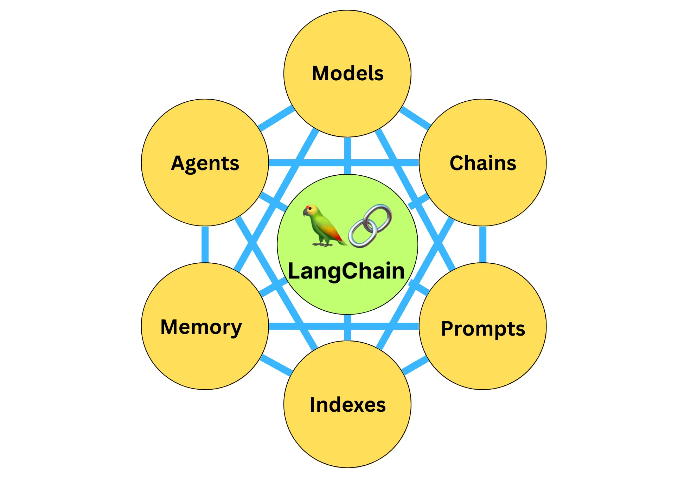
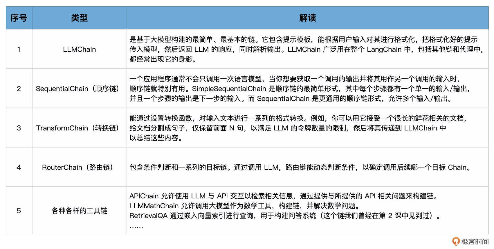
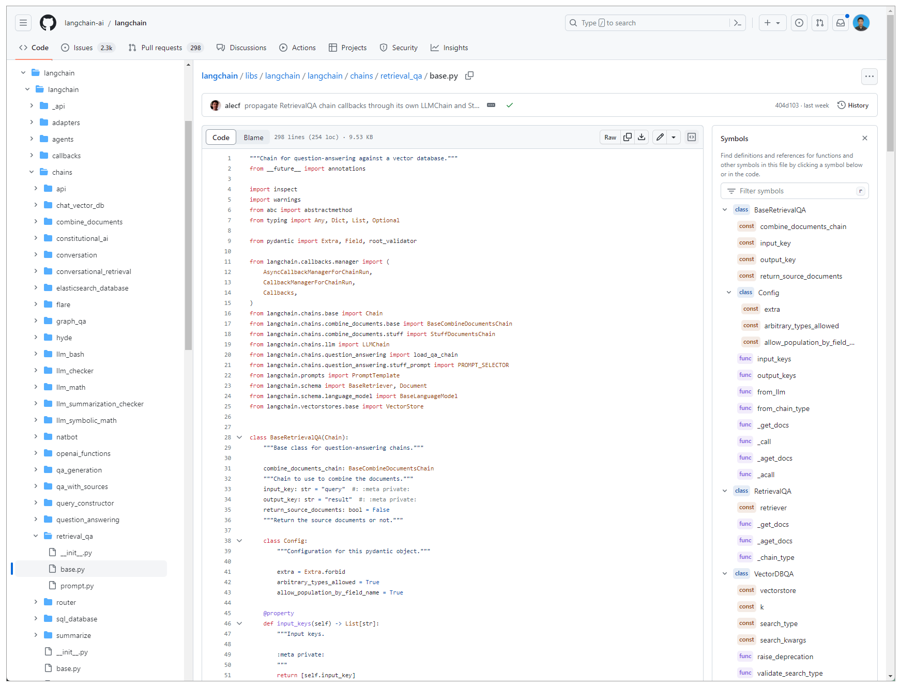

# 08 | 链（上）：写一篇完美鲜花推文？用SequencialChain链接不同的组件

你好，我是黄佳。欢迎来到 LangChain 实战课！

到这节课，我们已经学到了不少 LangChain 的应用，也体会到了 LangChain 功能的强大。但也许你心里开始出现了一个疑问：LangChain，其中的 Chain 肯定是关键组件，为什么我们还没有讲到呢？

这的确是个好问题。对于简单的应用程序来说，直接调用 LLM 就已经足够了。因此，在前几节课的示例中，我们主要通过 LangChain 中提供的提示模板、模型接口以及输出解析器就实现了想要的功能。

## 什么是 Chain

但是，如果你想开发更复杂的应用程序，那么就需要通过 “Chain” 来链接 LangChain 的各个组件和功能——模型之间彼此链接，或模型与其他组件链接。



这种将多个组件相互链接，组合成一个链的想法简单但很强大。它简化了复杂应用程序的实现，并使之更加模块化，能够创建出单一的、连贯的应用程序，从而使调试、维护和改进应用程序变得容易。

说到链的实现和使用，也简单。

- 首先 LangChain 通过设计好的接口，实现一个具体的链的功能。例如，LLM 链（LLMChain）能够接受用户输入，使用 PromptTemplate 对其进行格式化，然后将格式化的响应传递给 LLM。这就相当于把整个 Model I/O 的流程封装到链里面。

- 实现了链的具体功能之后，我们可以通过将多个链组合在一起，或者将链与其他组件组合来构建更复杂的链。

所以你看，链在内部把一系列的功能进行封装，而链的外部则又可以组合串联。链其实可以被视为 LangChain 中的一种基本功能单元。

LangChain 中提供了很多种类型的预置链，目的是使各种各样的任务实现起来更加方便、规范。



我们先使用一下最基础也是最常见的 LLMChain。

## LLMChain：最简单的链

LLMChain 围绕着语言模型推理功能又添加了一些功能，整合了 PromptTemplate、语言模型（LLM 或聊天模型）和 Output Parser，相当于把 Model I/O 放在一个链中整体操作。它使用提示模板格式化输入，将格式化的字符串传递给 LLM，并返回 LLM 输出。

举例来说，如果我想让大模型告诉我某种花的花语，如果不使用链，代码如下：

```python
#----第一步 创建提示
# 导入LangChain中的提示模板
from langchain import PromptTemplate
# 原始字符串模板
template = "{flower}的花语是?"
# 创建LangChain模板
prompt_temp = PromptTemplate.from_template(template)
# 根据模板创建提示
prompt = prompt_temp.format(flower='玫瑰')
# 打印提示的内容
print(prompt)
#----第二步 创建并调用模型
# 导入LangChain中的OpenAI模型接口
from langchain import OpenAI
# 创建模型实例
model = OpenAI(temperature=0)
# 传入提示，调用模型，返回结果
result = model(prompt)
print(result)
```

输出：

```
玫瑰的花语是?
```

- 爱情、浪漫、美丽、永恒、誓言、坚贞不渝。

此时 Model I/O 的实现分为两个部分，提示模板的构建和模型的调用独立处理。

如果使用链，代码结构则显得更简洁。

```python
# 导入所需的库
from langchain import PromptTemplate, OpenAI, LLMChain
# 原始字符串模板
template = "{flower}的花语是?"
# 创建模型实例
llm = OpenAI(temperature=0)
# 创建LLMChain
llm_chain = LLMChain(
   llm=llm,
   prompt=PromptTemplate.from_template(template))
# 调用LLMChain，返回结果
result = llm_chain("玫瑰")
print(result)
```

输出：

```
{'flower': '玫瑰', 'text': '\n\n爱情、浪漫、美丽、永恒、誓言、坚贞不渝。'}
```

在这里，我们就把提示模板的构建和模型的调用封装在一起了。

## 链的调用方式

链有很多种调用方式。

### 直接调用

刚才我们是直接调用的链对象。当我们像函数一样调用一个对象时，它实际上会调用该对象内部实现的 __call__ 方法。

如果你的提示模板中包含多个变量，在调用链的时候，可以使用字典一次性输入它们。

```
prompt = PromptTemplate(
   input_variables=["flower", "season"],
   template="{flower}在{season}的花语是?",
)
llm_chain = LLMChain(llm=llm, prompt=prompt)
print(llm_chain({
   'flower': "玫瑰",
   'season': "夏季" }))
```

输出：

```
{'flower': '玫瑰', 'season': '夏季', 'text': '\n\n玫瑰在夏季的花语是爱的誓言，热情，美丽，
```

### 通过 run 方法

通过 run 方法，也等价于直接调用 _call_ 函数。

语句：

```
llm_chain("玫瑰")
```

等价于：

```
llm_chain.run("玫瑰")
```

### 通过 predict 方法

predict 方法类似于 run，只是输入键被指定为关键字参数而不是 Python 字典。

```
result = llm_chain.predict(flower="玫瑰")
print(result)
```

### 通过 apply 方法

apply 方法允许我们针对输入列表运行链，一次处理多个输入。

示例如下：

```
# apply允许您针对输入列表运行链
input_list = [
   {"flower": "玫瑰",'season': "夏季"},
   {"flower": "百合",'season': "春季"},
   {"flower": "郁金香",'season': "秋季"}
]
result = llm_chain.apply(input_list)
print(result)
```

输出：

```
'''[{'text': '\n\n玫瑰在夏季的花语是“恋爱”、“热情”和“浪漫”。'},
{'text': '\n\n百合在春季的花语是“爱情”和“友谊”。'},
{'text': '\n\n郁金香在秋季的花语表达的是“热情”、“思念”、“爱恋”、“回忆”和“持久的爱”。'}]'''
```

### 通过 generate 方法

generate 方法类似于 apply，只不过它返回一个 LLMResult 对象，而不是字符串。LLMResult通常包含模型生成文本过程中的一些相关信息，例如令牌数量、模型名称等。

```
result = llm_chain.generate(input_list)
print(result)
```

输出：

```
generations=[[Generation(text='\n\n玫瑰在夏季的花语是“热情”、“爱情”和“幸福”。',
generation_info={'finish_reason': 'stop', 'logprobs': None})],
[Generation(text='\n\n春季的花语是爱情、幸福、美满、坚贞不渝。',
generation_info={'finish_reason': 'stop', 'logprobs': None})],
[Generation(text='\n\n秋季的花语是“思念”。银色的百合象征着“真爱”，而淡紫色的郁金香则象征着“思
generation_info={'finish_reason': 'stop', 'logprobs': None})]]
llm_output={'token_usage': {'completion_tokens': 243, 'total_tokens': 301, 'promp
run=[RunInfo(run_id=UUID('13058cca-881d-4b76-b0cf-0f9c831af6c4')),
RunInfo(run_id=UUID('7f38e33e-bab5-4d03-b77c-f50cd195affb')),
RunInfo(run_id=UUID('7a1e45fd-77ee-4133-aab0-431147186db8'))]
```

## Sequential Chain：顺序链

好，到这里，你已经掌握了最基本的 LLMChain 的用法。下面，我要带着你用 SequentialChain 把几个 LLMChain 串起来，形成一个顺序链。


这个示例中，我们的目标是这样的：

- 第一步，我们假设大模型是一个植物学家，让他给出某种特定鲜花的知识和介绍。

- 第二步，我们假设大模型是一个鲜花评论者，让他参考上面植物学家的文字输出，对鲜花进行评论。

- 第三步，我们假设大模型是易速鲜花的社交媒体运营经理，让他参考上面植物学家和鲜花评论者的文字输出，来写一篇鲜花运营文案。

下面我们就来一步步地实现这个示例。

首先，导入所有需要的库。

```python
# 设置OpenAI API密钥
import os
os.environ["OPENAI_API_KEY"] = '你的OpenAI API Key'
from langchain.llms import OpenAI
from langchain.chains import LLMChain
from langchain.prompts import PromptTemplate
from langchain.chains import SequentialChain
```

然后，添加第一个 LLMChain，生成鲜花的知识性说明。

```
# 这是第一个LLMChain，用于生成鲜花的介绍，输入为花的名称和种类
llm = OpenAI(temperature=.7)
template = """
你是一个植物学家。给定花的名称和类型，你需要为这种花写一个200字左右的介绍。
花名: {name}
颜色: {color}
植物学家: 这是关于上述花的介绍:"""
prompt_template = PromptTemplate(input_variables=["name", "color"], template=temp
introduction_chain = LLMChain(llm=llm, prompt=prompt_template, output_key="introd
```

接着，添加第二个 LLMChain，根据鲜花的知识性说明生成评论。

```
# 这是第二个LLMChain，用于根据鲜花的介绍写出鲜花的评论
llm = OpenAI(temperature=.7)
template = """
你是一位鲜花评论家。给定一种花的介绍，你需要为这种花写一篇200字左右的评论。
鲜花介绍:
{introduction}
花评人对上述花的评论:"""
prompt_template = PromptTemplate(input_variables=["introduction"], template=templ
review_chain = LLMChain(llm=llm, prompt=prompt_template, output_key="review")
```

接着，添加第三个 LLMChain，根据鲜花的介绍和评论写出一篇自媒体的文案。

```
# 这是第三个LLMChain，用于根据鲜花的介绍和评论写出一篇自媒体的文案
template = """
你是一家花店的社交媒体经理。给定一种花的介绍和评论，你需要为这种花写一篇社交媒体的帖子，300字左右
鲜花介绍:
{introduction}
花评人对上述花的评论:
{review}
社交媒体帖子:
"""
prompt_template = PromptTemplate(input_variables=["introduction", "review"], temp
social_post_chain = LLMChain(llm=llm, prompt=prompt_template, output_key="social_
```

最后，添加 SequentialChain，把前面三个链串起来。

```
# 这是总的链，我们按顺序运行这三个链
overall_chain = SequentialChain(
   chains=[introduction_chain, review_chain, social_post_chain],
   input_variables=["name", "color"],
   output_variables=["introduction","review","social_post_text"],
   verbose=True)
# 运行链，并打印结果
result = overall_chain({"name":"玫瑰", "color": "黑色"})
print(result)
```

最终的输出如下：

```
> Entering new  chain...
> Finished chain.
{'name': '玫瑰', 'color': '黑色',
'introduction': '\n\n黑色玫瑰，这是一种对传统玫瑰花的独特颠覆，它的出现挑战了我们对玫瑰颜色的
'review': '\n\n黑色玫瑰，这不仅仅是一种花朵，更是一种完全颠覆传统的艺术表现形式。黑色的花瓣仿佛
'social_post_text': '\n欢迎来到我们的自媒体平台，今天，我们要向您展示的是我们的全新产品——黑色
```

- 这种别样的玫瑰花，其黑色花瓣宛如漆黑夜空中闪烁的繁星，富有神秘的深度感，给人一种前所未有的视觉冲击黑色玫瑰的存在，不仅挑战了我们对于玫瑰传统颜色的认知，它更是一种生动的生命象征，象征着那些坚韧、独

至此，我们就通过两个 LLM 链和一个顺序链，生成了一篇完美的文案。

## 总结时刻

LangChain 为我们提供了好用的“链”，帮助我们把多个组件像链条一样连接起来。这个“链条”其实就是一系列组件的调用顺序，这个顺序里还可以包括其他的“链条”。

我们可以使用多种方法调用链，也可以根据开发时的需求选择各种不同的链。



除去最常见的 LLMChain 和 SequenceChain 之外，LangChain 中还自带大量其他类型的链，封装了各种各样的功能。你可以看一看这些链的实现细节，并尝试着使用它们。

下一节课，我们会继续介绍另外一种好用的链，RouterChain。

## 思考题

1. 在第 3 课中，我们曾经用提示模板生成过一段鲜花的描述，代码如下：

```
for flower, price in zip(flowers, prices):
   # 根据提示准备模型的输入
   input = prompt.format(flower_name=flower, price=price)
   # 获取模型的输出
   output = model(input)
   # 解析模型的输出
   parsed_output = output_parser.parse(output)
```

请你使用 LLMChain 重构提示的 format 和获取模型输出部分，完成相同的功能。

提示：

```
   llm_chain = LLMChain(
       llm=model,
       prompt=prompt)
```

2. 上一道题目中，我要求你把提示的 format 和获取模型输出部分整合到 LLMChain 中，其实你还可以更进一步，把 output_parser 也整合到 LLMChain 中，让程序结构进一步简化，请你尝试一下。

提示：

```
   llm_chain = LLMChain(
       llm=model,
       prompt=prompt,
       output_parser=output_parser)
```

3. 选择一个 LangChain 中的链（我们没用到的类型），尝试使用它解决一个问题，并分享你的用例和代码。

题目较多，可以选择性思考，期待在留言区看到你的分享。如果你觉得内容对你有帮助，也欢迎分享给有需要的朋友！最后如果你学有余力，可以进一步学习下面的延伸阅读。

## 延伸阅读

1. GitHub 上各种各样的链

2. 代码，LLMChain 的实现细节
