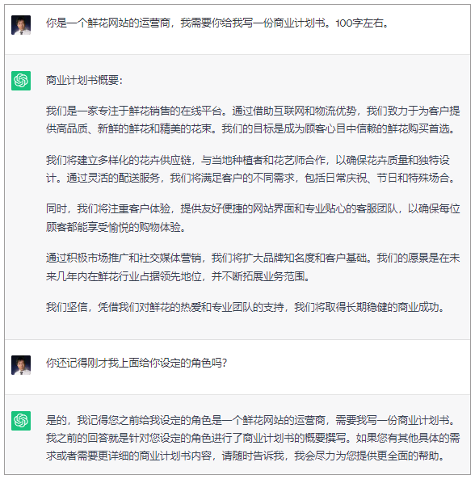
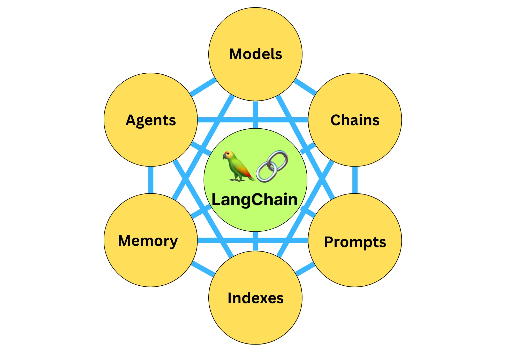
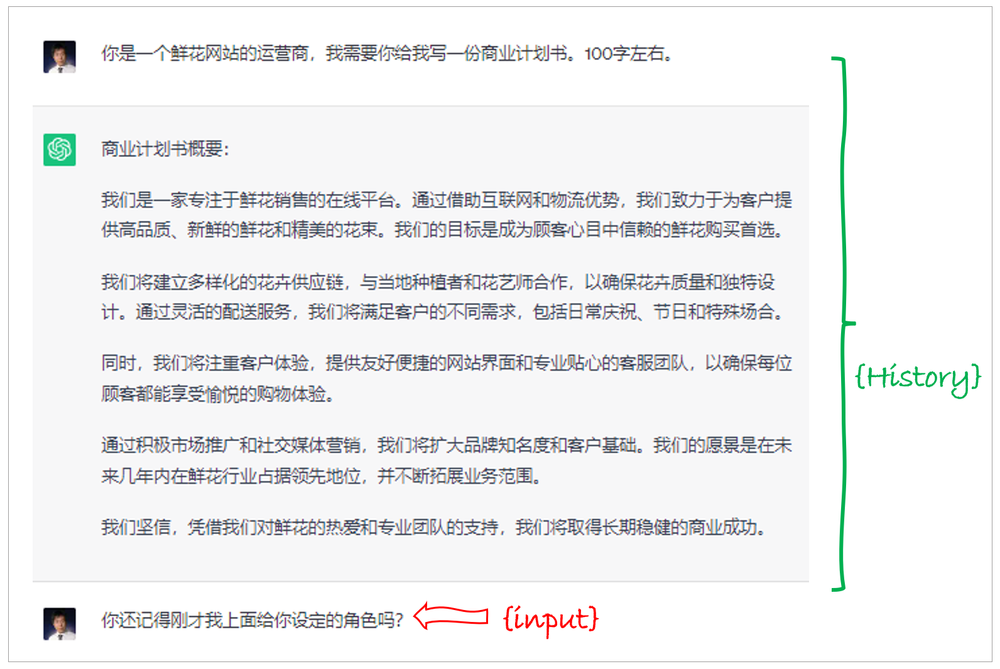
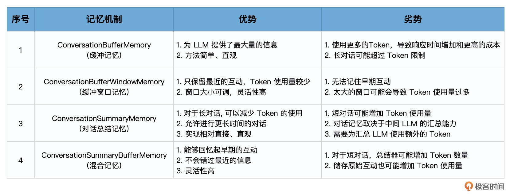
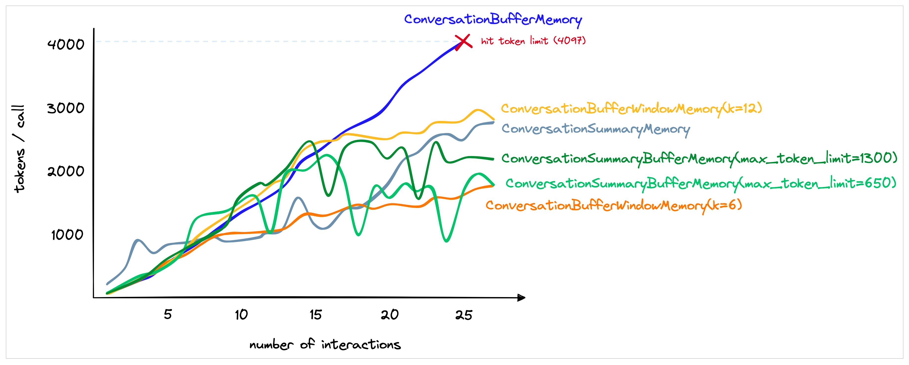

# 10 | 记忆：通过Memory记住客户上次买花时的对话细节

你好，我是黄佳，欢迎来到 LangChain 实战课！

在默认情况下，无论是 LLM 还是代理都是无状态的，每次模型的调用都是独立于其他交互的。也就是说，我们每次通过 API 开始和大语言模型展开一次新的对话，它都不知道你其实昨天或者前天曾经和它聊过天了。

你肯定会说，不可能啊，每次和 ChatGPT 聊天的时候，ChatGPT 明明白白地记得我之前交待过的事情。



的确如此，ChatGPT 之所以能够记得你之前说过的话，正是因为它使用了记忆（Memory）机制，记录了之前的对话上下文，并且把这个上下文作为提示的一部分，在最新的调用中传递给了模型。在聊天机器人的构建中，记忆机制非常重要。



## 使用 ConversationChain

不过，在开始介绍 LangChain 中记忆机制的具体实现之前，先重新看一下我们上一节课曾经见过的 ConversationChain。

这个 Chain 最主要的特点是，它提供了包含 AI 前缀和人类前缀的对话摘要格式，这个对话格式和记忆机制结合得非常紧密。

让我们看一个简单的示例，并打印出 ConversationChain 中的内置提示模板，你就会明白这个对话格式的意义了。

```python
from langchain import OpenAI
from langchain.chains import ConversationChain
# 初始化大语言模型
llm = OpenAI(
   temperature=0.5,
   model_name="gpt-3.5-turbo-instruct"
)
# 初始化对话链
conv_chain = ConversationChain(llm=llm)
# 打印对话的模板
print(conv chain.prompt.template)
```

输出：

```
The following is a friendly conversation between a human and an AI. The AI is tal
Current conversation:
{history}
Human: {input}
AI:
```

这里的提示为人类（我们）和人工智能（text-davinci-003）之间的对话设置了一个基本对话框架：这是人类和 AI 之间的友好对话。AI 非常健谈并从其上下文中提供了大量的具体细节。(The following is a friendly conversation between a human and an AI. The AI is talkative andprovides lots of specific details from its context. )

同时，这个提示试图通过说明以下内容来减少幻觉，也就是尽量减少模型编造的信息：

“如果 AI 不知道问题的答案，它就会如实说它不知道。”（If the AI does not know the answerto a question, it truthfully says it does not know.）

之后，我们看到两个参数 {history} 和 {input}。

- {history} 是存储会话记忆的地方，也就是人类和人工智能之间对话历史的信息。

- {input} 是新输入的地方，你可以把它看成是和 ChatGPT 对话时，文本框中的输入。

这两个参数会通过提示模板传递给 LLM，我们希望返回的输出只是对话的延续。



那么当有了 {history} 参数，以及 Human 和 AI 这两个前缀，我们就能够把历史对话信息存储在提示模板中，并作为新的提示内容在新一轮的对话过程中传递给模型。—— 这就是记忆机制的原理。

下面就让我们来在 ConversationChain 中加入记忆功能。

## 使用 ConversationBufferMemory

在 LangChain 中，通过 ConversationBufferMemory（缓冲记忆）可以实现最简单的记忆机制。

下面，我们就在对话链中引入 ConversationBufferMemory。

```python
from langchain import OpenAI
from langchain.chains import ConversationChain
from langchain.chains.conversation.memory import ConversationBufferMemory
# 初始化大语言模型
llm = OpenAI(
   temperature=0.5,
   model_name="gpt-3.5-turbo-instruct")
# 初始化对话链
conversation = ConversationChain(
   llm=llm,
   memory=ConversationBufferMemory()
)
# 第一天的对话
# 回合1
conversation("我姐姐明天要过生日，我需要一束生日花束。")
print("第一次对话后的记忆:", conversation.memory.buffer)
```

输出：

```
第一次对话后的记忆:
Human: 我姐姐明天要过生日，我需要一束生日花束。
AI:  哦，你姐姐明天要过生日，那太棒了！我可以帮你推荐一些生日花束，你想要什么样的？我知道有很多种
```

在下一轮对话中，这些记忆会作为一部分传入提示。

```
# 回合2
conversation("她喜欢粉色玫瑰，颜色是粉色的。")
print("第二次对话后的记忆:", conversation.memory.buffer)
```

输出：

```
第二次对话后的记忆:
Human: 我姐姐明天要过生日，我需要一束生日花束。
AI:  哦，你姐姐明天要过生日，那太棒了！我可以帮你推荐一些生日花束，你想要什么样的？我知道有很多种
Human: 她喜欢粉色玫瑰，颜色是粉色的。
AI:  好的，那我可以推荐一束粉色玫瑰的生日花束给你。你想要多少朵？我可以帮你定制一束，比如说十朵、
```

下面，我们继续对话，同时打印出此时提示模板的信息。

```
# 回合3 （第二天的对话）
conversation("我又来了，还记得我昨天为什么要来买花吗？")
print("/n第三次对话后时提示:/n",conversation.prompt.template)
print("/n第三次对话后的记忆:/n", conversation.memory.buffer)
```

模型输出：

```
Human: 我姐姐明天要过生日，我需要一束生日花束。
AI:  哦，你姐姐明天要过生日，那太棒了！我可以帮你推荐一些生日花束，你想要什么样的？我知道有很多种
Human: 她喜欢粉色玫瑰，颜色是粉色的。
AI:  好的，那我可以推荐一束粉色玫瑰的生日花束给你，你想要多少朵？
Human: 我又来了，还记得我昨天为什么要来买花吗？
AI:  是的，我记得你昨天来买花是因为你姐姐明天要过生日，你想要买一束粉色玫瑰的生日花束给她。
```

实际上，这些聊天历史信息，都被传入了 ConversationChain 的提示模板中的 {history} 参数，构建出了包含聊天记录的新的提示输入。

有了记忆机制，LLM 能够了解之前的对话内容，这样简单直接地存储所有内容为 LLM 提供了最大量的信息，但是新输入中也包含了更多的 Token（所有的聊天历史记录），这意味着响应时间变慢和更高的成本。而且，当达到 LLM 的令牌数（上下文窗口）限制时，太长的对话无法被记住（对于 text-davinci-003 和 gpt-3.5-turbo，每次的最大输入限制是 4096 个 Token）。

下面我们来看看针对 Token 太多、聊天历史记录过长的一些解决方案。

## 使用 ConversationBufferWindowMemory

说到记忆，我们人类的大脑也不是无穷无尽的。所以说，有的时候事情太多，我们只能把有些遥远的记忆抹掉。毕竟，最新的经历最鲜活，也最重要。

ConversationBufferWindowMemory 是缓冲窗口记忆，它的思路就是只保存最新最近的几次人类和 AI 的互动。因此，它在之前的“缓冲记忆”基础上增加了一个窗口值 k。这意味着我们只保留一定数量的过去互动，然后“忘记”之前的互动。

下面看一下示例。

```python
from langchain import OpenAI
from langchain.chains import ConversationChain
from langchain.chains.conversation.memory import ConversationBufferWindowMemory
# 创建大语言模型实例
llm = OpenAI(
   temperature=0.5,
   model_name="gpt-3.5-turbo-instruct")
# 初始化对话链
conversation = ConversationChain(
   llm=llm,
   memory=ConversationBufferWindowMemory(k=1)
)
# 第一天的对话
# 回合1
result = conversation("我姐姐明天要过生日，我需要一束生日花束。")
print(result)
# 回合2
result = conversation("她喜欢粉色玫瑰，颜色是粉色的。")
# print("\n第二次对话后的记忆:\n", conversation.memory.buffer)
print(result)
# 第二天的对话
# 回合3
result = conversation("我又来了，还记得我昨天为什么要来买花吗？")
print(result)
```

第一回合的输出：

```
{'input': '我姐姐明天要过生日，我需要一束生日花束。',
'history': '',
'response': ' 哦，你姐姐明天要过生日！那太棒了！你想要一束什么样的花束呢？有很多种类可以选择，
```

第二回合的输出：

```
{'input': '她喜欢粉色玫瑰，颜色是粉色的。',
'history': 'Human: 我姐姐明天要过生日，我需要一束生日花束。\nAI:  哦，你姐姐明天要过生日！那
'response': ' 好的，那粉色玫瑰花束怎么样？我可以帮你找到一束非常漂亮的粉色玫瑰花束，你觉得怎么样
```

第三回合的输出：

```
{'input': '我又来了，还记得我昨天为什么要来买花吗？',
'history': 'Human: 她喜欢粉色玫瑰，颜色是粉色的。\nAI:  好的，那粉色玫瑰花束怎么样？我可以帮
'response': '  当然记得，你昨天来买花是为了给你喜欢的人送一束粉色玫瑰花束，表达你对TA的爱意。'
```

在给定的例子中，设置 k=1，这意味着窗口只会记住与 AI 之间的最新的互动，即只保留上一次的人类回应和 AI 的回应。

在第三个回合，当我们询问“还记得我昨天为什么要来买花吗？”，由于我们只保留了最近的互动（k=1），模型已经忘记了正确的答案。所以，虽然它说记得，但只能模糊地说出“喜欢的人”，而没有说关键字“姐姐”。不过，如果（我是说如果哈）在第二个回合，模型能回答“我可以帮你为你姐姐找到…”，那么，尽管我们没有第一回合的历史记录，但凭着上一个回合的信息，模型还是有可能推断出昨天来的人买花的真实意图。

尽管这种方法不适合记住遥远的互动，但它非常擅长限制使用的 Token 数量。如果只需要记住最近的互动，缓冲窗口记忆是一个很好的选择。但是，如果需要混合远期和近期的互动信息，则还有其他选择。

## 使用 ConversationSummaryMemory

上面说了，如果模型在第二轮回答的时候，能够说出“我可以帮你为你姐姐找到…”，那么在第三轮回答时，即使窗口大小 k=1，还是能够回答出正确答案。

这是为什么？

因为模型在回答新问题的时候，对之前的问题进行了总结性的重述。

ConversationSummaryMemory（对话总结记忆）的思路就是将对话历史进行汇总，然后再传递给 {history} 参数。这种方法旨在通过对之前的对话进行汇总来避免过度使用 Token。

ConversationSummaryMemory 有这么几个核心特点。

1. 汇总对话：此方法不是保存整个对话历史，而是每次新的互动发生时对其进行汇总，然后将其添加到之前所有互动的“运行汇总”中。

2. 使用 LLM 进行汇总：该汇总功能由另一个 LLM 驱动，这意味着对话的汇总实际上是由 AI自己进行的。

3. 适合长对话：对于长对话，此方法的优势尤为明显。虽然最初使用的 Token 数量较多，但随着对话的进展，汇总方法的增长速度会减慢。与此同时，常规的缓冲内存模型会继续线性增长。

下面，我们来看看使用 ConversationSummaryMemory 的代码示例。

```
from langchain.chains.conversation.memory import ConversationSummaryMemory
# 初始化对话链
conversation = ConversationChain(
   llm=llm,
   memory=ConversationSummaryMemory(llm=llm)
)
```

第一回合的输出：

```
{'input': '我姐姐明天要过生日，我需要一束生日花束。',
'history': '',
'response': ' 我明白，你需要一束生日花束。我可以为你提供一些建议吗？我可以推荐一些花束给你，比如
```

第二回合的输出：

```
{'input': '她喜欢粉色玫瑰，颜色是粉色的。',
'history': "\nThe human asked what the AI thinks of artificial intelligence. The
'response': ' 为了为你的姐姐的生日准备一束花，我建议你搭配粉色玫瑰和白色康乃馨。你可以在玫瑰花束
```

第三回合的输出：

```
{'input': '我又来了，还记得我昨天为什么要来买花吗？',
'history': "\n\nThe human asked what the AI thinks of artificial intelligence. Th
'response': ' 确实，我记得你昨天想买一束花给你的姐姐作为生日礼物。我建议你买粉红色的玫瑰花和白色
看得出来，这里的 'history'，不再是之前人类和 AI 对话的简单复制粘贴，而是经过了总
```

结和整理之后的一个综述信息。

这里，我们不仅仅利用了 LLM 来回答每轮问题，还利用 LLM 来对之前的对话进行总结性的陈述，以节约 Token 数量。这里，帮我们总结对话的 LLM，和用来回答问题的 LLM，可以是同一个大模型，也可以是不同的大模型。

ConversationSummaryMemory 的优点是对于长对话，可以减少使用的 Token 数量，因此可以记录更多轮的对话信息，使用起来也直观易懂。不过，它的缺点是，对于较短的对话，可能会导致更高的 Token 使用。另外，对话历史的记忆完全依赖于中间汇总 LLM 的能力，还需要为汇总 LLM 使用 Token，这增加了成本，且并不限制对话长度。

通过对话历史的汇总来优化和管理 Token 的使用，ConversationSummaryMemory 为那些预期会有多轮的、长时间对话的场景提供了一种很好的方法。然而，这种方法仍然受到 Token数量的限制。在一段时间后，我们仍然会超过大模型的上下文窗口限制。

而且，总结的过程中并没有区分近期的对话和长期的对话（通常情况下近期的对话更重要），所以我们还要继续寻找新的记忆管理方法。

## 使用 ConversationSummaryBufferMemory

我要为你介绍的最后一种记忆机制是 ConversationSummaryBufferMemory，即对话总结缓冲记忆，它是一种混合记忆模型，结合了上述各种记忆机制，包括ConversationSummaryMemory 和 ConversationBufferWindowMemory 的特点。这种模型旨在在对话中总结早期的互动，同时尽量保留最近互动中的原始内容。

它是通过 max_token_limit 这个参数做到这一点的。当最新的对话文字长度在 300 字之内的时候，LangChain 会记忆原始对话内容；当对话文字超出了这个参数的长度，那么模型就会把所有超过预设长度的内容进行总结，以节省 Token 数量。

```
from langchain.chains.conversation.memory import ConversationSummaryBufferMemory
# 初始化对话链
conversation = ConversationChain(
   llm=llm,
   memory=ConversationSummaryBufferMemory(
       llm=llm,
       max_token_limit=300))
```

第一回合的输出：

```
{'input': '我姐姐明天要过生日，我需要一束生日花束。',
'history': '',
'response': ' 哇，你姐姐要过生日啊！那太棒了！我建议你去买一束色彩鲜艳的花束，因为这样可以代表你
```

第二回合的输出：

```
{'input': '她喜欢粉色玫瑰，颜色是粉色的。',
'history': 'Human: 我姐姐明天要过生日，我需要一束生日花束。\nAI:  哇，你姐姐要过生日啊！那太
'response': ' 好的，那粉色玫瑰就是一个很好的选择！你可以买一束粉色玫瑰花束，这样你姐姐会很开心
```

第三回合的输出：

```
{'input': '我又来了，还记得我昨天为什么要来买花吗？',
'history': "System: \nThe human asked the AI for advice on buying a bouquet for t
'response': ' 是的，我记得你昨天来买花是为了给你姐姐的生日。你想买一束粉色玫瑰花束来表达你的祝福
```

不难看出，在第二回合，记忆机制完整地记录了第一回合的对话，但是在第三回合，它察觉出前两轮的对话已经超出了 300 个字节，就把早期的对话加以总结，以节省 Token 资源。

ConversationSummaryBufferMemory 的优势是通过总结可以回忆起较早的互动，而且有缓冲区确保我们不会错过最近的互动信息。当然，对于较短的对话，ConversationSummaryBufferMemory 也会增加 Token 数量。

总体来说，ConversationSummaryBufferMemory 为我们提供了大量的灵活性。它是我们迄今为止的唯一记忆类型，可以回忆起较早的互动并完整地存储最近的互动。在节省 Token 数量方面，ConversationSummaryBufferMemory 与其他方法相比，也具有竞争力。

## 总结时刻

好的，今天我给你介绍了一种对话链和四种类型的对话记忆机制，那么我们可以通过一个表格对这四种类型的记忆做一个整体比较。

四种记忆机制的比较如下：



网上还有人总结了一个示意图，体现出了当对话轮次逐渐增加时，各种记忆机制对 Token 的消耗数量。意图向我们表达的是：有些记忆机制，比如说ConversationSummaryBufferMemory 和 ConversationSummaryMemory，在对话轮次较少的时候可能会浪费一些 Token，但是多轮对话过后，Token 的节省就逐渐体现出来了。

当然 ConversationBufferWindowMemory 对于 Token 的节省最为直接，但是它会完全遗忘掉K 轮之前的对话内容，因此对于某些场景也不是最佳选择。



- 当对话轮次逐渐增加时，各种记忆机制对 Token 的消耗数量（估算）

## 思考题

1. 在你的客服聊天机器人设计中，你会首先告知客户：“亲，我的记忆能力有限，只能记住和你的最近 10 次对话哦。如果我忘了之前的对话，请你体谅我。” 当有了这样的预设，你会为你的 ChatBot 选择那种记忆机制？

2. 尝试改变示例程序 ConversationBufferWindowMemory 中的 k 值，并增加对话轮次，看看记忆效果。

3. 尝试改变示例程序 ConversationSummaryBufferMemory 中的 max_token_limit 值，看看记忆效果。

期待在留言区看到你的分享。如果你觉得内容对你有帮助，也欢迎分享给有需要的朋友！最后如果你学有余力，可以进一步学习下面的延伸阅读。

## 延伸阅读

1. 代码，ConversationBufferMemory 的实现细节

2. 代码，ConversationSummaryMemory 的实现细节
