# 12 | 代理（中）：AgentExecutor究竟是怎样驱动模型和工具完成任务的？

你好，我是黄佳，欢迎来到 LangChain 实战课！

上节课中，你了解了 ReAct 框架的原理，最后我给你留了一道思考题，让你说一说LangChain 中的“代理”和“链”的差异究竟是什么。

我的答案是：在链中，一系列操作被硬编码（在代码中）。在代理中，语言模型被用作推理引擎来确定要采取哪些操作以及按什么顺序执行这些操作。

下面这个图，就展现出了 Agent 接到任务之后，自动进行推理，然后自主调用工具完成任务的过程。


那么，你看 LangChain，乃至整个大模型应用开发的核心理念就呼之欲出了。这个核心理念就是操作的序列并非硬编码在代码中，而是使用语言模型（如 GPT-3 或 GPT-4）来选择执行的操作序列。

这里，我又一次重复了上一段话，显得有点啰嗦，但是这个思路真的是太重要了，它也凸显了LLM 作为 AI 自主决定程序逻辑这个编程新范式的价值，我希望你仔细认真地去理解。

## Agent 的关键组件

在 LangChain 的代理中，有这样几个关键组件。

1. 代理（Agent）：这个类决定下一步执行什么操作。它由一个语言模型和一个提示（prompt）驱动。提示可能包含代理的性格（也就是给它分配角色，让它以特定方式进行响应）、任务的背景（用于给它提供更多任务类型的上下文）以及用于激发更好推理能力的提示策略（例如 ReAct）。LangChain 中包含很多种不同类型的代理。

2. 工具（Tools）：工具是代理调用的函数。这里有两个重要的考虑因素：一是让代理能访问到正确的工具，二是以最有帮助的方式描述这些工具。如果你没有给代理提供正确的工具，它

- 将无法完成任务。如果你没有正确地描述工具，代理将不知道如何使用它们。LangChain提供了一系列的工具，同时你也可以定义自己的工具。

3. 工具包（Toolkits）：工具包是一组用于完成特定目标的彼此相关的工具，每个工具包中包含多个工具。比如 LangChain 的 Office365 工具包中就包含连接 Outlook、读取邮件列表、发送邮件等一系列工具。当然 LangChain 中还有很多其他工具包供你使用。

4. 代理执行器（AgentExecutor）：代理执行器是代理的运行环境，它调用代理并执行代理选择的操作。执行器也负责处理多种复杂情况，包括处理代理选择了不存在的工具的情况、处理工具出错的情况、处理代理产生的无法解析成工具调用的输出的情况，以及在代理决策和工具调用进行观察和日志记录。

总的来说，代理就是一种用语言模型做出决策、调用工具来执行具体操作的系统。通过设定代理的性格、背景以及工具的描述，你可以定制代理的行为，使其能够根据输入的文本做出理解和推理，从而实现自动化的任务处理。而代理执行器（AgentExecutor）就是上述机制得以实现的引擎。

在这一讲中，我们将深入 LangChain 源代码的内部，揭示代理是如何通过代理执行器来自动决策的。

## 深挖 AgentExecutor 的运行机制

让我们先来回顾一下上一讲中的关键代码。

```
llm = OpenAI(temperature=0) # 大语言模型
tools = load_tools(["serpapi", "llm-math"], llm=llm) # 工具-搜索和数学运算
agent = initialize_agent(tools, llm, agent=AgentType.ZERO_SHOT_REACT_DESCRIPTION,
agent.run("目前市场上玫瑰花的平均价格是多少？如果我在此基础上加价15%卖出，应该如何定价？") # 运
```

在这段代码中，模型、工具、代理的初始化，以及代理运行的过程都极为简洁。但是，LangChain 的内部封装的逻辑究竟是怎样的？我希望带着你至少弄清楚两个问题。

1. 代理每次给大模型的具体提示是什么样子的？能够让模型给出下一步的行动指南，这个提示的秘密何在？

2. 代理执行器是如何按照 ReAct 框架来调用模型，接收模型的输出，并根据这个输出来调用工具，然后又根据工具的返回结果生成新的提示的。

运行代码后我们得到下面的日志。

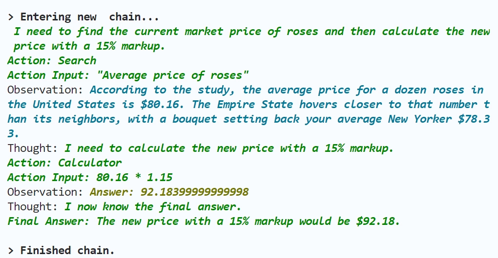

要回答上面的两个问题，仅仅观察 LangChain 输出的 Log 是不够的。我们需要深入到LangChain 的程序内部，深挖一下 AgentExcutor 的运行机制。

### 开始 Debug

现在，请你用你的代码编辑工具（比如 VS Code）在 agent.run 这个语句设置一个断点，用“Step Into” 功能深入几层 LangChain 内部代码，直到我们进入了 agent.py 文件的AgentExecutor 类的内部方法 _take_next_step。

这个 _take_next_step 方法掌控着下一步要调用什么的计划，你可以看到 self.agent.plan 方法被调用，这是计划开始之处。

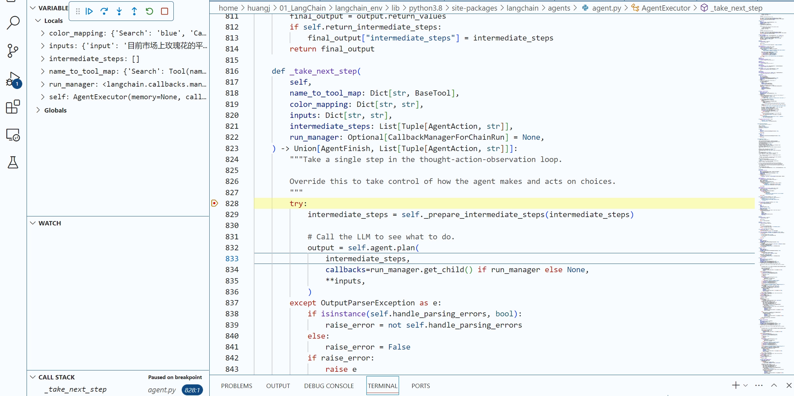

注意：如果使用 VS Code，要把 launch.json 的 justMycode 项设置为 false 才可以 debugLangChain 包中的代码。

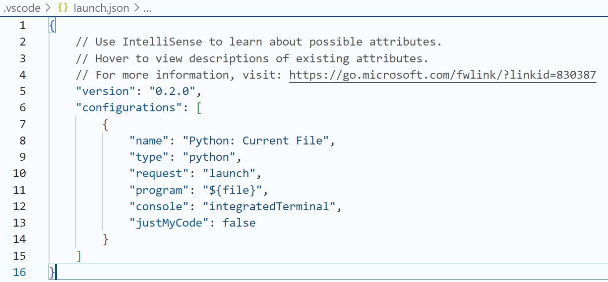

### 第一轮思考：模型决定搜索

在 AgentExecutor 的 _take_next_step 方法的驱动下，我们进一步 Debug，深入self.agent.plan 方法，来到了整个行为链条的第一步—— Plan，这个 Plan 的具体细节是由Agent 类的 Plan 方法来完成的，你可以看到，输入的问题将会被传递给 llm_chain，然后接收llm_chain 调用大模型的返回结果。

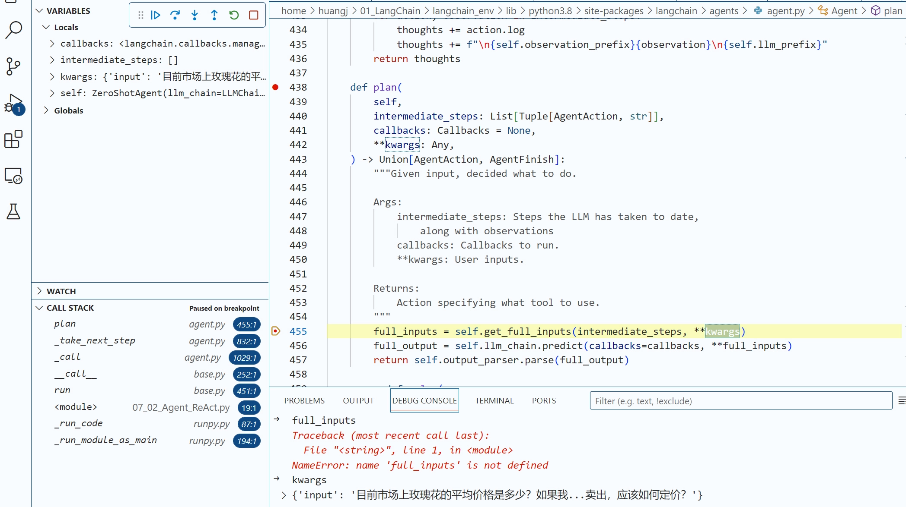

再往前进一步，我们就要开始调用大模型了，那么，LangChain 到底传递给了大模型什么具体的提示信息，让大模型能够主动进行工具的选择呢？秘密在 LLMChain 类的 generate 方法中，我们可以看到提示的具体内容。

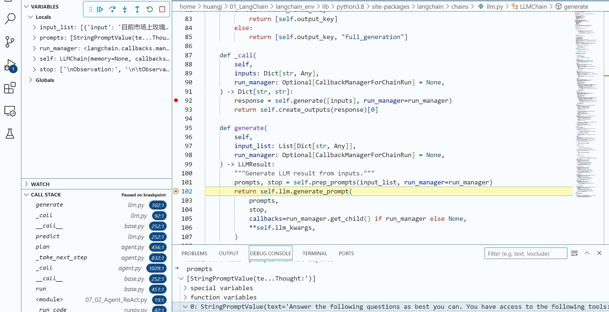

在 Debug 过程中，你可以观察 prompt，也就是提示的具体内容，这里我把这个提示 Copy 出来，你可以看一下。

```
0: StringPromptValue(text='Answer the following questions as best you can. You ha
```

我来给你详细拆解一下这个 prompt。注意，下面的解释文字不是原始提示，而是我添加的说明。

- 0: StringPromptValue(text='Answer the following questions as best you can. You haveaccess to the following tools:\n\n

这句提示是让模型尽量回答问题，并告诉模型拥有哪些工具。

- Search: A search engine. Useful for when you need to answer questions about currentevents. Input should be a search query.\n

这是向模型介绍第一个工具：搜索。

- Calculator: Useful for when you need to answer questions about math.\n\n

这是向模型介绍第二个工具：计算器。

- Use the following format:\n\n （指导模型使用下面的格式）Question: the input question you must answer\n （问题）Thought: you should always think about what to do\n （思考）Action: the action to take, should be one of [Search, Calculator]\n （行动）Action Input: the input to the action\n （行动的输入）Observation: the result of the action\n… （观察：行动的返回结果）(this Thought/Action/Action Input/Observation can repeat N times)\n （上面这个过程可以重复多次）Thought: I now know the final answer\n （思考：现在我知道最终答案了）Final Answer: the final answer to the original input question\n\n （最终答案）

上面，就是给模型的思考框架。具体解释可以看一下括号中的文字

- Begin!\n\n

现在开始！

- Question: 目前市场上玫瑰花的平均价格是多少？如果我在此基础上加价 15% 卖出，应该如何定价？

- \nThought:')

具体问题，也就是具体任务。

上面我一句句拆解的这个提示词，就是 Agent 之所以能够趋动大模型，进行思考 - 行动 - 观察行动结果 - 再思考 - 再行动 - 再观察这个循环的核心秘密。有了这样的提示词，模型就会不停地思考、行动，直到模型判断出问题已经解决，给出最终答案，跳出循环。

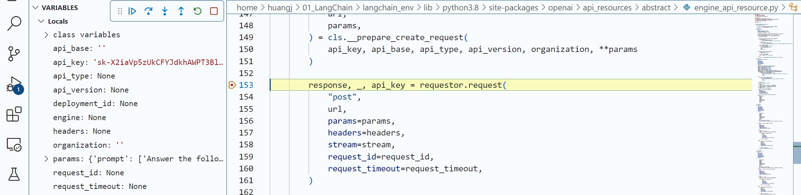

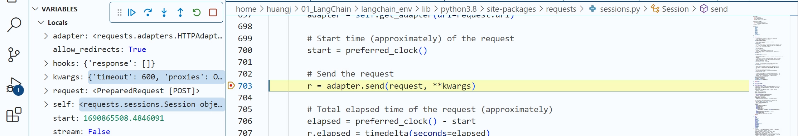

那么，调用大模型之后，模型具体返回了什么结果呢？

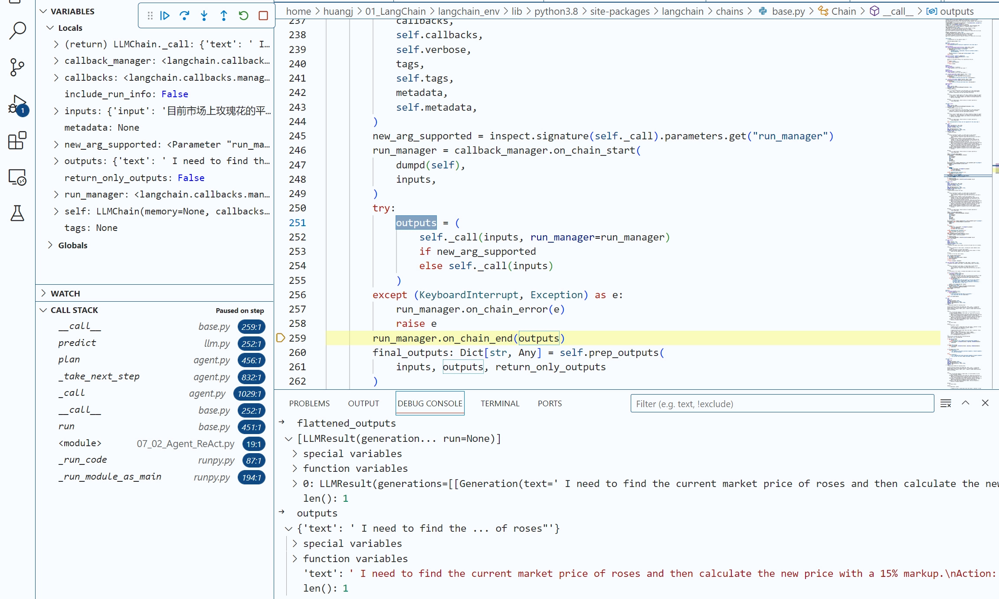

在 Debug 过程中，我们发现调用模型之后的 outputs 中包含下面的内容。

```
0: LLMResult(generations=[[Generation(text=' I need to find the current market pr
Action: Search\nAction Input: "Average price of roses"', generation_info={'finish
llm_output={'token_usage': {'completion_tokens': 36, 'total_tokens': 294, 'prompt
```

把上面的内容拆解如下：

- ‘text’: ’ I need to find the current market price of roses and then calculate the new pricewith a 15% markup.\n （Text：问题文本）Action: Search\n （行动：搜索）Action Input: “Average price of roses”’ （行动的输入：搜索玫瑰平均价格）

看来，模型知道面对这个问题，它自己根据现有知识解决不了，下一步行动是需要选择工具箱中的搜索工具。而此时，命令行中也输出了模型的第一步计划——调用搜索工具。

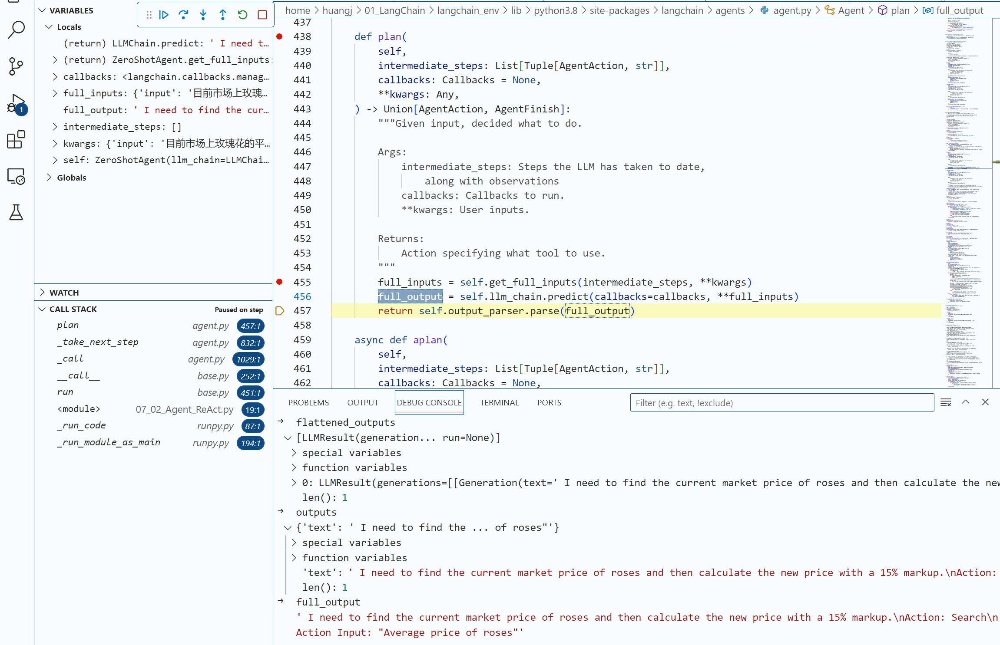

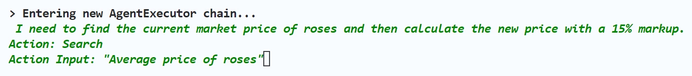

现在模型知道了要调用什么工具，第一轮的 Plan 部分就结束了。下面，我们就来到了AgentExecutor 的 _take_next_step 的工具调用部分。

在这里，因为模型返回了 Action 为 Search，OutputParse 解析了这个结果之后，LangChain很清楚地知道，Search 工具会被调用。

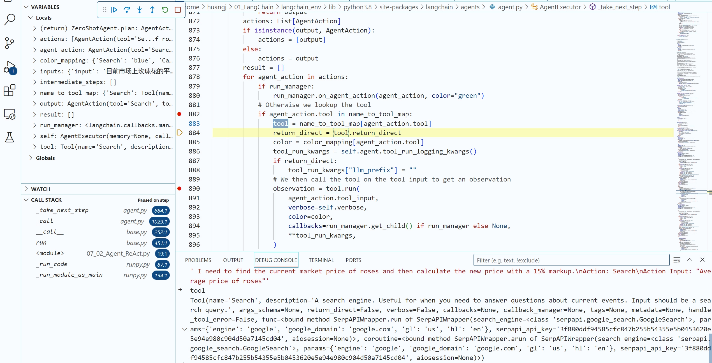

工具调用完成之后，我们就拥有了一个对当前工具调用的 Observation，也就是当前工具调用的结果。

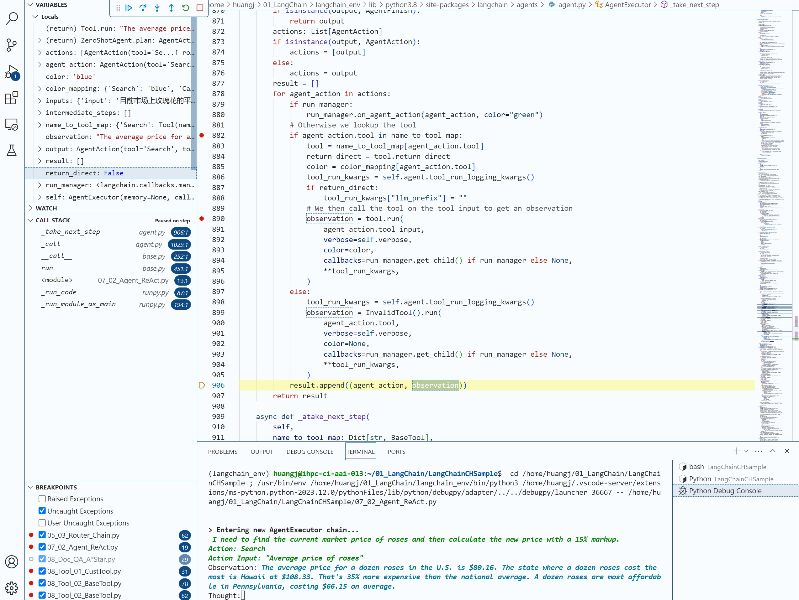

下一步，我们要再次调用大模型，形成新的 Thought，看看任务是否已经完成了，或者仍需要再次调用工具（新的工具或者再次调用同一工具）。

### 第二轮思考：模型决定计算

因为任务尚未完成，第二轮思考开始，程序重新进入了 Plan 环节。

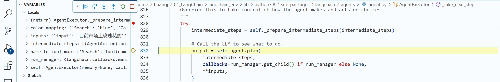

此时，LangChain 的 LLM Chain 根据目前的 input，也就是历史对话记录生成了新的提示信息。

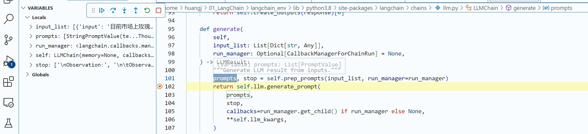

```
0: StringPromptValue(text='Answer the following questions as best you can. You ha
```

我们再来拆解一下这个 prompt。

- 0: StringPromptValue(text='Answer the following questions as best you can. You haveaccess to the following tools:\n\n

这句提示是让模型尽量回答问题，并告诉模型拥有哪些工具。

- Search: A search engine. Useful for when you need to answer questions about currentevents. Input should be a search query.\n

这是向模型介绍第一个工具：搜索。

- Calculator: Useful for when you need to answer questions about math.\n\n

这是向模型介绍第二个工具：计算器。

- Use the following format:\n\n （指导模型使用下面的格式）Question: the input question you must answer\n （问题）Thought: you should always think about what to do\n （思考）Action: the action to take, should be one of [Search, Calculator]\n （行动）Action Input: the input to the action\n （行动的输入）Observation: the result of the action\n… （观察：行动的返回结果）

- (this Thought/Action/Action Input/Observation can repeat N times)\n （上面这个过程可以重复多次）Thought: I now know the final answer\n （思考：现在我知道最终答案了）Final Answer: the final answer to the original input question\n\n （最终答案）

上面是一段比较细节的解释说明，看一下括号中的文字。

- Begin!\n\n

现在开始！

- Question: 目前市场上玫瑰花的平均价格是多少？如果我在此基础上加价 15% 卖出，应该如何定价？\n

具体问题，也就是具体任务。

这句之前的提示，与我们在第一轮思考时看到的完全相同。

- Thought: I need to find the current market price of roses and then calculate the new pricewith a 15% markup.\n （思考：我需要找到玫瑰花的价格，并加入 15% 的加价）Action: Search\nAction （行动：搜索）Input: “Average price of roses”\n （行动的输入：玫瑰花的平均价格）Observation: The average price for a dozen roses in the U.S. is $80.16. The state where adozen roses cost the most is Hawaii at $108.33. That’s 35% more expensive than thenational average. A dozen roses are most affordable in Pennsylvania, costing $66.15 onaverage.\n （观察：这里时搜索工具返回的玫瑰花价格信息）

- Thought:’

思考：后面是大模型应该进一步推理的内容。

大模型根据上面这个提示，返回了下面的 output 信息。

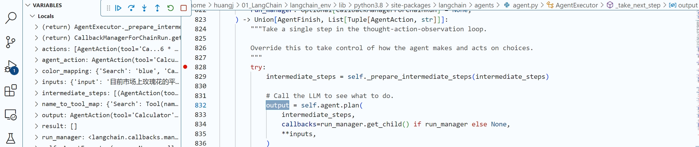

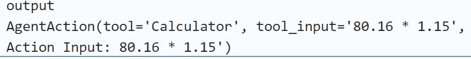

```
AgentAction(tool='Calculator', tool_input='80.16 * 1.15', log=' I need to calcula
```

这个输出显示，模型告诉自己，“我需要计算新的 Price，在搜索结果的基础上加价 15%”，并确定 Action 为计算器，输入计算器工具的指令为 80.16*1.15。这是一个非常有逻辑性的思考。

经过解析之后的 Thought 在命令行中的输出如下：

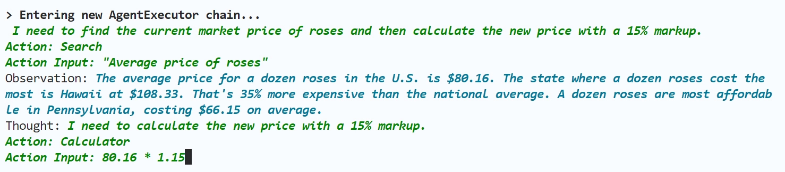

有了上面的 Thought 做指引，AgentExecutor 调用了第二个工具：LLMMath。现在开始计算。

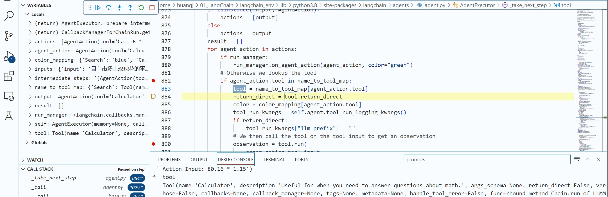

因为这个数学工具也是调用 LLM，我们可以看一下内部的提示，看看这个工具是怎样指导LLM 做数学计算的。

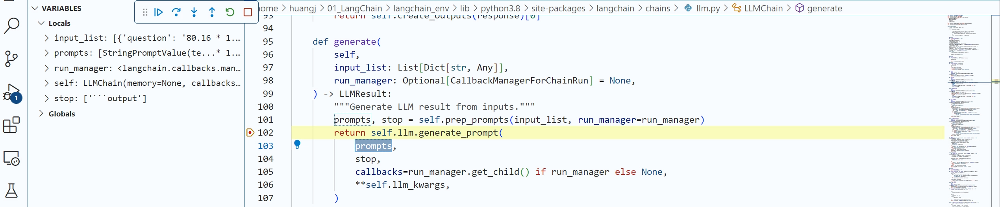

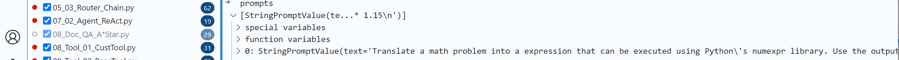

这个提示，我把它拷贝出来，也拆解一下。

- 0: StringPromptValue(text='Translate a math problem into a expression that can beexecuted using Python’s numexpr library. Use the output of running this code to answerthe question.\n\n

指定模型用 Python 的数学库来编程解决数学问题，而不是自己计算。这就规避了大模型数学推理能力弱的局限。

- Question: ${Question with math problem.}\n （问题）text\n${single line mathematical expression that solves the problem} n```\n （问题的数学描述）

- …numexpr.evaluate(text)…\n``` （通过 Python 库运行问题的数学描述）output\n${Output of running the code}\n```\n （输出的 Python 代码运行结果）Answer: ${Answer}\n\n （问题的答案）Begin.\n\n （开始）

从这里开始是两个数学式的解题示例。

- Question: What is 37593 * 67?\n```text\n37593 * 67\n```\n…numexpr.evaluate(“37593 * 67”)…\n```output\n2518731\n```\nAnswer: 2518731\n\nQuestion: 37593^(1/5)\n```text\n37593**(1/5)\n```\n…numexpr.evaluate(“37593**(1/5)”)…\n```output\n8.222831614237718\n```\nAnswer: 8.222831614237718\n\n

两个数学式的解题示例结束。

- Question: 80.16 * 1.15\n’)

这里是玫瑰花问题的具体描述。

下面，就是模型返回结果。

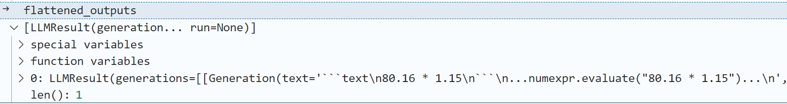

在 LLMChain 内部，根据 Python 代码进行了计算，因此 final_ansewer 也已经算好了。

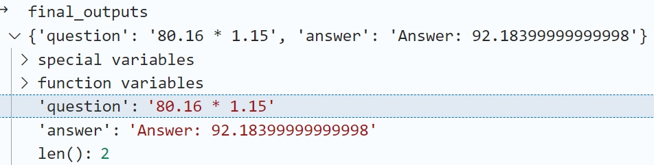

至此，LangChain 的 BaseTool 返回的 Observation 如下：

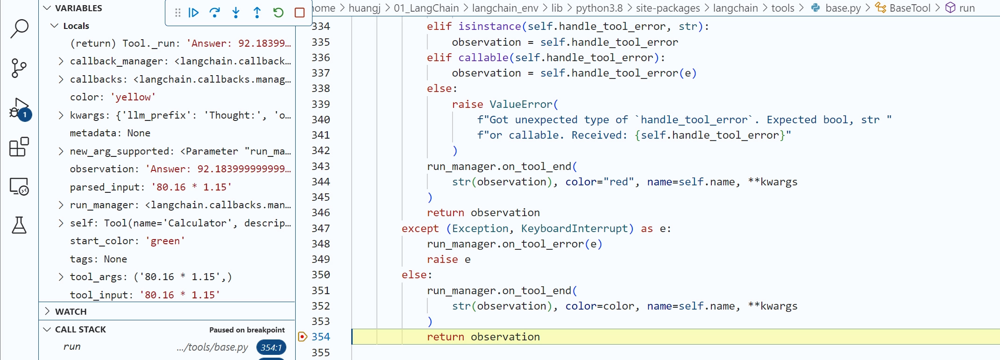

```
observation
'Answer: 92.18399999999998'
```


命令行中也输出了当前数学工具调用后的 Observation 结果：92.18。

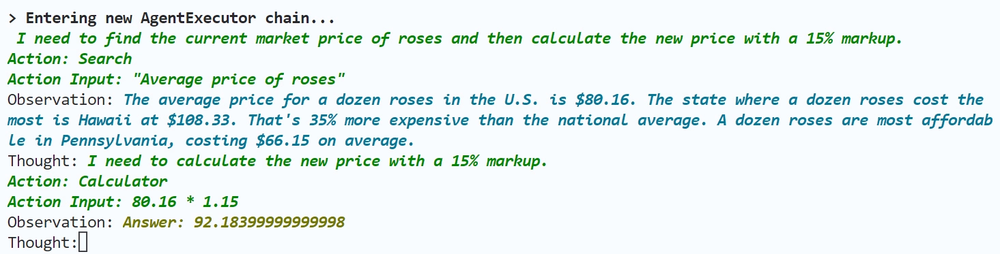

### 第三轮思考：模型完成任务

第三轮思考开始。此时，Executor 的 Plan 应该进一步把当前的新结果传递给大模型，不出所料的话，大模型应该有足够的智慧判断出任务此时已经成功地完成了。

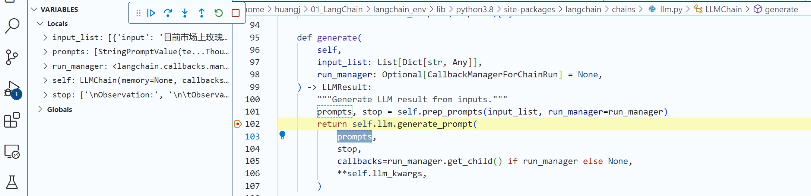

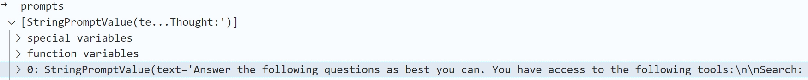

下面是目前最新的 prompt。

```
0: StringPromptValue(text='Answer the following questions as best you can. You ha
```

我们再来拆解一下这个最终的 prompt。

- 0: StringPromptValue(text='Answer the following questions as best you can. You haveaccess to the following tools:\n\n

这句提示是让模型尽量回答问题，并告诉模型拥有哪些工具。

- Search: A search engine. Useful for when you need to answer questions about currentevents. Input should be a search query.\n

这是向模型介绍第一个工具：搜索。

- Calculator: Useful for when you need to answer questions about math.\n\n

这是向模型介绍第二个工具：计算器。

- Use the following format:\n\n （指导模型使用下面的格式）Question: the input question you must answer\n （问题）Thought: you should always think about what to do\n （思考）Action: the action to take, should be one of [Search, Calculator]\n （行动）Action Input: the input to the action\n （行动的输入）Observation: the result of the action\n… （观察：行动的返回结果）(this Thought/Action/Action Input/Observation can repeat N times)\n （上面这个过程可以重复多次）Thought: I now know the final answer\n （思考：现在我知道最终答案了）Final Answer: the final answer to the original input question\n\n （最终答案）

仍然是比较细节的说明，看括号文字。

- Begin!\n\n

现在开始！

- Question: 目前市场上玫瑰花的平均价格是多少？如果我在此基础上加价 15% 卖出，应该如何定价？\n

具体问题，也就是具体任务。

- Thought: I need to find the current market price of roses and then calculate the new pricewith a 15% markup.\n （思考：我需要找到玫瑰花的价格，并加入 15% 的加价）Action: Search\nAction （行动：搜索）Input: “Average price of roses”\n （行动的输入：玫瑰花的平均价格）Observation: The average price for a dozen roses in the U.S. is $80.16. The state where adozen roses cost the most is Hawaii at $108.33. That’s 35% more expensive than thenational average. A dozen roses are most affordable in Pennsylvania, costing $66.15 onaverage.\n （观察：这里时搜索工具返回的玫瑰花价格信息）

这句之前的提示，与我们在第二轮思考时看到的完全相同。

- Thought: I need to calculate the new price with a 15% markup.\n （思考：我需要计算玫瑰花 15% 的加价）Action: Calculator\n （行动：计算器工具）Action Input: 80.16 * 1.15\n （行动输入：一个数学式）Observation: Answer: 92.18399999999998\n （观察：计算得到的答案）Thought:’ （思考）

可见，每一轮的提示都跟随着模型的思维链条，逐步递进，逐步完善。环环相扣，最终结果也就呼之欲出了。

继续 Debug，发现模型在这一轮思考之后的输出中终于包含了 “I now know the finalanswer.”，这说明模型意识到任务已经成功地完成了。

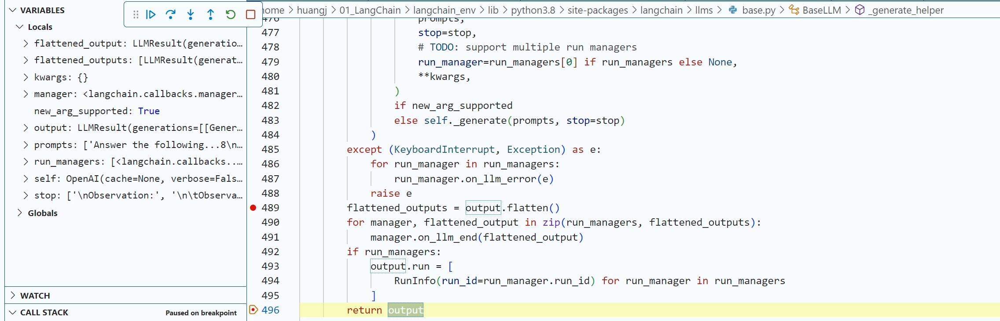

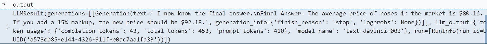

此时，AgentExcutor 的 plan 方法返回一个 AgentFinish 实例，这表示代理经过对输出的检查，其内部逻辑判断出任务已经完成，思考和行动的循环要结束了。

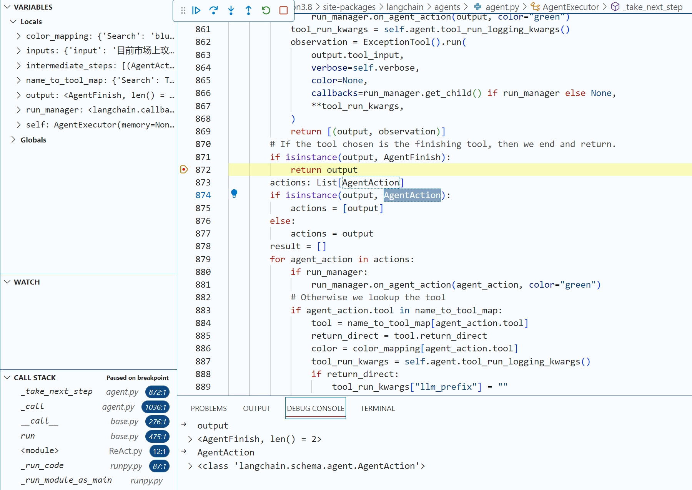

至此，整个链条完成，AgentExecutor 的任务结束。

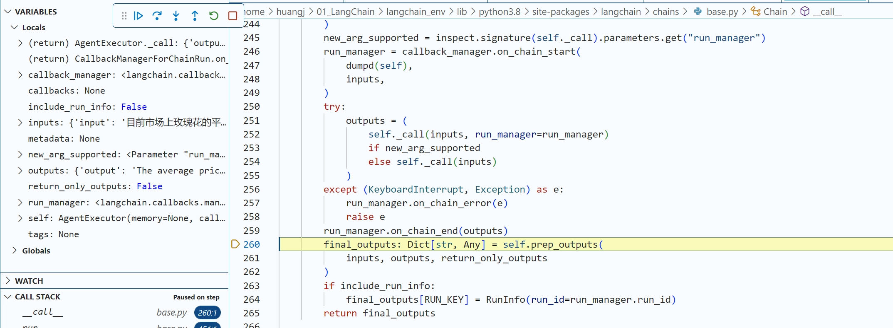

```
在命令行中，模型输出 Thought: I now know the final answer. （我已经知道最
```

终的答案）。

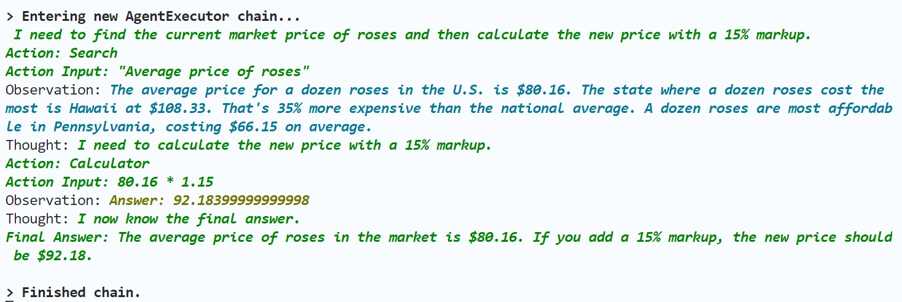

最终答案：玫瑰的平均价格是 80.16 美元，加价 15% 后，是 92.18 美元。

## 总结时刻

这一课中，我们深入到 AgentExecutor 的代码内部，深挖其运行机制，了解了 AgentExecutor是如何通过计划和工具调用，一步一步完成 Thought、Action 和 Observation 的。

如果我们审视一下 AgentExecutor 的代码实现，会发现 AgentExecutor 这个类是作为链（Chain）而存在，同时也为代理执行各种工具，完成任务。它会接收代理的计划，并执行代理思考链路中每一步的行动。

AgentExecutor 中最重要的方法是步骤处理方法，_take_next_step 方法。它用于在思考 - 行动 - 观察的循环中采取单步行动。先调用代理的计划，查找代理选择的工具，然后使用选定的工具执行该计划（此时把输入传给工具），从而获得观察结果，然后继续思考，直到输出是AgentFinish 类型，循环才会结束。

## 思考题

1. 请你在 agent.py 文件中找到 AgentExecutor 类。

2. 请你在 AgentExecutor 类中找到 _take_next_step 方法，对应本课的内容，分析AgentExecutor 类是怎样实现 Plan 和工具调用的。

期待在留言区看到你的分享，如果你觉得内容对你有帮助，也欢迎分享给有需要的朋友！最后如果你学有余力，可以进一步学习下面的延伸阅读。

## 延伸阅读

1. 代码，AgentExecutor 类的实现细节

2. 代码，LLMChain 类的实现细节
