# 14 | 工具和工具箱：LangChain中的Tool和Toolkits一览

你好，我是黄佳，欢迎来到 LangChain 实战课！

这节课我们来一起看一看 LangChain 中各种强大的工具（Tool），以及如何使用它们。

在之前的几节课中，我们深入讲解了 LangChain 中的代理。未来的 AI Agent，应该就是以LLM 为核心控制器的代理系统。而工具，则是代理身上延展出的三头六臂，是代理的武器，代理通过工具来与世界进行交互，控制并改造世界。

## 工具是代理的武器

LangChain 之所以强大，第一是大模型的推理能力强大，第二则是工具的执行能力强大！孙猴子法力再强，没有金箍棒，也降伏不了妖怪。大模型再能思考，没有工具也不行。

工具是代理可以用来与世界交互的功能。这些工具可以是通用实用程序（例如搜索），也可以是其他链，甚至其他的代理。

那么到底什么是工具？在 LangChain 中，工具是如何发挥作用的？

LangChain 通过提供一个统一的框架来集成功能的具体实现。在这个框架中，每个功能都被封装成一个工具。每个工具都有自己的输入和输出，以及处理这些输入和生成输出的方法。

当代理接收到一个任务时，它会根据任务的类型和需求，通过大模型的推理，来选择合适的工具处理这个任务。这个选择过程可以基于各种策略，例如基于工具的性能，或者基于工具处理特定类型任务的能力。

一旦选择了合适的工具，LangChain 就会将任务的输入传递给这个工具，然后工具会处理这些输入并生成输出。这个输出又经过大模型的推理，可以被用作其他工具的输入，或者作为最终结果，被返回给用户。

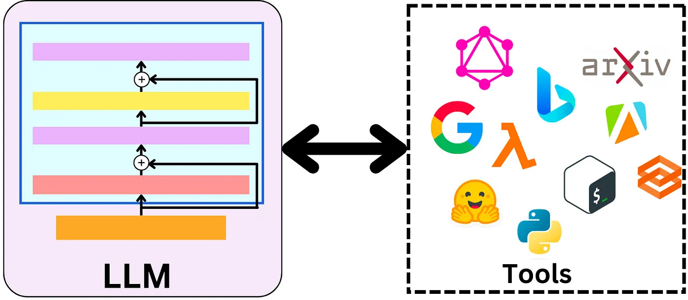

- LLM 和工具之间相互依存

通过这种方式，LangChain 大大延展了大模型的功能。大模型的推理，加上工具的调用，都集成在一个系统中，而这个系统可以处理多种类型的任务。这提高了系统的灵活性和可扩展性，也大大简化了开发者的工作。

## 如何加载工具

在程序中，可以使用以下代码片段加载工具。

```
from langchain.agents import load_tools
tool_names = [...]
tools = load_tools(tool_names)
```

某些工具（例如链、代理）可能需要 LLM 来初始化它们。

```
from langchain.agents import load_tools
tool_names = [...]
llm = ...
tools = load_tools(tool_names, llm=llm)
```

## LangChain 支持的工具一览

下面，我给你列出目前 LangChain 中所支持的工具。

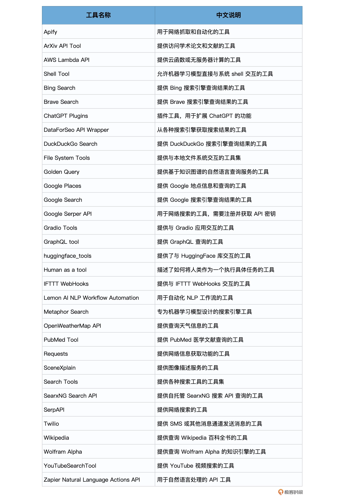

当然这个列表随着时间的推移会越来越长，也就意味着 LangChain 的功能会越来越强大。

## 使用 arXiv 工具开发科研助理

其中有一些工具，比如 SerpAPI，你已经用过了，这里我们再来用一下 arXiv 工具。arXiv 本身就是一个论文研究的利器，里面的论文数量比 AI 顶会还早、还多、还全。那么把它以工具的形式集成到 LangChain 中，能让你在研究学术最新进展时如虎添翼。

- arXiv 是一个提供免费访问的预印本库，供研究者在正式出版前上传和分享其研究工作。它成立于 1991 年，最初是作为物理学预印本数据库开始的，但后来扩展到了数学、计算机科学、生物学、经济学等多个领域。

- 预印本是研究者完成的、但尚未经过同行评议或正式出版的论文。Arxiv 允许研究者上传这些预印本，使其他研究者可以在正式出版之前查看、评论和使用这些工作。这样，研究的发现可以更快地传播和分享，促进学术交流。

```python
# 设置OpenAI API的密钥
import os
os.environ["OPENAI_API_KEY"] = 'Your Key'
# 导入库
from langchain.chat_models import ChatOpenAI
from langchain.agents import load_tools, initialize_agent, AgentType
# 初始化模型和工具
llm = ChatOpenAI(temperature=0.0)
tools = load_tools(
   ["arxiv"],
)
# 初始化链
agent_chain = initialize_agent(
   tools,
   llm,
   agent=AgentType.ZERO_SHOT_REACT_DESCRIPTION,
   verbose=True,
)
# 运行链
agent_chain.run("介绍一下2005.14165这篇论文的创新点?")
```

首先，我们还是来研究一下 ZERO_SHOT_REACT_DESCRIPTION 这个 Agent 是怎么通过提示来引导模型调用工具的。

- “prompts”: ["Answer the following questions as best you can. You have access to the followingtools:\n\n

首先告诉模型，要尽力回答问题，但是可以访问下面的工具。

- arxiv: A wrapper around Arxiv.org Useful for when you need to answer questions aboutPhysics, Mathematics, Computer Science, Quantitative Biology, Quantitative Finance,Statistics, Electrical Engineering, and Economics from scientific articles on arxiv.org. Inputshould be a search query.\n\n

arxiv 工具：一个围绕 Arxiv.org 的封装工具。当你需要回答关于物理学、数学、计算机科学、定量生物学、定量金融、统计学、电气工程和经济学的问题时，来自 arxiv.org 上的科学文章非常有用。同时还告诉模型：输入这个工具的内容应该是搜索查询。

- Use the following format:\n\n

指导模型输出下面的内容。

- Question: the input question you must answer\n （问题：需要回答的问题）Thought: you should always think about what to do\n （思考：应该总是思考下一步做什么）Action: the action to take, should be one of [arxiv]\n （行动：从具体工具列表中选择行动——这里只有 arxiv 一个工具）Action Input: the input to the action\n （行动的输入：输入工具的内容）Observation: the result of the action\n… （观察：工具返回的结果）

- (this Thought/Action/Action Input/Observation can repeat N times)\n （上面Thought/Action/Action Input/Observation 的过程将重复 N 次）Thought: I now know the final answer\n （现在我知道最终答案了）Final Answer: the final answer to the original input question\n\n （原始问题的最终答案）

- Begin!\n\n

现在开始！

- Question: 'Chain-of-Thought Prompting Elicits Reasoning in Large Language Models’这篇论文的创新点\n

真正的问题在此。

- Thought:"

开始思考吧！

然后，我们来看看 Chain 的运行过程。

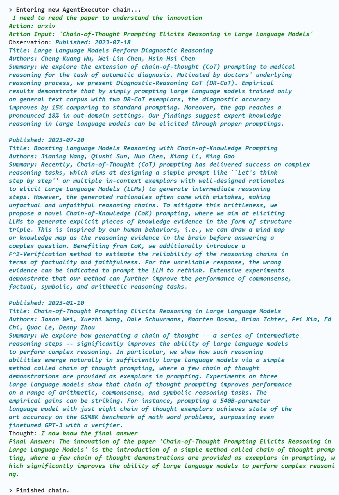

其中，代理的思考过程中的第一个返回结果如下：

- “text”: " I need to read the paper to understand the innovation\n （思考：我需要阅读文章才能理解创新点）Action: arxiv\n （行动：arxiv 工具）Action Input: ‘Chain-of-Thought Prompting Elicits Reasoning in Large Language Models’",（行动的输入：论文的标题）

因为在之前的提示中，LangChain 告诉大模型，对于 Arxiv 工具的输入总是以搜索的形式出现，因此尽管我指明了论文的 ID，Arxiv 还是根据这篇论文的关键词搜索到了 3 篇相关论文的信息。

模型对这些信息进行了总结，认为信息已经完善，并给出了最终答案。

- Thought: I now know the final answer

想法：我现在知道了最终答案。

- Final Answer: The innovation of the paper ‘Chain-of-Thought Prompting Elicits Reasoningin Large Language Models’ is the introduction of a simple method called chain of thoughtprompting, where a few chain of thought demonstrations are provided as exemplars inprompting, which significantly improves the ability of large language models to performcomplex reasoning."

最终答案：这篇名为《链式思考提示促使大型语言模型进行推理》的论文的创新之处在于，引入了一种简单的方法，即链式思考提示，在提示中提供了一些链式思考的示例，这大大提高了大型语言模型执行复杂推理的能力。

## LangChain 中的工具箱一览

下面，我给你列出了目前 LangChain 中所支持的工具箱。每个工具箱中都有一系列工具。

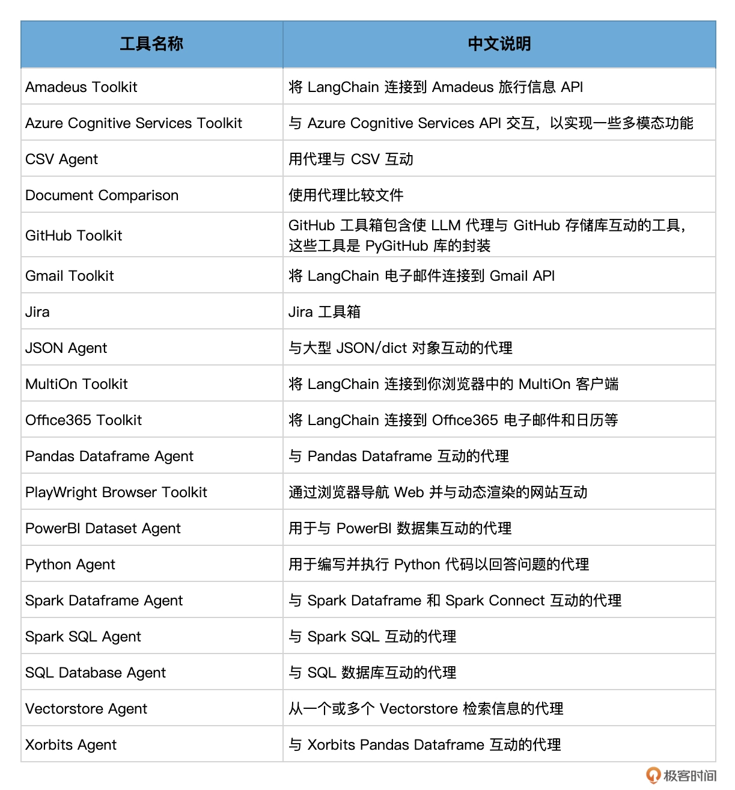

## 使用 Gmail 工具箱开发个人助理

刚才，你使用了 arXiv 工具帮助你做了一些科研工作。你当然还希望你的 AI Agent 能够成为你的全能自动助理，你开发出的智能应用应该能帮你检查邮件、写草稿，甚至发邮件、写文档，对吧？

上面这一切的一切，LangChain 当然能够安排上！

- 通过 Gmail 工具箱，你可以通过 LangChain 应用检查邮件、删除垃圾邮件，甚至让它帮你撰写邮件草稿。

- 通过 Office365 工具箱，你可以让 LangChain 应用帮你读写文档、总结文档，甚至做PPT。

- 通过 GitHub 工具箱，你可以指示 LangChain 应用来检查最新的代码，Commit Changes、Merge Branches，甚至尝试让大模型自动回答 Issues 中的问题——反正大模型解决代码问题的能力本来就更强。

这些都不再是梦想。

下面咱们从一个最简单的应用开始。

目标：我要让 AI 应用来访问我的 Gmail 邮件，让他每天早晨检查一次我的邮箱，看看“易速鲜花”的客服有没有给我发信息。（因为我可能正在焦急地等待他们的退款😁）

现在开始。

### 第一步：在 Google Cloud 中设置你的应用程序接口

这个步骤你要跟着 Gmail API 的官方配置链接完成，这个和 LangChain 无关。蛮复杂的，你需要有点耐心。跟着流程一步步配置就好了。

下面是我在这个设置过程中截取的一部分图片，只是供你参考。详细配置你要 follow Google的官方说明。

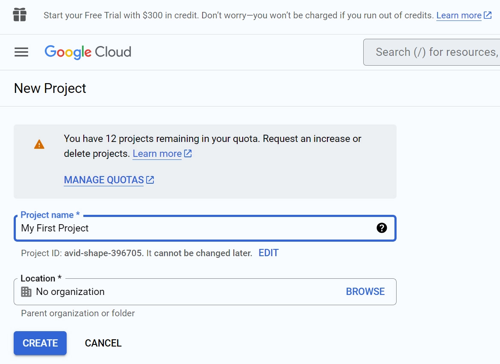

- 创建你的 Project（每人有 12 个免费的 Project）

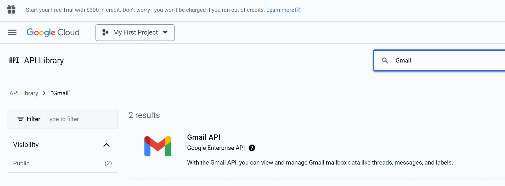

- Gmail API

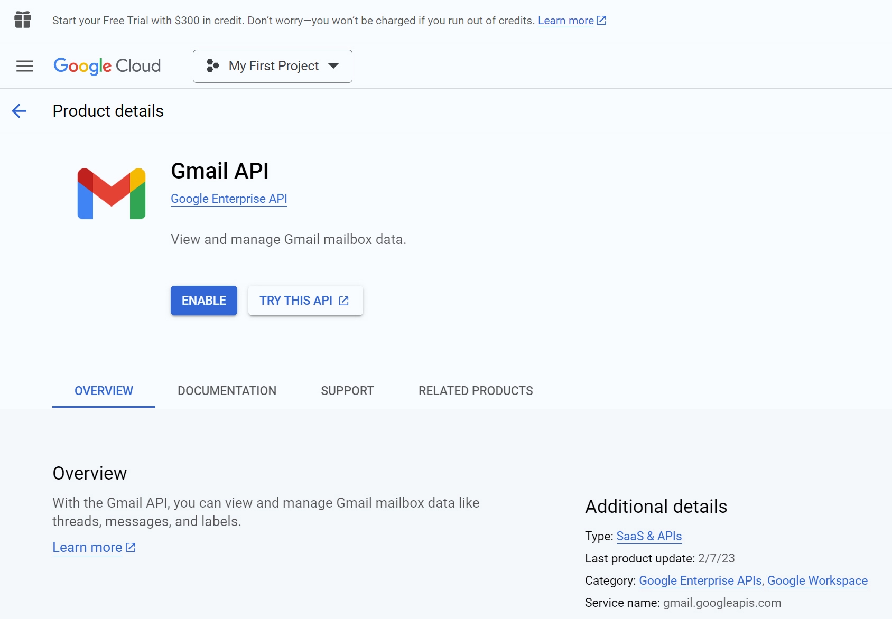

- Enable 它

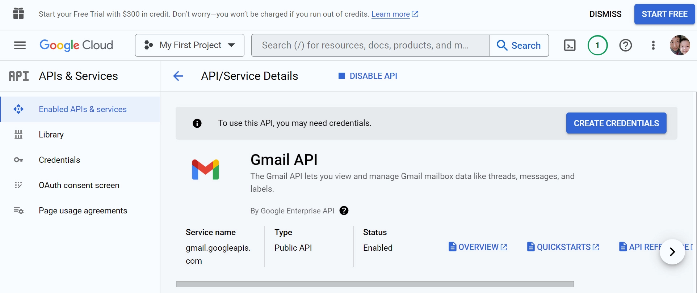

- Create Credentials

下面这个 OAuth 同意屏幕里面的配置非常重要，你的智能代理能做什么，不能做什么，就看你怎么给权限了！

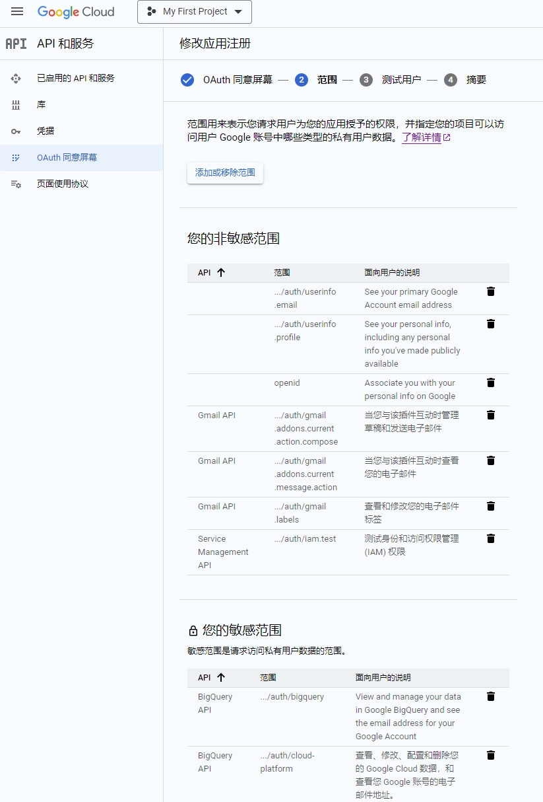

所有设置都完成之后，在 OAuth 客户段已创建这个页面，你拥有了开发密钥。

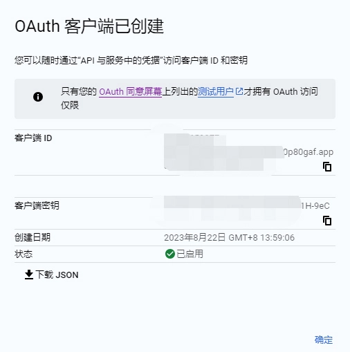

- 可以下载的开发密钥

### 第二步：根据密钥生成开发 Token

在这一步之前，你可能需要安装一些相关的包。

```
pip install --upgrade google-api-python-client
pip install --upgrade google-auth-oauthlib
pip install --upgrade google-auth-httplib2
```

然后，把密钥下载下来，保存为 credentials.json。

运行下面的代码，生成 token.json。

```sql
from __future__ import print_function
import os.path
from google.auth.transport.requests import Request
from google.oauth2.credentials import Credentials
from google_auth_oauthlib.flow import InstalledAppFlow
from googleapiclient.discovery import build
from googleapiclient.errors import HttpError
# If modifying these scopes, delete the file token.json.
SCOPES = ['https://www.googleapis.com/auth/gmail.readonly']
def main():
   """Shows basic usage of the Gmail API.
   Lists the user's Gmail labels.
   """
   creds = None
   # The file token.json stores the user's access and refresh tokens, and is
   # created automatically when the authorization flow completes for the first
   # time.
   if os.path.exists('token.json'):
       creds = Credentials.from_authorized_user_file('token.json', SCOPES)
   # If there are no (valid) credentials available, let the user log in.
   if not creds or not creds.valid:
       if creds and creds.expired and creds.refresh_token:
           creds.refresh(Request())
       else:
           flow = InstalledAppFlow.from_client_secrets_file(
               'credentials.json', SCOPES)
           creds = flow.run_local_server(port=8088)
       # Save the credentials for the next run
       with open('token.json', 'w') as token:
           token.write(creds.to_json())
   try:
       # Call the Gmail API
       service = build('gmail', 'v1', credentials=creds)
       results = service.users().labels().list(userId='me').execute()
       labels = results.get('labels', [])
       if not labels:
           print('No labels found.')
           return
       print('Labels:')
       for label in labels:
           print(label['name'])
   except HttpError as error:
       # TODO(developer) - Handle errors from gmail API.
       print(f'An error occurred: {error}')
if __name__ == '__main__':
   main()
```

这是 Google API 网站提供的标准示例代码，里面给了读取权限（gmail.readonly）的 Token，如果你要编写邮件，甚至发送邮件，需要根据需求来调整权限。更多细节可以参阅 GoogleAPI 的文档。

这个程序会生成一个 token.json 文件，是有相关权限的开发令牌。这个文件在 LangChain 应用中需要和密钥一起使用。

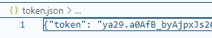

把密钥和 Token 文件都放在程序的同一个目录中，你就可以开始开发应用程序了。

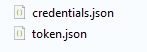

### 第三步：用 LangChain 框架开发 Gmail App

这段代码的核心目的是连接到 Gmail API，查询用户的邮件，并通过 LangChain 的 Agent 框架智能化地调用 API（用语言而不是具体 API），与邮件进行互动。

```python
# 设置OpenAI API的密钥
import os
os.environ["OPENAI_API_KEY"] = 'Your Key'
# 导入与Gmail交互所需的工具包
from langchain.agents.agent_toolkits import GmailToolkit
# 初始化Gmail工具包
toolkit = GmailToolkit()
# 从gmail工具中导入一些有用的功能
from langchain.tools.gmail.utils import build_resource_service, get_gmail_credent
# 获取Gmail API的凭证，并指定相关的权限范围
credentials = get_gmail_credentials(
   token_file="token.json",  # Token文件路径
   scopes=["https://mail.google.com/"],  # 具有完全的邮件访问权限
   client_secrets_file="credentials.json",  # 客户端的秘密文件路径
)
# 使用凭证构建API资源服务
api_resource = build_resource_service(credentials=credentials)
toolkit = GmailToolkit(api_resource=api_resource)
# 获取工具
tools = toolkit.get_tools()
print(tools)
# 导入与聊天模型相关的包
from langchain.chat_models import ChatOpenAI
from langchain.agents import initialize_agent, AgentType
# 初始化聊天模型
llm = ChatOpenAI(temperature=0, model='gpt-4')
# 通过指定的工具和聊天模型初始化agent
agent = initialize_agent(
   tools=toolkit.get_tools(),
   llm=llm,
   agent=AgentType.STRUCTURED_CHAT_ZERO_SHOT_REACT_DESCRIPTION,
)
# 使用agent运行一些查询或指令
result = agent.run(
   "今天易速鲜花客服给我发邮件了么？最新的邮件是谁发给我的？"
)
# 打印结果
print(result)
```

代码的核心部分主要是连接到 Gmail API，获取用户的邮件数据，并通过特定的 Agent 查询这些数据。

你的请求是查询今天是否收到了来自“易速鲜花客服”的邮件，以及最新邮件的发送者是谁。这个请求是模糊的，是自然语言格式，具体调用什么 API，由 Agent、Tool 也就是 Gmail API它俩商量着来。这与我们之前所进行的清晰的、具体 API 调用式的应用开发迥然不同。

第一次运行程序，会进行一些确认，并让我 Login 我的 Gmail。

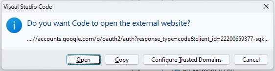

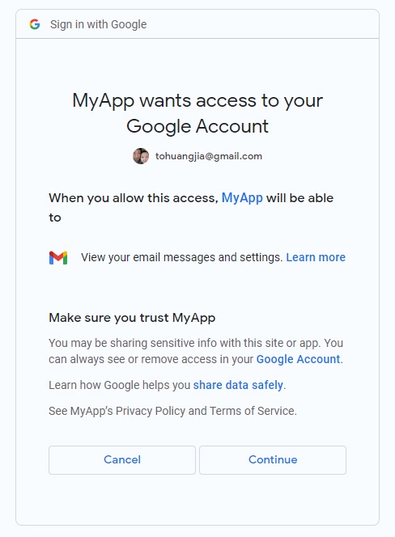

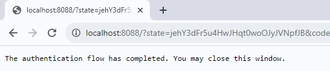

之后，我就得到了智能助手的回答！

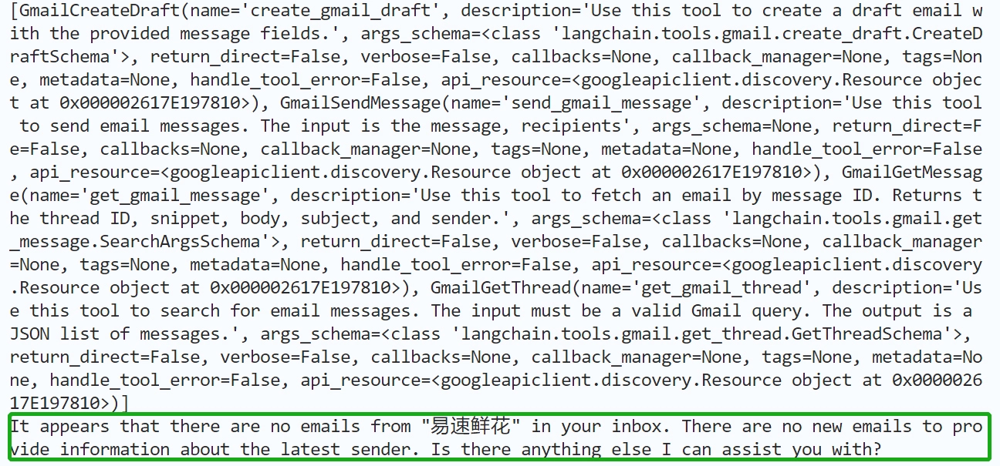

她说：主人，看起来你没有收到“易速鲜花”的邮件耶，还需要我帮你做些什么吗？真的很贴心，这样的话，我每天早晨就不需要自己去检查邮件啦！

后来，我又问她，那么谁给我发来了新邮件呢？

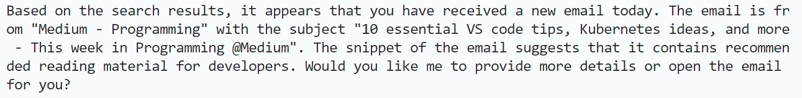

她告诉我说，Medium - Programing 给我发了一篇 VS code 的 10 个 tips 的文章，还有Kubernetes 的点子啥的。

嗯，这是我订阅的内容。下一步，我还可以让她针对这些内容给我总结总结！这也是她的强项！

## 总结时刻

学到现在，你应该对 LangChain 的核心价值有了更深的感悟吧。它的价值，在于它将模型运行和交互的复杂性进行了封装和抽象化，为开发者提供了一个更简单、更直观的接口来利用大模型。

- 集成多模型和多策略：LangChain 提供了一种方法，使得多个模型或策略能够在一个统一的框架下工作。例如，arXiv 是一个单独的工具，它负责处理特定的任务。这种工具可以与其他工具（例如用于处理自然语言查询或者数据库查询的工具）一起作为一个集成的系统存在。这样，你可以轻松地创建一个系统，该系统可以处理多种类型的输入并执行多种任务，而不必为每个任务单独写代码。

- 更易于交互和维护：通过 LangChain，你可以更方便地管理和维护你的工具和模型。LangChain 提供的工具和代理（Agent）抽象使得开发者可以将关注点从底层实现细节转向实现应用的高层逻辑。而且，LangChain 封装了像模型的加载、输入输出的处理、工具的调度等底层任务，使得开发者能够更专注于如何组合这些工具以解决实际问题。

- 适应性：LangChain 提供的架构允许你轻松地添加新的工具或模型，或者替换现有的工具或模型。这种灵活性使得你的系统可以很容易地适应新的需求或改变。

- 可解释性：LangChain 还提供了对模型决策的可解释性。在你的示例中，LangChain 提供的对话历史和工具选择的记录可以帮助理解系统做出某些决策的原因。

总的来说，尽管直接调用模型可能对于单一任务或简单应用来说足够了，但是当你需要处理更复杂的场景，例如需要协调多个模型或工具，或者需要处理多种类型的输入时，使用像LangChain 这样的框架可以大大简化你的工作。

## 思考题

1. 上面 Gmail 的示例中我只是展示了邮件读取功能，你能否让你的 AI 助理帮你写邮件的草稿甚至发送邮件？

2. 你可否尝试使用 GitHub 工具开发一些 App 来自动完成一部分 GitHub 任务，比如查看Issues、Merge Branches 之类的事儿。

提示：参考此链接创建 GitHub App，以及 LangChain 的参考文档。

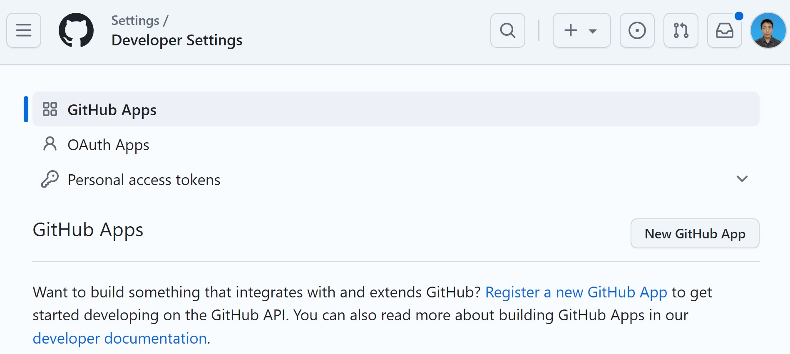

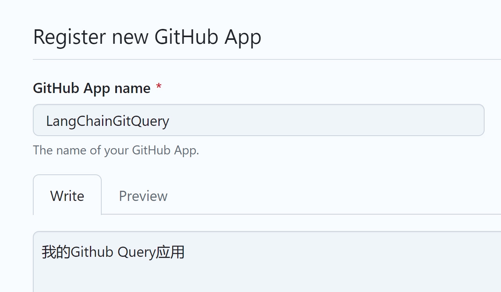

期待在留言区看到你的分享，如果你觉得内容对你有帮助，也欢迎分享给有需要的朋友！最后如果你学有余力，可以进一步学习下面的延伸阅读。

## 延伸阅读

1. 文档：LangChain 中集成的所有工具

2. 文档：LangChain 中集成的所有工具箱

3. 文档：Google Cloud API

4. 文档：Github REST API
