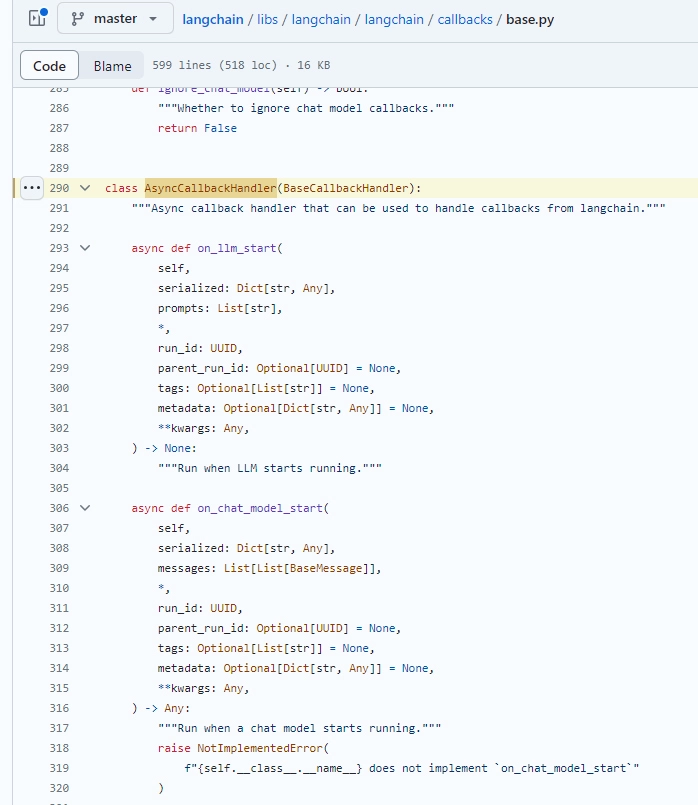
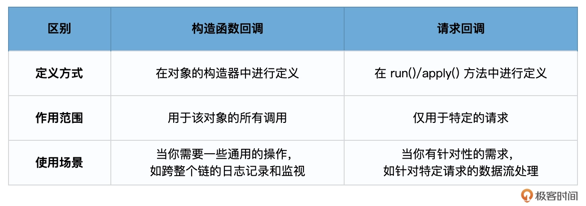
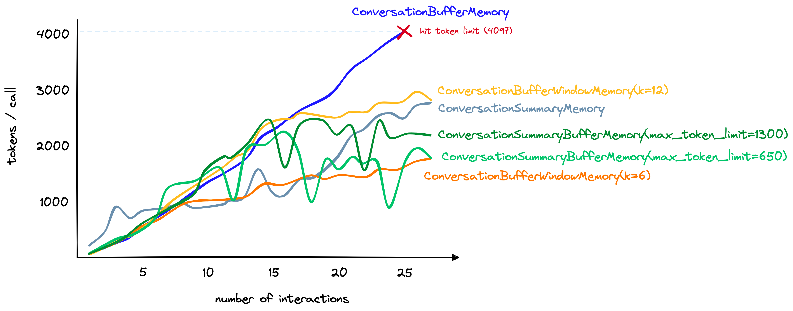

# 17 | 回调函数：在AI应用中引入异步通信机制

你好，我是黄佳，欢迎来到 LangChain 实战课！

这节课我们一起来学习一下 LangChain 中的回调函数。

## 回调函数和异步编程

回调函数，你可能并不陌生。它是函数 A 作为参数传给另一个函数 B，然后在函数 B 内部执行函数 A。当函数 B 完成某些操作后，会调用（即“回调”）函数 A。这种编程模式常见于处理异步操作，如事件监听、定时任务或网络请求。

- 在编程中，异步通常是指代码不必等待某个操作完成（如 I/O 操作、网络请求、数据库查询等）就可以继续执行的能力。异步机制的实现涉及事件循环、任务队列和其他复杂的底层机制。这与同步编程形成对比，在同步编程中，操作必须按照它们出现的顺序完成。

下面是回调函数的一个简单示例。

```python
def compute(x, y, callback):
   result = x + y
   callback(result)
def print_result(value):
   print(f"The result is: {value}")
def square_result(value):
   print(f"The squared result is: {value**2}")
# 使用print_result作为回调
compute(3, 4, print_result)  # 输出: The result is: 7
# 使用square_result作为回调
compute(3, 4, square_result)  # 输出: The squared result is: 49
```

不过，上面这个程序中并没有体现出异步操作。虽然回调函数这种编程模式常见于处理异步操作，但回调函数本身并不代表异步。回调只是一种编程模式，允许你在某个操作完成时（无论是否异步）执行某些代码。

而下面的例子，就是在异步操作时使用回调函数的示例。

```python
import asyncio
async def compute(x, y, callback):
   print("Starting compute...")
   await asyncio.sleep(0.5)  # 模拟异步操作
   result = x + y
   # callback(result)
   print("Finished compute...")
def print_result(value):
   print(f"The result is: {value}")
async def another_task():
   print("Starting another task...")
   await asyncio.sleep(1)
   print("Finished another task...")
async def main():
   print("Main starts...")
   task1 = asyncio.create_task(compute(3, 4, print_result))
   task2 = asyncio.create_task(another_task())
   await task1
   await task2
   print("Main ends...")
asyncio.run(main())
```

这个示例中，当我们调用 asyncio.create_task(compute(3, 4, print_result))，compute 函数开始执行。当它遇到 await asyncio.sleep(2) 时，它会暂停，并将控制权交还给事件循环。这时，事件循环可以选择开始执行 another_task，这是另一个异步任务。这样，你可以清晰地看到，尽管 compute 函数还没有完成，another_task 函数也得以开始执行并完成。这就是异步编程，允许你同时执行多个操作，而不需要等待一个完成后再开始另一个。

## LangChain 中的 Callback 处理器

LangChain 的 Callback 机制允许你在应用程序的不同阶段进行自定义操作，如日志记录、监控和数据流处理，这个机制通过 CallbackHandler（回调处理器）来实现。

回调处理器是 LangChain 中实现 CallbackHandler 接口的对象，为每类可监控的事件提供一个方法。当该事件被触发时，CallbackManager 会在这些处理器上调用适当的方法。

BaseCallbackHandler 是最基本的回调处理器，你可以继承它来创建自己的回调处理器。它包含了多种方法，如 on_llm_start/on_chat（当 LLM 开始运行时调用）和 on_llm_error（当 LLM出现错误时调用）等。



LangChain 也提供了一些内置的处理器，例如 StdOutCallbackHandler，它会将所有事件记录到标准输出。还有 FileCallbackHandler，会将所有的日志记录到一个指定的文件中。

## 在组件中使用回调处理器

在 LangChain 的各个组件，如 Chains、Models、Tools、Agents 等，都提供了两种类型的回调设置方法：构造函数回调和请求回调。你可以在初始化 LangChain 时将回调处理器传入，或者在单独的请求中使用回调。例如，当你想要在整个链的所有请求中进行日志记录时，可以在初始化时传入处理器；而当你只想在某个特定请求中使用回调时，可以在请求时传入。

这两者的区别，我给你整理了一下。



下面这段示例代码，使用 LangChain 执行了一个简单的任务，结合使用 LangChain 的回调机

```python
制与 loguru 日志库，将相关事件同时输出到标准输出和 "output.log" 文件中。
from loguru import logger
from langchain.callbacks import FileCallbackHandler
from langchain.chains import LLMChain
from langchain.llms import OpenAI
from langchain.prompts import PromptTemplate
logfile = "output.log"
logger.add(logfile, colorize=True, enqueue=True)
handler = FileCallbackHandler(logfile)
llm = OpenAI()
prompt = PromptTemplate.from_template("1 + {number} = ")
# this chain will both print to stdout (because verbose=True) and write to 'outpu
# if verbose=False, the FileCallbackHandler will still write to 'output.log'
chain = LLMChain(llm=llm, prompt=prompt, callbacks=[handler], verbose=True)
answer = chain.run(number=2)
logger.info(answer)
```

其中，初始化 LLMChain 时指定的 verbose 参数，就等同于将一个输出到控制台的回调处理器添加到你的对象中。这个在你调试程序时非常有用，因为它会将所有事件的信息输出到控制台。

简而言之，LangChain 通过回调系统提供了一种灵活的方式，来监控和操作应用程序的不同阶段。

## 自定义回调函数

我们也可以通过 BaseCallbackHandler 和 AsyncCallbackHandler 来自定义回调函数。下面是一个示例。

```python
import asyncio
from typing import Any, Dict, List
from langchain.chat_models import ChatOpenAI
from langchain.schema import LLMResult, HumanMessage
from langchain.callbacks.base import AsyncCallbackHandler, BaseCallbackHandler
# 创建同步回调处理器
class MyFlowerShopSyncHandler(BaseCallbackHandler):
   def on_llm_new_token(self, token: str, **kwargs) -> None:
       print(f"获取花卉数据: token: {token}")
# 创建异步回调处理器
class MyFlowerShopAsyncHandler(AsyncCallbackHandler):
   async def on_llm_start(
       self, serialized: Dict[str, Any], prompts: List[str], **kwargs: Any
   ) -> None:
       print("正在获取花卉数据...")
       await asyncio.sleep(0.5)  # 模拟异步操作
       print("花卉数据获取完毕。提供建议...")
   async def on_llm_end(self, response: LLMResult, **kwargs: Any) -> None:
       print("整理花卉建议...")
       await asyncio.sleep(0.5)  # 模拟异步操作
       print("祝你今天愉快！")
# 主要的异步函数
async def main():
   flower_shop_chat = ChatOpenAI(
       max_tokens=100,
       streaming=True,
       callbacks=[MyFlowerShopSyncHandler(), MyFlowerShopAsyncHandler()],
   )
   # 异步生成聊天回复
   await flower_shop_chat.agenerate([[HumanMessage(content="哪种花卉最适合生日？只简
# 运行主异步函数
asyncio.run(main())
```

在这个鲜花店客服的程序中，当客户问及关于鲜花的建议时，我们使用了一个同步和一个异步回调。

MyFlowerShopSyncHandler 是一个同步回调，每当新的 Token 生成时，它就简单地打印出正在获取的鲜花数据。

而 MyFlowerShopAsyncHandler 则是异步的，当客服开始提供鲜花建议时，它会模拟数据的异步获取。在建议完成后，它还会模拟一个结束的操作，如向客户发出感谢。

这种结合了同步和异步操作的方法，使得程序能够更有效率地处理客户请求，同时提供实时反馈。

这里的异步体现在这样几个方面。

1. 模拟延时操作：在 MyFlowerShopAsyncHandler 中，我们使用了 await asyncio.sleep(0.5)来模拟其他请求异步获取花卉信息的过程。当执行到这个 await 语句时，当前的on_llm_start 函数会“暂停”，释放控制权回到事件循环。这意味着，在这个 sleep 期间，其他异步任务（如其他客户的请求）可以被处理。

2. 回调机制：当 ChatOpenAI 在处理每个新 Token 时，它会调用 on_llm_new_token 方法。因为这是一个同步回调，所以它会立即输出。但是，开始和结束的异步回调 on_llm_start和 on_llm_end 在开始和结束时都有一个小的延时操作，这是通过 await asyncio.sleep(0.5)模拟的。

3. 事件循环：Python 的 syncio 库提供了一个事件循环，允许多个异步任务并发运行。在我们的例子中，虽然看起来所有的操作都是按顺序发生的，但由于我们使用了异步操作和回调，如果有其他并发任务，它们可以在 await 暂停期间运行。

为了更清晰地展示异步的优势，通常我们会在程序中同时运行多个异步任务，并观察它们如何“并发”执行。但在这个简单的例子中，我们主要是通过模拟延时来展示异步操作的基本机制。

因此说，回调函数为异步操作提供了一个机制，使你可以定义“当操作完成时要做什么”，而异步机制的真正实现涉及更深层次的底层工作，如事件循环和任务调度。

## 用 get_openai_callback 构造令牌计数器

下面，我带着你使用 LangChain 中的回调函数来构造一个令牌计数器。这个计数功能对于监控大模型的会话消耗以及成本控制十分重要。

在构造令牌计数器之前，我们来回忆一下第 10 课中的记忆机制。我们用下面的代码生成了ConversationBufferMemory。

```python
from langchain import OpenAI
from langchain.chains import ConversationChain
from langchain.chains.conversation.memory import ConversationBufferMemory
# 初始化大语言模型
llm = OpenAI(
   temperature=0.5,
   model_name="gpt-3.5-turbo-instruct")
# 初始化对话链
conversation = ConversationChain(
   llm=llm,
   memory=ConversationBufferMemory()
)
# 第一天的对话
# 回合1
conversation("我姐姐明天要过生日，我需要一束生日花束。")
print("第一次对话后的记忆:", conversation.memory.buffer)
# 回合2
conversation("她喜欢粉色玫瑰，颜色是粉色的。")
print("第二次对话后的记忆:", conversation.memory.buffer)
# 回合3 （第二天的对话）
conversation("我又来了，还记得我昨天为什么要来买花吗？")
print("/n第三次对话后时提示:/n",conversation.prompt.template)
print("/n第三次对话后的记忆:/n", conversation.memory.buffer)
```

同时，我们也给出了各种记忆机制对 Token 的消耗数量的估算示意图。



- 当对话轮次逐渐增加时，各种记忆机制对 Token 的消耗数量估算

不过，这张图毕竟是估算，要真正地衡量出每种记忆机制到底耗费了多少个 Token，那就需要回调函数上场了。

下面，我们通过回调函数机制，重构这段程序。为了做到这一点，我们首先需要确保在与大语言模型进行交互时，使用了 get_openai_callback 上下文管理器。

- 在 Python 中，一个上下文管理器通常用于管理资源，如文件或网络连接，这些资源在使用前需要设置，在使用后需要清理。上下文管理器经常与 with 语句一起使用，以确保资源正确地设置和清理。

- get_openai_callback 被设计用来监控与 OpenAI 交互的 Token 数量。当你进入该上下文时，它会通过监听器跟踪 Token 的使用。当你退出上下文时，它会清理监听器并提供一个Token 的总数。通过这种方式，它充当了一个回调机制，允许你在特定事件发生时执行特定的操作或收集特定的信息。

具体代码如下：

```python
from langchain import OpenAI
from langchain.chains import ConversationChain
from langchain.chains.conversation.memory import ConversationBufferMemory
from langchain.callbacks import get_openai_callback
# 初始化大语言模型
llm = OpenAI(temperature=0.5, model_name="gpt-3.5-turbo-instruct")
# 初始化对话链
conversation = ConversationChain(
   llm=llm,
   memory=ConversationBufferMemory()
)
# 使用context manager进行token counting
with get_openai_callback() as cb:
   # 第一天的对话
   # 回合1
   conversation("我姐姐明天要过生日，我需要一束生日花束。")
   print("第一次对话后的记忆:", conversation.memory.buffer)
   # 回合2
   conversation("她喜欢粉色玫瑰，颜色是粉色的。")
   print("第二次对话后的记忆:", conversation.memory.buffer)
   # 回合3 （第二天的对话）
   conversation("我又来了，还记得我昨天为什么要来买花吗？")
   print("/n第三次对话后时提示:/n",conversation.prompt.template)
   print("/n第三次对话后的记忆:/n", conversation.memory.buffer)
# 输出使用的tokens
print("\n总计使用的tokens:", cb.total_tokens)
```

这里，我使用了 get_openai_callback 上下文管理器来监控与 ConversationChain 的交互。这允许我们计算在这些交互中使用的总 Tokens 数。

输出：

```
总计使用的tokens: 966
```

下面，我再添加了一个 additional_interactions 异步函数，用于演示如何在多个并发交互中计算 Tokens。

- 当我们讨论异步交互时，指的是我们可以启动多个任务，它们可以并发（而不是并行）地运行，并且不会阻塞主线程。在 Python 中，这是通过 asyncio 库实现的，它使用事件循环来管理并发的异步任务。

```python
import asyncio
# 进行更多的异步交互和token计数
async def additional_interactions():
   with get_openai_callback() as cb:
       await asyncio.gather(
           *[llm.agenerate(["我姐姐喜欢什么颜色的花？"]) for _ in range(3)]
       )
   print("\n另外的交互中使用的tokens:", cb.total_tokens)
# 运行异步函数
asyncio.run(additional_interactions())
```

简单解释一下。

```
async def：这表示 additional_interactions 是一个异步函数。它可以使用 await 关键字在
```

- 其中挂起执行，允许其他异步任务继续。

```
await asyncio.gather(...)：这是 asyncio 库提供的一个非常有用的方法，用于并
```

- 发地运行多个异步任务。它会等待所有任务完成，然后继续执行。

```
*[llm.agenerate(["我姐姐喜欢什么颜色的花？"]) for _ in range(3)]：这实
```

- 际上是一个 Python 列表解析，它生成了 3 个 llm.agenerate(…) 的异步调用。asyncio.gather 将并发地运行这 3 个调用。

由于这 3 个 llm.agenerate 调用是并发的，所以它们不会按顺序执行，而是几乎同时启动，并在各自完成时返回。这意味着，即使其中一个调用由于某种原因需要更长时间，其他调用也不会被阻塞，它们会继续并完成。

## 总结时刻

回调函数是计算机科学中一个重要和广泛应用的概念，它允许我们在特定的时间或条件下执行特定的代码。

回调函数在开发过程中有很多应用场景。

1. 异步编程：在 JavaScript 中，回调函数常常用于异步编程。例如，当你发送一个 AJAX 请求到服务器时，你可以提供一个回调函数，这个函数将在服务器的响应到达时被调用。

2. 事件处理：在许多编程语言和框架中，回调函数被用作事件处理器。例如，你可能会写一个回调函数来处理用户的点击事件，当用户点击某个按钮时，这个函数就会被调用。

3. 定时器：你可以使用回调函数来创建定时器。例如，你可以使用 JavaScript 的 setTimeout或 setInterval 函数，并提供一个回调函数，这个函数会在指定的时间过后被调用。

在 LangChain 中，回调机制同样为用户提供了灵活性和自定义能力，以便更好地控制和响应事件。CallbackHandler 允许开发者在链的特定阶段或条件下注入自定义的行为，例如异步编程中的响应处理、事件驱动编程中的事件处理等。这为 LangChain 提供了灵活性和扩展性，使其能够适应各种应用场景。

## 思考题

1. 我通过 get_openai_callback 重构了 ConversationBufferMemory 的程序，你能否把这个令牌计数器实现到其他记忆机制中？

2. 在 LangChain 开发过程中，可以在构造函数中引入回调机制，我给出了一个示例，你能否尝试在请求过程（run/apply 方法）中引入回调机制？

提示：请求回调常用在流式传输的实现中。在传统的传输中，我们必须等待这个函数生成所有数据后才能开始处理。在流式传输中，我们可以在数据被生成时立即开始处理。如果你想将单个请求的输出流式传输到一个 WebSocket，你可以将一个 Callback 处理器传递给 call() 方法。

期待在留言区看到你的分享，如果觉得内容对你有帮助，也欢迎分享给有需要的朋友！最后如果你学有余力，可以进一步学习下面的延伸阅读。

## 延伸阅读

1. GitHub 代码：CallbackHandler 中的可监控事件和方法

2. 文档：LangChain 中的回调机制

3. 文档：什么是回调函数（知乎）
