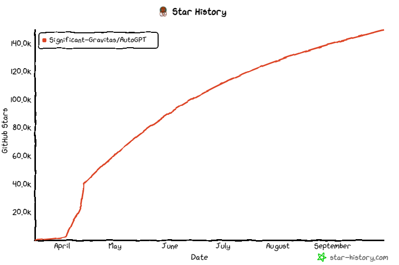
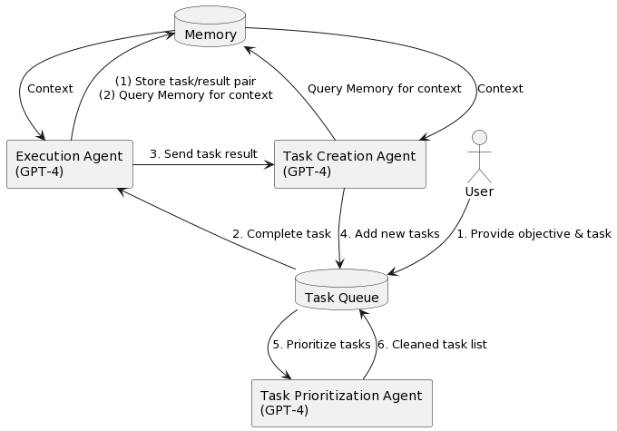
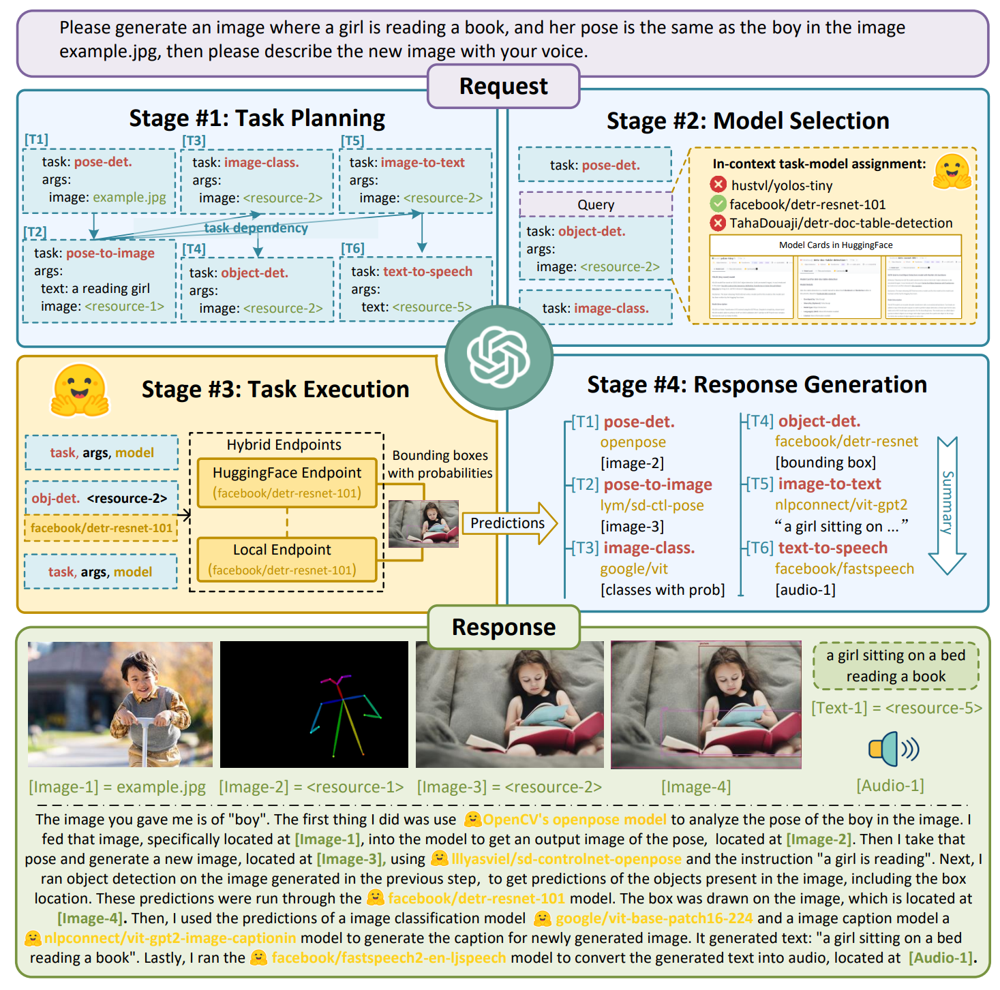
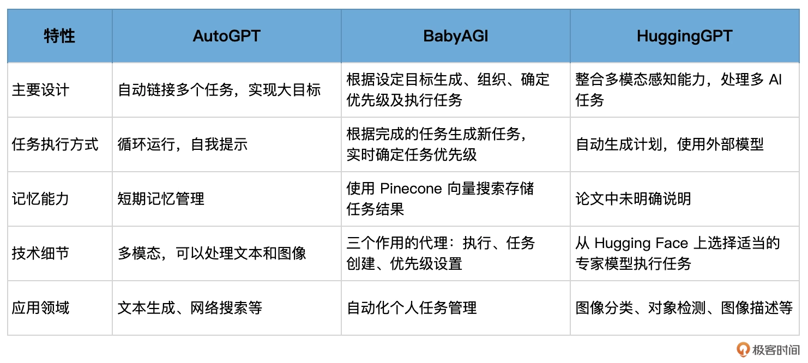

# 19 | BabyAGI：根据气候变化自动制定鲜花存储策略

你好，我是黄佳，欢迎来到 LangChain 实战课！

在上节课中，我们深入探讨了如何利用 CAMEL 框架制定出一个高效的鲜花营销方案。然而，LangChain 目前是将基于 CAMEL 框架的代理定义为 Simulation Agents（模拟代理）。这种代理在模拟环境中进行角色扮演，试图模拟特定场景或行为，而不是在真实世界中完成具体的任务。

随着 ChatGPT 的崭露头角，我们迎来了一种新型的代理——Autonomous Agents（自治代理或自主代理）。这些代理的设计初衷就是能够独立地执行任务，并持续地追求长期目标。在LangChain 的代理、工具和记忆这些组件的支持下，它们能够在无需外部干预的情况下自主运行，这在真实世界的应用中具有巨大的价值。

目前，GitHub 上已有好几个备受关注的“网红”项目，如 AutoGPT、BabyAGI 和HuggingGPT，它们都代表了自治代理的初步尝试。尽管这些代理仍处于实验阶段，但潜力十分巨大。它们都是基于 LangChain 框架构建的。通过 LangChain，你可以在这些开源项目中轻松地切换和测试多种 LLM、使用多种向量存储作为记忆，以及充分利用 LangChain 的丰富工具集。

今天的这节课，我就带着你看一看这些项目，同时也通过 LangChain 完成一个 BabyAGI 的实现。

## AutoGPT

Auto-GPT 是由 Toran Bruce Richards 创建的一个开源的自主 AI 代理，基于 OpenAI 的 GPT-4 语言模型。它的主要功能是自动链接多个任务，以实现用户设定的大目标。与传统的聊天机器人（如 ChatGPT）不同，用户只需提供一个提示或一组自然语言指令，Auto-GPT 就会通过自动化多步提示过程，将目标分解为子任务，以达到其目标。



- 图片来源网络

Auto-GPT 一出世，就受到了广泛的宣传和追捧，Star 数量半年飙升到了 150K。

为什么 Auto-GPT 吸引了这么多眼球？

因为与 ChatGPT 相比，它能够与互联网集成，提供实时数据访问。Auto-GPT 将活动分解为子任务，自我提示（而不是像 ChatGPT 那样需要用户多次提示才能把复杂任务完善地完成），并重复该过程，直到达到所提供的目标。

技术上，Auto-GPT 使用短期记忆管理来保存上下文；同时 Auto-GPT 是多模态的，可以处理文本和图像作为输入。

从具体应用上说，Auto-GPT 可以用于各种任务，例如生成文本、执行特定操作和进行网络搜索等。它还可以作为研究助手，帮助用户进行科学研究、市场研究、内容创建、销售线索生成、业务计划创建、产品评论、播客大纲制定等。

当然，Auto-GPT 并不完善，作为一个实验性质的项目，它还存在诸多挑战，比如它的运行成本可能很高，而且它可能会分心或陷入循环。技术上，它的缺陷是没有长期记忆。

但是，作为一个开源项目，它的优势在于，它展示出了 AI 的边界和自主行动能力，凸显出了自主代理的潜力，也从实践上验证了人类正朝向人工普通智能（AGI）迈进。理论上说，更成熟的 Auto-GPT 版本可以启动与其他自主代理进行交互过程，实现 AI 代理之间的对话。

Auto-GPT 在 GitHub 上的社区非常活跃，开发者可以分享他们使用 Auto-GPT 的进展和想法。Auto-GPT 还有一个 Hackathon 活动，鼓励开发者提交他们的代理进行基准测试和比较。

## Baby AGI

BabyAGI 是由中岛洋平（Yohei Nakajima）于 2023 年 3 月 28 日开发的自主任务驱动 AI 系统。核心在于，它可以根据设定的目标生成、组织、确定优先级以及执行任务。它也使用OpenAI 的 GPT-4 语言模型来理解和创建任务，利用 Pinecone 向量搜索来存储和检索特定任务的结果，提供执行任务的上下文，并采用 LangChain 框架进行决策。

BabyAGI 尝试使用预定义的目标进行自我驱动，自动化个人任务管理。它不仅可以自动生成和执行任务，而且还可以根据完成的任务结果生成新任务，并且可以实时确定任务的优先级。

与传统的 AI 工具（如 ChatGPT）不同，BabyAGI 不仅仅是解释查询和提供响应，而且能够根据目标生成任务列表，连续执行它们，并根据先前任务的输出适应性地创建更多任务。

和 Auto-GPT 一样，该系统发布后广受关注，也被某些人誉为完全自主人工智能的起点。

在 BabyAGI 中，你向系统提出一个目标之后，它将不断优先考虑需要实现或完成的任务，以实现该目标。具体来说，系统将形成任务列表，从任务列表中拉出优先级最高的第一个任务，使用 OpenAI API 根据上下文将任务发送到执行代理并完成任务，一旦这些任务完成，它们就会被存储在内存（或者 Pinecone 这类向量数据库）中，然后，根据目标和上一个任务的结果创建新任务并确定优先级。

整个过程如下图所示：



- 图片来源网络

在这个过程中，驱动任务的是三个不同作用的代理。分别是执行代理 execution_agent，任务创建代理 task_creation_agent，以及优先级设置代理 prioritization_agent。

- 执行代理，是系统的核心，利用 OpenAI 的 API 来处理任务。这个代理的实现函数有两个参数，目标和任务，用于向 OpenAI 的 API 发送提示，并以字符串形式返回任务结果。

- 任务创建代理，通过 OpenAI 的 API 根据当前对象和先前任务的结果创建新任务。这个代理的实现函数有四个参数，目标、上一个任务的结果、任务描述和当前任务列表。这个代理会向 OpenAI 的 API 发送一条提示，该 API 将以字符串形式返回新任务列表。然后，该函数将以字典列表的形式返回这些新任务，其中每个字典都包含任务的名称。

- 优先级设置代理，负责任务列表的排序和优先级，仍然是通过调用 OpenAI 的 API 来重新确定任务列表的优先级。这个代理的实现函数有一个参数，即当前任务的 ID。这个代理会向 OpenAI 的 API 发送提示，并返回已重新优先排序为编号列表的新任务列表。

等一下，我就用这个 BabyAGI 的框架来带着你开发一个能够根据气候变化自动制定鲜花存储策略的 AI 智能代理。

## HuggingGPT

在 Yongliang Shen 的论文《HuggingGPT: Solving AI Tasks with ChatGPT and its Friends inHugging Face》中，介绍了 HuggingGPT 的系统。HuggingGPT 的工作流程包括四个阶段。

1. 任务规划：LLM（例如 ChatGPT）解析用户请求，生成任务列表，并确定任务之间的执行顺序和资源依赖关系。

2. 模型选择：LLM 根据 Hugging Face 上的专家模型描述，为任务分配适当的模型。

3. 任务执行：整合各个任务端点上的专家模型，执行分配的任务。

4. 响应生成：LLM 整合专家的推断结果，生成工作流摘要，并给用户提供最终的响应。

HuggingGPT 的设计，使其能够根据用户请求自动生成计划，并使用外部模型，从而整合多模态感知能力，并处理多个复杂的 AI 任务。此外，这种流程还允许 HuggingGPT 持续从任务特定的专家模型中吸收能力，从而实现可增长和可扩展的 AI 能力。



- 图片来源论文

文章还提到，HuggingGPT 的优势在于，它能够使用不同的模型来执行特定的任务，如图像分类、对象检测、图像描述等。例如，它使用 OpenCV 的 OpenPose 模型来分析图像中小朋友的姿势，并使用其他模型生成新图像和描述。

不难看出，尽管实现过程各有特点，但这些自主类的 AI 代理应用的基本思想和流程还是很类似的。关键是利用 LLM 的推理能力生成任务，确定任务优先级，然后执行任务，实现目标。

## 根据气候变化自动制定鲜花存储策略

下面，我们就解析一下 LangChain 中 BabyAGI 的具体实现。这里的 “BabyAGI” 是一个简化版的实现，其核心功能是自动创建、优先级排序和执行任务。

首先，我们导入相关的库。

```python
# 设置API Key
import os
os.environ["OPENAI_API_KEY"] = 'Your OpenAI API Key
# 导入所需的库和模块
from collections import deque
from typing import Dict, List, Optional, Any
from langchain.chains import LLMChain
from langchain.prompts import PromptTemplate
from langchain.embeddings import OpenAIEmbeddings
from langchain.llms import BaseLLM, OpenAI
from langchain.vectorstores.base import VectorStore
from pydantic import BaseModel, Field
from langchain.chains.base import Chain
from langchain.vectorstores import FAISS
import faiss
from langchain.docstore import InMemoryDocstore
```

然后，我们初始化 OpenAIEmbedding 作为嵌入模型，并使用 Faiss 作为向量数据库存储任务信息。

```
# 定义嵌入模型
embeddings_model = OpenAIEmbeddings()
# 初始化向量存储
embedding_size = 1536
index = faiss.IndexFlatL2(embedding_size)
vectorstore = FAISS(embeddings_model.embed_query, index, InMemoryDocstore({}), {}
```

下面是定义任务生成链，基于给定的条件，这个链可以创建新任务。例如，它可以根据最后一个完成的任务的结果来生成新任务。

```python
# 任务生成链
class TaskCreationChain(LLMChain):
   """负责生成任务的链"""
   @classmethod
   def from_llm(cls, llm: BaseLLM, verbose: bool = True) -> LLMChain:
       """从LLM获取响应解析器"""
       task_creation_template = (
           "You are a task creation AI that uses the result of an execution agen
           " to create new tasks with the following objective: {objective},"
           " The last completed task has the result: {result}."
           " This result was based on this task description: {task_description}.
           " These are incomplete tasks: {incomplete_tasks}."
           " Based on the result, create new tasks to be completed"
           " by the AI system that do not overlap with incomplete tasks."
           " Return the tasks as an array."
       )
       prompt = PromptTemplate(
           template=task_creation_template,
           input_variables=[
               "result",
               "task_description",
               "incomplete_tasks",
               "objective",
           ],
       )
       return cls(prompt=prompt, llm=llm, verbose=verbose)
```

下面是定义任务优先级链，这个链负责重新排序任务的优先级。给定一个任务列表，它会返回一个新的按优先级排序的任务列表。

```python
# 任务优先级链
class TaskPrioritizationChain(LLMChain):
   """负责任务优先级排序的链"""
   @classmethod
   def from_llm(cls, llm: BaseLLM, verbose: bool = True) -> LLMChain:
       """从LLM获取响应解析器"""
       task_prioritization_template = (
           "You are a task prioritization AI tasked with cleaning the formatting
           " the following tasks: {task_names}."
           " Consider the ultimate objective of your team: {objective}."
           " Do not remove any tasks. Return the result as a numbered list, like
           " #. First task"
           " #. Second task"
           " Start the task list with number {next_task_id}."
       )
       prompt = PromptTemplate(
           template=task_prioritization_template,
           input_variables=["task_names", "next_task_id", "objective"],
       )
       return cls(prompt=prompt, llm=llm, verbose=verbose)
```

下面是定义任务执行链，这个链负责执行具体的任务，并返回结果。

```python
# 任务执行链
class ExecutionChain(LLMChain):
   """负责执行任务的链"""
   @classmethod
   def from_llm(cls, llm: BaseLLM, verbose: bool = True) -> LLMChain:
       """从LLM获取响应解析器"""
       execution_template = (
           "You are an AI who performs one task based on the following objective
           " Take into account these previously completed tasks: {context}."
           " Your task: {task}."
           " Response:"
       )
       prompt = PromptTemplate(
           template=execution_template,
           input_variables=["objective", "context", "task"],
       )
       return cls(prompt=prompt, llm=llm, verbose=verbose)
```

之后，我们定义一系列功能函数，实现 get_next_task、prioritize_tasks、_get_top_tasks 以及 execute_task 等具体功能。

```python
def get_next_task(
   task_creation_chain: LLMChain,
   result: Dict,
   task_description: str,
   task_list: List[str],
   objective: str,
) -> List[Dict]:
   """Get the next task."""
   incomplete_tasks = ", ".join(task_list)
   response = task_creation_chain.run(
       result=result,
       task_description=task_description,
       incomplete_tasks=incomplete_tasks,
       objective=objective,
   )
   new_tasks = response.split("\n")
   return [{"task_name": task_name} for task_name in new_tasks if task_name.stri
def prioritize_tasks(
   task_prioritization_chain: LLMChain,
   this_task_id: int,
   task_list: List[Dict],
   objective: str,
) -> List[Dict]:
   """Prioritize tasks."""
   task_names = [t["task_name"] for t in task_list]
   next_task_id = int(this_task_id) + 1
   response = task_prioritization_chain.run(
       task_names=task_names, next_task_id=next_task_id, objective=objective
   )
   new_tasks = response.split("\n")
   prioritized_task_list = []
   for task_string in new_tasks:
       if not task_string.strip():
           continue
       task_parts = task_string.strip().split(".", 1)
       if len(task_parts) == 2:
           task_id = task_parts[0].strip()
           task_name = task_parts[1].strip()
           prioritized_task_list.append({"task_id": task_id, "task_name": task_n
   return prioritized_task_list
def _get_top_tasks(vectorstore, query: str, k: int) -> List[str]:
   """Get the top k tasks based on the query."""
   results = vectorstore.similarity_search_with_score(query, k=k)
   if not results:
       return []
   sorted_results, _ = zip(*sorted(results, key=lambda x: x[1], reverse=True))
   return [str(item.metadata["task"]) for item in sorted_results]
def execute_task(
   vectorstore, execution_chain: LLMChain, objective: str, task: str, k: int = 5
) -> str:
   """Execute a task."""
   context = _get_top_tasks(vectorstore, query=objective, k=k)
   return execution_chain.run(objective=objective, context=context, task=task)
```

然后，我们定义 BabyAGI，这是主类，它控制整个系统的运行流程，包括添加任务、输出任务列表、执行任务等。

```sql
# BabyAGI 主类
class BabyAGI(Chain, BaseModel):
   """BabyAGI代理的控制器模型"""
   task_list: deque = Field(default_factory=deque)
   task_creation_chain: TaskCreationChain = Field(...)
   task_prioritization_chain: TaskPrioritizationChain = Field(...)
   execution_chain: ExecutionChain = Field(...)
   task_id_counter: int = Field(1)
   vectorstore: VectorStore = Field(init=False)
   max_iterations: Optional[int] = None
   class Config:
       """Configuration for this pydantic object."""
       arbitrary_types_allowed = True
   def add_task(self, task: Dict):
       self.task_list.append(task)
   def print_task_list(self):
       print("\033[95m\033[1m" + "\n*****TASK LIST*****\n" + "\033[0m\033[0m")
       for t in self.task_list:
           print(str(t["task_id"]) + ": " + t["task_name"])
   def print_next_task(self, task: Dict):
       print("\033[92m\033[1m" + "\n*****NEXT TASK*****\n" + "\033[0m\033[0m")
       print(str(task["task_id"]) + ": " + task["task_name"])
   def print_task_result(self, result: str):
       print("\033[93m\033[1m" + "\n*****TASK RESULT*****\n" + "\033[0m\033[0m")
       print(result)
   @property
   def input_keys(self) -> List[str]:
       return ["objective"]
   @property
   def output_keys(self) -> List[str]:
       return []
   def _call(self, inputs: Dict[str, Any]) -> Dict[str, Any]:
       """Run the agent."""
       objective = inputs["objective"]
       first_task = inputs.get("first_task", "Make a todo list")
       self.add_task({"task_id": 1, "task_name": first_task})
       num_iters = 0
       while True:
           if self.task_list:
               self.print_task_list()
               # Step 1: Pull the first task
               task = self.task_list.popleft()
               self.print_next_task(task)
               # Step 2: Execute the task
               result = execute_task(
                   self.vectorstore, self.execution_chain, objective, task["task
               )
               this_task_id = int(task["task_id"])
               self.print_task_result(result)
               # Step 3: Store the result in Pinecone
               result_id = f"result_{task['task_id']}_{num_iters}"
               self.vectorstore.add_texts(
                   texts=[result],
                   metadatas=[{"task": task["task_name"]}],
                   ids=[result_id],
               )
               # Step 4: Create new tasks and reprioritize task list
               new_tasks = get_next_task(
                   self.task_creation_chain,
                   result,
                   task["task_name"],
                   [t["task_name"] for t in self.task_list],
                   objective,
               )
               for new_task in new_tasks:
                   self.task_id_counter += 1
                   new_task.update({"task_id": self.task_id_counter})
                   self.add_task(new_task)
               self.task_list = deque(
                   prioritize_tasks(
                       self.task_prioritization_chain,
                       this_task_id,
                       list(self.task_list),
                       objective,
                   )
               )
           num_iters += 1
           if self.max_iterations is not None and num_iters == self.max_iteratio
               print(
                   "\033[91m\033[1m" + "\n*****TASK ENDING*****\n" + "\033[0m\03
               )
               break
       return {}
   @classmethod
   def from_llm(
       cls, llm: BaseLLM, vectorstore: VectorStore, verbose: bool = False, **kwa
   ) -> "BabyAGI":
       """Initialize the BabyAGI Controller."""
       task_creation_chain = TaskCreationChain.from_llm(llm, verbose=verbose)
       task_prioritization_chain = TaskPrioritizationChain.from_llm(
           llm, verbose=verbose
       )
       execution_chain = ExecutionChain.from_llm(llm, verbose=verbose)
       return cls(
           task_creation_chain=task_creation_chain,
           task_prioritization_chain=task_prioritization_chain,
           execution_chain=execution_chain,
           vectorstore=vectorstore,
           **kwargs,
       )
```

主执行部分，这是代码的入口点，定义了一个目标（分析北京市今天的气候情况，并提出鲜花储存策略），然后初始化并运行 BabyAGI。

```
# 主执行部分
if __name__ == "__main__":
   OBJECTIVE = "分析一下北京市今天的气候情况，写出鲜花储存策略。"
   llm = OpenAI(temperature=0)
   verbose = False
   max_iterations: Optional[int] = 6
   baby_agi = BabyAGI.from_llm(llm=llm, vectorstore=vectorstore,
                               verbose=verbose,
                               max_iterations=max_iterations)
   baby_agi({"objective": OBJECTIVE})
```

运行这个程序之后，产生了下面的结果。

```
'''*****TASK LIST*****
1: Make a todo list
*****NEXT TASK*****
1: Make a todo list
*****TASK RESULT*****
1. Gather data on current weather conditions in Beijing, including temperature, h
2. Analyze the data to determine the best storage strategy for flowers.
3. Research the optimal temperature, humidity, and other environmental conditions
4. Develop a plan for storing flowers in Beijing based on the data and research.
5. Implement the plan and monitor the flowers for any changes in condition.
6. Make adjustments to the plan as needed.
*****TASK LIST*****
2: Identify the most suitable materials for flower storage in Beijing.
3: Investigate the effects of temperature, humidity, and other environmental fact
4: Research the best methods for preserving flowers in Beijing.
5: Develop a plan for storing flowers in Beijing that takes into account the data
6: Monitor the flowers for any changes in condition and make adjustments to the p
7: Analyze the current climate conditions in Beijing and write out a strategy for
8: Create a report summarizing the findings and recommendations for flower storag
*****NEXT TASK*****
2: Identify the most suitable materials for flower storage in Beijing.
*****TASK RESULT*****
In order to store flowers in Beijing, it is important to consider the current wea
The best materials for flower storage in Beijing would be materials that are brea
*****TASK LIST*****
3: Analyze the current climate conditions in Beijing and write out a strategy for
4: Investigate the effects of temperature, humidity, and other environmental fact
5: Research the best methods for preserving flowers in Beijing.
6: Develop a plan for storing flowers in Beijing that takes into account the data
7: Monitor the flowers for any changes in condition and make adjustments to the p
8: Create a report summarizing the findings and recommendations for flower storag
*****NEXT TASK*****
3: Analyze the current climate conditions in Beijing and write out a strategy for
*****TASK RESULT*****
Based on the current climate conditions in Beijing, the best strategy for flower
*****TASK LIST*****
4: Monitor the flowers for any changes in condition and make adjustments to the p
1: Analyze the impact of different types of flowers on flower storage in Beijing.
2: Compare the effectiveness of different flower storage strategies in Beijing.
3: Investigate the effects of temperature, humidity, and other environmental fact
5: Research the best methods for preserving flowers in Beijing.
6: Develop a plan for storing flowers in Beijing that takes into account the data
7: Investigate the effects of different storage materials on flower preservation
8: Develop a system for monitoring the condition of flowers in storage in Beijing
9: Create a checklist for flower storage in Beijing that can be used to ensure op
10: Identify potential risks associated with flower storage in Beijing and develo
11: Create a report summarizing the findings and recommendations for flower stora
*****NEXT TASK*****
4: Monitor the flowers for any changes in condition and make adjustments to the p
*****TASK RESULT*****
I will monitor the flowers for any changes in condition and make adjustments to t
*****TASK LIST*****
5: Analyze the current climate conditions in Beijing and how they affect flower s
6: Investigate the effects of different storage containers on flower preservation
7: Develop a system for tracking the condition of flowers in storage in Beijing.
8: Identify potential pests and diseases that could affect flower storage in Beij
9: Create a report summarizing the findings and recommendations for flower storag
10: Develop a plan for storing flowers in Beijing that takes into account the dat
11: Compare the cost-effectiveness of different flower storage strategies in Beij
12: Research the best methods for preserving flowers in Beijing in different seas
13: Investigate the effects of temperature, humidity, and other environmental fac
14: Investigate the effects of different storage materials on flower preservation
15: Analyze the impact of different types of flowers on flower storage in Beijing
16: Compare the effectiveness of different flower storage strategies in Beijing.
17: Create a checklist for flower storage in Beijing that can be used to ensure o
18: Identify potential risks associated with flower storage in
*****NEXT TASK*****
5: Analyze the current climate conditions in Beijing and how they affect flower s
*****TASK RESULT*****
Based on the current climate conditions in Beijing, the most suitable materials f
*****TASK LIST*****
6: Develop a plan for storing flowers in Beijing that takes into account the loca
1: Investigate the effects of different storage containers on flower preservation
2: Investigate the effects of different storage materials on flower preservation
3: Analyze the impact of different types of flowers on flower storage in Beijing.
4: Compare the cost-effectiveness of different flower storage strategies in Beiji
5: Research the best methods for preserving flowers in Beijing in different weath
7: Develop a system for tracking the condition of flowers in storage in Beijing.
8: Identify potential pests and diseases that could affect flower storage in Beij
9: Create a report summarizing the findings and recommendations for flower storag
10: Create a checklist for flower storage in Beijing that can be used to ensure o
11: Identify potential risks associated with flower storage in Beijing.
*****NEXT TASK*****
6: Develop a plan for storing flowers in Beijing that takes into account the loca
*****TASK RESULT*****
Based on the previously completed tasks, I have developed a plan for storing flow
First, I will analyze the current climate conditions in Beijing, including temper
Second, I will create a to-do list of tasks that need to be completed in order to
Third, I will develop a strategy for flower storage that takes into account the l
Finally, I will monitor the flowers for any changes in condition and make adjustm
*****TASK ENDING*****'''
```

从结构上看，内容以循环方式进行组织，首先是 TASK LIST（任务列表），接着是 NEXTTASK（下一个任务），然后是 TASK RESULT（任务结果）。

每个任务结果似乎都是基于前一个任务的输出。随着自主代理思考的逐步深入，子任务的重点从获取当前的天气数据，到确定最佳的花朵储存策略，再到对策略的实际执行和调整。

6 轮循环之后，在任务的最终结果部分提供了具体的步骤和策略，以确保花朵在最佳的条件下储存。至于这个策略有多大用途，就仁者见仁智者见智了吧。

## 总结时刻

模拟代理主要关注模拟特定环境中的行为，而自主代理则更加关注独立性、自适应性和长期的任务执行。

本节课中我们介绍的 Auto-GPT、BabyAGI 以及 HuggingGPT，它们作为自主代理（Autonomous Agents）的代表，旨在创建更加普适和强大的算法，这些算法能够处理各种任务，并在没有明确编程指令的情况下自我改进。

这些自主代理的特点，我列表总结如下，供你参考。



未来，这种自主代理将在企业运营的任务分配、项目管理和资源调度等环节中起到至关重要的作用。想象一下，随着人工智能技术的飞速发展，会有众多的自主趋动型的应用程序被开发出来，优化任务管理，AI 将涵盖从项目开始到结束的整个过程，确保每个任务都得到有效的监控和组织。

## 思考题

1. 请你阅读 AutoGPT 的细节，并构造自己的 AI 代理。

2. 请你阅读 HuggingGPT 的细节，并构造自己的 AI 代理。

期待在留言区看到你的分享，如果觉得内容对你有帮助，也欢迎分享给有需要的朋友！最后如果你学有余力，可以进一步学习下面的延伸阅读。

## 延伸阅读

1. GitHub 项目 AutoGPT 官网

2. GitHub 项目 BabyAGI 官网

3. 论文 HuggingGPT: Solving AI Tasks with ChatGPT and its Friends in Hugging Face官网
