# 20 | 部署一个鲜花网络电商的人脉工具（上）

你好，我是黄佳，欢迎来到 LangChain 实战课！

从今天开始，我要用 4 节课的篇幅，带着你设计两个有趣而又实用的应用程序。设计这两个应用程序的目的，是为了让你能够把 LangChain 中的各个组件灵活地组合起来，融会贯通，并以此作为启发，在你熟悉的业务场景中，利用 LangChain 和 LLM 的能力，开发出更多、更强大的效率工具。

第一个应用程序，是用 LangChain 创建出一个专属于“易速鲜花”的网络人脉工具。光这么说，有些模糊，这个人脉工具长啥样？有些啥具体功能？

动手之前，让我先给你把这个所谓“人脉”工具的能力和细节说清楚。

## “人脉工具”项目说明

项目背景：易速鲜花电商网络自从创建以来，通过微信、抖音、小红书等自媒体宣传推广，短期内获得了广泛流量展示。目前，营销部门希望以此为契机，再接再厉，继续扩大品牌影响力。经过调研，发现很多用户会通过微博热搜推荐的新闻来购买鲜花赠送给明星、达人等，因此各部门一致认为应该联络相关微博大 V，共同推广，带动品牌成长。

然而，发掘并选择适合于“鲜花推广”的微博大 V 有一定难度。营销部门员工表示，这个任务比找微信、抖音和小红书达人要难得多。他们都希望技术部门能够给出一个“人脉搜索工具”来协助完成这一目标。

项目目标：帮助市场营销部门的员工找到微博上适合做鲜花推广的大 V，并给出具体的联络方案。

## 项目的技术实现细节

这个项目的具体技术实现细节，这里简述如下。

第一步：通过 LangChain 的搜索工具，以模糊搜索的方式，帮助运营人员找到微博中有可能对相关鲜花推广感兴趣的大 V（比如喜欢玫瑰花的大 V），并返回 UID。

第二步：根据微博 UID，通过爬虫工具拿到相关大 V 的微博公开信息，并以 JSON 格式返回大 V 的数据。

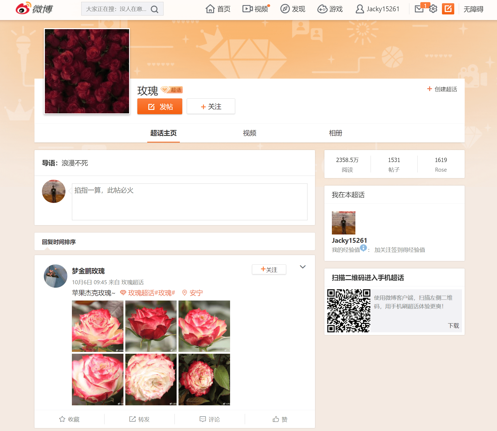

- 找到热爱鲜花的微博大 V 谋求合作

第三步：通过 LangChain 调用 LLM，通过 LLM 的总结整理以及生成功能，根据大 V 的个人信息，写一篇热情洋溢的介绍型文章，谋求与该大 V 的合作。

第四步：把 LangChain 输出解析功能加入进来，让 LLM 生成可以嵌入提示模板的格式化数据结构。

第五步：添加 HTML、CSS，并用 Flask 创建一个 App，在网络上部署及发布这个鲜花电商人脉工具，供市场营销部门的人员使用。

在上面的 5 个步骤中，我们使用到很多 LangChain 技术，包括提示工程、模型、链、代理、输出解析等。

这节课我们先来实现项目的前两个部分。

## 第一步：找到大 V

因为咱们的项目需要用到很多工具，所以我创建了一个项目目录，叫做 socializer_v0（项目每完成一步，我就创建一个新目录，并把版本号加 1）。当第一个步骤“找到大 V”实现之后，项目中的文档结构如下。

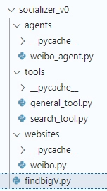

这里，主程序是 findbigV.py。意思就是派程序来作为智能代理，找到喜欢鲜花的微博大 V。

## 主程序 findbigV.py

主程序 findbigV.py 在第一步完成之后，是这样的。

```python
# 设置OpenAI API密钥
import os
os.environ["OPENAI_API_KEY"] = ''
os.environ["SERPAPI_API_KEY"] = ''
# 导入所取的库
import re
from agents.weibo_agent import lookup_V
if __name__ == "__main__":
   # 拿到UID
   response_UID = lookup_V(flower_type = "牡丹" )
   print(response_UID)
   # 抽取UID里面的数字
   UID = re.findall(r'\d+', response_UID)[0]
   print("这位鲜花大V的微博ID是", UID)
```

这里，我们要搜到的，是一个热爱鲜花的大 V 的微博 UID，而不是 URL。

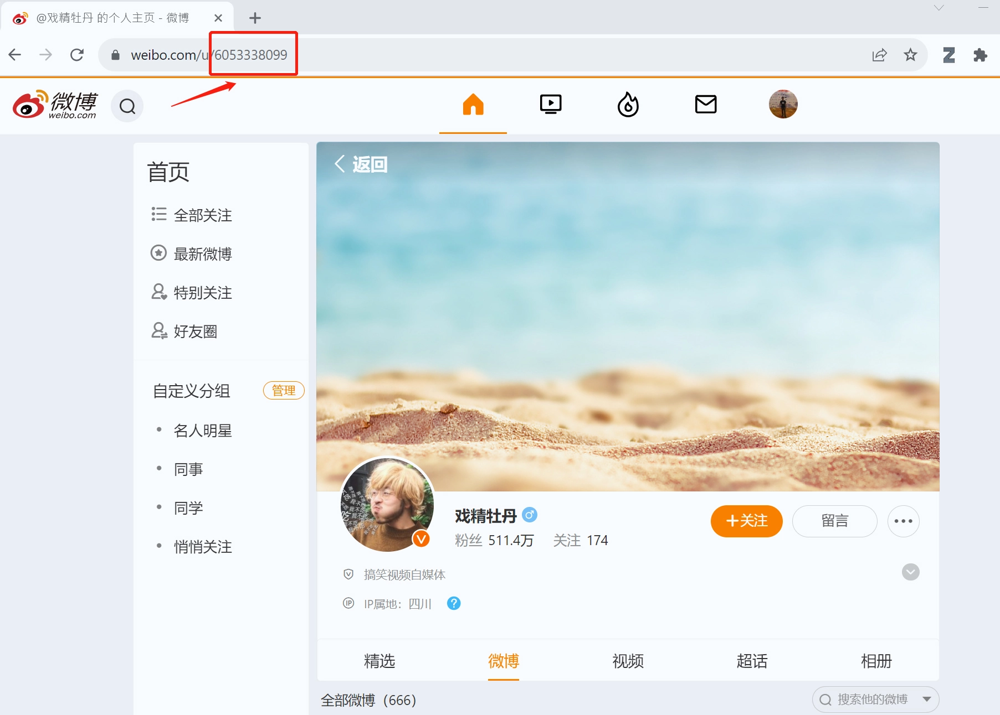

比如，上面这位喜欢牡丹花的大 V，他的 UID 是 6053338099。这些都是公开的信息。

为什么我们希望得到 UID 呢？因为我们可以通过这个 ID，爬取他个人主页里的更多介绍信息，有利于进一步了解他。

### 微博 Agent：查找大 V 的 ID

下面，我们就来看看，文件 agents\weibo_agent.py 中的 lookup_V 函数是如何实现这个搜寻UID 的功能的。

```python
# 导入一个搜索UID的工具
from tools.search_tool import get_UID
# 导入所需的库
from langchain.prompts import PromptTemplate
from langchain.chat_models import ChatOpenAI
from langchain.agents import initialize_agent, Tool
from langchain.agents import AgentType
# 通过LangChain代理找到UID的函数
def lookup_V(flower_type: str) :
   # 初始化大模型
   llm = ChatOpenAI(temperature=0, model_name="gpt-3.5-turbo")
   # 寻找UID的模板
   template = """given the {flower} I want you to get a related 微博 UID.
                 Your answer should contain only a UID.
                 The URL always starts with https://weibo.com/u/
                 for example, if https://weibo.com/u/1669879400 is her 微博, then
                 This is only the example don't give me this, but the actual UID
   # 完整的提示模板
   prompt_template = PromptTemplate(
       input_variables=["flower"], template=template
   )
   # 代理的工具
   tools = [
       Tool(
           name="Crawl Google for 微博 page",
           func=get_UID,
           description="useful for when you need get the 微博 UID",
       )
   ]
   # 初始化代理
   agent = initialize_agent(
       tools,
       llm,
       agent=AgentType.ZERO_SHOT_REACT_DESCRIPTION,
       verbose=True
   )
   # 返回找到的UID
   ID = agent.run(prompt_template.format_prompt(flower=flower_type))
   return ID
```

这段代码的目的，是为了通过提供的花的类型（flower type）来查找与之相关的微博 UID。其中使用了 LangChain 中的代理和工具。

这里有两点需要特别说明：

1. 搜索 UID 的工具通过 from tools.search_tool import get_UID 导入，这个内容后面还会介绍。

2. 下面的提示模板说明，强调了需要的是 UID，而不是 URL。刚才说了，这是因为后续的爬虫工具需要一个特定的 UID，来获取该微博大 V 的个人信息（公开）。然后我们会继续利用这些信息让 LLM 为我们写“勾搭”文案。

```
   # 寻找UID的模板
   template = """given the {flower} I want you to get a related 微博 UID.
                 Your answer should contain only a UID.
                 The URL always starts with https://weibo.com/u/
                 for example, if https://weibo.com/u/1669879400 is her 微博, then
                 This is only the example don't give me this, but the actual UID
```

### 定制的 SerpAPI：getUID

上面的程序只是调用了代理，但是没有给出具体的工具实现。现在我们来继续实现搜索大 V的 UID 的功能。

```
# 导入一个搜索UID的工具
from tools.search_tool import get_UID
```

这个具体的实现，在代码 \tools\search_tool.py 中。

说到通过 LangChain 来搜索微博，相信你会马上想到已经多次使用过的 SerpAPI。我们先来试一试标准的 SerpAPI，看看它能否满足我们的需求。

```python
from langchain.utilities import SerpAPIWrapper
def get_UID(flower: str):
   """Searches for Linkedin or twitter Profile Page."""
   search = SerpAPIWrapper()
   res = search.run(f"{flower}")
   return res
```

写好了这段代码，第一步就可以说是完成了。下面我们跑一遍 findbigV.py，看看程序会给出我们什么样的结果。

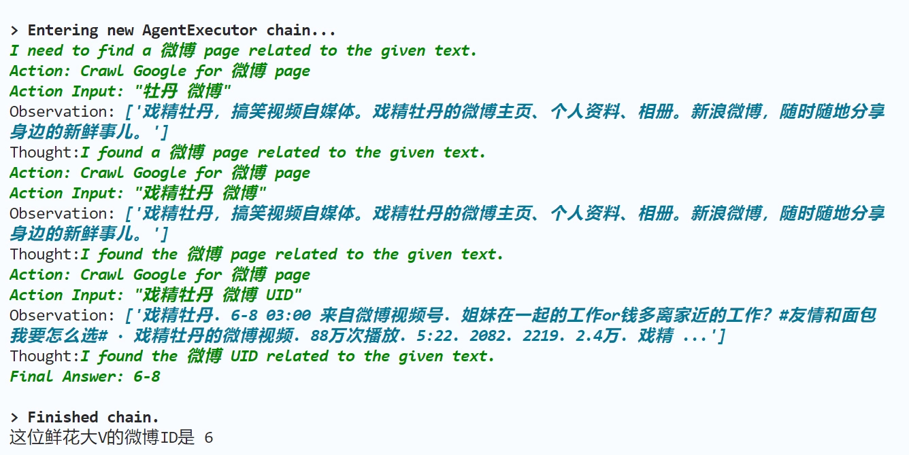

结果还好，不算太失望，SerpAPI 找到了一个貌似喜欢牡丹花的大 V，名叫戏精牡丹，搜到的信息也都是真实的。看起来他蛮适合为我们的牡丹花代言。然而，这个大 V 的微博 ID 肯定不是 6。

中间哪里或许是出了点小问题。

像这样的错误，明显发生在 LangChain 内部，那你的 trouble_shooting 也只能通过 Debug 来解决。这里，我就忽略掉一长串的错误排查过程，直接指出问题的根本原因所在。

让我们把断点设置在 SerpAPIWrapper 类的 _process_response 中。

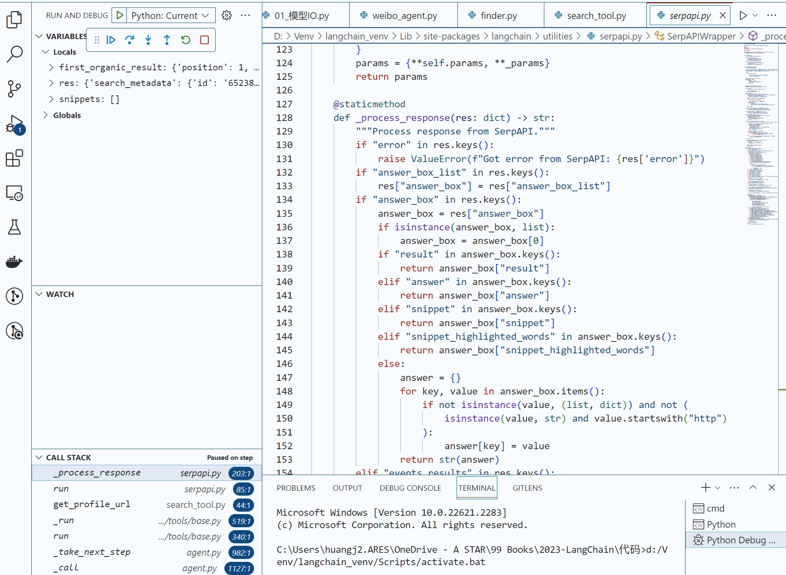

```
当程序进入  if "organic_results" in res.keys() 这段逻辑之后，我发现，它返回
```

的总是一个 snippet（摘要文字），而不是 link（URL）。

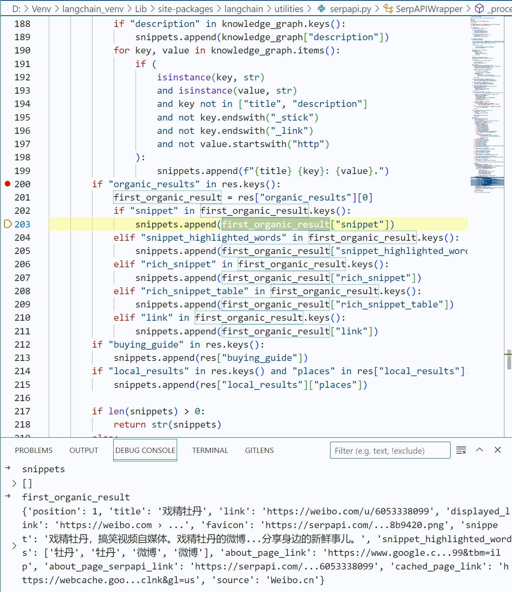

无论这背后的逻辑何在，这并不是我们所想要的。在 Debug 过程中，我们发现，新浪微博的UID，实际上包含在 URL 中，也就是 https://weibo.com/u/6053338099。因此，如果我们不返回微博的简短说明（戏精牡丹，搞笑视频自媒体……），而是返回 URL，会更有利于大模型提炼出 UID。

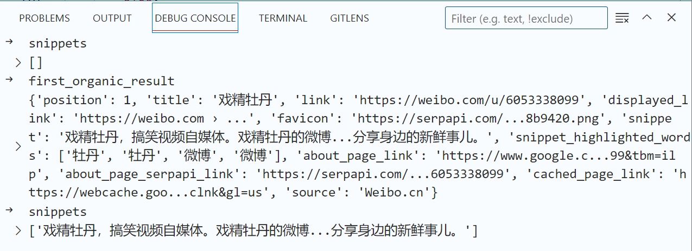

如何做呢？直接修改 LangChain 的 SerpAPIWrapper 类的 _process_response 源代码肯定不是一个好办法。

因此，这里我们可以继承 SerpAPIWrapper 类，并构造一个 CustomSerpAPIWrapper 类，在这个类中，我们重构 _process_response 这个静态方法。

新的 search_tool.py 完整代码如下：

```python
# 导入SerpAPIWrapper
from langchain.utilities import SerpAPIWrapper
# 重新定制SerpAPIWrapper，重构_process_response，返回URL
class CustomSerpAPIWrapper(SerpAPIWrapper):
   def __init__(self):
       super(CustomSerpAPIWrapper, self).__init__()
   @staticmethod
   def _process_response(res: dict) -> str:
       """Process response from SerpAPI."""
       if "error" in res.keys():
           raise ValueError(f"Got error from SerpAPI: {res['error']}")
       if "answer_box_list" in res.keys():
           res["answer_box"] = res["answer_box_list"]
       '''删去很多无关代码'''
       snippets = []
       if "knowledge_graph" in res.keys():
           knowledge_graph = res["knowledge_graph"]
           title = knowledge_graph["title"] if "title" in knowledge_graph else "
           if "description" in knowledge_graph.keys():
               snippets.append(knowledge_graph["description"])
           for key, value in knowledge_graph.items():
               if (
                   isinstance(key, str)
                   and isinstance(value, str)
                   and key not in ["title", "description"]
                   and not key.endswith("_stick")
                   and not key.endswith("_link")
                   and not value.startswith("http")
               ):
                   snippets.append(f"{title} {key}: {value}.")
       if "organic_results" in res.keys():
           first_organic_result = res["organic_results"][0]
           if "snippet" in first_organic_result.keys():
               # 此处是关键修改
               # snippets.append(first_organic_result["snippet"])
               snippets.append(first_organic_result["link"])
           elif "snippet_highlighted_words" in first_organic_result.keys():
               snippets.append(first_organic_result["snippet_highlighted_words"]
           elif "rich_snippet" in first_organic_result.keys():
               snippets.append(first_organic_result["rich_snippet"])
           elif "rich_snippet_table" in first_organic_result.keys():
               snippets.append(first_organic_result["rich_snippet_table"])
           elif "link" in first_organic_result.keys():
               snippets.append(first_organic_result["link"])
       if "buying_guide" in res.keys():
           snippets.append(res["buying_guide"])
       if "local_results" in res.keys() and "places" in res["local_results"].key
           snippets.append(res["local_results"]["places"])
       if len(snippets) > 0:
           return str(snippets)
       else:
           return "No good search result found"
# 获取与某种鲜花相关的微博UID的函数
def get_UID(flower: str):
   """Searches for Linkedin or twitter Profile Page."""
   # search = SerpAPIWrapper()
   search = CustomSerpAPIWrapper()
   res = search.run(f"{flower}")
   return res
```

唯一的区别就是，我们在下面的逻辑中返回了 link，而不是 snippet。

```
       if "organic_results" in res.keys():
           first_organic_result = res["organic_results"][0]
           if "snippet" in first_organic_result.keys():
               # snippets.append(first_organic_result["snippet"])
               snippets.append(first_organic_result["link"])
```

再次 Debug，我们发现返回的 snippets 里面包含了 URL 信息，其中 UID 信息包含在 URL 中了。

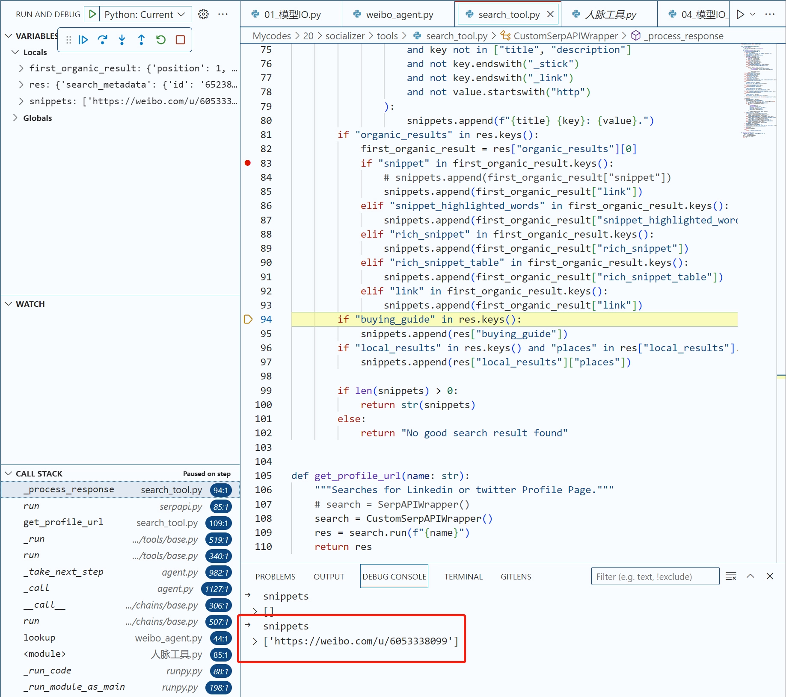

此时运行主程序 findbigV.py，会发现代理中返回了 URL 信息，并且经过进一步思考，提炼出了 UID。

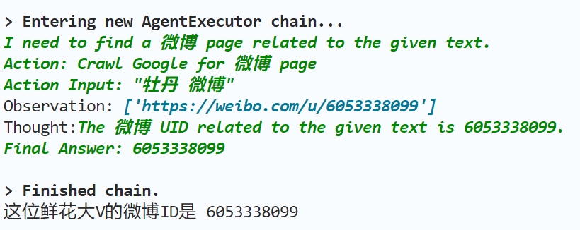

- 成功得到了大 V 的 UID

## 第二步：爬取大 V 资料

好的，第一步虽然是有磕有绊，但是经过了调整的 CustomSerpAPIWrapper 工具和代理，在LLM 的帮助之下，总算是不辱使命，完成了找到 UID 的任务。

这位大 V，看起来又喜欢牡丹，又喜欢搞笑。我们很想和他联络一下，也许他很适合为我们的牡丹花品牌代言。（到底是否适合，不必特别认真哈，总之搜索“牡丹”，Agent 给了这个 ID，就可以了。咱学的是 LangChain，不是真的要找他代言）

不过，知己知彼，百战不殆。想要和他沟通，就得了解他更多。下面，我们将使用爬虫程序，通过 UID 来爬取他的更多信息。

### 主程序 findbigV.py

第二步完成之后，主程序代码如下：

```python
# 设置OpenAI API密钥
import os
os.environ["OPENAI_API_KEY"] = 'Your OpenAI API Key'
os.environ["SERPAPI_API_KEY"] = 'Your SerpAPI Key'
# 导入所取的库
import re
from agents.weibo_agent import lookup_V
from tools.general_tool import remove_non_chinese_fields
from tools.scraping_tool import get_data
if __name__ == "__main__":
   # 拿到UID
   response_UID = lookup_V(flower_type = "牡丹" )
   # 抽取UID里面的数字
   UID = re.findall(r'\d+', response_UID)[0]
   print("这位鲜花大V的微博ID是", UID)
   # 根据UID爬取大V信息
   person_info = get_data(UID)
print(person info)
```

从第一步到第二步，我们主要是完成了一次微博信息的爬取。

### scraping_tool.py 中的 scrape_weibo 方法

第二步中的关键逻辑是 scraping_tool.py 中的 scrape_weibo 方法，具体代码如下：

```python
# 导入所需的库
import json
import requests
import time
# 定义爬取微博用户信息的函数
def scrape_weibo(url: str):
   '''爬取相关鲜花服务商的资料'''
   headers = {
       "User-Agent": "Mozilla/5.0 (Windows NT 10.0; Win64; x64) AppleWebKit/537.
       "Referer": "https://weibo.com"
   }
   cookies = {
       "cookie": '''SINAGLOBAL=3762226753815.13.1696496172299; ALF=1699182321; S
   }
   response = requests.get(url, headers=headers, cookies=cookies)
   time.sleep(3)   # 加上3s 的延时防止被反爬
   return response.text
# 根据UID构建URL爬取信息
def get_data(id):
   url = "https://weibo.com/ajax/profile/detail?uid={}".format(id)
   html = scrape_weibo(url)
   response = json.loads(html)
   return response
```

我这段爬虫代码特别简洁，不需要过多的解释，唯一需要说明的部分是怎么找到你自己的Cookies。

- Cookie 是由服务器发送到用户浏览器的一小段数据，并可能在随后的请求中被回传。它的主要目的是让服务器知道用户的上下文信息或状态。在 Web 爬虫中，使用正确的 Cookie可以模拟登录状态，从而获取到需要权限的网页内容。

首先，我是用 QQ ID 登录的微博，我发现通过这样的方式找到的 Cookie 能用得比较久。

然后，从我的浏览器中获取 Cookie，以下是简单步骤：

1. 使用浏览器（如 Chrome、Firefox）访问微博并登录。

2. 登录后，右键单击页面并选择“检查”（Inspect）。

3. 打开开发者工具，点击 Network 选项卡。

4. 在页面上进行一些操作（如刷新页面），然后在 Network 选项卡下查看请求列表。

5. 选择任一请求项，然后在右侧的 Headers 选项卡中查找 Request Headers 部分。

6. 在这部分中，你应该可以看到一个名为 Cookie 的字段，这就是你需要的 Cookie 值。

```
将获取到的完整 Cookie 值复制（挺长的），并替换上述代码中的 "你的Cookie" 部分。
```

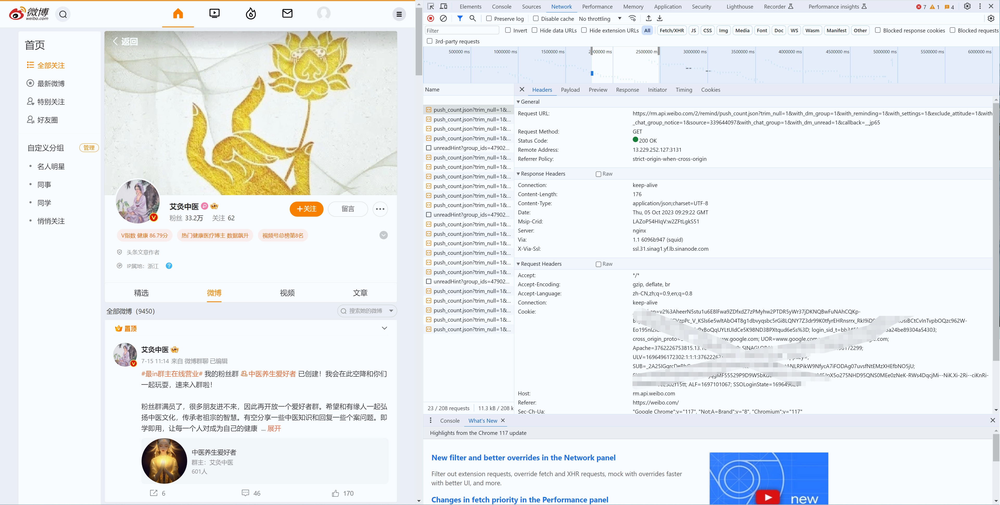

- 但请注意，微博的 Cookie 可能有过期时间，所以如果你发现一段时间后你的爬虫无法正常工作，你可能需要再次获取新的 Cookie。同时，频繁地爬取或大量请求可能会导致你的账号被封禁，所以请谨慎使用爬虫。

此时，运行 findbigV.py，就得到了下面的输出。

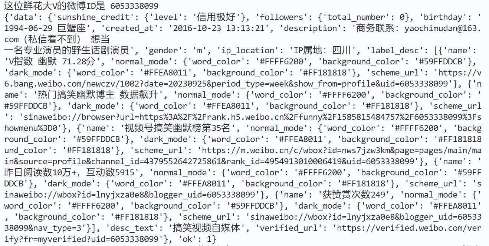

### 精简爬取输出

```
最后一个步骤，是精简上面的输出，因为类似 'word_color': '#FFEA8011',
'background_color': '#FF181818' 这样的内容会占据很多 Token 空间，而且对于
```

LLM 总结整理信息，也没啥作用。

因此，我创建了一个额外的步骤，就是\tools\general_tool.py 中的remove_non_chinese_fields 函数。

```python
import re
def contains_chinese(s):
   return bool(re.search('[\u4e00-\u9fa5]', s))
def remove_non_chinese_fields(d):
   if isinstance(d, dict):
       to_remove = [key for key, value in d.items() if isinstance(value, (str, i
       for key in to_remove:
           del d[key]
       for key, value in d.items():
           if isinstance(value, (dict, list)):
               remove_non_chinese_fields(value)
   elif isinstance(d, list):
       to_remove_indices = []
       for i, item in enumerate(d):
           if isinstance(item, (str, int, float, bool)) and (not contains_chines
               to_remove_indices.append(i)
           else:
               remove_non_chinese_fields(item)
       for index in reversed(to_remove_indices):
           d.pop(index)
```

在 findbigV.py 中，调用这个函数，对爬虫的输出结果进行了精简。

```
   # 移除无用的信息
   remove_non_chinese_fields(person_info)
   print(person_info)
```

重新运行 findbigV.py，结果如下：

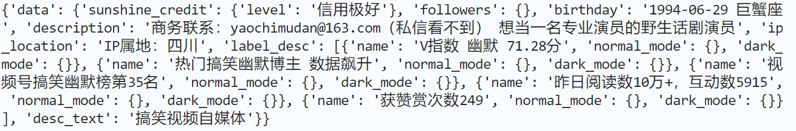

此时，爬取的内容就只剩下了干货。

## 总结时刻

这节课我们完成了前两步的工作。分别是，找到适合推广某种鲜花的大 V 的微博 UID，并且爬取了大 V 的资料。这为我们后续生成文本、进一步链接大 V 打下了良好的基础。

其中，我们用到了大量之前学习过的 LangChain 组件，具体包括：

1. 用提示模板告诉大模型我们要找到内容（UID）。

2. 调用 LLM。

3. 使用 Chain。

4. 使用 Agent。

5. 在 Agent 中，我们使用了一个 Customized Tool，因为 LangChain 内置的 SerpAPI Tool 不能完全满足我们的需要。这给了我们一个好机会创建自己的“私人定制” Tool。

在下节课中，我们还要继续利用大模型的总结文本、生成文本的功能，来为我们撰写能够打动大 V 和咱易速鲜花合作的文案，我们还将利用 Output Parser 把文案解析成需要的格式，部署到网络服务器端。敬请期待！

## 思考题

1. 如果 Agent 不返回 UID，而是返回 URL，是不是也能够完成这个任务？你可以尝试重构提示模板以及后续逻辑，返回 URL，然后手动从 URL 中解析出 UID。

2. 研究一下 SerpAPIWrapper 类的 _process_response 中的代码，看看这个方法具体是怎么设计的，用来实现了什么功能？

期待在留言区看到你的分享，如果觉得内容对你有帮助，也欢迎分享给有需要的朋友！
