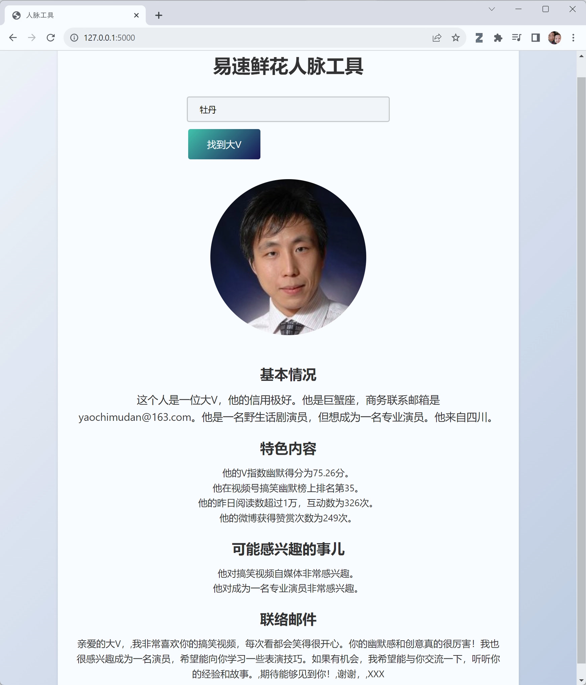
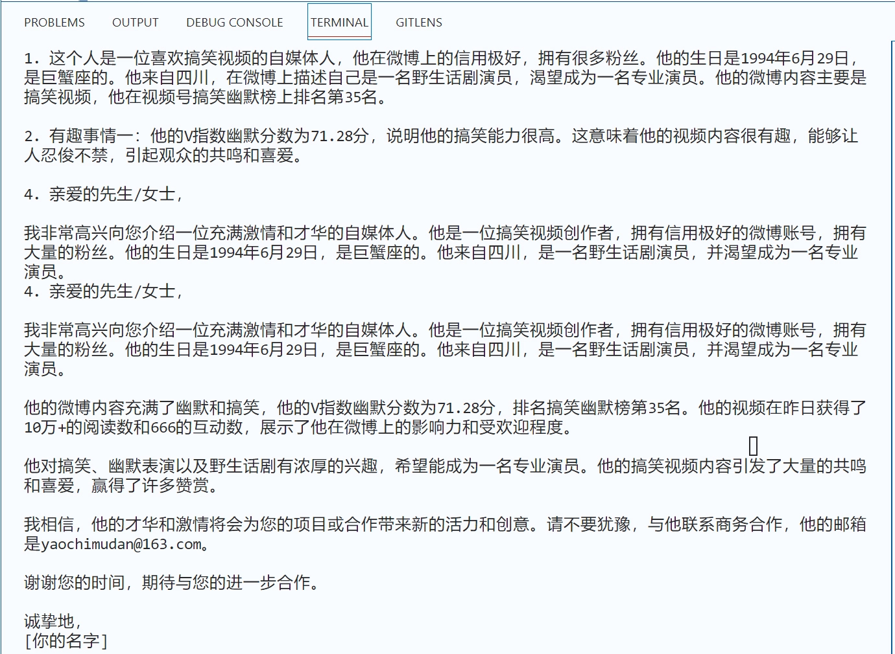
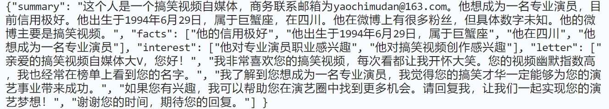
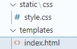
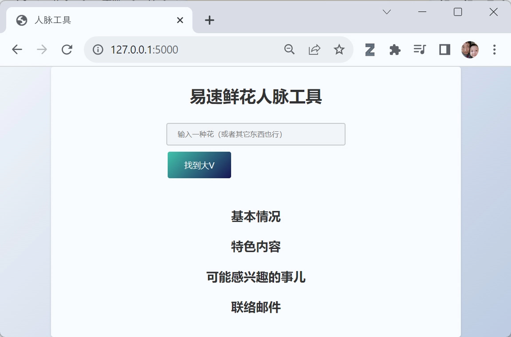
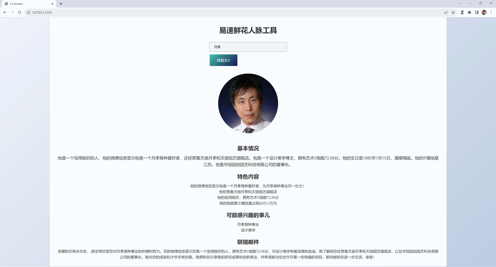
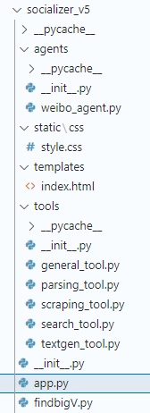
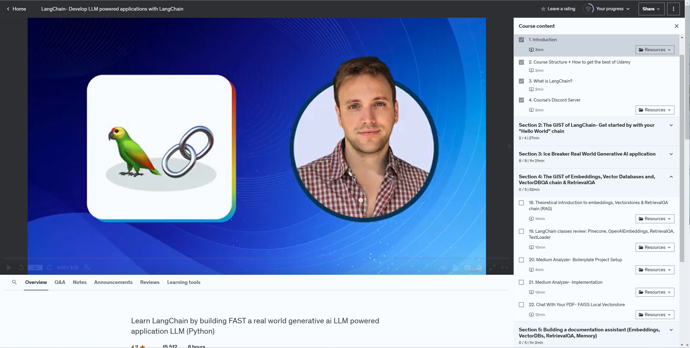

# 21 | 部署一个鲜花网络电商的人脉工具（下）

你好，我是黄佳，欢迎来到 LangChain 实战课！

在上节课中，我们通过 LangChain，找到了适合为某一类鲜花做推广的微博大 V，并且爬取了他的信息。下面，我带着你继续完成易速鲜花电商人脉工具的后续部分。

## 项目步骤复习

先复习一下项目实现过程的五个具体步骤。

第一步：通过 LangChain 的搜索工具，以模糊搜索的方式，帮助运营人员找到微博中有可能对相关鲜花推广感兴趣的大 V（比如喜欢牡丹花的大 V），并返回 UID。

第二步：根据微博 UID，通过爬虫工具拿到相关大 V 的微博公开信息，并以 JSON 格式返回大 V 的数据。

第三步：通过 LangChain 调用 LLM，通过信息整合以及文本生成功能，根据大 V 的个人信息，写一篇热情洋溢的介绍型文章，谋求与该大 V 的合作。

第四步：把 LangChain 输出解析功能加入进来，让 LLM 生成可以嵌入提示模板的格式化数据结构。

第五步：添加 HTML、CSS，并用 Flask 创建一个 App，在网络上部署及发布这个鲜花电商人脉工具，供市场营销部门的人员使用。



- 人脉工具成品

## 第三步：生成介绍文章

下面我们开始第三个步骤，把步骤二中返回的 JSON 数据（大 V 的个人简介）传递给 LLM，发挥大模型超强的总结整理和文本生成能力，帮助运营人员创建文案。

这个文案可以有很多种形式，比如说可以总结一下大 V 的特点，根据他的自我介绍猜测一下他的兴趣爱好，还可以让 LLM 帮助运营人员撰写一篇联络信件的草稿。

这就看我们如何设计提示模板了。

重构之后的 findbigV.py 代码如下：

```python
# 设置OpenAI API密钥
import os
os.environ["OPENAI_API_KEY"] = 'Your OpenAI Key'
os.environ["SERPAPI_API_KEY"] = 'Your SerpAPI Key'
# 导入所取的库
import re
from agents.weibo_agent import lookup_V
from tools.general_tool import remove_non_chinese_fields
from tools.scraping_tool import get_data
from langchain.prompts import PromptTemplate
from langchain.chat_models import ChatOpenAI
from langchain.chains import LLMChain
if __name__ == "__main__":
   # 拿到UID
   response_UID = lookup_V(flower_type = "牡丹" )
   # 抽取UID里面的数字
   UID = re.findall(r'\d+', response_UID)[0]
   print("这位鲜花大V的微博ID是", UID)
   # 根据UID爬取大V信息
   person_info = get_data(UID)
   print(person_info)
   # 移除无用的信息
   remove_non_chinese_fields(person_info)
   print(person_info)
   # 设计提示模板
   letter_template = """
        下面是这个人的微博信息 {information}
        请你帮我:
        1. 写一个简单的总结
        2. 挑两件有趣的事情说一说
        3. 找一些他比较感兴趣的事情
        4. 写一篇热情洋溢的介绍信
    """
   prompt_template = PromptTemplate(
       input_variables=["information"],
       template=letter_template
   )
   # 初始化大模型
   llm = ChatOpenAI(model_name="gpt-3.5-turbo")
   # 初始化链
   chain = LLMChain(llm=llm, prompt=prompt_template)
   # 生成文案
   result = chain.run(information = person_info)
   print(result)
```

运行程序之后，LLM 没有让我们失望，给出了相当专业的文案。



下面我整理一下程序，把生成文案的功能放在 \tools\textgen_tool.py 中，定义为generate_letter 函数。这样主程序显得比较清爽。

新的 findbigV.py 代码如下：

```python
# 导入所取的库
import re
from agents.weibo_agent import lookup_V
from tools.general_tool import remove_non_chinese_fields
from tools.scraping_tool import get_data
from tools.textgen_tool import generate_letter
if __name__ == "__main__":
   # 拿到UID
   response_UID = lookup_V(flower_type = "牡丹" )
   # 抽取UID里面的数字
   UID = re.findall(r'\d+', response_UID)[0]
   print("这位鲜花大V的微博ID是", UID)
   # 根据UID爬取大V信息
   person_info = get_data(UID)
   print(person_info)
   # 移除无用的信息
   remove_non_chinese_fields(person_info)
   print(person_info)
   # 调用函数根据大V信息生成文本
   result = generate_letter(information = person_info)
   print(result)
```

## 第四步：加入输出解析

上面的文案已经非常到位，但是你需要把文字 Copy Paste 出来才能够使用。下面，我们要通过 LangChain 的输出解析器一步到位，让 LLM 给我们生成有良好结构的 JSON 文档，便于下一步集成到 HTML 中进行展示。

在 tools 文件夹中，新建一个 tools\ParsingTool.py 文件。

```python
# 导入所需的类
from langchain.output_parsers import PydanticOutputParser
from pydantic import BaseModel, Field
from typing import List
# 定义一个名为TextParsing的模型，描述了如何解析大V信息
class TextParsing(BaseModel):
   summary: str = Field(description="大V个人简介")  # 大V的简介或背景信息
   facts: List[str] = Field(description="大V的特点")  # 大V的一些显著特点或者事实
   interest: List[str] = Field(description="这个大V可能感兴趣的事情")  # 大V可能感兴趣
   letter: List[str] = Field(description="一篇联络这个大V的邮件")  # 联络大V的建议邮件
   # 将模型对象转换为字典
   def to_dict(self):
       return {
           "summary": self.summary,
           "facts": self.facts,
           "interest": self.interest,
           "letter": self.letter,
       }
# 创建一个基于Pydantic模型的解析器，用于将文本输出解析为特定的结构
letter_parser: PydanticOutputParser = PydanticOutputParser(
   pydantic_object=TextParsing
)
```

此处，TextParsing 是一个用 Pydantic 定义的数据模型，描述了一个大 V 的个人信息如何被解析和组织。该模型包含四个字段：summary（简介）、facts（事实）、interest（兴趣）、letter（信件）。而 to_dict 是一个实例方法，它可以将该模型的实例转换为一个字典。最后，我们创建了一个 PydanticOutputParser 对象，该对象基于 TextParsing 模型，可以被用来解析一段文本并填充到这个数据模型中。

然后，我们更新 \tools\textgen_tool.py 文件。

```python
# 导入所需要的库
from langchain.prompts import PromptTemplate
from langchain.chat_models import ChatOpenAI
from langchain.chains import LLMChain
from tools.parsing_tool import letter_parser
# 生成文案的函数
def generate_letter(information):
   # 设计提示模板
   letter_template = """
        下面是这个人的微博信息 {information}
        请你帮我:
        1. 写一个简单的总结
        2. 挑两件有趣的特点说一说
        3. 找一些他比较感兴趣的事情
        4. 写一篇热情洋溢的介绍信
        \n{format_instructions}"""
   prompt_template = PromptTemplate(
       input_variables=["information"],
       template=letter_template,
       partial_variables={
           "format_instructions": letter_parser.get_format_instructions()
       },
   )
   # 初始化大模型
   llm = ChatOpenAI(model_name="gpt-3.5-turbo")
   # 初始化链
   chain = LLMChain(llm=llm, prompt=prompt_template)
   # 生成文案
   result = chain.run(information = information)
   return result
```

通过 {format_instructions} 和 partial_variables 参数，我们利用输出解析器增强了这个提示模板，让 LLM 直接返回我们所需要的格式。

重新运行 findbigV.py，可以看到，输出已经被解析为标准的 JSON 格式。



不过，此时的文案似乎和鲜花运营缺少了一些关联，你可以尝试着调整提示模板中的内容，让这封信写得更加贴合我们鲜花运营的具体意图。

## 第五步：部署人脉工具

好啦，到目前为止，这个人脉工具的所有功能都已经完善。我们利用 LangChain 自动做了好多事。

下面，我们就制作一个前端页面，同时把这个工具部署到服务器上面去，让我们的运营人员能够随时访问它。

### HTML 文件

首先，创建一个 HTML 文件，用于交互展示，这个文件放在 templates 目录下。

```xml
<!-- templates/index.html -->
<!DOCTYPE html>
<html lang="en">
<head>
   <meta charset="UTF-8">
   <meta name="viewport" content="width=device-width, initial-scale=1.0">
   <link rel="stylesheet" href="{{ url_for('static', filename='css/style.css') }
   <script src="https://code.jquery.com/jquery-3.6.0.min.js"></script>
   <title>Ice Breaker</title>
   <link rel="stylesheet" href="https://cdnjs.cloudflare.com/ajax/libs/font-awes
   <div class="spinner-container" id="spinner-container" style="display: none;">
       <i id="loading-spinner" class="fas fa-spinner fa-spin"></i>
   </div>
</head>
<body>
   <div class="container">
       <h1>易速鲜花人脉工具</h1>
       <form id="name-form">
           <input type="text" id="flower" name="flower" placeholder="输入一种花（或
           <button id="magic-button" type="submit">找到大V</button>
       </form>
       <div id="result">
           基本情况</h2>
           <p id="summary"></p>
           <h2>特色内容</h2>
           <div id="facts"></div>
           <h2>可能感兴趣的事儿</h2>
           <div id="interest"></div>
           <h2>联络邮件</h2>
           <div id="letter"></div>
       </div>
   </div>
   <script>
       $(document).ready(function () {
           $('#name-form').on('submit', function (e) {
               e.preventDefault();
               $('#spinner-container').show();
               $.ajax({
                   url: '/process',
                   data: $('#name-form').serialize(),
                   type: 'POST',
                   success: function (response) {
                       $('#profile-pic').attr('src', '你的URL');
                       $('#profile-pic').show();
                       $('#summary').text(response.summary);
                       $('#facts').html('<ul>' + response.facts.map(fact => '<li
                       $('#interest').html('<ul>' + response.interest.map(intere
                       $('#letter').text(response.letter);
                   },
                   error: function (error) {
                       console.log(error);
                   },
                   complete: function () {
                       $('#spinner-container').hide();
                   }
               });
           });
       });
   </script>
</body>
</html>
```

### CSS 文件

为了让 HTML 美一点，我们还制作了一个 CSS 文件 style.css，放在 \static\css\ 目录下。



这个文件就请你去咱们的 GitHub Repo 下载，我就不在这儿展示了。

### 重构 findbigV.py

下一步是重构 findbigV.py，把功能封装到一个函数中。

```python
def find_bigV(flower: str) :
   # 拿到UID
   response_UID = lookup_V(flower_type = flower )
   # 抽取UID里面的数字
   UID = re.findall(r'\d+', response_UID)[0]
   print("这位鲜花大V的微博ID是", UID)
   # 根据UID爬取大V信息
   person_info = get_data(UID)
   print(person_info)
   # 移除无用的信息
   remove_non_chinese_fields(person_info)
   print(person_info)
   # 调用函数根据大V信息生成文本
   result = generate_letter(information = person_info)
   print(result)
   return result
```

### 创建 app.py

下面，我们创建一个基于 Flask 的 Web 应用，主要用于显示一个输入表单，供大家提交花的名称，并返回市场营销人员所需要的内容，在网页中展示。

```python
# 导入所需的库和模块
from flask import Flask, render_template, request, jsonify
from findbigV import find_bigV
import json
# 实例化Flask应用
app = Flask(__name__)
# 主页路由，返回index.html模板
@app.route("/")
def index():
   return render_template("index.html")
# 处理请求的路由，仅允许POST请求
@app.route("/process", methods=["POST"])
def process():
   # 获取提交的花的名称
   flower = request.form["flower"]
   # 使用find_bigV函数获取相关数据
   response_str = find_bigV(flower=flower)
   # 使用json.loads将字符串解析为字典
   response = json.loads(response_str)
   # 返回数据的json响应
   return jsonify(
       {
           "summary": response["summary"],
           "facts": response["facts"],
           "interest": response["interest"],
           "letter": response["letter"],
       }
   )
# 判断是否是主程序运行，并设置Flask应用的host和debug模式
if __name__ == "__main__":
   app.run(host="0.0.0.0", debug=True)
```

程序非常简单，简单介绍下。

1. 导入库和模块：这部分导入了 Flask 框架的相关模块，以及 find_bigV 函数和 JSON 库。

2. 创建了一个 Flask 应用实例。

3. 定义主页路由：当用户访问这个路由时，它将返回一个叫 index.html 的模板。

4. 定义处理请求的路由：这是一个专门处理 POST 请求的路由。其流程如下：

```
从表单数据中获取名为 "flower" 的字段
```

- 使用 find_bigV 函数查询与该花名相关的数据

- 解析返回的数据（字符串格式）为 Python 字典

- 将这些数据整理并返回为 JSON 格式的响应

5. 启动 Flask 应用，监听所有公开的 IP 地址，并在调试模式中运行。

这样，我们就真正大功告成了，系统上线，运营人员可以在网页中调用我们的产品了。

运行 App 程序，就看到了这个人脉工具。



刚才我一直用牡丹花进行测试，下面使用月季花进行测试，看看能否找出月季花的爱好者。



不辱使命，天狼月季和天狼园艺旗舰店老板，华冠园创园艺科技有限公司的董事长，被我们的大 V 搜索器发现。我相信，和他联络并且建立合作关系，能够大大拓展易速鲜花的花卉事业。

有了人脉搜索工具，我对自己的事业充满了进一步的期待！你呢？

## 总结时刻

项目完成了！整体程序结构如下：



说老实话，这是一个创意和创造力兼备的 Project，没有 LangChain，很难想象用这么简单的方式，在这么短的时间内，就可以构建出这么有特色的项目。

此处，我们一块复习了 LangChain 中的链、代理、工具（特别是标准工具不灵光时，自定义了新工具）、LLM 的文本摘要和生成功能、提示模板、输出解析。可以说，这个项目把前面讲的几乎所有最重要的 LangChain 模块都贯串起来了。

在这里，我要感谢 Eden Marco 先生，这个人脉项目的设计（注意：只是这个项目，可不是整个专栏的课程设计），受到了他的启发（Udemy 课程《Learn LangChain by building FAST areal world generative ai LLM powered application LLM (Python)，Section 3》），并在他的程序架构上进行了大刀阔斧的扩充优化。创意部分，不敢掠美，特此说明。



你可以把这个项目当作一次复习，也可以把它当作一个启发，开发出属于你的、更有创意的程序。

## 思考题

1. 修改提示模板，让 LLM 为你生成更多更有创意、业务上更实用的文案。

2. 试试爬取其他网站（比如豆瓣）上的公开数据，制作更全面的人脉工具。

3. 你或许已经发现，我的这个程序不够鲁棒。这里，我用了牡丹、月季进行了测试，程序都找到了相关的 UID，但是当我使用其他一些花的时候，比如玫瑰、野菊花，会出现各种各样的错误。你能否修改程序（比如提示模板、输出解析、整体结构），让程序更健壮？

期待在留言区看到你的成果分享，如果觉得内容对你有帮助，也欢迎分享给有需要的朋友！
