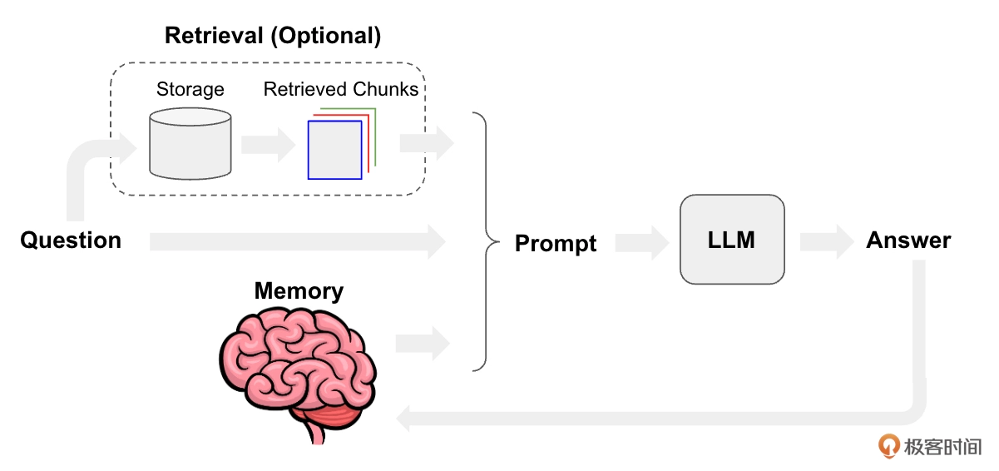
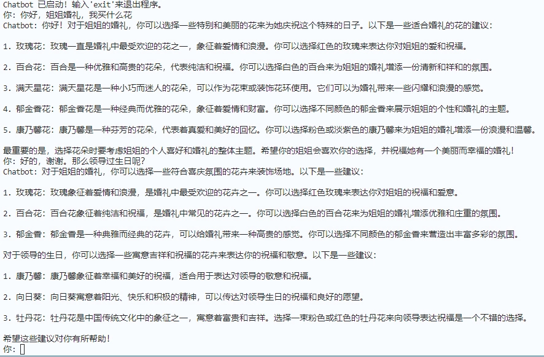
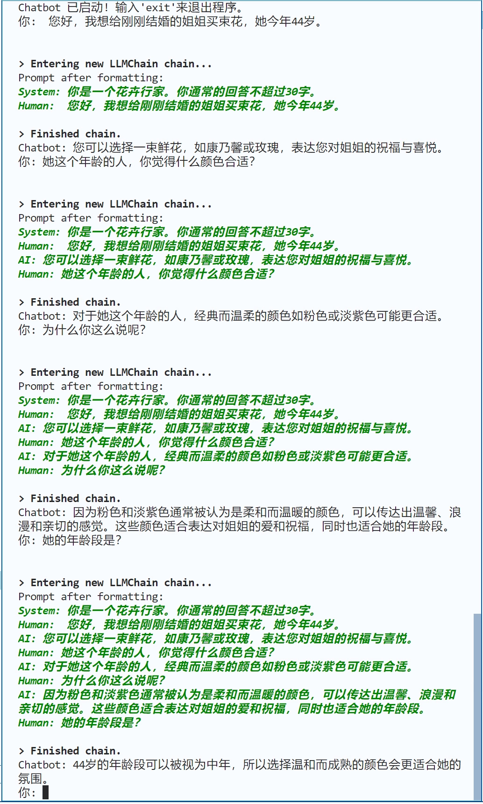
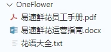
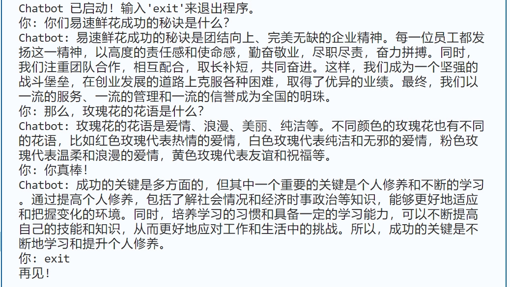

# 22 | 易速鲜花聊天客服机器人的开发（上）

你好，我是黄佳，欢迎来到 LangChain 实战课！

上节课，咱们的易速鲜花人脉工具成功上线。市场部的朋友们用了都说好。

这节课，我们继续为易速鲜花市场部、销售部和客服部门的员工，以及易速鲜花的广大用户来开发一个聊天机器人。

## “聊天机器人”项目说明

聊天机器人（Chatbot）是 LLM 和 LangChain 的核心用例之一，很多人学习大语言模型，学习 LangChain，就是为了开发出更好的、更能理解用户意图的聊天机器人。聊天机器人的核心特征是，它们可以进行长时间的对话并访问用户想要了解的信息。



如图所示，聊天机器人设计过程中的核心组件包括：

- 聊天模型：这是对话的基础，它更偏向于自然的对话风格。你可以参考 LangChain 相关文档中所支持的聊天模型的列表。尽管大模型（LLM）也可以应用于聊天机器人，但专用的聊天模型（Chat Model）更适合对话场景。

- 提示模板：帮助你整合默认消息、用户输入、历史交互以及检索时需要的上下文。

- 记忆：它允许机器人记住与用户之间的先前互动，增强对话连贯性。

- 检索器：这是一个可选组件，特别适合那些需要提供特定领域知识的机器人。

整体来说，聊天机器人的关键在于其记忆和检索能力，记忆使聊天机器人能够记住过去的交互，而检索则为聊天机器人提供最新的、特定于领域的信息。

## 项目的技术实现细节

在这个聊天机器人的实现过程中，我们将遵循敏捷开发的原则。先集中精力开发一个基础版本的机器人，实现最核心的功能，比如说能够聊天就可以了。然后，再逐步加入更多的功能，例如，能够基于易速鲜花的企业知识库进行检索，比如，用户可以输入订单号来查询订单状态，或询问如何退货等常见问题。

这个项目的具体技术实现步骤，这里简述一下。

第一步：通过 LangChain 的 ConversationChain，实现一个最基本的聊天对话工具。

第二步：通过 LangChain 中的记忆功能，让这个聊天机器人能够记住用户之前所说的话。

第三步：通过 LangChain 中的检索功能，整合易速鲜花的内部文档资料，让聊天机器人不仅能够基于自己的知识，还可以基于易速鲜花的业务流程，给出专业的回答。

第四步（可选）：通过 LangChain 中的数据库查询功能，让用户可以输入订单号来查询订单状态，或者看看有没有存货等等。

第五步：在网络上部署及发布这个聊天机器人，供企业内部员工和易速鲜花用户使用。

在上面的 5 个步骤中，我们使用到了很多 LangChain 技术，包括提示工程、模型、链、代理、RAG、数据库检索等。

这节课我们先来实现项目的前三个步骤，第四个步骤我会留给你作为思考题，你可以复习并参考第 16 讲中的内容来实现它。在下节课中，我将为你介绍两个 AI 网络 UI 框架，Streamlit和 Gradio，利用这两个框架，你可以轻松地把你的 AI 应用部署到网络中。

## 第一步：开发最基本的聊天机器人

让我们先来用 LangChain 打造出一个最简单的聊天机器人。

```python
# 设置OpenAI API密钥
import os
os.environ["OPENAI_API_KEY"] = 'Your OpenAI Key'
# 导入所需的库和模块
from langchain.schema import (
   HumanMessage,
   SystemMessage
)
from langchain.chat_models import ChatOpenAI
# 创建一个聊天模型的实例
chat = ChatOpenAI()
# 创建一个消息列表
messages = [
   SystemMessage(content="你是一个花卉行家。"),
   HumanMessage(content="朋友喜欢淡雅的颜色，她的婚礼我选择什么花？")
]
# 使用聊天模型获取响应
response = chat(messages)
print(response)
```

运行程序，输出如下：

```
content='对于喜欢淡雅的颜色的婚礼，你可以选择以下花卉：\n\n1. 白色玫瑰：白色玫瑰象征纯洁和爱情
```

下面，我把它重构一下，让 Chatbot 能够和我们循环地进行对话。

```python
# 设置OpenAI API密钥
import os
os.environ["OPENAI_API_KEY"] = 'Your OpenAI Key'
# 导入所需的库和模块
from langchain.schema import HumanMessage, SystemMessage
from langchain.chat_models import ChatOpenAI
# 定义一个命令行聊天机器人的类
class CommandlineChatbot:
   # 在初始化时，设置花卉行家的角色并初始化聊天模型
   def __init__(self):
       self.chat = ChatOpenAI()
       self.messages = [SystemMessage(content="你是一个花卉行家。")]
   # 定义一个循环来持续与用户交互
   def chat_loop(self):
       print("Chatbot 已启动! 输入'exit'来退出程序。")
       while True:
           user_input = input("你: ")
           # 如果用户输入“exit”，则退出循环
           if user_input.lower() == 'exit':
               print("再见!")
               break
           # 将用户的输入添加到消息列表中，并获取机器人的响应
           self.messages.append(HumanMessage(content=user_input))
           response = self.chat(self.messages)
           print(f"Chatbot: {response.content}")
# 如果直接运行这个脚本，启动聊天机器人
if __name__ == "__main__":
   bot = CommandlineChatbot()
   bot.chat_loop()
```

运行程序后，你可以一直和这个 Bot 聊天，直到你聊够了，输入 exit，它会和你说再见。



好的，一个简单的聊天机器人已经搭建好了，不过，这个聊天机器人没有记忆功能，它不会记得你之前说过的话。

下面，我们要通过记忆机制，把它改造成一个能记住话的 Chatbot。

## 第二步：增加记忆机制

下面，我们来通过 ConversationBufferMemory 给 Chatbot 增加记忆。具体代码如下：

```python
# 设置OpenAI API密钥
import os
os.environ["OPENAI_API_KEY"] = 'Your OpenAI Key'
# 导入所需的库和模块
from langchain.schema import HumanMessage, SystemMessage
from langchain.memory import ConversationBufferMemory
from langchain.prompts import (
   ChatPromptTemplate,
   MessagesPlaceholder,
   SystemMessagePromptTemplate,
   HumanMessagePromptTemplate,
)
from langchain.chains import LLMChain
from langchain.chat_models import ChatOpenAI
# 设置OpenAI API密钥
os.environ["OPENAI_API_KEY"] = 'Your OpenAI Key'
# 带记忆的聊天机器人类
class ChatbotWithMemory:
   def __init__(self):
       # 初始化LLM
       self.llm = ChatOpenAI()
       # 初始化Prompt
       self.prompt = ChatPromptTemplate(
           messages=[
               SystemMessagePromptTemplate.from_template(
                   "你是一个花卉行家。你通常的回答不超过30字。"
               ),
               MessagesPlaceholder(variable_name="chat_history"),
               HumanMessagePromptTemplate.from_template("{question}")
           ]
       )
       # 初始化Memory
       self.memory = ConversationBufferMemory(memory_key="chat_history", return_
       # 初始化LLMChain with LLM, prompt and memory
       self.conversation = LLMChain(
           llm=self.llm,
           prompt=self.prompt,
           verbose=True,
           memory=self.memory
       )
   # 与机器人交互的函数
   def chat_loop(self):
       print("Chatbot 已启动! 输入'exit'来退出程序。")
       while True:
           user_input = input("你: ")
           if user_input.lower() == 'exit':
               print("再见!")
               break
           response = self.conversation({"question": user_input})
           print(f"Chatbot: {response['text']}")
if __name__ == "__main__":
   # 启动Chatbot
   bot = ChatbotWithMemory()
   bot.chat_loop()
```

程序的核心是 ChatbotWithMemory 类，这是一个带有记忆功能的聊天机器人类。在这个类的初始化函数中，定义了一个对话缓冲区记忆，它会跟踪对话历史。在 LLMChain 被创建时，就整合了 LLM、提示和记忆，形成完整的对话链。



你看，我们的 Chatbot 成功地复述出了我好几轮之前传递给它的关键信息，也就是我的姐姐已经 44 岁了。她的推荐是基于这个原则来进行的。

## 第三步：增加检索机制

下面，继续增强 Chatbot 的功能，我们要把易速鲜花的内部文档信息嵌入到大模型的知识库中。让它成为一个拥有“易速鲜花”价值观的 Super 客服。



上图中的易速鲜花内部价值观，如果你感到陌生的话，可以复习一下第 2 讲的内容。

```python
# 导入所需的库
import os
from langchain.text_splitter import RecursiveCharacterTextSplitter
from langchain.embeddings import OpenAIEmbeddings
from langchain.vectorstores import Qdrant
from langchain.memory import ConversationSummaryMemory
from langchain.chat_models import ChatOpenAI
from langchain.chains import ConversationalRetrievalChain
from langchain.document_loaders import PyPDFLoader
from langchain.document_loaders import Docx2txtLoader
from langchain.document_loaders import TextLoader
# 设置OpenAI API密钥
os.environ["OPENAI_API_KEY"] = 'Your OpenAI Key'
# ChatBot类的实现-带检索功能
class ChatbotWithRetrieval:
   def __init__(self, dir):
       # 加载Documents
       base_dir = dir # 文档的存放目录
       documents = []
       for file in os.listdir(base_dir):
           file_path = os.path.join(base_dir, file)
           if file.endswith('.pdf'):
               loader = PyPDFLoader(file_path)
               documents.extend(loader.load())
           elif file.endswith('.docx') or file.endswith('.doc'):
               loader = Docx2txtLoader(file_path)
               documents.extend(loader.load())
           elif file.endswith('.txt'):
               loader = TextLoader(file_path)
               documents.extend(loader.load())
       # 文本的分割
       text_splitter = RecursiveCharacterTextSplitter(chunk_size=200, chunk_over
       all_splits = text_splitter.split_documents(documents)
       # 向量数据库
       self.vectorstore = Qdrant.from_documents(
           documents=all_splits, # 以分块的文档
           embedding=OpenAIEmbeddings(), # 用OpenAI的Embedding Model做嵌入
           location=":memory:",  # in-memory 存储
           collection_name="my_documents",) # 指定collection_name
       # 初始化LLM
       self.llm = ChatOpenAI()
       # 初始化Memory
       self.memory = ConversationSummaryMemory(
           llm=self.llm,
           memory_key="chat_history",
           return_messages=True
           )
       # 设置Retrieval Chain
       retriever = self.vectorstore.as_retriever()
       self.qa = ConversationalRetrievalChain.from_llm(
           self.llm,
           retriever=retriever,
           memory=self.memory
           )
   # 交互对话的函数
   def chat_loop(self):
       print("Chatbot 已启动! 输入'exit'来退出程序。")
       while True:
           user_input = input("你: ")
           if user_input.lower() == 'exit':
               print("再见!")
               break
           # 调用 Retrieval Chain
           response = self.qa(user_input)
           print(f"Chatbot: {response['answer']}")
if __name__ == "__main__":
   # 启动Chatbot
   folder = "OneFlower"
   bot = ChatbotWithRetrieval(folder)
   bot.chat_loop()
```

通过文档加载、文本分割、文档向量化以及检索功能，这个新的机器人除了常规的聊天功能，还能够检索存储在指定目录中的文档，并基于这些文档提供答案。

当用户输入一个问题时，机器人首先在向量数据库中查找与问题最相关的文本块。这是通过将用户问题转化为向量，并在数据库中查找最接近的文本块向量来实现的。然后，机器人使用LLM（大模型）在这些相关的文本块上进一步寻找答案，并生成回答。

现在，新的 Chatbot 既能够回答一般性的问题，又能够回答易速鲜花内部问题，成了一个多面手！



## 总结时刻

咱们的聊天机器人基本完成。它拥有了很多能力，有些能力来自于模型本身，比如 WorldKnowledge（世界知识）、总结、对话等等。除此之外，我们还为它武装了记忆功能以及检索易速鲜花内部文档的功能。

除了基本的提示和 LLM 之外，记忆和检索是聊天机器人的核心组件。这两者使其不仅可以回忆起过去的交互，还可以提供最新的、特定领域的信息。

在这个聊天机器人的构建过程中，我们进一步复习了 LangChain 中的对话模型、提示模板、记忆的实现，以及检索功能和 RAG 功能的实现。

下节课我将借着这个聊天机器人的部署过程，给你介绍两个实用的 Web UI 工具。敬请期待！

## 思考题

1. 如果你回忆第 10 讲，会发现我当时是在 ConversationChain 中实现了记忆机制。在这节课的示例中，我直接把 Memory 应用到了 LLMChain 中，你能否用 ConversationChain 中的 Memory 来重构并简化代码？

- 提示：ConversationChain 实际上是对 Memory 和 LLMChain 进行了封装，简化了初始化Memory 的步骤。

2. 我希望在聊天机器人中增加对数据库的查询能力，让用户或者业务人员知道某种鲜花的库存情况、销售情况等等。你能否参考第 16 讲的内容，把这个功能整合到这个 Chatbot 中呢？

期待在留言区看到你的成果分享，如果觉得内容对你有帮助，也欢迎分享给有需要的朋友！
