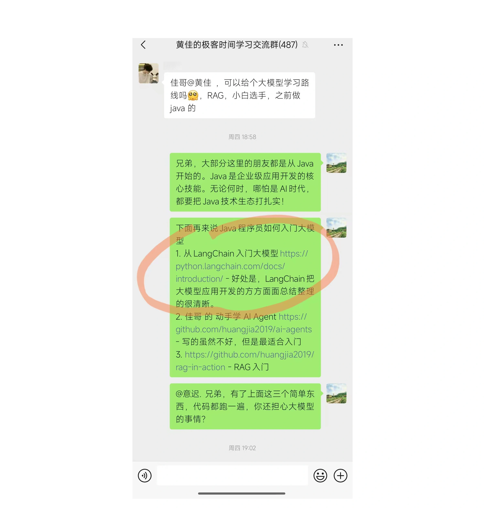
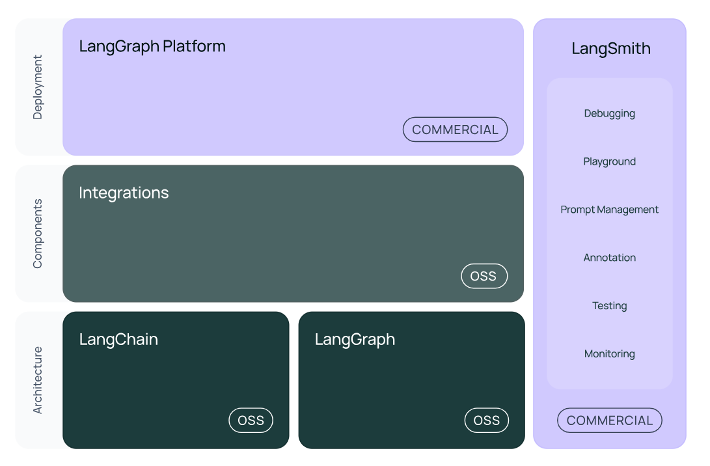
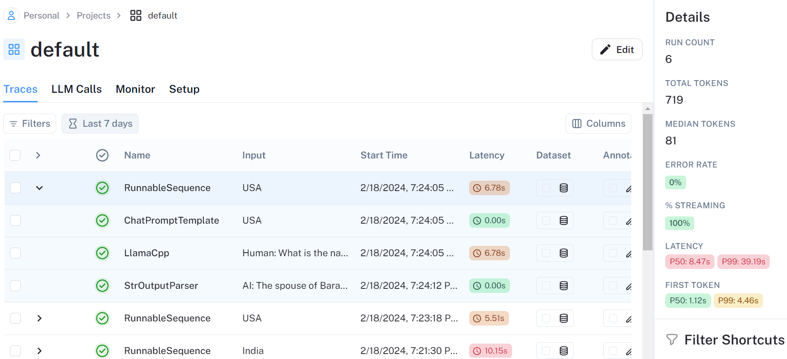
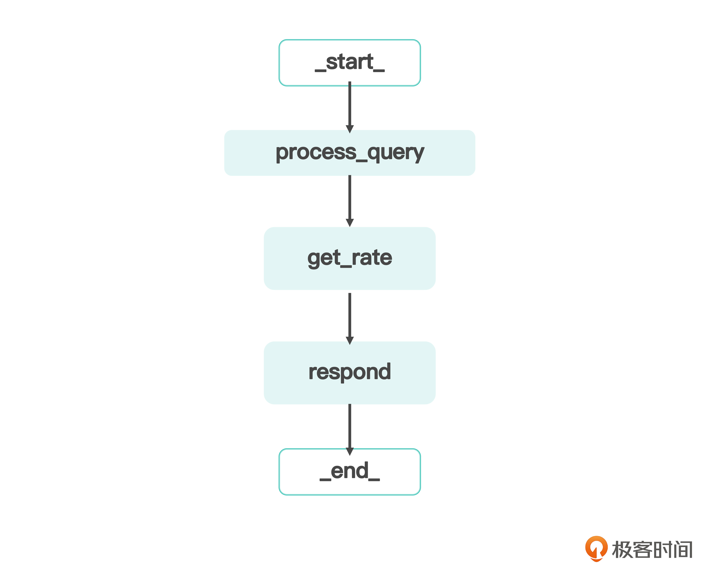
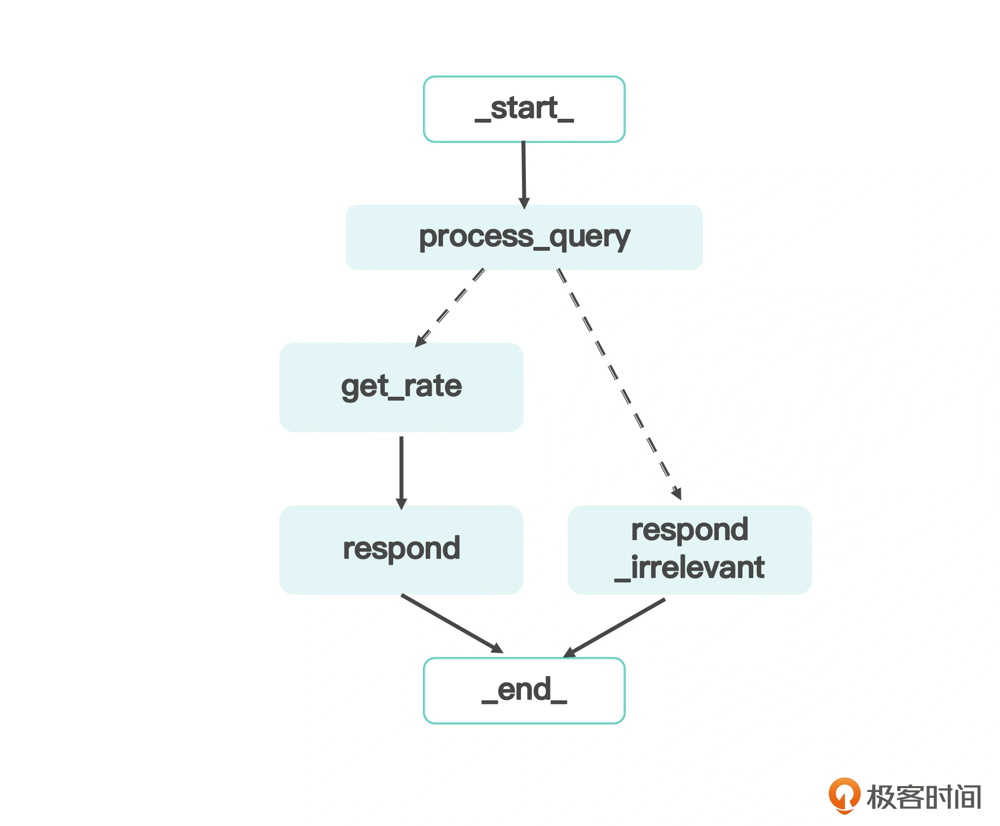

# 热点加餐：用LangGraph和A2A实现货币兑换Agent

- 写在前面：最近我在极客时间上线了一门新课《MCP & A2A 前沿实战》，其中第 14 节课我用 LangGraph 和 A2A 实现了一个货币兑换 Agent。刚好编辑和我说，有二刷我前面课程的小伙伴提到，希望我分享一些 LangGraph 的相关内容，于是我就把这节内容也加到了我们这门课里。

- 前面两次直播，我分别讲了 LECL、langsmith，刚好再加上 LangGraph，LangChain 的版图就更完整了，期待课程对你有所启发，也欢迎你在留言区和我交流讨论。

你好，我是黄佳。

这一课中，我带着你详细看一看 A2A Demo 系统中的另一个 Agent：用 LangGraph 搭建的“货币兑换”Agent（位于 a2a-in-action 代码库的 agents/ langgraph_zh 目录）。

## 从 LangChain 到 LangGraph

LangChain 是最早出现的一批大模型应用开发的主流框架。而且，我对这个框架可以说是充满了感情。2023 年的时候也推出过《LangChain 实战课》。时至今日，虽然 LangChain 早已不能代表 LLM 应用开发的全部，但是，我依然认为，LangChain 的文档组织体系，非常有利于初学者对大模型应用开发建立一个概述性的了解。因此，当有初学者问我如何从 Java 程序员进入大模型的世界，我还是会向大家推荐从 LangChain 开始。



LangChain 作为早期的大模型开发框架，曾经扮演了“打通任督二脉”的重要角色——它把提示词、模型、工具调用、记忆管理、检索增强（RAG）等模块组织成链式结构，让开发者能够清晰地组合这些组件，构建起复杂的应用流程。

然而，随着项目越来越复杂，LangChain 的链式结构开始暴露出几个明显的局限。

1. 流程不透明、调试困难：链条中间没有明确的状态表达，出错时难以定位是哪一步出了问题。

2. 缺乏并发与分支控制能力：只能“从左到右”执行，面对多轮对话、并行任务，力不从心。

3.Agent 系统复杂难控：LangChain Agent 的“反复推理 + 工具调用”机制，虽然看似智能，但在实际工程中不稳定、不易测试。

于是，LangChain 团队在 2024 年推出了 LCEL（LangChain Expression Language），一种基于组合子（Composables）的新语言，它用更明确的语法组织调用逻辑，把流程变得更像一个“声明式数据流图”。LCEL 帮助开发者不再拘泥于链式调用的模式，而是像搭积木一样构建模块化、清晰可控的流程图。

LCEL 的出现是一次范式进化，它把“LLM 驱动应用开发”从“脚本式”推进到了“数据流式”——这就像前端开发从 jQuery 到 React 的转变，意味着结构的重构与认知的升级。

但即使有了 LCEL，复杂流程仍需要状态管理、任务调度、失败重试、事件监听等机制。

但是 LCEL 是语言，但不是框架。除了这门语言之外，大模型应用开发，尤其是 Agent 的设计，还需要一套更为清晰完整的，适合工作流程编排的框架。

于是，LangGraph 诞生了——一个基于有向图（DAG）思想的 LLM 应用编排框架。它和LCEL 是兄弟工具。

我们来看看他们分别负责什么。

- LCEL：描述单个“图节点”的调用逻辑（比如一个子任务、一个 API 调用）。

- LangGraph：编排多个节点，负责整个工作流的调度、状态跳转与生命周期控制。



- LangChain的整个生态系统

LangGraph 的典型优势包括：

- 支持状态机驱动的流程控制，每个节点根据当前状态决定是否触发。

- 支持并行与条件分支，天然适配多智能体（Multi-Agent）交互场景。

- 内置缓存、持久化、观测接口，便于运维与监控。

此外，LangGraph 还可以与 Tracing 和测试辅助平台 LangSmith 配合使用，让开发者可以在图执行的每一步中进行可视化追踪、错误调试与性能分析。LangSmith 记录了每个节点的输入输出、中间状态、模型响应等关键数据，使得原本黑箱的流程变得透明、可复现。这种“开发+ 调试 + 评估”一体化的能力，为构建复杂 Agent 系统提供了强大的工程支撑。



- 用LangSmith Tracing LLM应用开发

## 基于 LangGraph 构建货币兑换智能体

下面，我们就来构建了一个“极简版 LangGraph 汇率 Agent”。这个 Agent 的目标非常明确：理解用户输入中的货币转换需求，调用汇率 API 获取最新数据，最后给出自然语言的回应。（完整代码参考 A2A Repo 中的 agents/langgraph_zh/02_LangGraph_Currency-v1.py）



- LangGraph_Currency-v1 的 Graph 工作流

首先我们导入相关的库。

```python
import os
import httpx
from typing import TypedDict, Annotated
from dotenv import load_dotenv
from langchain_core.messages import HumanMessage, AIMessage
from langchain_core.tools import tool
from langchain_google_genai import ChatGoogleGenerativeAI
from langgraph.graph import StateGraph, END
from langgraph.checkpoint.memory import MemorySaver
# 加载环境变量
load_dotenv()
```

然后我们为后续的 Agent 配置货币兑换工具。

```python
class CurrencyState(TypedDict):
   """汇率转换状态"""
   messages: Annotated[list, "对话消息列表"]
   exchange_data: Annotated[dict, "汇率数据"]
@tool
def get_exchange_rate(currency_from: str = 'USD', currency_to: str = 'CNY') -> di
   """获取汇率信息
   参数:
       currency_from: 源货币代码 (例如: "USD", "CNY")
       currency_to: 目标货币代码 (例如: "EUR", "JPY")
   返回:
       包含汇率数据的字典
   """
   try:
       response = httpx.get(
           f'https://api.frankfurter.app/latest',
           params={'from': currency_from, 'to': currency_to},
           timeout=10.0
       )
       response.raise_for_status()
       return response.json()
   except Exception as e:
       return {'error': f'获取汇率失败: {e}'}
```

接下来是 Agent 类的定义和实现。

Agent 的构建从定义状态开始。我们使用 Python 的 TypedDict 类型系统，定义了CurrencyState，明确规定状态中包含两项内容：消息列表和汇率数据。这个状态在LangGraph 中将被逐步传递和更新，成为贯穿整个流程的数据载体。

Agent 由三部分构成：用户意图解析、汇率调用、回应生成。这三部分分别映射为 LangGraph中的三个节点：process_query、get_rate 和 respond。节点之间通过显式的边连接，形成上图中所示的流程。

```sql
class SimpleCurrencyAgent:
   """极简汇率Agent"""
   def __init__(self):
       """初始化Agent"""
       # 配置LLM
       self.llm = ChatGoogleGenerativeAI(
           model='gemini-2.0-flash',
           api_key=os.getenv('GOOGLE_API_KEY')
       )
       # 创建图
       self.graph = self._create_graph()
   def _process_query(self, state: CurrencyState) -> CurrencyState:
       """处理用户查询"""
       # 获取用户消息
       user_message = state["messages"][-1].content
       # 简单的关键词匹配
       currencies = {
           '美元': 'USD', '人民币': 'CNY', '欧元': 'EUR', '日元': 'JPY',
           '英镑': 'GBP', '澳元': 'AUD', '港币': 'HKD', '韩元': 'KRW'
       }
       # 检查是否包含货币相关关键词
       currency_keywords = ['汇率', '兑', '换', '美元', '人民币', '欧元', '日元', '英
       is_currency_query = any(keyword in user_message for keyword in currency_k
       if not is_currency_query:
           # 非货币查询
           state["exchange_data"] = {
               "error": "抱歉，我只能协助货币转换和汇率查询。请询问汇率相关的问题。"
           }
           return state
       # 货币查询处理
       found_currencies = []
       for cn_name, code in currencies.items():
           if cn_name in user_message:
               found_currencies.append(code)
       # 设置默认货币对
       if len(found_currencies) >= 2:
           from_currency = found_currencies[0]
           to_currency = found_currencies[1]
       elif len(found_currencies) == 1:
           # 如果只找到一个货币，根据查询内容判断
           if '兑人民币' in user_message or '换人民币' in user_message:
               from_currency = found_currencies[0]
               to_currency = 'CNY'
           elif '人民币兑' in user_message or '人民币换' in user_message:
               from_currency = 'CNY'
               to_currency = found_currencies[0]
           else:
               # 默认查询该货币兑人民币
               from_currency = found_currencies[0]
               to_currency = 'CNY'
       else:
           # 没有找到货币，使用默认
           from_currency = 'USD'
           to_currency = 'CNY'
       # 避免相同货币的API调用
       if from_currency == to_currency:
           state["exchange_data"] = {
               "error": f"无法查询{from_currency}兑{to_currency}的汇率，因为它们是同一
           }
           return state
       state["exchange_data"] = {
           "from_currency": from_currency,
           "to_currency": to_currency,
           "user_query": user_message
       }
       return state
   def _get_rate(self, state: CurrencyState) -> CurrencyState:
       """获取汇率数据"""
       exchange_data = state["exchange_data"]
       # 如果已经有错误信息，直接返回
       if "error" in exchange_data:
           return state
       # 调用汇率工具
       rate_data = get_exchange_rate.invoke({
           "currency_from": exchange_data["from_currency"],
           "currency_to": exchange_data["to_currency"]
       })
       exchange_data.update(rate_data)
       return state
   def _respond(self, state: CurrencyState) -> CurrencyState:
       """生成响应"""
       exchange_data = state["exchange_data"]
       if "error" in exchange_data:
           response_content = f"抱歉，获取汇率时出现错误：{exchange_data['error']}"
       else:
           rates = exchange_data.get('rates', {})
           base = exchange_data.get('base', 'EUR')
           date = exchange_data.get('date', 'latest')
           if rates:
               rate_info = []
               for currency, rate in rates.items():
                   rate_info.append(f"{base} -> {currency}: {rate}")
               response_content = f"汇率信息 ({date}):\n" + "\n".join(rate_info)
           else:
               response_content = "无法获取汇率信息"
       # 创建AI响应
       ai_message = AIMessage(content=response_content)
       state["messages"].append(ai_message)
return state
```

在 _process_query 节点中，我们使用最基础的关键词匹配方式，从用户输入中提取出币种代码。例如，当用户输入“美元兑人民币的汇率是多少”，系统会识别出“美元”与“人民币”，并将其映射为 USD 和 CNY。这种处理逻辑虽然简陋，但非常清晰，便于后续教学中引入正则抽取、LLM 解析等更复杂的手段。

接下来是 _get_rate 节点，它调用了我们事先封装好的 get_exchange_rate 工具函数。该函数基于 httpx 库调用公开汇率服务（Frankfurter API），返回标准化的汇率字典，并将结果更新到状态中。这个步骤是 LangChain 工具系统与 LangGraph 流程控制的第一次“握手”——它表明我们可以在 LangGraph 流程中，灵活调用任意 LangChain 生态中的工具。

最后，_respond 节点根据当前状态中是否存在错误信息，生成回应文本。如果 API 调用成功，系统会构造 “1 USD -> CNY: 7.12” 这类结构化语句；如果出现问题，则返回对应的错误提示。回应通过 AIMessage 的形式加入到消息序列中，成为整个对话的最后一步。

下面我们继续完善 SimpleCurrencyAgent。使用 _create_graph 方法来构建整个 LangGraph工作流的核心部分。你可以把它简单理解错搭建一个小型状态机流程图，把我们之前定义的几个功能步骤串联起来。

```python
class SimpleCurrencyAgent:
   """极简汇率Agent"""
   def __init__(self):
       """初始化Agent"""
       ...
   def _create_graph(self):
       """创建LangGraph工作流"""
       # 创建内存检查点
       memory = MemorySaver()
       # 创建工作流图
       workflow = StateGraph(CurrencyState)
       # 添加节点
       workflow.add_node("process_query", self._process_query)
       workflow.add_node("get_rate", self._get_rate)
       workflow.add_node("respond", self._respond)
       # 设置入口点
       workflow.set_entry_point("process_query")
       # 添加边
       workflow.add_edge("process_query", "get_rate")
       workflow.add_edge("get_rate", "respond")
       workflow.add_edge("respond", END)
       # 编译图
       return workflow.compile(checkpointer=memory)
   def _process_query(self, state: CurrencyState) -> CurrencyState:
       """处理用户查询"""
       ...
   def _get_rate(self, state: CurrencyState) -> CurrencyState:
       """获取汇率数据"""
       ...
   def _respond(self, state: CurrencyState) -> CurrencyState:
       """生成响应"""
       ...
```

其中：

- memory = MemorySaver() 使用内存型检查点（checkpointer），记录每一步的状态数据。在复杂场景下，可以换成持久化版本（如 Redis、数据库等）来保存会话上下文。

- workflow = StateGraph(CurrencyState) 创建一个“有状态的图”（StateGraph），其中状态结构定义为 CurrencyState。每一步（节点）处理时都会读写这个状态。

- add_node(…) 加入三个核心处理节点：process_query 用来解析用户查询、识别币种 ，get_rate 负责调用 API 获取汇率 ，respond 负责生成 AI 回应 。

- set_entry_point(“process_query”) 设置流程的起始点为“process_query”，即从用户提问开始。

- add_edge(…) 明确地定义了节点之间的转移路径：

- process_query → get_rate

- get_rate → respond

- respond → END（流程终点）

- compile(…) 最后将这个状态图编译成可运行的 LangGraph 工作流对象，并启用检查点机制。

最后，整个流程的入口由 process_query 函数对外暴露。

```python
class SimpleCurrencyAgent:
   """极简汇率Agent"""
   def __init__(self):
       """初始化Agent"""
       ...
   def _create_graph(self):
       """创建LangGraph工作流"""
       ...
   def _process_query(self, state: CurrencyState) -> CurrencyState:
       """处理用户查询"""
       ...
   def _get_rate(self, state: CurrencyState) -> CurrencyState:
       """获取汇率数据"""
       ...
   def _respond(self, state: CurrencyState) -> CurrencyState:
       """生成响应"""
       ...
   def process_query(self, query: str, session_id: str = "default") -> dict:
       """处理用户查询"""
       # 初始化状态
       initial_state = {
           "messages": [HumanMessage(content=query)],
           "exchange_data": {}
       }
       # 配置会话
       config = {'configurable': {'thread_id': session_id}}
       try:
           # 执行工作流
           result = self.graph.invoke(initial_state, config)
           # 获取最终响应
           if result["messages"]:
               content = result["messages"][-1].content
           else:
               content = "无法处理请求"
           # 确定任务状态
           is_complete = "error" not in result["exchange_data"]
           return {
               'is_task_complete': is_complete,
               'require_user_input': not is_complete,
               'content': content,
               'session_id': session_id
           }
       except Exception as e:
           return {
               'is_task_complete': False,
               'require_user_input': True,
               'content': f"处理请求时出现错误: {str(e)}",
               'session_id': session_id
```

这个函数用来接收用户提问，初始化状态，并启动 LangGraph 流程。执行结束后，它返回一个结构化字典，其中包含任务是否完成、是否还需用户进一步输入、最终生成的内容等信息。这个返回值格式非常适合前端集成，既能用于 Chat UI 展示，也方便多轮对话追踪。

好，一个简单的 LangGraph 智能体就构建好了。整个过程虽然简单，却充分体现了LangGraph 在结构清晰、流程控制、可拓展性等方面的优势。

## 为智能体增加意图识别条件分支

上面的工作流程虽然清晰，但是其实并未体现出 LangGraph 通过状态图来构建智能体 AgenticWorkflowe 方面的灵活性。下面，我们要增加一些小功能，对 process_query 的设计要分个叉，也就是做意图的识别：用 LLM 来判断，如果是相关的问题，进入汇率计算；如果不相关，直接输出说明，然后结束。（完整代码参考 02_LangGraph_Currency-v2.py）

新的工作流程如下图所示：



- 02_LangGraph_Currency-v2.py 的 Graph 工作流

这个工作流程虽然仍然是固定的，但是其中的节点是由 Agent 进行路由判断。这是 Agent 和工作流的结合，也就是我们通常所说的 Agentic 工作流的设计模式。

### 工作流架构增强

新版本的工作流构建如下面的代码所示。

```
# 创建工作流图
workflow = StateGraph(CurrencyState)
# 添加节点
workflow.add_node("process_query", self._process_query)
workflow.add_node("get_rate", self._get_rate)
workflow.add_node("respond", self._respond)
workflow.add_node("respond_irrelevant", self._respond_irrelevant)
# 设置入口点
workflow.set_entry_point("process_query")
# 添加条件边
workflow.add_conditional_edges(
   "process_query",
   self._should_get_rate,
   {
       "get_rate": "get_rate",
       "respond_irrelevant": "respond_irrelevant"
   }
)
# 添加普通边
workflow.add_edge("get_rate", "respond")
workflow.add_edge("respond", END)
workflow.add_edge("respond_irrelevant", END)
# 编译图
return workflow.compile(checkpointer=memory)
```

比较一下两个版本的不同。

- v1 版本（直接调用）是使用线性工作流：process_query → get_rate → respond，所有查询都经过相同的流程，使用 workflow.add_edge() 添加简单边。

- v2 版本（意图识别）使用条件分支工作流：process_query → [get_rate |respond_irrelevant]，根据查询意图分叉到不同路径，使用workflow.add_conditional_edges() 添加条件边。

### 查询意图识别方式

除工作流的构建之外，意图识别方式是两个版本的另一个核心差异。

v1 版本的 _process_query 的核心代码：

```
# 简单的关键词匹配
currency_keywords = ['汇率', '兑', '换', '美元', '人民币', '欧元', '日元', '英镑', '澳元
is_currency_query = any(keyword in user_message for keyword in currency_keywords)
```

这是一个基于关键词的静态判断逻辑。是非常固定的。如果一个货币没在列表中，就无法进行下一步的操作。

v2 版本的 _process_query 的核心代码：

```
# 使用LLM智能判断
prompt = f"""
```

- 请判断以下用户查询是否与货币转换、汇率查询相关。

```
用户查询: "{user_message}"
请只回答 "是" 或 "否"。
"""
response = self.llm.invoke(prompt)
is_currency_query = "是" in response.content.strip()
```

这样就把固定的逻辑判断转换成了大语言模型的智能意图识别过程。

### V2 版本其它新增函数

V2 版本中的其它新增函数如下：

_should_get_rate() 函数：判断是否应该获取汇率。

```python
   def _should_get_rate(self, state: CurrencyState) -> str:
       """判断是否应该获取汇率"""
       exchange_data = state["exchange_data"]
       return "get_rate" if exchange_data.get("is_currency_query", False) else "
```

_respond_irrelevant() 函数：处理不相关查询的响应。

```python
   def _respond_irrelevant(self, state: CurrencyState) -> CurrencyState:
       """生成不相关查询的响应"""
       exchange_data = state["exchange_data"]
       response_content = exchange_data.get("error", "抱歉，我只能协助货币转换和汇率查
       # 创建AI响应
       ai_message = AIMessage(content=response_content)
       state["messages"].append(ai_message)
       return state
```

完整代码参考 A2A Repo 中的 agents/langgraph_zh/02_LangGraph_Currency-v2.py。

v2 版本在 v1 的基础上增加了智能意图识别和条件分支，使 Agent 能够更智能地处理不同类型的查询。

## LangGraph Agent 和 A2A 的集成

掌握了 LangGraph 的核心设计思想，最后来看看如何把通过 LangGraph 构建的货币转换Agent，集成到 A2A 协议架构中，如何实现外部 API 集成、流式响应处理、异步任务管理等关键技术点（参考 langgraph_zh/agent.py）。

### Agent 的封装和 ReAct 模式实现

A2A 代码库中的 LangGraph Agent 采用了 ReAct（Reasoning + Acting）模式，这是现代 AIAgent 的核心设计模式。

```python
class CurrencyAgent:
   SYSTEM_INSTRUCTION = (
       '你是专门进行货币转换的助手。'
       "你的唯一目的是使用'get_exchange_rate'工具来回答有关汇率的问题。"
       '如果用户询问除货币转换或汇率之外的任何内容，'
       '请礼貌地说明你无法帮助该主题，只能协助货币相关的查询。'
       '不要尝试回答不相关的问题或将工具用于其他目的。'
       '如果用户需要提供更多信息，请将响应状态设置为input_required。'
       '如果在处理请求时出现错误，请将响应状态设置为error。'
       '如果请求完成，请将响应状态设置为completed。'
   )
   def __init__(self):
       self.model = ChatGoogleGenerativeAI(model='gemini-2.0-flash')
       self.tools = [get_exchange_rate]
       # 创建ReAct Agent
       self.graph = create_react_agent(
           self.model,
           tools=self.tools,
           checkpointer=memory,
           prompt=self.SYSTEM_INSTRUCTION,
           response_format=ResponseFormat,
       )
```

在结构化响应格式方面，使用 ResponseFormat 确保 Agent 输出的一致性。

工具注册机制方面，也是通过 tools 参数注册外部工具，工具调用是 LangGraph Agent 的核心能力，通过装饰器模式实现：

```python
@tool
def get_exchange_rate(
   currency_from: str = 'USD',
   currency_to: str = 'EUR',
   currency_date: str = 'latest',
):
   """使用此工具获取当前汇率。
   参数:
       currency_from: 要转换的货币（例如，"USD"）。
       currency_to: 要转换到的货币（例如，"EUR"）。
       currency_date: 汇率的日期或"latest"。默认为"latest"。
   返回:
       包含汇率数据的字典，如果请求失败则返回错误消息。
   """
   try:
       response = httpx.get(
           f'https://api.frankfurter.app/{currency_date}',
           params={'from': currency_from, 'to': currency_to},
       )
       response.raise_for_status()
       data = response.json()
       if 'rates' not in data:
           return {'error': 'API响应格式无效。'}
       return data
   except httpx.HTTPError as e:
       return {'error': f'API请求失败: {e}'}
   except ValueError:
       return {'error': 'API返回的JSON响应无效。'}
```

和之前的例子完全相同，货币转换 Agent 集成了 Frankfurter API：

```
# API调用示例
response = httpx.get(
   f'https://api.frankfurter.app/{currency_date}',
   params={'from': currency_from, 'to': currency_to},
)
```

响应会转换成 JSON 格式，进行后续数据处理。数据处理策略包括检查响应结构完整性以及统一错误返回格式。

```
data = response.json()
if 'rates' not in data:
   return {'error': 'API响应格式无效。'}
return data
```

### 流式响应处理（Stream + 状态识别）

LangGraph Agent 实现了真正的流式响应，LangGraph 的 .stream() 方法支持输出过程的每一步。我们利用它实现 A2A 所需的流式交互，这是 A2A 协议的重要特性。

```
async def stream(self, query, sessionId) -> AsyncIterable[dict[str, Any]]:
   inputs = {'messages': [('user', query)]}
   config = {'configurable': {'thread_id': sessionId}}
   for item in self.graph.stream(inputs, config, stream_mode='values'):
       message = item['messages'][-1]
       if (
           isinstance(message, AIMessage)
           and message.tool_calls
           and len(message.tool_calls) > 0
       ):
           yield {
               'is_task_complete': False,
               'require_user_input': False,
               'content': '正在查询汇率...',
           }
       elif isinstance(message, ToolMessage):
           yield {
               'is_task_complete': False,
               'require_user_input': False,
               'content': '正在处理汇率数据...',
           }
yield self.get agent response(config)
```

流式处理机制的特点包括三点：

1. 状态识别：根据消息类型判断处理阶段

2. 进度反馈：实时返回处理状态

3. 最终结果：流式结束后返回完整响应

状态管理方面，get_agent_response 提供下列三种可能状态。

- input_required：需要用户提供更多信息

- completed：任务完成

- error：处理过程中出现错误

```python
def get_agent_response(self, config):
   current_state = self.graph.get_state(config)
   structured_response = current_state.values.get('structured_response')
   if structured_response and isinstance(
       structured_response, ResponseFormat
   ):
       if (
           structured_response.status == 'input_required'
           or structured_response.status == 'error'
       ):
           return {
               'is_task_complete': False,
               'require_user_input': True,
               'content': structured_response.message,
           }
       if structured_response.status == 'completed':
           return {
               'is_task_complete': True,
               'require_user_input': False,
               'content': structured_response.message,
           }
```

在这个过程中，系统提供多轮对话支持以及进度反馈。

```
# 系统指令中的多轮对话处理
SYSTEM_INSTRUCTION = (
   '如果用户需要提供更多信息，请将响应状态设置为input_required。'
   '如果在处理请求时出现错误，请将响应状态设置为error。'
   '如果请求完成，请将响应状态设置为completed。'
)
# 流式处理中的进度反馈
if isinstance(message, AIMessage) and message.tool_calls:
   yield {
       'is_task_complete': False,
       'require_user_input': False,
       'content': '正在查询汇率...',
   }
elif isinstance(message, ToolMessage):
   yield {
       'is_task_complete': False,
       'require_user_input': False,
       'content': '正在处理汇率数据...',
   }
```

### 任务调度与生命周期管理（A2A TaskManager）

下面简单说明如何通过 A2A TaskManager 来进行任务调度与生命周期管理。

### 注册 Agent 到 A2A 系统

为了统一管理任务的执行与生命周期，我们将 Agent 封装进一个继承自InMemoryTaskManager 的类 AgentTaskManager 中。这个任务管理器由 A2A 框架调度，实现任务状态的记录、更新和通知。

```python
class AgentTaskManager(InMemoryTaskManager):
   def __init__(
       self,
       agent: CurrencyAgent,
       notification_sender_auth: PushNotificationSenderAuth,
   ):
       super().__init__()
       self.agent = agent
       self.notification_sender_auth = notification_sender_auth
```

上述代码通过构造函数将具体的 CurrencyAgent 和推送通知模块注入进任务管理器中，便于任务调度器统一调用，并支持 webhook 通知下游系统。

### 由调度器来执行 Agent，实现异步任务调度

任务调度方面，每条数据通过 SSE 或 WebSocket 推送给客户端，根据处理结果动态更新任务状态，实现状态转换、消息生成、工件存储、通知推送多步一体；通过事件实时通知任务状态变化，同时进度可视，适配异步系统架构，自动管理任务生命周期。

```
async def _run_streaming_agent(self, request: SendTaskStreamingRequest):
   task_send_params: TaskSendParams = request.params
   query = self._get_user_query(task_send_params)
   try:
       async for item in self.agent.stream(
           query, task_send_params.sessionId
       ):
           is_task_complete = item['is_task_complete']
           require_user_input = item['require_user_input']
           artifact = None
           message = None
           parts = [{'type': 'text', 'text': item['content']}]
           end_stream = False
           if not is_task_complete and not require_user_input:
               task_state = TaskState.WORKING
               message = Message(role='agent', parts=parts)
           elif require_user_input:
               task_state = TaskState.INPUT_REQUIRED
               message = Message(role='agent', parts=parts)
               end_stream = True
           else:
               task_state = TaskState.COMPLETED
               artifact = Artifact(parts=parts, index=0, append=False)
               end_stream = True
           task_status = TaskStatus(state=task_state, message=message)
           latest_task = await self.update_store(
               task_send_params.id,
               task_status,
               None if artifact is None else [artifact],
           )
           await self.send_task_notification(latest_task)
```

### 错误处理和恢复机制

系统对流式中出现的任何异常进行了统一捕获，错误事件通过 SSE 立即反馈前端，统一日志记录便于排查，以保证任务生命周期稳定不中断。

```
except Exception as e:
   logger.error(f'流式响应时发生错误: {e}')
   await self.enqueue_events_for_sse(
       task_send_params.id,
       InternalError(
           message=f'流式响应时发生错误: {e}'
       ),
   )
```

### 状态实时更新 （Server-Sent Events）

通过 SSE（Server-Sent Events）实时事件流使用队列管理 SSE 事件来实现实时状态更新。支持客户端订阅，后台异步处理 Agent 任务、前台同步更新实时分发事件处理结果，提升交互响应速度与体验。

```
async def on_send_task_subscribe(
   self, request: SendTaskStreamingRequest
) -> AsyncIterable[SendTaskStreamingResponse] | JSONRPCResponse:
   try:
       error = self._validate_request(request)
       if error:
           return error
       await self.upsert_task(request.params)
       task_send_params: TaskSendParams = request.params
       sse_event_queue = await self.setup_sse_consumer(
           task_send_params.id, False
       )
       asyncio.create_task(self._run_streaming_agent(request))
       return self.dequeue_events_for_sse(
           request.id, task_send_params.id, sse_event_queue
       )
```

### 推送通知机制（JWK + Webhook）

A2A 启动服务时绑定 JWK 安全认证和 Webhook 推送端点。其特性是支持 JSON Web Key 身份校验，提供标准的 JWK 端点，并通过 Webhook 支持外部系统接收通知，安全地向外部系统发送推送，适用于协同工作流、系统集成场景。

```
# 服务器启动时配置推送通知
notification_sender_auth = PushNotificationSenderAuth()
notification_sender_auth.generate_jwk()
server = A2AServer(
   agent_card=agent_card,
   task_manager=AgentTaskManager(
       agent=CurrencyAgent(),
       notification_sender_auth=notification_sender_auth,
   ),
   host=host,
   port=port,
)
# 添加JWK端点
server.app.add_route(
   '/.well-known/jwks.json',
   notification_sender_auth.handle_jwks_endpoint,
   methods=['GET'],
)
```

### UI 客户端集成与状态同步

最后来看 UI 客户端集成与状态同步。

在 demo/ui 的实现中，客户端通过以下方式与 Agent 交互，发送消息。

```
# 客户端服务层
async def SendMessage(message: Message) -> str | None:
   client = ConversationClient(server_url)
   try:
       response = await client.send_message(SendMessageRequest(params=message))
       return response.result
   except Exception as e:
       print('Failed to send message: ', e)
```

UpdateAppState 函数负责状态的更新，同步应用状态（含消息列表、任务列表、后台任务）

状态的更新。

```sql
async def UpdateAppState(state: AppState, conversation_id: str):
   """更新应用状态。"""
   try:
       if conversation_id:
           state.current_conversation_id = conversation_id
           messages = await ListMessages(conversation_id)
           if not messages:
               state.messages = []
           else:
               state.messages = [convert_message_to_state(x) for x in messages]
       # 获取任务列表
       state.task_list = []
       for task in await GetTasks():
           state.task_list.append(
               SessionTask(
                   session_id=extract_conversation_id(task),
                   task=convert_task_to_state(task),
               )
           )
       # 获取后台任务状态
       state.background_tasks = await GetProcessingMessages()
   except Exception as e:
       print('Failed to update state: ', e)
```

通过以上模块的协同，我们完成了从 LangGraph Agent 构建 → A2A 异步调度 → SSE 推送 →UI 状态同步的一整条闭环。这种架构既具备工业级稳定性，又保留了高度的可扩展性，非常适合用来构建面向用户的智能对话系统。

## 总结一下

这节课程的信息含量较大，我们梳理一下重点内容。

我们从 LangChain 到 LangGraph 的演进过程开始，前半部分，介绍了 LangChain 作为大语言模型应用开发最具代表性的框架，以及 LangGraph 作为 Agent 工作流开发典型框架的主要特点，并构建了简单的 LangGraph Agent。

后半部分，我们主要讨论从单体 Agent 到 A2A Agent 架构的演进。从 LangGraph Agent 到A2A TaskManager，再到 SSE/Webhook 推送和 UI 状态更新，这一整套流程构成了一个高度解耦、异步驱动、任务可追踪的现代化 AI Agent 架构。

通过这样的设计，我们不仅实现了大模型推理逻辑的工程封装，更重要的是具备了对话流管理、状态追踪和流式反馈的系统能力，非常适合部署在企业级场景中。

## 思考题

1. 目前，LangGraph Agent 的 V2 版本实现了意图识别能力，但是使用简单的模板化回复，直接拼接字符串生成响应，响应内容相对固定和简单。你可否改造一下，使用 LLM 生成智能回复，让响应内容更加个性化和友好。

提示：参考 A2A Repo 中的 agents/langgraph_zh/02_LangGraph_Currency-v3.py

2. LangGraph Agent 的 V2 版本和 A2A Sample 中的 Agent.py 从工作流程控制方面有哪些差异？在你的工作场景中，你比较倾向于选择哪种实现方式，为什么？

期待你在留言区分享你的思考或者疑问，如果这节课对你有启发，别忘了分享给身边更多朋友！
