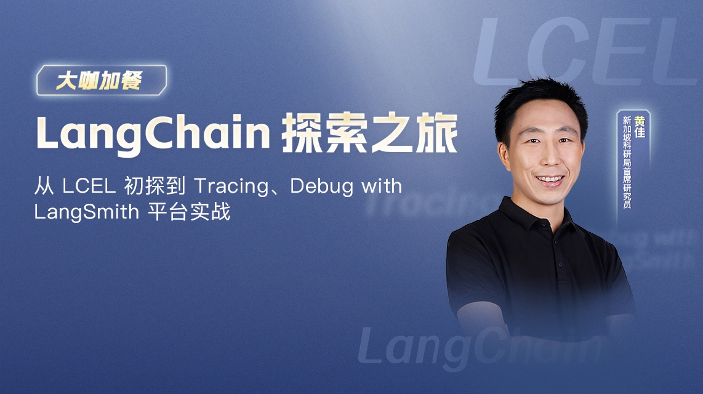
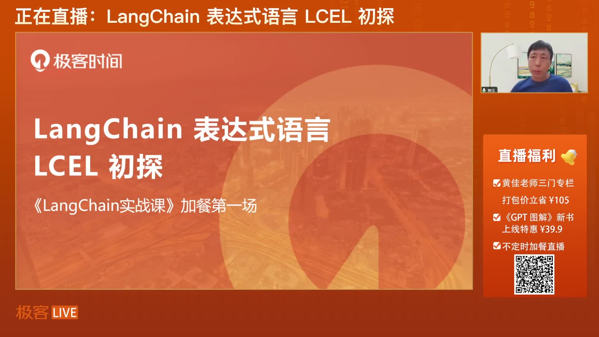

# 直播加餐 | LangChain表达式语言LCEL初探

## 你将获得

- 了解 LangChain 表达式语言的概念和基本语法

- 掌握 LangChain 表达式语言的常用功能

- 能够使用 LangChain 表达式语言构建复杂的链条

- 通过示例演示 LangChain 表达式语言的使用

## 直播回放

## PPT 下载地址

- 链接: https://pan.baidu.com/s/1re6hKElwqtvnKDzYpReMeA

- 提取码: jkd4
