# 01 | 开箱即用：MCP是LLM开发范式的增强

你好，我是黄佳。

这节课，我们将用一个通过 MCP 协议调用外部工具的实战，来理解 MCP 协议的强大之处。

在正式开始 MCP 实战之前，我们不妨先来回顾一下这两三年来，也就是 MCP 出现之前，我们是如何使用大模型的。

## 从提示工程到 RAG

大模型可以开箱即用，也就是我们人类通过提示工程和它直接对话，让它帮我们解决问题。随着大模型的能力越来越强大，尤其是推理模型的出现，它的回答越来越靠谱了。

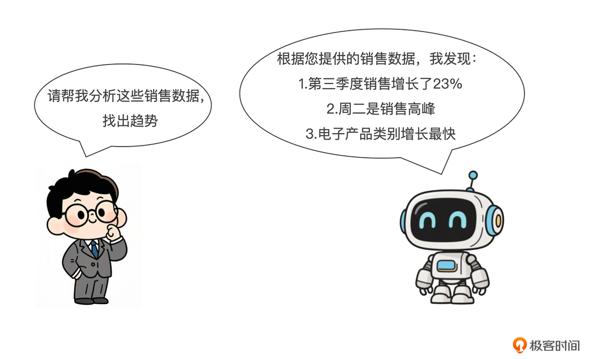

- 提示工程：我们直接与大模型对话

然而，大模型并非全知全能。预训练的数据虽然也在更新，但仍然有截止时间；而当我希望它分析属于我个人的图书销售数据时，它当然并不知道我、或者你的企业内部拥有哪些数据，此时就是 RAG（Retrival-Augmented Generation)，检索增强生成上场的时刻。

RAG 这种 LLM 应用开发范式背后的基本思想，就是通过将大型语言模型（LLM）与外部数据源相结合来提高其准确性和相关性。先通过向量之间的相似度，用检索系统从外部数据源搜索数据，以识别与用户查询相关的信息。LLM 随后利用检索到的信息生成更精确、更及时的响应。

1. 检索：首先通过向量数据库或其他检索系统，找出与用户查询相关的信息；

2. 增强：将检索到的信息作为上下文提供给大模型；

3. 生成：大模型基于这些额外信息生成回答。

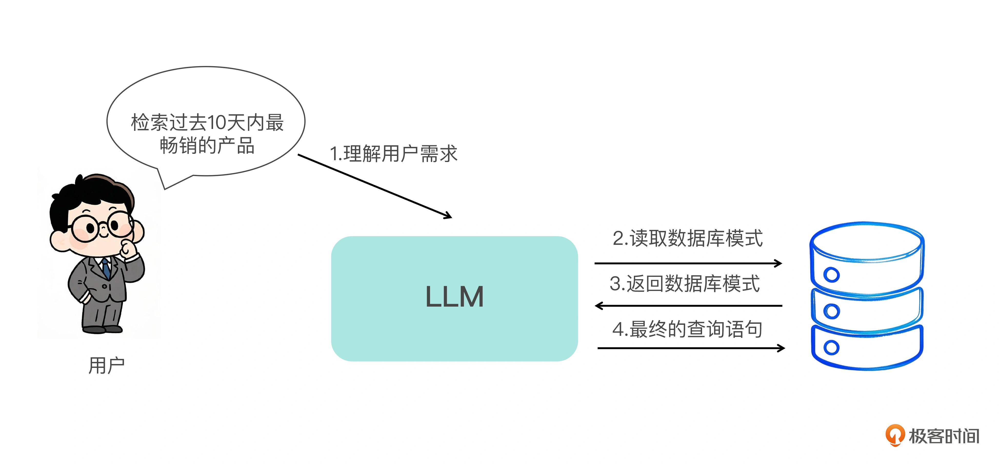

- 通过 RAG 增加大模型的知识，弥补其知识盲区的短板

RAG 是大模型时代应用开发的一个伟大创新，大大提高了大模型回答的准确性和相关性，特别是在处理专业领域或企业特定信息时。

举例来说，我们需要编写 SQL 查询来检索过去 10 天内最畅销的产品。由于 LLM 不知道表模式或列名，因此直接询问 LLM 可能会导致无法使用的 SQL 查询。为了改进这一点，可以通过RAG 来获取模式和列，以便 LLM 可以更准确地生成查询。

## 从 RAG 到 Agent 和工具调用

RAG 解决的是让 LLM 使用内部知识，同时减少幻觉的问题，但是它并没有增强大模型的行动能力。也就是说，大模型再怎么厉害，还是只能回答我们的问题，帮我们出主意、给建议，提方案。它仍有局限性，尤其是当我们需要大模型执行复杂的多步骤任务，或与多个外部系统交互时。它也许可以帮我们画一张漂亮的图片，但是还不能帮我们生成 PPT，回复邮件，更别说让它去上网查机票、订酒店了。

于是 Agent 模式应运而生。Agent 本质上是赋予了大模型使用工具并采取行动的开发范式。它的工作流程包括：

1. 规划：大模型理解用户需求，规划解决方案。

2. 工具选择：决定使用哪些工具来完成任务。

3. 工具调用：调用选定的工具并处理返回结果。

4. 反思与调整：评估进展，必要时调整计划。

5. 输出结果：向用户呈现最终结果。

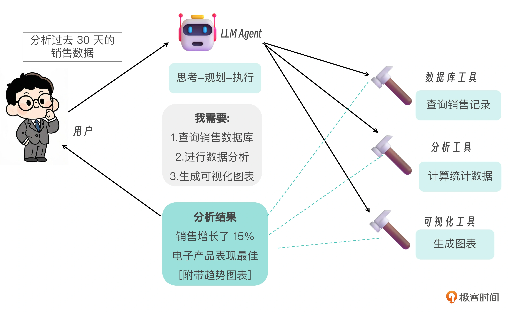

- Agent就是本来就会推理的大模型又拥有了工具调用能力，能够完成具体任务。

工具调用的能力让大模型不再仅限于生成文本，而是可以执行实际操作，例如查询数据库、调用 API、创建可视化图表、发送邮件，检索和处理文档等等一系列任务。这大大扩展了 AI 应用的范围和价值。以 OpenAI 的 Function Calling 和 Anthropic 的 Tool Use 为例，它们都允许开发者为模型定义可调用的工具，模型可以自主决定何时使用这些工具。

## 大模型应用开发的两个范式

以上所说的 RAG 和 Agent，就是大模型应用开发的目前最常用，也最通用的两个范式。

我曾经在《大模型应用开发：RAG 实战课》的序言中，这样总结过它们：

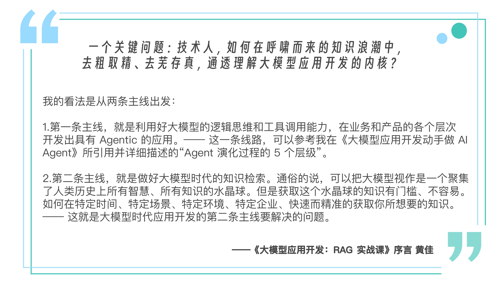

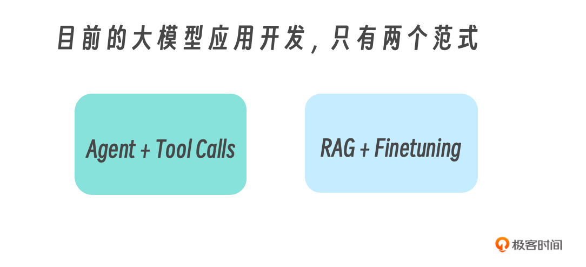

然而，要让你的大模型拥有各种工具调用能力，绝非易事。即使是使用 LangChain 这样的开发框架，要想为 LLM 配置一个工具，也要在程序中手动向大模型注册工具的名称及各种参数。在我们的 LangChain 实战课“工具调用”一课中，为了让我的 LLM 自动接收或发送一个邮件，我可是费尽千辛万苦，足足花了两天才完成了这么简单的一个设置。

而有了 MCP 协议，无论是 RAG，还是 Agent+Tool Calls（或称 Function Calling），这两个大模型应用开发的关键范式，都将得益于 MCP 提供的工具发现和主动调用能力。

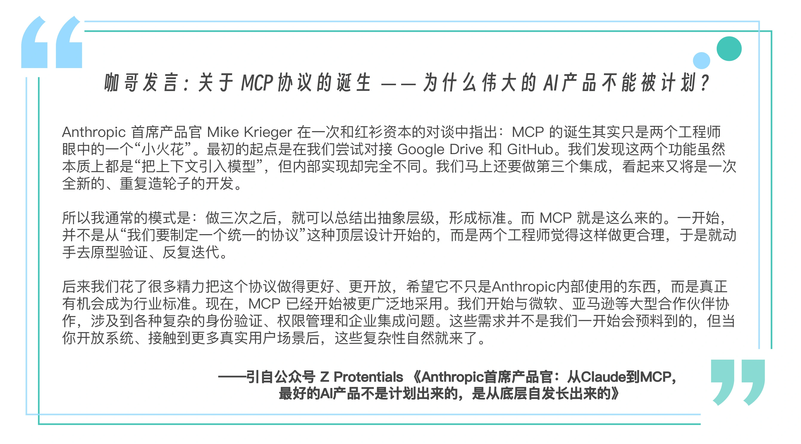

## MCP 增强了 RAG 和 Agent

现在你已经知道，MCP（模型上下文协议）是一个开放标准，用于将 AI 连接到数据库和工具，就​像专为 LLM 构建的 API 层一样。你可以将 MCP 想象成 AI 应用程序的“USB-C 接口”。正如 USB-C 为你的设备提供了连接各种外设的标准方式，MCP 为 AI 模型提供了连接不同数据源和工具的标准方式。

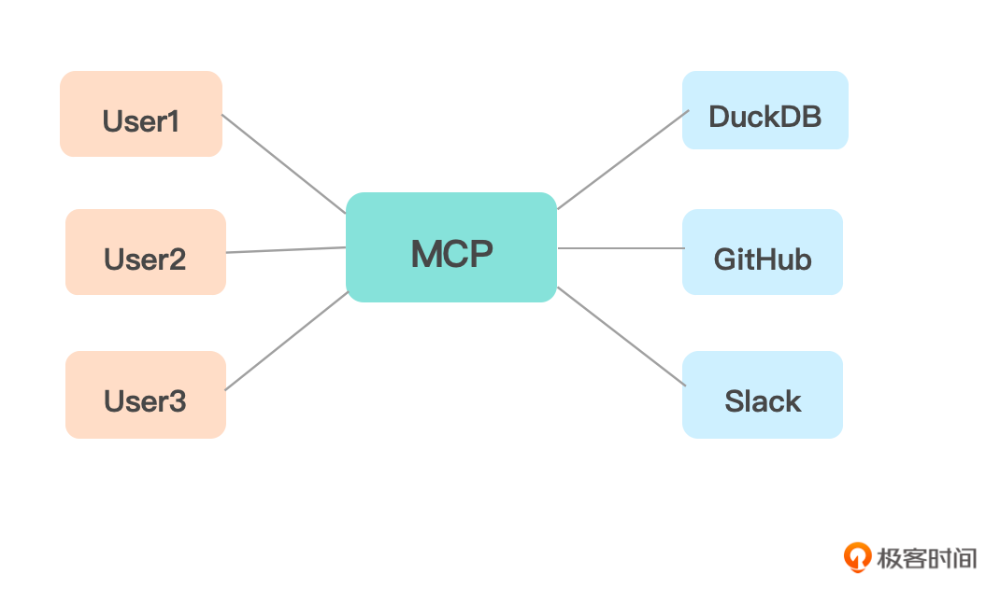

所有的工具或者服务提供商（如 Github、Milvus、PostgreSQL、Snowflake 或 Spark）都会按照 MCP 协议制定的标准定义一个共享接口，那就无需每个开发团队都分别与他们构建一次性集成，而 MCP 客户端中的 LLM 可以无缝地接入该接口。

对于 RAG 来说，MCP 通过定义统一的 SessionMessage 协议和工具发现机制，使 RAG 能够无缝接入多源数据检索，只需一次集成即可动态检索并注入上下文，大幅提高了检索增强生成的准确性和可维护性。

同时，MCP 为 Agent 提供了标准化的工具调用接口和结果回传格式，让大模型可以自主选择、分步调度各类工具执行复杂任务，无需手动注册或编码集成。这将显著提升 Agent 应用的开发效率和扩展能力。

## MCP 实战：Cursor（或 Copilot）+ DuckDB

下面，我们正式开始一次通过 MCP 进行工具调用的实战。这个实战案例中，我要在我的代码编辑器中用一个叫做 DuckDB 的数据分析工具来帮我自动分析我的图书销售情况。

好，在这个实战任务中，有下面几个相关参与方。

- 代码编辑环境。其实这个环境不是简单的环境，它本身必须就是一个支持 MCP 协议的MCP Client。我用的是 Cursor，你当然也可以替换成 Github Copilot、VS Code、Cline、Winsurf 等，它们全都支持 MCP，全都是 MCP Client。Cursor 是在开源的 VS Code 上开发出来的一个分支应用，非常好用，能够自动生成代码，对 MCP 的支持也非常好。你可以去官网下载，并免费试用。

- LLM 大模型：这个相关方隐藏在代码编辑器也就是 MCP Client 内部，当我和 Cursor 互动对话的时候，其实我是在和 Cursor 后台所调用的 LLM 对话，比如 GPT-4o 或者DeepSeek R1 或者 Claude 模型。

- DuckDB：这是一个支持 MCP 协议的 MCP Server。我们选择 DuckDB，只是因为其简单好用，便于展示。你完全可以用同样的步骤在你的 MCP Client 中配置任意多个其他的MCP Server，比如“彩云天气服务”“Google 邮箱服务”等等。配置好了 Server 之后，其中的一系列工具或资源会展现在你的 MCP Client 中。

- MCP：这就是 Cursor 和 DuckDB 以及所有的 MCP Client 和 MCP Server 所共同认可的一套通信标准。

有无数多的 MCP 服务可以开箱就用，例如下图所示，就是 Cursor 官网上所展示的部分 MCP服务。而 MCP 的官方 GitHub 上，也有一系列的服务供应商列表。此外，你也可以去各种IT 服务提供者的网站上看看，很可能也有惊喜（比如高德地图很早就提供了 MCP 服务）。

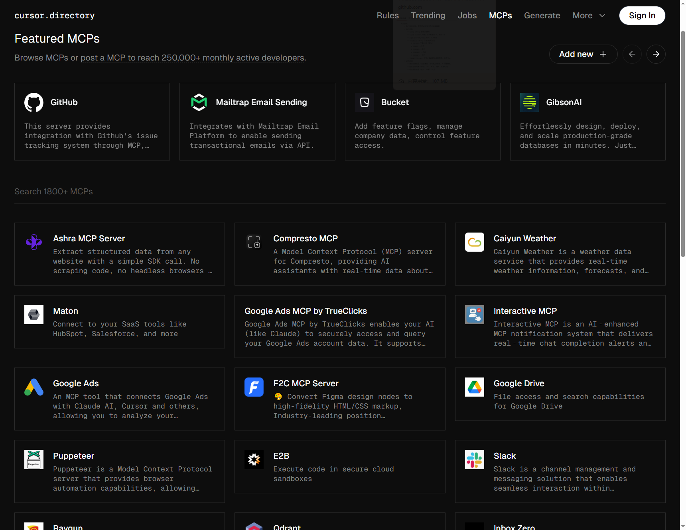

- MCP 服务提供者越来越多

以上各种 MCP 服务覆盖从源数据提取、知识检索到云原生管理、支付与监控等方方面面，可根据业务需求在对话中灵活组合使用。

好，在 MCP 官方服务列表中，你就可以看到我们即将使用的数据分析工具 DuckDB，也叫MotherDuck，妈妈鸭（DuckDB 的在线版本）。

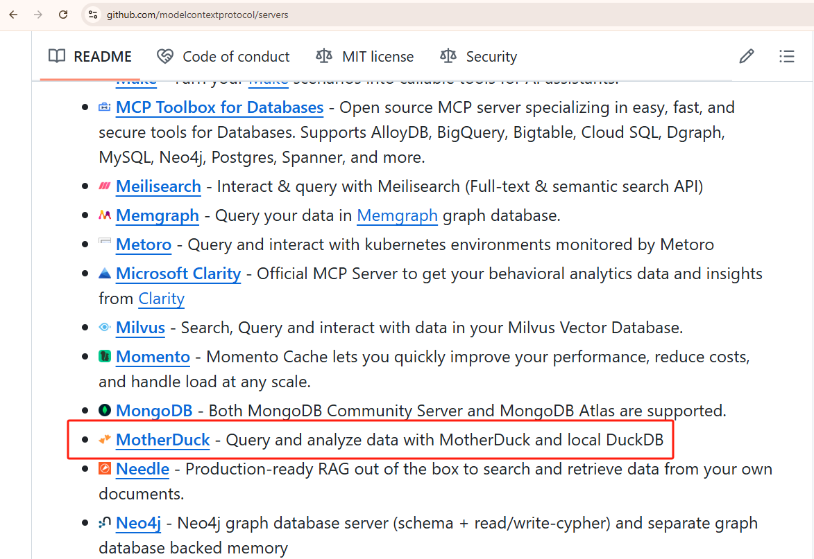

- DuckDB 是官方认证的 MCP 服务之一

如果你也像我一样，对 MotherDuck（详情）完全不了解。那么正合适，MCP 简单到什么程度呢？你在完全不懂的情况下，也可以快速展开对该服务的使用。 所有细节都封装在 MCP协议内部，我们只要知道它大概可以做数据分析就可以开始用了。

通过前面的链接中点击 MotherDuck，进入 MotherDuck 的 GitHub，你会找到它的 MCP 配置说明。

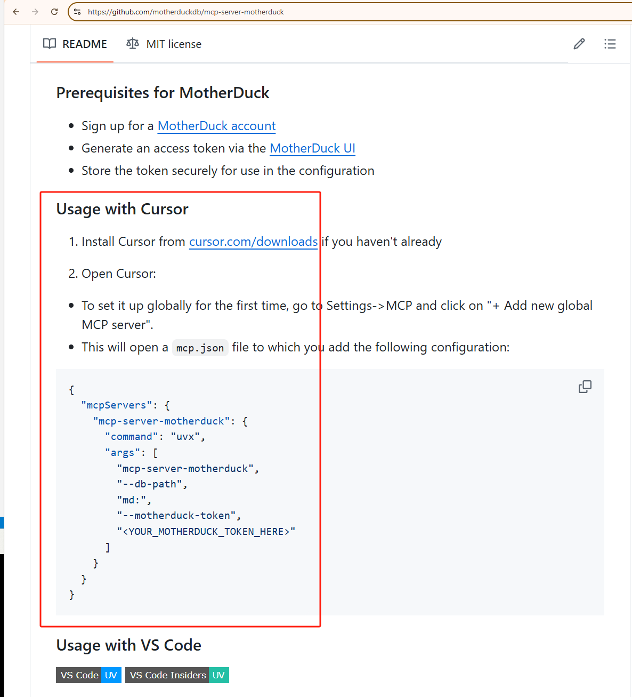

我们所要做的，就是打开 Cursor 的 Chat Setting，选择 MCP，然后再选择 Add new globalMCP server。

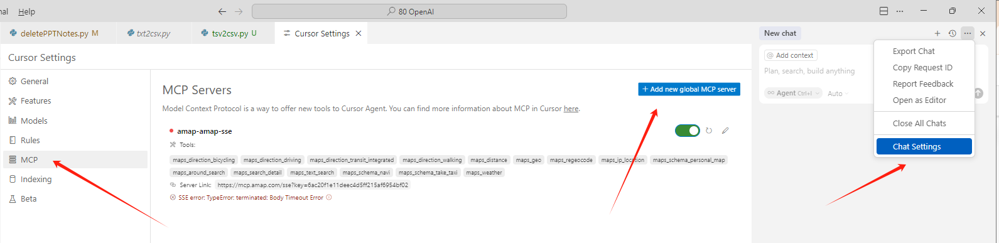

然后，把下面这段配置给复制并粘贴到你的 mcp.json 文件中。

```json
{
 "mcpServers": {
   "mcp-server-motherduck": {
     "command": "uvx",
     "args": [
       "mcp-server-motherduck",
       "--db-path",
       "md:",
       "--motherduck-token",
       "eyJhbGciOiJIUzI1NiIsInR5cCI6IkpXVCJ9.eyJlbWFpbCI6InRvaHVhbmdqaWFAZ21haWw
     ]
   }
 }
}
```

代码中“–motherduck-token”下面的一串文字是我的 motherduck API key，方便的话请你去它的官网申请一个。因为我常常知道国内的朋友访问外网有可能不便，如果实在不行你就用我的 Key 完成这个 Demo 吧。但是这是下下之策，因为如果大家都用的话，我的 key 有可能会超出限额。

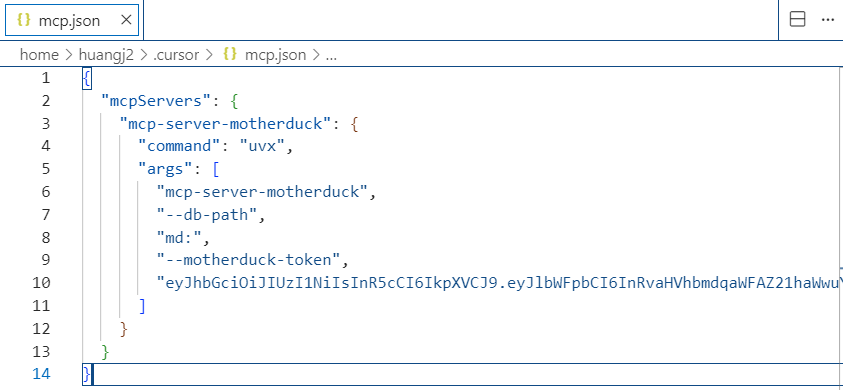

配好了之后，回到 MCP Servers 的页面，我们看到 mcp-server-motherduck 旁边的按钮就变绿了，而且他的 Tools 也展现了出来，目前只有一个，就是“query”（可以查询 CSV 文件或数据表）。如果没有变绿，你可以选择开关，关闭在打开，或者 Refresh 一下。选择旁边的铅笔就能重新配置。

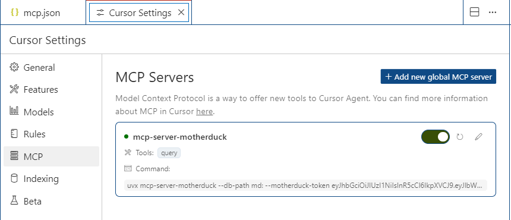

看到 MCP 工具已经变成绿色，我就迫不及待地希望利用 Cursor 这个 MCP Client 来调用Mother Duck 的工具服务了！我在 Cursor 的对话界面中输入下面的话：

```
请调用mother duck工具帮我做数据分析
```

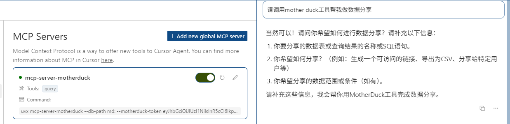

Cursor 回答我说当然可以，但是你需要提交一个数据表。

哈哈，那好的，我把我的一个数据文件（我的过去三年的图书销量）放在项目目录中，让它给我分析一下。

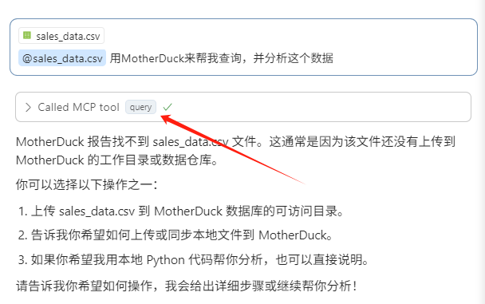

果然，MCP Client 成功的调用了 MCP 工具！不过，它告诉我，MotherDuck 只能访问云端的文件。

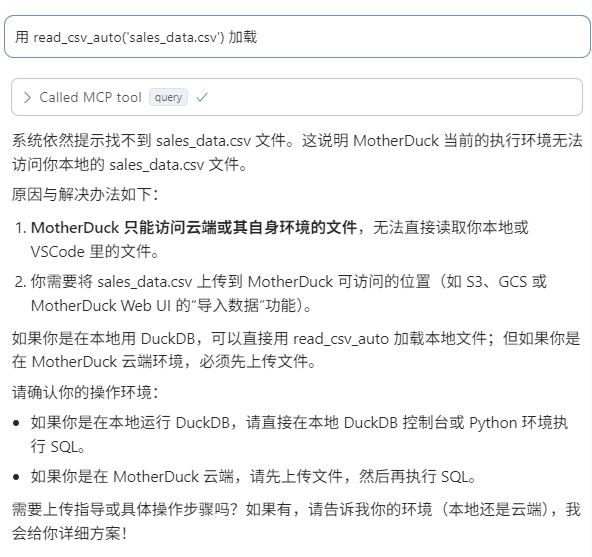

不要紧，我这把我的数据表上传到云端。

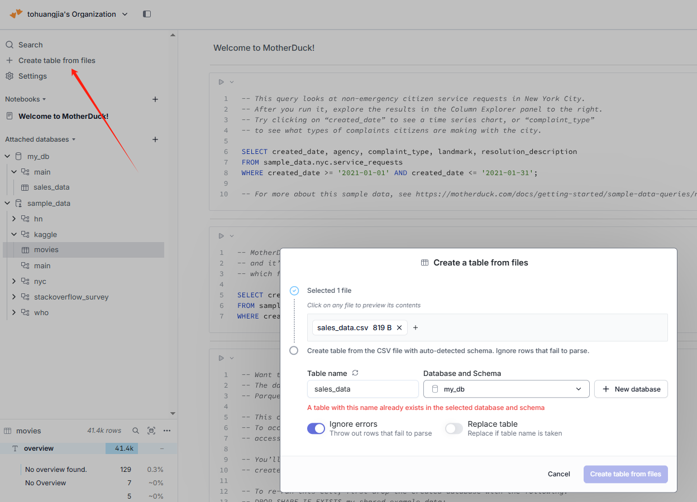

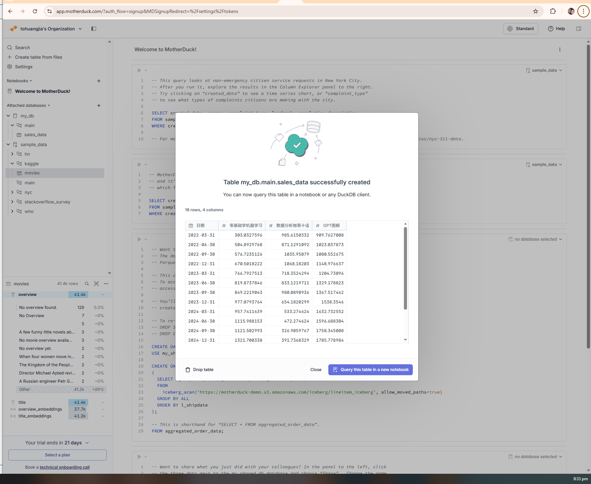

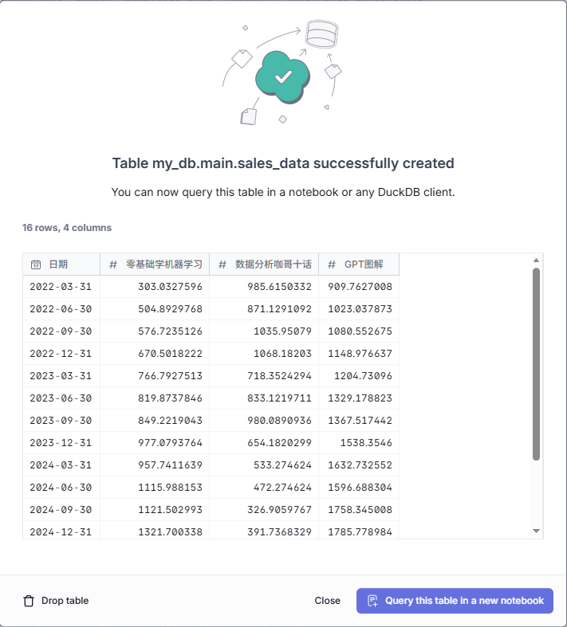

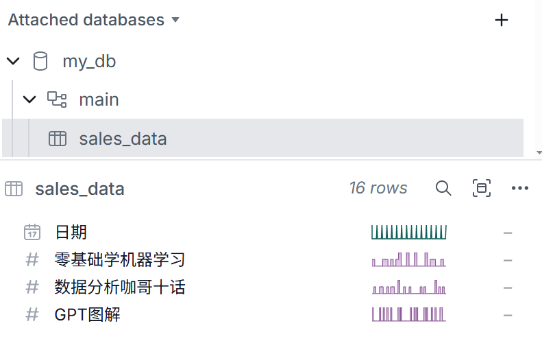

在 MotherDuck 网页版进行了几个简单操作，就把我的数据文件上载到了云端数据库。

现在，我应该可以成功的在 MCP Client，也就是 Cursor 的对话界面中调用 MotherDuck 的query 工具了吧！

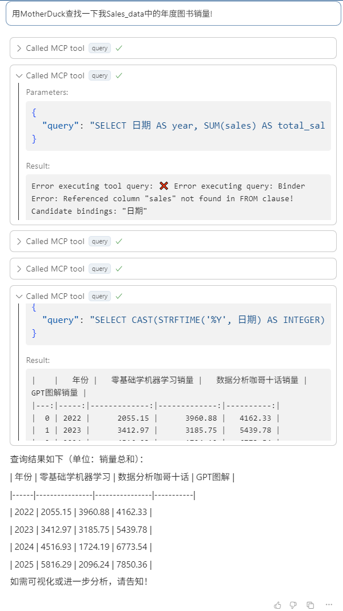

果然，这次工具开始运作了。由于需要进行额外的数据转换，初次尝试失败了。我惊讶地发现，它能主动将错误信息反馈给大模型，并持续尝试了好几次，直到问题得到解决。

最后它生成的成功查询如下：

```sql
{
 "query": "SELECT CAST(STRFTIME('%Y', 日期) AS INTEGER) AS 年份, SUM(\"零基础学机器
}
```

可以看出，经过多次尝试之后，这个数据分析 Agent 对我的 CSV 文件已经有了全面的掌控和了解，它知道了数据表中的每一个字段和涵义。而我，一个 MotherDuck 纯小白，在 MCP 协议的帮助之下，和大模型一起，用几分钟的时间掌握并成功运行了这个服务中的 query 工具。

## 总结一下

我们已经看到，MCP + LLM 释放了工具集成的潜力，并简化了代码开发周期。对于程序员而言，AI 正成为我们必备技能，而不再只是锦上添花。从小事做起，构建一个人工智能驱动的工具，你会发现，你能够省去很多时间精力。

AI 不仅能在 DuckDB 中自动完成数据转换，更可以通过 MCP 协议无缝对接各种数据库、云服务、大数据等平台，大幅减轻工程师在管道搭建与维护上的负担。借助 MCP 统一的服务发现与调用标准，AI 从“可有可无”蜕变为工作流程中不可或缺的核心引擎，让你能够快速构建各类智能化工具，把想法高效转化为实际产品。

## 思考题

1. 请你在你的编辑环境中选择另一种 MCP 服务和工具，并尝试使用它完成一个任务。

2. 在你当前的项目或团队中，哪些场景最适合引入 MCP 协议来替代手写集成？

3.MCP 与传统的 Function Calling 或 SDK 接入相比，你认为它的最大优势与潜在挑战各是什么？

欢迎你在留言区和我交流互动。如果这节课对你有启发，也欢迎分享给身边更多朋友，让我们一起分享 AI 提效的高光时刻。
