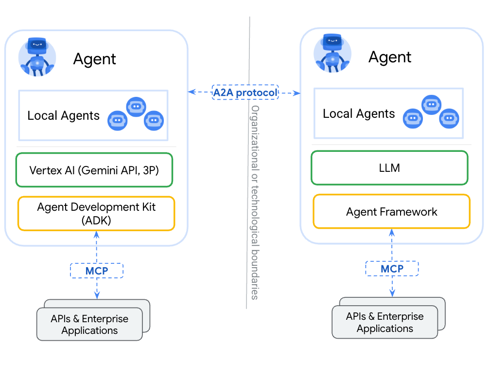
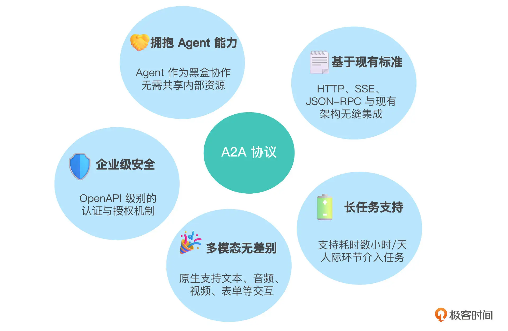
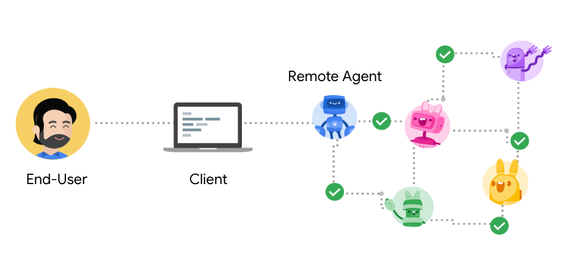
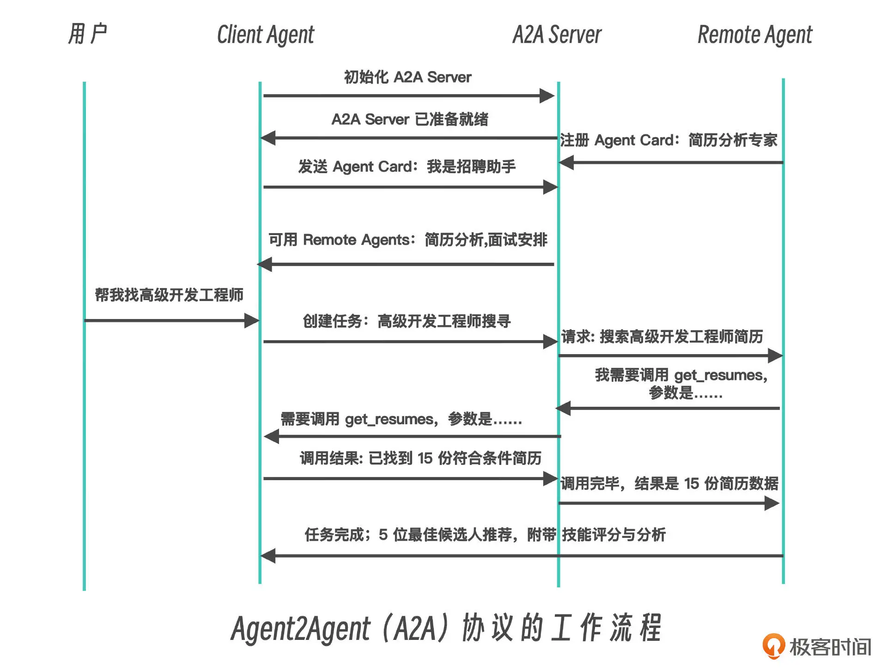
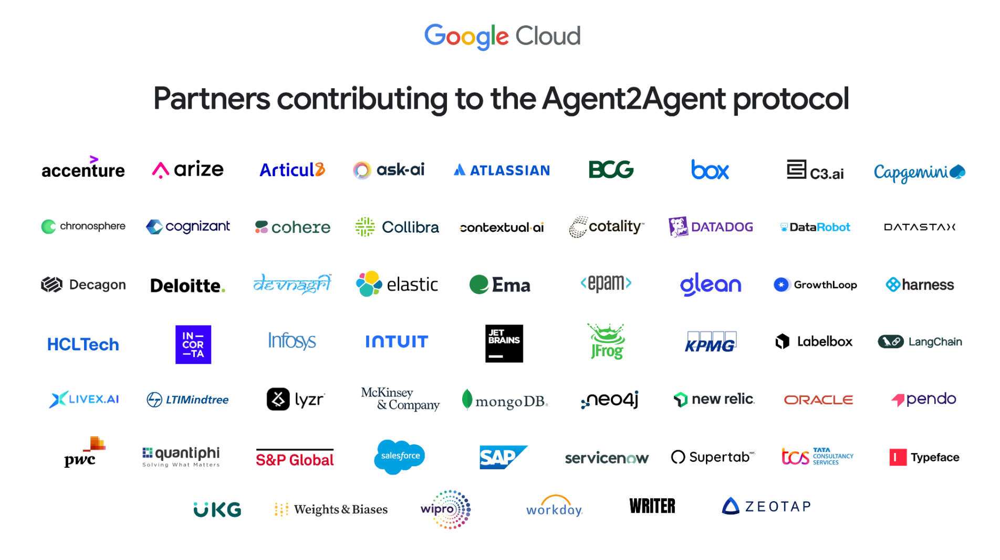

# 02 | 来而有往：A2A协议是Agent之间的桥梁

你好，我是黄佳。

在上一课中，我们通过在代码编辑器（MCP Host）中调用 MCP 服务器，完成了一次基于MCP 协议的数据分析实战。通过这个示例，你已经清晰地看到：MCP 使得大语言模型能够与外部工具和数据源无缝对接，从而大幅拓展了 AI 助手的能力边界。

就在我们还沉浸在 MCP 协议带来的激动与新奇之中，还未完全消化其中的细节，一项全新的相关协议便闪亮登场。在大规模部署自主 AI Agent 的时代，不同供应商和框架下的 Agent 往往各自为政，难以互通协作。在多 Agent 协作的场景下，我们需要一种全新的协议来实现Agent 之间的无缝对话。这就是 Google 在 2025 年 4 月发布的 Agent-to-Agent 协议（简称A2A）。

## A2A 和 MCP 是互补而非互斥关系

Agent2Agent（简称 A2A）协议应运而生，旨在为多 Agent 生态提供一套开放、标准、安全的互操作层，使不同厂商、不同平台上的 Agent 能够动态发现、调用并协同完成复杂任务，从而让 Agent 的生产力大幅上升，并优化成本。

A2A 与 MCP 各有专长，再加上 LLM，它们共同构成了一个完整的智能代理生态系统。正如下图所示，两者的关系可以这样理解：

- LLM：是 Agent 毫无疑问的“大脑”，负责处理信息，推理，做决策。

- MCP：负责模型与工具 / 资源的连接，是 Agent 的“手”，让 Agent 能够获取信息和执行操作。

- A2A：负责 Agent 之间的通信，是 Agent 的“嘴”，让 Agent 能够相互交流、协作完成任务。



这张 A2A 协议架构图展示了两个通过 A2A 协议互相通信的智能代理系统。每个系统虽然内部实现可能不同，但都可以通过标准化的 A2A 协议实现无缝协作。在图中左右两侧的代理系统顶部，都有一个主要的 “Agent”（智能体）组件，第二层为 “Local Agents”（本地智能体）层，这些本地智能体是在主智能体生态系统内工作的较小的子智能体。

左侧的 Agent 使用“Vertex AI（Gemini API，3P）”作为其 LLM 层；而右侧 Agent 的 “LLM” 表示可以使用任何大型语言模型。左侧的 “Agent Development Kit（ADK）”（代理开发工具包）和右侧的 “Agent Framework”（代理框架）也不同，意味着基于 LangGraph 框架和基于AutoGen 或者 CrewAI 等框架开发的 Agent 之间可以互通。

两侧的 Agent 都通过 MCP（模型上下文协议）连接到 “APIs & Enterprise Applications”（API和企业应用）。因此，可以说两个 Agent 系统通过 A2A 协议横向通信；每个系统都通过 MCP协议与外部工具和 API 纵向连接。

## A2A 的 5 大核心设计原则

A2A 协议设计有 5 个核心设计原则。



- A2A 协议 5 大核心设计原则

第一是拥抱 Agent 能力：A2A 不仅仅是将远端 Agent 视为工具调用，而是允许 Agent 以自由、非结构化的方式交换消息，支持跨内存、跨上下文的真实协作。与此同时，Agent 无需共享内部思考、计划或工具，因此 Agent 相互之间成为黑盒，无需向对方暴露任何不想暴露的隐私。

第二是基于现有标准：在 HTTP、Server-Sent Events、JSON-RPC 等成熟技术之上构建，确保与现有 IT 架构无缝集成。

第三是企业级安全：A2A 内置与 OpenAPI 同级别的认证与授权机制，满足企业级安全与合规需求。

第四是长任务支持：除了即时调用，还可管理需人机环节介入、耗时数小时甚至数天的深度研究任务，并实时反馈状态与结果。

第五是多模态无差别：不仅限于文本，还原生支持音频、视频、富表单、嵌入式 iframe 等多种交互形式。

## A2A 协议的角色

在讲完 A2A 的五大核心设计原则之后，我们接下来来看一下协议中定义的三个关键角色，看看它们如何各司其职、协同配合，共同支撑多 Agent 生态的运行。

如下图所示，A2A 协议定义了三个角色。

1. 用户（User）：最终用户（人类或服务），使用 Agent 系统完成任务。

2. 客户端（Client）：代表用户向远程 Agent 请求行动的实体。

3. 远程 Agent（Remote Agent）：作为 A2A 服务器的“黑盒”Agent。



- A2A 协议中的三种角色

需要注意的是，在 A2A 框架中，客户端（Client）通常也是一个具有一定决策能力 Agent。它代表用户行事 ，可以是应用程序、服务或另一个 AI Agent，负责选择合适的远程 Agent 来完成特定任务，管理与远程 Agent 的通信、认证和任务状态。

而远程 Agent（Remote Agent）则是执行实际任务的 Agent，作为“黑盒”存在 ，提供特定领域的专业能力，通过 AgentCard 声明自己的技能和接口，保持内部工作机制的不透明性。

这种设计使得 A2A 成为一个真正的 Agent-to-Agent 协议，而不仅仅是客户端 - 服务器架构的变种。

在实际应用中，我们可以看到多个 Agent 形成的网络，其中一个 Agent 可以同时是某些交互中的 Client，又在其他交互中作为 Remote Agent。例如，一个负责旅行规划的 Agent 可能作为 Client 向地图 Agent、酒店预订 Agent 和航班查询 Agent 发送请求，然后整合这些信息为用户提供完整的旅行方案。这种灵活的角色设计使得 A2A 协议能够支持复杂的 Agent 生态系统，实现 Agent 之间的专业分工和协作。

## A2A 协议的核心对象

A2A 协议设计了一套完整的对象体系，包括 Agent Card、Task、Artifact 和 Message。它们用于实现不同 Agent 之间的高效协作，这些核心对象相互配合，共同构成了 A2A 的通信框架。

### Agent Card（Agent 名片）

每个支持 A2A 的远程 Agent 需要发布一个 JSON 格式的 “Agent Card”，描述该 Agent 的能力和认证机制。Client 可以通过这些信息选择最适合的 Agent 来完成任务。

我们来看看一个典型的 Agent Card 长什么样：

```json
{
 "name": "Google Maps Agent",
 "description": "Plan routes, remember places, and generate directions",
 "url": "https://maps-agent.google.com",
 "provider": {
   "organization": "Google",
   "url": "https://google.com"
 },
 "version": "1.0.0",
 "authentication": {
   "schemes": "OAuth2"
 },
 "defaultInputModes": ["text/plain"],
 "defaultOutputModes": ["text/plain", "application/html"],
 "capabilities": {
   "streaming": true,
   "pushNotifications": false
 },
 "skills": [
   {
     "id": "route-planner",
     "name": "Route planning",
     "description": "Helps plan routing between two locations",
     "tags": ["maps", "routing", "navigation"],
     "examples": [
       "plan my route from Sunnyvale to Mountain View",
       "what's the commute time from Sunnyvale to San Francisco at 9AM"
     ],
     "outputModes": ["application/html", "video/mp4"]
   }
 ]
}
```

### Task（任务）

Task 是 Client 和 Remote Agent 之间协作的核心概念。一个 Task 代表一个需要完成的任务，包含状态、历史记录和结果。

Task 的具体状态列表如下：

- submitted（已提交）

- working（处理中）

- input-required（需要额外输入）

- completed（已完成）

- canceled（已取消）

- failed（失败）

- unknown（未知）

## Artifact（成果）

Artifact 是 Remote Agent 生成的任务结果。Artifact 可以有多个部分（parts），可以是文本、图像等。

### Message（消息）

Message 用于 Client 和 Remote Agent 之间的通信，可以包含指令、状态更新等内容。一个Message 可以包含多个 parts，用于传递不同类型的内容。

## A2A 协议工作流程

接下来，我们通过 A2A 协议的工作流程和具体示例，来展示这些对象如何协同工作，完成Agent 之间的对话。

A2A 协议的典型工作流程如下：

1. 能力发现：每个 Agent 通过一个 JSON 格式的 “Agent Card” 公布自己能执行的能力（如检索文档、调度会议等）。

2. 任务管理：Agent 间围绕一个 “task” 对象展开协作。该对象有生命周期、状态更新和最终产物（artifact），支持即时完成与长跑任务两种模式。

3. 消息协作：双方可互发消息，携带上下文、用户指令或中间产物；消息中包含若干“parts”，每个 part 都指明内容类型，便于双方就 UI 呈现形式（如图片、表单、视频）进行协商。

4. 状态同步：通过 SSE 等机制，Client Agent 与 Remote Agent 保持实时状态同步，确保用户看到最新的进度和结果。

下面用一个简单的例子展示 A2A 协议的基本请求 - 响应流程：

Client 发送任务

```json
{
 "jsonrpc": "2.0",
 "id": 1,
 "method": "tasks/send",
 "params": {
   "id": "de38c76d-d54c-436c-8b9f-4c2703648d64",
   "message": {
     "role": "user",
     "parts": [
       {
         "type": "text",
         "text": "请分析下面5位候选人是否符合岗位需求，并推荐最佳人选。"
       }
     ]
   },
   "metadata": {}
 }
}
```

Remote Agent 响应

```json
{
 "jsonrpc": "2.0",
 "id": 1,
 "result": {
   "id": "de38c76d-d54c-436c-8b9f-4c2703648d64",
   "sessionId": "c295ea44-7543-4f78-b524-7a38915ad6e4",
   "status": {
     "state": "completed"
   },
   "artifacts": [
     {
       "name": "result",
       "parts": [
         {
           "type": "text",
           "text": "第二位候选人最符合你的需求!"
         }
       ]
     }
   ],
   "metadata": {}
 }
}
```

以“招聘候选人搜寻”这个应用场景为例：

- 用户在统一界面下向自己的 Agent 发起“寻找 XX 岗位候选人”请求。

- Client Agent 根据岗位需求调用简历检索 Agent、技能筛选 Agent 等多个 Remote Agent。

- 各 Agent 协同返回候选人名单（artifact），并由 Client Agent 汇总、展示。

- 后续可继续调用“面试安排 Agent”“背景调查 Agent”，形成端到端招聘流程自动化。



A2A 协议中，Agent 之间除了基本的任务处理外，A2A 还支持流式响应，使用 Server-SentEvents（SSE）实现流式传输结果；支持 Agent 请求额外信息的多轮交互对话和长时间运行任务的异步通知，以及多模态数据，如文本、文件、结构化数据等多种类型。

## A2A 的生态与未来

A2A 是 Google 在大模型应用开发的关键节点推出的关键协议，充满了强行卡占生态位的意味。自从 Transformer 的论文发布以来，Google 作为 AI 浪潮的一贯引领者和开拓者，起了大早，赶了晚集，2023 年以来被 OpenAI 和 Anthropic 等一众小弟远远甩在身后，因此此时此刻的 A2A 绝对不容有失。

目前，Google Cloud 已联手 50 多家技术与服务伙伴（包括 Atlassian、Salesforce、MongoDB、Accenture、Deloitte 等），共建 A2A 生态。未来预计将在开源社区中逐步完善规范，并推出生产级实现，推动异构 Agent 在企业级场景中的深度互操作，助力跨系统、跨组织的智能协作大规模落地。



- A2A 庞大的生态圈

当然，和 MCP 相比，A2A 的协议发展更属早期，让我们保持关注，拭目以待。

## 总结一下

A2A 和 MCP 的互补关系：

- MCP：提供垂直集成，将代理连接到工具和资源。

- A2A：提供水平通信，将代理连接到其他代理。

Google A2A 协议中的 Agent 跨越了“组织或技术边界”（Organizational or technologicalboundaries），这表明这些 Agent 系统可能属于不同的组织或建立在不同的技术栈上，但它们仍然可以通过标准化的 A2A 协议有效地通信。

这种架构使得不同厂商、不同技术框架开发的代理能够维持自己的内部实现细节，同时实现互操作，这正是 A2A 协议的核心价值主张之一。这是 A2A 协议的重要特点，它实现了真正的Agent 到 Agent 的通信模式。

## 思考题

1. 当远程 Agent 响应缓慢或失败时，客户端 Agent 应如何设计调用与重试策略，才能保证任务可靠完成？

- 提示：客户端 Agent 在发出任务（Task）后，应持续监听其状态变化（通过 SSE 或轮询）。若进入 failed 或超时未从 working 状态转为 completed。

2. 在跨 Agent 共享敏感音频、视频或结构化报告时，如何利用 A2A 协议中的认证与授权机制，保障数据安全？

- 提示：在 A2A 中，敏感数据通过 Message 的 parts 字段分段传输，每段都可以指定内容类型和访问策略。

欢迎你在留言区记录自己的收获或者疑问。如果这节课对你有启发，别忘了分享给身边更多朋友。
