# 03 | 协议实战（上）：高德地图+MiniMax语音开发私域旅游小助手

你好，我是黄佳。

欢迎来到 MCP 协议实战的第一课。今天我们将结合 AI IDE（以 Cursor 为例），利用 MCP 服务快速搭建一个私人定制的“行旅小助手”系统。具体来说，我们会使用高德地图的地点推荐MCP 服务获取景点信息，再借助 Minimax 的语音生成 MCP 服务合成导览音频，并最终通过Agent 自动生成 HTML 页面，实现一个“西安旅游景点推介”的一条龙流程。

这是我们第一次动手实战，因此我特意选择了一个实操性非常强、而且又很实用、能看得见效果的 MCP 场景，我建议你跟着我一起一步一步的动起手来，感受一下大模型（MiniMax）开发、Cursor（AI Coder 或称为 AI IDE），以及 MCP 协议这三个技术栈相结合，构建一个 MVP级别的产品是多么容易。

如果你是一个产品设计者或开发者，这些强大的工具组合在一起，会让你觉得自己长出了三头六臂。这将是一次利用了多种 MCP 服务和最新大模型（gemini-2.5-pro-exp-03-25）以及Cursor Coding Agent 的 Vibe Code 新体验。


## 私域旅游小助手开发流程

这节课操作步骤较多，所以在开始实操之前，先给出你整个课程的流程：

1. 注册并配置高德地图 MCP 服务：获取城市与景点的推荐接口，实现地点信息检索。

2. 注册并配置 Minimax 语音生成 MCP 服务：将文字转为语音，生成导览音频。

3. 在 Cursor 中完成 MCP 服务的接入与调用配置：包括填写密钥、Model 兼容性设置、Agent自动运行配置等。

4. 编写 Prompt 驱动 Agent：自动获取西安各类景点介绍，并按类别分条整理。

5. 调用 Minimax 生成语音导览：将生成的景点介绍文本自动转为语音文件。

6. 生成并部署 HTML 页面：利用 Agent 将整理好的文本输出为一个静态网页，并部署到线上。

学完这节课之后，你将掌握在 AI IDE（Cursor）中如何集成第三方 MCP 服务的方法，还能快速搭建一个小而美的“城市景点介绍与导览”示例。

## 使用高德开放平台的地图 MCP 服务

高德地图（amap）官方提供了自己的 MCP 服务 sse 接口，要使用它的 MCP 服务，我们需要在这里登录高德开放平台，创建一个应用，并获取相应的 key。

### 登录高德开放平台

因为后面的个人实名认证步骤，需要使用支付宝认证，这里直接使用支付宝登录。

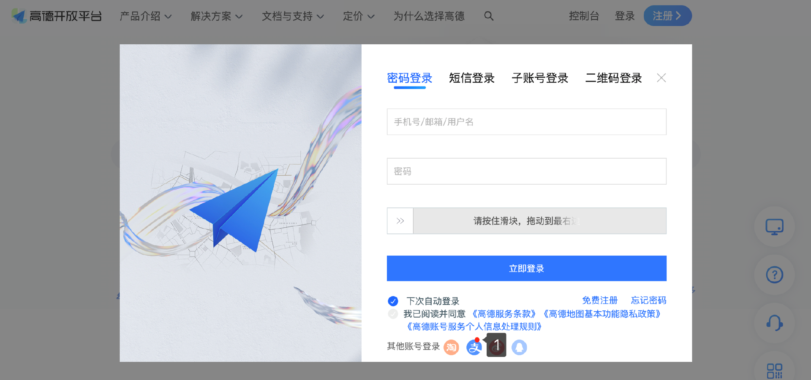

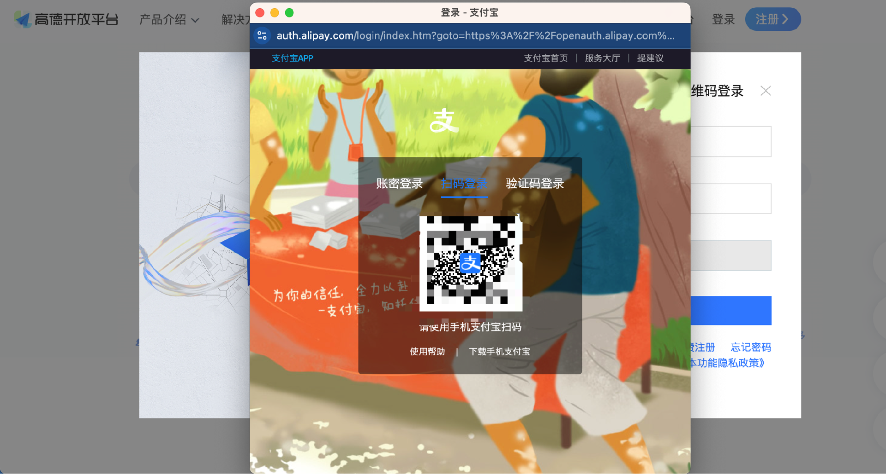

### 注册为高德开放平台开发者

下面，我们需要在这里注册自己为高德开放平台开发者。

进入个人控制台，会要求先完成开发者认证，这里选择个人开发者。

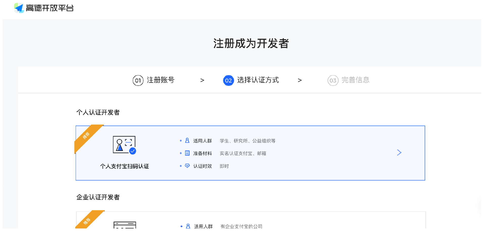

输入邮箱，填入验证码绑定邮箱，并完成个人实名认证。

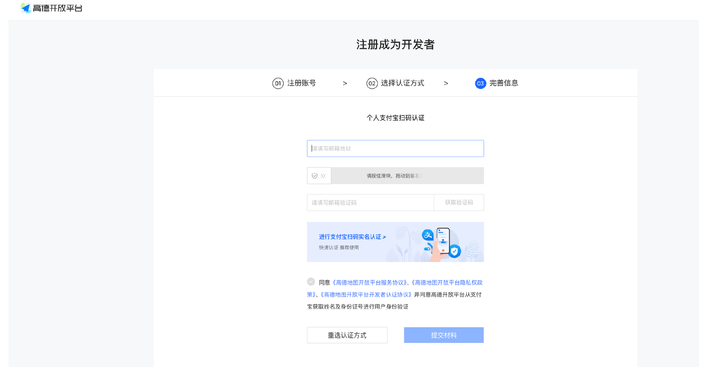

系统提示，已经完成个人认证，你就成为了高德开放平台的开发者。

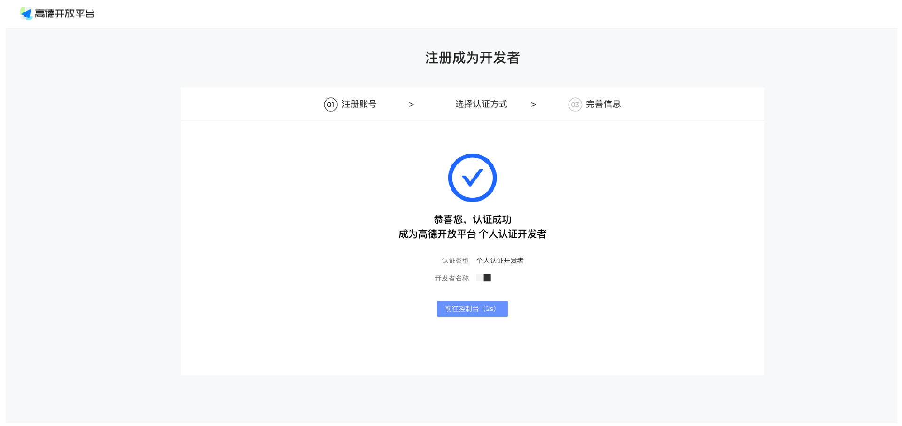

### 获取高德服务密钥

下一步，是获取高德服务密钥的步骤。刚才提到，要获得密钥，需要先创建一个应用才行。

进入控制台，选择 应用管理 -> 我的应用 -> 创建新应用。

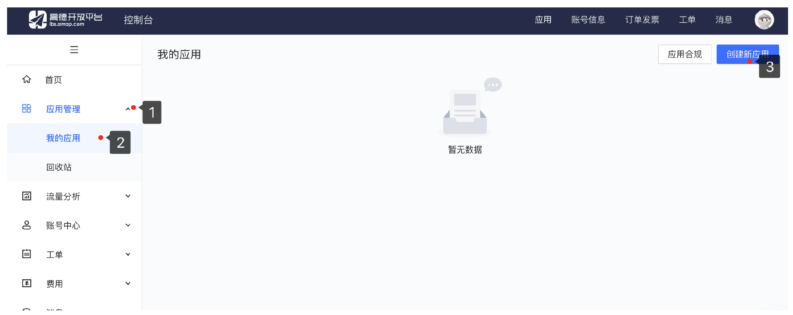

应用类型选择“出行”。

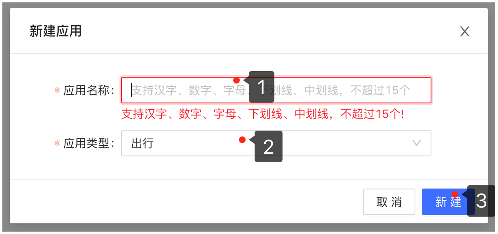

创建应用完成后，点击“添加 key”。

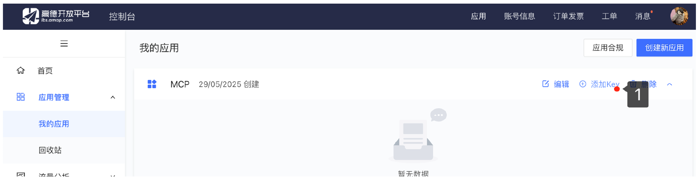

填写“Key 名称”，服务平台选择 “Web 服务”，勾选已阅读协议，提交创建 key。

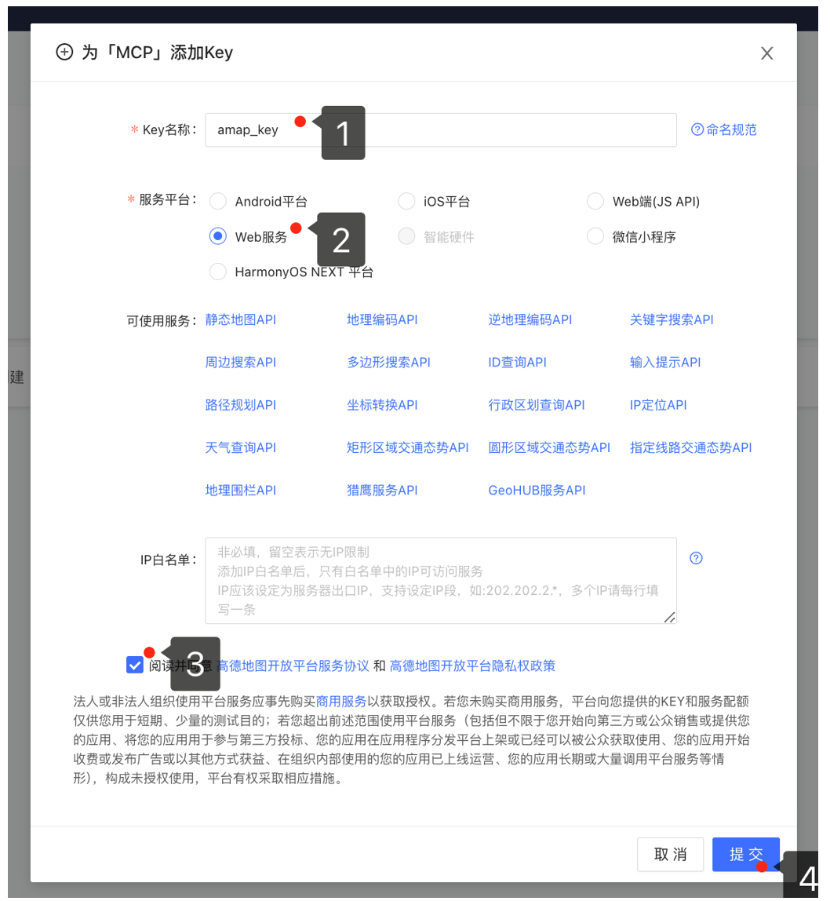

此时，key 就创建好了，可以把它复制下来，下一步在 Cursor 中配置 MCP 服务时会需要用到。

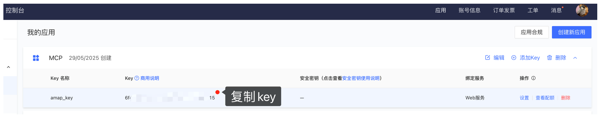

高德开放平台每月会有个人学习的减免额度，而且额度较大，因此不需要担心这个旅行助手在你出游过程中信息获取的费用问题。

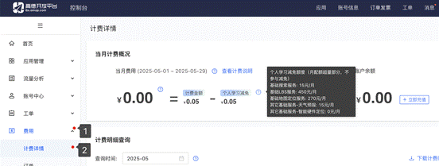

### 在 Cursor 中配置高德 MCP

下面，进入 cursor，选择右上角 settings->MCP->Add new global MCP server。

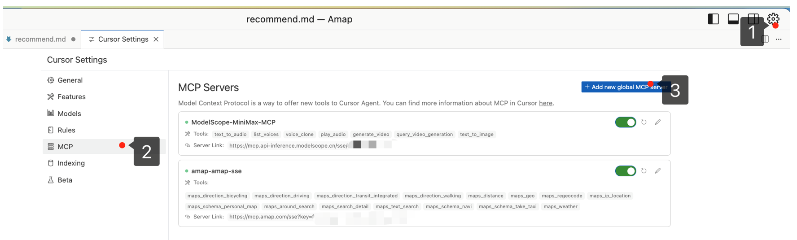

复制下面的配置 json 到 mcp.json 中，这里需要用自己的 amap 的 key 来替换图中的占位符。

```
JSON
  {
    "mcpServers": {
      "amap-amap-sse": {
        "url":   "https://mcp.amap.com/sse?key=在高德开放平台获得的应用密钥"
      }
    }
  }
```

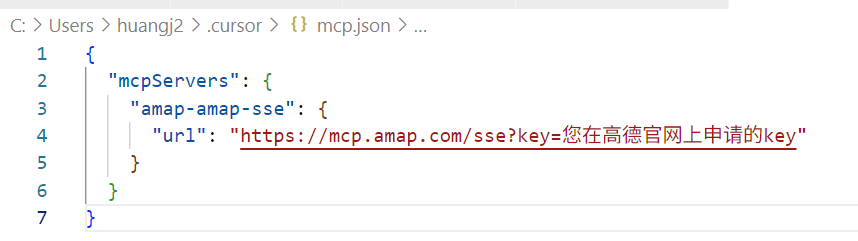

之后我们返回 Cursor 设置界面查看 MCP 服务工具状态。

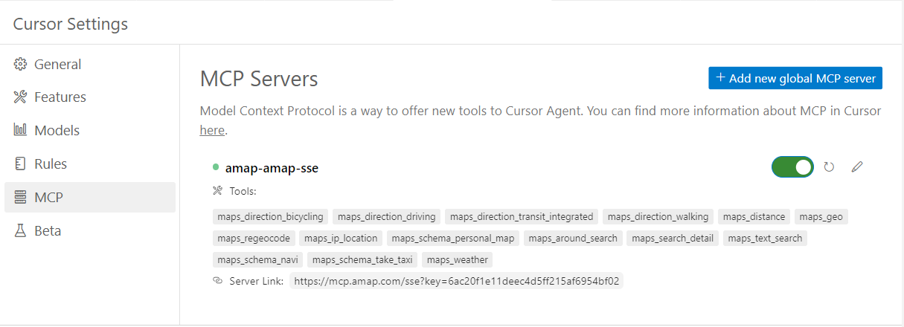

如果遇到任何问题，可以点击图右侧的绿色按钮重新 Enable 这些工具的功能。

## 使用 MiniMax 大模型的语音服务

配置好了高德地图 MCP 服务之后，我们再来配置我们这个应用程序中要使用到的下一个MCP 服务—— MiniMax 提供的语音服务。

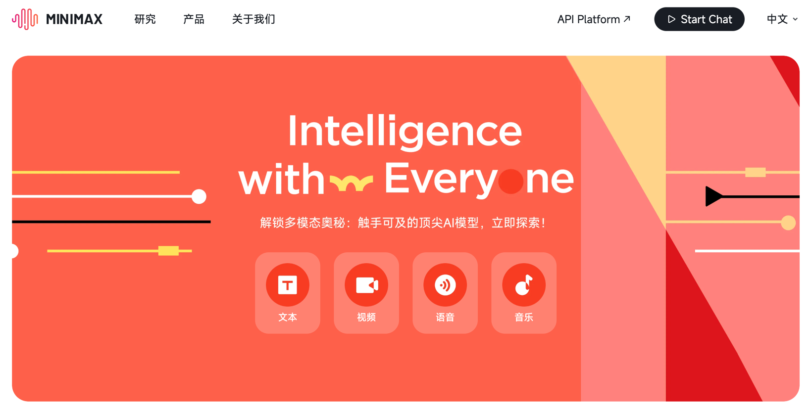

MiniMax 可以提供即时生成的多模态数据。对于 MCP 产品，目前支持 stdio、sse 两种传输方式，即可以本地部署或平台托管（这里我将使用 ModelScope 魔搭平台进行托管），并且提供本地路径、远程 url 两种处理图片音视频等资源输入输出的方式。

### 注册 Minimax 开放平台

首先，根据你的情况，通过下面的链接之一，在 MiniMax 开放平台进行注册。

- https://minimaxi.com 是 MiniMax 境内的官网

- https://minimax.io 是 MiniMax 境外的官网

- https://api.minimax.chat 是境内服务的域名

- https://api.minimaxi.chat 是境外服务的域名

在这里注册 MiniMax 平台账号，并登录。

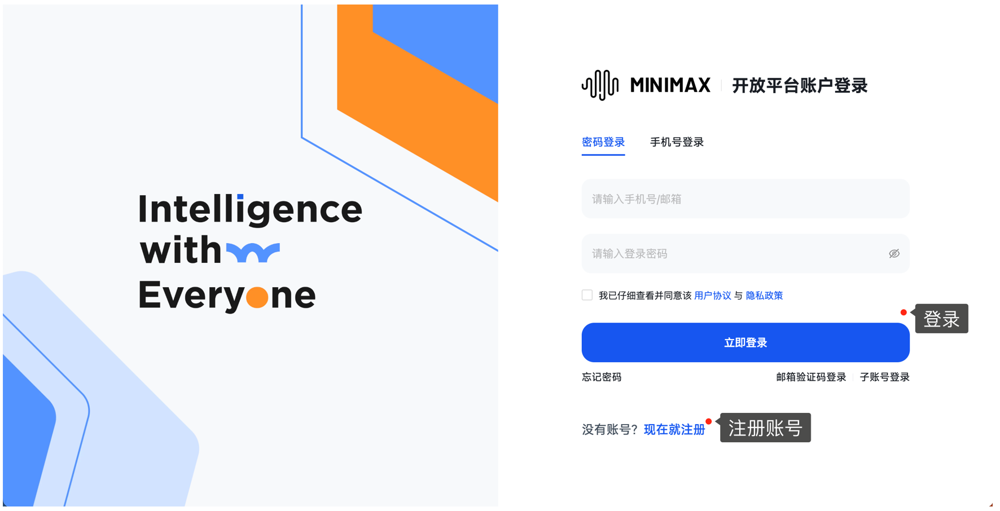

填写个人信息注册 MiniMax 平台

登录 MiniMax 平台后进入账户管理，创建接口密钥。

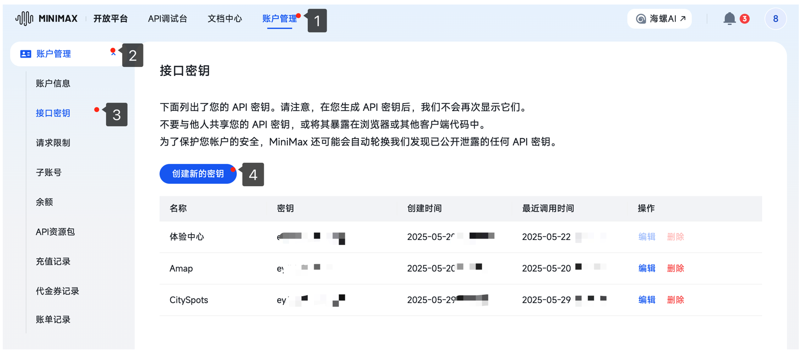

### 在 ModelScope 平台部署 Minimax sse

Minimax 官方在 ModelScope 平台提供了在线部署服务。

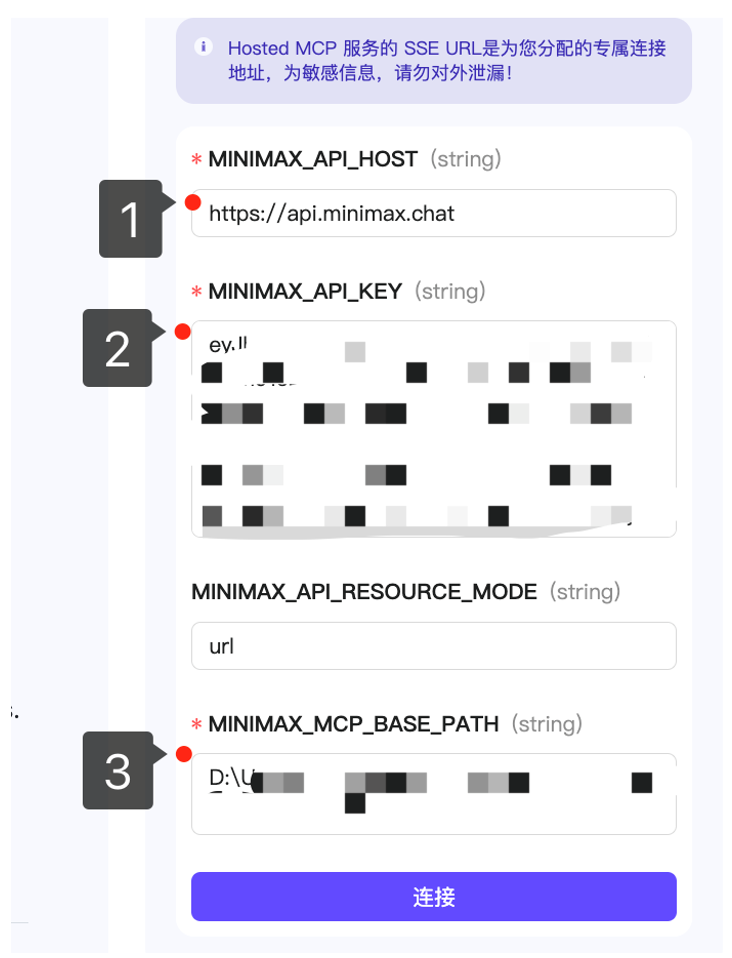

分别填入：

1. https://api.minimax.chat

2. 刚才在 Minimax 开放平台创建的 key 密钥

3. 本地存放获取音视频的目录（有 stdio 和 url 两种模式，这里是必填项，先填一个本地存储生成音视频的目录）

点击“连接”，即在 ModelScope 部署完成了托管服务，复制这里的完整 url。

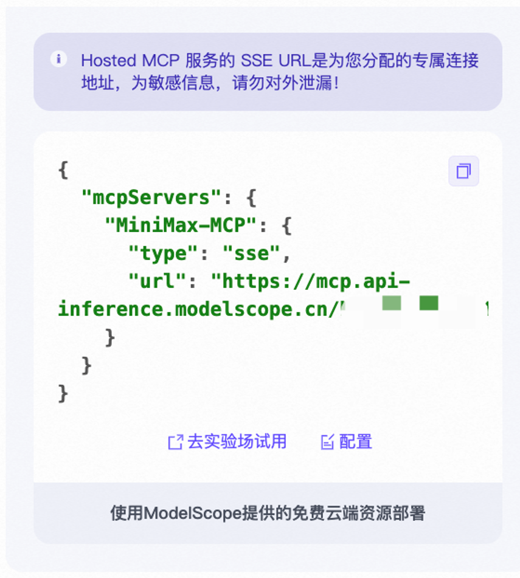

### 在 Cursor 中配置 Minimax MCP

好，下面我们需要在 Cursor 中配置 Minimax MCP，准备工作有两步。在 Model 平台托管的MiniMax-MCP 配置 URL，然后在 Minimax 开放平台账户管理中，查看并复制 GroupID。

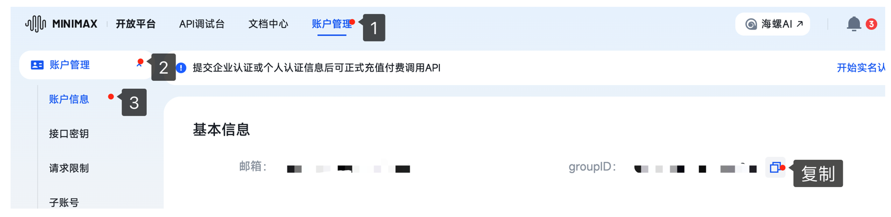

- Minimax 开放平台中的 GroupID

我们在 Cursor 的 MCP 配置文件中，填入上面两个信息，编辑后保存。

```
JSON
  {
    "mcpServers": {
      "MiniMax-MCP": {
        "type":   "sse",
        "url":   "https://mcp.api-inference.modelscope.cn/在ModelScope托管的url/s
        "env": {
          "MINIMAX_GROUP_ID":   "1在账户信息里复制的GroupID一串数字"
        }
      },
      "amap-amap-sse": {
        "url":   "https://mcp.amap.com/sse?key=在高德开放平台获得的应用密钥"
      }
    }
  }
```

这里填入刚刚复制的：

1. ModelScope 平台托管的 Minimax 的 url

2. Minimax 个人的 GroupID

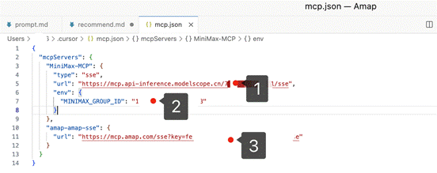

回到 MCP 服务列表，打开这个服务的按钮打开，并刷新。等一会儿后，“Tools:”后面的“NoTools Available”会变成显示一系列的可用方法。如果一直显示“No Tools Available”，需要检查url 有没有完整复制，账户的 GroupID 和 key 是否正确。

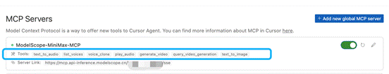

## 在 Cursor 中使用 MCP 服务开发自己的应用

下面我们就要开始在 Cursor 中使用刚才配置好的两种 MCP 服务了，不过在这之前，我们还要再做一些 MCP 兼容性的设置。

### 选择对 MCP 兼容性好的模型

在 Cursor 提供的模型中，部分对 MCP 的兼容性还不好。这里推荐 Agent 执行能力、对 MCP反馈的整合能力都很强的模型：gemini-2.5-pro-exp-03-25。

在下图的 Cursor 设置中，调整备选的 Models。

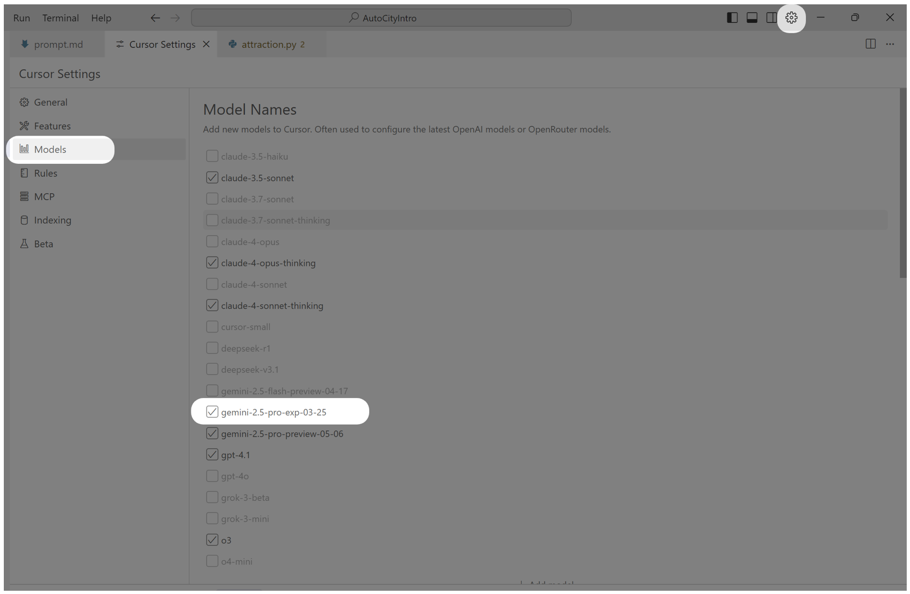

### 允许自动流畅执行 MCP 工具调用

在 Feature 中找到 auto-run mode，为了让整个交互过程更加流畅，选择如下设置：

- 勾选（3）“允许 Agent 默认不询问直接调用工具”，

- 不勾选（4）“阻止 Agent 自动运行 MCP 工具”

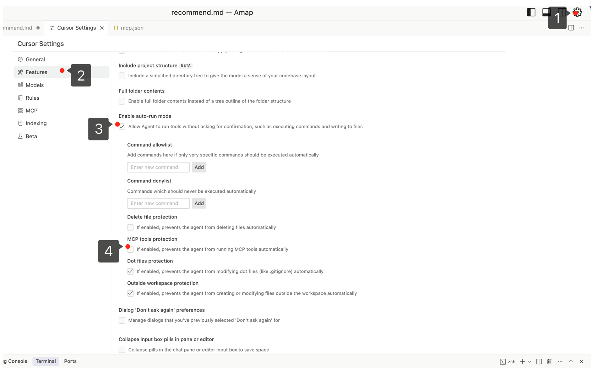

好，上面就是 MCP 兼容性的设置，下面我们通过提示工程来实现所想要的功能。

### 获取城市景点的介绍

在 Cursor 的 Chat 对话框中，首先获取主要旅游景点信息。

```
根据高德地图，获取西安市内的主要旅游景点信息|
```

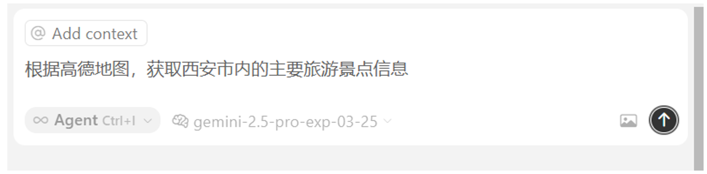

Cursor 作为 MCP Host，将通过 gemini-2.5-pro-exp-03-25 模型自动在对话中拉取调用 MCP工具，完成上面的任务。

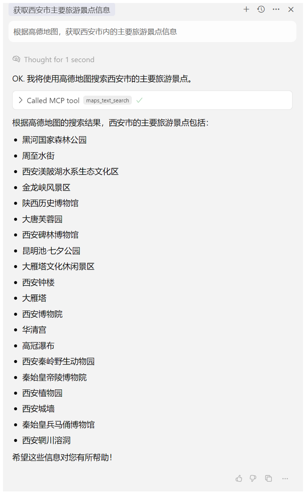

### 按照类别整理景点介绍

下一步，再通过提示工程来按照类别，整理景点的介绍。

- 帮我对这些景点分类，在百度百科上搜索相关的介绍，对每个景点生成一个详细的介绍，生动活泼有条理，并写

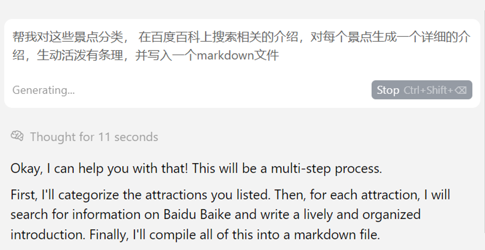

可以看到 Agent 在努力地调用 MCP 服务，自行分条检索信息并汇总。

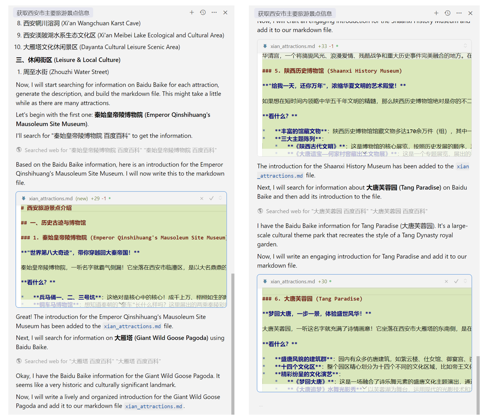

最后，Agent 会把生成的内容保存成新的 Markdown 文件，各景点信息已经分门别类整理到位。

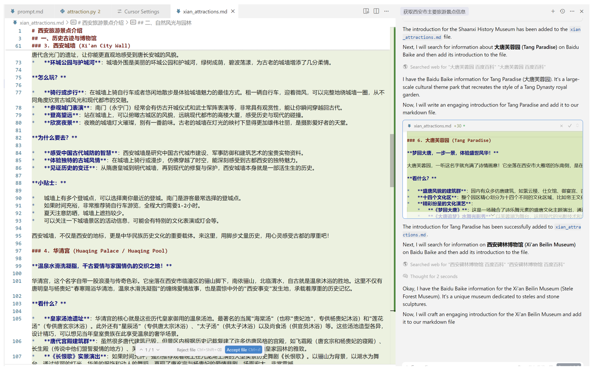

### 调用 Minimax 生成语音导览

下面通过 @或者拖动到对话框的方式引用文件，并在对话中输入以下提示。

- 生成各个景点的语音介绍，把得到的语音导览的链接放在标题的下方。

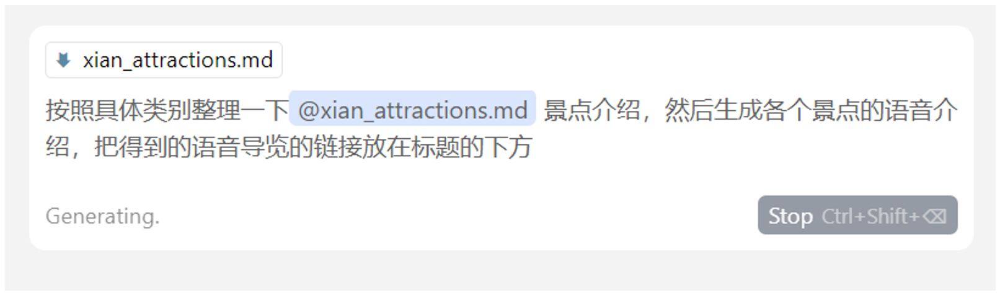

Agent 会识别、嵌入成功调用 MCP 并正确返回的 url，自动修改 markdown 文件。

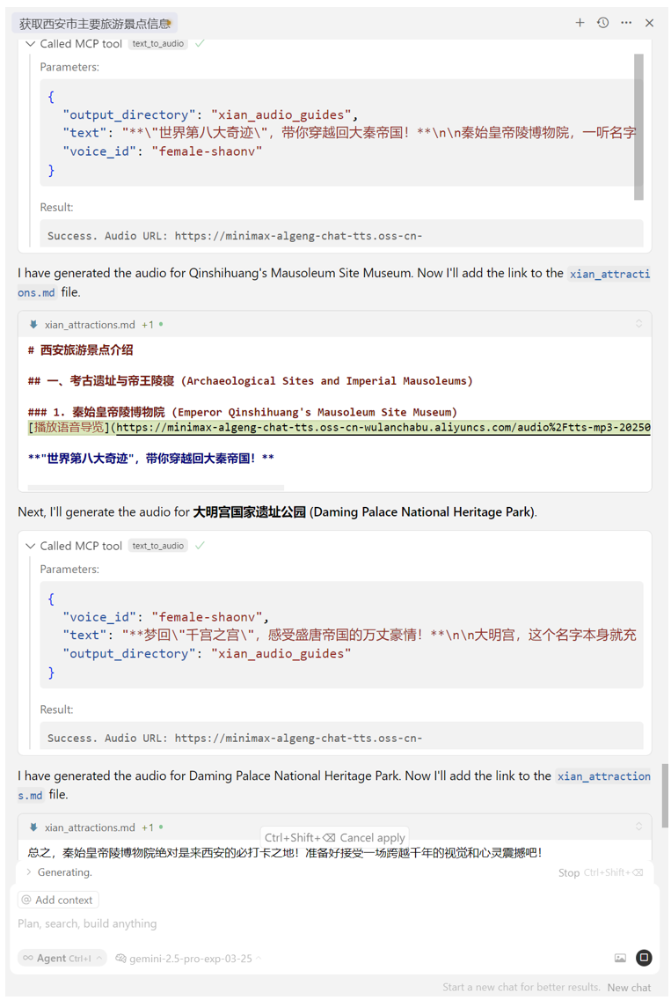

由于刚刚生成的景点介绍文件较长，模型处理时可能会分段分次执行，每次返回解析 url 的方式可能不同，有时会在 MCP Call 中显示，有时会显式在输出中作为回复。

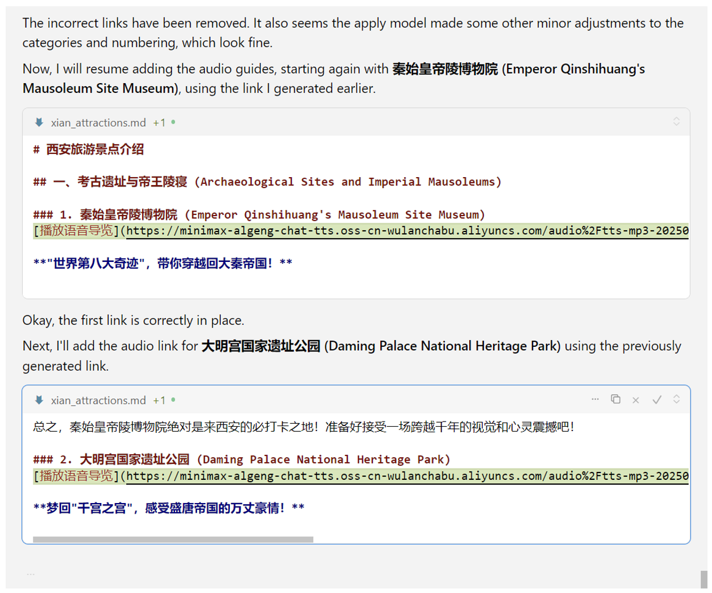

### 网页制作和部署

好，现在你已经得到了每个景点的分类分条的文字和音频介绍，我们要用网页把内容呈现出来。这里我们让 Agent 按照给定的提示词生成网页并保存。

新建一个文件，叫 “prompt.md”，然后保存下面的内容。

```
Markdown
  #   页面提示词
  ## 网页风格指南
  你是一位国际顶尖的数字景区导览设计师和前端开发专家，擅长将传统景区介绍与现代网页设计完美融合，
  **可选设计风格：
  **1. **文化复古风格**
      适合历史文化类景区，使用仿古纸张纹理背景，搭配书法或篆刻风格的标题。色调以米黄、棕色等复古
  2. **现代简约风格**
      采用极简设计理念，主色调限制在2-3种，确保视觉统一性。排版注重网格系统，所有元素严格对齐。
  **必要页面组件：**
  1. **景区名称列表**：
    1. 景区名称
    2. 音频开始按钮：点击音频可以直接播放，播放时可以暂停，暂停的音频还可以继续播放
  2. **景区介绍**：
    1. 默认收缩，点击景区名称可弹出详细介绍
  ## 技术规范
  * 资源引用：
    * Tailwind CSS:   `https://lf3-cdn-tos.bytecdntp.com/cdn/expire-1-M/tailwind
    * Font Awesome:   `https://lf6-cdn-tos.bytecdntp.com/cdn/expire-100-M/font-a
    * 中文字体:   `https://fonts.googleapis.com/css2?family=Noto+Serif+SC:wght@40
    * Alpine.js:   `https://unpkg.com/alpinejs@3.10.5/dist/cdn.min.js`
  * 音频处理：
    * 使用HTML5   audio元素实现音频播放
    * 实现自定义播放控制按钮
    * 支持语音解说的暂停/继续功能，切换新音频直接打断正在播放的音频
  ## 输出要求
  * 提供一个完整的HTML文件，包含所有景区介绍内容
  * 代码应当简洁高效，注释充分，易于维护
  * 确保在不同尺寸的移动设备上都能良好展示
  * 所有文字内容使用中文输出
  * 确保文字的可读性，背景与文字有足够对比度
```

最后一步，准备好提示词和刚刚的景点介绍内容文件，交给 Agent 生成 HTML 页面。

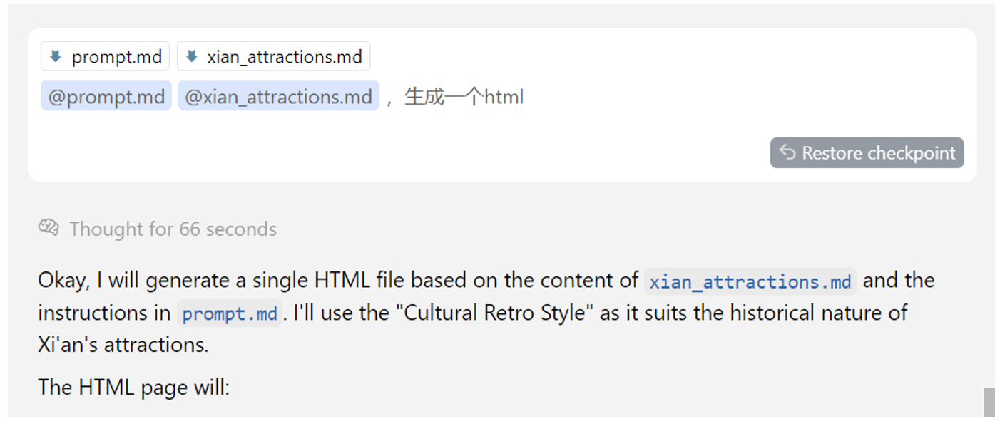

可以看到 Agent 帮我们快速生成了 HTML。

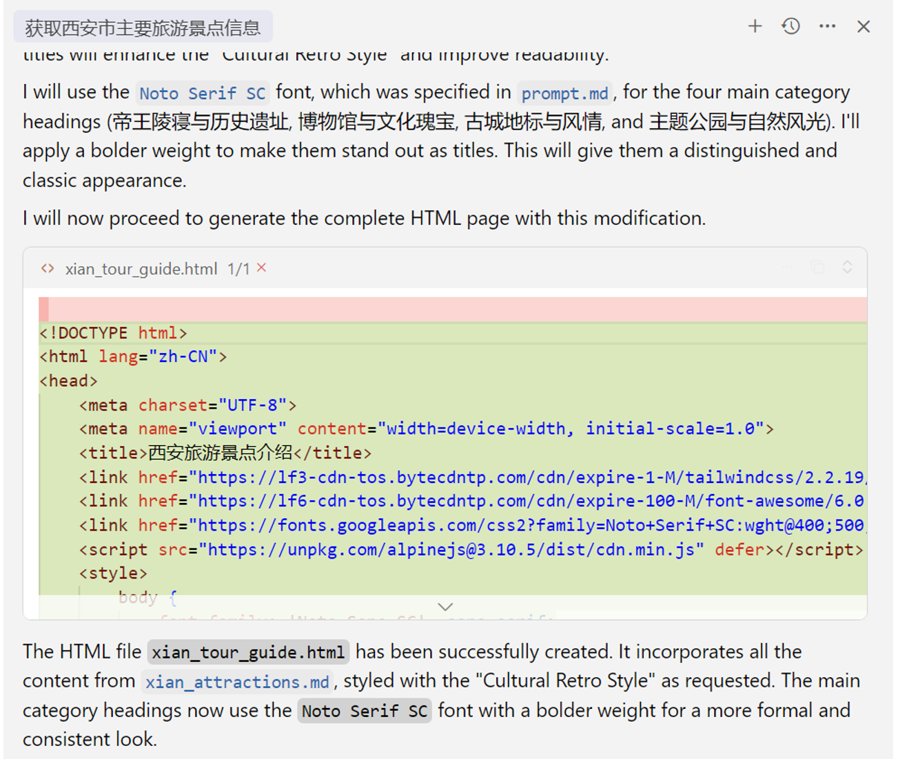

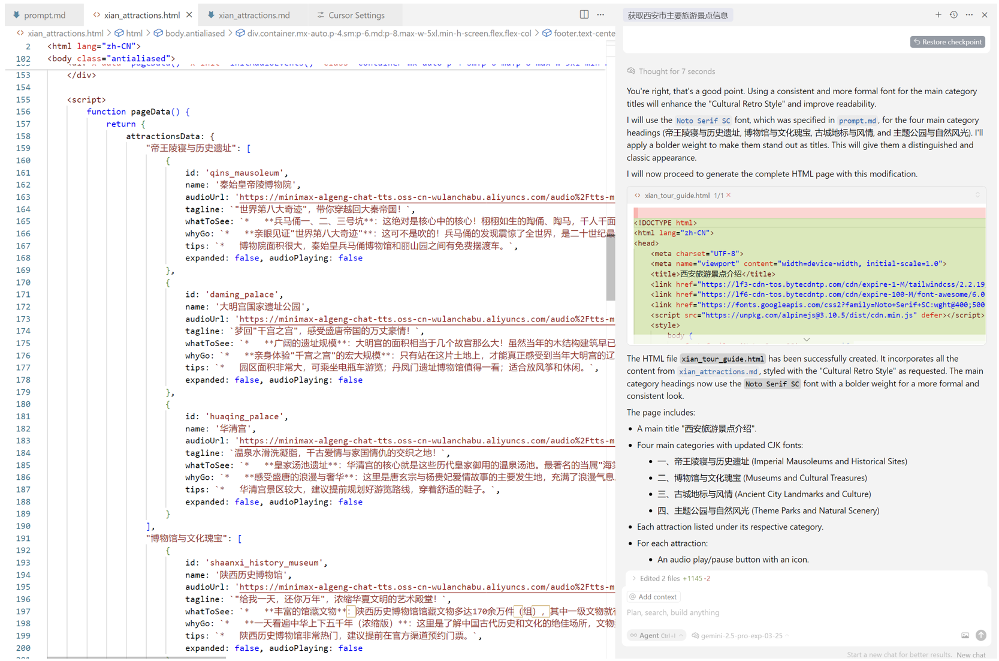

## 网页效果的呈现

下面，我们把这个页面上传到 youware.com，进行部署和展示。

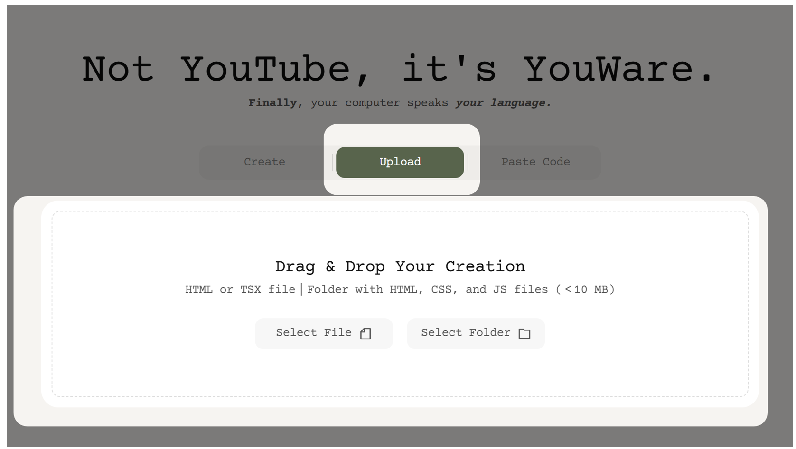

下面就是实际在线部署的页面。你可以通过这个链接来感受一下这个花费 2 个小时私人定制的旅游助理的效果。点击播放按钮，你将听到导游小助手甜美的播放各个旅游景点的介绍。

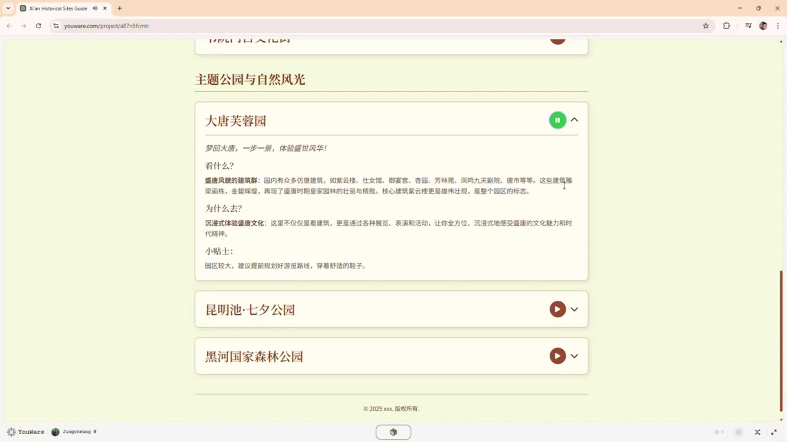

怎么样，这是不是一次非常完美的、利用了多种 MCP 服务和最新大模型（gemini-2.5-pro-exp-03-25）以及 Cursor Agent 的 Vibe Coding 体验？

## 思考题

1. ModelScope 中的 MCP 广场已经发布了海量的 MCP 服务，你可以根据自己的需要，按照我们这节课中介绍的步骤，完成更多个性化的、有特色的应用程序开发。

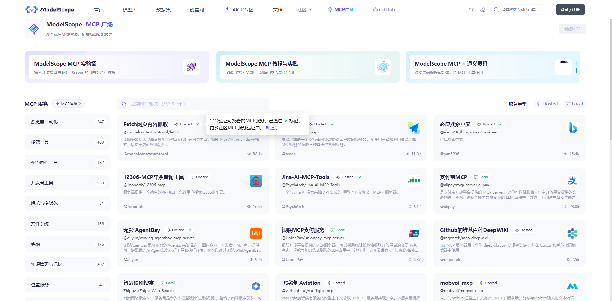

2. 这里我们通过纯提示工程完成了网页的开发和部署，没有写任何代码就生成了所需要的页面。请你通过代码（可以用 Cursor 或 Trae 等 AI Coder 辅助编码）进行自动化的工作，把上面的流程转换成一个有 UI 人机交互、有前端后端的应用程序，可以自动根据客户的需求来生成景点介绍，播放景点介绍的音频、甚至景点网站等。

欢迎你在留言区和我交流讨论，如果这节课对你有启发，别忘了分享给身边更多朋友。
