# 05 | 协议实战（下）：通过A2A，你的智能体不仅能对话还可以协作！

你好，我是黄佳。

上节课我们完成了快速搭建 MCP RAG 服务，这节课我们继续进行协议实战，感受一下 A2A的协议用法。

下面我将逐步给你展示一个通过 A2A 协议搭建的智能体平台，让你的智能体不仅能够相互对话，还能够协作协力来完成一个任务。

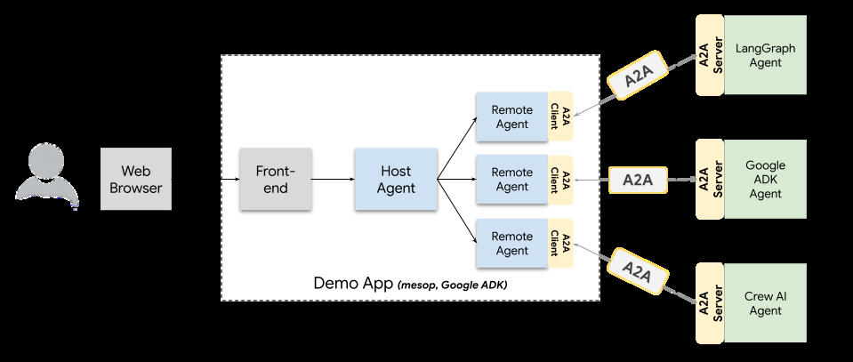

- A2A Demo 系统架构图 图源：https://github.com/google-a2a/a2a-samples/tree/main/demo

在这个基于 A2A 协议的智能体平台中，用户在浏览器端发出指令后，前端会将该请求传给Host Agent，由它负责解析用户意图、拆解具体子任务，并且并行触发多个 Remote Agent；每个 Remote Agent 通过 A2A Client 将子任务封装为标准的 JSON-RPC 请求，发送给远端对应的 A2A Server，再由后者调用各自擅长的智能体模块（如 LangGraph Agent 负责外汇兑换、Google ADK Agent 负责报销收据、Crew AI Agent 负责根据文字内容来生成图片等）执行并返回结果；最后，Host Agent 汇总并格式化各路反馈，一并呈现给用户，实现多智能体的分工协作与能力互补。

## 项目准备工作

我们先来搞定一些必要的准备工作。

### 安装 Python3.12 版本

A2A 协议非常新，所以它对环境的要求也是很高的。因此，要确保我们已经安装了 Python3.12 版本。如果你的系统没有这个版本，那就要更新一下。

下面是在 Ubuntu 系统中更新 Python 的代码示例：

```sql
sudo apt update
sudo apt install software-properties-common
sudo add-apt-repository ppa:deadsnakes/ppa
sudo apt update
sudo apt install -y python3.12 python3.12-venv python3.12-dev
```

在 Ubuntu 系统中，检查 Python 3.12 是否安装成功：

```
python3.12 --version
Python 3.12.10
```

其他各种系统的版本安装我就不赘述了。

### 克隆项目代码库

安装好 Python 包之后，就可以来到这里下载我为你准备的这套 A2A Demo 代码，并用下面的命令把它 Clone 到你的本机。

```
git clone https://github.com/huangjia2019/a2a-in-action.git
```

这一套代码，是我基于 Google 官方 A2A 仓库复制出来并简单改造过的教学版本，我会基于这套代码为你详细讲解 A2A 协议的实现细节。

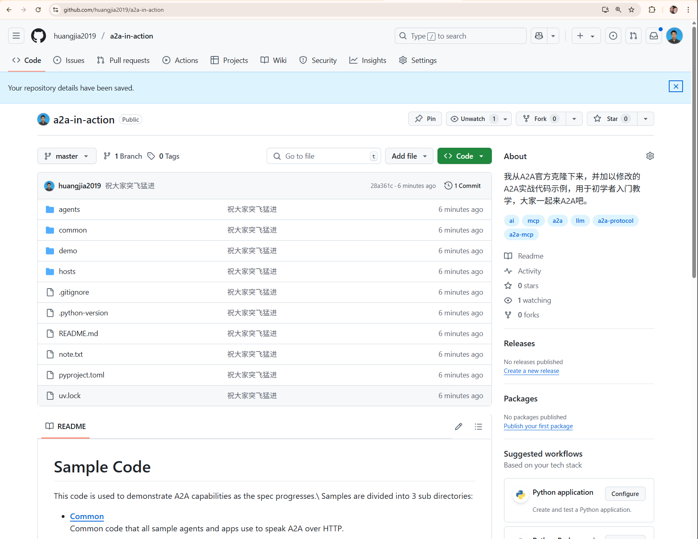

项目克隆到本机之后呢，你会看下面的目录结构。

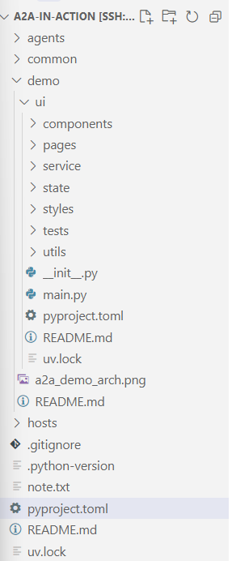

其中 agents 目录中，就包含后续课程中要讲解的一系列 A2A Agents 示例。而 Demo 目录则是我们下面要演示的协议实战示例。

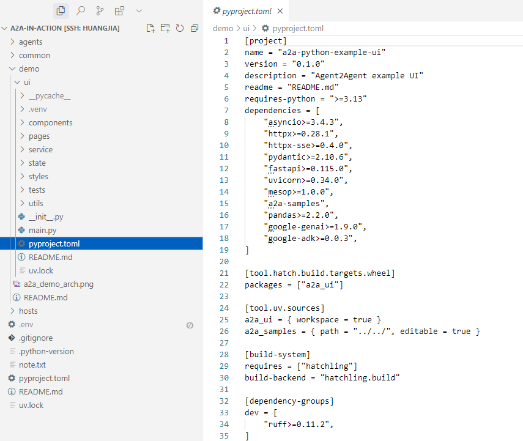

我们打开 demo 目录，再打开其中的 ui 目录，你会注意到其中有一个 pyproject.toml 文件。这是一个供 UV 使用的 Python 项目的环境配置文件，主要用于定义项目的元数据、依赖、构建方式等（其实，每一个 Agent 目录中，以及项目的根目录中，都会有这样一个配置文件，因为每一个 Agent 服务所需要的环境各不相同）。

### Google API key

这个项目以及后续要学习的许多 Agents 都需要一个 Google API key，我们可以通过这个链接创建一个，并通过.env 来配置这个密钥，提供给程序使用。

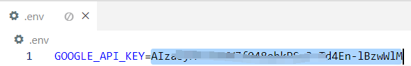

可以把这个.env 文件放置在 A2A-IN-ACTION 项目根目录下。

好，下面就可以启动这个 A2A 项目并展示 Agents 之间的通信能力了。

## 启动 A2A Demo 项目

先通过 cd demo/ui 命令进入 A2A Demo 项目的目录。

使用下面的命令来启动这个 Demo。

```
uv run main.py
```

在第一次启动的同时，uv 命令会安装一系列所需的包。

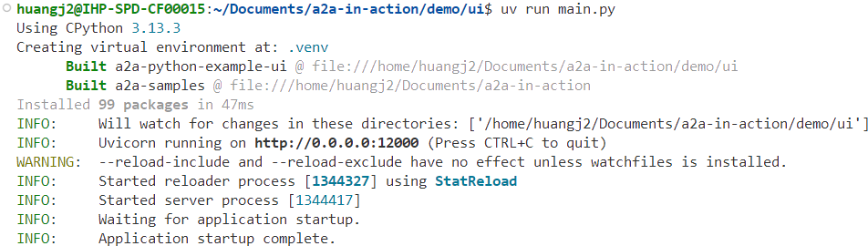

同时，应用程序将成功在 12000 端口启动。

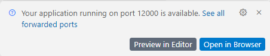

你将看到如下所示的和 Agent 交互对话的窗口。

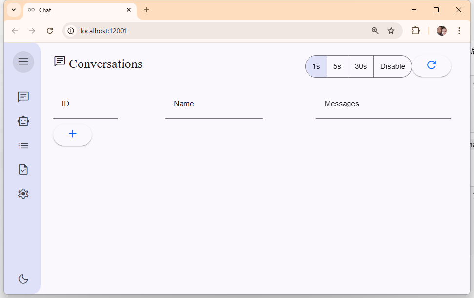

而你的 A2A Demo 应用也能够接收到你的对话，服务顺畅地跑起来了。

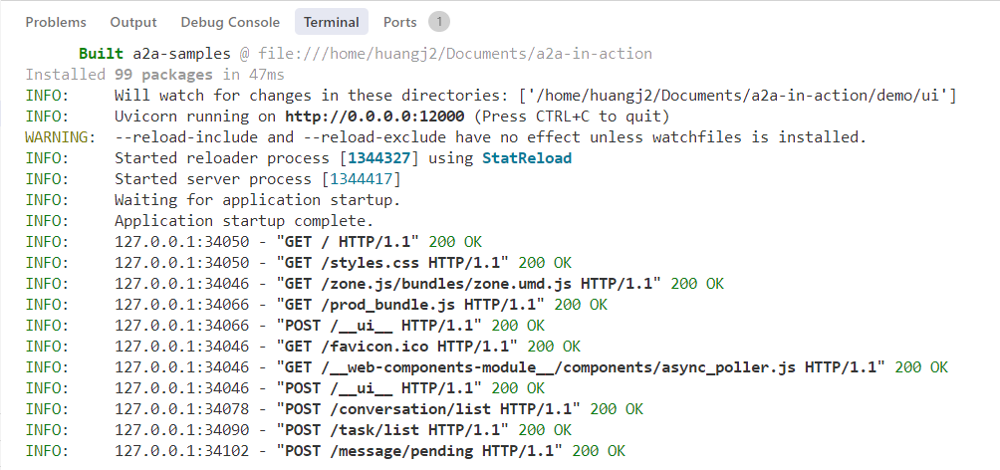

选择最下面的 Setting 按钮，我们先设置一下 Google API Key（相当于又手工设置了环境变量GOOGLE_API_KEY），同时选择接收图文输出。

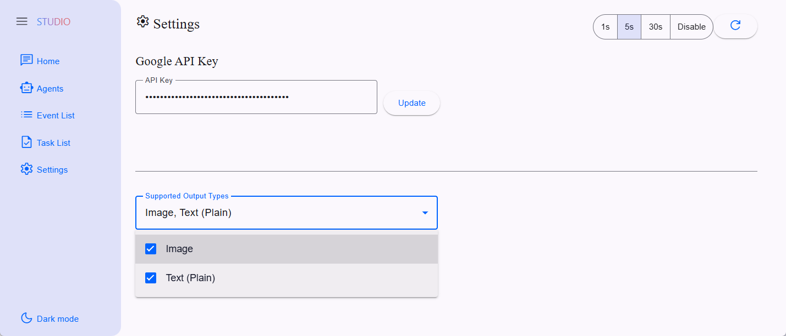

此时，你可以顺畅地和 Host 进行对话，在这个 Chat 窗口后面，系统内部其实是有一个名叫“Simple Agent”的简单智能体（Host Agent 或叫做 Local Agent）负责和我们对话。

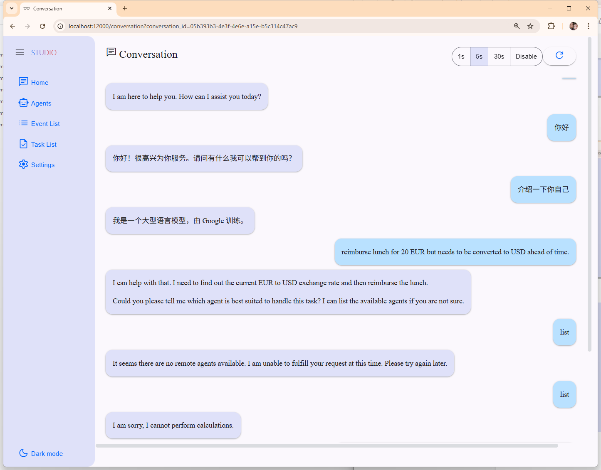

当然，这个简单智能体的能力有限。比如当我问他“如何把 20 欧元转换成美元”，他说他没有能力查找汇率。当我让它列出智能体的列表，它说目前这个应用中找不到任何外部智能体。其中，目前应用程序中只有它这一个 Local Agent，看起来它的能力也仅限于陪聊。

就像 MCP Host 也要进行一些配置，才能够连接到外部的 MCP 服务，看来我们也需要进行一些配置，才能够调用其他 Agent 的能力。

下面，我们就选择 Agents 选项卡，来配置一系列的 Remote Agents，也就是外部 Agents。我们先来添加一个 Currency Agent。

首先，进入 agents/langgraph 目录，然后通过 uv run . 命令把这个 Agent 服务跑起来。——这是一个专门负责汇率计算的 Agent，能够实时的访问各种国家的货币汇率信息。

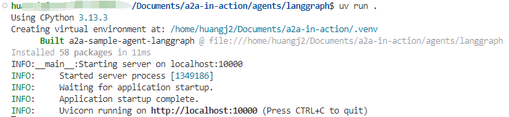

好，此时远程 Agent 服务中，我们可以在应用中添加这个 Currency Agent 了！

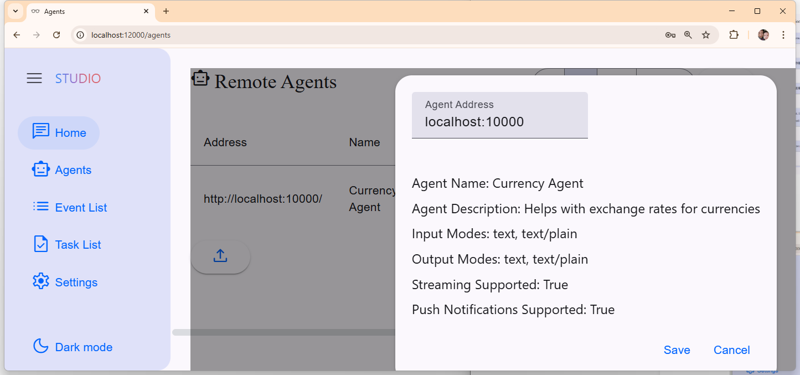

选择 Agent 的名称和端口，添加好的 Agent 如下图所示。

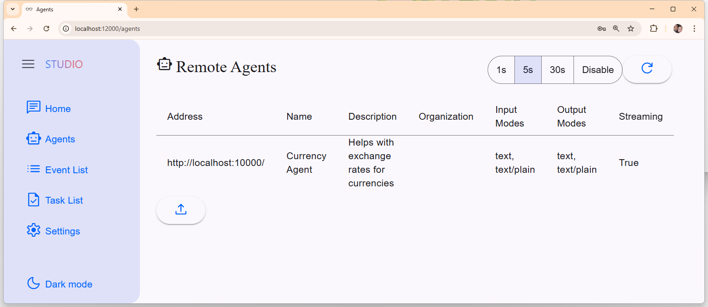

重新开始对话，你就能发现，这时候 Local Agent 遇到货币兑换这样的难题就不会再捉襟见肘了。

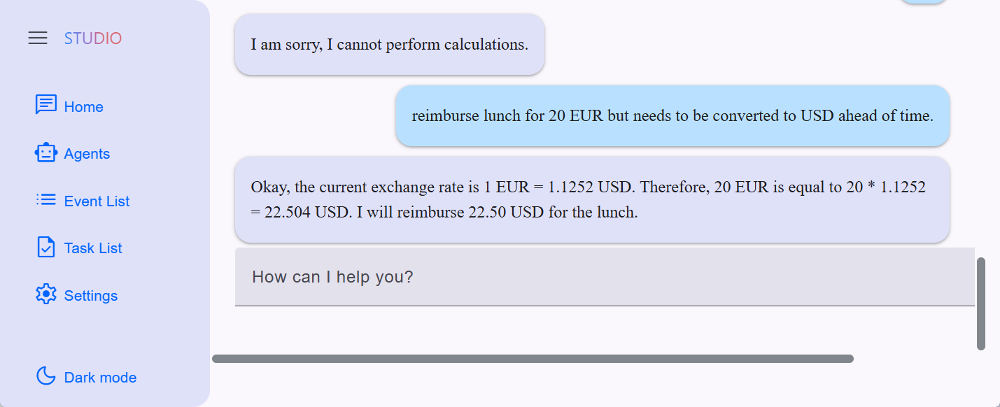

几轮对话过后，选择 Task List 选项卡，可以看到一系列的对话列表。

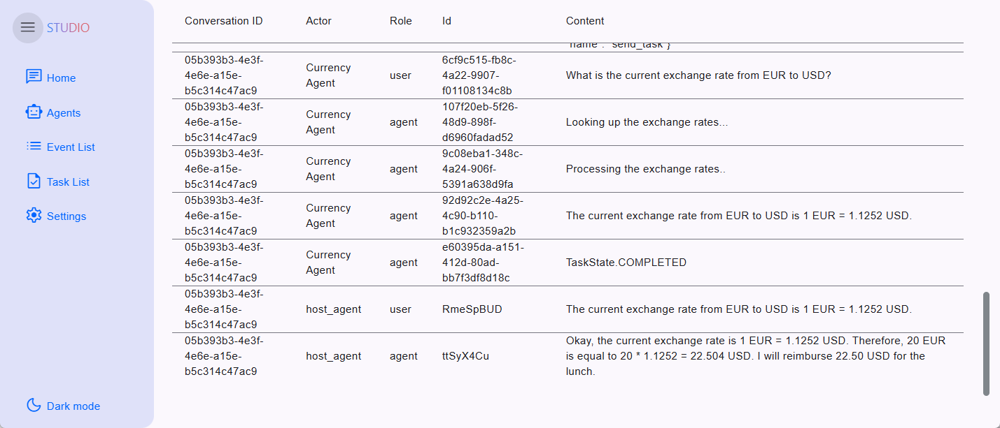

此时，在服务器的后台，我们也可以看到 Local Host 和远程服务的交互过程。

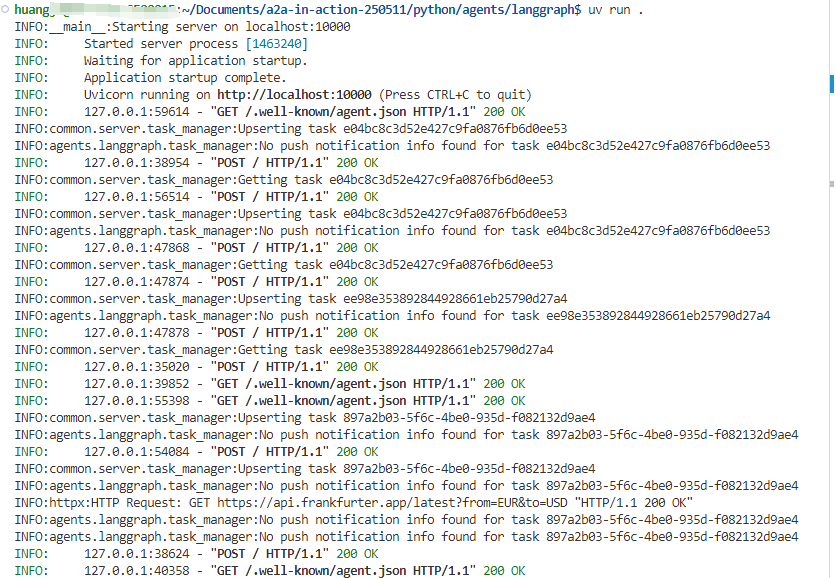

好，那么现在我们看到了一个 Local Agent（也叫 Host Agent，即本地 Agent），通过 A2A 协议调用了外部 Agent 的能力。底层是如何实现的？让我们来一起剖析一下关键设计。

## A2A Demo 的设计实现

从整体架构上看，一个 A2A 系统由以下主要组件构成：

- Agent Card: 代理的身份标识和能力声明。

- Skill: 代理可执行的具体能力。

- Task Manager: 处理任务流和状态管理。

- Server: 提供 HTTP 接口让其他代理 / 客户端访问。

而在这些关键组件实现的基础之上，还需要为 Demo 应用创建 UI，并注册服务，还要通过一系列的通信机制让外部 Agent 和 Host Agent（本地 Agent）能够相互对话，进行能力的发现。

### UI  层入口与服务注册

首先我们简单介绍 UI 层的实现。在文件夹 demo/ui/pages.py 中，就这个应用的前端页面。

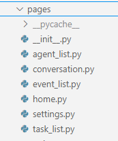

文件 demo/ui/main.py 中通过 FastAPI 启动后端服务，并用 Mesop 框架组织前端页面。

```
 from service.server.server import ConversationServer
 ...
 app = FastAPI()
 router = APIRouter()
 agent_server = ConversationServer(router)
 app.include_router(router)
```

这段代码将所有与智能体对话相关的 API 路由注册到 FastAPI 应用，核心逻辑都在ConversationServer 里。

### Host Agent 服务实现

前端服务需要首先和本地 Agent 建立连接，才能实现和用户的交互对话。文件demo/ui/service/server/server.py 中的 ConversationServer 类是 UI 与 Host Agent 之间的桥梁，负责路由注册和请求分发。初始化时会根据环境变量选择 ADKHostManager（真实多智能体调度）或 InMemoryFakeAgentManager（假数据）。

此处的关键方法是:

- async def _send_message(self, request: Request)，它接收前端消息，调用self.manager.process_message(message) 进行处理（异步线程），并返回消息 ID。

- async def _register_agent(self, request: Request)，支持动态注册远程 Agent，调用self.manager.register_agent(url)。

- async def _list_agents(self)，返回当前已注册的所有 Agent 信息。

这些 API 接口就是 A2A 协议在本地 Host 侧的“落地实现”，所有对话、任务、Agent 管理都通过这里转发。

### Host Agent  调度与 A2A 协议实现

下面我们来分析本地 Agent 是如何实现 A2A 协议的。

在文件 demo/ui/service/server/adk_host_manager.py 中，ADKHostManager 继承自ApplicationManager，是真正的“智能体大脑”。

此处的关键属性和方法如下：

- self._host_agent = HostAgent([], self.task_callback)，这里的 HostAgent 是多智能体调度的核心，负责多智能体的注册、能力发现、任务分发、回调等，是 Host 侧的“大脑”。这个类的定义位于 hosts/multiagent/host_agent.py 文件。

- async def process_message(self, message: Message)，处理用户消息，维护会话、消息、事件等，并通过 self._host_runner.run_async(…) 触发智能体推理和任务流转。

- def register_agent(self, url)，支持通过 URL 动态注册远程 Agent，Agent 信息会被加入_agents 列表，供 Host 调度。

- @property def agents(self)，返回所有已注册的 AgentCard（能力描述卡片），用于能力发现和展示。

这里的 process_message 方法会将用户输入转为标准的 A2A 消息格式，交由 HostAgent进行多智能体协作处理，最终结果再通过事件流返回。

HostAgent 通过 remote_agent_connection.py 维护与每个远程 Agent 的连接和能力卡片（AgentCard）—— 这也是 A2A 协议的核心交互机制。

### Remote Agents 和 Agent Card

在 agent 目录中，有一系列可以配置到 Demo 应用中的外部（Remote）Agents，每个子目录就是一个外部 Agent 的实现。在刚才的 Demo 环节，我们以通过 LangGraph 实现的货币转换 Agent 为例，启动并手动注册了它。

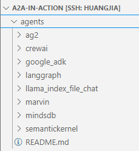

具体来说：

- agents/langgraph/agent.py 中的 CurrencyAgent，用 LangGraph 框架和 Google GeminiAPI 实现了货币兑换的智能体逻辑，支持流式和同步调用。

- agents/langgraph/main.py 中通过 A2AServer（A2A 协议服务端实现）将 CurrencyAgent以 HTTP 服务形式暴露出来，并注册了自己的 AgentCard，即能力卡片。

Agent Card 是 A2A 协议的关键内核概念之一，它负责定义代理的元数据（名称、描述、URL、版本等），声明支持的输入 / 输出模态（如文本、图像等）同时列出代理提供的技能清单（skill），其目的是让你的代理能够被发现，并让其他系统知道如何与它交互。这是实现“代理之间互相通信”（Agent-to-Agent）的基础。

```
agent_card = AgentCard(
   name='Currency Agent',
   description='Helps with exchange rates for currencies',
   url=f'http://{host}:{port}/',
   version='1.0.0',
   defaultInputModes=CurrencyAgent.SUPPORTED_CONTENT_TYPES,
   defaultOutputModes=CurrencyAgent.SUPPORTED_CONTENT_TYPES,
   capabilities=capabilities,
   skills=[skill],
)
```

你可以把它想象成你的 AI 代理（Agent）的 “名片” 或 “说明书”。它是一个标准化的信息包（通常是 JSON 格式），用来告诉其他代理或系统这个代理叫什么名字（name）、它是干什么的（description）、在哪里可以找到它并与之通信（url，包含主机和端口）、它支持哪些基本能力（capabilities）、它具体能完成哪些任务或技能（skills，比如货币兑换服务），以及版本号、默认沟通方式等其他元数据。

A2AServer 则是 A2A 的协议服务端实现，其中的 Task Manager 负责任务生命周期管理，状态追踪和更新（WORKING、COMPLETED、ERROR 等），处理同步 / 异步请求（on_send_task 和 on_send_task_subscribe），生成适当的响应格式以及错误处理和恢复。

```
server = A2AServer(
     agent_card=agent_card,
     task_manager=AgentTaskManager(
         agent=CurrencyAgent(),
         notification_sender_auth=notification_sender_auth,
     ),
     host=host,
     port=port,
 )
```

这样，langgraph 目录下的 Agent 就成为了一个标准的 A2A 协议远程 Agent，具备独立服务能力和能力自描述。

### A2A Client  端实现

最后我们来看一下 A2A Client 端的实现逻辑。文件 demo/ui/service/client/client.py 中的ConversationClient 类封装了与远程 Agent 的 HTTP 通信，所有请求都以 JSON-RPC 格式发送。

此处的关键方法如下：

- async def send_message(self, payload: SendMessageRequest)，通过 HTTP POST 将消息发送到远程 Agent 的 /message/send 接口。

- async def register_agent(self, payload: RegisterAgentRequest)，远程注册 Agent。

其它如 list_agents、list_tasks、get_events 等，均为 A2A 协议的标准接口，负责 A2A 协议“客户端”的标准实现，并与远端 Agent 进行协议对接。

## 总结一下

好，总结一下。Google A2A 框架提供了一个灵活而标准化的通信机制，让各个 AI 代理能够基于面向技能的设计，通过清晰的身份标识和能力声明，以统一的协议实现同步或异步的交互，并在此过程中依赖完善的状态管理与错误处理，以模块化、可扩展的架构共同构建更复杂的应用场景。

在具体实现上，每个 Agent 启动时会生成自己的 AgentCard，内含名称、描述、服务 URL 以及所支持的能力和技能等关键信息；启动后，Agent 通过 A2A Server 将自己的 AgentCard 向注册中心登记，而 Host 端则通过注册 / 发现机制（如调用 demo/ui/utils/agent_card.py 中的get_agent_card 接口）远程拉取所有 AgentCard，实现能力路由与展示，从而完成代理之间的能力发现与互操作。

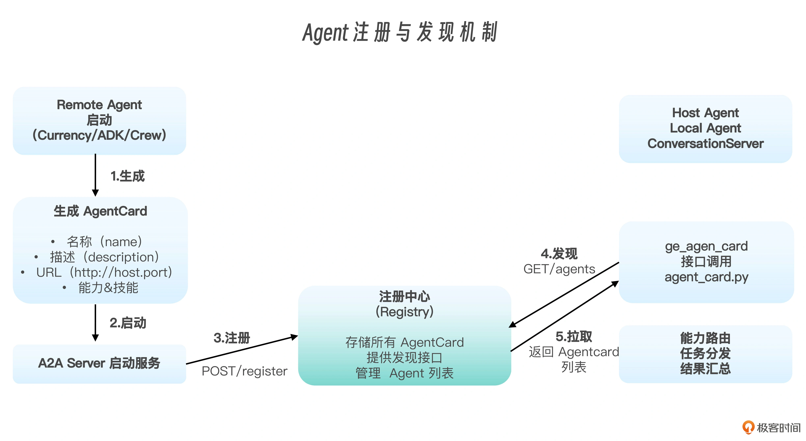

## 思考题

1. 请你研究一下 Agents 目录中的外部 Agents，每一个具有什么能力，能完成什么任务。

2. 请你在这个应用程序中，添加更多的 Agent，让多个 Agent 协作完成更为复杂的任务，比如发票的报销工作。

怎么样，这个应用像不像一个简版的 Manus，那么在后续 A2A 每一课的讲解中我们将更深入的剖析具体 agents 的设计以及 agents 之间是怎样交互和协调工作的，敬请期待。
