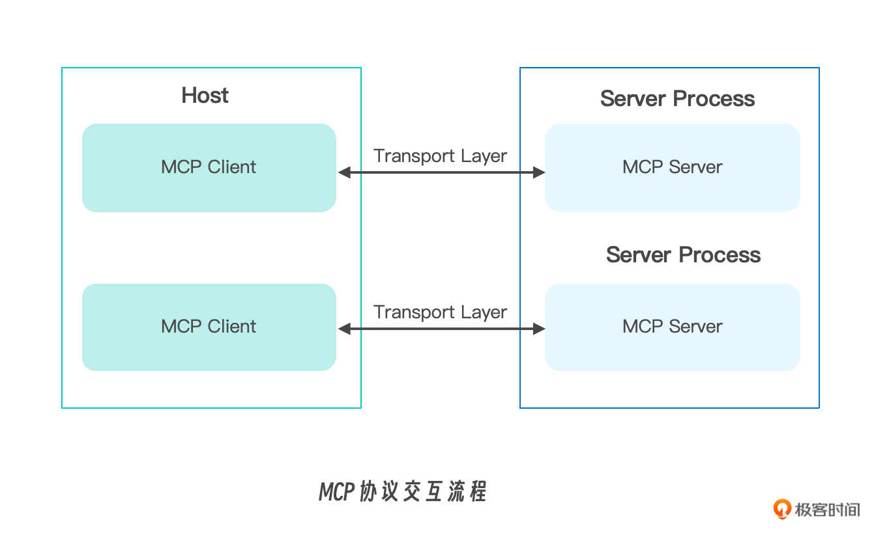
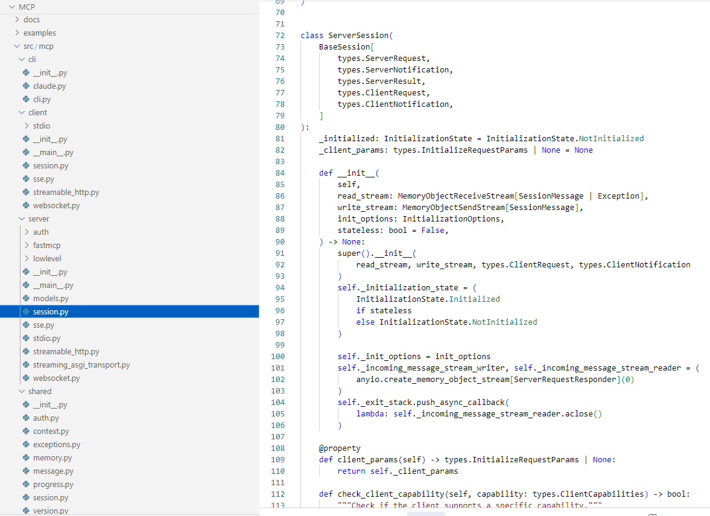
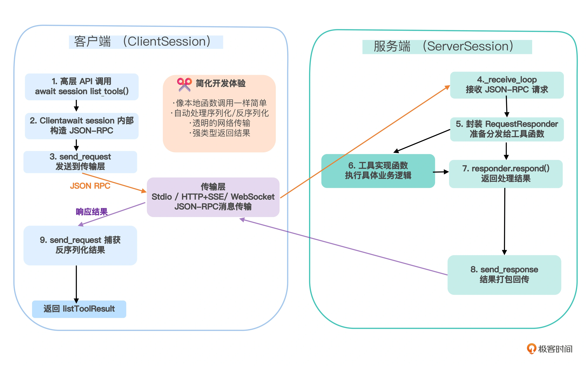

# 06 | 底层架构（上）：MCP协议层（Protocollayer）详解

你好，我是黄佳。

这节课开始，我们一起来深入剖析 MCP 的底层架构。这节课和下一课都比较偏重协议的设计，MCP 内部代码细节有点多。因此如果你的目标只是搭建 MCP 应用，可以速读，作为知识性的了解即可。

在传统的大模型应用中，模型本身只能被动地接收输入、产生输出，要让它调用外部工具或访问自定义的上下文，就需要在代码里逐条写好 API 调用、认证、错误处理的逻辑，既繁琐又难以维护。MCP（Model Context Protocol）的初衷，就是将这些“上下文管理”和“工具调用”能力抽象成一个标准化的通信协议，让大模型应用只需关注“我想用什么资源”，由专门的 MCP 服务端来真正执行调用、管理状态、返回结果。

## MCP 架构中的 Host、Client 和 Server

在 MCP 架构中，“Host” 指的是最终承载大模型和用户界面的应用，比如桌面端的 Claude 客户端、IDE 插件或自研的聊天机器人后台。一个 Host 启动时，会在内部创建一个 MCP Client实例，这个 Client 负责与外部的 MCP Server 建立一对一的连接（通常通过 stdio、HTTP+SSE 或其他支持的传输层）。

接入层面的 “Client” 正是这个 MCP 客户端，它把上层业务或大模型交互中产生的“请求”（例如“列出可用工具”“执行代码分析”）打包成符合 JSON-RPC 2.0 的消息，再通过底层传输通道发给 Server；同时，它也能接收来自 Server 的 Notification（如“工具状态更新”），并把所得数据交回给 Host，以便拼接到模型的 Prompt 中或做二次处理。

而 MCP “Server” 则是真正提供上下文内容和工具执行能力的进程或服务。它在启动时会注册一系列接口（Resource 列表、工具调用、文件系统访问、外部 API 调用等），并监听来自Client 的 JSON-RPC 消息。当收到“调用某个工具”这样的请求时，Server 会校验参数、调用相应逻辑，将结果封装成 Result 消息回传；如果出现异常，则返回带有标准错误码（如ParseError、InvalidParams、MethodNotFound）的 Error 响应。

整个交互流程可以分为三个阶段。

1. 握手初始化：Host 的 MCP Client 向 Server 发起 initialize 请求，双方交换协议版本与能力列表，并用 initialized 通知确认；

2. 正常通信：Client/Server 可双向发起 Request–Response（同步调用）或单向 Notification（异步事件），大模型应用只需按需调用 Client 的接口；

3. 优雅收尾：通信完成后，任意一端可调用 close() 或因底层通道断开而触发连接关闭。

在上面的 MCP 连接生命周期中，Client 和 Server 之间可以传递下列类型的 MCP 消息类型：

1.Request：期待收到响应。

2.Result：请求成功的响应。

3.Error：请求失败时返回。

4.Notification：单向消息，无需响应。

通过这种分层设计，MCP 将“业务逻辑”与“上下文 / 工具管理”解耦：Host 只管“我需要哪些信息 / 能力”；Server 负责“我怎样取到或实现这些能力”。最终，在 Host 内部，大模型得到的不再是死板的 API 返回值，而是经过精心组织的上下文提示，能够更灵活、更安全地调用外部工具、访问数据源，这样就扩展了大模型能力，让它可以对接更多复杂场景。



宏观地了解了 MCP 如何在 Host、Client 与 Server 之间建立起松耦合的上下文管理和工具调用架构之后。下面就请你跟随我的思路，一起来探讨协议层的核心实现——BaseSession、ClientSession 和 ServerSession 这三个基础类，看看它们如何携手将 JSON-RPC 2.0 打造成MCP 的“通信引擎”。

## 通过 BaseSession 类实现底层协议层 (Protocol layer)

协议层负责消息的封装、请求 / 响应关联，以及高级通信模式的实现。其中的核心逻辑位于BaseSession（定义在 mcp/shared/session.py）类，这里提供了所有 JSON-RPC 消息的读写、帧解析、请求–响应关联、通知分发的通用逻辑，是 MCP 协议层的通用实现，屏蔽了JSON-RPC 消息的底层读写、请求–响应关联和通知分发细节。

BaseSession 类承担了对所有 JSON-RPC 消息的统一管理与生命周期控制。它通过一系列核心属性和方法来维护读写流、请求 ID、响应管道和后台任务栈，确保异步收发、请求–响应关联以及资源清理都井然有序。

它将“发送请求、等待响应”“发出单向通知”“接收并分发对端消息”这些通用逻辑全部封装，派生类（客户端或服务端的 Session）只需关注「收到请求／通知后如何处理」或「要发送哪些高层类型化消息」。

BaseSession 类的伪代码如下（这里的伪代码只是一个简单示意，完整代码可以参考mcp/shared/session.py 或这里）。

```python
class Session(BaseSession[RequestT, NotificationT, ResultT]):
   async def send_request(
       self,
       request: RequestT,
       result_type: type[Result]
   ) -> Result:
       """发送请求并等待响应。若响应包含错误，则抛出 McpError。"""
       # 请求发送和响应处理逻辑
   async def send_notification(
       self,
       notification: NotificationT
   ) -> None:
       """发送无需响应的单向通知。"""
       # 通知发送逻辑
   async def _received_request(
       self,
       responder: RequestResponder[ReceiveRequestT, ResultT]
   ) -> None:
       """处理对方发来的请求。"""
       # 收到请求后的业务处理
   async def _received_notification(
       self,
       notification: ReceiveNotificationT
   ) -> None:
       """处理对方发来的通知。"""
       # 收到通知后的业务处理
```

让我们来详细剖析一下这个类的实现细节.

### BaseSession 类中的泛型参数

首先我们看一下类中包含一系列的泛型参数（Generic）。这些类型参数一方面让方法签名更严谨（例如 send_request(request: SendRequestT)），另一方面在收到消息时将原始 JSONRPC转成具体的 Pydantic 模型（ReceiveRequestT/ReceiveNotificationT），方便上层直接拿到结构化数据。

```
Generic[
 SendRequestT,       # 我们能发出的 Request 类型
 SendNotificationT,  # 我们能发出的 Notification 类型
 SendResultT,        # 我们发出的 Response（Result）类型
 ReceiveRequestT,    # 我们会接收的 Request 类型
 ReceiveNotificationT# 我们会接收的 Notification 类型
 ReceiveResultT # 我们会接收的 Response（Result）类型
]
```

### BaseSession 类的核心属性和上下文管理

BaseSession 类的核心属性包括后面几项。

- _read_stream / _write_stream：AnyIO 内存流，用于异步收发 SessionMessage（JSONRPC 封装 + 元数据）。

- _request_id：内部自增计数器，用来给每个发出的请求分配唯一 ID。

- _response_streams: dict[RequestId, MemoryObjectSendStream]：每发一个请求就开一个「答案流」，收到对应 ID 的响应或错误时就往流里写，send_request 在此流上等待结果。

- _in_flight: dict[RequestId, RequestResponder]：跟踪当前正在处理但尚未完成的对端请求，方便在收到取消通知时进行清理或超时管理。

- _exit_stack：AnyIO 的异步上下文管理栈，用来统一关闭流和任务。

BaseSession 类通过 __aenter__ / __aexit__ 进行上下文管理。

- aenter：创建一个 TaskGroup 并启动 _receive_loop，开始并行地监听对端发来的所有消息。

- aexit：依次关闭所有资源、取消接收循环任务，保证退出时不会挂起。

### BaseSession 类中的基本方法

BaseSession 类中有一系列协议实现方法，主要包括 send_request()、send_notification()、_send_response() 和 _receive_loop() 等，用于控制 MCP 基本交互流程。

### 发送请求：send_request()

发送请求方法完成的是如何把一个高层的 Pydantic 请求模型打包成 JSON-RPC 消息、发出去，并在底层管理好“谁发的请求”“等待谁的回应”这件事。

具体过程如下：

1. 分配请求 ID：用 _request_id 自增取新 ID。

2. 创建响应流：在 _response_streams 中为该 ID 注册一个缓冲大小为 1 的内存流。

3. 构造 JSONRPCRequest：将 Pydantic 模型 request 序列化为 JSONRPC 格式，附带 ID。

4. 写入 _write_stream：发往对端。

5. 等待响应：在对应的响应流上阻塞读取，设置超时（可自定义或继承会话级别超时）。

6. 错误处理：若拿到 JSONRPCError 就抛 McpError；若超时就抛带有 HTTP 408 码的McpError；否则把 result 部分反序列化为 ReceiveResultT 并返回。

7. 清理：无论成功或失败，都要把流和注册记录删除并关闭。

### 发送响应：_send_response()

当收到对端的请求时，如何基于成功或失败结果，及时生成正确的 JSON-RPC 响应或错误，并写回去呢？

当收到对端发来的 Request，需要给它回复时：

- 如果是正常结果 SendResultT，就构造 JSONRPCResponse（含 ID + result 字段）；

- 如果是错误 ErrorData，就构造 JSONRPCError； 然后同样写入 _write_stream。

### 发送通知：send_notification()

在 send_notification() 方法中，会将那些只需单向推送、不需要回复的事件（如日志、进度、资源变化）等静悄悄地发给对端而不阻塞。具体实现上，是在方法内部构造JSONRPCNotification（无 ID），部分传输层可携带 related_request_id（比如把进度通知关联到某次调用）；同时直接写入 _write_stream，不等待任何响应。

### 消息接收循环：_receive_loop()

_receive_loop() 方法会不断从底层流里读入任意一方发来的 JSON-RPC 消息，按类型分流到“请求处理”“通知处理”或“回应分发”的正确管道里。

该方法会持续读取 _read_stream 中的 SessionMessage， 并根据消息类型分流。

- JSONRPCRequest：用 ReceiveRequestT 模型校验后，包装成 RequestResponder 放入_in_flight，先调用 _received_request(responder) 钩子，让子类有机会同步响应；如果钩子未完成响应，再把 responder 传给 _handle_incoming（供上层或框架线程处理）。

- JSONRPCNotification：用 ReceiveNotificationT 校验后，调用_received_notification(notification) 钩子，然后 _handle_incoming。如果是取消通知，还会查找并取消对应的 in-flight 请求。

- JSONRPCResponse / JSONRPCError：根据消息中的 ID，查找 _response_streams，并将结果或错误写入那个流，让 send_request 能读到。若找不到对应流，则视为意外消息，转交 _handle_incoming 处理。

### 可重写的钩子方法

BaseSession 类中还定义了一系列的可重用钩子方法，将上面分流后的“该如何处理”留给子类去实现——比如 ClientSession、ServerSession 用于握手、工具调用分发、能力校验等。

- _received_request(self, responder)

- _received_notification(self, notification)

- _handle_incoming(self, req_or_notification_or_exception)

BaseSession 的子类（如 ServerSession、ClientSession）会重写这些方法，注入初始化握手逻辑、工具调用分发、事件转发等具体行为，而无需再触及底层 JSON-RPC 和并发细节。

通过以上这些模块化、泛型化和异步化的设计，MCP 在保证性能和灵活性的同时，也极大降低了开发者对底层 JSON-RPC 细节的认知成本。

## ClientSession，ServerSession 类的上层实现

BaseSession 将 JSON-RPC 的消息帧化、ID 跟踪、并发读写、超时与错误处理都做好了。上层只需继承并重写少数钩子，就能快速实现“MCP 客户端”或“MCP 服务端”的会话逻辑。

在前面把协议层、BaseSession 的通用骨架讲清后，我们再来看 client/session.py和server/session.py 两个文件，是如何“填充”这一骨架，把 MCP 协议真正落地成可用的客户端与服务端逻辑的。



server/session.py 文件中包含“MCP 服务端”的会话逻辑实现细节

### 客户端 (ClientSession) 如何“完成”协议设计

在 ClientSession 中，初始化阶段通过构造函数将下游的读写流、超时设置以及各类回调（包括取样、列出根目录、日志和通用消息处理）注入会话实例。调用 initialize() 时，客户端首先向服务端发送一个 initialize 请求，并在收到 InitializeResult 后，再发出一条InitializedNotification 通知，让握手完成。

```
return await self.send_request(
   types.ClientRequest(types.ListResourcesRequest(method="resources/list")),
   types.ListResourcesResult,
)
```

在消息接收方面，ClientSession 重写了 _received_request(responder) 钩子，当服务端发来诸如 sampling/createMessage、roots/list 或 ping 等请求时，钩子会从responder.request.root 中提取请求类型和参数，调用相应的回调（如 _sampling_callback 或_list_roots_callback），并将返回值（可能是正常结果或 ErrorData）传给 responder.respond()完成响应。

对于通知，_received_notification(notification) 目前只对日志消息（LoggingMessageNotification）作出处理，其他非同步钩子捕获的消息和未在钩子中处理的所有请求、通知，都会统一委托给用户在构造时提供的 message_handler，以便在上层进行监控、界面更新或其他自定义处理。

### 服务端 (ServerSession) 如何“完成”协议设计

在 ServerSession 中，协议的握手逻辑被内嵌在 _received_request 和 _received_notification两个钩子里：首次碰到来自客户端的 InitializeRequest，服务器会将请求参数保存到self._client_params，随即利用 responder.respond(…) 返回包含服务端能力集、版本号和说明文字的 InitializeResult。当接收到 InitializedNotification 时，状态机才真正进入“Initialized”阶段，任何在未完成初始化前到来的其他请求或通知都会触发 RuntimeError，以确保交互顺序的正确性。

握手完成后，check_client_capability(cap) 方法会读取客户端在初始化时声明的能力集，并根据传入的能力需求判断哪些功能可用——例如是否允许发布 roots/list_changed 等通知，从而在后续工具调用中进行权限或兼容性检查。

为了让服务端调用体验更自然，ServerSession 提供了一系列高层接口：诸如send_log_message(…)、send_resource_updated(uri)、send_tool_list_changed() 之类的方法，它们均转换成对应的 ServerNotification 并通过底层 send_notification 发送；同样地，create_message(…)、list_roots()、send_ping() 等方法封装了对 JSON-RPC 请求的构建与发送，让服务器可以像调用本地函数一样驱动模型取样、根列表查询或心跳检测。

至于上行消息的分发，ServerSession 在 _handle_incoming 中会将所有未由同步钩子处理的RequestResponder 或 Notification 推送到自身维护的内存队列中，这正是框架层面通过@server.call_tool()、@server.list_prompts() 等装饰器将队列内的请求与通知自动路由到用户业务函数的基础。

由此，ServerSession 不仅完成了底层 JSON-RPC 交互的所有复杂细节，也为上层的工具调用和事件处理提供了极简且一致的编程模型。

### 从“通用”到“可用”的核心流程

在 MCP 的典型部署中，首先由 Host 应用在启动时分别实例化 ClientSession 和ServerSession，并将二者的底层读写流对接：本地场景通常将一个进程的标准输出连向另一个进程的标准输入，而远程场景则可以通过 HTTP 与 SSE 通道互联。

接着，客户端调用 initialize()，通过底层 send_request 向服务端发出 initialize 请求；与此同时，ServerSession 在其接收钩子中捕获到该请求并立即返回包含能力集与版本信息的InitializeResult，客户端再发出一条 InitializedNotification 以完成握手，这样双方就进入了“已初始化”阶段，准备开始正常的消息交换。

在交互过程中，任何一方都只需像调用本地函数一样发起高层 API 调用。例如，客户端只要执行 await session.list_tools()，ClientSession 就会在内部构造一个 JSON-RPC 请求，将其通过send_request 发出，并在 ServerSession 的 _receive_loop 中被接收，随后被封装成一个RequestResponder 并交给注册在服务器端的工具实现函数处理；工具函数执行完成后调用responder.respond()，ServerSession 底层的 _send_response 将结果打包回传，最后在客户端的 send_request 中被捕获并反序列化成 ListToolsResult 返回给调用者。



- MCP 常规交互流程示意图

同样地，服务端也可以直接调用诸如 await server_session.create_message(…) 来触发大模型，并将结果通过响应或单向通知发回客户端，为大模型的上下文生成提供支持。

上层只要在 ServerSession 或 ClientSession 外面注册回调，就能无缝插入新的工具、扩展新的消息类型或自定义错误处理，BaseSession 的任何改动都不影响业务逻辑。

可以看到，client/session.py 和 server/session.py 这两个模块，在 BaseSession 打造的坚固底座上，完成了握手流程、能力协商、消息分发、工具调用、高层接口封装，以及上下文管理，真正将 MCP 从“一份协议文档”变成了“开箱即用、可扩展的客户端 / 服务端 SDK”。

## 总结一下

Session 类是 MCP SDK 在底层对“JSON-RPC 消息收发”的统一封装——它由框架内部创建和管理。

- 如我们之前用过的 FastMCP(“weather”) 其实在背后就会实例化一个 Session，并把它绑定到你的工具（@mcp.tool）以及资源发现接口上。

- 在编写 Server 代码时，只需关注声明工具函数、调用 mcp.run(…) 启动即可——不需要也看不到 Session 的具体实现。

- 只有当你想做非常定制化的“底层消息拦截”、“自定义请求路由”或“替换 JSON-RPC 实现”时，才需要考虑继承或修改 Session。

由于所有 JSON-RPC 的帧处理、ID 管理、并发流控、超时与错误处理均由 BaseSession 统一完成，开发者只需在 Server 或 ClientSession 外层注册相应的回调，就能轻松插入新的工具、扩展自定义的消息类型或覆写错误处理逻辑，而不会触及底层协议实现。

这样的设计既保证了 MCP 核心协议的稳定性，也为业务进展预留了无限的可扩展空间（我们是通过 Python 语言来介绍这种分层设计，你也可以去探索其他 SDK，如 TypeScript、Java等语言的 MCP 实现 ）。

如果今天讲的这些内容，你看了一头雾水，其实对于你使用 MCP 协议也完全没有关系。简单来说，Session 是框架内部件，你日常构建 MCP Server 时无需关注它的源码，只需使用高层的 @mcp.tool、list_resources()、mcp.run() 这些接口即可。但是了解这些协议的底层构造，能够让你对为什么需要 MCP 以及它是怎么构建出来的有个更清晰的认知。后续我们会通过更多示例进行实操，让你对 MCP 的使用更加胸有成竹。

## 思考题

1. 如果要在 BaseSession 之外引入一个新的消息优先级机制（比如“紧急通知”要比普通通知先被处理），你会在哪里、如何修改或扩展流程？

提示：你可以试着画出在 _receive_loop 中插入优先级判断的思路。

2. 考虑一种场景：你希望在 ClientSession 中统计所有发出的请求和收到的响应的往返时延（RTT），并在超过阈值时发出告警通知。

- 哪些地方最合适插入埋点？

- 如何利用现有的钩子或 metadata 来实现而不用大规模改动 BaseSession？

希望通过这两道题，你可以思考如何在 MCP 的协议层之上做增量扩展，又能保持与框架核心逻辑的解耦。

欢迎你在留言区记录自己的收获或者疑问。如果这节课对你有启发，别忘了分享给身边更多朋友。
