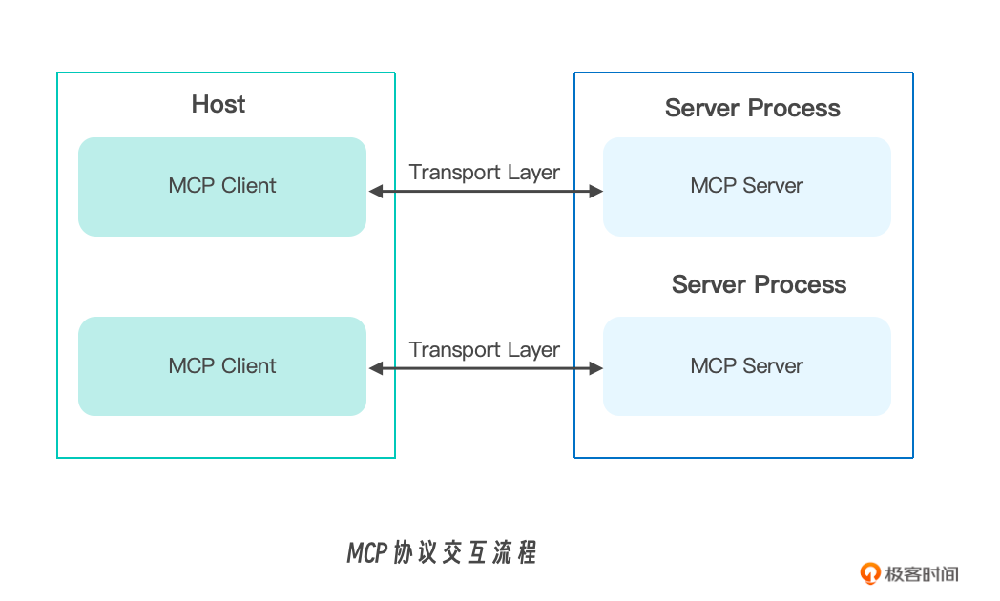
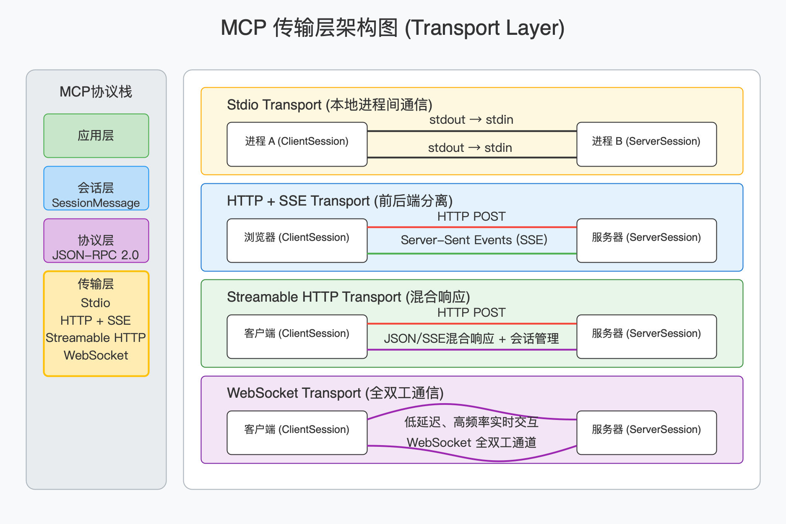
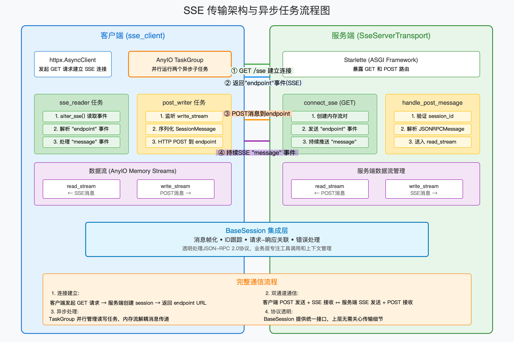
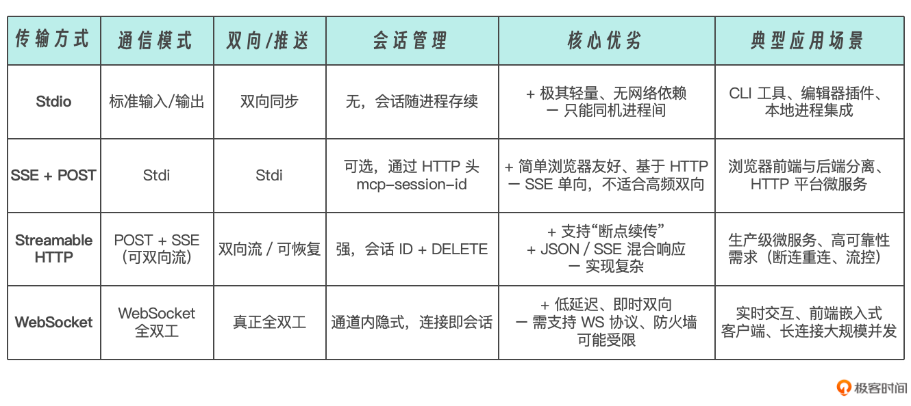

# 07 | 底层架构（下）：MCP协议传输层（Transportlayer）详解

你好，我是黄佳。

在上一课中，我们深入剖析了 MCP 的协议层，揭示了 BaseSession 如何在 JSON-RPC 之上完成 SessionMessage 的帧化、请求–响应关联、并发收发与通知分发，让客户端和服务端只需关注高层的请求处理和工具调用。

这一课，我们将目光从 **“消息如何被打包”转向“消息如何被传输”**。因为真正的通信管道，是由传输层（Transport layer）来承载这些帧化后的 SessionMessage，将它们在进程或网络之间来回搬运。



上一课中也提到，Host 应用在启动时会分别实例化 ClientSession 和 ServerSession。二者的底层读写流对接后，本地场景通常将一个进程的标准输出通过 stdio 连向另一个进程的标准输入，而远程场景则可以通过 HTTP 与 SSE 通道互联。我们下面就进一步看看不同的场景中，MCP 协议内部如何实现各种传输方式。

## MCP 的传输方式 (Transport layer)

MCP 支持多种传输方式以适配不同场景：

- Stdio Transport：这是最轻量的 stdio 通道，借助标准输入 / 输出即可完成同机进程间的双向通信，适合本地进程间的通信。

- HTTP + SSE Transport：基于 HTTP 的单向推流与单向发送组合（SSE + POST），适合浏览器前端与微服务后端的分离部署。服务器端使用 Server-Sent Events 推送消息给客户端。客户端通过 HTTP POST 发送请求。

- Streamable HTTP Transport：更完善的 Streamable HTTP 场景中，POST 请求能返回JSON 或切换到 SSE 流，在同一路径上混合使用 HTTP POST（发送请求）和 SSE（接收流式响应），支持 mcp-session-id 会话管理、断点续传以及 JSON/SSE 混合响应。

- WebSocket Transport：基于 WebSocket 全双工通道，建立后客户端和服务端都可以随时推送 JSON-RPC 消息。适合低延迟、高频率的实时双向交互，以及真正的全双工WebSocket 通道，为低延迟、高频双向交互提供最佳性能。



- MCP 协议栈和目前支持的传输方式

所有传输都遵循 JSON-RPC 2.0 格式，无论选哪一种，Host 启动时都会分别构造ClientSession 和 ServerSession，将它们的读写流对接到相应的底层通道——本地时可把一端的 stdout 连到另一端的 stdin，远程时则通过 HTTP 或 WS 长连接互联。

接下来，我们将一拆解这些传输实现，看看它们分别如何把 SessionMessage 从一端安全、高效地运抵另一端。

## 标准输入／输出（stdio）

在 MCP 中，最轻量的本地进程间通信方式就是通过标准输入／输出（stdio）来传递 JSON-RPC 消息：你只需要在主机（Host）和工具进程之间把 stdout 接入对方的 stdin，就能用同一套 BaseSession 协议去读写消息，而不必开启任何网络端口。

### 什么是 stdio

在操作系统和 C 语言标准库的语境里，stdio（Standard I/O，标准输入／输出）指的是一组预定义的、用于进程与外界交换数据的“流”（stream）接口。每个运行中的进程在启动时都会自动打开三条标准流：

- stdin（标准输入）：文件描述符 0，默认从键盘或上游程序的输出中读取数据。

- stdout（标准输出）：文件描述符 1，默认将程序的正常输出写到终端或下游程序的输入中。

- stderr（标准错误）：文件描述符 2，默认将错误信息写到终端，通常不与 stdout 混用，以便错误可以单独重定向或捕获。

在 C 语言中，这些流由 <stdio.h> 头文件提供高层次的封装，开发者可以使用 fgets/fputs、scanf/printf、fprintf(stderr, …) 等函数来读写它们，而不必直接操作底层的文件描述符。

从操作系统层面来看，这三条标准流其实都是文件描述符（file descriptor）。对应于打开的文件或管道，可以借助管道（pipe）将一个进程的 stdout 连接到另一个进程的 stdin，无需网络通信就能完成数据交换。例如在 Linux/Unix 下，你可以用 producer | consumer 将两个命令串联——这就把 producer 进程的 stdout 自动重定向（pipe）到 consumer 的 stdin。

在 MCP（Model Context Protocol）里，利用 stdio 的方式进行本地进程间通信，就是把“主机”（Host）的 stdout 通过管道接入“工具进程”（Tool）的 stdin，同时把工具进程的 stdout 接到主机的 stdin，再使用 JSON-RPC 的消息格式在这两条流上来回读写。

这样做的好处有三点。

1. 无需网络端口：整个通信走的是进程内部的管道，避免了网络配置和安全隔离的复杂度。

2. 轻量透明：直接复用操作系统和语言自身对 stdio 的管理，既简单，性能开销又低。

3. 兼容性好：几乎所有编程语言和操作系统都原生支持 stdio，使得跨语言、跨平台的工具集成都非常方便。

因此，stdio 在这里就是“最小代价、零配置”的进程间消息通道基础。

### 服务端的 stdio 实现

在服务端（也就是工具进程）里，stdio_server() 作为一个异步上下文管理器，重包装了系统的 sys.stdin 和 sys.stdout，确保它们都以 UTF-8 文本流的形式可读可写。

进入上下文后，两个协程分别启动：一个不断从 stdin 读取整行文本、把每行当作 JSON 去反序列化成 JSONRPCMessage，再封装为 SessionMessage 发入 read_stream；另一个从write_stream 中取出需要下发给客户端的 SessionMessage，序列化成 JSON 并逐行写到stdout。只要把这对 read_stream，write_stream 传给 Server.run(…)，服务端的 MCP 会话就能自动接收客户端的请求、发送响应和通知。

```
# 服务端：stdio_server 的核心实现
@asynccontextmanager
async def stdio_server(stdin=None, stdout=None):
   # 包装 stdin/stdout 为 UTF-8 文本异步流
   if not stdin:
       stdin = anyio.wrap_file(TextIOWrapper(sys.stdin.buffer, encoding="utf-8")
   if not stdout:
       stdout = anyio.wrap_file(TextIOWrapper(sys.stdout.buffer, encoding="utf-8
   # 创建读写内存流
   read_w, read = anyio.create_memory_object_stream(0)
   write, write_r = anyio.create_memory_object_stream(0)
   async def reader():
       async with read_w:
           async for line in stdin:
               try:
                   msg = types.JSONRPCMessage.model_validate_json(line)
               except Exception as e:
                   await read_w.send(e)
                   continue
               await read_w.send(SessionMessage(msg))
   async def writer():
       async with write_r:
           async for session_msg in write_r:
               json_str = session_msg.message.model_dump_json(by_alias=True, exc
               await stdout.write(json_str + "\n")
               await stdout.flush()
   async with anyio.create_task_group() as tg:
       tg.start_soon(reader)
       tg.start_soon(writer)
       yield read, write
```

### 客户端的 stdio 实现

在客户端，stdio_client() 则把被管理的工具进程作为子进程打开。它首先根据平台（Windows或类 Unix）拼装好可执行命令和环境变量，然后用 AnyIO 的 open_process（或特定的Win32 接口）启动该进程，将其 stderr 重定向以便排错。启动后同样创建了一对内存流：read_stream 从子进程的 stdout 里读行、反序列化；write_stream 往子进程的 stdin 写行、序列化。stdio 客户端在退出上下文时会优雅地终止子进程，避免留下孤儿进程。

```
# 客户端：stdio_client 的核心实现
@asynccontextmanager
async def stdio_client(server_params, errlog=sys.stderr):
   # 启动子进程并获取 stdin/stdout 句柄
   process = await anyio.open_process(
       [server_params.command, *server_params.args],
       env=server_params.env or {},
       stderr=errlog
   )
   # 创建读写内存流
   read_w, read = anyio.create_memory_object_stream(0)
   write, write_r = anyio.create_memory_object_stream(0)
   async def stdout_reader():
       async with read_w:
           buffer = ""
           async for chunk in TextReceiveStream(process.stdout, encoding=server_
               lines = (buffer + chunk).split("\n")
               buffer = lines.pop()
               for line in lines:
                   try:
                       msg = types.JSONRPCMessage.model_validate_json(line)
                       await read_w.send(SessionMessage(msg))
                   except Exception as e:
                       await read_w.send(e)
   async def stdin_writer():
       async with write_r:
           async for session_msg in write_r:
               json_str = session_msg.message.model_dump_json(by_alias=True, exc
               await process.stdin.send((json_str + "\n").encode(server_params.e
   async with anyio.create_task_group() as tg:
       tg.start_soon(stdout_reader)
       tg.start_soon(stdin_writer)
       try:
           yield read, write
       finally:
           process.terminate()
```

这种“读 stdin／写 stdout”的方式，对于同机启动、调试或在容器里一键运行本地插件尤其方便，不需要额外的网络配置，也无需担心防火墙或证书问题。只要 Host 和 Server 都对接了这组流，所有 JSON-RPC 2.0 的请求、响应和通知就能如丝般流畅地在两端往返。

## SSE 传输

下面我们来了解 SSE 传输，这个方式也相当常见。

### 什么是 Server‐Sent Events (SSE)

Server-Sent Events（简称 SSE）是一种通过 HTTP 建立单向持久连接，让服务器可以不断地“推送”文本事件到浏览器或客户端的技术。与 WebSocket 的双向通信不同，SSE 只需客户端发起一次 GET 请求，随后服务器即可不断地以 text/event-stream 格式发送数据——保持 TCP连接打开，事件到来便立即下发，无需客户端反复轮询。浏览器端原生支持 SSE，通过EventSource 接口就能方便地接收服务器推送。

### SSE 客户端的实现（sse_client）

在 MCP 的 sse_client 中，我们用 httpx.AsyncClient 搭配 httpx_sse.aconnect_sse 发起一个带有较长读超时（read=sse_read_timeout）的 GET 请求。一旦连接成功，就启动两个异步子任务：

1. sse_reader 它通过 event_source.aiter_sse() 逐个读取服务器发过来的 SSE 事件。遇到第一条 “endpoint” 事件时，解析出可用于 POST 客户消息的实际 URL，并通过task_status.started(endpoint_url) 通知调度器；之后每收到一条 “message” 事件，就把事件体反序列化成 JSONRPCMessage 模型，封装为 SessionMessage 放入 read_stream，供上层 BaseSession 解析和分发。

2. post_writer 等待上层通过 write_stream 写入要发送给服务端的 SessionMessage。每当拿到一条消息，就把它序列化为 JSON，通过 HTTP POST 发往前面读到的 endpoint_url。如此，客户端就实现了“SSE 读”＋“POST 写”的双通道通信。

整个 sse_client 以 @asynccontextmanager 形式提供，内部用 AnyIO TaskGroup 并行运行上述两部分，并在上下文退出时进行清理（关闭流、取消任务）。

### SSE 服务端的实现（SseServerTransport）

在 MCP 的服务端，我们用 Starlette（或任何 ASGI 框架）来暴露两个路由：一个用于 SSE连接（GET），一个用于接收客户端 POST（写消息）。我们挨个看一下。

1.connect_sse（GET → 建立 SSE） 当客户端发起 GET /sse?session_id=…，我们为它创建一对 AnyIO 内存流 read_stream、write_stream，并生成一个新的 session_id。用EventSourceResponse 把 write_stream_reader 的内容以 SSE 事件源的形式推送给客户端：首先发送一个 “endpoint“ 事件，告诉客户端接下来要往哪个 URL POST 消息，然后不断把write_stream_reader 里的 SessionMessage 序列化成 “message”事件下发。

2.handle_post_message（POST → 接收客户端消息） 客户端在拿到 “endpoint” 事件后的POST 请求中，把自己的 SessionMessage（即 JSONRPC 请求或通知）发到 /messages/?session_id=…。这里我们从查询参数里取出 session_id，校验后将请求体解析为JSONRPCMessage，再封装到 SessionMessage，通过对应的 read_stream_writer 送入read_stream。这样，ServerSession 的底层接收循环就能看到新的消息，交给协议层进一步处理。

SSE 传输架构和异步通信流程如下图所示。



- SSE 传输架构和异步通信流程图

通过这套读 SSE + 写 POST、另一端写 SSE + 读 POST 的组合，MCP 在 HTTP 之上实现了双通道、异步、安全的 JSON-RPC 2.0 消息交换。客户端和服务端都只要对接好各自的read_stream/write_stream，就能透明地利用 BaseSession 提供的消息帧化、ID 跟踪、请求–响应关联等能力，把业务逻辑专注在“工具调用”“上下文管理”上，而无需自己盯着底层网络细节。

## StreamableHTTP

StreamableHTTP 比前面讲到的纯粹用标准输入 / 输出的 stdio 和简单的 SSE 客户端 / 服务端模块更“全面”——它在一个模块里集成了客户端–服务器双向通信 POST 和 GET（SSE）。

- 客户端每次要发送 JSON-RPC 请求或通知时，通过 HTTP POST 将消息发到服务器。

- 服务器要向客户端推送消息（包括响应、通知、甚至新的请求），就用 Server-Sent Events在同一个 URL 上保持长连接，不断下发事件。

每次初始化时，服务器会在响应头里返回一个 mcp-session-id，客户端保存这个 ID 并在后续所有请求中携带，服务器据此区分多个并发会话。 MCP 支持显式的 DELETE 调用让客户端终止会话，服务器清理对应资源后拒绝所有后续请求。

在 SSE 连接断开后，会通过一个可插拔的 EventStore 接口给每条下发的消息打上唯一 ID，并在客户端重连时重新读取。这样，客户端可以带上上次收到的 Last-Event-ID（也就是上次读到的事件 ID），让服务器重放自那条消息之后的所有事件，以此保证在网络抖动时也不会漏消息，实现可恢复流（resumable stream）。

在 StreamableHTTP 中，对于短平快的请求（如初始化、简单的查询），服务器可以直接以application/json 返回一个普通响应。对于那些可能要持续推流的操作（比如大模型取样、长跑任务进度），服务器可以直接在同一个 HTTP POST 的响应里切换到 text/event-stream，持续下发多条消息，直到最终的 JSON-RPC Response 或 Error 为止。

## WebSocket 传输

WebSocket 传输则正好补足了 HTTP + SSE 的单向推送限制，为 MCP 提供了一个真正的双向、全双工的网络通道。与以 POST/GET 分别负责写和读不同，WebSocket 在握手完成后，客户端与服务器之间会建立一条始终打开的 TCP 连接，双方都可以随时向对方发送文本帧——在 MCP 的场景下，这些文本帧承载的就是序列化后的 JSON-RPC 消息。

### WebSocket 的服务端实现

在服务端实现中，websocket_server 接受传入的 ASGI scope/receive/send，首先用WebSocket(scope, receive, send) 将其封装成一个 WebSocket 对象，并调用accept(subprotocol=“mcp”) 完成子协议协商。接下来，它创建了一对 AnyIO 内存流：一个用来写入从客户端读来的消息，另一个让上层 MCP 会话往客户端写消息。然后分别启动两个异步任务：

- ws_reader：持续从 WebSocket iter_text() 中读取每个文本帧，尝试把它反序列化成JSONRPCMessage，再包装成 SessionMessage 写入 read_stream_writer。若任何一条数据解析失败，则把 ValidationError 异常发给上层，以便错误路径也能走到协议层的异常处理逻辑。

- ws_writer：不停从 write_stream_reader 中读取要发出的 SessionMessage，将其序列化成JSON 字符串后通过 websocket.send_text() 发送给客户端。此过程同样会在底层自动分帧并通过 TCP 推送。

MCP 在一个 async with anyio.create_task_group() 中并行运行这两条协程，最后把(read_stream, write_stream) 暴露给 MCP 的核心逻辑。只要这对流在，BaseSession 就能在它们上面做 JSON-RPC 的帧化、ID 跟踪、并发收发等处理，而服务端只需关注如何通过SessionMessage 调用工具、下发通知或执行初始化握手。

### WebSocket 的客户端实现

客户端的 websocket_client 则是镜像对称的实现：它用 websockets.asyncio.client.connect()连接到给定的 URL，并在 subprotocols=[“mcp”] 中表明自己愿意使用同一个 MCP 子协议。

连接建立后，同样会创建读写内存流，并启动 ws_reader 与 ws_writer 两个协程。其中ws_reader 用 async for raw_text in ws 收帧、反序列化并写入 read_stream_writer，ws_writer 则从 write_stream_reader 中取出 SessionMessage 后转为 JSON 串调用ws.send()。最终把这对流提供给上层，MCP 的 ClientSession 就可以像操作本地方法一样发起初始化、工具调用和通知了。

在有网络要求但同时需要低延迟、双向交互的场景中，WebSocket 的表现尤佳：比如网页端直接嵌入 LLM 客户端，或者在微服务集群里通过持久连接让大模型服务和插件间高效协同。只要选用 websocket_server／websocket_client 这套读写对，就能把 WebSocket 链路无缝接入 BaseSession，从而复用所有封装良好的 JSON-RPC、超时、并发与错误处理逻辑。

### MCP 传输过程中的错误处理

在 MCP 的运行过程中，任何一步出错都必须被及时上报并交给上层逻辑处理。具体来说，“错误传播”主要有三条路径。

第一，通过对每个 RPC 调用返回“错误响应（Error Response）”来上报。 当主机（Host）向工具进程（Tool）发出一个 JSON-RPC 请求，如果在执行过程中出现了处理错误，比如传入参数不合法、内部业务异常或超时，工具进程不会再发正常的结果消息，而是返回一条包含error 字段的响应报文。这个 error 字段里包含标准的 code、message 以及可选的 data，调用方收到之后就能在对应的请求回调里捕获到具体的失败原因并采取补救措施。

第二，在底层“传输通道”上触发“错误事件（Error Event）”。 虽然 stdio、TCP、WebSocket 等通道平时负责承载 JSON-RPC 消息，但一旦出现连通性故障（如管道被意外关闭、套接字写入失败、网络抖动导致连接中断等），底层 I/O 库会抛出或发出一个错误事件。MCP 框架会把这些事件监听到，并将它们转发给上层 Session 的错误处理回调，让开发者知道“连不上了”或“读写失败”，区别于单个请求的业务错误。

第三，在协议栈层面提供“全局错误处理器（Protocol-Level Error Handler）”。 不同于针对某次调用的错误响应，这一层的处理器常常用于捕获难以归属到具体请求或传输的问题，比如：收到无法识别或格式非法的 JSON 消息、RPC 版本不匹配、消息序列化／反序列化失败等。这些异常一经发现，MCP 会调用注册好的协议级回调（例如 BaseSession 的 on_error 或类似钩子），让使用者有机会记录日志、摧毁会话、清理资源，甚至尝试重连或降级降载。

通过这三条“链路”，也就是请求级错误响应、传输级错误事件，以及协议级全局错误处理，MCP 就能做到不漏报任何环节的失败，并且让上层业务代码根据不同的错误类型选择最合适的恢复或告警策略。

MCP 定义标准错误码如下：

```
enum ErrorCode {
 ParseError      = -32700,
 InvalidRequest  = -32600,
 MethodNotFound  = -32601,
 InvalidParams   = -32602,
 InternalError   = -32603
}
// 用户可自定义 > -32000 的错误码
```

## 总结一下

这四种传输机制是互为并列的、可选的通道实现——都承载 MCP 的 JSON-RPC 消息，但各自针对不同部署场景和需求做了取舍。

下面的这个列表从架构维度和适用场景两个角度，帮你做个横向对比。



这四个传输方式是可插拔的“下层通道”。无论你选择哪种，最终都把数据交给同一个BaseSession 来做帧化、ID 管理、并发控制、超时和错误处理。 不同传输只要对接好一对read_stream/write_stream，Host 和 Server 两端就能无缝互换，你可以在同一个系统里并行支持多种通道，按需路由来自不同前端或插件的连接。

好，协议的整个设计内核终于讲完了，这两课文字内容和技术细节都比较多，难免有些烧脑。还是那句话，如果对今天的内容没能完全理解的话也别担心，能掌握大致思路即可。后续我们还会安排更多实操案例，让你对 MCP 协议的架构产生更深的体感。

## 思考题

1. 上述 4 种 MCP 的传输实现方式，具体业务场景中应该如何选型？

思路：

- 本地 / 调试：如果只是同机启动或者做调试，用 stdio 最简单；

- 浏览器或 HTTP 服务：前端无法直接用 stdin/stdout，可用 SSE+POST，它在所有浏览器里原生支持；

- 可靠生产：若要在 HTTP/1.1 上做断连重连、流复用、可恢复推流，就选 StreamableHTTP；

- 高性能双向：需要真正双向、低延迟、长连接，且网络允许 WS 的场景，则用WebSocket。

2. 如果部署在不稳定的网络环境下，希望在 WebSocket 链路失败后自动切换到 HTTP +SSE，再切回 WebSocket，你会如何在 Host/ClientSession 层设计这一机制？哪些事件或回调最合适触发重连或降级？

3. 假设要为 MCP 增加一个全新的传输方式（例如 gRPC 双向流），它需要实现哪些核心能力？请列出应实现的接口或函数，以及如何与现有的 BaseSession 集成。

欢迎你在留言区记录自己的收获或者疑问。如果这节课对你有启发，别忘了分享给身边更多朋友。
